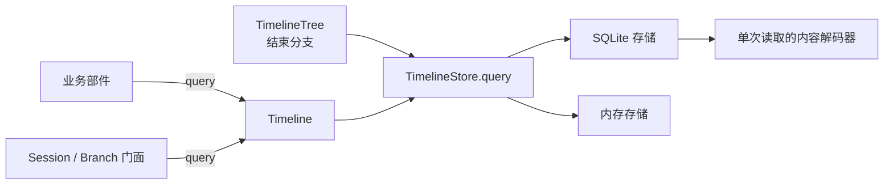

# 022: Timeline 属性查询与正文重建

Decision status: Proposed.

## Context

[ADR 019](019-event-query.md) 的查询返回完整事件，[ADR 020](020-timeline-read-convergence.md) 把进一步筛选和计算留给调用方。业务只需要几个字段，也必须先读取事件；只需要当前状态，也容易变成遍历并收集历史。分页没有消除这些工作。

读取接口应直接提供业务需要的字段和计算结果。完整事件、历史请求正文不再是所有读取的中间产物。

## Decision

### D1. Timeline 查询事件属性，返回所需结果

属性就是现有事件的字段，包括事件类型、标识、位置和内容。属性查询不新增一份业务数据。

调用方指定查询条件、参与计算的字段和返回字段。Timeline 支持组合条件、关联、计数、排序和分组取值。例如：

| 业务需要 | 查询返回 |
| --- | --- |
| 某次提交是否已处理 | 按提交标识查询，返回是否存在。 |
| 最后一次配置是什么 | 按事件顺序取最后一条配置，返回配置字段。 |
| 哪些操作尚未结束 | 按操作标识关联开始和终态事件，返回没有终态的操作标识及恢复所需字段。 |

正文也是属性。只有筛选、计算或返回内容涉及正文时才读取正文；查询其他字段不构造完整 `AgentEvent`，不展开历史请求的消息链。

对于正文搜索，调用方可以查询可能命中的事件位置，再读取并验证业务正文。文本候选允许多返回，不能漏掉契约范围内的命中；它不是业务搜索结果。存储选择索引，业务负责正文解释。

属性查询返回字段值或计算结果。调用方明确请求完整事件时，才返回完整事件；不能用缺少正文的 `AgentEvent` 充当属性结果。

### D2. 目标 API 与模块结构

#### 读取 API

事件读取保留一个 `query`，字段查询、属性计算和正文读取使用同一入口。以下为目标接口，参数和结果均为语言中立的数据：

```text
Timeline.query(request) -> reply
Branch.query(request) -> reply
Session.query(branch_id, request) -> reply
TreeCommands.query(branch_id, request) -> reply
```

业务部件使用分支的 Timeline 服务；普通调用方使用 Branch、Session 门面；结束分支的本分支查询由 TreeCommands 转给 TimelineTree。门面只转发并限制可见范围，不增加查询逻辑。入口归属沿用 [ADR 021](021-reads-follow-the-state-owner.md)。

请求的组成如下。运算表达式的具体字段语法由公开查询契约定义。

| 参数 | 内容 |
| --- | --- |
| `scope` | 本分支或包含祖先的分支链。 |
| `from` | 可选的起始位置，包含该位置；限制整个查询范围，不充当分页游标。 |
| `through` | 目标分支的截止位置；祖先仍受各自分叉点限制。首次查询可以省略，由读取入口确定；后续查询传回该位置。 |
| `include_publishing` | 是否包含本分支已完成原子写入、尚未发布的事实。供内部恢复、准备重试等读取使用，普通门面不开放。 |
| `query.filter` | 字段条件及其组合，包括按关联键判断另一类事件是否存在。 |
| `query.select` | 明确选择返回字段、计算值或完整事件；不默认返回完整事件。 |
| `query.group_by` | 分组字段；不分组时省略。 |
| `query.pick` | 按事件顺序取第一条或最后一条；有分组时逐组取值。 |
| `query.order_by` | 结果顺序，包括事件顺序。 |
| `page` | 返回数量和上一页的续读位置。多条结果必须分页，单个计算值不分页。 |

返回结果包含三个部分：

| 部分 | 内容 |
| --- | --- |
| `through` | 实际采用的截止位置，空结果也返回。 |
| `result` | 字段行、单个计算值或完整事件，类型由请求决定。正文作为所选字段返回，不另设正文读取 API。 |
| `next` | 有剩余结果时返回续读位置，否则为空。它是数据，不是 Reader 句柄。 |

一次恢复中的查询使用同一个截止位置，包含该位置的事件。请求构造固定内容上界；准备重试读取随后产生的控制事实时另设固定范围，不扩大内容上界。下一页从上一页末尾继续，不靠累计跳过数量重读前缀。筛选、关联和计算针对整个查询范围，分页只截取最终结果。

#### 存储接口与调用路径

存储查询接收完整读取范围，不再只接收单个分支的一页：

```text
TimelineStore.query(read_scope, query, page) -> query_result
```

`read_scope` 由 Timeline 或 TimelineTree 构造，包含 Session、有序分支段及各段上下界，以及本次查询允许读取的内存尾部。存储段和内存尾部不得重叠；尾部只在本次调用内引用，不为查询复制一份历史。`query` 和 `page` 直接使用公开请求中的同一份类型化数据，不另建一套存储表达式。`query_result` 返回结果和续读位置，由读取入口附上截止位置。

存储对这些输入一起筛选、关联和计算。例如，开始事件在祖先分支、终态事件在当前分支时，两者仍须关联。不能先在每个分支分别查“未结束操作”，再拼接结果。

目标读取路径：



模块按以下边界改造，不增加独立查询服务：

| 模块 | 目标职责 |
| --- | --- |
| [timeline_query](../../crates/dim-agent-runtime/src/timeline_query.rs) | 定义查询和结果数据，供入口、存储和语言绑定共用；不保存跨调用状态，不执行业务恢复。 |
| [Timeline](../../crates/dim-agent-runtime/src/core/timeline.rs) / [TimelineTree](../../crates/dim-agent-capabilities/src/timeline_tree.rs) | 确定读取范围和截止位置，调用存储查询，返回结果。 |
| [TimelineStore](../../crates/dim-agent-runtime/src/timeline_store.rs) | 声明整个读取范围上的查询接口，不向业务部件开放。 |
| [SQLite 存储](../../crates/dim-app-server/src/storage/timeline.rs) / [内存存储](../../crates/dim-agent-runtime/src/memory_timeline_store.rs) | 执行相同的查询约定；SQLite 使用 SQL 和索引，物理行合并不改变事件查询结果。 |
| [内容解码](../../crates/dim-app-server/src/storage/codec.rs) | 只在查询涉及正文时解析内容引用，不提供 Reader 服务。 |
| 业务部件，包括 [ContextPreparation](../../crates/dim-agent-capabilities/src/context_preparation.rs) | 定义查询、消费结果；分别恢复自身状态或组装本次请求。 |

开始和终态的事件类型、关联键由业务给出。Timeline 和存储执行通用查询，不内置“待审批”“待执行”等业务状态。业务不提交 SQL，也不直接访问存储。

### D3. 读取层不持有跨调用的历史副本

读取结果交给业务对象后，怎样分发、处理和保留由业务决定。读取层不增加承担这些职责的 Reader 服务，也不缓存已解码的事件、消息前缀或请求正文。

存储内部可以保留单次读取使用的解码器，例如沿父指针读取消息链。它的工作数据随这次读取结束、失败或取消而释放，不跨调用保留。数据库自己的页缓存不受此限制。

业务对象保留运行状态和正在消费的数据，消费结束就解除持有。Dispatcher 继续负责实时事件派发。

### D4. 业务对象恢复自己的状态

装载或重载时，每个业务对象通过属性查询和计算恢复自己的状态。例如，先查出尚未结束的操作；需要结算其中某个操作时，再读取它的参数。已经结束的操作不因恢复而重建请求正文。

删除 `rebuild_facts` 收集完整历史事件的方式。确实需要逐条推进状态时，由业务对象分批读取所需字段，边读边更新状态，不累积一份历史事件列表。

状态恢复不等于请求正文重建：即使接下来不调用模型，业务状态也必须恢复。恢复与实时派发的交接沿用 [ADR 020 D3](020-timeline-read-convergence.md#d3-replay-is-removed)；未完成 I/O 按所属部件的规则结算，不重放历史外部副作用。

### D5. 请求正文由本次调用持有

准备模型调用时，上下文部件先查询采用关系、压缩结果和事件顺序，确定本次请求包含哪些内容，再读取这些内容并组装请求。不通过重建历次模型请求来取得本次上下文。

读取过程中的事件和中间数据在消费后释放。本次请求保留到发送、重试及其余消费者结束，随后解除持有。后续调用再次需要内容时重新读取，不保留完整历史或请求正文供下次复用。

历史查看和导出也可以读取正文，由对应操作消费和释放。请求内容仍须满足[上下文拼装需求](../design/context-assembly-requirements.md#2-业务需求)，读取方法不能改变采用、压缩和消息顺序。

## Consequences

- 公开接口及语言绑定按 D2 改造，由[插件契约](../design/plugin-contract.md)的所有者更新。移除单分支查页后拼接结果的存储查询约定，支持整个读取范围上的计算。
- [上下文拼装需求](../design/context-assembly-requirements.md)中“每步仍然读取全量事件”的约束被替代。恢复和请求构造分别查询各自所需的数据。
- 不增加通用状态投影层。存储索引由存储所有者决定，持久化辅助结构另作格式和一致性决策。
- 返回更少字段不保证扫描更少事件。验证分别检查扫描量、正文解码量和持有的数据量，并确认恢复状态与请求内容不变。

## Non-goals

本 ADR 确定 API 组成、模块职责和调用路径，不规定每种运算表达式的序列化细节、数据库表或索引；不改变事件格式、写入与派发规则、业务状态归属或恢复快照契约。

具体接口、SQL 与内容引用处理、消费端修改、实施顺序和验收见 [Timeline 属性查询与消费端改造](../design/timeline-property-query.md)。

## Supersession

- 替代 [ADR 019](019-event-query.md) 中只返回完整事件、位置只作起点、按跳过数量分页和逐页取新截止点的限制；允许属性投影和聚合。
- 替代 [ADR 020](020-timeline-read-convergence.md) 中只下推一个等值条件、其余由调用方筛选的限制；恢复交接不变。
- 保留 [ADR 021](021-reads-follow-the-state-owner.md) 的读取入口和存储访问权限。

## Rule check

| 规则 | 本决策 |
| --- | --- |
| [设计规则](../architecture/rust-agent/principles.md) §1；[ADR 002](002-plugin-scope.md) D1–D5 | 不增加部件或接线模块；状态仍归业务所有者；查询接口语言中立。 |
| §4 规则 1、2、3、5、6、9 | 不改变指令、交接、`before`、原子写入、上下文入口或事实种类。 |
| §4 规则 4、7 | Timeline 提供通用查询；业务经公开接口读取并处理自己的状态。 |
| §4 规则 8 | 机制变更要求见下节。 |

## Requirements raised to mechanism owners

现有事件查询的限制见 Context。分页不能替代字段选择和计算；增加 Reader 缓存也没有改变查询仍返回完整事件的问题。运行时负责 D2 的公共接口和存储端口，存储实现负责跨分支段及内存尾部的查询，消费者按 D3–D5 调整数据持有方式。序号和原子写入不变，取消释放本次读取数据，重载保留现有交接规则。相关读取审计与性能工作见 [#1147](https://github.com/arcships/dim/issues/1147)。
