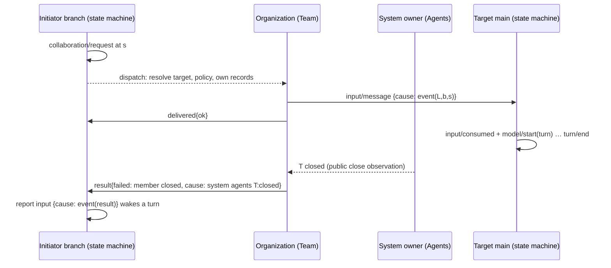

# Collaboration timeline: a causal network of state machines

Status: Proposed; not implemented. Scope: how agents, the system around them and
the outside world affect each other, recorded as a causal timeline and tree that
is independent of how the agents are organized. The Collaboration plugin
([collaboration.rs](../../crates/dim-app-server/src/collaboration.rs)) is the first
organization built on it. This document also takes the place of
`docs/design/appserver/collaboration.md`, which the module header cites but which
does not exist.

## 0. Model

**Every agent Session is a state machine.** Its state is the fold of its branch
buses ([time bus](../architecture/rust-agent/time-bus.md)); the only way anything
else affects it is by a fact entering one of those buses (an input, or a fact one
of its capabilities writes in response to something). Inside a Session this is
already true.

**Collaboration is a network of such state machines**, and it is not only
agent-to-agent. Three kinds of state machine take part:

| Kind | Examples | Where its facts live |
| --- | --- | --- |
| Agent | Every Session (its branches) | Its Timeline: sequenced events |
| System | Agents (Session lifecycle: create, close, unload, restore, delete), Collaboration's organization records, Scheduler, Workflow runs, a capability reload, the daemon restart | The owner's records, or only the effect it causes (§4.3) |
| External | A webhook through RemoteGateway, an ACP editor, an external agent bridge, a process exit, a file change detected at a boundary | Outside Dim; enters at a boundary owner |

**Collaboration is system-driven and causal.** Nothing acts on another state
machine directly. A state machine changes; some owner observes that change through
a public contract and writes an effect fact on the affected bus; **the effect
records its cause.** The collaboration timeline is the graph of those causes.

**The timeline is decoupled from the organization.** It records only causality:
which fact, on which state machine, caused which fact on another. Who may address
whom, leaders and members, depth, participant lifecycle, all belong to an
organization above it. Replacing the organization (a Team, peers, a Workflow
pipeline, a Scheduler launch, an external agent bridge) changes no causal fact and
no fold rule.

## 1. Current state

### 1.1 What exists

| Part | Scope | Holds |
| --- | --- | --- |
| `CollaborationDirectory` | Process | `relations` (member → leader, member Agent), `temporary` (temporary Agent → creating leader), `watched` close observers; `Mutex` maps in process memory |
| `Collaboration` | Process | Creates members, authorizes peers, lists the Team |
| `CollaborationCapability` | Session | The `agent` tool; one open request per member; per-branch records |
| `CollaborationTimeline` | Branch | Binds the branch Dispatcher to the Session part |

Leader-branch facts: `collaboration/request`, `/message`, `/cancel`, `/close`
(commands), `collaboration/delivered` (names the target `input/message` by id),
`collaboration/result` (terminal state). The target sees only an `input/message`
with model-facing prose.

System and external influences already produce effects, but none records its
cause:

| Influence | Effect today | Cause recorded? |
| --- | --- | --- |
| Member Session closes | Leader writes `result{failed: member closed}` | No |
| Leader reload or daemon restart | Leader writes `delivered{error: closed}`, `result{failed: capability reloading}`; member gets `stop/interrupt` | No |
| Leader closes | Member gets `stop/interrupt`; leader writes `result{cancelled}` | No |
| Member's approval asked through the leader (ExternalAgent, #145) | Leader input | Only as prose |
| Workflow stage, Scheduler job, ExternalAgent ask | Input on another Session via `sessions.input` | Source marker and `submissionId` only |
| A background process exits | `exec/ended` | No (it is the owner's own work, which is fine) |

### 1.2 Gaps

| # | Gap | Consequence |
| --- | --- | --- |
| G1 | Cross-state-machine causality exists only as Collaboration's leader-side facts in Team vocabulary | The timeline is coupled to one organization; Workflow, Scheduler, ExternalAgent and system influences are on no collaboration timeline |
| G2 | An effect fact does not say what caused it | A reader of the target cannot tell delegated work from user input, or a lifecycle-driven failure from the agent's own failure; the chain "member closed → leader result failed → leader turn" cannot be followed |
| G3 | Collaboration's work range is re-derived | `result` does not record where on the target's bus the work ended |
| G4 | Team state is process memory | After restart a leader cannot reach members, members are refused, a reload stops nobody, temporary Agents become public |
| G5 | Team decisions read live state of other Sessions | `busy` reads `state("main").running`; authorization reads a shared mutable map |
| G6 | Business close ends relations | Close must not cascade into membership |

G1–G3 are causal-timeline gaps; G4–G6 are gaps of the Team organization.

## 2. Goals and non-goals

1. One causal timeline and tree for every influence that crosses a state machine
   boundary: agent to agent, system to agent, external to agent.
2. Decoupling test: adding or replacing an organization, or a new system or
   external source, changes no causal fact format, fold rule or reader.
3. Every decision of every state machine uses only its own consumed facts and its
   owner's records; none reads another state machine's live state.
4. The Team organization survives restart, unload and reload with the same meaning.

Non-goals: a global or Team bus (D1); recording causality nobody's effect depends on
(for example "agent A's file write influenced agent B's next read" is not inferred;
it is recorded only when an owner reacts to it, §4.3); cross-control-node
collaboration; a shared task layer or shared start/end events
([event-driven flows §3](../architecture/rust-agent/event-driven-flows.md)).

## 3. Layers

```text
 ┌───────────────────────────────────────────────────────────────────────────┐
 │ L3 Organization    Team, peers, Workflow pipeline, ...                    │
 │   who may address whom, target resolution, participant lifecycle, roles   │
 ├───────────────────────────────────────────────────────────────────────────┤
 │ L2 Owner facts     each owner's own commands, results and reactions       │
 │   (collaboration/*, exec/*, workflow results, reload settlements, ...)    │
 ├───────────────────────────────────────────────────────────────────────────┤
 │ L1 Causal timeline  event envelope `cause` + existing turn facts          │
 │   org-free, owner-free; every reader folds it the same way                │
 └───────────────────────────────────────────────────────────────────────────┘
```

Dependencies point down. L1 reads no L2 or L3 meaning. L2 owners set `cause` on the
facts they write. L3 decides which L2 operations are allowed and keeps its own
records; L1 never reads them.

## 4. L1: the causal event mechanism

### 4.1 One envelope field: `cause`

Every event may carry an optional `cause`, set by its writer, next to `tags`:

```text
cause: { kind: "event",    sessionId, branchId, eventId, sequence }   // a fact on another bus
     | { kind: "system",   owner, id, summary }                       // a system state machine's change
     | { kind: "external", owner, id, summary }                       // an outside influence at a boundary
```

| Rule | |
| --- | --- |
| Meaning | This fact was written because of the named fact or change. Nothing else: no role, relation, expected reply or authority |
| When it is set | When the writer writes the fact in reaction to something outside its own bus. A fact caused by the bus's own earlier facts needs none: sequence order already says it (time-bus §1) |
| Who sets it | The writer of the effect, from what it consumed or observed. The cause's owner never writes into the effect's bus (callers write, owners decide). The writer guarantees the reference (producer contract) |
| `event` | Names a committed event on another Session's branch, or another branch of the same Session |
| `system` | `owner` is the process owner (`agents`, `collaboration`, `scheduler`, `workflow`, `runtime`); `id` is the owner's durable identity of the change (a Session id with its lifecycle step, a run id, a reload generation); `summary` is short display text |
| `external` | `owner` is the boundary owner that admitted it (`remote-gateway`, `acp`, `external-agent`, `host-platform`); `id` is the boundary's identity for it; `summary` as above |
| Boundary | Client entries never accept `cause`; client and user inputs are roots. `sessions.input` accepts an optional `cause` from in-process producers |
| Lifetime | Part of the committed event: commits, forks and is deleted with it, like `submissionId` |
| Consumers | Timeline, Dispatcher, InputQueue, Loop and context rendering ignore it. Only causal readers use it. A before callback keeps it |

`cause` is a field of the effect, not a second fact. The work an input causes is
already on its bus: Loop commits `input/consumed` in the batch of the `model/start`
that names the consuming turn
([agent_loop.rs](../../crates/dim-agent-capabilities/src/agent_loop.rs)).

### 4.2 Graph, tree and order

Every reader folds the same structure from public history:

| Element | Definition |
| --- | --- |
| Node | A fact; work nodes are turns of some branch of some Session; system and external causes are leaf nodes identified by `(owner, id)` |
| Causal edge | From a fact's `cause` to the fact. For an `event` cause, from the turn of the causing bus that contains it (or that bus itself outside a turn) |
| Work edge | An input with a cause that is the first input consumed by its turn: it started that work. A steer or append into a running turn is a cross-link |
| Tree | Work edges, plus `branch/create` → child `branch/start.createEvent` inside a Session. Roots are turns started by an input with no cause (user, client), or by a `system`/`external` cause |
| Order | Within a bus, sequence. Across state machines, only causal edges: `cause < effect`. Unordered facts are concurrent; a reader may interleave them by `create_at` for display; nothing decides by that |

```text
 user ──▶ L/main  t1[ s3 collaboration/request ]─────────────── s9 result{failed} ── s10 report ─▶ t4
                              │ cause(L,main,s3)                    ▲ cause(system agents M1:closed)
 M1/main                      └─▶ 4 input ─ t2[ … 8 collaboration/message ]   ✕ closed by user
                                                 │ cause(M1,main,8)
 M2/main                                         └─▶ 3 input ─ t3[ … ]
 webhook ──(external remote-gateway h7)──▶ M2/main 9 input ─ t5[ … ]
```

### 4.3 System and external influences

A system or external change becomes part of the timeline exactly when some owner
reacts to it by writing a fact; that fact records the change as its cause.

| Influence | Reacting owner and fact | `cause` |
| --- | --- | --- |
| Member Session closed (Agents lifecycle) | Collaboration: `collaboration/result{failed: member closed}` | `system agents <member>:closed` |
| Leader Session or branch closed | Collaboration on the member: the `stop/interrupt` it requests; on the leader: `result{cancelled}` | `event` (the leader's `stop/interrupt{branch}`) |
| Capability reload or daemon restart | Collaboration: reload settlements; Loop and others: their own settlements | `system runtime <generation>` |
| Team membership change (§6) | Collaboration's `delivered{ok}` of the close | `event` (the close command) |
| Scheduler job fires | Scheduler: input on the job's Session | `system scheduler <run id>` |
| Workflow stage | Workflow: stage input | `event` (the tool call) or `system workflow <run id>` |
| Webhook, ACP, external agent permission ask | The boundary owner's input | `external <owner> <id>` |
| Process exit of a background command | BackgroundExec: `exec/ended` | none: it ends the owner's own work (time-bus §2) |
| Workspace change by another participant | Nothing is written unless an owner reacts (for example a file-write conflict); then that fact names its cause | the reacting owner's choice |

System owners whose changes are causes keep a durable identity for them: Agents
has Session records, Collaboration its records (§6), Scheduler and Workflow their
run records. The `summary` keeps the reference readable after the owner's record
is gone. No system owner gains a bus: process-level state stays out of Timelines
(principles §4 rule 9); it appears only as the cause of the effects it produced.

### 4.4 D1: no global or Team bus

Rejected because time-bus §2 already places a work item's start and terminal facts
on the initiator's bus; every decision still depends on branch-local facts; a new
bus kind with its own owner and storage is an infrastructure change that does not
close within the infrastructure (principles §4 rule 8); and a global bus would
impose one organization's scope. Causal edges give the only cross-machine order
anyone needs.

## 5. L2: owner facts

Settlement stays with each owner (time-bus §2); there is no shared result event.
Owners add `cause` where they react to something outside their bus. For
Collaboration, in addition:

| Event | Change |
| --- | --- |
| Target `input/message` (request, message) | `cause = event(initiator branch, operation event)` |
| `collaboration/result` | Optional `through`: the target `main` sequence of the idle cut that settled the work, so the work is the target's facts in `(input, through]`; `cause` when settled by a system change (member closed, reload) |
| `collaboration/delivered{error}` from a reload | `cause = system runtime <generation>` |

`through` is Collaboration's business, not a timeline concept. Field additions are
registered in the contract tests ([principles §6](../architecture/rust-agent/principles.md#6-验证));
readers treat a missing field as "not recorded".

## 6. L3: organizations

An organization owns target resolution, authorization, participant lifecycle and
its records. It acts only through L2 facts it owns and the `cause` it sets on the
inputs it delivers; it never reads another organization's records.

### 6.1 The Team

| Decision | Rule |
| --- | --- |
| D2 Durable Team records | Membership (member → `leaderSessionId`, `memberAgentId`, `joined {branchId, requestEventId}`, `released?`) and temporary-Agent ownership move to Collaboration's `pluginFiles` records (process "cross-Session records", [principles §2](../architecture/rust-agent/principles.md#2-作用域的含义)); each record precedes the fact that relies on it. `watched` stays memory. Closes G4 |
| D3 Busy from own facts | Refused `busy` only while this leader has an open request to the member, from its consumed facts; the live running read goes. Closes G5 |
| D4 Membership ends only by `collaboration/close` | Close, unload, reload and restart keep the record; `session_closed` only closes a temporary Agent with its last Session. Closes G6 |
| D5 Depth | Whether members may delegate is Team policy (Settings source `collaboration`, `maxDepth`, default 1 = today). L1 needs nothing for it |
| Reload, restart, fork | By records: an open request is settled `failed: capability reloading` with its `system` cause; the member is stopped only if its record names this leader; a fork leads nobody (#127) |
| Delete | A record whose Session no longer exists is removed when next resolved; the lookup answers `team_member_not_found` |

The Team view (`agent list`, CLI task panel #264, [member views](member-conversation.md))
folds the leader's local Collaboration facts for membership and joins them to the
causal tree for the work. Membership is never inferred from the tree, and the tree
is never filtered by membership.

### 6.2 Other organizations

| Organization | What it adds | L1 change |
| --- | --- | --- |
| Peers | Its own authorization records | None |
| Workflow pipeline | Stage inputs caused by the starting tool call or run | None |
| Scheduler | `system scheduler` causes | None |
| ExternalAgent | `external` or `event` causes on asks | None |

## 7. Flow



## 8. Format decisions and compatibility

| Item | Decision |
| --- | --- |
| Envelope `cause` | Optional; absent in every earlier fact, meaning "own bus order, root, or unknown". Registered in the contract tests; frozen fixtures unchanged; storage keeps it inside the event body |
| `collaboration/result.through` | Optional additive field |
| Team records | New `pluginFiles` record set, format version 1; no migration (relations were never durable) |
| Wire | No new method or notice; `sessions.input` gains optional `cause`; client entries reject it |

## 9. Implementation steps

1. L1: envelope `cause`, `sessions.input` parameter, client-boundary rejection.
2. Collaboration sets `cause` on delivered inputs and on system-settled results;
   adds `through`. Flow test: the §4.2 fold over leader and member histories yields
   the tree, a member-to-member cross-link, and a member-closed result whose cause
   is the close.
3. Team D2–D4. Flow tests: restart keeps the Team reachable; temporary Agents stay
   private; reload stops only led members; a fork leads nobody.
4. Scheduler, Workflow and ExternalAgent set causes where they deliver.
5. D5 nested delegation.

[transport_flow/collaboration.rs](../../crates/dim-app-server/tests/transport_flow/collaboration.rs)
is reused; assertions that relations vanish on close move to D4.

## 10. Ablation

| Considered | Kept? | Reason |
| --- | --- | --- |
| Global or Team bus | No | D1 |
| Tree defined by Team membership | No | Couples the timeline to one organization |
| `origin` only on `input/message` | No | System-driven effects (results, settlements) are not inputs; one envelope field covers both |
| Per-owner cause fields | No | Every reader would need every owner's event kinds |
| Bus or records for every system change | No | Only changes that cause effects matter; they appear as causes |
| Inferring causality (file accesses, timing) | No | Only owners' reactions are facts; inference would be a decision by timing |
| Target-side `collaboration/assigned`, `delivered.inputSequence` | No | The cause on the target input states the edge |
| New timeline or team read method | No | The fold runs on public history |
| `cause` | Yes | The single org-free, owner-free statement of cross-machine causality |
| `through` | Yes | G3 |
| Team records | Yes | G4 |

## 11. Rule check

| Rule | Application |
| --- | --- |
| §1 / ADR 002 D1 | L1 is an envelope field; L2 stays with owners; Team records are Collaboration's process state |
| §4.1 commands/results | The cause's owner never writes the effect; the effect's writer records the cause |
| §4.2 hand-over | Hand-over facts are unchanged; `cause` is a field of them |
| §4.3 before | None added; before keeps `cause` |
| §4.4 core neutrality | `cause` has no business meaning; core components ignore it |
| §4.5 batches | `cause` is per fact; Team records precede the facts relying on them |
| §4.6 context | Not rendered into context |
| §4.7 public access | Readers use public history; no decision reads another machine's live state |
| §4.8 infrastructure | One envelope field, raised below |
| §4.9 necessary facts | No new event kind; system changes enter only as causes of necessary effects |
| ADR 002 D2–D5 | No wiring module or timeline service; nothing core depends on an organization; `maxDepth` is business configuration; all contracts are data |

**Requirements raised to mechanism owners**

| Item | Content |
| --- | --- |
| Blocked by | Time-bus §2 and principles §2 give no way for a fact to state that it was caused by a fact on another bus or by a system or external change (G1, G2) |
| Considered | Source-marker prose (must not be parsed, session access A.2); `submissionId` (idempotency, not causality); `tags` (untyped labels); per-owner fields (every reader must know every owner); an input-only field (misses system-driven effects); a global bus (D1) |
| Generic capability | An optional typed `cause` on the event envelope, beside `tags`: `event` / `system` / `external` as in §4.1; stored and published unchanged; ignored by Timeline, Dispatcher and core consumers; rejected at client entries |
| Ordering, batches, interrupt, reload | None: data of an already ordered fact; fork, withdraw, delete and reload treat it as part of the fact |
| Owner | dim runtime (event envelope, dim-agent-types) and Agents (`sessions.input`); issue to be opened with this proposal |

## 12. Open questions

1. Approve the envelope `cause` (§11) as the single L1 addition, rather than an
   input-only field.
2. Which system owners commit to durable cause identities in the first step
   (proposed: Agents lifecycle, runtime reload generation, Collaboration)?
3. D4 changes observable behaviour: a reopened leader finds its Team again. Confirm.
4. D5 default: `maxDepth = 1`, or one level of sub-Teams?
