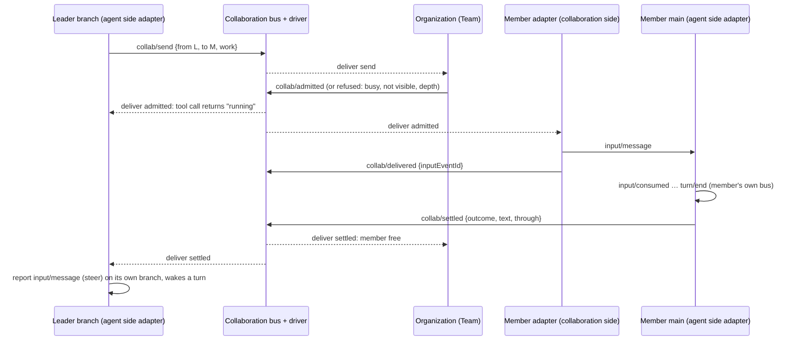

# Collaboration timeline

Status: Proposed; not implemented. Scope: agent-to-agent collaboration as its own
time bus, driven exactly like an agent branch. Today's Collaboration plugin
([collaboration.rs](../../crates/dim-app-server/src/collaboration.rs)) becomes a set of
state machines on that bus. This document also takes the place of
`docs/design/appserver/collaboration.md`, which the module header cites but which
does not exist.

## 0. Model

Inside an agent, the [time bus](../architecture/rust-agent/time-bus.md) already works
this way: an event is written to the branch Timeline, the Timeline assigns its
sequence, the Dispatcher consumes committed events in sequence order and delivers
each one to its subscribers; every subscriber is a state machine that decides from
what it consumed and writes its result as new events, which the Dispatcher delivers
in turn. Causality is that loop: **every written event is consumed, and consuming
always produces new result events that drive the timeline on.** Nothing is linked
by reference or called directly.

Collaboration uses the same loop one level up:

```text
            ┌─────────────────────── Collaboration Timeline ───────────────────────┐
  write ───▶│  seq 1   seq 2   seq 3   seq 4   seq 5   …                           │
            └───────────────────────────────┬──────────────────────────────────────┘
                                            │ driver (Dispatcher): consumes committed
                                            │ events in order, delivers to subscribers
            ┌───────────────┬───────────────┼────────────────┬──────────────────────┐
            ▼               ▼               ▼                ▼                      ▼
     participant A    participant B   organization     system sources        external sources
     (agent Session)  (agent Session) rules (Team, …)  (Session lifecycle,   (webhook, ACP,
                                                       reload, schedule)      external agent)
            │               │               │                │                      │
            └───────────────┴──── result events written back to the bus ────────────┘
```

- **Every agent Session is a state machine on the collaboration bus.** It consumes
  the collaboration events that concern it and turns them into input on its own
  branch; its own branch runs as today; the results of that run are written back to
  the collaboration bus as new events. The agent timeline nests inside the
  collaboration timeline; both are the same mechanism.
- **System changes and external influences are events on the same bus**, written by
  their owners (a participant Session closed or restored, a capability reload, a
  scheduled job firing, a webhook). Subscribers consume them like any other event
  and react with their own result events.
- **The organization is not part of the timeline.** Leader and member, who may
  address whom, depth limits: these are rules of subscriber state machines that
  consume requests and write their decisions. Replacing the organization replaces a
  subscriber, not the bus.
- **The collaboration tree is the branch tree of the collaboration bus**, exactly
  as agent branches form a tree: a collaboration branch inherits the history up to
  its cut and continues on its own.

## 1. Current state and gaps

Today collaboration has no bus of its own. Its facts are scattered across the
leader's branch (`collaboration/request`, `/message`, `/cancel`, `/close`,
`/delivered`, `/result`); the member sees only an `input/message`; the Team
(relations, temporary-Agent ownership) is a set of `Mutex` maps in process memory;
the leader decides completion by waiting on `Session::idle` and re-reading the
member's history.

| # | Gap | Consequence |
| --- | --- | --- |
| G1 | No collaboration bus | There is no ordered history of the collaboration as a whole; each participant sees only its own side |
| G2 | Decisions are not driven by consumption | `busy` reads the member's live running state; authorization reads a shared map every Session mutates; completion is a wait on another Session, not a consumed event |
| G3 | Team state is process memory | Not rebuildable from any timeline: after a daemon restart a leader cannot reach its members, members are refused, a reload stops nobody, temporary Agents become visible to every leader |
| G4 | System changes act outside the timeline | A member closing, a reload or a restart changes collaboration only through ad-hoc observers and settlement code, not as events subscribers consume |
| G5 | Organization is fused with mechanism | Team vocabulary (leader, member, temporary Agent) is in the event types and in the delivery code; another organization (peers, a Workflow pipeline) cannot reuse it |
| G6 | No collaboration tree | Members cannot delegate; there is no way to branch a collaboration |

## 2. The collaboration bus

### 2.1 Host

A **collaboration space** is the scope that owns one collaboration bus tree. It is
hosted by the existing runtime machinery unchanged: Timeline (sequence, atomic
batches, `before`, commit then publish), Dispatcher (single ordered reader that
delivers to subscribers), TimelineStore (the same SQLite store), TimelineTree
(branches, cuts, creation and close), reload and restart rules. Its capabilities
are the collaboration state machines of §3; it has no model Loop.

The proposed host is a Session whose assembly contains only collaboration
capabilities (a "collaboration Session"), so every mechanism above, including
storage, fork, idle unload and close, applies with no new code path. §9 records the
alternative (a dedicated scope) as an open question.

### 2.2 Writing and driving

| Rule | |
| --- | --- |
| Entry | Like an agent branch: external writers use the bus's public input entry; its own capabilities write through its `Timeline` service. Nobody writes another owner's result event |
| Driver | The collaboration branch's Dispatcher, unchanged: consumes committed events in sequence order and delivers each to its subscribers; handlers register their own work and return (principles §4 rule 3) |
| Order | Only the sequence of the collaboration bus (time-bus §1). The order between a participant's own branch events and collaboration events exists only through consumption: a participant writes to the collaboration bus after consuming its own result; the collaboration bus's subscriber writes to the participant after consuming a collaboration event |
| State | Every subscriber's state is the fold of the collaboration events it consumed, rebuilt from the bus on load (time-bus §3). Team membership, open work and busy status are such folds |
| Persistence | The bus is durable like any Timeline; reload and restart rebuild every subscriber from it |

### 2.3 Events

Collaboration events describe the collaboration, not an organization. Initial set
(domain `collab/`):

| Event | Written by | Consumed by |
| --- | --- | --- |
| `collab/participant` `{participant, session, agent, state: joined \| left \| closed \| restored}` | The system source that observed it (Agents lifecycle), or the organization when it admits or releases a participant | Organization rules, participant adapters, views |
| `collab/send` `{from, to, kind: work \| message, content, mode}` | A participant adapter, on behalf of its agent's tool call | Organization rules (admit or refuse), the addressed participant's adapter |
| `collab/admitted` / `collab/refused` `{send, reason?}` | The organization | The sender's adapter (answers the tool call), the addressed adapter (only admitted work is delivered) |
| `collab/delivered` `{send, inputEventId}` | The addressed participant's adapter, after writing the input on its agent branch | Sender's adapter, views |
| `collab/settled` `{send, outcome, text, through}` | The addressed participant's adapter, after consuming the end of that work on its own branch | Sender's adapter (writes the report input), organization (frees the participant) |
| `collab/stop` `{send, reason}` | A participant adapter (cancel) or the organization | The addressed adapter, which writes `stop/interrupt` on its agent branch |
| `collab/external` `{source, id, content}` | External boundary owners | Organization rules, adapters |
| `stop/interrupt`, `branch/*` | As on any bus | As on any bus |

Every effect is a new event written by the subscriber that consumed its trigger:
`send` → `admitted` → `delivered` → `settled` → (on the sender's own branch) the
report input. No event points to its cause; the bus order and the consumption that
produced each event are the causality.

## 3. State machines on the bus

| State machine | Scope | Consumes | Writes | Owns |
| --- | --- | --- | --- | --- |
| Participant adapter, collaboration side | Collaboration space, one per participant | `collab/*` addressed to its participant | `input/message` and `stop/interrupt` on the participant's `main` through `Session::input` / `stop`; `collab/delivered` | The fold of its participant's open work |
| Participant adapter, agent side | Each participant Session (today's `CollaborationTimeline` position) | Its own branch events: the `agent` tool's calls, `input/consumed`, `turn/end`, `stop/interrupt` | `collab/send`, `collab/stop`, `collab/settled` on the collaboration bus; the report `input/message` on its own branch when it consumes `collab/settled` for its send | Its own pending calls |
| Organization (Team) | Collaboration space | `collab/send`, `collab/participant`, `collab/settled` | `collab/admitted` / `refused`, `collab/participant {joined/left}`, creation requests to Agents | Membership, roles, depth, busy: all folds of the bus |
| System source: Session lifecycle | Agents (process) | Session close, restore, delete of participants | `collab/participant {closed/restored}` on each space they belong to | Nothing new |
| System source: reload and restart | Runtime | The space's own rebuild | Settlement events for work the previous generation left open (§5) | Nothing new |
| External sources | Boundary owners (RemoteGateway, ACP, ExternalAgent) | Their own inputs | `collab/external` | Their own records |

The two adapter halves are the only bridge between an agent bus and the
collaboration bus. Each half writes to the other bus only through that bus's public
input entry and only after consuming an event on its own bus, the same rule as
"a branch affects another branch only by writing input to its Timeline"
([principles §2](../architecture/rust-agent/principles.md#2-作用域的含义)).

## 4. Flows

### 4.1 Delegation



A new member is the organization's decision: on admitting work to a target that
does not exist yet, it asks Agents to create the Session (as `establish` does
today) and writes `collab/participant {joined}` before `collab/admitted`. A
creation failure is `collab/refused {member_create_failed}`.

### 4.2 Work end

The member's agent-side adapter decides when the work ends, from its own consumed
events: the work starts at the `input/consumed` of the delivered input and ends at
the first `turn/end` after which its branch is idle with no pending input of that
work. It then writes `collab/settled` with `through` = that `turn/end`'s sequence.
This replaces the leader's wait on `Session::idle` and its rescan of the member's
history (G2): the end of the work is a consumed event on the bus that owns the
work.

### 4.3 System changes

| Change | Event | Reaction (each a new event) |
| --- | --- | --- |
| Member Session closed | `collab/participant {closed}` by Agents' lifecycle source | Organization: open work to it → `collab/settled {failed: member closed}` written on its behalf, since the member's adapter can no longer write; the sender's adapter writes the report |
| Leader branch closed | The leader adapter consumes its `stop/interrupt {branch}` and writes `collab/stop` for its open sends | Member adapters write `stop/interrupt` on members; their adapters settle as `cancelled` |
| Turn interrupt on the leader | Leader adapter consumes it | Sends of that turn not yet admitted are withdrawn with `collab/stop`; admitted work continues (detached work, [event-driven flows §3](../architecture/rust-agent/event-driven-flows.md)) |
| Session close of either side | Not a membership change: membership changes only with `collab/participant {left}` written by the organization | — |
| Reload / restart of the space | Its subscribers rebuild from the bus | Work admitted but neither delivered nor settled by the previous generation is settled `failed: capability reloading` by the owning adapter |
| Reload / restart of a participant | Its agent-side adapter rebuilds from its own branch and the collaboration bus | Open work keeps running per the member's own reload rules; settlement still comes from its adapter |
| Webhook or other external input | `collab/external` | Whatever subscriber rules apply |

## 5. The tree

The collaboration tree is the collaboration bus's branch tree, created and closed
by the same TimelineTree rules (`branch/create` at a cut, `branch/start`,
`branch/create-failed`). A collaboration branch inherits the collaboration history
up to its cut, so every subscriber's fold (membership, open work) starts from the
same state and then diverges.

Nested delegation is not a separate structure: a member that sends work is just a
participant writing `collab/send`; whether that is allowed is the organization's
rule (Team default: members message, read and list only; `maxDepth` as business
configuration, default 1).

How a collaboration branch binds participants is open (§9): either the branch
shares the parent's participants and only the collaboration history diverges, or
creating a collaboration branch also creates branches of the participant Sessions
at their own cuts.

## 6. What changes in Collaboration

| Today | Becomes |
| --- | --- |
| `collaboration/request`, `/message`, `/cancel`, `/close`, `/delivered`, `/result` on the leader branch | The leader branch keeps only its tool call and the report input; the collaboration facts are `collab/*` on the collaboration bus |
| `CollaborationDirectory` `Mutex` maps (relations, temporary ownership) | The organization's fold of `collab/participant` and admission events; rebuilt from the bus, so it survives restart (G3) |
| `busy` from the member's live running state | Organization fold: the participant has admitted work without `collab/settled` (G2) |
| Completion by `Session::idle` and history rescan | `collab/settled` written by the member's own adapter (§4.2) |
| Close observers deleting relations | `collab/participant {closed}` events; membership ends only by `{left}` |
| Team logic inside delivery code | The organization subscriber; delivery is the adapters' only job (G5) |

`agent` tool actions map onto `collab/send` (request, message), `collab/stop`
(cancel) and an organization request to release (close); `list`, `inspect`, `read`
and `result` read the collaboration bus and folds.

## 7. Format decisions

| Item | Decision |
| --- | --- |
| `collab/*` event kinds | New kinds in the closed `EventKind` list (until dynamic events, #2), a format decision with contract-test registration |
| `collaboration/*` kinds | Kept readable for existing histories; no longer written. A leader history with open old requests is settled once on load as today |
| Storage | The collaboration space is stored like a Session (same tables, current version); no new table |
| Team records | None outside the bus |
| Wire | Clients read the collaboration bus through the existing history and attach methods, addressed by the space's id |

## 8. Rule check

| Rule | Application |
| --- | --- |
| Time bus §1–§6 | One sequence per collaboration branch; every subscriber decides from consumed events; state rebuilds from the bus; side effects (Session creation, input to participants) are not replayed: a new generation settles what the old one left open |
| Principles §1 / ADR 002 D1 | Collaboration space hosts the bus and its state machines; agent-side adapters live in participant Sessions; system sources stay with their owners |
| §4.1 commands/results | `collab/send` and `collab/stop` are commands; the organization and the addressed adapter write the results |
| §4.2 hand-over | `collab/admitted` hands work to the addressed adapter; `input/message` hands it to the agent |
| §4.3 before | None added |
| §4.4 core neutrality | Timeline, Dispatcher and TimelineTree are used as they are; organization meaning is only in subscribers |
| §4.5 batches | `collab/participant {joined}` and `collab/admitted` of a new member are one batch, admission last |
| §4.6 context | Agents see only their own inputs (work, messages, reports) |
| §4.7 public access | Adapters cross buses only through public input entries; no live-state reads |
| §4.8 infrastructure | Reused unchanged, if the host is a collaboration Session (§2.1) |
| §4.9 necessary facts | Every `collab/*` event is consumed by a later decision |
| ADR 002 D2–D5 | No wiring module; the organization is a replaceable subscriber; `maxDepth` is configuration; events are data |

**Requirements raised to mechanism owners:** none if the collaboration space is
hosted as a Session (§2.1); a dedicated scope would need one (§9).

## 9. Open questions

1. Host: a Session with collaboration-only assembly (recommended, no infrastructure
   change), or a dedicated collaboration scope beside Session?
2. Which space a collaboration belongs to: one space per leader Session (today's
   Team), or spaces that participants join explicitly?
3. Collaboration branches: share participants, or branch participant Sessions too
   (§5)?
4. A reopened leader finds its collaboration again (membership ends only by
   `left`): confirm.
