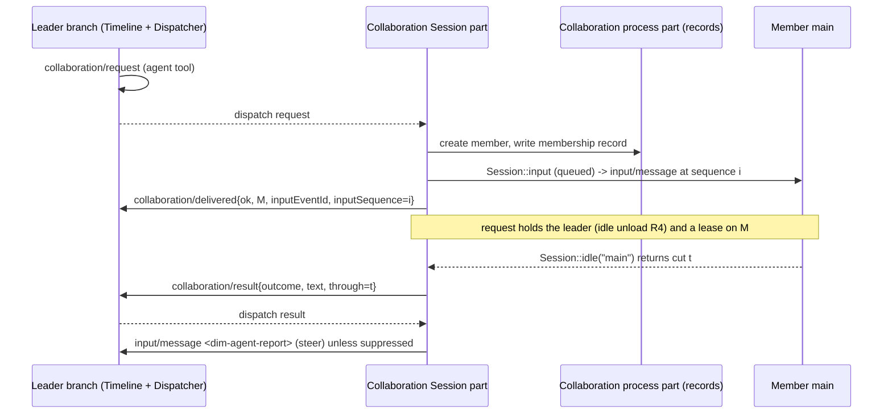

# Collaboration as a timeline-driven tree

Status: Proposed; not implemented. Scope: the Collaboration plugin
([collaboration.rs](../../crates/dim-app-server/src/collaboration.rs)) and the
contracts it shares with clients. This document also takes the place of
`docs/design/appserver/collaboration.md`, which the module header cites but which
does not exist.

Inside one Session, Dim is already a timeline-driven system: every branch is a time
bus ([time bus](../architecture/rust-agent/time-bus.md)), branches form a tree whose
edges are anchored at sequences (`branch_point`, `create_anchor`), and every
capability's state is a fold of the facts it consumed. Collaboration between
Sessions (a leader delegating to member Sessions) only half follows that model. This
design makes agent-to-agent collaboration a tree of Sessions whose edges are
anchored on the participants' own timelines, whose state is the fold of those facts
plus durable process records, and whose timeline any reader can reconstruct from
history alone.

## 1. Current state

### 1.1 What exists

| Part | Scope | Holds |
| --- | --- | --- |
| `CollaborationDirectory` | Process | `relations` (member Session → leader, member Agent), `temporary` (temporary Agent → creating leader), `watched` close observers. All are `Mutex` maps in process memory |
| `Collaboration` | Process | Creates members (`establish`), authorizes peers, lists the Team |
| `CollaborationCapability` | Session | The `agent` tool; `requests` (one open request per member Session) and per-branch `BranchRecord`s |
| `CollaborationTimeline` | Branch | Binds the branch Dispatcher to the Session part's `consume` |

Facts on the **leader branch** that issued the operation:

| Event | Written by | Meaning |
| --- | --- | --- |
| `collaboration/request` | `agent` tool, before waiting | Delegate `prompt` to a new Agent member, a temporary member or an existing member |
| `collaboration/message`, `/cancel`, `/close` | `agent` tool | Message a peer; stop a member's current work; release a member |
| `collaboration/delivered` | Delivery work, at the end of the operation | `ok {agentId, sessionId, inputEventId?, outcome?}` or `error {code}` |
| `collaboration/result` | Settlement work, after the member goes idle | Terminal state of a delivered request: `completed`, `failed` or `cancelled`, with the member's last text |

On the **member's `main` branch** there is only an ordinary `input/message` whose raw
block is the text element `<dim-agent-message agent=…>`. A member-sent message is a
`collaboration/message` on the member's own branch and an `input/message` on the
target.

```text
 leader L / branch b                         member M / main
 ─────────────────────────                   ───────────────────────────
 s1  collaboration/request ───────┐
                                  └──input──▶ i   input/message (text only)
 s2  collaboration/delivered{ok, M, i}            input/consumed i
                                                  turn/start … turn/end
                    Session::idle("main") ◀──── idle at sequence t
 s3  collaboration/result{completed, text}   (t is not recorded anywhere)
 s4  input/message <dim-agent-report> (steer, wakes b)
```

### 1.2 Gaps

| # | Gap | Consequence |
| --- | --- | --- |
| G1 | The Team (relations, temporary-Agent ownership) is process memory | After a daemon restart a leader cannot reach its members, members' messages to it are refused (`TeamMemberNotFound`), a reload stops no member, and a temporary Agent becomes visible to every leader (`visible` treats an unknown Agent as public). The Team violates time-bus §3: it is decision state that nothing can rebuild |
| G2 | The edge is anchored only on the leader side | `delivered` names the member input by id, but `result` does not record where on the member's bus the work ended. A reader cannot cut the member's history for one delegation; the leader re-derives it by scanning, and a client cannot draw the edge at all |
| G3 | Decisions read other instances' live state | `Busy` reads `member.state("main").running`; relation authorization reads a shared `Mutex` map that every Session mutates. Both are reads of state the deciding Session never consumed (principles §4 rule 7) |
| G4 | Business close ends relations | `session_closed` deletes every relation naming the closed Session. Close is not deletion and must not cascade into Team membership; ending membership is Collaboration's own decision, expressed by `collaboration/close` |
| G5 | The tree has depth one and no shared reading of it | Members cannot delegate. Clients (#263, #264) rebuild the Team from the leader's tool results and member histories ad hoc, without a documented fold |

## 2. Goals and non-goals

Goals:

1. The Team is a **tree of Sessions**. Each edge is a delegation anchored at
   sequences on both participants' buses, just as a child branch is anchored at
   `create_anchor` on its parent.
2. Every Collaboration decision is made from consumed facts of the deciding owner's
   own bus, or from Collaboration's own durable records. No decision reads another
   Session's live state.
3. The Team survives restart, unload and reload with the same meaning; close and
   reload settle work without erasing membership.
4. The **collaboration timeline** of a Team is reconstructible by any reader from
   participants' histories, with a documented fold and ordering rule, and needs no
   new server method.

Non-goals: a Team bus or global sequence (D1); cross-control-node collaboration
([overview](overview.md) "Future"); changes to Timeline, Dispatcher, the event
envelope, assembly or the Session facade; a generic workflow or task layer
([event-driven flows §3](../architecture/rust-agent/event-driven-flows.md)).

## 3. Model

### 3.1 Two trees, joined at sequences

```text
                 Team tree (Sessions)                Branch tree (inside each Session)
                 ────────────────────                ─────────────────────────────────
  L (leader) ── main ──┬── s1 request ─────────────▶ M1 (member) ── main
                       │                               └─ child branch c (branch/create)
                       └── child b ── s7 request ────▶ M2 (member) ── main
                                                         └─ s3 request ──▶ M3 (sub-member, D4)
```

- A **node** is a Session together with its own branch tree.
- An **edge** is one delegation: a `collaboration/request` on some branch of the
  leader to the `main` branch of a member. A member joins the Team with its first
  edge and stays until a `collaboration/close` releases it (D3).
- Messages (`collaboration/message`) are not edges of the tree; they are
  cross-links between nodes of the same Team, anchored the same way.

### 3.2 Anatomy of an edge

| Anchor | Bus | Fact | Fields |
| --- | --- | --- | --- |
| A1 open | Leader branch | `collaboration/request` | its own sequence |
| A2 hand-over | Member `main` | `input/message` | `delivered.inputEventId`, plus new `delivered.inputSequence` |
| A3 work end | Member `main` | (any event; the idle cut) | new `result.through` |
| A4 close | Leader branch | `collaboration/result` | its own sequence; the report input follows it |

The delegation's work on the member is exactly the member's facts in
`(inputSequence, through]` on `main`. This replaces "whatever the member did until
it was next idle, re-derived on each read" with a recorded cut that every reader
uses identically. The cut keeps today's semantics (it is still the member's idle
point) and makes them durable.

### 3.3 The collaboration timeline

There is no new bus. The collaboration timeline of a Team is the merge of the
participants' collaboration facts:

1. Within a bus, order is the sequence (time-bus §1).
2. Across buses, order is only the causal order the anchors give:
   `request(L,s1) < input(M,A2) ≤ … ≤ M@through(A3) < result(L,A4)`; for a
   message, `message(X,s) < input(Y, delivered.inputSequence)`.
3. Facts the anchors do not order are concurrent. A reader may interleave them by
   `create_at` for display; no decision uses that interleaving.

```text
 L/main   ──s1 request(M1)──s2 delivered(M1,i=4)────────────────s9 result(M1,through=12)──s10 report
 M1/main  ─────────────────────────4 input──5 consumed──…──12 turn/end (idle)
 M2/main  ─────────────3 input(message from M1)───────…
                            ▲
 M1/main  ──8 collaboration/message(M2)──9 delivered(M2,i=3)
```

### 3.4 Decision D1: no Team bus

A Team bus would give the Team one global sequence. It is rejected because:

- Time-bus §2 already places a work item's start and terminal facts on the
  initiator's bus; a Team bus would duplicate them or move them away from the branch
  whose turn and interrupt they depend on.
- Every Team decision still depends on branch-local facts (the requesting turn, its
  `stop/interrupt`), so a Team bus would need cross-bus reads to decide anything.
- It is a new kind of Timeline with its own owner, storage and lifecycle: an
  infrastructure change that does not close within the infrastructure (principles
  §4 rule 8).

The anchored edges give the only order the Team needs, the causal one.

## 4. Facts and records

### 4.1 Timeline facts (additive fields, no new event kinds)

| Event | Change | Rule |
| --- | --- | --- |
| `collaboration/delivered` (`ok`, for `request` and `message`) | Optional `inputSequence`: the sequence of the member `input/message` named by `inputEventId` | Written by every new delivery; absent only in facts written before this change |
| `collaboration/result` | Optional `through`: the member `main` sequence at which the work was settled | Written by every new settlement. A reload settlement that never observed the member writes no `through`; such a result has no member work range |

Both are extensions of frozen event structures and are registered in the contract
tests ([principles §6](../architecture/rust-agent/principles.md#6-验证)). The frozen
fixtures stay unchanged; readers treat a missing field as "not anchored", never as
zero.

No member-side event is added. The member's `input/message` is already the
hand-over fact (rule 2), and the leader's `delivered` names it; a member-side
`collaboration/assigned` would repeat the same edge on a second bus (§10 ablation).

### 4.2 Durable Team records (process, `pluginFiles`)

The Team is cross-Session process state ([principles §2](../architecture/rust-agent/principles.md#2-作用域的含义):
"cross-Session records" belong to Process). It moves from `Mutex` maps to
Collaboration's own `pluginFiles` records (atomic replace, lock, format version),
written only by Collaboration's typed operations:

| Record | Key | Fields | Written |
| --- | --- | --- | --- |
| Membership | Member Session id | `leaderSessionId`, `memberAgentId`, `joined {branchId, requestEventId}`, `released?: {branchId, closeEventId}` | `joined` before the request's `delivered{ok}`; `released` before the close's `delivered{ok}` |
| Temporary Agent | Agent id | `leaderSessionId` | Before the Agent enters Agents' index (as today) |

`watched` stays process memory: it is an observation task table, not Team state.

Ordering (rule 5 across a process record and a fact): the record is written first
and the fact second, so a fact never names membership that the record lacks. A crash
in between leaves a record without its fact; the rebuild writes the operation's
`delivered{error: closed}` (as today) and the member stays a listed member that has
no open request. That is the same visible state as a request that was refused after
creation, and the leader may `close` it.

A record whose Session no longer exists (deleted) is removed by Collaboration when
it next resolves that id; a lookup that fails for a deleted Session answers
`team_member_not_found`, as a lookup of a released member does.

## 5. Ownership and folds

| State | Owner | Built from | Decides |
| --- | --- | --- | --- |
| Team membership and temporary ownership | Collaboration process part | §4.2 records | Who may address whom; whether a target Agent is visible |
| Operations awaiting `delivered`, open requests per member | Collaboration Session part, per leader branch | The branch's consumed facts (`request`, `delivered`, `result`, `turn/*`, `stop/interrupt`), rebuilt at load as today | Refusal of operations of interrupted turns or a closing branch; `cancel` outcome; `busy` |
| A delegation's member work range | The leader's `collaboration/result` | Recorded once at settlement (`through`) | Nothing further; readers use it |
| Team tree and timeline view | Each reader | The fold in §6 | Display only |

Changes this implies:

- **D2 Busy is the leader's own fact.** A request to an existing member is refused
  `busy` only while the leader Session has an open request to it (delivered, no
  `result` yet), from its own consumed facts. The live
  `member.state("main").running` read is removed. A member running because of other
  input (for example the user typing to it) receives the request as a queued input,
  exactly as any queued input; its work range then begins where InputQueue consumes
  the request input.
- **D3 Membership ends only with `collaboration/close`.** Close, unload, reload and
  restart of either Session keep the record. `session_closed` no longer removes
  relations; it keeps only its other duty, closing a temporary Agent with its last
  Session (which then removes that Agent's records). This follows "close does not
  cascade": closing members or ending membership is Collaboration's business and is
  written as its own fact.
- Authorization (`authorize_peer`) reads the durable records instead of the shared
  map. A member addresses its leader and its unreleased siblings; with D4, a
  sub-leader also addresses its own members.
- Team status (`working` / `idle` / `closed`) in `agent list` stays a live display
  read. It informs the model; no Collaboration decision depends on it.

## 6. Reading the tree and the timeline

The same fold serves the model (`agent list`), the CLI task panel (#264) and member
views ([member conversation](member-conversation.md)). It uses only public history
(`session.history`), so no server method or notice is added.

1. **Membership of leader `L`.** Over each branch of `L`, fold only that branch's
   local facts (from its `branch/start`, or from `session/forked` for a forked
   `main`, as Goal does): a `request` whose `delivered` is `ok` with a Session not
   yet in the Team adds it; a `close` whose `delivered` is `ok` releases it. Local
   facts only, so inherited prefixes are not counted twice and a fork starts with an
   empty Team (it leads no member, matching #127).
2. **Edges.** Each `request` with `delivered{ok}` is an edge from
   `(branch, request.sequence)` to `(member, inputSequence)`; its `result` closes it
   at `through`. A request without a `result` is open.
3. **Depth.** For each member, apply 1–2 to the member's own history (D4).
4. **Timeline.** Merge the facts of 1–3 under §3.3.

The model's `agent list` returns the tree with each member's open request and
anchors in `ToolResult.content`, so a later `agent read` can use them as cursors.

## 7. Flows

### 7.1 Delegate and settle



The result text and outcome are read from the member's history in
`(i, t]`, exactly the range recorded.

### 7.2 Lifecycle cases

| Case | Leader side | Member side | Team records |
| --- | --- | --- | --- |
| Turn `stop/interrupt` on the leader | Undelivered operations of that turn are refused; delivered requests continue (detached work) | Unchanged | Unchanged |
| Branch close on the leader | Every open request settles `cancelled: leader closed` after stopping its member | Member is stopped | Unchanged (D3) |
| Leader Session close | As branch close, for each branch | Stopped, not closed | Unchanged |
| Member Session close | Open request settles `failed: member closed` | — | Unchanged; the member is listed `closed` and a later request to it is refused `member_closed` |
| `collaboration/close` | Waits for an open request's result, then `delivered{ok}` | Stopped | `released` written before `delivered` |
| Reload of the leader | Undelivered → `delivered{error: closed}`; open → `result{failed: capability reloading}` without `through`; a member stopped only if its record names this leader | Stopped if led | Unchanged |
| Daemon restart | Same as reload. Since records survive, a led member is now stopped and the Team stays reachable, closing G1 | As reload | Survive |
| Fork of the leader | Copied requests are settled as on reload; F leads no member, so nothing is stopped (#127 holds by records, not by lost memory) | Unchanged | Unchanged; F has no rows |
| Delete of a participant | — | — | Its record is removed on next resolution (§4.2) |

### 7.3 D4: nested delegation

Members may issue `request`, making them leaders of a sub-Team. The membership
record for a sub-member names the member as its leader, so the tree follows from
the records alone, and every rule above applies unchanged at each level. Today's
restriction ("members can only message, read and list") becomes the default of a
business setting in Collaboration's Settings source `collaboration`:
`maxDepth` (integer ≥ 1, default 1 = today's behaviour). A `request` from a Session
at depth `maxDepth` is refused `invalid_input` with the limit in the explanation.
Nested delegation is the last implementation step (§9) and can be left out without
affecting §4–§7.2.

## 8. Format decisions and compatibility

| Item | Decision |
| --- | --- |
| Event fields | `inputSequence`, `through` are optional additions to existing kinds; no event-kind change, no fixture change; registered in the contract tests |
| Team records | A new `pluginFiles` record set with format version 1. No migration: relations never were durable, so after upgrade an existing member is unattached, which is the state a restart produces today |
| `SessionConfig.collaborationRole` | Unchanged. The leader of a member is a Team record, not a Session configuration field, because release changes it while the config is fixed at creation |
| Storage format (SQL) | Unchanged (v18) |
| Wire | No new method or notice; `agent list` content gains the tree and anchors |

## 9. Implementation steps

1. Add `inputSequence` / `through`, write them, and use the recorded range in
   `outcome`. Flow test: a result's `through` cuts the member's history, and a later
   member turn is excluded.
2. Move the directory to `pluginFiles` records; drop the relation removal from
   `session_closed`; authorize from records. Flow tests: restart keeps the Team
   reachable both ways; a temporary Agent stays private after restart; reload stops
   only a member this leader leads; a fork leads nobody.
3. D2: remove the live busy read; verify a member busy with user input queues the
   request and the result's range begins at its consumption.
4. `agent list` returns the tree and anchors; document the fold for the CLI (#263,
   #264) consumers.
5. D4 nested delegation with `maxDepth`.

Existing flow tests in
[transport_flow/collaboration.rs](../../crates/dim-app-server/tests/transport_flow/collaboration.rs)
are reused; assertions about relations disappearing on close are updated to D3.

## 10. Ablation

| Considered | Kept? | Reason |
| --- | --- | --- |
| Team bus with a global sequence | No | D1 |
| Member-side `collaboration/assigned` event | No | The member `input/message` is the hand-over fact and `delivered` names it; a second fact repeats the edge |
| Member-written `collaboration/answered` marking the work end | No | The idle cut already defines the end; recording it once in `result.through` is enough |
| Leader id in `SessionConfig` | No | Membership changes on release; the config is fixed at creation |
| New SQL tables in SessionStore | No | `pluginFiles` is the existing process persistence for plugins |
| New `session.team` client method | No | The fold in §6 runs on public history |
| `inputSequence` | Yes | Without it a reader must resolve an event id to a sequence to cut the member's history |
| `through` | Yes | G2: the work range must be recorded, not re-derived |
| Durable records | Yes | G1: membership is decision state that must survive restart |

## 11. Rule check

| Rule | Application |
| --- | --- |
| §1 / ADR 002 D1 | Team records are process state (cross-Session records); per-branch operation state stays in the Session part as today; no new part |
| §4.1 commands/results | `request`, `message`, `cancel`, `close` are commands on the caller's bus; the delivery owner writes `delivered`, the request owner writes `result`. Membership changes are Collaboration's own writes |
| §4.2 hand-over | The member `input/message` is the hand-over; after it, only `cancel` (the member's stop) acts on the work |
| §4.3 before | No new before callback |
| §4.4 core neutrality | No Timeline, Dispatcher or facade change |
| §4.5 batches | Each new field is in the event that already carries the decision; record-before-fact ordering is §4.2 |
| §4.6 context | Model context still receives only the request input and the report input |
| §4.7 public access | Removes the live busy read and the shared mutable map; cross-Session reads are history reads at recorded cuts (time-bus §6) |
| §4.8 infrastructure | Unchanged |
| §4.9 necessary facts | Two fields, both used by later decisions (result range) or by every reader of the edge |
| ADR 002 D2 | No wiring module, task registry or Team service |
| ADR 002 D3 | Collaboration depends on Agents and `pluginFiles`; nothing core depends on it |
| ADR 002 D4 | `maxDepth` is business configuration in Settings |
| ADR 002 D5 | Records, fields and the fold are data contracts |

**Requirements raised to mechanism owners:** none.

## 12. Open questions

1. D3 changes observable behaviour: today a closed leader's Team is gone for the
   rest of the process; with D3 it is kept. Confirm that a reopened leader should
   find its Team again.
2. D4 default: keep `maxDepth = 1` (no change) or allow one level of sub-Teams by
   default?
3. Should a released member's record be kept (for the tree's history) or deleted?
   This document keeps it with `released`, so the timeline still shows past members.
