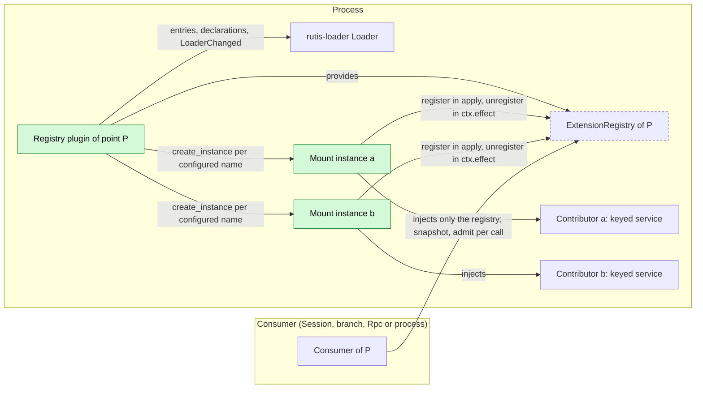
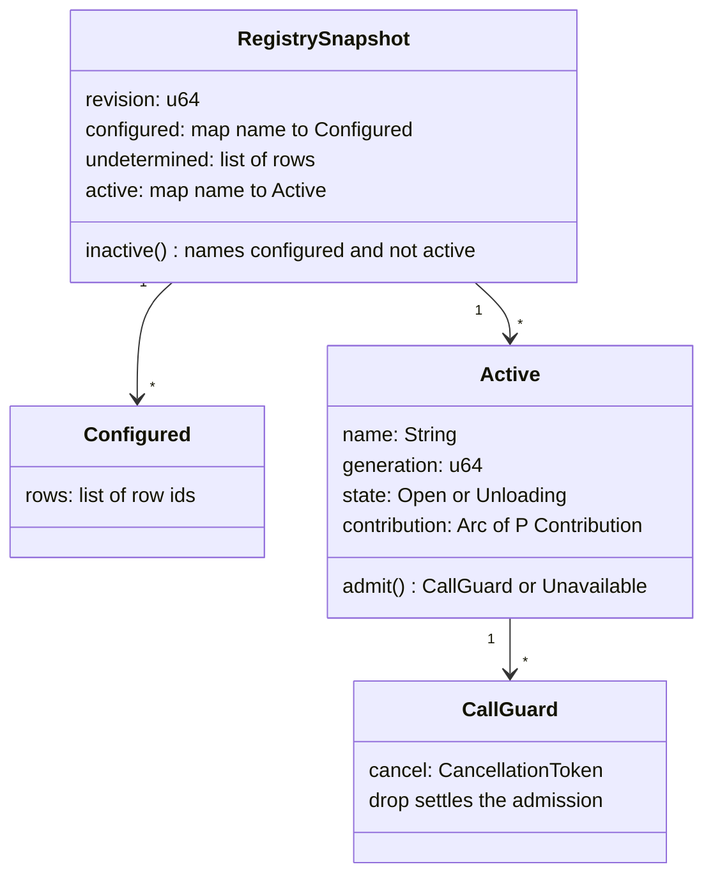
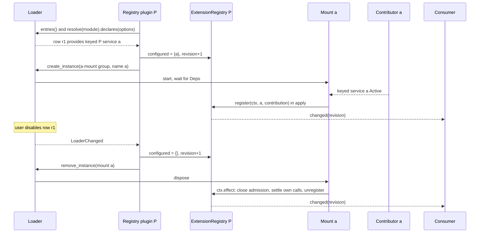
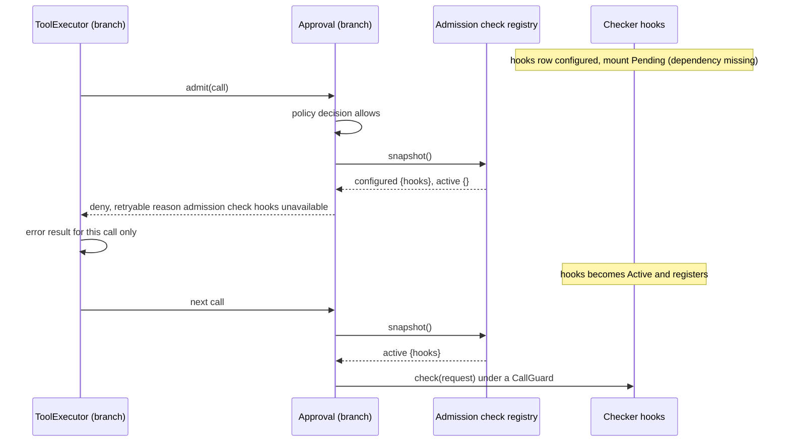

# Extension registry

Status: Draft. Overall design: [overview §3 integration methods](../overview.md#3-integration-methods), [§7 supplements](../overview.md#7-supplements-and-changes-to-existing-plugins). Phase: P0. Language: Rust (registry and mounts); a contributor may be implemented in any language that provides its keyed service.

Every process-level extension point used by a Session, branch or Rpc consumer follows one pattern: a stable registry owned by the consumer contract, filled by one mount instance per configured contributor, with the configured set discovered from loader row declarations. A contributor's reload, failure or removal therefore never reloads the consumer; it only makes that contributor's contribution unavailable, with an outcome the consumer contract defines per call. This document defines the pattern once; each consumer contract states only its point-specific rules (the table in §4).

The pattern implements the rule that dynamic sources are obtained through a declared management service that owns legitimacy and generation ([single-tree](../../architecture/rust-agent/single-tree.md), product assembly constraints), reuses the per-contributor mounts of [Management §3](../plugins/Management.md#3-scope-and-dependencies), and keeps the implemented dynamic tool source contract ([tool contributions §7](../../architecture/rust-agent/tool-contributions.md)) unchanged for Sessions.

## 1. Structure



The consumer's `Deps` contain only the registry, which depends on no contributor, so the consumer's lifecycle is independent of every contributor. Each mount depends on exactly one contributor and the registry, so a contributor's lifecycle reaches only its own mount.

| Part | Scope | Depends on | Provides |
| --- | --- | --- | --- |
| Consumer contract (ToolRegistry, Approval, Rpc, Agents, SessionStore, Management, ModelHost, Web, Modality, SessionResources) | — | — | The point `P`: contribution type, key, validation, stance and per-call outcome (§4) |
| Registry plugin of `P` | Process | `Arc<Loader>` | `ExtensionRegistry<P>` (stable); mount group `<point>-mount` |
| Mount instance (instanced group `<point>-mount`, one per configured name) | Process | `Arc<ExtensionRegistry<P>>`, the keyed contribution of its name | Registration of that contribution |
| Contributor | Process (or a peer row) | its own dependencies | Keyed service `TypeKey::keyed_dynamic::<P::Service>(name)` |
| Consumer | Session, branch or process | `Arc<ExtensionRegistry<P>>` (or a point-specific facade over it) | Its own services, unchanged |

Contracts defined here: `ExtensionPoint`, `Stance`, `ExtensionRegistry<P>`, `RegistrySnapshot<P>`, `Configured`, `Active<P>`, `Lookup<P>`, `CallGuard`, `Unavailable`, `RegistryError`, the mount and discovery rules, the volatile-configuration rule and the facade rule. Contracts depended on: rutis-loader 0.10 `Loader::entries`, `Loader::resolve`, `Resolved::declares` (`Declared { requires, provides }`), `Loader::create_instance`/`remove_instance`, `LoaderChanged`, and `volatile_key`/`VolatileUpdate`; rutis `ctx.effect` disposers. Management keeps its own registry implementation ([Management §6](../plugins/Management.md#6-interfaces)); it satisfies the same rules and may later be ported onto the shared one.

## 2. Data and state



All registry state is process memory, rebuilt from loader entries and mount registrations on every start; nothing is persisted and nothing enters a Timeline. `configured` comes only from discovery, `active` only from mounts; the difference is what the consumer needs to tell "absent by configuration" from "configured but inactive".

| State | Writer | Readers | Rebuild |
| --- | --- | --- | --- |
| `configured`, `undetermined` | Registry plugin (discovery) | Consumer (stance decisions), diagnostics | Recomputed from `Loader::entries()` on `apply` and on every `LoaderChanged` |
| `active` entries | Mount instances (`register`, disposer) | Consumer, per call | Mounts re-register in their `apply` |
| Admissions (`CallGuard`s) | Consumer, through `Active::admit` | Mount disposer | Not rebuilt; a process restart has no in-flight calls |
| Contributor business state | Contributor | Contributor | Contributor's own document |

## 3. Flows

### 3.1 Discovery, mount and unmount



The registry is filled only by mounts and its configured set only by discovery. Between the removal of the row and the end of the mount's disposer, `a` is neither configured nor accepting calls, and the consumer sees it as absent.

Discovery rule: for every entry of `Loader::entries()` with `instance: None` whose `status` is neither `Disabled` nor `Inactive`, the registry plugin resolves the row's module with `Loader::resolve` and evaluates `Resolved::declares` on the row's options. Each name `n` such that `Declared.provides` contains the service name of `TypeKey::keyed_dynamic::<P::Service>(n)` is configured; rows of a `rutis-bridge/peer` link count through what the link declares it imports. A row whose declarations are unknown (`declares` absent or `Err(why)`) is recorded in `undetermined` (A1). The plugin keeps exactly one mount instance per configured name (created with `Loader::create_instance(ctx, "<point>-mount")` carrying the name, removed with `Loader::remove_instance`), and re-evaluates on every `LoaderChanged`. The host's ready latch waits until the mounts discovered from the initial entries are Active or failed (Management precedent).

Mount rule: a mount's `apply` resolves its two `Deps`, validates the contribution through `P::admit` (names, namespaces, collisions with active entries) and calls `register`; a rejected contribution is reported in diagnostics and not registered (the earlier owner keeps its names). The mount's `ctx.effect` disposer, in this order: (1) marks its entry `Unloading`, so `admit` returns `Unavailable` and the name appears in `inactive()`; (2) fires the cancel token of every outstanding `CallGuard` (or, for a point whose calls drain, waits without cancelling) and waits until every guard is dropped, the consumer having settled each call with the point's "provider unavailable" outcome; (3) removes the entry and bumps the revision.

### 3.2 Contributor reload while a call is in flight

```mermaid
sequenceDiagram
  participant TE as ToolExecutor (branch)
  participant TR as ToolRegistry (Session)
  participant R as Process tool registry
  participant M as Mount web
  participant C as Contributor web
  participant TL as Branch Timeline
  TE->>TL: step/tool-start (Timeline append)
  TE->>TR: handler from request snapshot
  TR->>R: Active(web).admit()
  R-->>TR: CallGuard
  TR->>C: execute(call, guard.cancel)
  Note over C,M: contributor row reloads (code update or failure)
  M->>R: disposer: Unloading, cancel guards
  R-->>TR: changed: sets of web revoked
  C-->>TR: cancelled
  TR-->>TE: error ToolResult: tool provider web unavailable (no reload settlement)
  M->>R: guard dropped, unregister
  TE->>TL: step/tool-completed, then step/tool-result after the whole batch
  Note over TE,TL: batch and turn continue; Loop sends the result to the model
  C-->>M: new generation Active
  M->>R: register(web) with new set versions
  R-->>TR: changed: branches adopt the new versions via context/configured
```

The call ends with an ordinary error result, never with the `capability reloading` reason that would make Loop end the turn `Failed` ([single-tree](../../architecture/rust-agent/single-tree.md), capability reload protocol). Only Sessions with a call to this contributor in flight notice anything; ToolRegistry, ToolBinding, Loop and ToolExecutor do not reload.

### 3.3 Configured but inactive, fail-closed point



A fail-closed consumer never treats a configured contributor it cannot reach as absent. The configured set comes from discovery, not from the contributor, so even a contributor that never starts is known.

## 4. Per extension point

| Extension point (owner contract) | Contributor inactive | Its in-flight work | Stance |
| --- | --- | --- | --- |
| Process tools ([ToolRegistry](process-tool-contribution.md)) | Its sets are revoked; branches adopt without them at the next opportunity; retained pins return the existing explicit stop error | That call gets the error result "tool provider `<name>` unavailable"; the batch and the turn continue | Withdraw-only |
| Admission checks (Approval) | Any configured-but-inactive checker (or an `undetermined` row): Approval denies every call that reaches the check stage with a retryable reason | Cancelled check returns deny | Fail closed; the rule lives in Approval's contract |
| Submission filters ([Rpc, session-boundary](session-boundary.md#a1-submission-filters-rpc)) | Configured-but-inactive filter (or an `undetermined` row): `session.submit` returns `service_reloading`; nothing is written | Cancelled filter: submission rejected, nothing written | Fail closed |
| Session-created observers ([Agents, session-boundary](session-boundary.md#a3-session-created-observers-agents)) | Creation proceeds; diagnostic | Cancelled observer: nothing written | Fail open |
| Session methods ([Rpc, session-boundary](session-boundary.md#a2-session-methods-rpc)) and management methods ([Management](../plugins/Management.md)) | That namespace returns `service_reloading`; other namespaces unaffected | Per method declaration (`Report` or `Drain`) | Per namespace |
| Session closure participants ([SessionStore, session-boundary](session-boundary.md#a4-session-closure-participants-sessionstore)) | Fork and delete return `service_reloading` before any change | Idempotent participant steps; the operation is retried | Fail closed |
| Model provider kinds (ModelHost) | Requests of that kind fail before acceptance (transient); other kinds unaffected | The provider cancels its streams; ModelProvider settles that call | Per kind |
| Web search backends; Modality adapters and executors | Availability flag false (Web publishes a set without `web_search`; Modality reports the adapter or runtime unavailable) | That call or task fails or is `interrupted` | Per name |
| Node services ([SessionResources](session-access.md#a4-sessionresources)) | `node_unavailable` for calls on that node only | Per owner of the call | Per node |

## 5. Rules every point follows

| Rule | Content |
| --- | --- |
| Ownership | The registry type, contribution type, key, validation and stance belong to the consumer contract. The registry never knows a contributor; contributors never know the consumer's internals |
| Injection | Session, branch and Rpc consumers inject only the registry (or a facade over it). `When<ProcessContributions<T>>` and every `Deps` injection of a contributor into a Session, branch or Rpc plugin are replaced by this pattern |
| No reload reason | A contributor's unload never uses the `capability reloading` reason for a consumer's work; each call gets the point's per-call "provider unavailable" outcome |
| Volatile configuration | Contributors to a Session-visible registry declare user-editable configuration as `x-volatile` fields and apply `VolatileUpdate` (listened on `volatile_key(ctx)`) in place, as new set versions or availability flags, never as a reload. A non-volatile change restarts only that contributor's row and therefore only its mount |
| Per-call node services | Services on a resource node are resolved per call ([SessionResources](session-access.md#a4-sessionresources)); a node is a mount of the node-services point; an offline node yields `node_unavailable` for calls on that node only, never Pending for a consumer |
| Facades | [SessionAccess](session-access.md) and [SessionEvents](session-broadcast-subscription.md) resolve the current AgentIndex per call through a stable slot that AgentsPlugin fills; during an Agents reload their calls return `Reloading` instead of reloading their consumers |
| Re-entry | A new contributor generation registers with new set versions or a new generation number; consumers never reuse an old generation's handles except through the existing retained-pin rule |

## 6. Interfaces (summary)

| Item | Purpose |
| --- | --- |
| `ExtensionPoint` | Consumer-defined point: contribution type, point name, stance, validation |
| `ExtensionRegistry<P>` | Stable process service: snapshot, change notification, lookup, registration (mounts only) |
| `Active<P>::admit` / `CallGuard` | Per-call admission; the guard's token fires when the contributor unloads |
| Mount group `<point>-mount` | One instance per configured name |
| Discovery | Configured names from loader row declarations, re-evaluated on `LoaderChanged` |

## 7. Security

The registry is a lifecycle mechanism, not a trust boundary: contributors are trusted in-process code or rows the user enabled. Fail-closed points use the configured set from discovery so that an unavailable security contributor (an admission checker, a submission filter) cannot be skipped by making it fail. Registration validates names and namespaces so that a contributor cannot take over another contributor's names.

## Appendix A. Interface details

```rust
/// Defined by each consumer contract.
pub trait ExtensionPoint: Send + Sync + 'static {
    /// Keyed contribution service, e.g. `ProcessToolSource`; key
    /// `TypeKey::keyed_dynamic::<Self::Service>(name)`, no instance.
    type Service: Send + Sync + 'static;
    /// Point name; the mount group is "<POINT>-mount".
    const POINT: &'static str;
    const STANCE: Stance;
    /// Validates a contribution against the currently active entries.
    fn admit(name: &str, service: &Self::Service, active: &RegistrySnapshot<Self>)
        -> Result<(), RegistryError> where Self: Sized;
}
pub enum Stance { FailClosed, FailOpen, PerName }

/// Process service; key `TypeKey::of::<ExtensionRegistry<P>>()`.
impl<P: ExtensionPoint> ExtensionRegistry<P> {
    pub fn snapshot(&self) -> Arc<RegistrySnapshot<P>>;
    pub fn changed(&self) -> tokio::sync::watch::Receiver<u64>;   // revision
    pub fn lookup(&self, name: &str) -> Lookup<P>;
    /// Used only by mount instances; removal is registered with `ctx.effect`.
    pub fn register(&self, ctx: &Ctx, name: &str, service: Arc<P::Service>)
        -> Result<(), RegistryError>;
}
pub struct RegistrySnapshot<P: ExtensionPoint> {
    pub revision: u64,
    pub configured: BTreeMap<String, Configured>,
    pub undetermined: Vec<UndeterminedRow>,          // declarations unknown (A1)
    pub active: BTreeMap<String, Arc<Active<P>>>,
}
impl<P: ExtensionPoint> RegistrySnapshot<P> {
    /// Configured and not active (including Unloading entries).
    pub fn inactive(&self) -> impl Iterator<Item = &str>;
}
pub struct Configured { pub rows: Vec<String> }
pub struct UndeterminedRow { pub row: String, pub why: String }
pub enum Lookup<P: ExtensionPoint> { Active(Arc<Active<P>>), Inactive, Absent }
pub struct Active<P: ExtensionPoint> {
    pub name: String,
    pub generation: u64,                            // unique per registration in this process
    pub service: Arc<P::Service>,
}
impl<P: ExtensionPoint> Active<P> {
    pub fn admit(&self) -> Result<CallGuard, Unavailable>;
}
pub struct CallGuard { pub cancel: CancellationToken }  // drop = settled
pub struct Unavailable { pub name: String }
pub enum RegistryError {
    Invalid { name: String, reason: String },        // contribution rejected as a whole
    Collision { name: String, owner: String },
    Closed,                                          // registry unloading
}
```

| Item | Rule |
| --- | --- |
| Point names | `[a-z][a-z0-9-]*`, owned by the consumer contract: `process-tools`, `admission-checks`, `submission-filters`, `session-created`, `session-methods`, `session-closure`, `model-kinds`, `web-search-backends`, `modality-adapters`, `node-services` (A2) |
| Contributor names | Chosen by the contributor; validated by `P::admit`; stable across releases |
| Snapshot consistency | One snapshot is internally consistent; consumers decide one call from one snapshot |
| Revision | Increases on every change of `configured`, `undetermined` or `active` |

## Appendix B. Full conflict table

| Scenario | Order | Outcome | Owner of the decision |
| --- | --- | --- | --- |
| Call admitted, then contributor unloads | admit < disposer | Guard cancelled; call settles with the point's unavailable outcome; disposer waits | Mount, consumer |
| Contributor unloading, then a call arrives | Unloading < admit | `Unavailable`; same outcome as an inactive contributor | Registry |
| Contributor configured, mount still starting | discovery < register | Inactive: stance decides (fail closed, fail open, per name) | Consumer |
| Row disabled while a call runs | LoaderChanged < disposer | As unload; afterwards the name is absent | Registry plugin |
| Row enabled while a consumer decides | snapshot < LoaderChanged | Decision uses its snapshot; the next call sees the new set | Consumer |
| Volatile configuration change | VolatileUpdate | No unload; new set version or availability flag | Contributor |
| Non-volatile configuration change | row restart | As contributor reload: only its mount | rutis lifecycle |
| Two contributors claim one name or namespace | second register | Second rejected as a whole; first keeps its names | Registry (`P::admit`) |
| Registry plugin reload | — | Mounts and consumers that inject the registry reload; avoided in practice: the registry plugin has no dependency except `Loader` | rutis lifecycle |
| Contributor on a peer row, peer offline | mount Pending | Inactive; stance decides; other contributors unaffected | Consumer |
| Process restart | — | Registry and mounts rebuild before the ready latch opens; no call survives; owners settle committed facts by their own rules | Each owner |
| Declarations unknown for an enabled row | discovery | `undetermined`; fail-closed points refuse, others ignore (A1) | Consumer |

## Appendix C. Errors and recovery

| Case | Result |
| --- | --- |
| Contribution invalid or colliding | Mount reports the error in diagnostics and stays Active without registration; the name is configured and inactive |
| Mount disposer waits for a contributor that ignores cancellation | Unload waits (real settlement); reported in diagnostics |
| `create_instance` fails | Name stays configured and inactive; retried on the next `LoaderChanged` |

## Appendix D. Acceptance

1. A contributor reload during a tool call yields one error result for that call; the turn continues; no ToolRegistry, ToolBinding, Loop or ToolExecutor reload occurs.
2. A configured checker whose dependency is missing makes Approval deny with a retryable reason; disabling its row restores normal admission.
3. A configured submission filter that is inactive makes `session.submit` return `service_reloading` and writes nothing.
4. A volatile configuration change publishes a new set version without any unload.
5. One offline resource node yields `node_unavailable` for calls on that node; Sessions on other nodes are unaffected.
6. Mount instances match the configured set after enable, disable and module rename of rows.

## Appendix E. Assumptions

| # | Assumption | Basis | Effect if rejected |
| --- | --- | --- | --- |
| A1 | An enabled row whose declarations are unknown counts as possibly providing any name: fail-closed points refuse while it is undetermined, other points ignore it | Judgment; rutis-loader reports unknown declarations as `Err(why)` | Fail-closed points would admit while a security contributor's row cannot be described |
| A2 | One shared generic registry implementation serves all points except Management, which keeps its own | Judgment | Each owner implements the same rules separately |

## Appendix F. Open questions

| Question | Description |
| --- | --- |
| Peer-row naming | Whether a contributor imported from a peer link registers under the same name as a local one or under a node-qualified name; today Management and PluginManager use per-node mounts |
