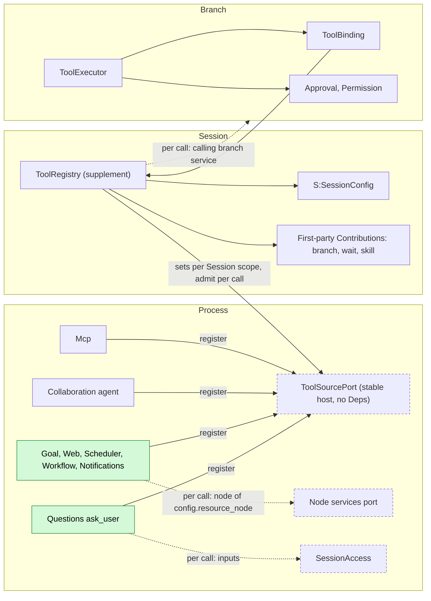
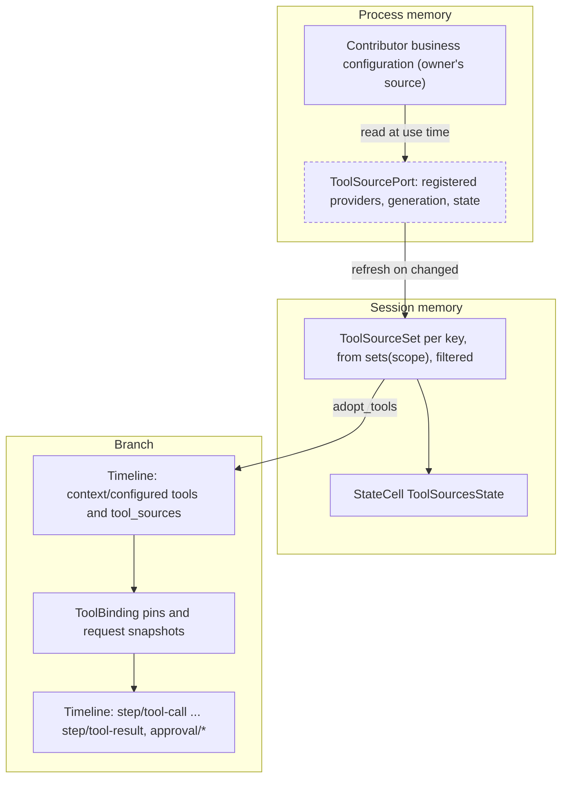
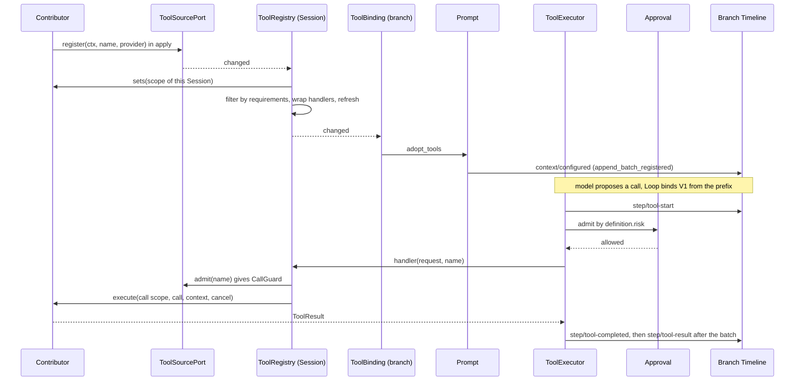
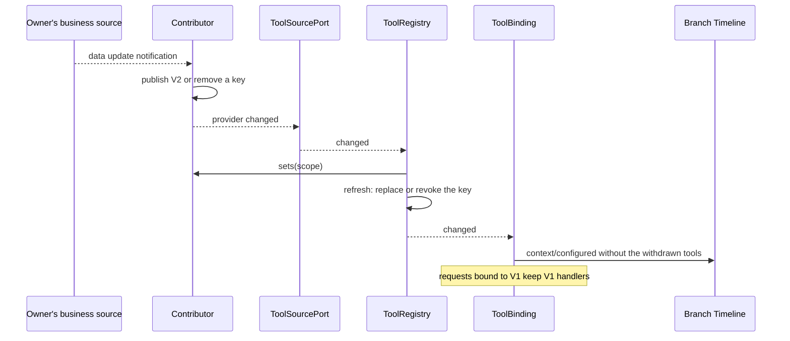
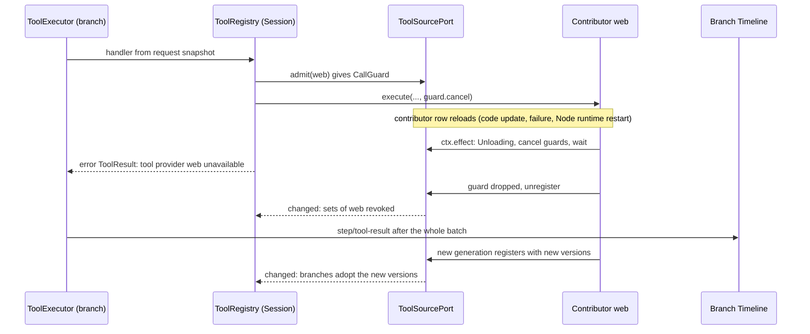
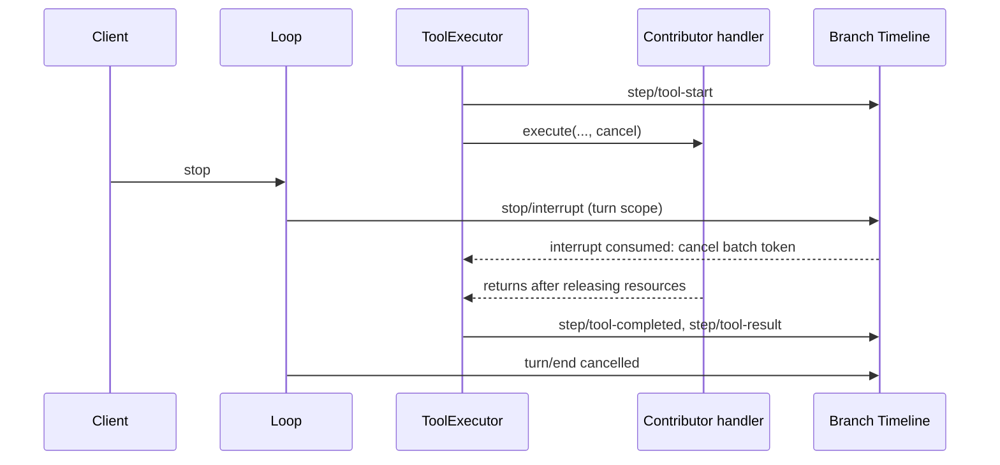

# Process-level tool contribution

Status: Draft. Overall design: [overview §3 dependency direction and ports](../overview.md#3-dependency-direction-and-ports), [§6.1 method A](../overview.md#61-integration-methods), [Appendix C ToolRegistry supplement](../overview.md#appendix-c-supplements-and-changes-to-existing-plugins); rules: [ADR 002](../../adr/002-plugin-scope.md) D1–D3. Phase: P0. Language: Rust (port and ToolRegistry side); a contributor may be implemented in any language that provides the provider contract.

ToolRegistry's side owns the **tool source port**: a stable process service through which process plugins offer model tools to every Session. The port is hosted in its own plugin with no dependencies. Contributors (Mcp, Collaboration's `agent`, Goal, Web, Scheduler, Workflow, Notifications, Questions' `ask_user`) depend on the port, register in `apply` and unregister in `ctx.effect`; each Session's ToolRegistry depends on the port, never on a contributor. Values about the calling Session (cwd, interactivity, role, resource node) are passed per call, so contributors never read Session state and no contributor needs a Session part. Adoption, pinning, execution and admission reuse the implemented contract of [tool contributions §7](../../architecture/rust-agent/tool-contributions.md). When a contributor unloads, its sets disappear and only its own in-flight calls end with "tool provider unavailable"; ToolRegistry, ToolBinding, Loop and ToolExecutor never reload.

`Contributions<ToolContribution>` stays reserved for stable first-party contributors that hold Session or branch state (`branch`, `wait`, `skill`); its names are fixed at assembly ([ADR 002](../../adr/002-plugin-scope.md#consequences)). `Contributions<SessionToolSource>` is no longer used: McpSession and the Questions Session placeholder are removed.

## 1. Structure



Every edge into the port points from the volatile side to the stable side; nothing points from the port or from ToolRegistry to a contributor. Contributors reach Session data and resource-node services only through public ports resolved per call, and the calling branch's own public services only through the lookup ToolRegistry binds into each call (§A.4), as Wait does through `S:TreeCommands`.

| Part | Scope | Depends on | Provides |
| --- | --- | --- | --- |
| `ToolSourcePort` plugin | Process | nothing | `ToolSourcePort` (stable) |
| Contributor | Process | `Arc<ToolSourcePort>`; its own dependencies; per call the node services port and `SessionAccess` when needed | Registration of one `ProcessToolProvider` under its name |
| `ToolRegistryPlugin` | Session | existing `S:ToolHost`, `S:SessionConfig`, `Contributions<ToolContribution>` (first-party only); added `Arc<ToolSourcePort>`; removed `Contributions<SessionToolSource>` | `S:ToolRegistry`, `S:ToolSourcesView` (unchanged) |
| ToolBinding, ToolExecutor, Approval, Permission | Branch | unchanged | unchanged |

| Contributor | Name | Sets derived from (per Session scope) | Per-call needs |
| --- | --- | --- | --- |
| Mcp | `mcp` (keys `mcp:<server>`) | MCP catalog and the project root of `cwd`; replaces McpSession | Host-local approval rechecked per call (A9) |
| Collaboration | `collaboration` (`agent`) | `collaboration_role` | The calling branch's CollaborationTimeline through `ToolCallScope::branch_service` |
| Questions | `questions` (`ask_user`) | Declares `interactive: true`, so non-interactive Sessions never see it | The calling branch's Questions part through `ToolCallScope::branch_service` |
| Goal, Web, Scheduler, Workflow, Notifications | own names | Their business configuration, read at use time ([ADR 002 D5](../../adr/002-plugin-scope.md#d5-structural-configuration-and-business-configuration-are-separate)) | Per their documents |

Contracts defined here (owner: ToolRegistry): `ToolSourcePort`, `ProcessToolProvider`, `ToolScope`, `ProcessToolSet`, `ProcessTool`, `ToolRequirements`, `ProcessToolHandler`, `ToolCallScope`, the registration mechanics (`Registered`, `CallGuard`, `Unavailable`, `PortError`; reused by the [Rpc ports](session-boundary.md)) and the per-call outcome "tool provider unavailable". Contracts depended on: `SessionConfig` with the [proposed fields](session-access.md#a3-sessionconfig-fields), the dynamic tool source contract (`ToolSourceSet`, `ToolHandler`, `ToolExecutionContext`), ToolBinding adoption and pinning, ToolExecutor settlement, the `ToolDefinition.risk` category read by Permission.

## 2. Data and state



No new event and no new `StateCell`. Timeline facts are the existing adoption (`context/configured`) and call facts; everything else is memory rebuilt from the port on `apply`.

| State | Owner | Rebuild |
| --- | --- | --- |
| Contributor business configuration | Contributor's business source | Read at use time; a change publishes new set versions, never a reload |
| Registered providers, generations | `ToolSourcePort` | Contributors register again in their `apply` |
| Per-Session sets (`sets(scope)`, filtered, handlers bound to the scope) | ToolRegistry | Recomputed on every refresh and `apply` |
| Current and replaced sets, held versions, `ToolSourcesState` | ToolRegistry (existing `Sources`) | Not persisted |
| Pins and request snapshots | ToolBinding (existing) | Pins from the adopted `context/configured`; snapshots runtime only |

## 3. Flows

### 3.1 Register, adopt and call



ToolExecutor consumes `step/tool-call` on the Dispatcher, registers the batch task and returns; all writes in the call path are ToolExecutor's or Approval's. The contributor writes no Timeline fact for the call; model-visible follow-up goes only through [session-access](session-access.md) input.

### 3.2 Business configuration change and withdrawal



Configuration edits, credentials and external outages are new set versions or revocations, never a reload ([ADR 002 D5](../../adr/002-plugin-scope.md#d5-structural-configuration-and-business-configuration-are-separate)). A contributor that unregisters is handled the same way: all its keys are revoked.

## 4. Timing and conflicts

### 4.1 Contributor reload mid-call



The call ends with an ordinary error result, never with the `capability reloading` reason that makes Loop end the turn `Failed`. Only Sessions with a call to this contributor in flight notice anything. TypeScript contributors share one Node runtime, so a runtime restart unregisters all of them together; consumers still do not reload.

### 4.2 Interrupt while the handler runs



The interrupt is decided by Timeline order: before `step/tool-call` consumption the call is never executed; after `step/tool-start` the token is cancelled and a result that truly completed is kept. Work a contributor continues after returning is not cancelled by this contract (A7).

### 4.3 Other key rows

| Scenario | Order | Outcome | Owner |
| --- | --- | --- | --- |
| V2 adopted after a request's `step/model-start`, before `bind` | adoption > model-start | Request binds V1 from its prefix; V1 released after the next bind at or after V2 | ToolBinding |
| Contributor unregistered, request pinned to its version | pin < unload | Retained handler returns "tool provider `<name>` unavailable"; turn continues | ToolRegistry wrapper |
| Resource node offline for a call | — | Node lookup yields `node_unavailable`; error result for that call | Contributor |
| Process restart mid-call | `step/tool-call` without result | Settled as not surviving recovery; never re-executed | ToolExecutor |

Full table: Appendix B.

## 5. Context mapping

| What the model sees | Form and position |
| --- | --- |
| Tool name, description, input schema | Declarations in the adopted `context/configured.tools`, effective for requests whose prefix contains that configuration; fixed tools first, then source tools by key |
| Call outcome, including "tool provider `<name>` unavailable" | `ToolResult.content` at the tool result position of its batch; `structured_content` is not model text |
| Follow-up after the call | Only input written through session-access, placed where Loop consumes it |

Declarations are configuration, not history: compaction keeps the latest adopted set; results survive compaction only through the summary. Child branches inherit the configuration adopted in their prefix and the results before the cut, then re-adopt. Non-interactive Sessions (`SessionConfig.interactive = false`) never see tools declaring `interactive: true` (`ask_user`). The model never sees requirement attributes, risk categories, set keys, versions, contributor names other than in the unavailable text, the per-call scope, diagnostics or other plugins' events.

## 6. Interfaces (summary)

| Interface | Purpose |
| --- | --- |
| `ToolSourcePort::register / snapshot / changed / admit` | Stable port: contributors register; ToolRegistry reads, watches and admits per call |
| `ProcessToolProvider::sets(scope) / changed` | Current sets for one Session scope and a change signal |
| `ProcessToolSet`, `ProcessTool`, `ToolRequirements` | Versioned set; tool definition with required `risk`; generic Session filters |
| `ProcessToolHandler::execute` | Called per call with `ToolCallScope`, `ToolCall`, `ToolExecutionContext`, cancellation |
| ToolRegistry supplement | Depends on the port; presents each registered contributor as one dynamic source per Session |

## 7. Security

Contributed tools are admitted per call by Approval and Permission through their declared risk; ToolExecutor calls Approval before every handler, so a contributor cannot bypass admission. The port is withdraw-only: an unregistered contributor's tools disappear, nothing is added. Contributors are trusted in-process code; `Deps` is not a sandbox (AGENTS rule 11). Credentials stay inside the contributor as references, never in definitions, results or diagnostics. A contributor exposing project-sourced executable content (Mcp) checks host-local approval on every call (A9); replay never restores it. Resource-node access goes through the node's services resolved per call; it never widens authority beyond the call's admission.

## Appendix A. Interface details

### A.1 Contribution types

```rust
/// Process service of the `ToolSourcePort` plugin (Deps: none); key TypeKey::of::<ToolSourcePort>().
impl ToolSourcePort {
    /// Contributors only, in `apply`; removal is registered with `ctx.effect` (A.2).
    pub fn register(&self, ctx: &Ctx, name: &str, provider: Arc<dyn ProcessToolProvider>)
        -> Result<(), PortError>;
    pub fn snapshot(&self) -> Arc<BTreeMap<String, Arc<Registered<dyn ProcessToolProvider>>>>;
    pub fn changed(&self) -> tokio::sync::watch::Receiver<u64>;   // revision
}
pub trait ProcessToolProvider: Send + Sync + 'static {
    /// Every complete set offered to a Session with this scope, one per key.
    fn sets(&self, scope: &ToolScope) -> Vec<Arc<ProcessToolSet>>;
    /// Signals that `sets` may have changed for some scope; carries no data and may coalesce.
    fn changed(&self) -> tokio::sync::watch::Receiver<()>;
}
/// Creation-time SessionConfig subset; fixed for the Session.
pub struct ToolScope {
    pub session_id: String,
    pub cwd: PathBuf,
    pub interactive: bool,
    pub collaboration_role: CollaborationRole,
    pub resource_node: Option<NodeId>,
    pub created_by: SessionOrigin,
}
pub struct ToolCallScope { pub session: Arc<ToolScope>, pub branch_id: String, /* + branch lookup */ }
impl ToolCallScope {
    /// The calling branch's public branch service (e.g. the contributor's own branch part),
    /// resolved per call through the Session ToolRegistry belongs to (`Session::service(branch)`,
    /// Wait's `S:TreeCommands` precedent). No AgentIndex involved, so no `Reloading`.
    pub fn branch_service<T: ?Sized + BranchService + PublicService>(&self)
        -> Result<Arc<T>, BranchLookupError>;
}
pub enum BranchLookupError { BranchMissing, NotProvided, Pending }
pub struct ProcessToolSet {
    pub key: String,      // "<name>" or "<name>:<instance>", e.g. "mcp:github"
    pub version: String,  // never reused for this key, across generations and restarts
    pub tools: Vec<ProcessTool>,
}
pub struct ProcessTool {
    pub definition: ToolDefinition,          // `risk` required
    pub requires: ToolRequirements,
    pub handler: Arc<dyn ProcessToolHandler>,
}
pub struct ToolRequirements {
    pub interactive: bool,                              // offered only when scope.interactive
    pub roles: Option<BTreeSet<CollaborationRole>>,     // None = any role
}
pub trait ProcessToolHandler: Send + Sync + 'static {
    fn execute(&self, scope: &ToolCallScope, call: ToolCall, context: ToolExecutionContext,
        cancel: CancellationToken) -> HostFuture<'_, ToolResult>;
}
```

### A.2 Registration mechanics (shared by the ports of these contracts)

```rust
pub struct Registered<S: ?Sized> {
    pub name: String,
    pub generation: u64,          // unique per registration in this process
    pub service: Arc<S>,
}
impl<S: ?Sized> Registered<S> {
    pub fn admit(&self) -> Result<CallGuard, Unavailable>;
}
pub struct CallGuard { pub cancel: CancellationToken }  // drop = settled
pub struct Unavailable { pub name: String }
pub enum PortError {
    Invalid { name: String, reason: String },   // rejected as a whole
    Collision { name: String, owner: String },  // earlier owner keeps its names
    Closed,                                     // port host unloading
}
```

| Rule | Content |
| --- | --- |
| Register | In the contributor's `apply`; validation (names, collisions with current registrations) rejects the whole registration, reported in the contributor's diagnostics |
| Unregister | The `ctx.effect` disposer, in order: marks the entry `Unloading` (`admit` returns `Unavailable`); fires every outstanding guard's token (or, for a draining point, waits without cancelling) and waits until all guards drop, the consumer having settled each call with the point's "provider unavailable" outcome; removes the entry and bumps the revision |
| Consumers | Depend on the port only; decide one call from one snapshot; never use `capability reloading` for a contributor's unload |
| Re-entry | A new generation registers with a new generation number and new set versions |
| Port host | Has no dependency on any contributor and no volatile dependency; a host reload would reload contributors and consumers, so it has none |

### A.3 Per-Session adaptation

On every refresh ToolRegistry calls `sets(scope)` on each registered provider with its Session's `ToolScope`, keeps each tool whose `requires` matches (`interactive` requires `scope.interactive`; `roles` contains `scope.collaboration_role`), wraps each handler as a `ToolHandler` that admits through the provider's `Registered` entry and calls `execute` with `ToolCallScope`, returning "tool provider `<name>` unavailable" if admission fails or the guard is cancelled, and produces `ToolSourceSet { key, version, tools }` under the contributor's name as source name. The scope is fixed after creation, so one version's filtered result never changes within a Session. A set whose tools are all filtered out is revoked for that Session; an unregistered contributor's keys are revoked.

| Item | Rule |
| --- | --- |
| Version | Never reused for a key; include a per-generation random id and a counter (A4) |
| Definitions | Parsed at the contributor's boundary; `definition.name` matches `[A-Za-z0-9_-]{1,64}`; `source` is `ToolSource::Extension` (A5) |
| Risk | `definition.risk` is required; a set with a tool without it is rejected through the existing rejection path (A3) |
| Names | Unique within the set; not equal to fixed tools or other keys' current tools (existing validation, per Session) |
| Contributor name | `[a-z][a-z0-9-]*`; not a first-party `Contributions` name (`branch`, `wait`, `skill`); the port rejects the registration |

### A.4 Per-call context

| Value | Source |
| --- | --- |
| Session id, cwd, role, interactive, resource node, origin | `ToolCallScope.session` |
| Branch id, turn id, request id | `ToolCallScope.branch_id`, `ToolExecutionContext` from ToolExecutor |
| Call id, tool name, input | `ToolCall { id, name, input }` |
| Cancellation | ToolExecutor's token (interrupt, branch close) combined with the port's `CallGuard` (contributor unload) |
| Resource-node services | Node services port, keyed by `resource_node`, resolved per call ([overview §6.3](../overview.md#63-multiple-nodes)) |
| Calling branch's services | `ToolCallScope::branch_service::<T>()`: ToolRegistry binds the lookup to its Session and the call's branch; `BranchMissing` after close, `Pending` while that capability is not active, `NotProvided` if the branch has none; the handler returns an error result |
| Session reads, inputs | [`SessionAccess`](session-access.md) with these ids |

Risk categories are opaque strings owned by Permission (`Risk::of` in [permission.rs](../../../crates/dim-agent-capabilities/src/permission.rs)): existing `read_filesystem`, `write_filesystem`, `execute_process`, `network`, `session`; new categories `outbound_message` and `persistent_configuration` are registered with Permission (overview Appendix C), and FullAccess allows them (decision E1). Until Permission recognizes a string, it is unclassified (denied under read-only, asked under workspace-write, allowed under FullAccess).

### A.5 Timeline and capability mechanics

| Step | Path |
| --- | --- |
| Watch | ToolRegistry `apply` reads the port snapshot, subscribes to the port's `changed()` and each provider's `changed()` before the first `sets` call, and joins watcher tasks in its `ctx.effect` disposer |
| Refresh | Existing `ToolRegistry::refresh` over the adapted sets: validate the whole set, replace atomically or reject (`ToolSourcesState.rejected`), notify `changed()`. No Timeline write |
| Adoption | ToolBinding (after `BranchLifecycle::activated()`) calls `Prompt::adopt_tools`; Prompt's serial queue publishes `context/configured` through `Timeline::append_batch_registered`; the adopted sequence becomes a pin |
| Request pinning | Loop calls `ToolBinding::bind(request_id, through, tools, tool_sources)` from the prefix configuration; the snapshot holds the declared version's `Arc<ToolSourceSet>` |
| Execution | ToolExecutor consumes `step/tool-call`, registers the batch task and returns; per call it appends `step/tool-start`, asks Approval, calls the handler, appends `step/tool-completed`, and after all calls one `step/tool-result` |
| Contributor unload | Keys revoked, in-flight calls get the unavailable result, a new generation registers new versions, branches re-adopt. ToolRegistry does not reload |
| ToolRegistry reload (from `ToolHost` or its own) | Existing protocol: in-flight batches reload-settled; branches whose prefix versions are unavailable re-adopt in `apply` |
| Process restart | Restored branches re-adopt at `branch/resume`; committed calls without results are settled by ToolExecutor's rebuild, never re-executed |

## Appendix B. Full conflict table

| Scenario | Sequence order | Outcome | Owner of the decision |
| --- | --- | --- | --- |
| V2 adopted after a request's `step/model-start`, before `bind` | adoption of V2 > model-start | Request binds V1; V1 released after the next successful bind at or after V2 | ToolBinding |
| V2 published while a V1 call executes | — | Call completes on V1; next request declares V2 | ToolBinding snapshot |
| Set revoked mid-call | — | Call completes; next request lacks the tool; a later call by name gets `Unknown tool` | ToolBinding |
| Turn `stop/interrupt` before the batch is dispatched | interrupt < `step/tool-call` consumption | Not executed, `Tool cancelled before execution` | ToolExecutor |
| Turn `stop/interrupt` while the handler runs | interrupt > `step/tool-start` | Token cancelled; handler returns; a truly completed result is kept; turn ends cancelled | ToolExecutor, Loop |
| Interrupt while Approval is pending | interrupt > `approval/request` | `approval/cancelled`; handler never called | Approval |
| Branch-scoped interrupt or branch close | branch interrupt | As turn interrupt; work continued after returning is not cancelled (A7) | ToolExecutor; contributor |
| Batch not yet settled | handler returned, others running | Result held until the batch's single `step/tool-result` | ToolExecutor |
| Handler writes Session input during the call | `input/message` < `step/tool-result` | Steer/Append consumed after the batch result; Queue after the turn | InputQueue, Loop |
| Handler's input withdrawn before consumption | `input/message` < `input/withdrawn` | Never consumed; the tool result stands | InputQueue |
| Compaction after the result | `context/compaction` > `step/tool-result` | Result survives only through the summary; declarations stay in configuration | ContextPreparation |
| Child branch creation | cut before `step/model-start` | Child inherits the adopted configuration; pins or re-adopts | ToolBinding (child) |
| Contributor reload or failure mid-call | admit < disposer | That call: "tool provider `<name>` unavailable"; batch and turn continue | Port, ToolRegistry wrapper |
| Contributor unregistered, call through a retained pin | unload < call | Unavailable error result; turn continues | ToolRegistry wrapper |
| Contributor disabled by the user | unregister | Keys revoked in every Session; branches adopt without them; no Session is Pending | Port |
| Contributor enabled later | register | Existing Sessions adopt its tools at the next opportunity | Port, ToolBinding |
| Mcp catalog or project approval changes | provider changed | New versions per Session scope; approval also rechecked per call | Mcp |
| Agents reload while `agent` or `ask_user` runs | — | Leases keep the Session; only `SessionAccess` calls needing AgentIndex return `Reloading` | SessionAccess |
| Resource node of the Session offline | — | `node_unavailable`; error result for that call | Contributor |
| Process restart mid-call | `step/tool-call` without result | Settled as not surviving recovery; not re-executed | ToolExecutor |
| Session unload and restore | `branch/resume` | Sets recomputed for the scope; current versions adopted before the first request | ToolRegistry, ToolBinding |
| Handler returns after its token was cancelled | — | Exactly one result per call | ToolExecutor |
| Duplicate or late call (model repeats the call id) | — | ToolExecutor's existing per-call rules | ToolExecutor |
| Client detach | — | No effect on calls | — |

## Appendix C. Errors and recovery

| Case | Result |
| --- | --- |
| Name conflict, invalid name, missing `risk`, reused version | Whole set rejected in that Session; previous set kept; `ToolSourcesState.rejected`; diagnostics |
| Registration rejected (name collision, reserved name) | Contributor reports it; its tools are absent |
| Contributor unload during a call | Error result "tool provider `<name>` unavailable" |
| Handler error | Error `ToolResult` for that call only |
| Handler ignores cancellation | Turn completion and the contributor's unload wait for it; reported in diagnostics |
| Adoption failure | Pins and prefix kept; retried on the next change (existing) |

## Appendix D. Acceptance

Flow tests in `tests/integration` with a test contributor (controllable versions, recorded calls, observable `Drop`):

1. A registered contributor's tools appear in declarations of new and existing Sessions; a call reaches its handler with the Session scope, branch id, call id and request ids.
2. `sets(scope)` receives each Session's cwd; two Sessions with different project roots see different Mcp sets.
3. A tool with `interactive: true` (`ask_user`) is absent in a non-interactive Session; a `roles` restriction is honored.
4. Version change during a pinned request and during a running call; revocation.
5. Interrupt before dispatch, during the handler and during approval; one result per call.
6. Missing `risk` rejects the set and keeps the previous one; an unknown risk string is unclassified.
7. Contributor reload (and Mcp restart) during a call yields one unavailable error result; the turn completes; ToolRegistry, ToolBinding, Loop and ToolExecutor do not reload.
8. Disabling a contributor withdraws its tools from running Sessions without Pending; enabling it adds them.
9. A business configuration change publishes a new version with no unload.
10. `ask_user` resolves the calling branch's Questions part through `branch_service`; after branch close it gets `BranchMissing` and returns an error result.
11. Restart settles committed calls without re-execution; restored branches re-adopt before the first request.

## Appendix E. Assumptions

| # | Assumption | Basis | Effect if rejected |
| --- | --- | --- | --- |
| A2 | Per-Session filtering attributes are `interactive` and collaboration `roles` | Overview B.1; role is judgment | Attribute set changes; matching stays generic |
| A3 | Every contributed tool must declare `risk`; otherwise the set is rejected | Overview §6.2 constraints | Undeclared tools fall back to unclassified handling |
| A4 | Versions combine a per-generation random id and a counter | "Never reused" rule | Any scheme never reused across generations and restarts |
| A5 | Contributed tools use `ToolSource::Extension` | Judgment | Display only |
| A7 | Interrupting the calling branch never cancels work a contributor continues after its call returned | Overview B.9, generalized | Each contributor defines interrupt propagation itself |
| A9 | Approval of project-sourced executable tool content is rechecked per call | Overview §6.4 Trust; MCP precedent | Revocation would not stop calls through retained bindings |

## Appendix F. Open questions

| Question | Description |
| --- | --- |
| Session opt-out | Whether `SessionConfig` or the Agent profile may exclude a whole contributor, beyond requirement attributes |
