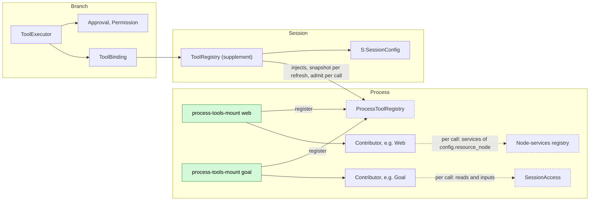
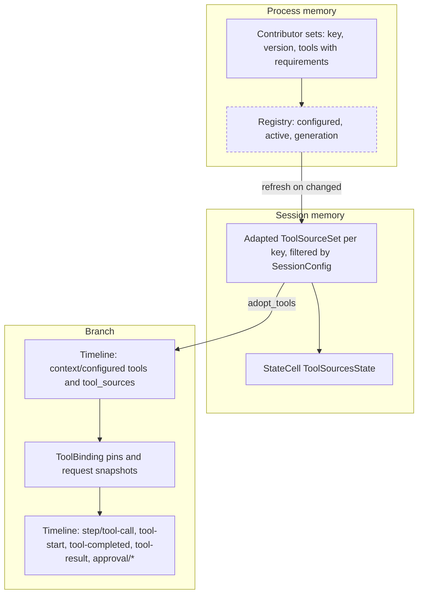
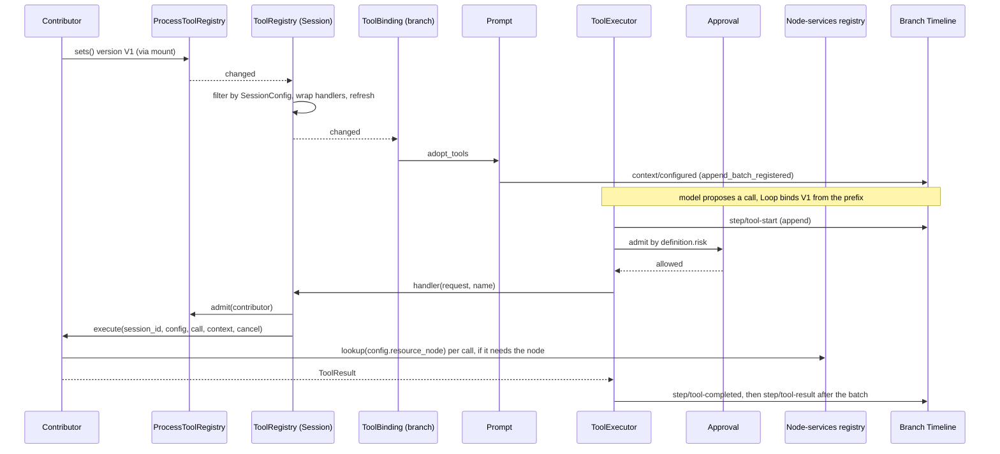
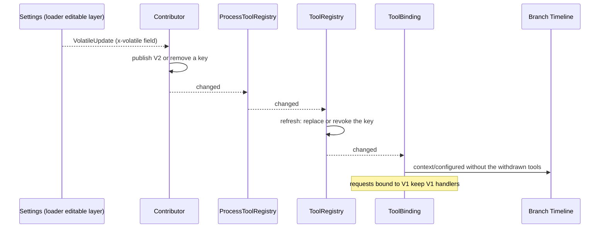
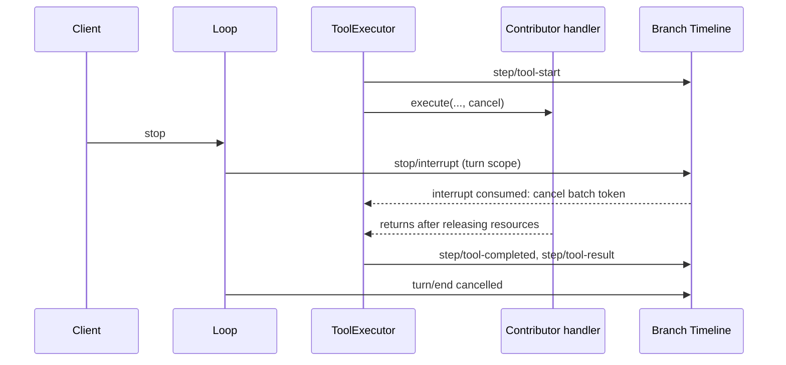

# Process-level tool contribution

Status: Draft. Overall design: [overview §6.1 method A](../overview.md#61-integration-methods), [§3 extension registries](../overview.md#3-extension-registries), [Appendix C ToolRegistry supplement](../overview.md#appendix-c-supplements-and-changes-to-existing-plugins). Phase: P0. Language: Rust (registry and ToolRegistry side); a contributor may be implemented in any language that provides the service contract.

ToolRegistry defines a generic extension point through which a process plugin offers model tools to every Session. Contributors register into a stable process tool registry through per-contributor mounts ([extension registry](extension-registry.md)); each Session's ToolRegistry injects only that registry, filters contributed tools by generic attributes against the Session's `SessionConfig` ([proposed fields](session-access.md#a3-sessionconfig-fields)), passes that configuration to each handler and presents every active contributor as an ordinary dynamic tool source. Adoption, pinning, execution and admission reuse the implemented contract of [tool contributions §7](../../architecture/rust-agent/tool-contributions.md); a contributor's unload withdraws its tools and fails only its own in-flight calls.

Not covered: Session-scoped contributions that resolve the calling branch's service per call (precedent [Wait](../../architecture/rust-agent/plugins/Wait.md)); they keep using `ToolContribution`.

## 1. Structure



ToolRegistry depends on the registry and the Session's existing configuration, never on a contributor, so no contributor's lifecycle reaches ToolRegistry, ToolBinding, Loop or ToolExecutor. Contributors reach Session data and resource-node services only through public contracts resolved per call.

| Part | Scope | Depends on | Provides |
| --- | --- | --- | --- |
| Contributor | Process | its own dependencies; per call the [`node-services`](extension-registry.md#5-rules-every-point-follows) registry and [`SessionAccess`](session-access.md) when needed | `ProcessToolSource` under key `TypeKey::keyed_dynamic::<ProcessToolSource>(name)` |
| Process tool registry plugin | Process | `Arc<Loader>` | `ProcessToolRegistry` = `ExtensionRegistry<ProcessTools>`, mount group `process-tools-mount` |
| `process-tools-mount` instance | Process | `Arc<ProcessToolRegistry>`, the contributor's `ProcessToolSource` | registration |
| `ToolRegistryPlugin` | Session | existing `S:ToolHost`, `S:SessionConfig`, `Contributions<ToolContribution>`, `Contributions<SessionToolSource>`; added `Arc<ProcessToolRegistry>` | `S:ToolRegistry`, `S:ToolSourcesView` (unchanged) |
| ToolBinding, ToolExecutor, Approval, Permission | Branch | unchanged | unchanged |

Contracts defined here (owner: ToolRegistry): the point `ProcessTools`, `ProcessToolSource`, `ProcessToolProvider`, `ProcessToolSet`, `ProcessTool`, `ToolRequirements`, `ProcessToolHandler`, and the per-call outcome "tool provider unavailable". Contracts depended on: [extension registry](extension-registry.md), `SessionConfig` with the [proposed fields](session-access.md#a3-sessionconfig-fields), the dynamic tool source contract (`ToolSourceSet`, `ToolContribution`, `ToolHandler`, `ToolExecutionContext`), ToolBinding adoption and pinning, ToolExecutor settlement, the `ToolDefinition.risk` category read by Permission. ToolRegistry never knows a contributor or matches tool names; contributors never read Session or branch state.

## 2. Data and state



No new event and no new `StateCell`. The only Timeline facts are the existing adoption (`context/configured`) and call facts; everything else is memory rebuilt from the current registry on `apply`.

| State | Owner | Rebuild |
| --- | --- | --- |
| Contributor sets and business state | Contributor, process storage | Contributor's document |
| Active contributors, generations | Process tool registry | Mount registration (§1) |
| Per-Session adapted sets (filtered, handlers bound to `SessionConfig`) | ToolRegistry | Recomputed from the registry snapshot on every refresh and `apply` |
| Current and replaced sets, held versions, `ToolSourcesState` | ToolRegistry (existing `Sources`) | Not persisted |
| Pins and request snapshots | ToolBinding (existing) | Pins from the adopted `context/configured` in the prefix; snapshots are runtime only |

## 3. Flows

### 3.1 Publish, adopt and call



ToolExecutor consumes `step/tool-call` on the Dispatcher, registers the batch task and returns; all writes in the call path are ToolExecutor's or Approval's. The contributor writes no Timeline fact for the call; model-visible follow-up goes only through [session-access](session-access.md) input.

### 3.2 Configuration change and withdrawal



Ordinary changes (configuration, credentials, an external outage) are set versions or revocations published in place, never a reload ([extension registry §5](extension-registry.md#5-rules-every-point-follows)). A contributor that becomes inactive is handled the same way: the registry revokes all its keys (withdraw-only).

## 4. Timing and conflicts

### 4.1 Contributor reload mid-call

The full sequence is [extension registry §3.2](extension-registry.md#32-contributor-reload-while-a-call-is-in-flight): the mount's disposer cancels the call's guard, the wrapped handler returns the error result "tool provider `<name>` unavailable" without the reload settlement marker, ToolExecutor writes it in the batch's single `step/tool-result`, and the turn continues. Only that call is affected.

### 4.2 Interrupt while the handler runs



The interrupt is decided by Timeline order: before `step/tool-call` consumption the call is never executed; after `step/tool-start` the token is cancelled and a result that truly completed is kept. Work a contributor continues after returning is not cancelled by this contract (A7).

### 4.3 Other key rows

| Scenario | Order | Outcome | Owner |
| --- | --- | --- | --- |
| V2 adopted after a request's `step/model-start`, before `bind` | adoption > model-start | Request binds V1 from its prefix; V1 released after the next bind at or after V2 | ToolBinding |
| Contributor inactive, request already pinned to its version | pin < unload | Retained handler returns the existing explicit stop error as an error result; turn continues | ToolRegistry wrapper |
| Resource node offline for a call | — | Node lookup yields `node_unavailable`; the contributor returns an error result for that call | Contributor |
| Process restart mid-call | `step/tool-call` without result | Settled as not surviving recovery; never re-executed | ToolExecutor |

Full table: Appendix B.

## 5. Context mapping

| What the model sees | Form and position |
| --- | --- |
| Tool name, description, input schema | Declarations in the adopted `context/configured.tools`, effective for requests whose prefix contains that configuration; fixed tools first, then source tools by key |
| Call outcome, including "tool provider `<name>` unavailable" | `ToolResult.content` at the tool result position of its batch; `structured_content` is not model text |
| Follow-up after the call | Only input written through session-access, placed where Loop consumes it |

Declarations are configuration, not history: compaction keeps the latest adopted set; results survive compaction only through the summary. Child branches inherit the configuration adopted in their prefix and the results before the cut, then re-adopt. Non-interactive Sessions (`SessionConfig.interactive = false`) never see tools declaring `interactive: true`. The model never sees requirement attributes, risk categories, set keys, versions, contributor names other than in the unavailable text, the per-call context, diagnostics, or other plugins' events.

## 6. Interfaces (summary)

| Interface | Purpose |
| --- | --- |
| `ProcessToolSource` / `ProcessToolProvider` | Keyed process service: current sets and a change signal |
| `ProcessToolSet`, `ProcessTool`, `ToolRequirements` | Versioned set; tool definition with required `risk`; generic Session filters |
| `ProcessToolHandler::execute` | Called per call with the Session id, `SessionConfig`, `ToolCall`, `ToolExecutionContext`, cancellation |
| `ProcessToolRegistry` | `ExtensionRegistry<ProcessTools>`, point `process-tools`, stance withdraw-only |
| ToolRegistry supplement | Injects the registry; filters by its existing `S:SessionConfig`; presents each active contributor as a dynamic source |

## 7. Security

Contributed tools are admitted per call by Approval and Permission through their declared risk; ToolExecutor calls Approval before every handler, so a contributor cannot bypass admission. The registry is withdraw-only on failure: an inactive contributor's tools disappear, nothing is added. Contributors are trusted in-process code; `Deps` is not a sandbox (AGENTS rule 11). Credentials stay inside the contributor as references, never in definitions, results or diagnostics. A contributor exposing project-sourced executable content checks host-local approval on every call (A9); replay never restores it. Resource-node access goes through the node's services resolved per call, which carry that node's isolation configuration; it never widens authority beyond the call's admission.

## Appendix A. Interface details

### A.1 Contribution types

```rust
/// Process service; key TypeKey::keyed_dynamic::<ProcessToolSource>(name), no instance.
pub struct ProcessToolSource(pub Arc<dyn ProcessToolProvider>);

pub trait ProcessToolProvider: Send + Sync + 'static {
    /// Every complete set currently offered, one per key; same rules as `ToolProvider::sets`.
    fn sets(&self) -> Vec<Arc<ProcessToolSet>>;
    /// Signals that `sets()` changed; carries no data and may coalesce.
    fn changed(&self) -> tokio::sync::watch::Receiver<()>;
}
pub struct ProcessToolSet {
    pub key: String,      // "<registered name>" or "<registered name>:<instance>"
    pub version: String,  // never reused for this key, across generations and restarts
    pub tools: Vec<ProcessTool>,
}
pub struct ProcessTool {
    pub definition: ToolDefinition,          // `risk` required
    pub requires: ToolRequirements,
    pub handler: Arc<dyn ProcessToolHandler>,
}
/// Generic attributes matched against SessionConfig (A2).
pub struct ToolRequirements {
    pub interactive: bool,                              // offered only when config.interactive
    pub roles: Option<BTreeSet<CollaborationRole>>,     // None = any role
}
pub trait ProcessToolHandler: Send + Sync + 'static {
    /// `config`: the Session's SessionConfig; handlers read only the creation subset
    /// (cwd, interactive, collaboration_role, created_by, resource_node).
    fn execute(&self, session_id: &str, config: &Arc<SessionConfig>, call: ToolCall,
        context: ToolExecutionContext, cancel: CancellationToken) -> HostFuture<'_, ToolResult>;
}
/// The point; owned by ToolRegistry.
pub struct ProcessTools;
impl ExtensionPoint for ProcessTools {
    type Service = ProcessToolSource;
    const POINT: &'static str = "process-tools";
    const STANCE: Stance = Stance::PerName;   // withdraw-only
    /* admit: name matches [a-z][a-z0-9-]*, not a registered session tool source name */
}
pub type ProcessToolRegistry = ExtensionRegistry<ProcessTools>;
```

### A.2 Per-Session adaptation

Per active contributor and refresh, ToolRegistry: keeps each tool whose `requires` matches the Session (`interactive` requires `config.interactive`; `roles` contains `config.collaboration_role`); wraps its handler as a `ToolHandler` that admits through the contributor's `Active` entry, calls `ProcessToolHandler::execute` with the Session id and `SessionConfig` and returns "tool provider `<name>` unavailable" if admission fails or the guard is cancelled; and produces a `ToolSourceSet { key, version, tools }` with the contributor's key and version, under the contributor's name as registered source name. The filtered fields are fixed after creation, so the filtered result of one version never changes within a Session. A set whose tools are all filtered out is treated as revoked for that Session. When a contributor leaves `active`, all its keys are revoked.

| Item | Rule |
| --- | --- |
| Version | Never reused for a key; include a per-generation random id and a counter (A4) |
| Definitions | Parsed at the contributor's external boundary; `definition.name` matches `[A-Za-z0-9_-]{1,64}`; `source` is `ToolSource::Extension` (A5) |
| Risk | `definition.risk` is required; ToolRegistry rejects a set containing a tool without it through the existing rejection path (A3) |
| Names | Unique within the set; not equal to fixed tools or other keys' current tools (existing validation, per Session) |
| Contributor name | Not equal to a `session_tool_source` name (`mcp`) or a fixed contribution name; the registry rejects the mount |

### A.3 Per-call context

| Value | Source |
| --- | --- |
| Session id | `session_id` |
| cwd, role, interactive, resource node, origin | `SessionConfig` subset |
| Branch id, turn id, request id | `ToolExecutionContext { branch_id, turn_id, request_id }` from ToolExecutor |
| Call id, tool name, input | `ToolCall { id, name, input }` |
| Cancellation | The token ToolExecutor passes (interrupt, branch close), combined with the registry `CallGuard` (contributor unload) |
| Resource-node services | `node-services` lookup of `config.resource_node` per call (FileStorage, HostPlatform, isolation of that node; [extension registry](extension-registry.md#5-rules-every-point-follows)) |
| Session reads and inputs | `SessionAccess` with these ids |

Risk categories are opaque strings owned by Permission (`Risk::of` in [permission.rs](../../../crates/dim-agent-capabilities/src/permission.rs)): existing `read_filesystem`, `write_filesystem`, `execute_process`, `network`, `session`; new categories `outbound_message` and `persistent_configuration` are registered with Permission (overview Appendix C), and FullAccess allows them (decision E1). Until Permission recognizes a string, it is unclassified (denied under read-only, asked under workspace-write, allowed under FullAccess).

### A.4 Timeline and capability mechanics

| Step | Path |
| --- | --- |
| Inject and watch | ToolRegistry `apply` reads the registry snapshot, subscribes to the registry's `changed()` and to each active contributor's `changed()` before the first `sets()` read, and joins watcher tasks in its `ctx.effect` disposer |
| Refresh | Existing `ToolRegistry::refresh` over the adapted sets: validate the whole set, replace atomically or reject (`ToolSourcesState.rejected`), notify `changed()`. No Timeline write |
| Adoption | ToolBinding (after `BranchLifecycle::activated()`) calls `Prompt::adopt_tools`; Prompt's serial queue publishes `context/configured` through `Timeline::append_batch_registered` (the callback fails the batch if the adoption was superseded). The adopted sequence becomes a pin |
| Request pinning | Loop calls `ToolBinding::bind(request_id, through, tools, tool_sources)` from the prefix configuration; the snapshot holds the declared version's `Arc<ToolSourceSet>` |
| Execution | ToolExecutor consumes `step/tool-call` on the Dispatcher, registers the batch task and returns; per call it appends `step/tool-start`, asks Approval (`approval/request` and `approval/respond` when asking), calls the handler, appends `step/tool-completed`, and after all calls one `step/tool-result` |
| Settlement | ToolExecutor: cancellation before execution, panic, process restart. Contributor unload yields an ordinary error result, never reload settlement |
| State and recheck | Existing `StateCell<ToolSourcesState>`; ToolBinding compares current versions with the last adopted configuration it consumed |
| Contributor reload | Mount only: keys revoked, in-flight calls get the unavailable result, new generation registers new versions, branches re-adopt. ToolRegistry does not reload |
| ToolRegistry reload (from `ToolHost` or its own) | Existing protocol: in-flight batches reload-settled; branches whose prefix versions are unavailable re-adopt in `apply` |
| Process restart | Restored branches re-adopt at `branch/resume` before their first request; committed calls without results are settled by ToolExecutor's rebuild, never re-executed |

## Appendix B. Full conflict table

| Scenario | Sequence order | Outcome | Owner of the decision |
| --- | --- | --- | --- |
| V2 adopted after a request's `step/model-start`, before `bind` | adoption of V2 > model-start | Request binds V1; V1 released after the next successful bind at or after V2 | ToolBinding |
| V2 published while a V1 call executes | — | Call completes on V1; next request declares V2 | ToolBinding snapshot |
| Set revoked mid-call | — | Call completes; next request lacks the tool; a later call by name gets `Unknown tool` | ToolBinding |
| Turn `stop/interrupt` before the batch is dispatched | interrupt < `step/tool-call` consumption | Not executed, `Tool cancelled before execution` | ToolExecutor |
| Turn `stop/interrupt` while the handler runs | interrupt > `step/tool-start` | Token cancelled; handler releases and returns; a truly completed result is kept; turn ends cancelled | ToolExecutor, Loop |
| Interrupt while Approval is pending | interrupt > `approval/request` | `approval/cancelled`; handler never called | Approval |
| Branch-scoped interrupt or branch close | branch interrupt | As turn interrupt; work the contributor continues after returning is not cancelled (A7) | ToolExecutor; contributor |
| Batch not yet settled | handler returned, others running | Result held until the batch's single `step/tool-result`; its side effects already happened | ToolExecutor |
| Handler writes Session input during the call | `input/message` < `step/tool-result` | Steer/Append consumed after the batch result; Queue after the turn | InputQueue, Loop |
| Handler's input withdrawn by the user before consumption | `input/message` < `input/withdrawn` | Never consumed; the tool result stands | InputQueue |
| Compaction after the result | `context/compaction` > `step/tool-result` | Result survives only through the summary; declarations stay in configuration | ContextPreparation |
| Child branch creation | cut before `step/model-start` | Child inherits the adopted configuration; pins or re-adopts; never inherits snapshots | ToolBinding (child) |
| Contributor reload or failure mid-call | admit < disposer | That call: "tool provider `<name>` unavailable"; batch and turn continue | Registry mount, ToolRegistry wrapper |
| Contributor inactive, call through a retained pin | unload < call | Explicit stop error as an error result; turn continues | ToolRegistry wrapper |
| Contributor disabled by the user | LoaderChanged | Keys revoked in every Session; branches adopt without them; existing Sessions never Pending | Registry |
| Contributor enabled later | register | Existing Sessions adopt its tools at the next opportunity | Registry, ToolBinding |
| Contributor on a peer row, peer offline | mount Pending | Tools withdrawn as inactive; other Sessions and contributors unaffected | Registry |
| Resource node of the Session offline | — | `node_unavailable` from the node lookup; error result for that call | Contributor |
| Process restart mid-call | `step/tool-call` without result | Settled as not surviving recovery; not re-executed | ToolExecutor |
| Session unload and restore | `branch/resume` | Re-inject the registry; current versions adopted before the first request | ToolRegistry, ToolBinding |
| Handler returns after its token was cancelled | — | Exactly one result per call | ToolExecutor |
| Duplicate or late call (model repeats the call id) | — | ToolExecutor's existing per-call rules; contributors are not deduplicated | ToolExecutor |
| Client detach | — | No effect on calls | — |

## Appendix C. Errors and recovery

| Case | Result |
| --- | --- |
| Name conflict, invalid name, missing `risk`, reused version | Whole set rejected in that Session; previous set kept; `ToolSourcesState.rejected`; diagnostics |
| Contributor configured but not Active | Its tools absent (withdraw-only); Sessions are never Pending because of it |
| Contributor unload during a call | Error result "tool provider `<name>` unavailable" |
| Handler error | Error `ToolResult` for that call only |
| Handler ignores cancellation | Turn completion and the mount's unload wait for it; reported in diagnostics |
| Adoption failure | Pins and prefix kept; retried on the next change (existing) |

## Appendix D. Acceptance

Flow tests in `tests/integration` with a test contributor (controllable versions, recorded calls, observable `Drop`):

1. A registered contributor's tools appear in declarations of new and existing Sessions; a call reaches its handler with the Session id, `SessionConfig`, branch id, call id and request ids.
2. A tool with `interactive: true` is absent in a non-interactive Session; a `roles` restriction is honored.
3. Version change during a pinned request and during a running call; revocation.
4. Interrupt before dispatch, during the handler and during approval; one result per call.
5. Handler-written Steer input is consumed after the batch result.
6. Missing `risk` rejects the set and keeps the previous one; an unknown risk string is unclassified.
7. Contributor reload during a call yields one unavailable error result; the turn completes; ToolRegistry does not reload.
8. Disabling a contributor withdraws its tools from running Sessions without Pending; enabling it adds them.
9. A volatile configuration change publishes a new version with no unload.
10. Restart settles committed calls without re-execution; restored branches re-adopt before the first request.

## Appendix E. Assumptions

| # | Assumption | Basis | Effect if rejected |
| --- | --- | --- | --- |
| A2 | Per-Session filtering attributes are `interactive` and collaboration `roles` from `SessionConfig` | Overview B.1 (non-interactive Sessions omit interactive tools); role is judgment | Attribute set changes; matching stays generic |
| A3 | Every contributed tool must declare `risk`; otherwise the set is rejected | Overview §6.2 constraints; rejection policy is judgment | Undeclared tools fall back to unclassified handling |
| A4 | Versions combine a per-generation random id and a counter | Judgment from the "never reused" rule | Any scheme never reused across generations and restarts |
| A5 | Contributed tools use `ToolSource::Extension` | Judgment | Display only |
| A7 | Interrupting the calling branch never cancels work a contributor continues after its call returned | Overview B.9, generalized by judgment | Each contributor defines interrupt propagation itself |
| A9 | Approval of project-sourced executable tool content is rechecked per call | Overview §6.4 Trust; MCP precedent (judgment) | Revocation would not stop calls through retained bindings |

A1 (opt-in fixed at Session build), A6 (category strings, now decision E1) and A8 (versions instead of reloads, now the [volatile configuration rule](extension-registry.md#5-rules-every-point-follows)) are superseded.

## Appendix F. Open questions

| Question | Description |
| --- | --- |
| Session opt-out | Whether `SessionConfig` or the Agent profile may exclude a whole contributor, beyond requirement attributes |
