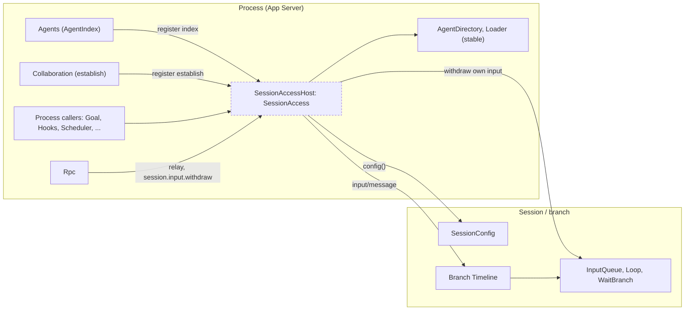
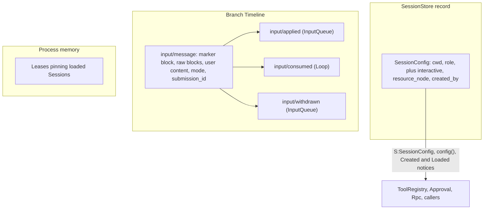
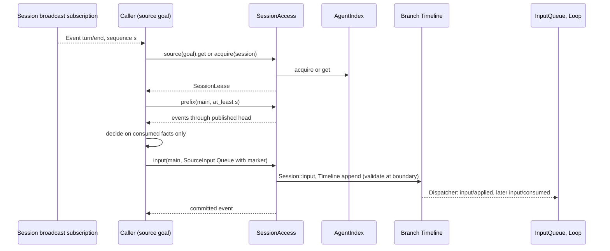
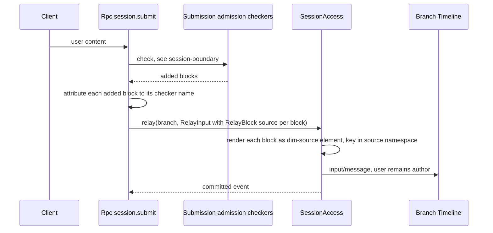
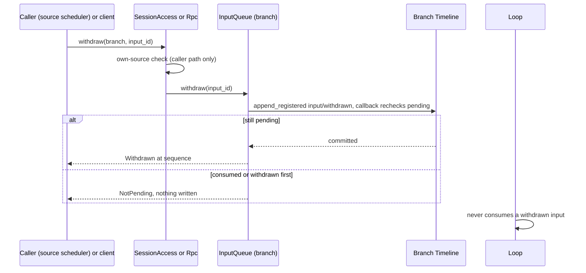
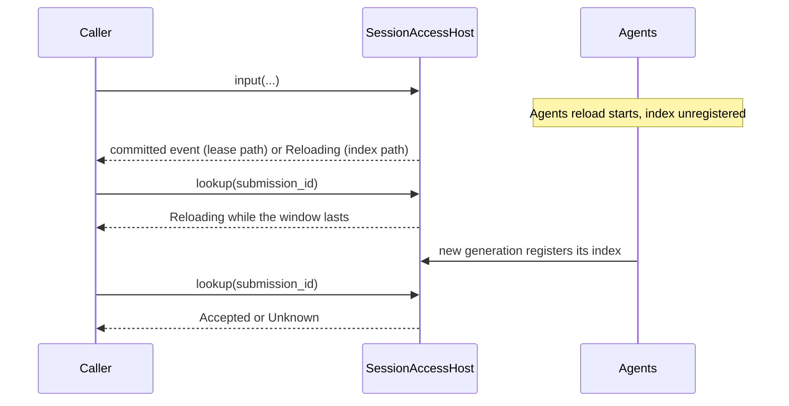

# Session access

Status: Draft. Overall design: [overview §3 dependency direction and ports](../overview.md#3-dependency-direction-and-ports), [§6.1 methods B and E](../overview.md#61-integration-methods), [Appendix C Agents](../overview.md#appendix-c-supplements-and-changes-to-existing-plugins); rules: [ADR 002](../../adr/002-plugin-scope.md) D1–D2. Phase: P0. Language: Rust.

SessionAccess is not a new abstraction: it is the existing public Session interface (`Session::input/history/local_page/sequence/idle/stop`, `AgentIndex::acquire`, `session.input_lookup` semantics) made reachable from process plugins, as Collaboration already uses it, with source attribution added. It is hosted, together with the [broadcast subscription](session-broadcast-subscription.md), in the stable process plugin `SessionAccessHost`, which depends only on `AgentDirectory` and `Loader`. Agents' `AgentIndex` registers into it and is resolved per call, so an Agents reload never reloads a caller: calls that need AgentIndex return `Reloading` while no generation is registered, and leases keep working. Collaboration registers `establish` into the same host, resolved per call by Workflow. This document also defines `SessionAccess::config`, which returns the existing `SessionConfig` with three proposed fields ([A.3](#a3-sessionconfig-fields)), and the process side of the [withdrawal contract](#a4-withdrawal).

## 1. Structure



All edges point to the stable host: callers inject only `SessionAccess`, and the volatile providers (Agents, Collaboration) register into it. Loaded Sessions and leases are reached through `AgentDirectory`, which outlives Agents reloads; restore, stored reads and creation go through the registered AgentIndex. Resource-node services are not reached through it: callers read `resource_node` from `SessionConfig` and resolve the node per call through the node services port ([overview §6.3](../overview.md#63-multiple-nodes)).

| Part | Scope | Depends on | Provides | Status |
| --- | --- | --- | --- | --- |
| `SessionAccessHost` | Process | `AgentDirectory`, `Loader` | `SessionAccess`, `SessionEvents` | New (stable host) |
| Agents | Process | existing | `AgentIndex` (existing), registered into `SessionAccessHost` in `apply`; proposed `SessionConfig` fields | Supplement |
| Collaboration | Process | `SessionAccessHost` | `establish` registration | Change |
| Runtime `Session` / `Branch` facades | Session / branch | — | `input`, `history`, `local_page`, `sequence`, `publication`, `idle`, `stop`, `branches` | Existing ([agent.rs](../../../crates/dim-agent-runtime/src/agent.rs), [branch.rs](../../../crates/dim-agent-runtime/src/branch.rs)) |
| InputQueue | Branch | existing | consumes `input/message`; owns withdrawal (`input/withdrawn`) | Change (overview Appendix C) |
| Callers | Process | `Arc<SessionAccess>` | — | Per plugin |

Contracts defined here (owner: Agents side, hosted in `SessionAccessHost`): `SessionAccess`, `SessionIndex`, `Establish`, `SourceAccess`, `SessionLease`, `SourceInput`, `RelayInput`, `RelayBlock`, `Marker`, `SourceBlock`, `KeyUse`, `Lookup`, `Withdrawal`, `AccessError`, the proposed `SessionConfig` fields `interactive`, `resource_node`, `created_by: SessionOrigin`, the `interactive` and `client` parameters of `session.create`, and the source marker and key namespace conventions. Contracts depended on: runtime `Session`/`Branch` facades, `AgentIndex` loading, `SessionConfig` ([config.rs](../../../crates/dim-agent-runtime/src/config.rs)), the `input/message` data and consumption contract, InputQueue's `input/withdrawn` data contract and withdrawal service. Callers depend on this contract only; it carries no caller-specific rule.

## 2. Data and state



The proposed `SessionConfig` fields are fixed at creation and stored with the Session; nothing here changes them. An input is pending while it has neither an `input/consumed` nor an `input/withdrawn` referencing its event id; every caller derivation of "pending input" uses exactly this rule.

| State | Owner | Rebuild |
| --- | --- | --- |
| `SessionConfig` | Agents, persisted in the Session record | Read from the record on restore |
| Input queue, applied, consumed and withdrawn inputs | InputQueue, Loop (`StateCell<InputSnapshot>`, `LoopSnapshot`) | From the branch's local history on reload (existing) |
| Leases | SessionAccess (wraps `SessionUse`) | Runtime only; ended on caller unload |
| Keyed block effect, model context | History projection ([history.rs](../../../crates/dim-agent-capabilities/src/history.rs)) | From the fixed prefix and compaction facts |
| Caller progress (pending `submission_id`, runs) | Caller, process storage | Caller's document |

## 3. Flows

### 3.1 Observe, decide, write



The caller holds no lock: facts committed after its read precede its write in sequence and are resolved by the input owners. A caller that may retry after an uncertain outcome calls `lookup(submission_id)` first.

### 3.2 Relay at the submission boundary



The checker never names its own source: Rpc sets `RelayBlock.source` from the checker's registered name ([session-boundary](session-boundary.md#a3-submission-admission-port)), so blocks are attributed without a forgeable marker and the user content stays unmarked.

### 3.3 Withdrawal



The decision between withdrawal and consumption is made under the branch commit lock by InputQueue, so exactly one of `input/withdrawn` and `input/consumed` exists for an input. Clients use the Session method `session.input.withdraw`; process callers may withdraw only inputs that carry their own source marker.

## 4. Timing and conflicts

### 4.1 Agents reload during a call



Callers retry after `Reloading` and look up their `submission_id` before re-writing. Sessions and leases survive an Agents reload (only directory logic is replaced); the host resolves AgentIndex per call, so callers never reload.

### 4.2 Withdrawal between write and consumption

| Scenario | Order | Outcome | Owner |
| --- | --- | --- | --- |
| Input withdrawn before consumption | input < withdrawn < (no consumed) | Never consumed; not pending for any derivation; stays in history, invisible to the model | InputQueue, Loop |
| Withdrawal after consumption | consumed < withdraw request | `NotPending`; nothing written | InputQueue |
| Steer input withdrawn while a tool batch runs | input < withdrawn < `step/tool-result` | Not consumed at the batch boundary | Loop |

### 4.3 Other key rows

| Scenario | Order | Outcome | Owner |
| --- | --- | --- | --- |
| Input before a turn `stop/interrupt`, not consumed | applied < interrupt | Stays pending; consumed by the next turn | Loop |
| Input after `stop/interrupt` | interrupt < input | Queue/Steer start a turn, Append waits | InputQueue, Loop |
| Decision read, then a newer fact, then write | through < fact < write | Write ordered after the fact; owner consumes in order | Input owners |
| Session unload between read and write | lease held | Lease pins the instance; unload refused while in use | AgentIndex |

Full table: Appendix B.

## 5. Context mapping

| Input form | What the model sees | Placement |
| --- | --- | --- |
| Marker block | One user-role message with the verbatim element text | First, at the input's consumed position (`input/consumed`) |
| Other raw blocks | One user-role message each, verbatim, in order | After the marker |
| Relay blocks | One user-role message each, rendered as `<dim-<source> kind="...">` elements of the checker's source | Before the user content of the same input |
| User content (text, images) | One user message; a single text block renders as text, otherwise parts with image blocks | After all blocks of the same input |
| Keyed block (`Live`) | As a raw block; additionally in effect: latest block per key | Consumed position |
| Retire block (`Retire`) | Delivered once; the key is no longer in effect | Consumed position |
| Withdrawn input | Nothing | — |

Consumption position by mode: Queue is consumed when Loop starts the turn it drives; Steer at the next boundary of the running turn (after the current batch's `step/tool-result`, or replacing a request that has no output) and starts a turn when idle; Append with the next model request of a turn and never starts one. Inputs applied before an interrupt and not consumed are consumed by the next turn.

Compaction: consumed inputs survive only through the summary, except keyed blocks, whose latest block per live key is replayed verbatim from the compaction baseline; retired keys are not replayed. Child branches see the ancestor prefix up to their cut, including the keys in effect at the cut, never inputs consumed after it, and never adopt pending inputs of the parent. Non-interactive Sessions use the same mapping; their Queue inputs drive turns with no user present. The model never sees `submission_id`, mode, `SessionConfig` fields, leases or events of other plugins; reads and `config` have no model-visible effect.

## 6. Interfaces (summary)

| Interface | Purpose |
| --- | --- |
| `SessionAccess::source(name) -> SourceAccess` | Binds source attribution for one caller |
| `SessionAccess::config(session_id) -> SessionConfig` | Configuration of a loaded or stored Session |
| `SessionAccess::register_index` | AgentIndex registers its generation; resolved per call |
| `SessionAccess::register_establish`, `establish` | Collaboration registers `establish`; Workflow resolves it per call |
| `SourceAccess::get / acquire / stored_page / loaded` | Leases and reads without capability state |
| `SessionLease::prefix / local_page / head / published / idle / stop` | Reads and turn-scope control |
| `SessionLease::input` | Source-marked input |
| `SessionLease::relay` | Operator content with per-block source attribution (Rpc) |
| `SessionLease::withdraw` (`SessionAccess::withdraw`) | Withdraw a pending input of the caller's own source |
| `SessionLease::lookup` | Find an input by `submission_id` |
| `S:SessionConfig` (existing) | Session service for Session and branch capabilities |
| `session.create { interactive, client }` | Non-interactive creation and client origin over RPC |
| `session.input.withdraw` | Client withdrawal Session method (InputQueue) |

## 7. Security

Only in-process trusted plugins obtain `SessionAccess`; they are not RPC methods and not exported over rutis links by this contract. Markers, keys and relay attribution are source-scoped so users and other sources cannot impersonate a source; process callers withdraw only their own inputs. Writing input confers no authority: tools started by the resulting turn are admitted by Approval and Permission under the Session's policy. Inputs are Timeline facts replayed into model context: callers must not put credentials or host security settings into them.

## Appendix A. Interface details

### A.1 SessionAccess

```rust
/// Process service of the `SessionAccessHost` plugin (Deps: AgentDirectory, Loader);
/// key TypeKey::of::<SessionAccess>(). In-process only, never exported as RPC.
impl SessionAccess {
    /// Agents' `apply`; removal with `ctx.effect`. At most one registration (A9).
    pub fn register_index(&self, ctx: &Ctx, index: Arc<dyn SessionIndex>) -> Result<IndexRegistration, PortError>;
    /// Collaboration's `apply`; removal with `ctx.effect`.
    pub fn register_establish(&self, ctx: &Ctx, establish: Arc<dyn Establish>) -> Result<(), PortError>;
    /// Resolved per call; `Unavailable` while Collaboration is not registered.
    pub async fn establish(&self, request: EstablishRequest) -> Result<SessionRef, AccessError>;
    pub fn source(&self, name: &'static str) -> SourceAccess;            // binds attribution (A1)
    pub async fn config(&self, session_id: &str) -> Result<Arc<SessionConfig>, AccessError>; // loaded or stored
}
impl SourceAccess {
    pub fn loaded(&self) -> Result<Vec<SessionRef>, AccessError>;        // AgentIndex::hosts + Agent::sessions
    pub fn get(&self, session_id: &str) -> Result<Option<SessionLease>, AccessError>; // loaded only
    pub async fn acquire(&self, session_id: &str) -> Result<SessionLease, AccessError>; // may restore
    pub async fn stored_page(&self, session_id: &str, branch: &str, after: u64, limit: usize,
        through: Option<u64>) -> Result<Page, AccessError>;               // no load
}
impl SessionLease {                                                        // pins one loaded incarnation
    pub fn config(&self) -> &Arc<SessionConfig>;
    pub fn branches(&self) -> Vec<TimelineInfo>;
    pub fn head(&self, branch: &str) -> Result<u64, AccessError>;        // published head
    pub async fn prefix(&self, branch: &str, at_least: u64) -> Result<Prefix, AccessError>;
    pub async fn local_page(&self, branch: &str, after: u64, limit: usize, through: u64)
        -> Result<Page, AccessError>;
    pub async fn input(&self, branch: &str, input: SourceInput) -> Result<Arc<AgentEvent>, AccessError>;
    pub async fn relay(&self, branch: &str, input: RelayInput) -> Result<Arc<AgentEvent>, AccessError>;
    pub async fn withdraw(&self, branch: &str, input_id: &str) -> Result<Withdrawal, AccessError>;
    pub async fn lookup(&self, branch: &str, submission_id: &str) -> Result<Lookup, AccessError>;
    pub async fn published(&self, branch: &str, sequence: u64) -> Result<(), AccessError>;
    pub async fn idle(&self, branch: &str) -> Result<u64, AccessError>;
    pub async fn stop(&self, branch: &str, reason: String) -> Result<u64, AccessError>;
}
pub struct Prefix { pub through: u64, pub events: Vec<Arc<AgentEvent>> } // ancestor prefix + local
pub struct SourceInput { pub submission_id: Option<String>, pub marker: Marker,
    pub blocks: Vec<SourceBlock>, pub user: Option<UserInput>, pub mode: InputMode }
pub struct Marker { pub kind: String, pub attrs: Vec<(String, String)>, pub body: String, pub key: Option<KeyUse> }
pub struct SourceBlock { pub text: String, pub key: Option<KeyUse> }
pub enum KeyUse { Live(String), Retire(String) }                       // name inside the source namespace
pub struct RelayInput { pub submission_id: Option<String>, pub user: UserInput,
    pub blocks: Vec<RelayBlock>, pub mode: InputMode }
pub struct RelayBlock { pub source: String, pub kind: String, pub block: SourceBlock } // source set by Rpc
pub enum Lookup { Accepted(Arc<AgentEvent>), Unknown }                  // Ambiguous is an error
pub enum Withdrawal { Withdrawn { sequence: u64 }, NotPending }
/// Implemented by AgentIndex: what needs directory logic.
pub trait SessionIndex: Send + Sync + 'static {
    fn acquire(&self, session_id: &str) -> HostFuture<'_, Result<SessionUse, AgentError>>;
    fn stored_config(&self, session_id: &str) -> HostFuture<'_, Result<Arc<SessionConfig>, AgentError>>;
    fn stored_page(&self, session_id: &str, branch: &str, after: u64, limit: usize,
        through: Option<u64>) -> HostFuture<'_, Result<Page, AgentError>>;
}
/// Handle AgentIndex uses to announce `Created`/`Loaded` (broadcast subscription).
impl IndexRegistration { pub async fn announce(&self, notice: SessionNotice); }
/// Implemented by Collaboration (member creation from outside a branch).
pub trait Establish: Send + Sync + 'static {
    fn establish(&self, request: EstablishRequest) -> HostFuture<'_, Result<SessionRef, AccessError>>;
}
pub struct EstablishRequest { pub leader_session: String, pub agent: String, pub source: String }
```

`PortError` and the registration mechanics are those of the [tool source port](process-tool-contribution.md#a2-registration-mechanics-shared-by-the-ports-of-these-contracts).

**Per-call resolution.** `get`, `loaded` and every `SessionLease` call read loaded Sessions through `AgentDirectory` (not restartable; Agents and their Sessions register there and outlive an Agents reload). A lease holds the Session's `SessionUse`, which belongs to the Session, not to the Agents generation. Only `acquire` (restore), `stored_page` and `config` of an unloaded Session resolve the registered `SessionIndex` per call and return `Reloading` while none is registered. `establish` resolves Collaboration's registration per call and returns `Unavailable` while none is registered; an establish in flight when Collaboration unloads ends `Unavailable` (its guard is cancelled), never `capability reloading`.

### A.2 Prefix, marking, keys, relay, submission identity

**Published prefix.** An event is published when its atomic batch is committed and the branch publication watermark has advanced ([Timeline storage §3](../../architecture/rust-agent/timeline-storage.md)); the published head is always a batch boundary. `prefix(branch, at_least)` fixes `through` = the published head at call time, fails with `FutureSequence` if that is below `at_least`, and returns `Session::history(branch, Some(through))`. Every event delivered by the [broadcast subscription](session-broadcast-subscription.md) is published, so `at_least = event.sequence` succeeds while the branch exists. `stored_page` reads local events of any stored branch without loading; ancestor prefixes require a lease.

**Source marking.** `input` renders `marker` as the first raw block, `context_block::element("dim-<source>", [("kind", kind), attrs..], body)` (A2). Consumers recognize a source only from the first line of the first raw block, `<dim-<source> kind="...">`. Element names used by existing producers cannot be source names: `dim-rule`, `dim-state`, `dim-agent-message`, `dim-agent-report`, `dim-branch-task`. A source name is lowercase `[a-z][a-z0-9-]*`, owned by the producing plugin, stable across releases (A3).

**Keys.** `KeyUse` names are placed in the source namespace: the raw block key is `<source>:<name>` (A4). Prompt's `rule:` and `state:` prefixes can never be produced. A key is per branch Timeline.

**Relay.** `relay` writes operator content on the user's behalf at the submission boundary. The user content carries no marker (the user remains its author, A5). Each `RelayBlock` is rendered as `context_block::element("dim-<source>", [("kind", kind)], text)` with its key in `<source>:`; `source` is set by Rpc from the registered name of the admission checker that added the block, never by the checker. `relay` requires `user` and is used only by Rpc.

**Submission identity.** `submission_id` is generated by the caller per logical submission, `<source>:<uuid>` (A6). Writes do not deduplicate. A caller that may retry after an uncertain outcome calls `lookup` first: `Accepted` returns the committed input, `Unknown` permits a retry, `Ambiguous` is an error. Same scan as `session.input_lookup` ([connection/tree.rs](../../../crates/dim-app-server/src/connection/tree.rs)).

**Never possible:** writing any event other than `input/message`, InputQueue's `input/withdrawn` through `withdraw`, and `stop`'s `stop/interrupt`; branch-scoped interrupts; editing or deleting history; reading capability state; supplying `submission_id`s, keys or markers of another source; withdrawing another source's or the user's input (enforced for well-behaved trusted code, not a sandbox).

### A.3 SessionConfig fields

Agents supplement: the existing `SessionConfig` gains three fields, fixed at creation and persisted with the Session record.

```rust
pub struct SessionConfig {
    // existing: permission_policy, cwd, model, system_prompt, tools, collaboration_role
    pub interactive: bool,               // false: exec, ACP, automation; stored Sessions without it: true
    pub resource_node: Option<NodeId>,   // None = the local host (control node)
    pub created_by: SessionOrigin,
}
pub enum SessionOrigin {
    Client { client: Option<String> },      // session.create over Rpc; label from `client`, e.g. "acp"
    Collaboration { leader_session: String }, // member created by Collaboration (including establish)
    Launch { source: String },              // Agents launch by a process source, e.g. "scheduler"
    Fork { source_session: String },        // created from another Session's cut
}
```

| Exposure | Consumers |
| --- | --- |
| `S:SessionConfig` (existing Session service) | ToolRegistry (process tool filtering and handler context), Approval (admission check requests), other Session/branch capabilities |
| `SessionAccess::config(session_id)`, `SessionLease::config()` | Process callers, Rpc (submission admission request, Session-level methods) |
| `Created` and `Loaded` notices (subset `interactive`, `collaboration_role`, `created_by`, `resource_node`) | Broadcast subscribers ([session broadcast](session-broadcast-subscription.md)) |

`session.create` gains `interactive?: bool` (default `true`) and `client?: string` (recorded in `SessionOrigin::Client`, so AcpGateway marks its Sessions without a separate `hello` field); `exec`, AcpGateway and automation (`launch`) create non-interactive Sessions. A fork copies `cwd`, `resource_node`, `interactive` and `collaboration_role` from the source and sets `created_by: Fork`. Only creation-time fields are read from `SessionConfig`; the current permission preset and model are Timeline facts.

### A.4 Withdrawal

| Item | Content |
| --- | --- |
| Owner | InputQueue (data contract `input/withdrawn { input_id }`, withdrawal service, consumption rule) |
| Client path | Session method `session.input.withdraw {sessionId, branchId, inputId}` → `{sequence}`; served by Rpc through `Session::service::<InputQueue>(branch)` as `approval.respond` is; errors `input_not_pending`, `unknown_input` |
| Process path | `SessionLease::withdraw(branch, input_id)` (`SessionAccess::withdraw`): only inputs whose first raw block is the caller's own marker; otherwise `Rejected("foreign source")` |
| Write path | InputQueue `Timeline::append_registered`; the in-lock callback rechecks that the input has neither `input/consumed` nor `input/withdrawn`, otherwise the append is cancelled (`NotPending`) |
| Withdraw and re-submit as Steer | One InputQueue atomic batch (`append_batch_registered`): `input/withdrawn` and the new `input/message` with mode Steer |
| Pending rule | An input is pending iff no `input/consumed` and no `input/withdrawn` references its event id; Goal, Notifications, AcpGateway, Scheduler and every caller use this rule |

### A.5 Errors

| Error | From | Meaning |
| --- | --- | --- |
| `SessionClosed` | `AgentError::Closed`, closed slot | Session closed or closing; nothing written |
| `SessionUnavailable(reason)` | `AgentError::Storage` from `acquire` | Stored but no available owner, or unreadable |
| `BranchMissing` | `AgentError::UnknownBranch` | Branch never published or already closed |
| `NotLoaded` | `get` | Use `acquire` or `stored_page` |
| `Reloading` | No AgentIndex registered (Agents reload window), `AgentError::Reloading` | Retry; after a write, `lookup` first |
| `Unavailable` | `establish` while Collaboration is not registered or unloads mid-call | Per-call; retry later |
| `Rejected(reason)` | `InputMessageData::validate`, marker, key, source or own-source rules, `FutureSequence` | Nothing written |
| `PublicationUnknown` | Committed, publication failed | Outcome uncertain; `lookup` after recovery |
| `Failed(AgentError)` | Fault, storage failure | Session fault |

### A.6 Timeline and capability mechanics

| Step | Path |
| --- | --- |
| Write | `SessionLease::input`/`relay` build `InputMessageData`, call `Session::input(data, branch)` → `Branch::input` → `TimelineContext::input`: fault check, close check, `validate()`, then `Timeline::append` (no registration callback; `before` hooks may transform the draft). `published` waits on `Branch::publication().watch()` |
| Withdraw | InputQueue `append_registered` with the pending recheck (A.4) |
| Consumption | InputQueue's Dispatcher subscription on `input/message` appends `input/applied { mode }`; Loop consumes at a turn or request boundary and appends `input/consumed`, skipping withdrawn inputs; WaitBranch records Steer arrivals; SessionBroadcast emits every event. Handlers register work and return |
| State | InputQueue `StateCell<InputSnapshot>` and Loop `LoopSnapshot`, rebuilt from `local(..=S)` on reload |
| Read | `Session::history` / `local_page`, bounded by the published head; no state read |
| Recheck | The caller decides on the prefix it read; later facts are ordered before its write and resolved by the input owners |
| Terminal facts | An input has no terminal fact; its consumption is Loop's, its withdrawal InputQueue's. A caller's own work records its outcome in the caller's process storage |
| Agents reload | Index-path calls in the window return `Reloading`; callers and leases are not reloaded (they depend only on the stable host); a committed input stays |
| Collaboration reload | `establish` returns `Unavailable` until it registers again; callers are not reloaded |
| InputQueue or Loop reload | The committed input is picked up by the new generation from the Timeline |
| Restart | Leases vanish; committed inputs are restored with the Session and adopted if neither consumed nor withdrawn; callers look up pending `submission_id`s before retrying |

## Appendix B. Full conflict table

| Scenario | Sequence order | Outcome | Owner of the decision |
| --- | --- | --- | --- |
| Input before a turn `stop/interrupt`, not yet consumed | applied < interrupt | Stays pending; consumed with the next turn | Loop |
| Input after `stop/interrupt` | interrupt < input | Queue/Steer start a turn, Append waits | InputQueue, Loop |
| Input consumed by the interrupted turn | consumed < interrupt | Cancelled with that turn; remains in history | Loop |
| Branch close or branch-scoped interrupt | close started < write | `SessionClosed`/`BranchMissing`; nothing written | Runtime facade |
| Input committed just before branch close | input < branch interrupt | In history, never consumed | Loop |
| Concurrent Steer, Queue, Append from different writers | Timeline order | Each applied by mode in sequence order | InputQueue |
| Tool batch not settled | input < `step/tool-result` | Steer and Append consumed after the batch result; Queue after `turn/end` | Loop |
| Steer while the model streams with no output yet | Steer consumed | Request cancelled ("replaced by steer"), turn continues | Loop, ModelProvider |
| `input/withdrawn` between write and consumption | input < withdrawn | Never consumed; not pending | InputQueue, Loop |
| Withdraw races consumption | consumed < withdraw append | `NotPending`; nothing written | InputQueue (commit lock) |
| Process caller withdraws a foreign input | — | `Rejected`; nothing written | SessionAccess |
| Compaction between write and consumption | input < compaction < consumed | Input placed at its consumed position after the summary | ContextPreparation |
| Keyed block written while compaction runs | cursor < keyed block | Not in that baseline; delivered at consumption; later baselines replay it | History projection |
| Child branch cut between write and consumption | input < cut < consumed | Child does not adopt the input | InputQueue (child) |
| Child branch cut after a keyed block was consumed | consumed < cut | Key in effect in the child; child may supersede or retire it | History projection |
| Two writers use the same key | Timeline order | Later block supersedes; namespaces prevent cross-source collisions | History projection |
| Retire then reuse a key | retire < new block | New block starts a new live key | History projection |
| Decision read, then a newer fact, then write | through < fact < write | Write ordered after the fact | Input owners |
| `Reloading` or restart after commit | committed, reply lost | `lookup` returns `Accepted`; no duplicate | Caller |
| Agents reload while a caller holds a lease | — | Lease stays valid; index-path calls return `Reloading` until the new generation registers | SessionAccessHost |
| `establish` while Collaboration unloads | admit < unload | `Unavailable`; Workflow settles that stage per its document | SessionAccessHost |
| Duplicate submission by a buggy caller | two inputs same id | Both applied; `lookup` returns `Ambiguous` | Caller |
| Session unload between read and write | lease held | Lease pins the instance; unload refused while in use | AgentIndex |
| Session not loaded | — | `acquire` restores before writing | AgentIndex |
| Resource node offline, input write | — | Input committed; turns start when capabilities leave Pending | rutis lifecycle |
| Client detach | — | No effect | — |

## Appendix C. Errors and recovery

Errors are listed in A.5. Cancelling a caller's future after `Session::input` returned does not withdraw the input; only `withdraw` does. `idle` and `stop` follow the runtime facade: they wait for Loop and return dispatched sequences; a closed branch returns `BranchMissing`. Restoring a Session through `acquire` runs project authorization as AgentIndex does today and can fail with `Failed`.

## Appendix D. Acceptance

Flow tests through public interfaces (App Server test suite):

1. `prefix` after a broadcast `turn/end` returns `through` ≥ the event sequence, including ancestor events for a child branch.
2. Queue, Steer and Append written while a tool batch runs: Steer and Append after the batch result, Queue after `turn/end`; the marker precedes user content.
3. Interrupt rows: input before an interrupt stays pending and is consumed by the next turn; input after it starts a turn.
4. Keyed block survives compaction as its latest block; a retired key does not; a child branch inherits and retires a key independently.
5. Marker, key and own-source validation: reserved names, foreign namespaces and foreign withdrawals are `Rejected`; RPC cannot submit blocks.
6. Relay blocks render with the admission checker's source; user content stays unmarked.
7. Withdrawal before consumption leaves the input unconsumed; withdrawal racing consumption yields exactly one of the two facts.
8. `acquire` restores an unloaded Session; `stored_page` and `config` read without loading.
9. An Agents reload returns `Reloading` to an `acquire` without reloading the caller; lease writes keep working; `lookup` then finds the committed input. A Collaboration reload makes `establish` return `Unavailable` without reloading Workflow.
10. `session.create {interactive: false, client: "acp"}` produces `interactive = false` and `created_by = Client { client: Some("acp") }`, visible through `config`, `S:SessionConfig` and the `Created` notice.

## Appendix E. Assumptions

| # | Assumption | Basis | Effect if rejected |
| --- | --- | --- | --- |
| A1 | Attribution is bound per caller through `source(name)` rather than per call | Judgment | Each call names its source; enforcement weaker |
| A2 | Every source input starts with one marker block `<dim-<source> kind="...">` | Overview B.2, B.8, §7; format is judgment | Each plugin defines its own recognition |
| A3 | A source name is the producing plugin's own stable name | Judgment | Renaming breaks recognition of historical inputs |
| A4 | Keys are `<source>:<name>`; Prompt's `rule:`/`state:` are reserved | Judgment; existing Prompt key format | Collisions between sources become possible |
| A5 | Submission-boundary user content is relayed as the user's without a marker; added blocks carry the admission checker's source | Overview §6.1 method E, B.4, B.7; decision record C13 | Such inputs gain a marker and render as runtime content |
| A6 | `submission_id` format `<source>:<uuid>`; writes never deduplicate | Existing `session.input_lookup`; format is judgment | Write-time deduplication would need registration in the commit lock |
| A7 | Process plugins may call `stop` (turn scope) and `idle` on a Session | Collaboration precedent; overview B.9 | Callers that stop Sessions they started need another stop path |
| A8 | Stored Sessions without `interactive` are interactive; `session.create` defaults to interactive | Judgment | Clients must always send the field |
| A9 | One AgentIndex registration at a time; a second registration is rejected | Agents is a single process plugin | — |

## Appendix F. Open questions

| Question | Description |
| --- | --- |
| Overview §9 "How events enter context" | This contract designs for adopted input only (ADR 001) |
| Lease duration | Whether holding a lease should block idle unload by a future host policy (ShellInput holds one for a whole command, Workflow across `idle` waits), or only pin for the call |
| Ancestor reads of unloaded Sessions | Whether the store should serve full prefixes without loading |
| Re-submit wire shape | Whether the "withdraw and re-submit as Steer" batch is a parameter of `session.input.withdraw` or a separate InputQueue Session method; InputQueue's page decides |
