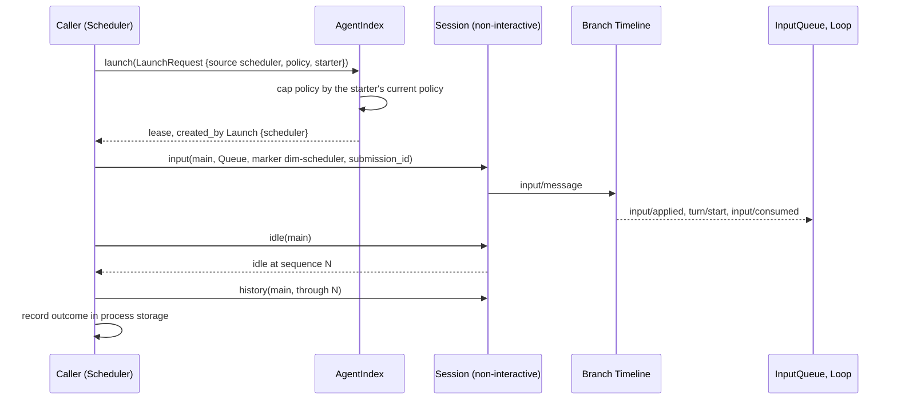
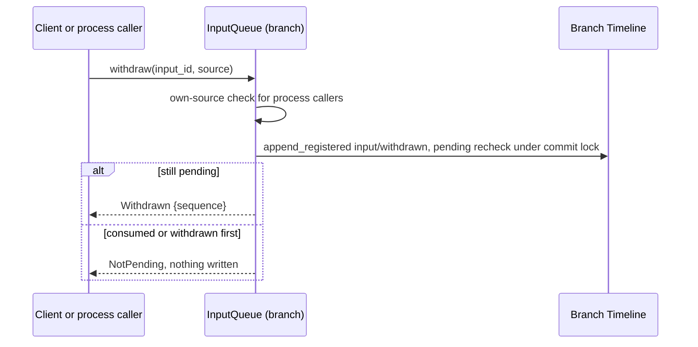

# Session access: Agents and Session public-interface supplement

Status: Draft. Overall design: [overview §3 integration](../overview.md#3-integration-by-existing-mechanisms), [Appendix B Agents and InputQueue](../overview.md#appendix-b-supplements-to-existing-plugins); rules: [ADR 002](../../adr/002-plugin-scope.md) D1–D3. Phase: P0. Language: Rust.

Process plugins reach Sessions the way Collaboration already does. They depend on Agents (`AgentIndex`), acquire or launch a Session, and use the public `Session` facade (`input`, `history`, `local_page`, `sequence`, `idle`, `stop`, `service`). This document adds what Scheduler, Workflow and Collaboration need on top of that interface. It adds no host or facade plugin, and a caller that depends on Agents reloads with it (D3).

| Supplement | Owner | Used by |
| --- | --- | --- |
| `AgentIndex::launch` with a policy capped by the starter | Agents | Scheduler, Workflow, Collaboration `establish` |
| `SessionConfig` fields `interactive`, `resource_node`, `created_by` | Agents | Every scope: `S:SessionConfig`, `Session::config()` |
| Input with source raw blocks (marker, keys, `submission_id`) | InputQueue data contract, runtime facade | Scheduler, Workflow; Goal and Hooks branch parts write the same form |
| Fixed-prefix read | Runtime facade | Process callers and branch parts deciding from Timeline facts |
| Withdrawal (`input/withdrawn`, `session.input.withdraw`, own-source withdrawal) | InputQueue | Clients, AcpGateway, Scheduler |

Session-scoped and branch-scoped plugins do not use this interface to reach their own Session. They use `S:`/`B:` services, the branch Dispatcher and the Session broadcast directly.

## 1. Structure


| Part | Scope | Status |
| --- | --- | --- |
| `AgentIndex::launch`, `acquire` | Process | `acquire` exists; `launch` is a supplement |
| `SessionConfig` fields | Session record | Supplement |
| Session facade ([agent.rs](../../../crates/dim-agent-runtime/src/agent.rs), [branch.rs](../../../crates/dim-agent-runtime/src/branch.rs)) | Session, branch | Existing; input attribution is a supplement |
| InputQueue | Branch | Change: `input/withdrawn`, withdrawal service |
| Collaboration `establish(leader, agent)` | Process | Change: member creation from outside a branch |

Contracts defined here are `LaunchRequest`, `SessionOrigin`, the three `SessionConfig` fields, the `interactive` and `client` parameters of `session.create`, the source marker, key and `submission_id` conventions, `Prefix`, the withdrawal contract and `Withdrawal`. Contracts used are the runtime facade, `AgentIndex` loading, the `input/message` data and consumption contract, and `context_block::element`.

## 2. Data and state

| State | Owner | Rebuild |
| --- | --- | --- |
| `SessionConfig` with the new fields | Agents, Session record | From the record on restore |
| Inputs and their applied, consumed and withdrawn facts | InputQueue, Loop | From local history on reload (existing) |
| Leases (`SessionUse`) | AgentIndex | Runtime only |
| Keyed block effect | History projection ([history.rs](../../../crates/dim-agent-capabilities/src/history.rs)) | From the fixed prefix and compaction facts |
| Caller progress (runs, pending `submission_id`s) | Caller's process storage | Caller's document |

An input is pending while no `input/consumed` and no `input/withdrawn` references its event id. Every "pending input" derivation (Goal, Notifications, AcpGateway, Scheduler) uses exactly this rule.

## 3. Flows

### 3.1 Launch, write, wait



The caller holds no lock. Facts committed after its read are ordered before its write and are resolved by the input owners. A caller that may retry after an uncertain outcome looks up its `submission_id` first.

### 3.2 Withdrawal



Exactly one of `input/withdrawn` and `input/consumed` exists for an input. Clients withdraw through the Rpc built-in `session.input.withdraw` ([session-boundary](session-boundary.md#a1-method-contributions)), and process callers withdraw through `Session::service::<InputQueue>(branch)`.

## 4. Timing and conflicts

| Scenario | Order | Outcome | Owner |
| --- | --- | --- | --- |
| Input before a turn `stop/interrupt`, not consumed | applied < interrupt | Stays pending; consumed by the next turn | Loop |
| Input after `stop/interrupt` | interrupt < input | Queue/Steer start a turn, Append waits | InputQueue, Loop |
| Withdrawn before consumption | input < withdrawn | Never consumed; not pending | InputQueue, Loop |
| Withdrawal races consumption | consumed < withdraw | `NotPending` | InputQueue |
| Agents reload while a caller holds a lease | — | Caller reloads with Agents (D3); committed inputs stay; caller looks up `submission_id` before rewriting | rutis lifecycle, caller |
| Launch with a policy wider than the starter's | — | Capped to the starter's current policy | Agents |

Full table: Appendix B.

## 5. Context mapping

| Input form | What the model sees | Placement |
| --- | --- | --- |
| Marker block | One user-role message with the verbatim `<dim-<source> kind="...">` element | First, at the input's consumed position |
| Other raw blocks | One user-role message each, verbatim, in order | After the marker |
| User content (text, images) | One user message | After all blocks of the same input |
| Keyed block (`Live`) | As a raw block; the latest block per key stays in effect | Consumed position |
| Retire block | Delivered once; the key leaves effect | Consumed position |
| Withdrawn input | Nothing | — |

Queue inputs are consumed when Loop starts the turn they drive. Steer inputs are consumed at the next boundary of the running turn and start a turn when the branch is idle. Append inputs are consumed with the next model request and never start a turn. Through compaction, consumed inputs survive only in the summary, except that the latest block of each live key is replayed verbatim. A child branch sees the ancestor prefix up to its cut, including the keys in effect at the cut, and never adopts the parent's pending inputs. The model never sees `submission_id`, mode, `SessionConfig` fields or leases.

## 6. Interfaces (summary)

| Interface | Purpose |
| --- | --- |
| `AgentIndex::launch(LaunchRequest) -> SessionUse` | Create a Session for automation with a capped policy |
| `AgentIndex::acquire(id)` (existing) | Lease a loaded or stored Session |
| `Session::config()` (existing), new fields | Creation-time configuration |
| `Session::input(InputMessageData, branch)` (existing) | Write input with source raw blocks |
| `Session::prefix(branch, at_least) -> Prefix` | Fixed-prefix read bounded by the published head |
| `InputQueue::withdraw(input_id, source)` | Withdraw a pending input |
| `session.create {interactive, client}` | Non-interactive creation and client origin |
| Collaboration `establish(leader, agent)` | Member created from outside a branch (Workflow) |

## 7. Security

Only in-process plugins hold `AgentIndex`, and nothing here is exported over RPC or rutis links. Markers, keys and `submission_id`s are source-scoped. Process callers withdraw only their own inputs, and clients withdraw through Rpc's Session authorization. Writing input confers no authority, because the resulting tool calls are admitted by Approval and Permission under the Session's policy. Inputs are replayed into model context, so callers must not put credentials or host security settings into them.

## Appendix A. Interface details

### A.1 Launch

```rust
pub struct LaunchRequest {
    pub agent: String,                    // Agent profile id
    pub cwd: PathBuf,
    pub resource_node: Option<NodeId>,
    pub source: String,                   // recorded as SessionOrigin::Launch { source }
    pub policy: Option<PermissionPolicy>, // narrowed request; None = starter's or read-only default
    pub starter: Option<SessionRef>,      // upper bound; None = host configuration bound
}
impl AgentIndex {
    pub async fn launch(&self, request: LaunchRequest) -> Result<SessionUse, AgentError>;
}
```

Launched Sessions are non-interactive. The effective policy is the requested policy capped by the starter's current policy, which is a Timeline fact read at launch. Without a starter, a run started by a management method defaults to read-only unless the job or definition declares more, and it is always capped by host configuration. Collaboration's `establish(leader, agent)` uses the same cap.

### A.2 Source input conventions

| Item | Rule |
| --- | --- |
| Marker | The first raw block is `context_block::element("dim-<source>", [("kind", kind), attrs..], body)`. A source is recognized only from the first line of the first raw block. A source name is `[a-z][a-z0-9-]*`, owned by the producing plugin and stable. The names `rule`, `state`, `agent-message`, `agent-report` and `branch-task` are reserved |
| Keys | `KeyUse::Live(name)` or `Retire(name)`, stored as `<source>:<name>`, per branch Timeline. Prompt's `rule:`/`state:` prefixes cannot be produced |
| Submission identity | `<source>:<uuid>`, generated per logical submission. Writes do not deduplicate; `session.input_lookup` semantics find a committed input (`Accepted`, `Unknown`, error on ambiguity) |
| Never possible | Writing events other than `input/message`, `input/withdrawn` through InputQueue and `stop/interrupt` through `stop`; editing history; using another source's marker, keys or ids |

### A.3 SessionConfig fields

```rust
pub struct SessionConfig {
    // existing: permission_policy, cwd, model, system_prompt, tools, collaboration_role
    pub interactive: bool,             // false: exec, ACP, automation; stored records without it: true
    pub resource_node: Option<NodeId>, // None = control node
    pub created_by: SessionOrigin,
}
pub enum SessionOrigin {
    Client { client: Option<String> },        // session.create; e.g. "acp"
    Collaboration { leader_session: String },
    Launch { source: String },                // e.g. "scheduler", "workflow"
    Fork { source_session: String },
}
```

`session.create` gains `interactive?: bool` (default `true`) and `client?: string`. A fork copies `cwd`, `resource_node`, `interactive` and `collaboration_role`. The fields are fixed at creation. The Session assembly reads `interactive` to decide which optional plugins are installed (no `ask_user` in non-interactive Sessions).

### A.4 Withdrawal

| Item | Content |
| --- | --- |
| Data contract | `input/withdrawn { input_id }`, owned by InputQueue |
| Client path | Rpc built-in `session.input.withdraw {sessionId, branchId, inputId}` → `{sequence}`; errors `input_not_pending`, `unknown_input` |
| Process and branch-part path | `InputQueue::withdraw(input_id, source)`: only inputs whose marker is the caller's source; otherwise `Rejected("foreign source")` |
| Write path | `append_registered` with an in-lock recheck that the input is still pending |
| Withdraw and re-submit as Steer | One atomic batch: `input/withdrawn` plus the new Steer `input/message` |

### A.5 Fixed-prefix read

`Session::prefix(branch, at_least)` fixes `through` as the published head at call time. It fails with `FutureSequence` if that head is below `at_least`, and otherwise returns `history(branch, Some(through))` including ancestors. Every event delivered by the branch Dispatcher or the Session broadcast is published, so `at_least = event.sequence` succeeds while the branch exists.

### A.6 Errors

| Error | Meaning |
| --- | --- |
| `SessionClosed`, `BranchMissing` | Nothing written |
| `Reloading` | Agents or the Session's capabilities are reloading; retry after looking up `submission_id` |
| `Rejected(reason)` | Validation, marker, key, own-source rule or `FutureSequence`; nothing written |
| `PublicationUnknown` | Committed, publication failed; look up after recovery |
| `Failed(AgentError)` | Session fault |

## Appendix B. Full conflict table

| Scenario | Sequence order | Outcome | Owner of the decision |
| --- | --- | --- | --- |
| Input before `stop/interrupt`, not consumed | applied < interrupt | Consumed with the next turn | Loop |
| Input after `stop/interrupt` | interrupt < input | Queue/Steer start a turn; Append waits | InputQueue, Loop |
| Input consumed by the interrupted turn | consumed < interrupt | Cancelled with that turn; stays in history | Loop |
| Branch close | close < write | `SessionClosed`/`BranchMissing` | Runtime facade |
| Concurrent writers | Timeline order | Applied by mode in sequence order | InputQueue |
| Tool batch not settled | input < `step/tool-result` | Steer and Append after the batch; Queue after `turn/end` | Loop |
| `input/withdrawn` before consumption | input < withdrawn | Never consumed | InputQueue, Loop |
| Withdraw races consumption | consumed < withdraw | `NotPending` | InputQueue |
| Foreign withdrawal by a process caller | — | `Rejected` | InputQueue |
| Compaction between write and consumption | input < compaction < consumed | Placed after the summary | ContextPreparation |
| Child branch cut between write and consumption | input < cut < consumed | Child does not adopt it | InputQueue (child) |
| Two writers, same key | Timeline order | Later supersedes; namespaces prevent cross-source collisions | History projection |
| Decision read, newer fact, then write | through < fact < write | Write ordered after the fact | Input owners |
| Agents reload | — | Callers reload with it (D3); committed inputs stay | rutis lifecycle |
| Restart after commit, reply lost | — | Lookup returns `Accepted`; no duplicate | Caller |
| Session not loaded | — | `acquire` restores first | AgentIndex |
| Resource node offline | — | Input committed; turns start when capabilities leave Pending | rutis lifecycle |

## Appendix C. Acceptance

1. `launch` creates a non-interactive Session whose policy is capped by the starter, with `created_by = Launch`.
2. `session.create {interactive: false, client: "acp"}` produces the fields visible through `Session::config()` and `S:SessionConfig`, and no `ask_user`.
3. Queue, Steer and Append written during a tool batch are consumed in the documented order, with the marker before the user content.
4. A keyed block survives compaction, a retired key does not, and a child branch inherits keys independently.
5. Withdrawal before consumption leaves the input unconsumed, and a withdrawal that races consumption yields exactly one of the two facts. A foreign withdrawal is `Rejected`.
6. `prefix` after a dispatched `turn/end` returns `through` ≥ that sequence.

## Appendix D. Assumptions

| # | Assumption | Basis | Effect if rejected |
| --- | --- | --- | --- |
| A1 | Every source input starts with one marker block | Existing context-block format | Each plugin defines recognition |
| A2 | Stored Sessions without `interactive` are interactive | Judgment | Clients must always send the field |
| A3 | Process callers may call `idle` and `stop` on Sessions they started | Collaboration precedent | Another stop path |
| A4 | The re-submit-as-Steer batch is a parameter of `session.input.withdraw` | Judgment | A separate built-in |
