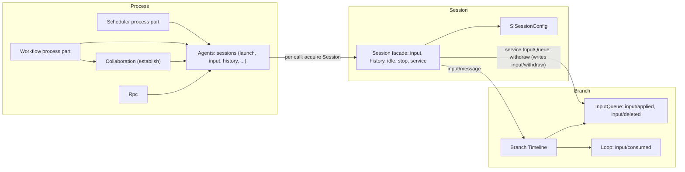
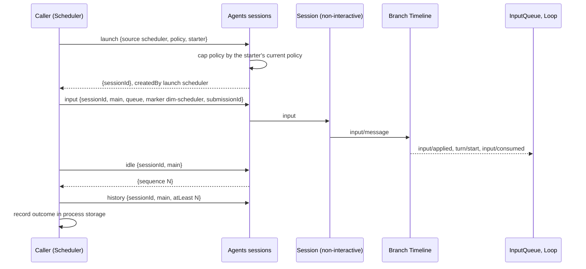
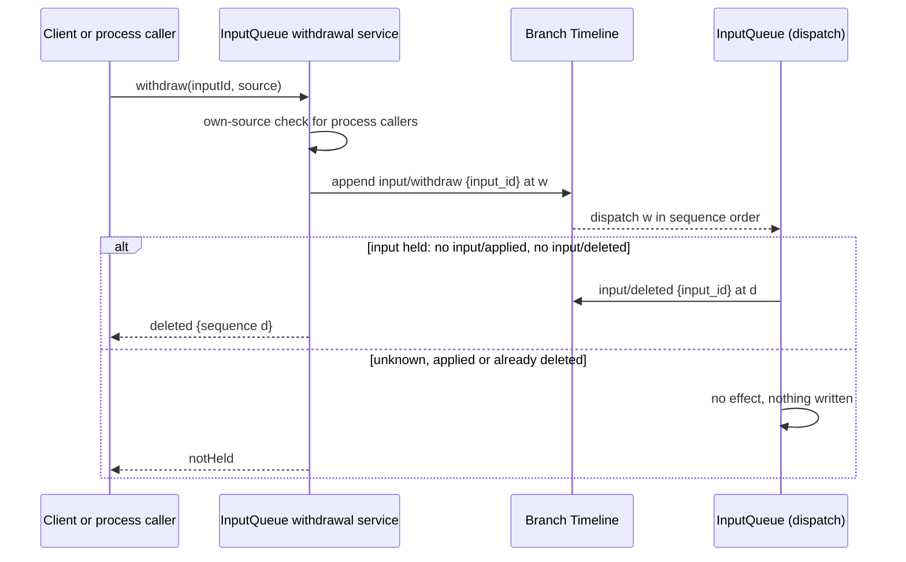

# Session access: Agents and Session public-interface supplement

Status: Draft. Overall design: [overview §3 integration](../overview.md#3-integration-by-existing-mechanisms), [Appendix B Agents and InputQueue](../overview.md#appendix-b-supplements-to-existing-plugins); rules: [ADR 002](../../adr/002-plugin-scope.md) D1–D3, D5. Phase: P0. Language: neutral contract; Rust binding in [Appendix E](#appendix-e-rust-binding).

Process plugins reach Sessions the way Collaboration already does: through Agents and the public Session interface. This document defines that access as the language-neutral process service `sessions` (ADR 002 D5), provided by Agents, so a TypeScript or Python process plugin (Scheduler, Workflow) uses it by name. Its methods are `launch`, `input`, `lookup`, `history`, `withdraw`, `stop` and `idle`, with request and reply as data ([A.1](#a1-the-sessions-service)). In Rust it is `AgentIndex` plus the `Session` facade ([Appendix E](#appendix-e-rust-binding)). It adds no host or facade plugin, and a caller that depends on Agents reloads with it (D3).

| Supplement | Owner | Used by |
| --- | --- | --- |
| `sessions` service: named, data-only access to Sessions | Agents | Scheduler, Workflow process parts |
| `launch` with a policy capped by the starter | Agents | Scheduler, Workflow, Collaboration `establish` |
| `SessionConfig` fields `interactive`, `resourceNode`, `createdBy` | Agents | Every scope: `S:SessionConfig`, `Session::config()` |
| Input with source raw blocks (marker, keys, `submissionId`) | InputQueue data contract, runtime facade | Scheduler, Workflow; Goal and Hooks branch parts write the same form |
| Fixed-prefix read | Runtime facade | Process callers and branch parts deciding from Timeline facts |
| Withdrawal (command `input/withdraw`, result `input/deleted`, `session.input.withdraw`, own-source withdrawal) | InputQueue | Clients, Hooks, AcpGateway, Scheduler, Workflow |

Session-scoped and branch-scoped plugins do not use this interface to reach their own Session. They use `S:`/`B:` services, the branch Dispatcher and the Session broadcast directly.

## 1. Structure



| Part | Scope | Status |
| --- | --- | --- |
| `sessions` (Agents) | Process | Supplement; maps to the existing `acquire` and facade, plus `launch` |
| `SessionConfig` fields | Session record | Supplement |
| Session facade ([agent.rs](../../../crates/dim-agent-runtime/src/agent.rs), [branch.rs](../../../crates/dim-agent-runtime/src/branch.rs)) | Session, branch | Existing; input attribution is a supplement |
| InputQueue | Branch | Change: consumes `input/withdraw`, writes `input/deleted`; withdrawal service |
| Collaboration `establish(leader, agent)` | Process | Change: member creation from outside a branch |

Contracts defined here are the `sessions` service with `LaunchRequest`, `InputWrite`, `RawBlock`, `HistoryRequest`, `HistoryPage`, `WithdrawRequest` and `SessionsError`; `SessionOrigin` and the three `SessionConfig` fields; the `interactive` and `client` parameters of `session.create`; the source marker, key and `submissionId` conventions; and the withdrawal contract. Contracts used are the runtime facade, Agents loading, the `input/message` data and consumption contract, `context_block::element`, the Session input path (`Session::input`) and Timeline before callbacks (runtime supplement, [overview Appendix B](../overview.md#appendix-b-supplements-to-existing-plugins)).

## 2. Data and state

| State | Owner | Rebuild |
| --- | --- | --- |
| `SessionConfig` with the new fields | Agents, Session record | From the record on restore |
| Inputs and their applied, consumed and deleted facts; InputQueue's held set | InputQueue, Loop | From local history on reload: an input is held while it has neither `input/applied` nor `input/deleted` |
| Leases held during a `sessions` call | Agents | Runtime only |
| Keyed block effect | History projection ([history.rs](../../../crates/dim-agent-capabilities/src/history.rs)) | From the fixed prefix and compaction facts |
| Caller progress (runs, pending `submissionId`s) | Caller's process storage | Caller's document |

An input is pending from its `input/message` until either `input/applied` followed by `input/consumed`, or `input/deleted`, references its event id. `input/withdraw` alone never changes whether an input is pending; only InputQueue's result fact does. Every "pending input" derivation (Goal, Notifications, AcpGateway, Scheduler, Workflow) uses exactly this rule.

## 3. Flows

### 3.1 Launch, write, wait



The caller holds no lock. Facts committed after its read are ordered before its write and are resolved by the input owners. A caller that may retry after an uncertain outcome calls `lookup` with its `submissionId` first. A write that matches an asynchronous Timeline before callback on its branch commits after the callback, so the reply may wait for it; a callback may append `input/withdraw` for that input in the same batch (A.4); InputQueue then writes `input/deleted` for it, and the caller reads the input as deleted.

### 3.2 Withdrawal



`input/withdraw { input_id }` is a command event, and `input/deleted { input_id }` is InputQueue's result fact. Legitimate producers write the command: clients through the Rpc built-in `session.input.withdraw` ([session-boundary](session-boundary.md#a1-method-contributions)), process callers through `sessions.withdraw`, and a Timeline before callback (for example Hooks) in the same atomic batch as the input. InputQueue consumes commands in sequence order and decides from its own decision state only ([time bus §4](../../architecture/rust-agent/time-bus.md#4-写入前的复核归各状态机)): the command takes effect only if InputQueue still holds that `input/message` unapplied. Once InputQueue has written `input/applied` for an input, the input belongs to Loop and cannot be withdrawn; Loop needs no change. InputQueue decides adoption for inputs only after the whole atomic batch containing them has been dispatched, so a withdraw in the input's own batch always takes effect. For one input, at most one of `input/applied` and `input/deleted` exists.

## 4. Timing and conflicts

| Scenario | Order | Outcome | Owner |
| --- | --- | --- | --- |
| Input before a turn `stop/interrupt`, not consumed | applied < interrupt | Stays pending; consumed by the next turn | Loop |
| Input after `stop/interrupt` | interrupt < input | Queue/Steer start a turn, Append waits | InputQueue, Loop |
| Withdraw while the input is held | input < `input/withdraw`, no `input/applied` | `input/deleted`; never applied or consumed; not pending | InputQueue |
| Withdraw after the input is applied | `input/applied` < `input/withdraw` | No effect, nothing written; reply `notHeld`; the input is consumed normally | InputQueue |
| Input and withdraw in one batch (before callback) | input, `input/withdraw` same batch | `input/deleted`; never applied; the write's reply still carries `{inputId, sequence}` | Callback owner, InputQueue |
| Agents reload during a `sessions` call | — | Caller reloads with Agents (D3); committed inputs stay; caller calls `lookup` before rewriting | rutis lifecycle, caller |
| Session's resource node offline | — | Input committed; tool calls on that node fail `node_unavailable`; nothing goes Pending | rutis link (#5) |
| Launch with a policy wider than the starter's | — | Capped to the starter's current policy | Agents |

Full table: Appendix B.

## 5. Context mapping

| Input form | What the model sees | Placement |
| --- | --- | --- |
| Marker block | One user-role message with the verbatim `<dim-<source> kind="...">` element | First, at the input's consumed position |
| Other raw blocks | One user-role message each, verbatim, in order | After the marker |
| User content (text, images) | One user message | After all blocks of the same input |
| Keyed block (`Live`) | As a raw block; the latest block per key stays in effect | Consumed position |
| Retire block | Delivered once; the key leaves effect | Consumed position |
| Deleted input (never applied) | Nothing: its user content and raw blocks never enter context, its keyed blocks never take effect, and compaction never sees it. Clients may show it as deleted from `input/deleted` | — |

Queue inputs are consumed when Loop starts the turn they drive. Steer inputs are consumed at the next boundary of the running turn and start a turn when the branch is idle. Append inputs are consumed with the next model request and never start a turn. Through compaction, consumed inputs survive only in the summary, except that the latest block of each live key is replayed verbatim. A child branch sees the ancestor prefix up to its cut, including the keys in effect at the cut, and never adopts the parent's pending inputs. The model never sees `submissionId`, mode, `SessionConfig` fields or leases.

## 6. Interfaces (summary)

| Interface | Mode | Purpose |
| --- | --- | --- |
| `sessions.launch(LaunchRequest) -> {sessionId}` | async | Create a non-interactive Session for automation with a capped policy |
| `sessions.input(InputWrite) -> {inputId, sequence}` | async | Write input with source raw blocks |
| `sessions.lookup({sessionId, branchId, submissionId}) -> LookupReply` | async | Find a committed input after an uncertain outcome |
| `sessions.history(HistoryRequest) -> HistoryPage` | async | Read history, optionally as a fixed prefix bounded by the published head |
| `sessions.withdraw(WithdrawRequest) -> WithdrawReply` | async | Write `input/withdraw` for an input of the caller's own source and return InputQueue's decision |
| `sessions.stop({sessionId, branchId}) -> {sequence}` | async | Interrupt the branch's turn |
| `sessions.idle({sessionId, branchId}) -> {sequence}` | async | Wait until the branch is idle |
| `SessionConfig` fields | data | Creation-time configuration (`interactive`, `resourceNode`, `createdBy`) |
| `session.create {interactive, client}` | RPC | Non-interactive creation and client origin |
| Collaboration `establish(leader, agent)` | — | Member created from outside a branch (Workflow); a Collaboration service, outside `sessions` |

## 7. Security

Only plugins in the control node's process hold `sessions`, and it is never exported over RPC entries or rutis links. Markers, keys and `submissionId`s are source-scoped. Agents fixes the caller's source from its plugin identity, so a caller cannot write or withdraw under another source. Process callers withdraw only their own inputs, and clients withdraw through Rpc's Session authorization. Writing input confers no authority, because the resulting tool calls are admitted by Approval and Permission under the Session's policy. Inputs are replayed into model context, so callers must not put credentials or host security settings into them.

## Appendix A. Interface details

### A.1 The sessions service

`sessions` is a process service provided by Agents, without an instance key. Shapes are JSON with camelCase fields; a `?` after a field name marks it optional and `|` separates alternatives. Each call acquires the Session (restoring it if needed) and holds it loaded until the reply. A caller's `source` is fixed by Agents from the calling plugin's declared source name.

| Method | Mode | Request | Reply | Errors |
| --- | --- | --- | --- | --- |
| `launch` | async | `LaunchRequest` | `{sessionId}` | `rejected`, `reloading`, `failed` |
| `input` | async | `InputWrite` | `{inputId, sequence}` | `rejected`, `session_closed`, `branch_missing`, `reloading`, `publication_unknown`, `failed` |
| `lookup` | async | `{sessionId, branchId, submissionId}` | `LookupReply` | `ambiguous`, `session_closed`, `branch_missing` |
| `history` | async | `HistoryRequest` | `HistoryPage` | `future_sequence`, `session_closed`, `branch_missing` |
| `withdraw` | async | `WithdrawRequest` | `WithdrawReply` | `foreign_source`, `session_closed`, `branch_missing` |
| `stop` | async | `{sessionId, branchId}` | `{sequence}` | `session_closed`, `branch_missing` |
| `idle` | async | `{sessionId, branchId}` | `{sequence}` | `session_closed`, `branch_missing` |

```text
// LaunchRequest
{ "agent": "string",                 // Agent profile id
  "cwd": "string",
  "resourceNode?": "string",         // absent: control node
  "model?": "string",                // model id; absent: the profile's model
  "policy?": { /* PermissionPolicy data */ },  // narrowed request; absent: starter's or read-only default
  "starter?": { "sessionId": "string", "branchId": "string" } } // upper bound; absent: host configuration bound
// InputWrite
{ "sessionId": "string", "branchId": "string",
  "mode": "queue" | "steer" | "append",
  "submissionId": "<source>:<uuid>",
  "rawBlocks": [ RawBlock ],         // first block is the caller's marker (A.2)
  "content": [ { "type": "text", "text": "..." } | { "type": "image", "...": "..." } ] }
// RawBlock
{ "text": "string", "key?": { "use": "live" | "retire", "name": "string" } }
// LookupReply
{ "status": "accepted", "inputId": "string", "sequence": 0 } | { "status": "unknown" }
// HistoryRequest
{ "sessionId": "string", "branchId": "string",
  "after?": 0,                        // exclusive lower bound; absent: from the start of the branch
  "through?": 0,                      // read up to this sequence
  "atLeast?": 0 }                     // fixed-prefix read (A.5)
// HistoryPage
{ "through": 0, "events": [ { "sequence": 0, "branchId": "string", "type": "turn/end", "data": {} } ] }
// WithdrawRequest
{ "sessionId": "string", "branchId": "string", "inputId": "string" }
// WithdrawReply
{ "status": "deleted", "sequence": 0 }   // sequence of input/deleted
| { "status": "notHeld" }                  // unknown, already applied or already deleted; InputQueue wrote nothing
// SessionsError
{ "code": "rejected" | ..., "message": "string", "retryable": false }
```

Cancellation: the caller dropping an `idle` or `history` call ends it with no effect. Dropping an `input` before the reply leaves the outcome uncertain; the caller resolves it with `lookup`.

`launch` creates a non-interactive Session with `createdBy = {kind: "launch", source}`. The effective policy is the requested policy capped by the starter's current policy, which is a Timeline fact read at launch. Without a starter, a run started by a management method defaults to read-only unless the job or definition declares more, and it is always capped by host configuration. Collaboration's `establish(leader, agent)` uses the same cap.

### A.2 Source input conventions

| Item | Rule |
| --- | --- |
| Marker | The first raw block is `context_block::element("dim-<source>", [("kind", kind), attrs..], body)`. A source is recognized only from the first line of the first raw block. A source name is `[a-z][a-z0-9-]*`, owned by the producing plugin and stable. The names `rule`, `state`, `agent-message`, `agent-report` and `branch-task` are reserved |
| Keys | `RawBlock.key` with `use: live` or `retire`, stored as `<source>:<name>`, per branch Timeline. Prompt's `rule:`/`state:` prefixes cannot be produced |
| Submission identity | `<source>:<uuid>`, generated per logical submission. Writes do not deduplicate; `sessions.lookup` (same semantics as `session.input_lookup`) finds a committed input (`accepted`, `unknown`, error `ambiguous`) |
| Never possible | Writing events other than `input/message`, `input/withdraw` through `withdraw` and `stop/interrupt` through `stop`; writing `input/deleted`; editing history; using another source's marker, keys or ids |

### A.3 SessionConfig fields

```text
// SessionConfig (new fields; existing: permissionPolicy, cwd, model, systemPrompt, tools, collaborationRole)
{ "interactive": true,              // false: exec, ACP, automation; stored records without it: true
  "resourceNode?": "string",        // absent: control node
  "createdBy": SessionOrigin }
// SessionOrigin
{ "kind": "client", "client?": "acp" }
| { "kind": "collaboration", "leaderSession": "string" }
| { "kind": "launch", "source": "scheduler" }
| { "kind": "fork", "sourceSession": "string" }
```

`session.create` gains `interactive?: bool` (default `true`) and `client?: string`. A fork copies `cwd`, `resourceNode`, `interactive` and `collaborationRole`. The fields are fixed at creation. The Session assembly reads `interactive` to decide which optional plugins are installed (no `ask_user` in non-interactive Sessions).

### A.4 Withdrawal

| Item | Content |
| --- | --- |
| Command | `input/withdraw { input_id }`, a branch command event; producers: the withdrawal service (clients, process callers) and Timeline before callbacks in the input's own batch. It is never a fact about the input by itself |
| Result fact | `input/deleted { input_id }`, written only by InputQueue, only when it consumes an `input/withdraw` while it holds that input unapplied |
| Held | InputQueue holds an input from its `input/message` until it writes `input/applied` or `input/deleted` for it. Adoption of an input is decided only after the whole atomic batch containing it has been dispatched |
| No effect | Unknown id, input already applied, or already deleted: InputQueue writes nothing; the caller's reply is `notHeld` |
| Client path | Rpc built-in `session.input.withdraw {sessionId, branchId, inputId}` → `{status: "deleted", sequence}` or `{status: "notHeld"}` |
| Process and branch-part path | `sessions.withdraw` for process callers, InputQueue's branch withdrawal service for branch parts: only inputs whose marker is the caller's source; otherwise `foreign_source`, nothing written |
| Write path | The service appends `input/withdraw`, then replies with InputQueue's decision for that command. InputQueue's recheck uses only its own decision state (held set), never a lock on another owner's facts |
| Withdraw and re-submit as Steer | One atomic batch: `input/withdraw` for the old input plus the new Steer `input/message`. The withdraw takes effect only if the old input is still held; the new input is written either way |
| Withdrawal in the input's own batch | A Timeline before callback on `input/message` may append `input/withdraw` for that input to its batch; InputQueue then always writes `input/deleted` and never applies it. Which inputs and why is the callback owner's rule (for example [Hooks](../plugins/Hooks.md) `user_prompt_submit`) |
| After apply | An applied input cannot be withdrawn; Loop consumes it as usual and needs no change |

### A.5 Fixed-prefix read

`sessions.history` with `atLeast` fixes `through` as the published head at call time. It fails with `future_sequence` if that head is below `atLeast`, and otherwise returns the history through that head, including ancestors. Every event delivered by the branch Dispatcher or the Session broadcast is published, so `atLeast = event.sequence` succeeds while the branch exists.

### A.6 Errors

| Code | Meaning |
| --- | --- |
| `session_closed`, `branch_missing` | Nothing written |
| `reloading` | Agents or the Session's capabilities are reloading; retryable after `lookup` |
| `rejected` | Validation, marker or key rule; nothing written |
| `foreign_source` | Withdrawal of another source's input; nothing written. An unknown id is not an error: the reply is `notHeld` |
| `future_sequence` | Fixed-prefix read beyond the published head |
| `ambiguous` | `lookup` matched more than one input |
| `publication_unknown` | Committed, publication failed; `lookup` after recovery |
| `node_unavailable` | Not returned by `sessions`: calls on an offline resource node fail inside the Session's tools |
| `failed` | Session fault |

## Appendix B. Full conflict table

| Scenario | Sequence order | Outcome | Owner of the decision |
| --- | --- | --- | --- |
| Input before `stop/interrupt`, not consumed | applied < interrupt | Consumed with the next turn | Loop |
| Input after `stop/interrupt` | interrupt < input | Queue/Steer start a turn; Append waits | InputQueue, Loop |
| Input consumed by the interrupted turn | consumed < interrupt | Cancelled with that turn; stays in history | Loop |
| Branch close | close < write | `SessionClosed`/`BranchMissing` | Runtime facade |
| Concurrent writers | Timeline order | Applied by mode in sequence order | InputQueue |
| Input pending on a before callback while another write arrives on the branch | this < other | The other write queues behind it; order is kept | Timeline |
| Input and `input/withdraw` in one batch by a before callback | same batch | `input/deleted`; never applied; reply carries `inputId` | Callback owner, InputQueue |
| Tool batch not settled | input < `step/tool-result` | Steer and Append after the batch; Queue after `turn/end` | Loop |
| `input/withdraw` while held | input < withdraw, no `input/applied` | `input/deleted`; never applied or consumed | InputQueue |
| `input/withdraw` after apply | `input/applied` < withdraw | No effect; `notHeld`; consumed normally | InputQueue, Loop |
| Two withdraws for one input | withdraw₁ < withdraw₂ | First deletes (if held); second `notHeld` | InputQueue |
| Withdraw of an unknown id | — | No effect; `notHeld` | InputQueue |
| Withdraw and re-submit as Steer, old input already applied | applied < batch | Old input consumed normally; new Steer input applied as usual | InputQueue |
| Foreign withdrawal by a process caller | — | `foreign_source` | InputQueue |
| Compaction between write and consumption | input < compaction < consumed | Placed after the summary; a deleted input is never seen by compaction | ContextPreparation |
| Child branch cut between write and consumption | input < cut < consumed | Child does not adopt it | InputQueue (child) |
| Two writers, same key | Timeline order | Later supersedes; namespaces prevent cross-source collisions | History projection |
| Decision read, newer fact, then write | through < fact < write | Write ordered after the fact | Input owners |
| Agents reload | — | Callers reload with it (D3); committed inputs stay | rutis lifecycle |
| Restart after commit, reply lost | — | `lookup` returns `accepted`; no duplicate | Caller |
| Session not loaded | — | Agents restores it before the call | Agents |
| Resource node offline | — | Input committed; the turn runs and calls on that node fail `node_unavailable`; no dependent reloads or goes Pending (requirement on #5) | rutis link |

## Appendix C. Acceptance

1. `sessions.launch` creates a non-interactive Session whose policy is capped by the starter, with `createdBy.kind = launch`, and a TypeScript process plugin can call it by name.
2. `session.create {interactive: false, client: "acp"}` produces the fields visible in the Session's `SessionConfig`, and no `ask_user`.
3. Queue, Steer and Append written during a tool batch are consumed in the documented order, with the marker before the user content.
4. A keyed block survives compaction, a retired key does not, and a child branch inherits keys independently.
5. `input/withdraw` while InputQueue holds the input yields `input/deleted` and the input is never applied; after `input/applied` it writes nothing and replies `notHeld`; for one input at most one of `input/applied` and `input/deleted` exists. A same-batch withdraw from a before callback always deletes. A deleted input's raw and keyed blocks never reach the model. A foreign withdrawal fails `foreign_source`.
6. `history` with `atLeast` after a dispatched `turn/end` returns `through` ≥ that sequence.

## Appendix D. Assumptions

| # | Assumption | Basis | Effect if rejected |
| --- | --- | --- | --- |
| A1 | Every source input starts with one marker block | Existing context-block format | Each plugin defines recognition |
| A2 | Stored Sessions without `interactive` are interactive | Judgment | Clients must always send the field |
| A3 | Process callers may call `idle` and `stop` on Sessions they started | Collaboration precedent | Another stop path |
| A4 | The re-submit-as-Steer batch is a parameter of `session.input.withdraw` | Judgment | A separate built-in |

## Appendix E. Rust binding

| Neutral | Rust |
| --- | --- |
| `sessions` | `AgentIndex` (Agents) plus the `Session` facade ([agent.rs](../../../crates/dim-agent-runtime/src/agent.rs), [branch.rs](../../../crates/dim-agent-runtime/src/branch.rs)); a generated binding exposes it by name |
| `launch` | `AgentIndex::launch(LaunchRequest) -> Result<SessionUse, AgentError>` |
| per-call acquire | `AgentIndex::acquire(id)` (existing) returning a `SessionUse` lease |
| `input` | `Session::input(InputMessageData, branch)` (existing), keys as `KeyUse::Live(name)` / `Retire(name)` |
| `lookup` | `session.input_lookup` semantics on the facade |
| `history` with `atLeast` | `Session::prefix(branch, at_least) -> Result<Prefix, AgentError>` (supplement); otherwise `Session::history`, or `Session::local_page(branch, after, limit, through)` when `after` is set |
| `withdraw` | `Session::service::<InputQueue>(branch)` then `InputQueue::withdraw(input_id, source) -> Result<WithdrawOutcome, AgentError>`: appends `input/withdraw`, awaits InputQueue's decision for it; `WithdrawOutcome::Deleted { sequence }` or `WithdrawOutcome::NotHeld` |
| `stop`, `idle` | `Session::stop`, `Session::idle` (existing) |
| `SessionConfig`, `SessionOrigin` | Rust structs below |
| Errors | `AgentError`: `SessionClosed`, `BranchMissing`, `Reloading`, `Rejected(reason)` (including `foreign source`, `FutureSequence`), `PublicationUnknown`, `Failed` |

```rust
pub struct LaunchRequest {
    pub agent: String,
    pub cwd: PathBuf,
    pub resource_node: Option<NodeId>,
    pub model: Option<String>,            // absent: the profile's model
    pub source: String,                   // recorded as SessionOrigin::Launch { source }
    pub policy: Option<PermissionPolicy>,
    pub starter: Option<SessionRef>,
}
impl AgentIndex {
    pub async fn launch(&self, request: LaunchRequest) -> Result<SessionUse, AgentError>;
}
pub struct SessionConfig {
    // existing: permission_policy, cwd, model, system_prompt, tools, collaboration_role
    pub interactive: bool,
    pub resource_node: Option<NodeId>,
    pub created_by: SessionOrigin,
}
pub enum WithdrawOutcome {
    Deleted { sequence: u64 },            // sequence of input/deleted
    NotHeld,                              // unknown, applied or already deleted
}
pub enum SessionOrigin {
    Client { client: Option<String> },
    Collaboration { leader_session: String },
    Launch { source: String },
    Fork { source_session: String },
}
```

Session-scoped and branch-scoped Rust plugins read the configuration as `S:SessionConfig` or `Session::config()`.
