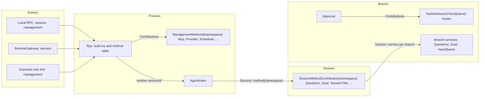
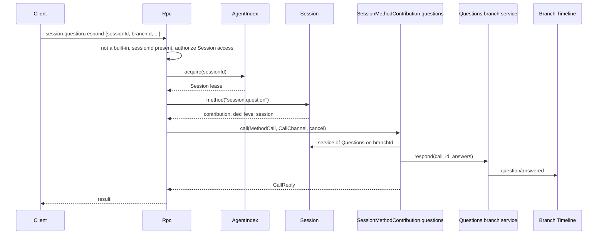
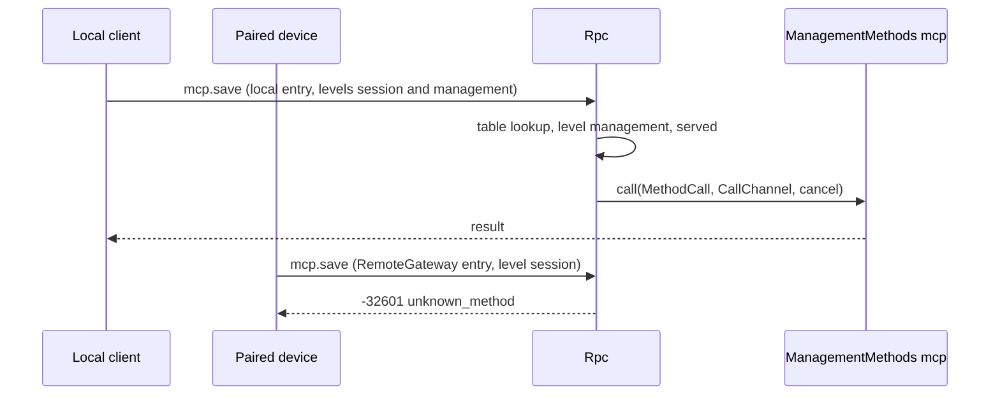
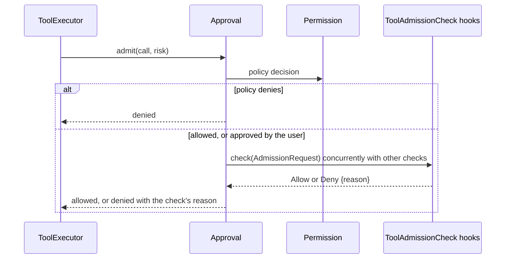

# Methods and admission checks

Status: Draft. Overall design: [overview §3 integration](../overview.md#3-integration-by-existing-mechanisms), [Appendix B Rpc and Approval](../overview.md#appendix-b-supplements-to-existing-plugins); rules: [ADR 002](../../adr/002-plugin-scope.md) D2, D3. Phase: P0. Language: Rust.

This contract defines three contributions, all built on mechanisms the runtime already has: named services collected as `Contributions<T>` and Rpc's existing dispatch through the Session, as `approval.respond` does today.

1. **Session methods.** A Session-scoped plugin contributes `SessionMethodContribution` under its own namespace. Rpc resolves the Session from `sessionId` and dispatches through it.
2. **Management methods.** A process plugin contributes `ManagementMethods` under its own namespace. Rpc collects them as `Contributions<ManagementMethods>` into its method table, marked `level: management`.
3. **Tool admission checks.** A branch-scoped plugin contributes `ToolAdmissionCheck`. Approval collects these checks and consults them for every tool call.

Each entry (local RPC, RemoteGateway, an exported rutis link) serves the levels it is configured for. There is no registry, no port and no Management plugin. Contributors are optional plugins installed only when enabled. A contributor reload propagates to its collector, which is the accepted cost of D3.

## 1. Structure



| Contribution | Scope | Key | Registered at assembly by | Collected by | Absent |
| --- | --- | --- | --- | --- | --- |
| `SessionMethodContribution` | Session | `S:SessionMethodContribution[namespace]` | `AgentBuilder::session_methods(namespace)` when the plugin is installed in the Session | Rpc, through `Session::method(namespace)` | `unknown_method` for that Session |
| `ManagementMethods` | Process | `ManagementMethods[namespace]` | The owner's loader row, when enabled | Rpc, `Contributions<ManagementMethods>` | `unknown_method` |
| `ToolAdmissionCheck` | Branch | `B:ToolAdmissionCheck[name]` | `AgentBuilder::tool_admission_check(name)` when the plugin is installed in the branch | Approval, `Contributions<ToolAdmissionCheck>` | No check |

Contracts defined here: `SessionMethodContribution`, `ManagementMethods`, `MethodProvider`, `MethodDecl`, `MethodLevel`, `Interruption`, `ReplyMode`, `MethodCall`, `CallOrigin`, `CallReply`, `MethodError`, `CallChannel`, `ConnectionNotifier`; `ToolAdmissionCheck`, `AdmissionRequest`, `AdmissionVerdict`. They also cover entry levels, naming, reserved names, the migration of existing management methods and the compatibility table. Contracts used: `Contributions<T>` and keyed Session and branch services ([tool contributions](../../architecture/rust-agent/tool-contributions.md)), `Session::service`, `SessionConfig` ([session-access](session-access.md#a3-sessionconfig-fields)), the Rpc command envelope, `appError` codes and Approval's decision flow ([Approval](../../architecture/rust-agent/plugins/Approval.md)).

## 2. Data and state

No contribution owns a Timeline event or persisted state. Method tables are rebuilt when Rpc or a Session loads. The served levels are entry assembly data, recorded on each connection when it is accepted as `ConnectionEntry {name, levels, device_id}`, and are never derived from identity. A link's management export is host-local structural configuration. Admission checks keep no state: their rules are read at use time from the owner's business source.

## 3. Flows

### 3.1 Session method



The namespace is resolved by the longest prefix among the namespaces contributed in that Session. If the Session has no such namespace, because the plugin is disabled or the Session is non-interactive and the plugin is not installed, the result is `unknown_method`. A Session-scoped method may declare `level: management` (`shell.*`). It is then dispatched only on entries that serve management.

### 3.2 Management method



The levels an entry serves are the only check. Serving the management level grants host administrator rights.

### 3.3 Tool admission check



Checks run after the policy decision and before execution. A denial by any check denies the call, and a denied call settles exactly like a policy denial (an error tool result, with no new event). A check that fails maps to its own declared outcome (Hooks `pre_tool_use` defaults to deny).

## 4. Timing and conflicts

| Scenario | Order | Outcome | Owner |
| --- | --- | --- | --- |
| Session-scoped contributor reloads mid-call | call < reload | `Report`: `operation_interrupted`; `Drain`: reload waits | Rpc |
| Session method while the Session's capabilities reload | — | `service_reloading` | Rpc (from `AgentError::Reloading`) |
| Session method on a Session without that plugin | — | `unknown_method` | Rpc |
| Management owner reloads | — | Rpc reloads with it (D3); open connections see the existing Rpc reload behaviour | rutis lifecycle |
| Management method on a session-only entry | — | `unknown_method` | Rpc |
| Two contributors claim one namespace | assembly | Assembly fails; namespaces are unique per scope | Assembly |
| Admission-check plugin reloads during a turn | check < reload | Approval and dependants reload; the in-flight turn ends `Failed` (D3, accepted) | Approval |
| Check denies while another allows | — | Denied | Approval |
| Turn `stop/interrupt` during a check | interrupt < verdict | Check cancelled; tool call settled as interrupted | Approval, ToolExecutor |
| Hooks disabled (structural) | — | Branch assembled without the check; calls proceed | Assembly |

Full table: [Appendix B](#appendix-b-full-conflict-table).

## 5. Context mapping

Methods have no model-visible effect. A method that changes model context does so through its owner's input or Timeline facts, and those owners' mappings apply. An admission denial reaches the model only as the error tool result, carrying the check's public reason.

## 6. Interfaces (summary)

| Interface | Purpose |
| --- | --- |
| `SessionMethodContribution(Arc<dyn MethodProvider>)` | Session-scoped method namespace |
| `ManagementMethods(Arc<dyn MethodProvider>)` | Process method namespace, collected into Rpc's table |
| `MethodProvider::namespace / methods / call` | Declarations and execution |
| `Session::method(namespace)` | Runtime lookup used by Rpc (keyed variant of `Session::session_service`) |
| `CallChannel` | Per-call progress, connection-bound notifications, reply handoff |
| `ToolAdmissionCheck(Arc<dyn AdmissionCheck>)` | Branch-scoped check consulted by Approval |

## 7. Security

Entry assembly is the only authority for levels: local RPC serves both levels, RemoteGateway serves `session` (paired devices may call every Session method, decision E3), and a rutis link serves `management` only when it is explicitly exported in host-local link configuration. Rpc authorizes `sessionId` for every Session-scoped method exactly as for its built-ins, and contributors validate the other params. Methods that run commands or change host configuration declare `level: management`. Admission checks can deny but never widen: a check cannot allow a call that the policy or the user denied. Host-local approvals (`mcp.approve`, `hooks.approve`, `plugin.approve`, `workflow.approve`) are management methods.

## Appendix A. Interface details

### A.1 Method contributions

```rust
/// Session-scoped; key SessionScope::named_key::<SessionMethodContribution>(namespace).
pub struct SessionMethodContribution(pub Arc<dyn MethodProvider>);
impl SessionService for SessionMethodContribution {}
impl PublicService for SessionMethodContribution {}

/// Process-scoped; collected by Rpc as Contributions<ManagementMethods>.
pub struct ManagementMethods(pub Arc<dyn MethodProvider>);

pub trait MethodProvider: Send + Sync + 'static {
    fn namespace(&self) -> &str;          // equals the registered name
    fn methods(&self) -> Vec<MethodDecl>; // each name inside the namespace
    fn call(&self, call: MethodCall, channel: CallChannel, cancel: CancellationToken)
        -> HostFuture<'_, Result<CallReply, MethodError>>;
}
pub struct MethodDecl {
    pub name: String,               // full wire name, e.g. "session.goal.set", "mcp.save"
    pub level: MethodLevel,         // ManagementMethods: always Management
    pub mutating: bool,
    pub interruption: Interruption,
    pub progress: bool,
    pub notifications: Vec<String>, // inside the namespace
    pub reply: ReplyMode,
}
pub enum MethodLevel { Session, Management }
pub enum Interruption { Report, Drain }  // Report: operation_interrupted; Drain: unload waits
pub enum ReplyMode { Direct, Handoff }   // Handoff: daemon.shutdown
pub enum CallReply { Value(serde_json::Value), HandedOff }
pub struct MethodCall {
    pub method: String,
    pub session_id: Option<String>, // Some and authorized for Session-scoped contributions
    pub params: serde_json::Value,
    pub origin: CallOrigin,         // diagnostics only
}
pub enum CallOrigin { Local { connection_id: String }, Entry { entry: String, connection_id: String }, Link { peer: String } }
pub struct MethodError { pub code: i32, pub app_error: Cow<'static, str>, pub message: String }
```

| Rule | Content |
| --- | --- |
| Namespace | `<segment>(.<segment>)*`, segments `[a-z][a-z0-9_]*`, owned by the contributor; a namespace may itself be a method (`session.rename`) |
| Ownership | A name belongs to the longest contributed namespace that prefixes or equals it, among the built-ins, the process table and the Session's contributions |
| Reserved for Rpc built-ins | `hello`, `daemon`, `agent`, `approval`, the bare `session` root and `session.attach`, `session.branch_create`, `session.close`, `session.create`, `session.detach`, `session.history`, `session.idle`, `session.input_lookup`, `session.list`, `session.state`, `session.stop`, `session.submit`, `session.summaries`, `session.exec`, `session.mcp`, `session.model`, `session.permission`, `session.prompt`, `session.skills`, `session.input` (`session.input.withdraw`, served through `Session::service::<InputQueue>(branch)` as `approval.respond` is, because InputQueue is a core branch capability with no Session part) |
| Precedence | Built-ins, then the process table, then the Session's contributions; one wire name space |
| Session-scoped call | Requires `sessionId` (`-32602` without it). Rpc authorizes it, acquires the Session through AgentIndex (restoring if needed) and calls `Session::method(namespace)`. The contributor reaches a branch through `Session::service::<T>(branch)` |
| Not dispatched | Namespace not contributed, or level not served by the entry → `-32601 unknown_method`. Session reloading → `-32000 service_reloading`. A started `Report` call interrupted → `operation_interrupted` |
| `hello.features` (v3) | Built-ins and process-table methods of the entry's levels. Session-scoped methods are listed per Session in `session.state.methods` |
| Ready latch | Opens after the loader's initial load settles, so process contributions are present at the first `hello` |

Known Session-scoped namespaces: `session.question` (Questions), `session.goal` (Goal), `session.rename` (SessionTitle), `attachment` (Attachments), `shell` (ShellInput, level management). Each plugin document is authoritative for its methods.

### A.2 Call channel

```rust
impl CallChannel {
    pub fn progress(&self, data: serde_json::Value);                       // no-op unless declared
    pub fn notifier(&self) -> Result<ConnectionNotifier, ChannelError>;    // Unsupported for links
    pub fn take_final_reply(&self) -> Result<FinalReply, ChannelError>;   // Handoff only
}
impl ConnectionNotifier {
    pub fn send(&self, method: &str, params: serde_json::Value) -> Result<(), ChannelError>;
    pub fn closed(&self) -> impl Future<Output = ()>;
}
pub enum ChannelError { Unsupported, Undeclared, Gone }
```

Progress is sent as the notification `management.progress {id, method, data}` for both levels, ordered before the response and dropped after disconnect. Notification names must be declared and lie inside the namespace. A notifier stays valid until the connection closes.

### A.3 Tool admission check

```rust
/// Branch-scoped; key BranchScope::named_key::<ToolAdmissionCheck>(name).
pub struct ToolAdmissionCheck(pub Arc<dyn AdmissionCheck>);
impl BranchService for ToolAdmissionCheck {}

pub trait AdmissionCheck: Send + Sync + 'static {
    fn check(&self, request: &AdmissionRequest, cancel: CancellationToken)
        -> HostFuture<'_, AdmissionVerdict>;
}
pub struct AdmissionRequest {
    pub session_id: String,
    pub branch_id: String,
    pub turn_id: String,
    pub call_id: String,
    pub tool: String,
    pub arguments: serde_json::Value,
    pub risk: RiskCategory,
    pub config: Arc<SessionConfig>,
}
pub enum AdmissionVerdict { Allow, Deny { reason: String } } // reason is public, model-visible
```

| Rule | Content |
| --- | --- |
| Collection | Approval adds `Contributions<ToolAdmissionCheck>` to its Deps. Names come from assembly, and a name without a provider fails the branch build |
| Order | Every check runs concurrently after the policy decision; any `Deny` denies, and reasons are joined in name order |
| Cancellation | Turn interrupt cancels checks; the call settles as interrupted |
| Failure | Mapped by the check itself to `Allow` or `Deny` |
| Model-call approvals | Unaffected: checks apply to tool calls only |

### A.4 Entry levels and export

| Entry | Levels | Notes |
| --- | --- | --- |
| Local protected transport | `{session, management}` | Today's protected-profile rules unchanged |
| Bare WebSocket, protected profile | as today | Everything but `hello`/`daemon.ping` is `local_transport_required` |
| RemoteGateway | `{session}` | [RemoteGateway](../plugins/RemoteGateway.md) |
| Exported rutis link | `{management}` | Only when exported in host-local link configuration. Without a caller sink, progress is dropped and `notifier()` returns `Unsupported` |

### A.5 Migration and compatibility

Sources: `MANAGEMENT_METHODS`, `MCP_METHODS`, `LOCAL_EXECUTION_METHODS`, `Call::is_management` in [protocol.rs](../../../crates/dim-app-server/src/protocol.rs); `validate_call` in [connection.rs](../../../crates/dim-app-server/src/connection.rs).

| Methods | Destination | Contributor (namespace) |
| --- | --- | --- |
| `account.providers/status/recover/logout`, `account.login.*` | `ManagementMethods` | ManagedProviders (`account`) |
| `account.codex.*`, `account.grok.*` | `ManagementMethods` | OpenAI Codex OAuth (`account.codex`), Grok OAuth (`account.grok`) |
| `provider.*` | `ManagementMethods` | Provider (`provider`) |
| `skills.catalog/set_enabled/refresh` | `ManagementMethods` | SkillsCatalog (`skills`) |
| `mcp.catalog/set_enabled/save/remove/disconnect/approve/revoke` | `ManagementMethods` | Mcp (`mcp`) |
| `daemon.shutdown` | Rpc built-in, level management, reply handoff | — |
| `hello`, `daemon.ping`, `agent.*`, existing `session.*`, `approval.respond`, new `session.input.withdraw` | Rpc built-ins | — |
| New Session methods | `SessionMethodContribution` | Each owner (A.1) |

Interruption reproduces today's behaviour: `mcp.*` and `skills.*` are `Report`, and `account.*` and `provider.*` are `Drain`. Rpc's `When<ProductServices>` and `When<ExecutionServices>` are replaced by `Contributions<ManagementMethods>`, so Rpc no longer names any owning service.

| Client | Before | After |
| --- | --- | --- |
| v1, v2 | Management methods `unknown_method` | Same |
| v3 local, product profile | `hello.features` has the 33 product names | Same names; params, results, codes and `appError` unchanged |
| v3 local, execution | `LOCAL_EXECUTION_METHODS` + `MCP_METHODS` | Same names |
| v3 bare WebSocket, protected profile | `local_transport_required` | Same |
| v3 RemoteGateway (new) | Did not exist; execution Session methods (`session.permission.get/update`, `session.exec.stop`, `session.skills`, `session.model.update`, `session.prompt.refresh`, `session.mcp`, `session.mcp.refresh`) were local-only | **Compatibility change (E3):** available to paired devices; management names `unknown_method` |
| v3, MCP disabled | `mcp.*` `unknown_method` | Same, with Rpc's message |
| v3, Mcp reloading | `service_reloading` | Rpc reloads with Mcp (D3); the client reconnects and retries |

No protocol version is added and persistence formats are unchanged.

## Appendix B. Full conflict table

| Scenario | Sequence order | Outcome | Owner of the decision |
| --- | --- | --- | --- |
| Session method during branch `stop/interrupt` | per owner's facts | Decided by the owner's Timeline order (for example, a Questions answer after the interrupt is `question/cancelled`) | Owning plugin |
| Session method on a closed branch | — | Owner's `BranchMissing` error | Owning plugin |
| Session method on an unloaded Session | — | Rpc restores through AgentIndex, then dispatches | Rpc |
| Session-scoped contributor reloads mid-call | admitted < reload | `Report`: `operation_interrupted`; `Drain`: waits | Rpc |
| Process owner reloads | — | Rpc reloads (D3) | rutis lifecycle |
| Rpc reload with calls in flight | — | `Report` interrupted, `Drain` drained; notifiers `closed()` | Rpc |
| Level not served by the entry | — | `unknown_method` | Rpc |
| Client detaches mid-call | — | Call continues; reply discarded | Rpc |
| Two clients mutate the same configuration | storage revision | Second gets the contributor's conflict | Contributor |
| `daemon.shutdown` concurrent with another call | admission | Admission stops, then admitted calls settle per `Interruption` | Process coordinator |
| Check pending, turn interrupted | interrupt < verdict | Cancelled; tool call settled interrupted | Approval |
| Check plugin reload with a pending check | — | Turn ends `Failed` with the reload | Approval (D3) |
| Unsettled tool batch, compaction, child branch cut, `input/withdrawn` | — | No effect on methods or checks | — |
| Process restart mid-call | — | Reply lost; outcome per contributor persistence; never replayed | Contributor |

## Appendix C. Errors and recovery

| Case | Wire result |
| --- | --- |
| Not contributed, or level not served, or v1/v2 | `-32601`, `unknown_method` |
| Session-scoped method without `sessionId` | `-32602` |
| Session reloading | `-32000`, `service_reloading` |
| `Report` call interrupted | `-32000`, `operation_interrupted` |
| Contributor error | `-32000`, contributor's `appError` |

## Appendix D. Acceptance

1. A Session-scoped method dispatches through the Session it names. On a Session without the plugin it returns `unknown_method`, and Rpc never names the contributor.
2. A management method is reachable on the local entry, returns `unknown_method` on RemoteGateway, and is reachable over a link only when exported. A Session-scoped `shell.*` method follows the same level rule.
3. A recorded transcript of every migrated management method matches the pre-migration transcript, and `hello.features` is unchanged for v3 local profiles.
4. On a RemoteGateway test entry, `session.permission.update` and `session.exec.stop` succeed.
5. With a Hooks check installed, a denied tool call yields an error tool result with the reason. With Hooks disabled, the same call proceeds. Reloading Hooks during a turn ends that turn `Failed`.
6. Progress precedes the response, and a notifier reports `Gone` after disconnect.

## Appendix E. Assumptions

| # | Assumption | Basis | Effect if rejected |
| --- | --- | --- | --- |
| A1 | Session-scoped namespaces may use roots other than `session` (`attachment`, `shell`) | Existing wire names | All move under `session.` |
| A2 | `Session::method(namespace)` is a keyed variant of `Session::session_service` | Existing keyed Session services | Rpc enumerates contributions through a Session service |
| A3 | Session-scoped methods are listed per Session, not in `hello.features` | They differ per Session | A global list with per-Session availability |
| A4 | Admission checks run after user approval, not before the prompt | Simplest ordering; checks only deny | Checks run before the prompt and can skip it |
