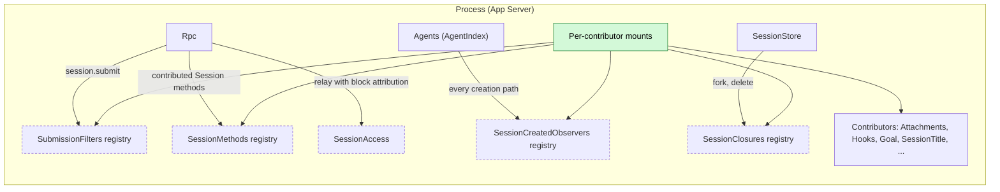
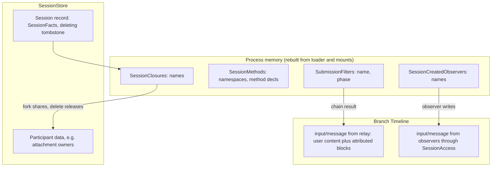
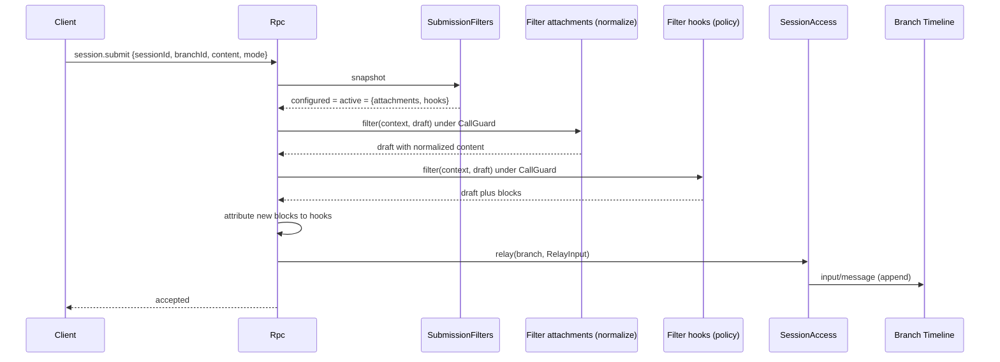
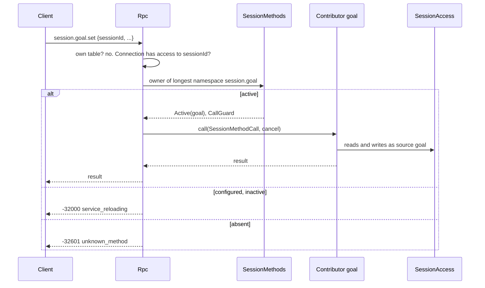
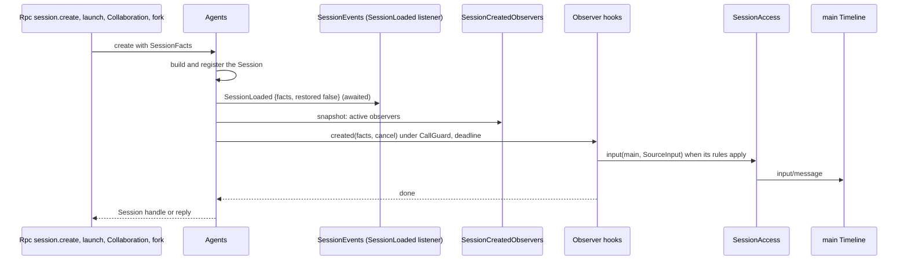
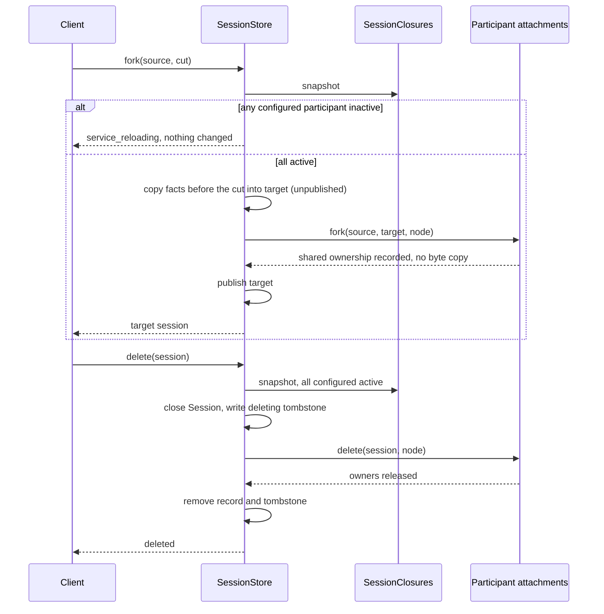
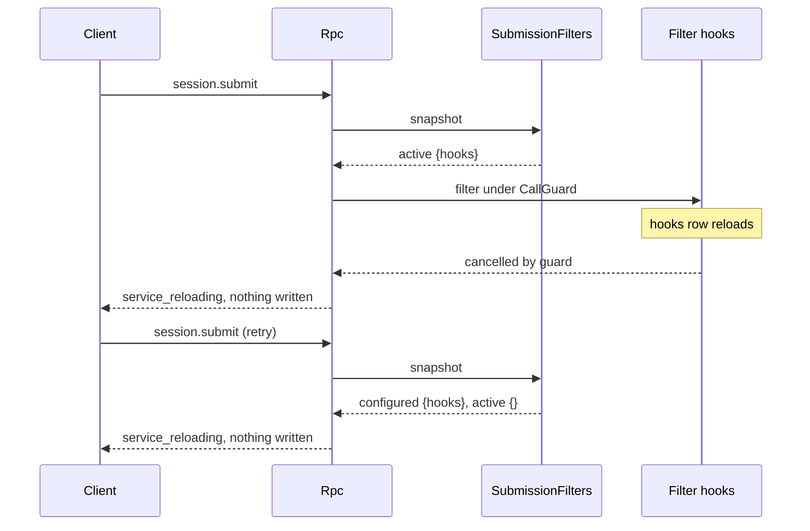

# Session boundary extension points

Status: Draft. Overall design: [overview §6.1 method E](../overview.md#61-integration-methods), [§3 extension registries](../overview.md#3-extension-registries), [Appendix C Rpc, Agents, SessionStore](../overview.md#appendix-c-supplements-and-changes-to-existing-plugins). Phase: P1. Language: Rust (registries and owners); contributors in any language that provides the keyed service.

Four extension points sit at the boundary where Sessions are created, receive client input, expose Session methods and are forked or deleted. Each is owned by the plugin that owns that boundary (Rpc, Agents, SessionStore), filled by per-contributor mounts of the [extension registry](extension-registry.md), and never names a contributor: submission filters (Rpc), Session methods (Rpc), Session-created observers (Agents) and Session closure participants (SessionStore). Values about the Session reach contributors only as [`SessionFacts`](session-access.md#a3-sessionfacts); resource-node work goes through [`SessionResources`](session-access.md#a4-sessionresources) per call.

## 1. Structure



Rpc, Agents and SessionStore inject only their registries, so no contributor reload reloads them; each owner applies its point's stance when a configured contributor is inactive. Contributors depend only on these contracts and never on each other: ordering is decided by the owner (phases and names), not by contributors referencing each other.

| Point | Owner | Registry (point name) | Stance when a configured contributor is inactive | Contributors (examples) |
| --- | --- | --- | --- | --- |
| Submission filters | Rpc | `SubmissionFilters` (`submission-filters`) | Fail closed: `session.submit` returns `service_reloading`, nothing written | Attachments (`normalize`), Hooks (`policy`) |
| Session methods | Rpc | `SessionMethods` (`session-methods`) | That namespace returns `service_reloading` | Goal (`session.goal`), SessionTitle (`session.rename`), Attachments (`attachment`) |
| Session-created observers | Agents | `SessionCreatedObservers` (`session-created`) | Fail open: creation proceeds, diagnostic | Hooks (`session_start`) |
| Session closure participants | SessionStore | `SessionClosures` (`session-closure`) | Fail closed: fork and delete return `service_reloading` before any change | Attachments |

Contracts defined here: `SubmissionFilter`, `SubmissionPhase`, `SubmissionFiltering`, `SubmissionContext`, `SubmissionDraft`, `DraftBlock`, `SubmissionRejected`; `SessionMethodContribution`, `SessionMethodProvider`, `SessionMethodDecl`, `SessionMethodCall`; `SessionCreatedObserver`, `SessionCreatedObserving`; `SessionClosure`, `SessionClosureParticipant`, `ClosureError`; the four registries and their rules. Contracts depended on: [extension registry](extension-registry.md), [session-access](session-access.md) (`SessionFacts`, `SessionResources`, `relay` with `RelayBlock`), [session broadcast](session-broadcast-subscription.md) (`SessionLoaded` at the creation point), the Rpc command envelope and `appError` codes, [Management](../plugins/Management.md) method rules (naming, `Interruption`).

## 2. Data and state



The points own no Timeline events. Filters produce no fact of their own: their result is part of the single `input/message` Rpc relays. Observers write ordinary inputs through SessionAccess. Closure participants keep their own data; SessionStore keeps only a deleting tombstone so that an interrupted delete is finished by a retry.

## 3. Flows

### 3.1 `session.submit` through the filter chain



Filters run sequentially: all `normalize` filters ordered by name, then all `policy` filters ordered by name, so policy filters see final content. Rpc decides from one registry snapshot taken before the chain; if any configured filter is inactive, nothing runs and nothing is written.

### 3.2 Contributed Session method



Rpc authorizes Session access from the call's `sessionId` before dispatch, exactly as for its own Session methods; the contributor validates the remaining params at its boundary and acts only through public contracts.

### 3.3 Creation with observers



Every creation path passes the same point, so subscribers and observers see members, launched Sessions and forks too; each observer decides from `facts.created_by` (Hooks runs `session_start` only for `Client` creations, decision E10). An inactive, failing or slow observer never blocks creation (fail open).

### 3.4 Fork and delete with closure participants



Participants are idempotent, so a failed or interrupted fork or delete is completed or cleaned up by retrying the operation; a target that was never published is removed by calling `delete` for it.

## 4. Timing and conflicts

### 4.1 Filter inactive during a submit



A submission is either fully filtered by every configured filter and relayed, or not written at all; the client keeps its draft and retries.

### 4.2 Other key rows

| Scenario | Order | Outcome | Owner |
| --- | --- | --- | --- |
| Observer input vs the client's first submit | observer input < reply < submit | Observer input precedes; consumed first | Agents (reply after observers) |
| Observer exceeds its deadline | — | Cancelled; creation proceeds; a write already committed stays | Agents |
| Session-method contributor reloads mid-call | admitted < unload | `Report`: `operation_interrupted`; `Drain`: unload waits | Rpc, mount |
| Fork while a participant is reloading | — | `service_reloading`, nothing changed | SessionStore |
| Delete interrupted after close | tombstone written | Retry finishes; Session stays closed | SessionStore |

Full table: Appendix B.

## 5. Context mapping

| Point | What the model sees |
| --- | --- |
| Submission filters | The relayed `input/message`: user content (possibly normalized) and blocks added by filters, each rendered as a `<dim-<filter>>` element ([session-access §5](session-access.md#5-context-mapping)), at the input's consumed position |
| Session methods | Nothing directly; a method that writes input does so through SessionAccess, whose mapping applies |
| Session-created observers | Inputs they write through SessionAccess, consumed at the start of the main branch |
| Closure participants | Nothing; a fork's inherited history keeps valid references because ownership is shared |

Compaction and child branches follow the input rules of session-access. Rejected submissions, unavailable namespaces, observer diagnostics and closure errors never reach the model.

## 6. Interfaces (summary)

| Interface | Owner | Purpose |
| --- | --- | --- |
| `SubmissionFilter` (`phase`, `SubmissionFiltering::filter`) | Rpc | Transform or reject a client submission before relay |
| `SessionMethodContribution` (`SessionMethodProvider::namespaces/methods/call`) | Rpc | Contribute Session methods under owned namespaces |
| `SessionCreatedObserver` (`SessionCreatedObserving::created`) | Agents | Observe every Session creation |
| `SessionClosure` (`SessionClosureParticipant::fork/delete`) | SessionStore | Share data with a fork, release it on delete |

## 7. Security

Submission filters are fail closed so that a policy filter (for example a prompt-submit hook) cannot be bypassed by being unavailable. Block attribution is set by Rpc from the registered filter name, so a filter cannot write blocks under another source, and users cannot submit blocks at all. Session methods are authorized by Rpc's Session access for `sessionId` (remote devices included, decision E3) and confer no authority beyond the contributor's own checks. Observers cannot deny creation. Closure participants act only on the named Sessions' data on their resource node and never copy host security settings.

## Appendix A. Interface details

### A.1 Submission filters (Rpc)

```rust
/// Process service; key TypeKey::keyed_dynamic::<SubmissionFilter>(name), no instance.
pub struct SubmissionFilter { pub phase: SubmissionPhase, pub filter: Arc<dyn SubmissionFiltering> }
pub enum SubmissionPhase { Normalize, Policy }        // Normalize runs before Policy
pub trait SubmissionFiltering: Send + Sync + 'static {
    fn filter(&self, context: &SubmissionContext, draft: SubmissionDraft, cancel: CancellationToken)
        -> HostFuture<'_, Result<SubmissionDraft, SubmissionRejected>>;
}
pub struct SubmissionContext {
    pub facts: SessionFacts,
    pub branch_id: String,
    pub model_accepts_images: Option<bool>,           // None = unknown (A2)
}
pub struct SubmissionDraft { pub user: UserInput, pub blocks: Vec<DraftBlock>, pub mode: InputMode }
pub struct DraftBlock {
    pub source: String,     // set by Rpc to the adding filter's name; filters leave it empty
    pub kind: String,
    pub block: SourceBlock, // key, if any, is a name inside the source namespace
}
pub struct SubmissionRejected {
    pub app_error: String,  // [a-z][a-z0-9_]*, owned by the filter, e.g. "hook_rejected", "attachment_too_large"
    pub message: String,    // public text
}
```

| Rule | Content |
| --- | --- |
| Order | `Normalize` filters by name, then `Policy` filters by name (A1) |
| Changes | A filter may replace `user` and `mode` and append blocks; it must leave earlier blocks unchanged. Rpc checks that the earlier blocks are a prefix of the returned list and sets `source` on the new ones; a violation is a filter fault: the submission is rejected with `service_reloading` and a diagnostic |
| Rejection | `-32000`, `appError` = `SubmissionRejected.app_error`, `data.filter` = filter name; nothing written |
| Inactive | Any configured filter inactive, or an undetermined row: `-32000` `service_reloading` before running any filter; nothing written |
| Cancelled mid-chain | Guard cancelled (filter unload) or Rpc unload: `service_reloading`; nothing written |
| Relay | Rpc converts the final draft to `RelayInput { user, blocks: DraftBlock → RelayBlock, mode, submission_id }` and calls `SessionLease::relay` |
| Resource node | Filters needing the node call `SessionResources::resolve(facts.session_id)` per call; `NodeUnavailable` becomes the filter's own rejection |
| `model_accepts_images` | Rpc resolves it per submission from the last adopted model in the branch's published prefix and the Provider catalog's model capability (A2) |

### A.2 Session methods (Rpc)

```rust
/// Process service; key TypeKey::keyed_dynamic::<SessionMethodContribution>(name), no instance.
pub struct SessionMethodContribution(pub Arc<dyn SessionMethodProvider>);
pub trait SessionMethodProvider: Send + Sync + 'static {
    /// Namespaces owned by this contributor (fixed for the generation).
    fn namespaces(&self) -> Vec<String>;
    /// Complete method list; each name lies in one of the namespaces.
    fn methods(&self) -> Vec<SessionMethodDecl>;
    fn call(&self, call: SessionMethodCall, cancel: CancellationToken)
        -> HostFuture<'_, Result<serde_json::Value, ManagementError>>;
}
pub struct SessionMethodDecl { pub name: String, pub interruption: Interruption }
pub struct SessionMethodCall {
    pub method: String,
    pub session_id: String,        // from params.sessionId, already authorized by Rpc
    pub params: serde_json::Value, // raw params; validated by the contributor
    pub origin: CallOrigin,        // diagnostics only
}
```

`Interruption`, `ManagementError` and `CallOrigin` are Management's types ([Management A.1](../plugins/Management.md#a1-contribution-contract)), reused unchanged.

| Rule | Content |
| --- | --- |
| Namespace | `<segment>(.<segment>)*`, segments `[a-z][a-z0-9_]*`, chosen by the contributor (for example `session.goal`, `attachment`); a namespace may itself be a method name (for example `session.rename`) |
| Ownership | A name belongs to the longest registered namespace that prefixes it or equals it |
| Reserved | `management`, the bare `session` root, and every name Rpc serves with its namespaces: `hello`, `daemon`, `agent`, `approval`, `session.attach`, `session.branch_create`, `session.close`, `session.create`, `session.detach`, `session.history`, `session.idle`, `session.input_lookup`, `session.list`, `session.state`, `session.stop`, `session.submit`, `session.summaries`, `session.exec`, `session.mcp`, `session.model`, `session.permission`, `session.prompt`, `session.skills`, `session.input` (InputQueue withdrawal, served by Rpc) |
| Rejection | A contribution violating a rule or colliding with an active one is rejected as a whole; the earlier owner keeps its names |
| Parameters | Every contributed method requires `sessionId`; Rpc returns `-32602` without it and authorizes it as for its own Session methods |
| Dispatch order and Management | Rpc's own table, then this registry, then Management. Rpc rejects a Session-method contribution whose namespace overlaps an active management namespace and reports a diagnostic; Management reserves `session` (A4) |
| Inactive | Namespace configured but inactive: `-32000` `service_reloading`; absent: `-32601` `unknown_method` |
| Features | `hello.features` (v3) lists the active contributed Session methods |
| Long-running work | Methods return promptly; streams belong to Session events or the contributor's own Timeline inputs |

### A.3 Session-created observers (Agents)

```rust
/// Process service; key TypeKey::keyed_dynamic::<SessionCreatedObserver>(name), no instance.
pub struct SessionCreatedObserver(pub Arc<dyn SessionCreatedObserving>);
pub trait SessionCreatedObserving: Send + Sync + 'static {
    /// Called once per created Session, after SessionLoaded listeners and before the
    /// creator receives the Session. Writes only through SessionAccess.
    fn created(&self, facts: &SessionFacts, cancel: CancellationToken) -> HostFuture<'_, ()>;
}
```

| Rule | Content |
| --- | --- |
| Paths | `session.create`, Agents `launch`, Collaboration member creation (including `establish`), fork. Restore is not creation (restores emit only `SessionLoaded { restored: true }`) |
| Order | `SessionLoaded` listeners (awaited), then all active observers concurrently (awaited), then the creator receives the Session; `session.create` replies after that |
| Deadline | Each observer call is cancelled after a deadline (A3); creation proceeds |
| Inactive | Configured but inactive: skipped with a diagnostic (fail open) |
| Failure | Observer errors are diagnostics; inputs the observer committed stay |
| Selection | Observers select by `facts` (`created_by`, `interactive`, `collaboration_role`); Agents never filters for them |

### A.4 Session closure participants (SessionStore)

```rust
/// Process service; key TypeKey::keyed_dynamic::<SessionClosure>(name), no instance.
pub struct SessionClosure(pub Arc<dyn SessionClosureParticipant>);
#[async_trait]
pub trait SessionClosureParticipant: Send + Sync + 'static {
    /// Called by SessionStore's fork before the target Session is published. Idempotent.
    async fn fork(&self, source: &str, target: &str, node: Option<&str>) -> Result<(), ClosureError>;
    /// Called by SessionStore's delete after the Session is closed. Idempotent.
    async fn delete(&self, session: &str, node: Option<&str>) -> Result<(), ClosureError>;
}
pub struct ClosureError { pub retryable: bool, pub message: String }
```

| Rule | Content |
| --- | --- |
| Fork | All configured participants must be active, else `service_reloading` before any change. SessionStore copies facts before the cut into an unpublished target, calls every participant's `fork`, then publishes. Ownership is shared, no bytes are copied (decision E17); a fork to another resource node is out of scope |
| Fork failure | Target not published; SessionStore calls `delete` for the target on every participant and removes it; error returned |
| Delete | All configured participants must be active, else `service_reloading` before closing. SessionStore closes the Session (rejected while Loop is not idle), writes a deleting tombstone, calls every participant's `delete`, then removes the record |
| Delete failure | Session stays closed with its tombstone; listing hides it; retrying `delete` finishes; startup finishes tombstoned deletes once participants are active |
| Node | `node` is `facts.resource_node`; participants reach it through `SessionResources` |

## Appendix B. Full conflict table

| Scenario | Sequence order | Outcome | Owner of the decision |
| --- | --- | --- | --- |
| Submit while a configured filter is inactive | snapshot | `service_reloading`; nothing written | Rpc |
| Filter unloads mid-chain | admitted < unload | `service_reloading`; nothing written | Rpc |
| Filter rejects | — | Its `appError`; nothing written; later filters not run | Rpc |
| Submit during turn `stop/interrupt` | relay vs interrupt by Timeline order | Per session-access rows (input after interrupt starts a turn) | InputQueue, Loop |
| Submit to a closed branch | — | `SessionClosed`/`BranchMissing` from relay | Runtime facade |
| Two clients submit concurrently | Timeline order | Each filtered independently; inputs ordered by append | InputQueue |
| Duplicate or late submit (client retry) | — | Relayed twice unless the client uses `submission_id` and `session.input_lookup` | Client |
| Client detaches mid-submit | — | Submission continues; reply discarded | Rpc |
| Resource node offline, filter needs it | — | The filter's rejection (`node_unavailable`) | Filter |
| Session method contributor inactive | — | `service_reloading` for its namespace only | Rpc |
| Session method contributor reloads mid-call | admitted < unload | `Report`: `operation_interrupted`; `Drain`: waits | Rpc, mount |
| Two contributors claim one namespace | second registration | Rejected; first keeps it | SessionMethods registry |
| Rpc reload with Session method calls in flight | — | As Management methods: `Report` interrupted, `Drain` drained | Rpc |
| Observer inactive at creation | — | Skipped, diagnostic | Agents |
| Observer slow | deadline | Cancelled; committed writes stay | Agents |
| Observer input vs client's first submit | observer input < reply | Observer input first | Agents |
| Agents reload during creation | — | Creation fails with `service_reloading` (existing window rule); no observer call | Agents |
| Fork while a participant is inactive | — | `service_reloading`, nothing changed | SessionStore |
| Fork participant fails | — | Target deleted from participants and store; error | SessionStore |
| Delete while Loop is not idle | — | Rejected (existing rule) | SessionStore |
| Delete interrupted (process exit) after close | tombstone | Finished at startup or on retry | SessionStore |
| Delete of a Session whose fork shares data | — | Only this Session's ownership released; the fork keeps its data | Participant |
| Process restart mid-submit | — | Committed input stays; client looks up by `submission_id` | Client |

## Appendix C. Errors and recovery

| Case | Wire result |
| --- | --- |
| Configured filter or closure participant inactive; filter cancelled | `-32000`, `service_reloading` |
| Filter rejection | `-32000`, filter's `appError`, `data.filter` |
| Session method namespace inactive | `-32000`, `service_reloading` |
| Unknown Session method | `-32601`, `unknown_method` |
| Session method without `sessionId` | `-32602` |
| Closure participant error | `-32000`, `session_closure_failed` (retryable flag in `data`) |

## Appendix D. Acceptance

1. Filters run normalize-then-policy by name regardless of registration order; blocks added by a policy filter are attributed to it and rendered with its source.
2. An inactive configured filter makes `session.submit` return `service_reloading` and writes nothing; disabling its row restores submission.
3. A filter that changes an earlier filter's block is rejected as a fault.
4. A contributed Session method dispatches by longest namespace; a reserved or colliding namespace is rejected; an inactive namespace returns `service_reloading` while others work.
5. Observers are called for `session.create`, `launch`, Collaboration member creation and fork, not for restore; an inactive or slow observer does not block creation; an observer input precedes the client's first input.
6. Fork shares participant data without copying; deleting the source leaves the fork's data intact; an inactive participant blocks fork and delete without changes.
7. A delete interrupted after close is finished on retry and at startup.

## Appendix E. Assumptions

| # | Assumption | Basis | Effect if rejected |
| --- | --- | --- | --- |
| A1 | Two phases (`normalize`, `policy`) suffice; ties ordered by name | Decision record R5 | More phases or explicit priorities |
| A2 | `model_accepts_images` comes from the branch's last adopted model and the Provider catalog, resolved by Rpc per submission | Judgment (cross-review C15) | Filters decide without model capability |
| A3 | Observer deadline of 10 seconds per call | Judgment | Slow observers delay creation longer or are cut earlier |
| A4 | Session-method namespaces may use roots other than `session` (Attachments uses `attachment`); overlaps with management namespaces are rejected by Rpc on the Session-method side | Judgment; overview Appendix C Rpc row | A management contributor registered later under the same root is shadowed by dispatch order until renamed |
| A5 | Delete uses a tombstone in the Session record to finish interrupted deletes | Judgment | Interrupted deletes leave participant data until a manual cleanup |

## Appendix F. Open questions

| Question | Description |
| --- | --- |
| Branch-service methods | `session.question.respond` resolves a branch service (`B:Questions`); whether Rpc keeps such branch-service methods in its own table (as `approval.respond`, `session.input.withdraw`) or a contributor provides them is for the Questions and Rpc pages to settle |
