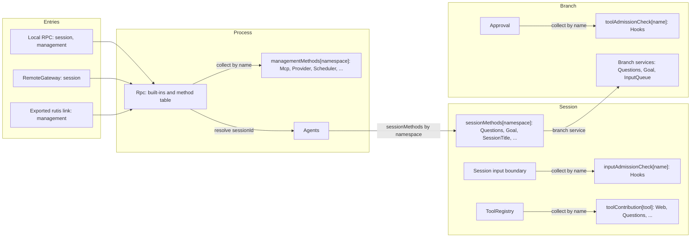
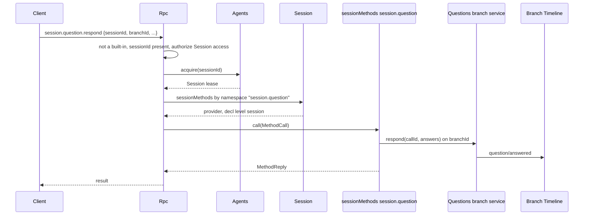
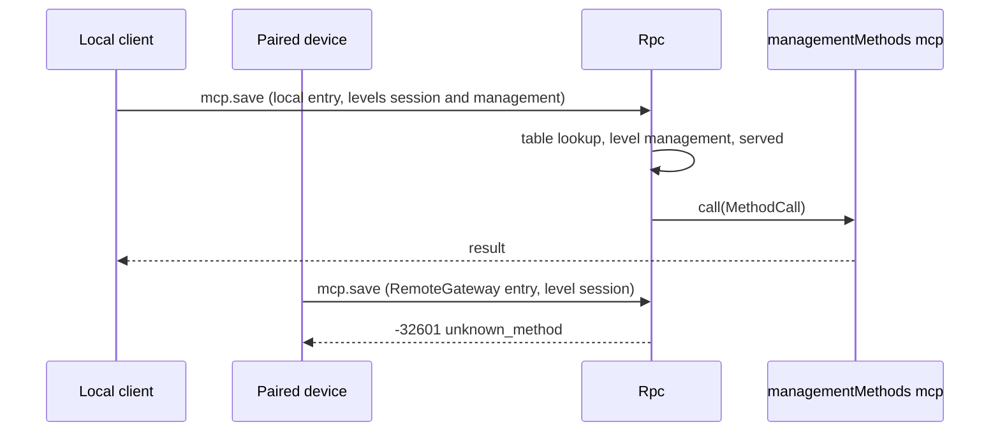
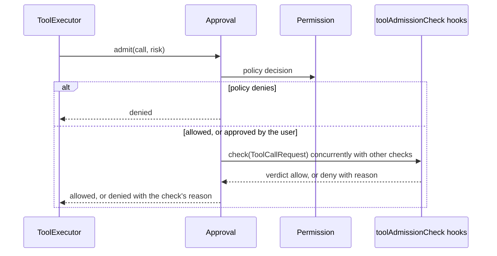
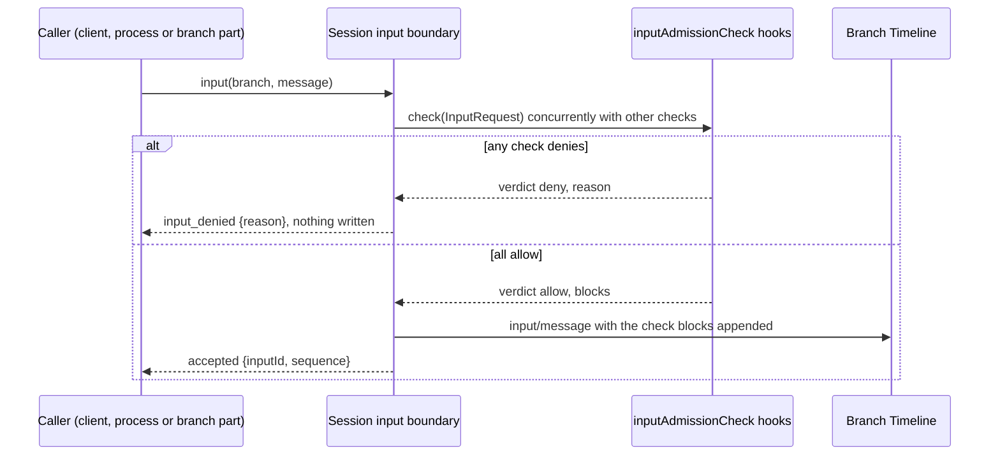

# Methods and admission checks

Status: Draft. Overall design: [overview §3 integration](../overview.md#3-integration-by-existing-mechanisms), [Appendix B Rpc and Approval](../overview.md#appendix-b-supplements-to-existing-plugins); rules: [ADR 002](../../adr/002-plugin-scope.md) D2, D3, D5. Phase: P0. Language: neutral contracts; Rust binding in [Appendix F](#appendix-f-rust-binding).

This contract defines five named services in the language-neutral form of ADR 002 D5. Each is identified by a service name, a scope and an instance key; its methods take and return serializable data; errors are data; cancellation is a protocol action. A plugin in any language provides them by declaring them in its `provides` (loader row), and consumers collect them by name and scope. They are built on mechanisms the runtime already has: named services collected per scope and Rpc's existing dispatch through the Session, as `approval.respond` does today.

| Service | Scope | Key | Provided by | Collected by |
| --- | --- | --- | --- | --- |
| `sessionMethods` | Session | namespace | Session-scoped plugin parts (Questions, Goal, SessionTitle, Attachments, ShellInput) | Rpc, dispatching through the Session |
| `managementMethods` | Process | namespace | Process plugins (Mcp, Provider, Scheduler, ...) | Rpc's method table, level `management` |
| `toolAdmissionCheck` | Branch | check name | Branch-scoped plugin parts (Hooks) | Approval, for every tool call |
| `inputAdmissionCheck` | Session | check name | Session-scoped plugin parts (Hooks `user_prompt_submit`) | The Session input boundary, for every input |
| `toolContribution` | Session | tool name | Session-scoped plugin parts (Questions, Goal, Web, Notifications, Scheduler, Workflow) | ToolRegistry (supplement: named tool services) |

Each entry (local RPC, RemoteGateway, an exported rutis link) serves the levels it is configured for. There is no registry, no port and no Management plugin. Providers are optional plugins installed only when enabled. A provider reload propagates to its collector, which is the accepted cost of D3.

## 1. Structure



| Service | Absent |
| --- | --- |
| `sessionMethods` | `unknown_method` for that Session |
| `managementMethods` | `unknown_method` |
| `toolAdmissionCheck` | No check |
| `inputAdmissionCheck` | No check; inputs are written as today |
| `toolContribution` | The tool is not offered |

Contracts defined here: the five services, `MethodDecl`, `MethodCall`, `MethodReply`, `MethodError`, the `callChannel` companion service, `ToolCallRequest`, `InputRequest`, `AdmissionReply`, `ToolDeclaration`, `ToolCall`, `ToolResult`, entry levels, naming, reserved names, the migration of existing management methods and the compatibility table. Contracts used: `SessionConfig` ([session-access](session-access.md#a3-sessionconfig-fields)), source input conventions ([session-access A.2](session-access.md#a2-source-input-conventions)), the Rpc command envelope, `appError` codes and Approval's decision flow ([Approval](../../architecture/rust-agent/plugins/Approval.md)).

## 2. Data and state

No service owns a Timeline event or persisted state. Method tables are rebuilt when Rpc or a Session loads. The served levels are entry assembly data, recorded on each connection when it is accepted as `ConnectionEntry {name, levels, deviceId}`, and are never derived from identity. A link's management export is host-local structural configuration. Admission checks keep no state: their rules are read at use time from the owner's business source.

## 3. Flows

### 3.1 Session method



The namespace is resolved by the longest prefix among the namespaces provided in that Session. If the Session has no such namespace, because the plugin is disabled or the Session is non-interactive and the plugin is not installed, the result is `unknown_method`. A Session-scoped method may declare `level: management` (`shell.*`). It is then dispatched only on entries that serve management.

### 3.2 Management method



The levels an entry serves are the only check. Serving the management level grants host administrator rights.

### 3.3 Tool admission check



Checks run after the policy decision and before execution. A denial by any check denies the call, and a denied call settles exactly like a policy denial (an error tool result, with no new event). A check that fails maps to its own declared outcome (Hooks `pre_tool_use` defaults to deny).

### 3.4 Input admission check



The Session input boundary is the runtime's `Session::input` path, which every input write uses (`session.submit`, `sessions.input`, branch parts writing inputs). The supplement makes it collect the Session's `inputAdmissionCheck` services and run them before the write. Each check receives the input's source and decides which inputs its rules apply to; Hooks applies `user_prompt_submit` rules only to inputs without a source marker (user input).

## 4. Timing and conflicts

| Scenario | Order | Outcome | Owner |
| --- | --- | --- | --- |
| Session-scoped provider reloads mid-call | call < reload | `Report`: `operation_interrupted`; `Drain`: reload waits | Rpc |
| Session method while the Session's capabilities reload | — | `service_reloading` | Rpc |
| Session method on a Session without that plugin | — | `unknown_method` | Rpc |
| Management owner reloads | — | Rpc reloads with it (D3); open connections see the existing Rpc reload behaviour | rutis lifecycle |
| Management method on a session-only entry | — | `unknown_method` | Rpc |
| Two providers claim one namespace, check name or tool name | assembly | Assembly fails; keys are unique per scope | Assembly |
| Tool-check plugin reloads during a turn | check < reload | Approval and dependants reload; the in-flight turn ends `Failed` (D3, accepted) | Approval |
| Check denies while another allows | — | Denied | Approval, input boundary |
| Turn `stop/interrupt` during a tool check | interrupt < verdict | Check cancelled; tool call settled as interrupted | Approval, ToolExecutor |
| Input check pending, another input committed | other < this | Order decided at commit; checks never hold the commit lock | Input boundary |
| Input-check plugin reloads during a check | — | The write fails `Reloading`; the caller looks up `submissionId` and retries | Input boundary |
| Hooks disabled (structural) | — | Assembled without the checks; calls and inputs proceed | Assembly |

Full table: [Appendix B](#appendix-b-full-conflict-table).

## 5. Context mapping

Methods have no model-visible effect. A method that changes model context does so through its owner's input or Timeline facts, and those owners' mappings apply. A tool admission denial reaches the model only as the error tool result, carrying the check's public reason. A denied input is never written and the model sees nothing. Blocks returned by an allowing input check are raw blocks of that input, placed after the input's own raw blocks and before its user content ([session-access §5](session-access.md#5-context-mapping)), and the model sees them verbatim.

## 6. Interfaces (summary)

| Service and method | Mode | Purpose |
| --- | --- | --- |
| `sessionMethods[namespace].describe() -> MethodDecl[]` | async | Session-scoped method declarations |
| `sessionMethods[namespace].call(MethodCall) -> MethodReply` | async | Execute a Session-scoped method |
| `managementMethods[namespace].describe / call` | async | Same shapes, process scope, level management |
| `callChannel.progress / notify / closed` (Rpc) | sync / async | Per-call progress and connection-bound notifications |
| `toolAdmissionCheck[name].check(ToolCallRequest) -> AdmissionReply` | async | Branch-scoped check consulted by Approval |
| `inputAdmissionCheck[name].check(InputRequest) -> AdmissionReply` | async | Session-scoped check run before an input is written |
| `toolContribution[tool].declaration() -> ToolDeclaration` | sync | Tool declaration |
| `toolContribution[tool].execute(ToolCall) -> ToolResult` | async | Tool execution |

## 7. Security

Entry assembly is the only authority for levels: local RPC serves both levels, RemoteGateway serves `session` (paired devices may call every Session method, decision E3), and a rutis link serves `management` only when it is explicitly exported in host-local link configuration. Rpc authorizes `sessionId` for every Session-scoped method exactly as for its built-ins, and providers validate the other params. Methods that run commands or change host configuration declare `level: management`. Admission checks can deny but never widen: a tool check cannot allow a call that the policy or the user denied, and an input check can only reject an input or add attributed blocks, never alter the caller's content or source. Host-local approvals (`mcp.approve`, `hooks.approve`, `plugin.approve`, `workflow.approve`) are management methods.

## Appendix A. Interface details

Shapes are JSON with camelCase fields; a `?` after a field name marks it optional and `|` separates alternatives. These shapes are canonical: plugin documents use these field names (Rust bindings map them to snake_case). Every error is `MethodError` data.

### A.1 Method contributions

`sessionMethods` (Session, key namespace) and `managementMethods` (process, key namespace) have the same two methods.

| Method | Mode | Request | Reply |
| --- | --- | --- | --- |
| `describe` | async | — | `MethodDecl[]` |
| `call` | async | `MethodCall` | `MethodReply`, or `MethodError` |

```text
// MethodDecl
{ "name": "session.goal.set",          // full wire name inside the namespace
  "level": "session" | "management",   // managementMethods: always "management"
  "mutating": true,
  "interruption": "report" | "drain",  // report: operation_interrupted; drain: unload waits
  "progress": false,
  "notifications": ["session.goal.changed"], // inside the namespace
  "reply": "direct" | "handoff" }      // handoff: daemon.shutdown
// MethodCall
{ "callId": "string", "method": "session.goal.set",
  "sessionId?": "string",              // present and authorized for sessionMethods
  "params": {},
  "origin": { "kind": "local" | "entry" | "link", "entry?": "string",
              "connectionId?": "string", "peer?": "string" } } // diagnostics only
// MethodReply
{ "kind": "value", "value": {} } | { "kind": "handedOff" }
// MethodError
{ "code": -32000, "appError": "string", "message": "string" }
```

Cancellation: when a `report` call is interrupted, Rpc sends a cancel request for `callId` (or drops the call) and replies `operation_interrupted`; a `drain` call is awaited before the provider unloads.

| Rule | Content |
| --- | --- |
| Namespace | `<segment>(.<segment>)*`, segments `[a-z][a-z0-9_]*`, owned by the provider; a namespace may itself be a method (`session.rename`) |
| Ownership | A name belongs to the longest provided namespace that prefixes or equals it, among the built-ins, the process table and the Session's providers |
| Reserved for Rpc built-ins | `hello`, `daemon`, `agent`, `approval`, the bare `session` root and `session.attach`, `session.branch_create`, `session.close`, `session.create`, `session.detach`, `session.history`, `session.idle`, `session.input_lookup`, `session.list`, `session.state`, `session.stop`, `session.submit`, `session.summaries`, `session.exec`, `session.mcp`, `session.model`, `session.permission`, `session.prompt`, `session.skills`, `session.input` (`session.input.withdraw`, served through InputQueue's branch service as `approval.respond` is, because InputQueue is a core branch capability with no Session part) |
| Precedence | Built-ins, then the process table, then the Session's providers; one wire name space |
| Session-scoped call | Requires `sessionId` (`-32602` without it). Rpc authorizes it, acquires the Session through Agents (restoring if needed) and calls the Session's `sessionMethods` for the namespace. The provider reaches a branch through that branch's services |
| Not dispatched | Namespace not provided, or level not served by the entry → `-32601 unknown_method`. Session reloading → `-32000 service_reloading`. A started `report` call interrupted → `operation_interrupted` |
| `hello.features` (v3) | Built-ins and process-table methods of the entry's levels. Session-scoped methods are listed per Session in `session.state.methods` |
| Ready latch | Opens after the loader's initial load settles, so process providers are present at the first `hello` |

Known Session-scoped namespaces: `session.question` (Questions), `session.goal` (Goal), `session.rename` (SessionTitle), `attachment` (Attachments), `shell` (ShellInput, level management). Each plugin document is authoritative for its methods.

### A.2 Call channel

Rpc provides the process service `callChannel` to method providers.

| Method | Mode | Request | Reply |
| --- | --- | --- | --- |
| `progress` | sync | `{callId, data}` | — (dropped unless the method declared `progress`) |
| `notify` | async | `{connectionId, method, params}` | `{}`, or error `unsupported` (link), `undeclared`, `gone` |
| `closed` | async | `{connectionId}` | Resolves when the connection closes |
| `takeFinalReply` | async | `{callId}` | `{}` after the final reply is written; `handoff` methods only |

Progress is sent as the notification `management.progress {id, method, data}` for both levels, ordered before the response and dropped after disconnect. Notification names must be declared and lie inside the namespace. A `connectionId` stays valid for `notify` until the connection closes.

### A.3 Tool admission check

`toolAdmissionCheck` (branch, key check name): `check(ToolCallRequest): async -> AdmissionReply`.

```text
// ToolCallRequest
{ "sessionId": "string", "branchId": "string", "turnId": "string", "callId": "string",
  "tool": "web_fetch", "arguments": {}, "risk": "network",
  "config": { /* SessionConfig data, session-access A.3 */ } }
// AdmissionReply (tool checks never return blocks)
{ "verdict": "allow" | "deny", "reason?": "string", "blocks?": [ { "marker": "dim-<owner>", "text": "string" } ] }
```

| Rule | Content |
| --- | --- |
| Collection | Approval collects every `toolAdmissionCheck` of its branch by name. A declared name without a provider fails the branch build |
| Order | Every check runs concurrently after the policy decision; any `deny` denies, and reasons (public, model-visible) are joined in name order |
| Cancellation | Turn interrupt sends a cancel request (or drops the call); the tool call settles as interrupted |
| Failure | Mapped by the check itself to `allow` or `deny` |
| Model-call approvals | Unaffected: checks apply to tool calls only |

### A.4 Entry levels and export

| Entry | Levels | Notes |
| --- | --- | --- |
| Local protected transport | `{session, management}` | Today's protected-profile rules unchanged |
| Bare WebSocket, protected profile | as today | Everything but `hello`/`daemon.ping` is `local_transport_required` |
| RemoteGateway | `{session}` | [RemoteGateway](../plugins/RemoteGateway.md) |
| Exported rutis link | `{management}` | Only when exported in host-local link configuration. Without a caller sink, progress is dropped and `notify` returns `unsupported` |

### A.5 Migration and compatibility

Sources: `MANAGEMENT_METHODS`, `MCP_METHODS`, `LOCAL_EXECUTION_METHODS`, `Call::is_management` in [protocol.rs](../../../crates/dim-app-server/src/protocol.rs); `validate_call` in [connection.rs](../../../crates/dim-app-server/src/connection.rs).

| Methods | Destination | Provider (namespace) |
| --- | --- | --- |
| `account.providers/status/recover/logout`, `account.login.*` | `managementMethods` | ManagedProviders (`account`) |
| `account.codex.*`, `account.grok.*` | `managementMethods` | OpenAI Codex OAuth (`account.codex`), Grok OAuth (`account.grok`) |
| `provider.*` | `managementMethods` | Provider (`provider`) |
| `skills.catalog/set_enabled/refresh` | `managementMethods` | SkillsCatalog (`skills`) |
| `mcp.catalog/set_enabled/save/remove/disconnect/approve/revoke` | `managementMethods` | Mcp (`mcp`) |
| `daemon.shutdown` | Rpc built-in, level management, reply handoff | — |
| `hello`, `daemon.ping`, `agent.*`, existing `session.*`, `approval.respond`, new `session.input.withdraw` | Rpc built-ins | — |
| New Session methods | `sessionMethods` | Each owner (A.1) |

Interruption reproduces today's behaviour: `mcp.*` and `skills.*` are `report`, and `account.*` and `provider.*` are `drain`. Rpc's `When<ProductServices>` and `When<ExecutionServices>` are replaced by collecting `managementMethods`, so Rpc no longer names any owning service.

| Client | Before | After |
| --- | --- | --- |
| v1, v2 | Management methods `unknown_method` | Same |
| v3 local, product profile | `hello.features` has the 33 product names | Same names; params, results, codes and `appError` unchanged |
| v3 local, execution | `LOCAL_EXECUTION_METHODS` + `MCP_METHODS` | Same names |
| v3 bare WebSocket, protected profile | `local_transport_required` | Same |
| v3 RemoteGateway (new) | Did not exist; execution Session methods (`session.permission.get/update`, `session.exec.stop`, `session.skills`, `session.model.update`, `session.prompt.refresh`, `session.mcp`, `session.mcp.refresh`) were local-only | **Compatibility change (E3):** available to paired devices; management names `unknown_method` |
| v3, MCP disabled | `mcp.*` `unknown_method` | Same, with Rpc's message |
| v3, Mcp reloading | `service_reloading` | Rpc reloads with Mcp (D3); the client reconnects and retries |
| v3, input denied by a check (new) | Did not exist | `session.submit` returns `-32000 input_denied` with the reason |

No protocol version is added and persistence formats are unchanged.

### A.6 Input admission check

Session input boundary supplement (runtime facade, `Session::input`): before writing an input, the boundary runs every `inputAdmissionCheck` of the Session and writes only if all allow.

`inputAdmissionCheck` (Session, key check name): `check(InputRequest): async -> AdmissionReply`.

```text
// InputRequest
{ "sessionId": "string", "branchId": "string",
  "mode": "queue" | "steer" | "append",
  "source?": "string",           // marker source (A.2 of session-access); absent for user input
  "origin": "client" | "process" | "branch",
  "submissionId?": "string",
  "rawBlocks": ["string"],       // the input's own raw blocks, marker first
  "content": [ { "type": "text", "text": "..." } | { "type": "image", "...": "..." } ],
  "config": { /* SessionConfig data */ } }
// AdmissionReply
{ "verdict": "allow" | "deny", "reason?": "string", "blocks?": [ { "marker": "dim-<owner>", "text": "string" } ] }
```

| Rule | Content |
| --- | --- |
| Collection | The Session assembly collects every `inputAdmissionCheck` of the Session by name; checks exist only while their plugin is enabled |
| Order | Checks run concurrently before the write and outside the commit lock; any `deny` denies, and reasons are joined in name order |
| Deny | Nothing is written. The canonical error code is `input_denied`, with the joined reasons as `message`: `session.submit` returns `-32000` with `appError: "input_denied"`; `sessions.input` returns `{code: "input_denied", message}` |
| Allow with blocks | Each block is `{marker, text}`: `marker` is the check owner's marker (`dim-<owner>`, session-access A.2) and `text` the complete raw block, whose first line must be that marker element; otherwise the boundary treats the reply as `deny` with reason `invalid check reply`. Blocks are appended after the input's own raw blocks in check-name order and written in the same `input/message`. Keys are not allowed in check blocks |
| Scope of rules | Each check decides by `source` and `origin` which inputs its rules cover. A check returns `allow` for inputs carrying its own marker |
| Cancellation | The caller dropping the write cancels pending checks; nothing is written |
| Failure | Mapped by the check itself to `allow` or `deny`. A check reloading fails the write with `Reloading` |

### A.7 Tool contribution

ToolRegistry supplement: besides tools registered today, ToolRegistry accepts named tool services. A plugin declares `toolContribution[<tool name>]` at Session scope in its `provides`, and ToolRegistry collects the Session's tool services by name. Existing rules for name uniqueness, collisions with host tools and enablement through `SessionConfig.tools` are unchanged ([tool contributions](../../architecture/rust-agent/tool-contributions.md)).

| Method | Mode | Request | Reply |
| --- | --- | --- | --- |
| `declaration` | sync | — | `ToolDeclaration` |
| `execute` | async | `ToolCall` | `ToolResult` |

```text
// ToolDeclaration
{ "name": "web_fetch",           // equals the key
  "description": "string",
  "inputSchema": { /* JSON Schema */ },
  "risk": "network" }            // Permission category; required for new tools
// ToolCall
{ "sessionId": "string", "branchId": "string", "turnId": "string", "callId": "string",
  "arguments": {}, "config": { /* SessionConfig data */ } }
// ToolResult
{ "content": [ { "type": "text", "text": "..." } | { "type": "image", "...": "..." } ],
  "structuredContent?": {}, "isError": false }
```

Cancellation: turn interrupt sends a cancel request for `callId` (or drops the call); ToolExecutor settles the call as interrupted. A provider error is returned as `ToolResult` with `isError: true`. The declaration may depend on the Session's configuration and is read once per provider generation.

## Appendix B. Full conflict table

| Scenario | Sequence order | Outcome | Owner of the decision |
| --- | --- | --- | --- |
| Session method during branch `stop/interrupt` | per owner's facts | Decided by the owner's Timeline order (for example, a Questions answer after the interrupt is `question/cancelled`) | Owning plugin |
| Session method on a closed branch | — | Owner's `BranchMissing` error | Owning plugin |
| Session method on an unloaded Session | — | Rpc restores through Agents, then dispatches | Rpc |
| Session-scoped provider reloads mid-call | admitted < reload | `report`: `operation_interrupted`; `drain`: waits | Rpc |
| Process owner reloads | — | Rpc reloads (D3) | rutis lifecycle |
| Rpc reload with calls in flight | — | `report` interrupted, `drain` drained; `closed` resolves | Rpc |
| Level not served by the entry | — | `unknown_method` | Rpc |
| Client detaches mid-call | — | Call continues; reply discarded | Rpc |
| Two clients mutate the same configuration | storage revision | Second gets the provider's conflict | Provider |
| `daemon.shutdown` concurrent with another call | admission | Admission stops, then admitted calls settle per `interruption` | Process coordinator |
| Tool check pending, turn interrupted | interrupt < verdict | Cancelled; tool call settled interrupted | Approval |
| Tool check plugin reload with a pending check | — | Turn ends `Failed` with the reload | Approval (D3) |
| Input check pending, `stop/interrupt` committed | interrupt < input | Input written after the interrupt; applied per mode | InputQueue, Loop |
| Input denied, caller retries with the same `submissionId` | — | Checked again; nothing was written before | Input boundary |
| Input check pending, branch closed | close < write | `BranchMissing`; nothing written | Runtime facade |
| Input check plugin reload | — | Write fails `Reloading`; caller retries after lookup | Input boundary |
| Unsettled tool batch, compaction, child branch cut, `input/withdrawn` | — | No effect on methods or checks | — |
| Process restart mid-call | — | Reply lost; outcome per provider persistence; never replayed | Provider |

## Appendix C. Errors and recovery

| Case | Wire result |
| --- | --- |
| Not provided, or level not served, or v1/v2 | `-32601`, `unknown_method` |
| Session-scoped method without `sessionId` | `-32602` |
| Session reloading | `-32000`, `service_reloading` |
| `report` call interrupted | `-32000`, `operation_interrupted` |
| Input denied by a check | `-32000`, `input_denied` |
| Provider error | `-32000`, provider's `appError` |

## Appendix D. Acceptance

1. A Session-scoped method dispatches through the Session it names. On a Session without the plugin it returns `unknown_method`, and Rpc never names the provider.
2. A management method is reachable on the local entry, returns `unknown_method` on RemoteGateway, and is reachable over a link only when exported. A Session-scoped `shell.*` method follows the same level rule.
3. A recorded transcript of every migrated management method matches the pre-migration transcript, and `hello.features` is unchanged for v3 local profiles.
4. On a RemoteGateway test entry, `session.permission.update` and `session.exec.stop` succeed.
5. With a Hooks tool check installed, a denied tool call yields an error tool result with the reason. With Hooks disabled, the same call proceeds. Reloading Hooks during a turn ends that turn `Failed`.
6. With a Hooks input check installed, a denied user prompt returns `input_denied` and no `input/message` is written; an allowed prompt with blocks is written with the blocks after its own raw blocks.
7. A tool provided as `toolContribution` by a non-Rust plugin is declared to the model and executed through ToolExecutor like a Rust tool.
8. Progress precedes the response, and `notify` reports `gone` after disconnect.

## Appendix E. Assumptions

| # | Assumption | Basis | Effect if rejected |
| --- | --- | --- | --- |
| A1 | Session-scoped namespaces may use roots other than `session` (`attachment`, `shell`) | Existing wire names | All move under `session.` |
| A2 | The Session can look up a keyed Session service by name for Rpc | Existing keyed Session services | Rpc enumerates providers through a Session service |
| A3 | Session-scoped methods are listed per Session, not in `hello.features` | They differ per Session | A global list with per-Session availability |
| A4 | Tool admission checks run after user approval, not before the prompt | Simplest ordering; checks only deny | Checks run before the prompt and can skip it |
| A5 | Every input write goes through `Session::input` | Runtime facade is the input path | Each other write path runs the checks itself |

## Appendix F. Rust binding

The neutral services above map to Rust as follows. Rust plugins may use these types directly; non-Rust plugins provide the services by name through rutis-bridge (`TypeKey::named`, `host_key(name)` with `dyn HostDispatch`), and generated Rust bindings decode them to the same types.

| Neutral service | Rust type and key | Registration in Rust assemblies | Collection |
| --- | --- | --- | --- |
| `sessionMethods[ns]` | `SessionMethodContribution(Arc<dyn MethodProvider>)`, `SessionScope::named_key::<SessionMethodContribution>(ns)` | `AgentBuilder::session_methods(ns)` | `Session::method(ns)` |
| `managementMethods[ns]` | `ManagementMethods(Arc<dyn MethodProvider>)` | loader row | `Contributions<ManagementMethods>` |
| `toolAdmissionCheck[name]` | `ToolAdmissionCheck(Arc<dyn AdmissionCheck>)`, `BranchScope::named_key::<ToolAdmissionCheck>(name)` | `AgentBuilder::tool_admission_check(name)` | `Contributions<ToolAdmissionCheck>` in Approval's Deps |
| `inputAdmissionCheck[name]` | `InputAdmissionCheck(Arc<dyn InputCheck>)`, `SessionScope::named_key::<InputAdmissionCheck>(name)` | `AgentBuilder::input_admission_check(name)` | `Contributions<InputAdmissionCheck>` in the Session input boundary |
| `toolContribution[tool]` | `ToolContribution {definition, handler}`, `SessionScope::named_key::<ToolContribution>(tool)` | `AgentBuilder::session_tool(tool)` (existing) | `Contributions<ToolContribution>` in ToolRegistry |
| `callChannel` | `CallChannel`, `ConnectionNotifier` passed to `MethodProvider::call` | — | — |

```rust
pub trait MethodProvider: Send + Sync + 'static {
    fn namespace(&self) -> &str;
    fn methods(&self) -> Vec<MethodDecl>;
    fn call(&self, call: MethodCall, channel: CallChannel, cancel: CancellationToken)
        -> HostFuture<'_, Result<CallReply, MethodError>>;
}
pub enum MethodLevel { Session, Management }
pub enum Interruption { Report, Drain }
pub enum ReplyMode { Direct, Handoff }
pub enum CallReply { Value(serde_json::Value), HandedOff }
pub struct MethodError { pub code: i32, pub app_error: Cow<'static, str>, pub message: String }

impl CallChannel {
    pub fn progress(&self, data: serde_json::Value);
    pub fn notifier(&self) -> Result<ConnectionNotifier, ChannelError>; // Unsupported for links
    pub fn take_final_reply(&self) -> Result<FinalReply, ChannelError>; // Handoff only
}
pub enum ChannelError { Unsupported, Undeclared, Gone }

pub trait AdmissionCheck: Send + Sync + 'static {
    fn check(&self, request: &AdmissionRequest, cancel: CancellationToken)
        -> HostFuture<'_, AdmissionVerdict>;
}
pub enum AdmissionVerdict { Allow, Deny { reason: String } }

pub trait InputCheck: Send + Sync + 'static {
    fn check(&self, request: &InputRequest, cancel: CancellationToken)
        -> HostFuture<'_, InputVerdict>;
}
pub enum InputVerdict { Allow { blocks: Vec<CheckBlock> }, Deny { reason: String } }
pub struct CheckBlock { pub marker: String, pub text: String }
```

`AdmissionRequest` and `InputRequest` carry the A.3 and A.6 fields with `config: Arc<SessionConfig>` and `risk: RiskCategory`. `ToolContribution` and `ToolHandler` are the existing types in `dim-agent-capabilities/src/tool_registry.rs`; a named tool service from another language is wrapped in a `ToolHandler` by the generated binding. `Session::input` returns `AgentError::Rejected("input_denied: <reason>")` on denial.
