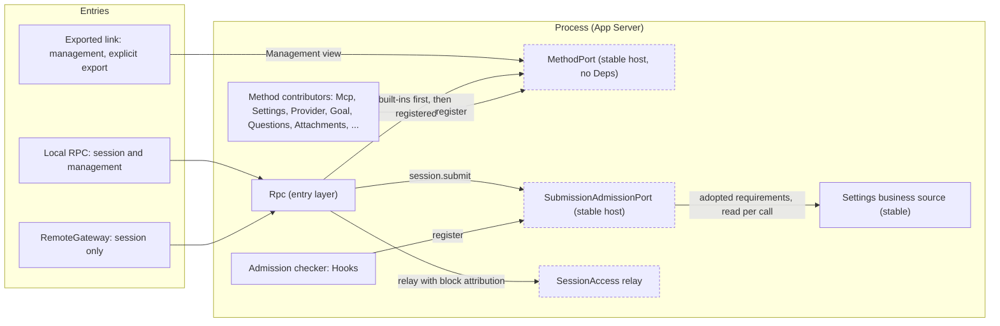
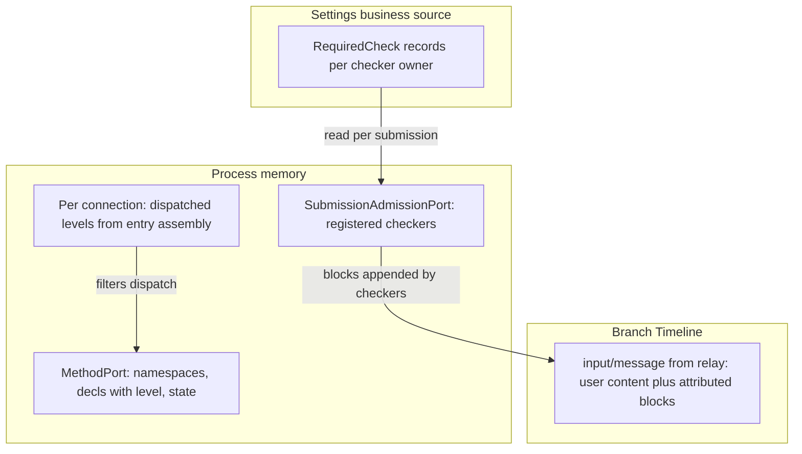
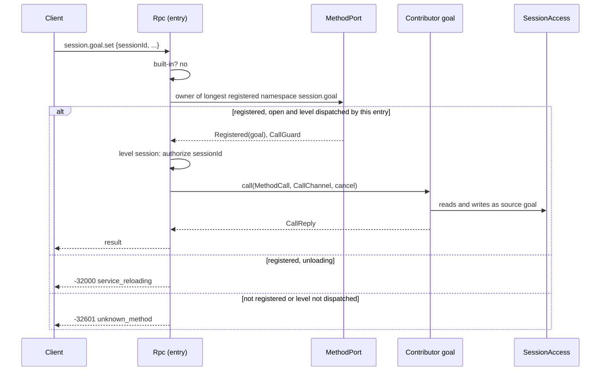
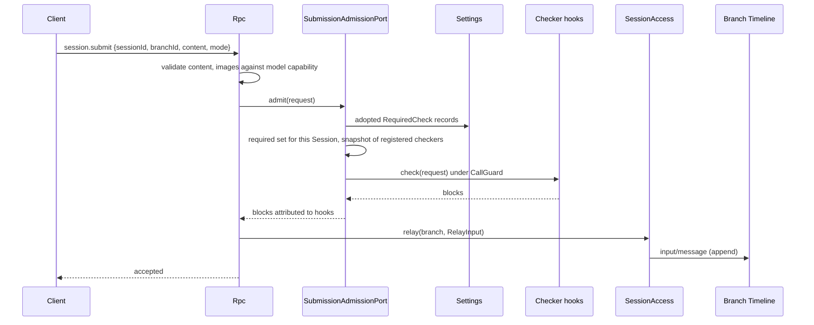
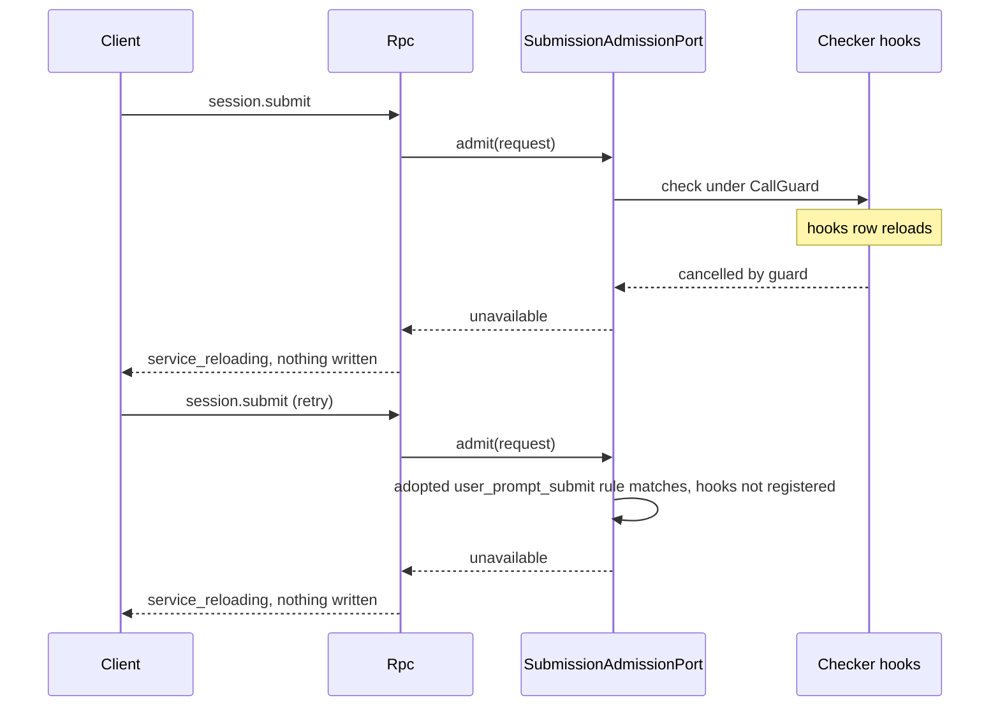

# Session boundary: method port and submission-admission port

Status: Draft. Overall design: [overview §3 dependency direction and ports](../overview.md#3-dependency-direction-and-ports), [§6.1 method E](../overview.md#61-integration-methods), [Appendix C Rpc](../overview.md#appendix-c-supplements-and-changes-to-existing-plugins); rules: [ADR 002](../../adr/002-dependency-direction.md) D2, D6. Phase: P1. Language: Rust (ports and entry layer); contributors in any language that provides the contract.

The entry layer (Rpc) owns two stable registration ports, each hosted in its own plugin and neither naming a contributor. (1) The **method port**: process or Session-scoped plugins register wire methods under their own namespaces; each method declares `level: session | management`, and each entry dispatches the levels its assembly allows. [Management](../plugins/Management.md) is a level-filtered view of this port (level `management`) and keeps the management plane semantics (export, migration, `daemon.shutdown`). (2) The **submission-admission port**: one check of `session.submit`, used by Hooks, that may reject a submission or append attributed raw blocks. It is fail closed only where adopted business configuration requires a check that is not registered (D6). Contributors register in `apply` and unregister in `ctx.effect` with the [shared registration mechanics](process-tool-contribution.md#a2-registration-mechanics-shared-by-the-ports-of-these-contracts); Rpc never reloads because a contributor does.

## 1. Structure



Rpc depends on AgentIndex, ConnectionHub, ServerControl, `SessionAccess` and the two ports; contributors depend on the ports. Entries differ only in which method levels they dispatch; a contributor never knows which entry calls it. The two ports are separate hosts because Settings registers methods into the method port while the submission-admission port reads Settings.

| Port | Host plugin (Deps) | Not registered | Contributors (examples) |
| --- | --- | --- | --- |
| Method | `MethodPort` (none) | `-32601` `unknown_method` | Management (`management`, `daemon`), Mcp, Settings, SkillsCatalog, Provider, OAuth, ManagedProviders, Goal (`session.goal`), SessionTitle (`session.rename`), Questions (`session.question`), Attachments (`attachment`) |
| Submission admission | `SubmissionAdmissionPort` (Settings) | Fail closed only if an adopted requirement matches the submission; otherwise skipped | Hooks (`user_prompt_submit`) |

Contracts defined here: `MethodPort`, `MethodProvider`, `MethodDecl`, `MethodLevel`, `Interruption`, `ReplyMode`, `MethodCall`, `CallOrigin`, `CallReply`, `MethodError`, `CallChannel`, `ConnectionNotifier`, `ChannelError`; `SubmissionAdmissionPort`, `SubmissionChecker`, `SubmissionRequest`, `AdmittedBlock`, `SubmissionRejected`, `RequiredCheck`; the entry dispatch, naming and error rules. Contracts depended on: the registration mechanics of the [tool source port](process-tool-contribution.md#a2-registration-mechanics-shared-by-the-ports-of-these-contracts), [session-access](session-access.md) (`SessionConfig` through `SessionAccess::config`, `relay` with `RelayBlock`), the Settings business source, the Rpc command envelope and `appError` codes.

## 2. Data and state



Neither port owns a Timeline event. Registrations are memory, rebuilt when contributors register in `apply`. The only persisted state is the requirement records, which belong to the checker owner's business configuration (Hooks' user rules and `disable_all` live in Settings, [ADR 002 D5](../../adr/002-dependency-direction.md#d5-structural-configuration-and-business-configuration-are-separate)) and stay readable while the checker is down. Dispatched levels are recorded per connection at accept time and never derived from identity.

## 3. Flows

### 3.1 Registered method on an entry



Rpc authorizes Session access from `sessionId` before dispatch for every `session`-level method, exactly as for its built-in Session methods; the contributor validates the remaining params. A `management`-level method has no Session parameter and is reachable only on entries that dispatch the management level.

### 3.2 `session.submit` through admission



Registered checkers always run; requirements only decide what happens when a required checker is not registered. With no matching requirement and no registered checker, `session.submit` relays directly.

## 4. Timing and conflicts

### 4.1 Required checker unavailable



A submission is either admitted by every registered checker and every required checker is present, or nothing is written; the client keeps its draft and retries. A Session whose scope matches no adopted requirement is never blocked by Hooks being down.

### 4.2 Other key rows

| Scenario | Order | Outcome | Owner |
| --- | --- | --- | --- |
| Method contributor reloads mid-call | admitted < unload | `Report`: `operation_interrupted`; `Drain`: unload waits | Rpc, port |
| Method called between unregistration and re-registration | — | `unknown_method` (registration state alone decides) | MethodPort |
| Two contributors claim one namespace | second registration | Rejected as a whole; first keeps it | MethodPort |
| `management`-level method on RemoteGateway | — | `unknown_method` (level not dispatched) | Rpc |
| Checker rejects | — | Its `appError`; nothing written | Rpc |
| Submit during turn `stop/interrupt` | relay vs interrupt by Timeline order | Per [session-access](session-access.md#4-timing-and-conflicts) rows | InputQueue, Loop |

Full table: Appendix B.

## 5. Context mapping

| Port | What the model sees |
| --- | --- |
| Submission admission | The relayed `input/message`: user content and checker blocks, each rendered as a `<dim-<checker>>` element ([session-access §5](session-access.md#5-context-mapping)), at the input's consumed position |
| Method | Nothing directly; a method that writes input does so through SessionAccess, whose mapping applies |

Compaction and child branches follow the input rules of session-access. Rejected submissions, unregistered namespaces, progress and notifications never reach the model.

## 6. Interfaces (summary)

| Interface | Purpose |
| --- | --- |
| `MethodPort::register / lookup / list(level)` | Register wire methods under owned namespaces; dispatch for entries; `list(Management)` is the Management view |
| `MethodProvider::namespaces/methods/call` | The registered provider |
| `CallChannel` | Per-call progress sink, connection-bound notifications, reply handoff |
| `SubmissionAdmissionPort::register / admit` | Register a checker; Rpc admits a submission against registered checkers and adopted requirements |
| `SubmissionChecker::check` | Reject a client submission or append attributed blocks |
| `RequiredCheck` | Adopted requirement record in the checker owner's business configuration |

## 7. Security

Entry assembly is the only authority for methods: an entry reaches exactly the levels it dispatches (RemoteGateway: `session` only, including remote execution Session methods per decision E3; management only on the local entry and on links that export it explicitly). Session-level methods are additionally authorized by Rpc's Session access for `sessionId`. Submission admission cannot be bypassed by making a checker fail while an adopted rule requires it: a missing or unloading required checker rejects the submission. Loader declarations or the mere presence of a configured plugin never deny (D6). Block attribution is set by Rpc from the registered checker name, and users cannot submit blocks at all. Requirement records are business configuration edited through the owner's management methods or Settings; removing them is an explicit user action.

## Appendix A. Interface details

### A.1 Method port

```rust
/// Process service of the `MethodPort` plugin (Deps: none); key TypeKey::of::<MethodPort>().
impl MethodPort {
    /// In the contributor's `apply`; removal with `ctx.effect`.
    pub fn register(&self, ctx: &Ctx, name: &str, provider: Arc<dyn MethodProvider>) -> Result<(), PortError>;
    /// Owner of the longest registered namespace that prefixes or equals `method`.
    pub fn lookup(&self, method: &str) -> MethodLookup;
    /// Registered methods of one level; `list(Management)` is the Management view.
    pub fn list(&self, level: MethodLevel) -> Vec<(String, MethodDecl)>;
    pub fn changed(&self) -> tokio::sync::watch::Receiver<u64>;
}
pub enum MethodLookup { Open(Arc<Registered<dyn MethodProvider>>), Unloading, NotRegistered }
pub trait MethodProvider: Send + Sync + 'static {
    /// Namespaces owned by this contributor; fixed for the registration.
    fn namespaces(&self) -> Vec<String>;
    /// Complete method list; each name lies in one of the namespaces.
    fn methods(&self) -> Vec<MethodDecl>;
    /// Validates params and executes. `cancel` fires when the caller is gone or the
    /// contributor unregisters, for `Interruption::Report` methods.
    fn call(&self, call: MethodCall, channel: CallChannel, cancel: CancellationToken)
        -> HostFuture<'_, Result<CallReply, MethodError>>;
}
pub struct MethodDecl {
    pub name: String,               // full wire name, e.g. "session.goal.set", "mcp.save"
    pub level: MethodLevel,
    pub mutating: bool,             // changes host configuration or runs a command
    pub interruption: Interruption,
    pub progress: bool,             // emits progress through CallChannel
    pub notifications: Vec<String>, // connection-bound notification names, inside the namespace
    pub reply: ReplyMode,
}
pub enum MethodLevel { Session, Management }
pub enum Interruption { Report, Drain } // Report: caller gets operation_interrupted; Drain: unload waits
pub enum ReplyMode { Direct, Handoff }  // Handoff: daemon.shutdown only today
pub enum CallReply { Value(serde_json::Value), HandedOff }
pub struct MethodCall {
    pub method: String,
    pub session_id: Option<String>, // Some and already authorized for level Session
    pub params: serde_json::Value,  // raw params, {} when absent
    pub origin: CallOrigin,         // diagnostics only, never authorization
}
pub enum CallOrigin {
    Local { connection_id: String },
    Entry { entry: String, connection_id: String },
    Link { peer: String },
}
pub struct MethodError {
    pub code: i32,                    // -32602, -32601 or -32000
    pub app_error: Cow<'static, str>, // [a-z][a-z0-9_]*
    pub message: String,              // public text; never secrets
}
```

| Rule | Content |
| --- | --- |
| Namespace | `<segment>(.<segment>)*`, segments `[a-z][a-z0-9_]*`, chosen by the contributor; a namespace may itself be a method name (`session.rename`) |
| Method name | Inside one of the contributor's namespaces, at most 128 bytes |
| Ownership | A name belongs to the longest registered namespace that prefixes or equals it |
| Reserved for Rpc built-ins | `hello`, `agent`, `approval`, the bare `session` root, and `session.attach`, `session.branch_create`, `session.close`, `session.create`, `session.detach`, `session.history`, `session.idle`, `session.input_lookup`, `session.list`, `session.state`, `session.stop`, `session.submit`, `session.summaries`, `session.exec`, `session.mcp`, `session.model`, `session.permission`, `session.prompt`, `session.skills`, `session.input` (InputQueue withdrawal) |
| Precedence | Rpc built-ins, then registered methods; one wire name space |
| Level | `Session`: requires `sessionId` (`-32602` without it), authorized by Rpc. `Management`: no Session parameter |
| Entry dispatch | Local RPC entry: both levels (management when assembly configures it); RemoteGateway: `Session` only; exported rutis link: `Management` only, by explicit host-local export ([Management](../plugins/Management.md)) |
| Rejection | A registration violating a rule or colliding with a current one is rejected as a whole; the earlier owner keeps its names |
| Not registered | Registration state alone decides: no registration owns the name, or the level is not dispatched by this entry → `-32601` `unknown_method`; the owning registration is `Unloading`, or a `Report` call is cancelled by unregistration → `-32000` `service_reloading` (`operation_interrupted` if the call had started). Loader rows and business enablement never change this |
| Features | `hello.features` (v3) lists the currently registered methods of the levels the connection dispatches |
| Session-scoped contributors | A Session-scoped plugin (Questions) registers a process-level provider that resolves its branch service per call from `sessionId` and params, as Rpc's `approval.respond` does |
| Long-running work | Methods return promptly or stream through `CallChannel`; Session results go through Session events or the contributor's own inputs |

### A.2 Call channel

```rust
impl CallChannel {
    /// No-op unless the method declared `progress` and the caller has a connection.
    pub fn progress(&self, data: serde_json::Value);
    /// Err(Unsupported) for link callers without a sink or when no notifications are declared.
    pub fn notifier(&self) -> Result<ConnectionNotifier, ChannelError>;
    /// Only for ReplyMode::Handoff: takes the connection's final-response writer.
    pub fn take_final_reply(&self) -> Result<FinalReply, ChannelError>;
}
impl ConnectionNotifier {
    pub fn send(&self, method: &str, params: serde_json::Value) -> Result<(), ChannelError>; // Gone after close
    pub fn closed(&self) -> impl Future<Output = ()>; // disconnect, Rpc reload, entry close
}
pub enum ChannelError { Unsupported, Undeclared, Gone }
```

| Rule | Content |
| --- | --- |
| Progress wire form | Notification `management.progress {id, method, data}` for either level; ordered before the response; dropped after disconnect; coalesced to the transport write budget, never dropping the response |
| Notification names | Declared in `MethodDecl.notifications` and inside the contributor's namespace; others return `Undeclared` |
| Notifier lifetime | Valid after the call returns until the connection closes; contributors release connection-bound resources on `closed()` |
| Link callers | Dispatch takes an optional caller sink; without one, progress is dropped and `notifier()` returns `Unsupported` |

### A.3 Submission-admission port

```rust
/// Process service of the `SubmissionAdmissionPort` plugin (Deps: Settings);
/// key TypeKey::of::<SubmissionAdmissionPort>().
impl SubmissionAdmissionPort {
    pub fn register(&self, ctx: &Ctx, name: &str, checker: Arc<dyn SubmissionChecker>) -> Result<(), PortError>;
    /// Used by Rpc: requirements, then all registered checkers.
    pub async fn admit(&self, request: &SubmissionRequest)
        -> Result<Vec<(String, AdmittedBlock)>, AdmissionDenied>;
}
pub trait SubmissionChecker: Send + Sync + 'static {
    fn check(&self, request: &SubmissionRequest, cancel: CancellationToken)
        -> HostFuture<'_, Result<Vec<AdmittedBlock>, SubmissionRejected>>;
}
pub struct SubmissionRequest {
    pub session_id: String,
    pub branch_id: String,
    pub config: Arc<SessionConfig>, // read through SessionAccess::config
    pub user: UserInput,            // already validated; read-only
    pub mode: InputMode,
}
pub struct AdmittedBlock { pub kind: String, pub block: SourceBlock } // key inside the checker namespace
pub struct SubmissionRejected {
    pub app_error: String, // [a-z][a-z0-9_]*, owned by the checker, e.g. "hook_rejected"
    pub message: String,   // public text
}
pub enum AdmissionDenied { Rejected { checker: String, rejection: SubmissionRejected }, Unavailable { checker: String } }
/// Adopted requirement, stored in the checker owner's Settings section (`<checker>.required`).
pub struct RequiredCheck { pub checker: String, pub scope: CheckScope }
pub enum CheckScope { AllSessions, InteractiveSessions, ProjectRoot(PathBuf) } // matched against SessionConfig
```

| Rule | Content |
| --- | --- |
| Requirements | Read per submission from the Settings business source; a requirement applies when its scope matches the Session (`ProjectRoot`: `cwd` inside the root). The owner writes them when it adopts business configuration (Hooks: one record per adopted `user_prompt_submit` rule, user rules as `AllSessions`, approved project rules as `ProjectRoot`; none while `disable_all`) |
| Required but not registered | `AdmissionDenied::Unavailable` → `-32000` `service_reloading`; nothing written; no checker is called |
| Order | All registered checkers are called concurrently on the same request; blocks are appended in checker-name order |
| Rejection | Any rejection: `-32000`, `appError` = `SubmissionRejected.app_error`, `data.checker` = name; nothing written |
| Cancelled | Guard cancelled (checker unload) or Rpc unload: `service_reloading`; nothing written |
| Relay | Rpc builds `RelayInput { user, blocks: AdmittedBlock → RelayBlock { source: checker name }, mode, submission_id }` and calls `SessionLease::relay` |
| Content | User content (text and image blocks) is validated by Rpc as today, including images against the branch model's capability; checkers cannot change it |

Approval's admission-check port (overview Appendix C) uses the same `RequiredCheck` rule for tool calls.

## Appendix B. Full conflict table

| Scenario | Sequence order | Outcome | Owner of the decision |
| --- | --- | --- | --- |
| Submit while a required checker is not registered | requirement read | `service_reloading`; nothing written | SubmissionAdmissionPort |
| Submit with no matching requirement while the checker is down | — | Relayed without that checker | SubmissionAdmissionPort |
| Checker unloads mid-check | admitted < unload | `service_reloading`; nothing written | SubmissionAdmissionPort |
| Checker rejects | — | Its `appError`; nothing written | Rpc |
| Requirement record changed during a submit | read < write | Decision uses the records it read; the next submit sees the change | SubmissionAdmissionPort |
| Submit during turn `stop/interrupt` | relay vs interrupt by Timeline order | Per session-access rows (input after interrupt starts a turn) | InputQueue, Loop |
| Submit to a closed branch | — | `SessionClosed`/`BranchMissing` from relay | Runtime facade |
| Two clients submit concurrently | Timeline order | Each checked independently; inputs ordered by append | InputQueue |
| Duplicate or late submit (client retry) | — | Relayed twice unless the client uses `submission_id` and `session.input_lookup` | Client |
| Client detaches mid-submit | — | Submission continues; reply discarded | Rpc |
| Method contributor unloading | — | `service_reloading` for its namespaces only | MethodPort |
| Method contributor not registered | — | `unknown_method` | MethodPort |
| Method contributor reloads mid-call | admitted < unload | `Report`: `operation_interrupted`; `Drain`: waits | Rpc, port |
| Two contributors claim one namespace | second registration | Rejected; first keeps it | MethodPort |
| Rpc reload with method calls in flight | — | `Report` interrupted, `Drain` drained; notifiers report `closed()` | Rpc |
| Level not dispatched by the entry | — | `unknown_method` | Rpc |
| Process restart mid-submit | — | Committed input stays; client looks up by `submission_id` | Client |

## Appendix C. Errors and recovery

| Case | Wire result |
| --- | --- |
| Required checker not registered, or checker cancelled | `-32000`, `service_reloading` |
| Checker rejection | `-32000`, checker's `appError`, `data.checker` |
| Namespace owner unloading | `-32000`, `service_reloading` |
| Method not registered, or level not dispatched | `-32601`, `unknown_method` |
| Session-level method without `sessionId` | `-32602` |
| `Report` method interrupted by unload | `-32000`, `operation_interrupted` |

## Appendix D. Acceptance

1. A registered method dispatches by longest namespace; a reserved or colliding namespace is rejected; an unregistered namespace returns `unknown_method`, an unloading one `service_reloading`, while others work; Rpc never reloads.
2. A `management`-level method is reachable on the local entry, `unknown_method` on RemoteGateway, and reachable over a link only when exported; `list(Management)` matches the Management view; a `session`-level method requires and authorizes `sessionId`.
3. Progress precedes the response; a notifier reports `Gone` after disconnect.
4. With an adopted `user_prompt_submit` rule and Hooks not registered, `session.submit` returns `service_reloading` and writes nothing; a Session outside the rule's scope submits normally; with no adopted rule, a down Hooks plugin blocks nothing.
5. Checker blocks are attributed to the checker and rendered with its source; user content is unchanged.

## Appendix E. Assumptions

| # | Assumption | Basis | Effect if rejected |
| --- | --- | --- | --- |
| A1 | Checkers run concurrently and only append blocks; no phases | Single admission point used by Hooks | Ordered phases return |
| A2 | Registered namespaces may use roots other than `session` (`attachment`) | Overview Appendix C Rpc row | All Session-level methods live under `session.` |
| A3 | Progress uses one notification name for both levels | Judgment | A Session-level progress notification is defined |
| A4 | Requirement scopes are `AllSessions`, `InteractiveSessions` and `ProjectRoot` | Hooks rule sources (user, project) | Richer scopes added to `CheckScope` |
