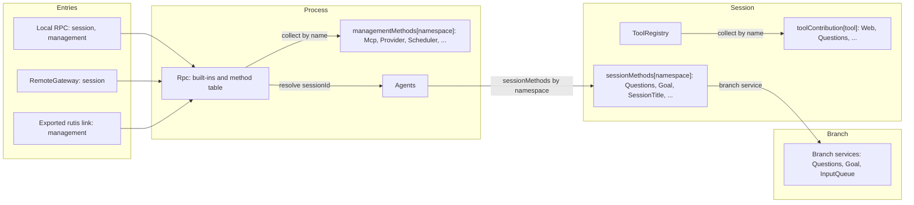
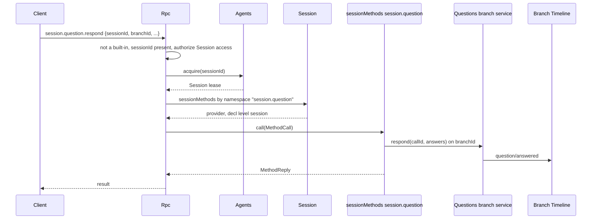
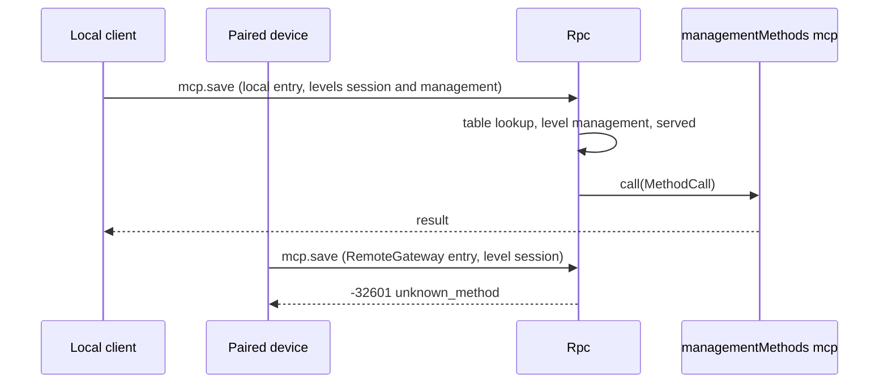

# Methods and tool contributions

Status: Draft. Overall design: [overview §3 integration](../overview.md#3-integration-by-existing-mechanisms), [Appendix B Rpc and ToolRegistry](../overview.md#appendix-b-supplements-to-existing-plugins); rules: [ADR 002](../../adr/002-plugin-scope.md) D2, D3, D5. Phase: P0. Language: neutral contracts; Rust binding in [Appendix F](#appendix-f-rust-binding).

This contract defines three named services in the language-neutral form of ADR 002 D5. Each is identified by a service name, a scope and an instance key; its methods take and return serializable data; errors are data; cancellation is a protocol action. A plugin in any language provides them by declaring them in its `provides` (loader row), and consumers collect them by name and scope. They are built on mechanisms the runtime already has: named services collected per scope and Rpc's existing dispatch through the Session, as `approval.respond` does today.

| Service | Scope | Key | Provided by | Collected by |
| --- | --- | --- | --- | --- |
| `sessionMethods` | Session | namespace | Session-scoped plugin parts (Questions, Goal, SessionTitle, Attachments, ShellInput) | Rpc, dispatching through the Session |
| `managementMethods` | Process | namespace | Process plugins (Mcp, Provider, Scheduler, ...) | Rpc's method table, level `management` |
| `toolContribution` | Session | tool name | Session-scoped plugin parts (Questions, Goal, Web, Notifications, Scheduler, Workflow) | ToolRegistry (supplement: named tool services) |

Each entry (local RPC, RemoteGateway, an exported rutis link) serves the levels it is configured for. There is no registry, no port and no Management plugin. Providers are optional plugins installed only when enabled. A provider reload propagates to its collector, which is the accepted cost of D3.

Acting on a tool call or an input before it is committed is not a service of this contract: a branch-scoped plugin registers a Timeline before callback on `step/tool-call` or `input/message` (the runtime Timeline supplement, [overview Appendix B](../overview.md#appendix-b-supplements-to-existing-plugins)), and what it writes is defined by that plugin ([Hooks](../plugins/Hooks.md)). Approval, ToolExecutor, InputQueue and the Session input path are unchanged.

## 1. Structure



| Service | Absent |
| --- | --- |
| `sessionMethods` | `unknown_method` for that Session |
| `managementMethods` | `unknown_method` |
| `toolContribution` | The tool is not offered |

Contracts defined here: the three services, `MethodDecl`, `MethodCall`, `MethodReply`, `MethodError`, the `callChannel` companion service, `ToolDeclaration`, `ToolCall`, `ToolResult`, entry levels, naming, reserved names, the migration of existing management methods and the compatibility table. Contracts used: `SessionConfig` ([session-access](session-access.md#a3-sessionconfig-fields)), source input conventions ([session-access A.2](session-access.md#a2-source-input-conventions)), the Rpc command envelope and `appError` codes.

## 2. Data and state

No service owns a Timeline event or persisted state. Method tables are rebuilt when Rpc or a Session loads. The served levels are entry assembly data, recorded on each connection when it is accepted as `ConnectionEntry {name, levels, deviceId}`, and are never derived from identity. A link's management export is host-local structural configuration.

## 3. Flows

### 3.1 Session method



The namespace is resolved by the longest prefix among the namespaces provided in that Session. If the Session has no such namespace, because the plugin is disabled or the Session is non-interactive and the plugin is not installed, the result is `unknown_method`. A Session-scoped method may declare `level: management` (`shell.*`). It is then dispatched only on entries that serve management.

### 3.2 Management method



The levels an entry serves are the only check. Serving the management level grants host administrator rights.

## 4. Timing and conflicts

| Scenario | Order | Outcome | Owner |
| --- | --- | --- | --- |
| Session-scoped provider reloads mid-call | call < reload | `Report`: `operation_interrupted`; `Drain`: reload waits | Rpc |
| Session method while the Session's capabilities reload | — | `service_reloading` | Rpc |
| Session method on a Session without that plugin | — | `unknown_method` | Rpc |
| Management owner reloads | — | Rpc reloads with it (D3); open connections see the existing Rpc reload behaviour | rutis lifecycle |
| Management method on a session-only entry | — | `unknown_method` | Rpc |
| Two providers claim one namespace or tool name | assembly | Assembly fails; keys are unique per scope | Assembly |
| Tool-contribution provider reloads during a turn | call < reload | ToolRegistry and dependants reload; the in-flight turn ends `Failed` (D3, accepted) | ToolRegistry |

Full table: [Appendix B](#appendix-b-full-conflict-table).

## 5. Context mapping

Methods have no model-visible effect. A method that changes model context does so through its owner's input or Timeline facts, and those owners' mappings apply. A `toolContribution` reaches the model only through its declaration and its `ToolResult`, as any tool does.

## 6. Interfaces (summary)

| Service and method | Mode | Purpose |
| --- | --- | --- |
| `sessionMethods[namespace].describe() -> MethodDecl[]` | async | Session-scoped method declarations |
| `sessionMethods[namespace].call(MethodCall) -> MethodReply` | async | Execute a Session-scoped method |
| `managementMethods[namespace].describe / call` | async | Same shapes, process scope, level management |
| `callChannel.progress / notify / closed` (Rpc) | sync / async | Per-call progress and connection-bound notifications |
| `toolContribution[tool].declaration() -> ToolDeclaration` | sync | Tool declaration |
| `toolContribution[tool].execute(ToolCall) -> ToolResult` | async | Tool execution |

## 7. Security

Entry assembly is the only authority for levels: local RPC serves both levels, RemoteGateway serves `session` (paired devices may call every Session method, decision E3), and a rutis link serves `management` only when it is explicitly exported in host-local link configuration. Rpc authorizes `sessionId` for every Session-scoped method exactly as for its built-ins, and providers validate the other params. Methods that run commands or change host configuration declare `level: management`. A `toolContribution` is admitted by Approval and Permission like every tool, under its declared risk. Host-local approvals (`mcp.approve`, `hooks.approve`, `plugin.approve`, `workflow.approve`) are management methods.

## Appendix A. Interface details

Shapes are JSON with camelCase fields; a `?` after a field name marks it optional and `|` separates alternatives. These shapes are canonical: plugin documents use these field names (Rust bindings map them to snake_case). Every error is `MethodError` data.

### A.1 Method contributions

`sessionMethods` (Session, key namespace) and `managementMethods` (process, key namespace) have the same two methods.

| Method | Mode | Request | Reply |
| --- | --- | --- | --- |
| `describe` | async | — | `MethodDecl[]` |
| `call` | async | `MethodCall` | `MethodReply`, or `MethodError` |

```text
// MethodDecl
{ "name": "session.goal.set",          // full wire name inside the namespace
  "level": "session" | "management",   // managementMethods: always "management"
  "mutating": true,
  "interruption": "report" | "drain",  // report: operation_interrupted; drain: unload waits
  "progress": false,
  "notifications": ["session.goal.changed"], // inside the namespace
  "reply": "direct" | "handoff" }      // handoff: daemon.shutdown
// MethodCall
{ "callId": "string", "method": "session.goal.set",
  "sessionId?": "string",              // present and authorized for sessionMethods
  "params": {},
  "origin": { "kind": "local" | "entry" | "link", "entry?": "string",
              "connectionId?": "string", "peer?": "string" } } // diagnostics only
// MethodReply
{ "kind": "value", "value": {} } | { "kind": "handedOff" }
// MethodError
{ "code": -32000, "appError": "string", "message": "string" }
```

Cancellation: when a `report` call is interrupted, Rpc sends a cancel request for `callId` (or drops the call) and replies `operation_interrupted`; a `drain` call is awaited before the provider unloads.

| Rule | Content |
| --- | --- |
| Namespace | `<segment>(.<segment>)*`, segments `[a-z][a-z0-9_]*`, owned by the provider; a namespace may itself be a method (`session.rename`) |
| Ownership | A name belongs to the longest provided namespace that prefixes or equals it, among the built-ins, the process table and the Session's providers |
| Reserved for Rpc built-ins | `hello`, `daemon`, `agent`, `approval`, the bare `session` root and `session.attach`, `session.branch_create`, `session.close`, `session.create`, `session.detach`, `session.history`, `session.idle`, `session.input_lookup`, `session.list`, `session.state`, `session.stop`, `session.submit`, `session.summaries`, `session.exec`, `session.mcp`, `session.model`, `session.permission`, `session.prompt`, `session.skills`, `session.input` (`session.input.withdraw`, served through InputQueue's branch service as `approval.respond` is, because InputQueue is a core branch capability with no Session part) |
| Precedence | Built-ins, then the process table, then the Session's providers; one wire name space |
| Session-scoped call | Requires `sessionId` (`-32602` without it). Rpc authorizes it, acquires the Session through Agents (restoring if needed) and calls the Session's `sessionMethods` for the namespace. The provider reaches a branch through that branch's services |
| Not dispatched | Namespace not provided, or level not served by the entry → `-32601 unknown_method`. Session reloading → `-32000 service_reloading`. A started `report` call interrupted → `operation_interrupted` |
| `hello.features` (v3) | Built-ins and process-table methods of the entry's levels. Session-scoped methods are listed per Session in `session.state.methods` |
| Ready latch | Opens after the loader's initial load settles, so process providers are present at the first `hello` |

Known Session-scoped namespaces: `session.question` (Questions), `session.goal` (Goal), `session.rename` (SessionTitle), `attachment` (Attachments), `shell` (ShellInput, level management). Each plugin document is authoritative for its methods.

### A.2 Call channel

Rpc provides the process service `callChannel` to method providers.

| Method | Mode | Request | Reply |
| --- | --- | --- | --- |
| `progress` | sync | `{callId, data}` | — (dropped unless the method declared `progress`) |
| `notify` | async | `{connectionId, method, params}` | `{}`, or error `unsupported` (link), `undeclared`, `gone` |
| `closed` | async | `{connectionId}` | Resolves when the connection closes |
| `takeFinalReply` | async | `{callId}` | `{}` after the final reply is written; `handoff` methods only |

Progress is sent as the notification `management.progress {id, method, data}` for both levels, ordered before the response and dropped after disconnect. Notification names must be declared and lie inside the namespace. A `connectionId` stays valid for `notify` until the connection closes.

### A.3 Entry levels and export

| Entry | Levels | Notes |
| --- | --- | --- |
| Local protected transport | `{session, management}` | Today's protected-profile rules unchanged |
| Bare WebSocket, protected profile | as today | Everything but `hello`/`daemon.ping` is `local_transport_required` |
| RemoteGateway | `{session}` | [RemoteGateway](../plugins/RemoteGateway.md) |
| Exported rutis link | `{management}` | Only when exported in host-local link configuration. Without a caller sink, progress is dropped and `notify` returns `unsupported` |

### A.4 Migration and compatibility

Sources: `MANAGEMENT_METHODS`, `MCP_METHODS`, `LOCAL_EXECUTION_METHODS`, `Call::is_management` in [protocol.rs](../../../crates/dim-app-server/src/protocol.rs); `validate_call` in [connection.rs](../../../crates/dim-app-server/src/connection.rs).

| Methods | Destination | Provider (namespace) |
| --- | --- | --- |
| `account.providers/status/recover/logout`, `account.login.*` | `managementMethods` | ManagedProviders (`account`) |
| `account.codex.*`, `account.grok.*` | `managementMethods` | OpenAI Codex OAuth (`account.codex`), Grok OAuth (`account.grok`) |
| `provider.*` | `managementMethods` | Provider (`provider`) |
| `skills.catalog/set_enabled/refresh` | `managementMethods` | SkillsCatalog (`skills`) |
| `mcp.catalog/set_enabled/save/remove/disconnect/approve/revoke` | `managementMethods` | Mcp (`mcp`) |
| `daemon.shutdown` | Rpc built-in, level management, reply handoff | — |
| `hello`, `daemon.ping`, `agent.*`, existing `session.*`, `approval.respond`, new `session.input.withdraw` | Rpc built-ins | — |
| New Session methods | `sessionMethods` | Each owner (A.1) |

Interruption reproduces today's behaviour: `mcp.*` and `skills.*` are `report`, and `account.*` and `provider.*` are `drain`. Rpc's `When<ProductServices>` and `When<ExecutionServices>` are replaced by collecting `managementMethods`, so Rpc no longer names any owning service.

| Client | Before | After |
| --- | --- | --- |
| v1, v2 | Management methods `unknown_method` | Same |
| v3 local, product profile | `hello.features` has the 33 product names | Same names; params, results, codes and `appError` unchanged |
| v3 local, execution | `LOCAL_EXECUTION_METHODS` + `MCP_METHODS` | Same names |
| v3 bare WebSocket, protected profile | `local_transport_required` | Same |
| v3 RemoteGateway (new) | Did not exist; execution Session methods (`session.permission.get/update`, `session.exec.stop`, `session.skills`, `session.model.update`, `session.prompt.refresh`, `session.mcp`, `session.mcp.refresh`) were local-only | **Compatibility change (E3):** available to paired devices; management names `unknown_method` |
| v3, MCP disabled | `mcp.*` `unknown_method` | Same, with Rpc's message |
| v3, Mcp reloading | `service_reloading` | Rpc reloads with Mcp (D3); the client reconnects and retries |

No protocol version is added and persistence formats are unchanged.

### A.5 Tool contribution

ToolRegistry supplement: besides tools registered today, ToolRegistry accepts named tool services. A plugin declares `toolContribution[<tool name>]` at Session scope in its `provides`, and ToolRegistry collects the Session's tool services by name. Existing rules for name uniqueness, collisions with host tools and enablement through `SessionConfig.tools` are unchanged ([tool contributions](../../architecture/rust-agent/tool-contributions.md)).

| Method | Mode | Request | Reply |
| --- | --- | --- | --- |
| `declaration` | sync | — | `ToolDeclaration` |
| `execute` | async | `ToolCall` | `ToolResult` |

```text
// ToolDeclaration
{ "name": "web_fetch",           // equals the key
  "description": "string",
  "inputSchema": { /* JSON Schema */ },
  "risk": "network" }            // Permission category; required for new tools
// ToolCall
{ "sessionId": "string", "branchId": "string", "turnId": "string", "callId": "string",
  "arguments": {}, "config": { /* SessionConfig data */ } }
// ToolResult
{ "content": [ { "type": "text", "text": "..." } | { "type": "image", "...": "..." } ],
  "structuredContent?": {}, "isError": false }
```

Cancellation: turn interrupt sends a cancel request for `callId` (or drops the call); ToolExecutor settles the call as interrupted. A provider error is returned as `ToolResult` with `isError: true`. The declaration may depend on the Session's configuration and is read once per provider generation.

## Appendix B. Full conflict table

| Scenario | Sequence order | Outcome | Owner of the decision |
| --- | --- | --- | --- |
| Session method during branch `stop/interrupt` | per owner's facts | Decided by the owner's Timeline order (for example, a Questions answer after the interrupt is `question/cancelled`) | Owning plugin |
| Session method on a closed branch | — | Owner's `BranchMissing` error | Owning plugin |
| Session method on an unloaded Session | — | Rpc restores through Agents, then dispatches | Rpc |
| Session-scoped provider reloads mid-call | admitted < reload | `report`: `operation_interrupted`; `drain`: waits | Rpc |
| Process owner reloads | — | Rpc reloads (D3) | rutis lifecycle |
| Rpc reload with calls in flight | — | `report` interrupted, `drain` drained; `closed` resolves | Rpc |
| Level not served by the entry | — | `unknown_method` | Rpc |
| Client detaches mid-call | — | Call continues; reply discarded | Rpc |
| Two clients mutate the same configuration | storage revision | Second gets the provider's conflict | Provider |
| `daemon.shutdown` concurrent with another call | admission | Admission stops, then admitted calls settle per `interruption` | Process coordinator |
| Tool contribution called during turn `stop/interrupt` | interrupt < result | Cancel request for `callId`; ToolExecutor settles the call as interrupted | ToolExecutor |
| Unsettled tool batch, compaction, child branch cut, `input/withdraw`, `input/deleted` | — | No effect on methods | — |
| Process restart mid-call | — | Reply lost; outcome per provider persistence; never replayed | Provider |

## Appendix C. Errors and recovery

| Case | Wire result |
| --- | --- |
| Not provided, or level not served, or v1/v2 | `-32601`, `unknown_method` |
| Session-scoped method without `sessionId` | `-32602` |
| Session reloading | `-32000`, `service_reloading` |
| `report` call interrupted | `-32000`, `operation_interrupted` |
| Provider error | `-32000`, provider's `appError` |

## Appendix D. Acceptance

1. A Session-scoped method dispatches through the Session it names. On a Session without the plugin it returns `unknown_method`, and Rpc never names the provider.
2. A management method is reachable on the local entry, returns `unknown_method` on RemoteGateway, and is reachable over a link only when exported. A Session-scoped `shell.*` method follows the same level rule.
3. A recorded transcript of every migrated management method matches the pre-migration transcript, and `hello.features` is unchanged for v3 local profiles.
4. On a RemoteGateway test entry, `session.permission.update` and `session.exec.stop` succeed.
5. A tool provided as `toolContribution` by a non-Rust plugin is declared to the model and executed through ToolExecutor like a Rust tool.
6. Progress precedes the response, and `notify` reports `gone` after disconnect.

## Appendix E. Assumptions

| # | Assumption | Basis | Effect if rejected |
| --- | --- | --- | --- |
| A1 | Session-scoped namespaces may use roots other than `session` (`attachment`, `shell`) | Existing wire names | All move under `session.` |
| A2 | The Session can look up a keyed Session service by name for Rpc | Existing keyed Session services | Rpc enumerates providers through a Session service |
| A3 | Session-scoped methods are listed per Session, not in `hello.features` | They differ per Session | A global list with per-Session availability |

## Appendix F. Rust binding

The neutral services above map to Rust as follows. Rust plugins may use these types directly; non-Rust plugins provide the services by name through rutis-bridge (`TypeKey::named`, `host_key(name)` with `dyn HostDispatch`), and generated Rust bindings decode them to the same types.

| Neutral service | Rust type and key | Registration in Rust assemblies | Collection |
| --- | --- | --- | --- |
| `sessionMethods[ns]` | `SessionMethodContribution(Arc<dyn MethodProvider>)`, `SessionScope::named_key::<SessionMethodContribution>(ns)` | `AgentBuilder::session_methods(ns)` | `Session::method(ns)` |
| `managementMethods[ns]` | `ManagementMethods(Arc<dyn MethodProvider>)` | loader row | `Contributions<ManagementMethods>` |
| `toolContribution[tool]` | `ToolContribution {definition, handler}`, `SessionScope::named_key::<ToolContribution>(tool)` | `AgentBuilder::session_tool(tool)` (existing) | `Contributions<ToolContribution>` in ToolRegistry |
| `callChannel` | `CallChannel`, `ConnectionNotifier` passed to `MethodProvider::call` | — | — |

```rust
pub trait MethodProvider: Send + Sync + 'static {
    fn namespace(&self) -> &str;
    fn methods(&self) -> Vec<MethodDecl>;
    fn call(&self, call: MethodCall, channel: CallChannel, cancel: CancellationToken)
        -> HostFuture<'_, Result<CallReply, MethodError>>;
}
pub enum MethodLevel { Session, Management }
pub enum Interruption { Report, Drain }
pub enum ReplyMode { Direct, Handoff }
pub enum CallReply { Value(serde_json::Value), HandedOff }
pub struct MethodError { pub code: i32, pub app_error: Cow<'static, str>, pub message: String }

impl CallChannel {
    pub fn progress(&self, data: serde_json::Value);
    pub fn notifier(&self) -> Result<ConnectionNotifier, ChannelError>; // Unsupported for links
    pub fn take_final_reply(&self) -> Result<FinalReply, ChannelError>; // Handoff only
}
pub enum ChannelError { Unsupported, Undeclared, Gone }
```

`ToolContribution` and `ToolHandler` are the existing types in `dim-agent-capabilities/src/tool_registry.rs`; a named tool service from another language is wrapped in a `ToolHandler` by the generated binding.
