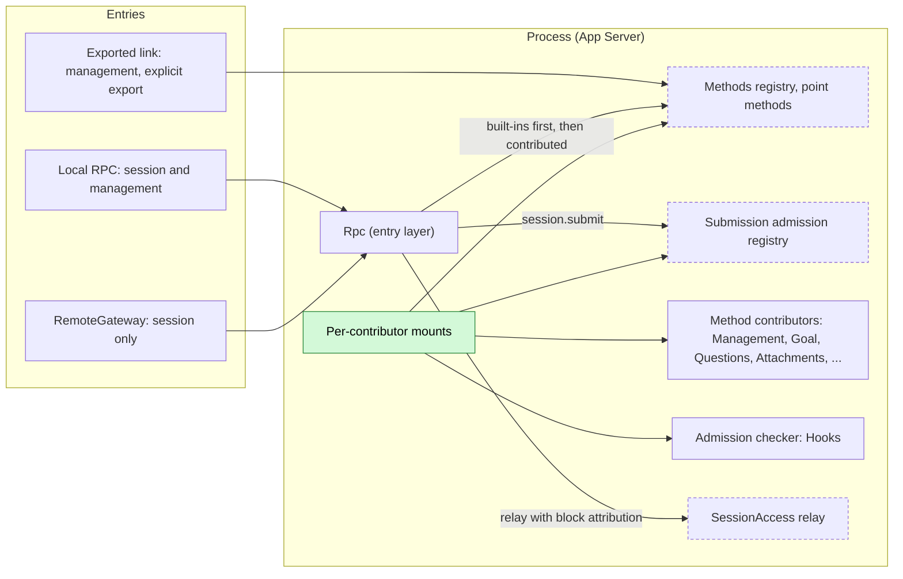
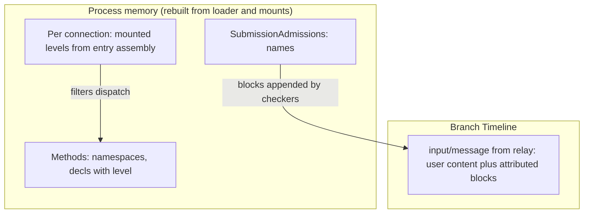
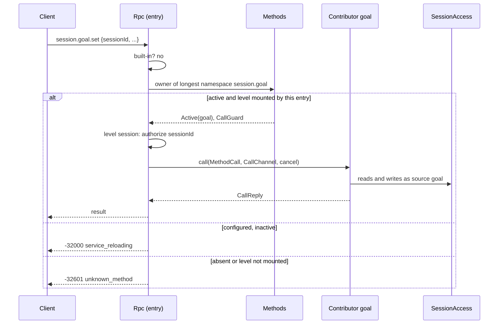
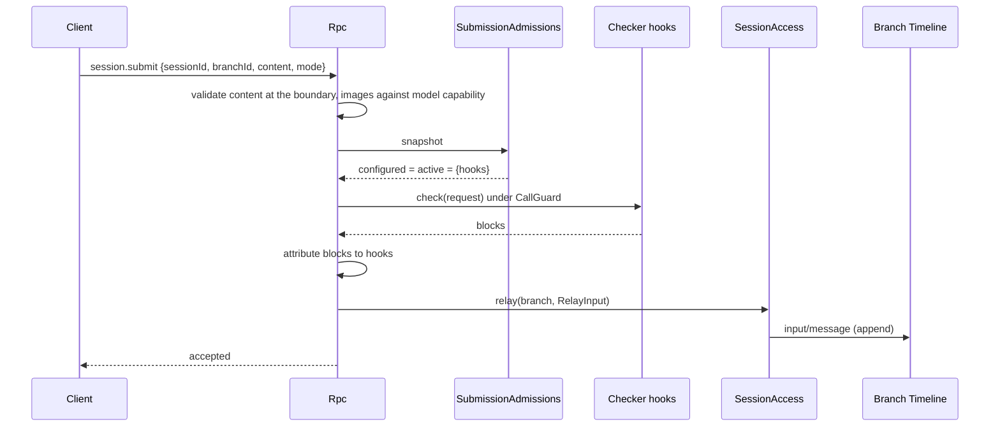
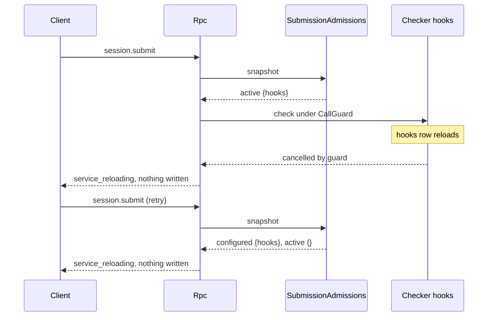

# Session boundary: method contribution and submission admission

Status: Draft. Overall design: [overview §6.1 method E](../overview.md#61-integration-methods), [§3 extension registries](../overview.md#3-extension-registries), [Appendix C Rpc](../overview.md#appendix-c-supplements-and-changes-to-existing-plugins). Phase: P1. Language: Rust (registries and entry layer); contributors in any language that provides the keyed service.

The entry layer (Rpc) owns exactly two extension points, both filled by per-contributor mounts of the [extension registry](extension-registry.md) and neither naming a contributor. (1) **Method contribution** (point `methods`): process or Session-scoped plugins contribute wire methods under their own namespaces; each method declares `level: session | management`, and each entry mounts the levels its assembly allows. This merges the former Session-method and management-method contracts; [Management](../plugins/Management.md) keeps the management plane semantics (mounting, export, migration, `daemon.shutdown`). (2) **Submission admission** (point `submission-admission`): one fail-closed check of `session.submit`, used by Hooks, that may reject a submission or append attributed raw blocks.

## 1. Structure



Rpc injects only the two registries, so no contributor reload reloads it. Entries differ only in which method levels they mount; a contributor never knows which entry calls it.

| Point | Owner | Registry (point name) | Configured contributor inactive | Contributors (examples) |
| --- | --- | --- | --- | --- |
| Method contribution | Entry layer (Rpc) | `Methods` (`methods`) | Its namespaces return `service_reloading`; others unaffected | Management (`management`, `daemon`), Goal (`session.goal`), SessionTitle (`session.rename`), Questions (`session.question`), Attachments (`attachment`), MCP, Settings |
| Submission admission | Rpc | `SubmissionAdmissions` (`submission-admission`) | Fail closed: `session.submit` returns `service_reloading`, nothing written | Hooks (`user_prompt_submit`) |

Contracts defined here: `MethodContribution`, `MethodProvider`, `MethodDecl`, `MethodLevel`, `Interruption`, `ReplyMode`, `MethodCall`, `CallOrigin`, `CallReply`, `MethodError`, `CallChannel`, `ConnectionNotifier`, `ChannelError`, `Methods`; `SubmissionAdmission`, `SubmissionChecker`, `SubmissionRequest`, `AdmittedBlock`, `SubmissionRejected`; the entry mounting, naming and dispatch rules. Contracts depended on: [extension registry](extension-registry.md), [session-access](session-access.md) (`SessionConfig` through `SessionAccess::config`, `relay` with `RelayBlock`), the Rpc command envelope and `appError` codes.

## 2. Data and state



Neither point owns a Timeline event. Admission blocks become part of the single `input/message` Rpc relays; a contributed method that writes input does so through [SessionAccess](session-access.md). Mounted levels are recorded per connection at accept time and never derived from identity.

## 3. Flows

### 3.1 Contributed method on an entry



Rpc authorizes Session access from `sessionId` before dispatch for every `session`-level method, exactly as for its built-in Session methods; the contributor validates the remaining params at its boundary. A `management`-level method has no Session parameter and is reachable only on entries that mount the management level.

### 3.2 `session.submit` through admission



Checkers never change user content, so there is no ordering between them; Rpc decides from one snapshot taken before the check, and if any configured checker is inactive nothing runs and nothing is written. With no configured checker, `session.submit` relays directly.

## 4. Timing and conflicts

### 4.1 Checker inactive during a submit



A submission is either admitted by every configured checker and relayed, or not written at all; the client keeps its draft and retries.

### 4.2 Other key rows

| Scenario | Order | Outcome | Owner |
| --- | --- | --- | --- |
| Method contributor reloads mid-call | admitted < unload | `Report`: `operation_interrupted`; `Drain`: unload waits | Rpc, mount |
| Two contributors claim one namespace | second registration | Rejected as a whole; first keeps it | `Methods` |
| `management`-level method on RemoteGateway | — | `unknown_method` (level not mounted) | Rpc |
| Checker rejects | — | Its `appError`; nothing written | Rpc |
| Submit during turn `stop/interrupt` | relay vs interrupt by Timeline order | Per [session-access](session-access.md#4-timing-and-conflicts) rows | InputQueue, Loop |

Full table: Appendix B.

## 5. Context mapping

| Point | What the model sees |
| --- | --- |
| Submission admission | The relayed `input/message`: user content and checker blocks, each rendered as a `<dim-<checker>>` element ([session-access §5](session-access.md#5-context-mapping)), at the input's consumed position |
| Method contribution | Nothing directly; a method that writes input does so through SessionAccess, whose mapping applies |

Compaction and child branches follow the input rules of session-access. Rejected submissions, unavailable namespaces, progress and notifications never reach the model.

## 6. Interfaces (summary)

| Interface | Purpose |
| --- | --- |
| `MethodContribution` (`MethodProvider::namespaces/methods/call`) | Contribute wire methods under owned namespaces, each with a `level` |
| `CallChannel` | Per-call progress sink, connection-bound notifications, reply handoff |
| `Methods` | Registry service of point `methods`; dispatch for entries and exported links |
| `SubmissionAdmission` (`SubmissionChecker::check`) | Reject a client submission or append attributed blocks |

## 7. Security

Mounting is the only authority for methods: an entry reaches exactly the levels its assembly mounts (RemoteGateway: `session` only, including remote execution Session methods per decision E3; management only on the local entry and on links that export it explicitly). Session-level methods are additionally authorized by Rpc's Session access for `sessionId`. Submission admission is fail closed so that a policy checker (a prompt-submit hook) cannot be bypassed by being unavailable; block attribution is set by Rpc from the registered checker name, and users cannot submit blocks at all.

## Appendix A. Interface details

### A.1 Method contribution

```rust
/// Process service; key TypeKey::keyed_dynamic::<MethodContribution>(contributor name), no instance.
pub struct MethodContribution(pub Arc<dyn MethodProvider>);
pub trait MethodProvider: Send + Sync + 'static {
    /// Namespaces owned by this contributor; fixed for the generation.
    fn namespaces(&self) -> Vec<String>;
    /// Complete method list; each name lies in one of the namespaces.
    fn methods(&self) -> Vec<MethodDecl>;
    /// Validates params at this boundary and executes. `cancel` fires only when the caller
    /// is gone and the method is `Interruption::Report`.
    fn call(&self, call: MethodCall, channel: CallChannel, cancel: CancellationToken)
        -> HostFuture<'_, Result<CallReply, MethodError>>;
}
pub struct MethodDecl {
    pub name: String,               // full wire name, e.g. "session.goal.set", "mcp.save"
    pub level: MethodLevel,
    pub mutating: bool,             // changes host configuration or runs a command
    pub interruption: Interruption,
    pub progress: bool,             // emits progress through CallChannel
    pub notifications: Vec<String>, // connection-bound notification names, inside the namespace
    pub reply: ReplyMode,
}
pub enum MethodLevel { Session, Management }
pub enum Interruption { Report, Drain } // Report: caller gets operation_interrupted; Drain: unload waits
pub enum ReplyMode { Direct, Handoff }  // Handoff: daemon.shutdown only today
pub enum CallReply { Value(serde_json::Value), HandedOff }
pub struct MethodCall {
    pub method: String,
    pub session_id: Option<String>, // Some and already authorized for level Session
    pub params: serde_json::Value,  // raw params, {} when absent
    pub origin: CallOrigin,         // diagnostics only, never authorization
}
pub enum CallOrigin {
    Local { connection_id: String },
    Entry { entry: String, connection_id: String },
    Link { peer: String },
}
pub struct MethodError {
    pub code: i32,                    // -32602, -32601 or -32000
    pub app_error: Cow<'static, str>, // [a-z][a-z0-9_]*
    pub message: String,              // public text; never secrets
}
/// Registry service of the point; key TypeKey::of::<Methods>().
pub type Methods = ExtensionRegistry<MethodsPoint>;
```

| Rule | Content |
| --- | --- |
| Namespace | `<segment>(.<segment>)*`, segments `[a-z][a-z0-9_]*`, chosen by the contributor; a namespace may itself be a method name (`session.rename`) |
| Method name | Inside one of the contributor's namespaces, at most 128 bytes |
| Ownership | A name belongs to the longest registered namespace that prefixes or equals it |
| Reserved for Rpc built-ins | `hello`, `agent`, `approval`, the bare `session` root, and `session.attach`, `session.branch_create`, `session.close`, `session.create`, `session.detach`, `session.history`, `session.idle`, `session.input_lookup`, `session.list`, `session.state`, `session.stop`, `session.submit`, `session.summaries`, `session.exec`, `session.mcp`, `session.model`, `session.permission`, `session.prompt`, `session.skills`, `session.input` (InputQueue withdrawal) |
| Precedence | Rpc built-ins, then contributed methods; one wire name space |
| Level | `Session`: requires `sessionId` (`-32602` without it), authorized by Rpc. `Management`: no Session parameter |
| Entry mounting | Local RPC entry: both levels (management when assembly configures it); RemoteGateway: `Session` only; exported rutis link: `Management` only, by explicit host-local export ([Management](../plugins/Management.md)) |
| Rejection | A contribution violating a rule or colliding with an active one is rejected as a whole; the earlier owner keeps its names |
| Inactive | Namespace configured but inactive: `-32000` `service_reloading`; absent or level not mounted: `-32601` `unknown_method` |
| Features | `hello.features` (v3) lists the active contributed methods of the levels the connection mounts |
| Session-scoped contributors | A Session-scoped plugin (Questions) contributes through a process-level provider that resolves its branch service per call from `sessionId` and params |
| Long-running work | Methods return promptly or stream through `CallChannel`; Session results go through Session events or the contributor's own inputs |

### A.2 Call channel

```rust
impl CallChannel {
    /// No-op unless the method declared `progress` and the caller has a connection.
    pub fn progress(&self, data: serde_json::Value);
    /// Err(Unsupported) for link callers without a sink or when no notifications are declared.
    pub fn notifier(&self) -> Result<ConnectionNotifier, ChannelError>;
    /// Only for ReplyMode::Handoff: takes the connection's final-response writer.
    pub fn take_final_reply(&self) -> Result<FinalReply, ChannelError>;
}
impl ConnectionNotifier {
    pub fn send(&self, method: &str, params: serde_json::Value) -> Result<(), ChannelError>; // Gone after close
    pub fn closed(&self) -> impl Future<Output = ()>; // disconnect, Rpc reload, entry close
}
pub enum ChannelError { Unsupported, Undeclared, Gone }
```

| Rule | Content |
| --- | --- |
| Progress wire form | Notification `management.progress {id, method, data}` for either level; ordered before the response; dropped after disconnect; coalesced to the transport write budget, never dropping the response |
| Notification names | Declared in `MethodDecl.notifications` and inside the contributor's namespace; others return `Undeclared` |
| Notifier lifetime | Valid after the call returns until the connection closes; contributors release connection-bound resources on `closed()` |
| Link callers | Dispatch takes an optional caller sink; without one, progress is dropped and `notifier()` returns `Unsupported` |

### A.3 Submission admission

```rust
/// Process service; key TypeKey::keyed_dynamic::<SubmissionAdmission>(name), no instance.
pub struct SubmissionAdmission(pub Arc<dyn SubmissionChecker>);
pub trait SubmissionChecker: Send + Sync + 'static {
    fn check(&self, request: &SubmissionRequest, cancel: CancellationToken)
        -> HostFuture<'_, Result<Vec<AdmittedBlock>, SubmissionRejected>>;
}
pub struct SubmissionRequest {
    pub session_id: String,
    pub branch_id: String,
    pub config: Arc<SessionConfig>, // read through SessionAccess::config
    pub user: UserInput,            // already validated; read-only
    pub mode: InputMode,
}
pub struct AdmittedBlock { pub kind: String, pub block: SourceBlock } // key inside the checker namespace
pub struct SubmissionRejected {
    pub app_error: String, // [a-z][a-z0-9_]*, owned by the checker, e.g. "hook_rejected"
    pub message: String,   // public text
}
```

| Rule | Content |
| --- | --- |
| Order | All active checkers are called concurrently on the same request; blocks are appended in checker-name order |
| Rejection | Any rejection: `-32000`, `appError` = `SubmissionRejected.app_error`, `data.checker` = name; nothing written |
| Inactive | Any configured checker inactive, or an `undetermined` row: `-32000` `service_reloading` before calling any checker; nothing written |
| Cancelled | Guard cancelled (checker unload) or Rpc unload: `service_reloading`; nothing written |
| Relay | Rpc builds `RelayInput { user, blocks: AdmittedBlock → RelayBlock { source: checker name }, mode, submission_id }` and calls `SessionLease::relay` |
| Content | User content (text and image blocks) is validated by Rpc at the boundary as today, including images against the branch model's capability; checkers cannot change it |

## Appendix B. Full conflict table

| Scenario | Sequence order | Outcome | Owner of the decision |
| --- | --- | --- | --- |
| Submit while a configured checker is inactive | snapshot | `service_reloading`; nothing written | Rpc |
| Checker unloads mid-check | admitted < unload | `service_reloading`; nothing written | Rpc |
| Checker rejects | — | Its `appError`; nothing written | Rpc |
| Submit during turn `stop/interrupt` | relay vs interrupt by Timeline order | Per session-access rows (input after interrupt starts a turn) | InputQueue, Loop |
| Submit to a closed branch | — | `SessionClosed`/`BranchMissing` from relay | Runtime facade |
| Two clients submit concurrently | Timeline order | Each checked independently; inputs ordered by append | InputQueue |
| Duplicate or late submit (client retry) | — | Relayed twice unless the client uses `submission_id` and `session.input_lookup` | Client |
| Client detaches mid-submit | — | Submission continues; reply discarded | Rpc |
| Method contributor inactive | — | `service_reloading` for its namespaces only | Rpc |
| Method contributor reloads mid-call | admitted < unload | `Report`: `operation_interrupted`; `Drain`: waits | Rpc, mount |
| Two contributors claim one namespace | second registration | Rejected; first keeps it | `Methods` |
| Rpc reload with method calls in flight | — | `Report` interrupted, `Drain` drained; notifiers report `closed()` | Rpc |
| Level not mounted by the entry | — | `unknown_method` | Rpc |
| Process restart mid-submit | — | Committed input stays; client looks up by `submission_id` | Client |

## Appendix C. Errors and recovery

| Case | Wire result |
| --- | --- |
| Configured checker inactive or cancelled | `-32000`, `service_reloading` |
| Checker rejection | `-32000`, checker's `appError`, `data.checker` |
| Method namespace inactive | `-32000`, `service_reloading` |
| Unknown method or level not mounted | `-32601`, `unknown_method` |
| Session-level method without `sessionId` | `-32602` |
| `Report` method interrupted by unload | `-32000`, `operation_interrupted` |

## Appendix D. Acceptance

1. A contributed method dispatches by longest namespace; a reserved or colliding namespace is rejected; an inactive namespace returns `service_reloading` while others work.
2. A `management`-level method is reachable on the local entry, `unknown_method` on RemoteGateway, and reachable over a link only when exported; a `session`-level method requires and authorizes `sessionId`.
3. Progress precedes the response; a notifier reports `Gone` after disconnect.
4. An inactive configured checker makes `session.submit` return `service_reloading` and writes nothing; disabling its row restores submission.
5. Checker blocks are attributed to the checker and rendered with its source; user content is unchanged.

## Appendix E. Assumptions

| # | Assumption | Basis | Effect if rejected |
| --- | --- | --- | --- |
| A1 | Checkers run concurrently and only append blocks; no phases | Simplification pass (single admission point used by Hooks) | Ordered phases return |
| A2 | Contributed namespaces may use roots other than `session` (`attachment`) | Judgment; overview Appendix C Rpc row | All Session-level methods live under `session.` |
| A3 | Progress uses one notification name for both levels | Judgment | A Session-level progress notification is defined |
