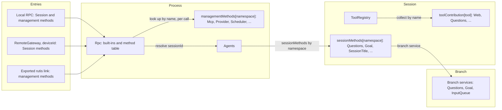
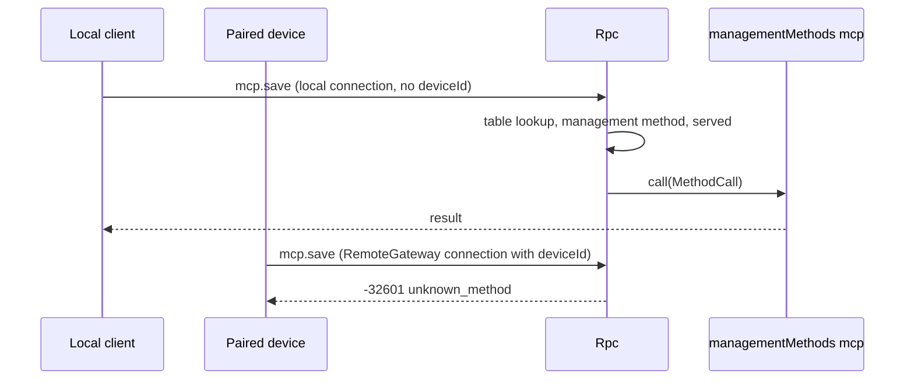

# Methods and tool contributions

Status: Draft. Overall design: [overview §3 integration](../overview.md#3-integration-by-existing-mechanisms), [Appendix B Rpc and ToolRegistry](../overview.md#appendix-b-supplements-to-existing-plugins); rules: [ADR 002](../../adr/002-plugin-scope.md) D2, D3, D5. Phase: P0. Language: neutral contracts; Rust binding in [Appendix F](#appendix-f-rust-binding).

This contract defines three named services in the language-neutral form of ADR 002 D5. Each is identified by a service name, a scope and an instance key; its methods take and return serializable data; errors are data; cancellation is a protocol action. A plugin in any language provides them by declaring them in its `provides` (loader row), and consumers collect them by name and scope. They are built on mechanisms the runtime already has: named services collected per scope and Rpc's existing dispatch through the Session, as `approval.respond` does today.

| Service | Scope | Key | Provided by | Collected by |
| --- | --- | --- | --- | --- |
| `sessionMethods` | Session | namespace | Session-scoped plugin parts (Questions, Goal, SessionTitle, Attachments, ShellInput, Hooks, Notifications) and InputQueue (`session.input`) | Rpc, dispatching through the Session |
| `managementMethods` | Process | namespace | Process plugins only (Mcp, Provider, Settings, Scheduler, ...) | Rpc, looked up per call |
| `toolContribution` | Session | tool name | Session-scoped plugin parts (Questions, Goal, Web, Notifications, Scheduler, Workflow) | ToolRegistry (supplement: named tool services) |

**Management methods** are client RPC methods about the host rather than a Session: `account.*`, `provider.*`, `mcp.*`, `skills.*` and settings, plus the methods of new process plugins. `daemon.shutdown` stays an Rpc built-in and is likewise never served to paired devices. Today Rpc injects their services directly (`ProductServices` and `ExecutionServices` in [connection.rs](../../../crates/dim-app-server/src/connection.rs)); this design looks them up through `managementMethods` instead, per call and without a dependency on their providers. Only process plugins provide them, and they are never served to paired remote devices. Session methods have no level; the only split is `sessionMethods` (dispatched through a Session) versus `managementMethods`.

Rpc decides what a connection is served from its `ConnectionEntry {name, deviceId}`: a local connection gets Session and management methods, a connection with a `deviceId` (a paired device through RemoteGateway) never gets management methods, and an exported rutis link gets management methods only when exported. There is no registry, no port and no Management plugin. Providers are optional plugins installed only when enabled. Rpc looks up a `managementMethods` provider on each call and does not depend on it, so a provider that is disabled, Pending, Failed or reloading affects only its own namespace (§3.2). A `toolContribution` provider reload propagates to ToolRegistry, which is the accepted cost of D3.

Acting on a tool call or an input before it is committed is not a service of this contract. Approval and the Session input path are unchanged; InputQueue's withdrawal is its owner's change ([overview Appendix B](../overview.md#appendix-b-supplements-to-existing-plugins)).

## 1. Structure



| Service | Absent |
| --- | --- |
| `sessionMethods` | `unknown_method` for that Session |
| `managementMethods` | `unknown_method` |
| `toolContribution` | The tool is not offered |

Contracts defined here: the three services, `MethodDecl`, `MethodCall`, `MethodReply`, `MethodError`, the `callChannel` companion service, `ToolDeclaration`, `ToolCall`, `ToolResult`, what each entry is served, naming, reserved names, the migration of existing management methods and the compatibility table. Contracts used: `SessionConfig` ([session-access](session-access.md#a3-sessionconfig-fields)), source input conventions ([session-access A.2](session-access.md#a2-source-input-conventions)), the Rpc command envelope and `appError` codes.

## 2. Data and state

No service owns a Timeline event or persisted state. A Session's method table is rebuilt when the Session loads; management providers are looked up on each call. Each connection records `ConnectionEntry {name, deviceId}` when it is accepted; what it is served follows from that record (§3.2), never from a user identity. A link's management export is host-local structural configuration.

## 3. Flows

### 3.1 Session method


The namespace is resolved by the longest prefix among the namespaces provided in that Session. If the Session has no such namespace, because the plugin is disabled, the result is `unknown_method`. Session methods carry no level: every connection that is served Session methods is served all of them, including `shell.*`.

### 3.2 Management method



The connection's entry record is the only check. Being served management methods grants host administrator rights.

Rpc resolves the namespace on each call by keyed reads of the method name's prefixes, longest first, among the active process services `managementMethods` (Appendix F). Rpc does not depend on these providers. A namespace whose provider row is enabled but not active (Pending, Failed, or between generations while it reloads) returns `service_reloading`; Rpc tells this from the loader's row status (`Loader::entries`). A namespace with no enabled provider returns `unknown_method`. Rpc, open connections and the other namespaces are unaffected. A call admitted before its provider unloads follows the method's `interruption` (A.1): the unloading provider ends its `report` calls with `operation_interrupted`, and how a `drain` call holds the unload follows rutis' existing lifecycle (§9.2 is withdrawn).

## 4. Timing and conflicts

| Scenario | Order | Outcome | Owner |
| --- | --- | --- | --- |
| Session-scoped provider reloads mid-call | call < reload | `report`: `operation_interrupted`; `drain`: reload waits | Rpc |
| Session method while the Session's capabilities reload | — | `service_reloading` | Rpc |
| Session method on a Session without that plugin | — | `unknown_method` | Rpc |
| Management owner reloads | — | Calls into its namespace return `service_reloading` until the new generation is active; admitted calls follow their `interruption`; Rpc does not reload and connections stay open | Rpc |
| Management method or `daemon.shutdown` on a connection with a `deviceId` | — | `unknown_method` | Rpc |
| Two providers claim one namespace or tool name | assembly | Assembly fails; keys are unique per scope | Assembly |
| Tool-contribution provider reloads during a turn | call < reload | ToolRegistry and dependants reload; the in-flight turn ends `Failed` (D3, accepted) | ToolRegistry |

Full table: [Appendix B](#appendix-b-full-conflict-table).

## 5. Context mapping

Methods have no model-visible effect. A method that changes model context does so through its owner's input or Timeline facts, and those owners' mappings apply. A `toolContribution` reaches the model only through its declaration and its `ToolResult`, as any tool does.

## 6. Interfaces (summary)

| Service and method | Mode | Purpose |
| --- | --- | --- |
| `sessionMethods[namespace].describe() -> MethodDecl[]` | async | Session-scoped method declarations |
| `sessionMethods[namespace].call(MethodCall) -> MethodReply` | async | Execute a Session-scoped method |
| `managementMethods[namespace].describe / call` | async | Same shapes, process scope, management methods |
| `callChannel.progress / notify / closed` (Rpc) | sync / async | Per-call progress and connection-bound notifications |
| `toolContribution[tool].declaration() -> ToolDeclaration` | sync | Tool declaration |
| `toolContribution[tool].execute(ToolCall) -> ToolResult` | async | Tool execution |

## 7. Security

The connection's `ConnectionEntry {name, deviceId}` is the only authority for what it is served: local RPC gets Session and management methods, a connection with a `deviceId` (RemoteGateway) gets Session methods only (paired devices may call every Session method, including `shell.*`, decision E3), and a rutis link serves management methods only when they are explicitly exported in host-local link configuration. Rpc validates only at the external boundary: param shape and `sessionId` authorization for every Session-scoped method, exactly as for its built-ins. Feature checks (content sniffing, size limits, model capability) belong to the method's owner. A `toolContribution` is admitted by Approval and Permission like every tool, under its declared risk. There is no host-local approval: Approval and Permission govern only actions an agent decides, and commands that user or project configuration runs are that configuration's responsibility and run when enabled ([overview §6.4](../overview.md#64-conventions)). The existing `mcp.approve`/`mcp.revoke` are removed in a follow-up code change (A.4).

## 8. Rule check

| Rule | How this document complies |
| --- | --- |
| §4 rule 1 (command events) | Not applicable: the services write no Timeline event themselves; a method that changes branch state calls its owner, which writes (for example `question/answered`). |
| §4 rule 2 (handover) | Not applicable: methods and tool contributions hand nothing over; a tool call is handed to ToolExecutor by the existing `step/tool-call` contract. |
| §4 rule 3 (before callbacks only) | Rpc validates only param shape and `sessionId` authorization; feature checks belong to the method's owner, and acting before a commit is left to Timeline before callbacks. |
| §4 rule 4 (no business meaning in core) | Rpc and ToolRegistry collect services by name and never name a provider or interpret a method. |
| §4 rule 5 (batch) | Not applicable: no decision here is taken on a Timeline event; owners decide from their own facts. |
| §4 rule 6 (model context) | Methods have no model-visible effect, and a `toolContribution` reaches the model only through its declaration and `ToolResult` (§5). |
| §4 rule 7 (public events and services) | Providers reach branches only through the branch's public services, and Rpc dispatches only through the Session's `sessionMethods`. |
| §4 rule 8 (requirements) | Session lookup by name, named tool collection, drain on unload and listing the active providers of a process-scoped service are raised in §9. |
| §4 rule 9 (only decision facts in the Timeline) | Method tables and served entries are assembly data, never Timeline facts (§2). |
| §1 (Capability and App Server boundary) | Rpc only collects and dispatches; the business code of every method lives in its provider's plugin. |
| ADR 002 D1 | `sessionMethods` and `toolContribution` are Session-scoped, `managementMethods` process-scoped, matching their owners. |
| ADR 002 D2 | No registry, port or Management plugin; Rpc and ToolRegistry collect by name. |
| ADR 002 D3 | Providers depend on their own or an enclosing scope. A `toolContribution` provider reload reloads ToolRegistry (§4); Rpc does not depend on management providers, so their reloads stay within their namespace (§3.2). |
| ADR 002 D4 | A link's management export is structural host-local configuration; no business configuration is defined here. |
| ADR 002 D5 | Every service is named with scope, key and data-only methods; Rust types appear only in Appendix F. |

## 9. Requirements raised to mechanism owners

### 9.1 Lookup of a keyed Session service by name

| Item | Content |
| --- | --- |
| Blocked by | Rpc must dispatch a Session method without naming its provider (§4 rule 4, ADR 002 D2 and D5); the Session facade today returns only typed services. |
| Existing mechanisms considered | Typed `Session::service::<T>()`: needs the provider's Rust type, so Rpc would name it. A Session service that lists providers: a wiring module (D2). |
| Generic capability | The Session facade returns the Session-scoped service registered under a service name and instance key (`sessionMethods` by namespace), and the Session's services of one name (`toolContribution` for ToolRegistry). |
| Effect on sequence, batch, interrupt, reload | None on sequence or batches; a lookup during a Session reload fails, and Rpc replies `service_reloading`. |
| Owner and issue | Runtime (Session facade); issue to be opened. |

### 9.2 Unload waits for `drain` calls

Withdrawn: rutis is an external dependency, so no requirement is raised to it. Rpc already waits for the commands it admitted before it unloads.

| Item | Content |
| --- | --- |
| Blocked by | A `drain` method (`account.*`, `provider.*`) must finish before its provider unloads (A.4, today's behaviour). |
| Existing mechanisms considered | Interrupting every call (`report`) changes the wire behaviour of `account.*` and `provider.*`; holding the provider in Rpc keeps a reloading plugin alive outside the lifecycle. |
| Generic capability | A plugin's unload waits for in-flight work it registered as draining, then proceeds. |
| Effect on sequence, batch, interrupt, reload | No Timeline effect; a reload is delayed by at most the drained calls. |
| Owner and issue | rutis lifecycle; issue to be opened. |

### 9.3 Listing the active providers of a process-scoped service

Withdrawn: rutis is an external dependency, so no requirement is raised to it. Rpc dispatches management methods with what rutis provides today (keyed reads); how `hello.features` reports them is Rpc's own design.

| Item | Content |
| --- | --- |
| Blocked by | `hello.features` lists the methods of the active management providers (A.1), and Rpc must find them without depending on them (§3.2). A reloading provider should get `service_reloading`, not `unknown_method`. |
| Existing mechanisms considered | The keyed read `Ctx::get_as` finds one active provider by key, which is enough to dispatch a call; Mcp reads its loader rows this way. It does not list providers, and it does not tell a registered but inactive provider from a missing one. Declaring the providers as dependencies lists them, but gates Rpc on every one of them (§3.2). |
| Generic capability | List the active providers of one service name at process scope, and report whether a key has a registered provider that is not active. |
| Effect on sequence, batch, interrupt, reload | None on sequence or batches. A provider that becomes active after a connection's `hello` appears in the next `hello`. |
| Owner and issue | rutis registry; issue to be opened. |

Named services from non-Rust plugins rely on #4; its five items are in [session access §9](session-access.md#9-requirements-raised-to-mechanism-owners).

## Appendix A. Interface details

Shapes are JSON with camelCase fields; a `?` after a field name marks it optional and `|` separates alternatives. These shapes are canonical: plugin documents use these field names (Rust bindings map them to snake_case). Every error is `MethodError` data.

### A.1 Method contributions

`sessionMethods` (Session, key namespace) and `managementMethods` (process, key namespace) have the same two methods.

| Method | Mode | Request | Reply |
| --- | --- | --- | --- |
| `describe` | async | — | `MethodDecl[]` |
| `call` | async | `MethodCall` | `MethodReply`, or `MethodError` |

```text
// MethodDecl
{ "name": "session.goal.set",          // full wire name inside the namespace
  "mutating": true,
  "interruption": "report" | "drain",  // report: operation_interrupted; drain: unload waits
  "progress": false,
  "notifications": ["session.goal.changed"], // inside the namespace
  "reply": "direct" | "handoff" }      // handoff: daemon.shutdown
// MethodCall
{ "callId": "string", "method": "session.goal.set",
  "sessionId?": "string",              // present and authorized for sessionMethods
  "params": {},
  "origin": { "entry?": { "name": "string", "deviceId?": "string" }, // the connection's ConnectionEntry
              "connectionId?": "string", "peer?": "string" } } // peer: rutis link; diagnostics only
// MethodReply
{ "kind": "value", "value": {} } | { "kind": "handedOff" }
// MethodError
{ "code": -32000, "appError": "string", "message": "string" }
```

Cancellation: when a `report` call is interrupted, Rpc sends a cancel request for `callId` (or drops the call) and replies `operation_interrupted`; a `drain` call is awaited before the provider unloads.

| Rule | Content |
| --- | --- |
| Namespace | `<segment>(.<segment>)*`, segments `[a-z][a-z0-9_]*`, owned by the provider; a namespace may itself be a method (`session.rename`) |
| Ownership | A name belongs to the longest provided namespace that prefixes or equals it, among the built-ins, the process table and the Session's providers |
| Reserved for Rpc built-ins | `hello`, `daemon`, `agent`, `approval`, the bare `session` root and `session.attach`, `session.branch_create`, `session.close`, `session.create`, `session.detach`, `session.history`, `session.idle`, `session.input_lookup`, `session.list`, `session.state`, `session.stop`, `session.submit`, `session.summaries`, `session.exec`, `session.mcp`, `session.model`, `session.permission`, `session.prompt`, `session.skills`. `session.input` is not reserved: InputQueue provides `session.input.withdraw` through `sessionMethods` (proposed), so Rpc names no owning service |
| Precedence | Built-ins, then the process table, then the Session's providers; one wire name space |
| Session-scoped call | Requires `sessionId` (`-32602` without it). Rpc authorizes it, acquires the Session through Agents (restoring if needed) and calls the Session's `sessionMethods` for the namespace. The provider reaches a branch through that branch's services |
| Not dispatched | Namespace not provided (no enabled provider), or a management method on a connection with a `deviceId` or an unexported link → `-32601 unknown_method`. Session reloading, or a management provider enabled but not active → `-32000 service_reloading`. A started `report` call interrupted → `operation_interrupted` |
| `hello.features` (v3) | Built-ins, plus the methods of the management providers active at `hello` when the connection is served management methods. Until §9.3 exists, Rpc makes a keyed read of each namespace that enabled loader rows declare in their `provides` and lists the active ones. Session-scoped methods are listed per Session in `session.state.methods` |
| Ready latch | Opens after the loader's initial load settles, so process providers are present at the first `hello` |

Known Session-scoped namespaces: `session.question` (Questions), `session.goal` (Goal), `session.rename` (SessionTitle), `session.input` (InputQueue), `attachment` (Attachments), `shell` (ShellInput), `hooks` (Hooks), `notifications` (Notifications, including `notifications.test`). Each plugin document is authoritative for its methods.

### A.2 Call channel

Rpc provides the process service `callChannel` to method providers.

| Method | Mode | Request | Reply |
| --- | --- | --- | --- |
| `progress` | sync | `{callId, data}` | — (dropped unless the method declared `progress`) |
| `notify` | async | `{connectionId, method, params}` | `{}`, or error `unsupported` (link), `undeclared`, `gone` |
| `closed` | async | `{connectionId}` | Resolves when the connection closes |
| `takeFinalReply` | async | `{callId}` | `{}` after the final reply is written; `handoff` methods only |

Progress is sent as the notification `management.progress {id, method, data}` for Session and management methods, ordered before the response and dropped after disconnect. Notification names must be declared and lie inside the namespace. A `connectionId` stays valid for `notify` until the connection closes.

### A.3 Entries and export

| Entry | Served | Notes |
| --- | --- | --- |
| Local protected transport | Session and management methods | Today's protected-profile rules unchanged |
| Bare WebSocket, protected profile | as today | Everything but `hello`/`daemon.ping` is `local_transport_required` |
| RemoteGateway (`deviceId` set) | Session methods only | [RemoteGateway](../plugins/RemoteGateway.md) |
| Exported rutis link | Management methods | Only when exported in host-local link configuration. Without a caller sink, progress is dropped and `notify` returns `unsupported` |

### A.4 Migration and compatibility

Sources: `MANAGEMENT_METHODS`, `MCP_METHODS`, `LOCAL_EXECUTION_METHODS`, `Call::is_management` in [protocol.rs](../../../crates/dim-app-server/src/protocol.rs); `validate_call` in [connection.rs](../../../crates/dim-app-server/src/connection.rs).

| Methods | Destination | Provider (namespace) |
| --- | --- | --- |
| `account.providers/status/recover/logout`, `account.login.*` | `managementMethods` | ManagedProviders (`account`) |
| `account.codex.*`, `account.grok.*` | `managementMethods` | OpenAI Codex OAuth (`account.codex`), Grok OAuth (`account.grok`) |
| `provider.*` | `managementMethods` | Provider (`provider`) |
| `skills.catalog/set_enabled/refresh` | `managementMethods` | SkillsCatalog (`skills`) |
| `mcp.catalog/set_enabled/save/remove/disconnect` | `managementMethods` | Mcp (`mcp`) |
| `mcp.approve/revoke` | Removed in a follow-up code change (no host-local approval; servers run when enabled; project entries start disabled; [ADR 003](../../adr/003-approval-scope.md)) | — |
| `daemon.shutdown` | Rpc built-in, reply handoff; never served to a connection with a `deviceId` | — |
| `hello`, `daemon.ping`, `agent.*`, existing `session.*`, `approval.respond` | Rpc built-ins | — |
| New `session.input.withdraw` | `sessionMethods` | InputQueue (`session.input`) |
| New Session methods | `sessionMethods` | Each owner (A.1) |

Interruption reproduces today's behaviour: `mcp.*` and `skills.*` are `report`, and `account.*` and `provider.*` are `drain`. Rpc's `When<ProductServices>` and `When<ExecutionServices>` are removed, not replaced by a collection: Rpc looks up `managementMethods` per call (§3.2) and no longer names or depends on any owning service. Built-ins that read a management service today (model selection for `session.create` and `session.model.update`, Mcp for `session.mcp`) read it per call with the same keyed read and keep today's behaviour when it is absent.

| Client | Before | After |
| --- | --- | --- |
| v1, v2 | Management methods `unknown_method` | Same |
| v3 local, product profile | `hello.features` has the 33 product names | Same names; params, results, codes and `appError` unchanged |
| v3 local, execution | `LOCAL_EXECUTION_METHODS` + `MCP_METHODS` | Same names |
| v3 bare WebSocket, protected profile | `local_transport_required` | Same |
| v3 RemoteGateway (new) | Did not exist; execution Session methods (`session.permission.get/update`, `session.exec.stop`, `session.skills`, `session.model.update`, `session.prompt.refresh`, `session.mcp`, `session.mcp.refresh`) were local-only | **Compatibility change (E3):** available to paired devices; management names `unknown_method` |
| v3, MCP disabled | `mcp.*` `unknown_method` | Same, with Rpc's message |
| v3, Mcp reloading | `service_reloading` | Same: `mcp.*` returns `service_reloading` until Mcp is active again; Rpc does not reload and the connection stays open |

No protocol version is added and persistence formats are unchanged.

### A.5 Tool contribution

ToolRegistry supplement: besides tools registered today, ToolRegistry accepts named tool services. A plugin declares `toolContribution[<tool name>]` at Session scope in its `provides`, and ToolRegistry collects the Session's tool services by name. Existing rules for name uniqueness, collisions with host tools and enablement through `SessionConfig.tools` are unchanged ([tool contributions](../../architecture/rust-agent/tool-contributions.md)).

| Method | Mode | Request | Reply |
| --- | --- | --- | --- |
| `declaration` | sync | — | `ToolDeclaration` |
| `execute` | async | `ToolCall` | `ToolResult` |

```text
// ToolDeclaration
{ "name": "web_fetch",           // equals the key
  "description": "string",
  "inputSchema": { /* JSON Schema */ },
  "risk": "network" }            // Permission category; required for new tools
// ToolCall
{ "sessionId": "string", "branchId": "string", "turnId": "string", "callId": "string",
  "arguments": {}, "config": { /* SessionConfig data */ } }
// ToolResult
{ "content": [ { "type": "text", "text": "..." } | { "type": "image", "...": "..." } ],
  "structuredContent?": {}, "isError": false }
```

Cancellation: turn interrupt sends a cancel request for `callId` (or drops the call); ToolExecutor settles the call as interrupted. A provider error is returned as `ToolResult` with `isError: true`. The declaration may depend on the Session's configuration and is read once per provider generation.

## Appendix B. Full conflict table

| Scenario | Sequence order | Outcome | Owner of the decision |
| --- | --- | --- | --- |
| Session method during branch `stop/interrupt` | per owner's facts | Decided by the owner's Timeline order (for example, a Questions answer after the interrupt is `question/cancelled`) | Owning plugin |
| Session method on a closed branch | — | Owner's `BranchMissing` error | Owning plugin |
| Session method on an unloaded Session | — | Rpc restores through Agents, then dispatches | Rpc |
| Session-scoped provider reloads mid-call | admitted < reload | `report`: `operation_interrupted`; `drain`: waits | Rpc |
| Process owner reloads | — | Its namespace returns `unknown_method` until it is active again; admitted calls follow their `interruption`; Rpc does not reload | Rpc |
| Rpc reload with calls in flight | — | `report` interrupted, `drain` drained; `closed` resolves | Rpc |
| Management method on a connection with a `deviceId` | — | `unknown_method` | Rpc |
| Client detaches mid-call | — | Call continues; reply discarded | Rpc |
| Two clients mutate the same configuration | storage revision | Second gets the provider's conflict | Provider |
| `daemon.shutdown` concurrent with another call | admission | Admission stops, then admitted calls settle per `interruption` | Process coordinator |
| Tool contribution called during turn `stop/interrupt` | interrupt < result | Cancel request for `callId`; ToolExecutor settles the call as interrupted | ToolExecutor |
| Unsettled tool batch, compaction, child branch cut, `input/withdraw`, `input/deleted` | — | No effect on methods | — |
| Process restart mid-call | — | Reply lost; outcome per provider persistence; never replayed | Provider |

## Appendix C. Errors and recovery

| Case | Wire result |
| --- | --- |
| Not provided, provider not active, or not served to the connection, or v1/v2 | `-32601`, `unknown_method` |
| Session-scoped method without `sessionId` | `-32602` |
| Session reloading | `-32000`, `service_reloading` |
| `report` call interrupted | `-32000`, `operation_interrupted` |
| Provider error | `-32000`, provider's `appError` |

## Appendix D. Acceptance

1. A Session-scoped method dispatches through the Session it names. On a Session without the plugin it returns `unknown_method`, and Rpc never names the provider.
2. A management method is reachable on the local entry, returns `unknown_method` on RemoteGateway, and is reachable over a link only when exported. A `shell.*` Session method is reachable on RemoteGateway like every Session method.
3. A recorded transcript of every migrated management method matches the pre-migration transcript, and `hello.features` is unchanged for v3 local profiles.
4. On a RemoteGateway test entry, `session.permission.update` and `session.exec.stop` succeed.
5. A tool provided as `toolContribution` by a non-Rust plugin is declared to the model and executed through ToolExecutor like a Rust tool.
6. Progress precedes the response, and `notify` reports `gone` after disconnect.
7. With an enabled management provider that is Pending or Failed, `hello` succeeds, every other namespace works, and the provider's namespace returns `unknown_method`; `plugin.set_enabled` can disable the provider unless it is PluginManager itself. Reloading a management provider neither reloads Rpc nor closes connections.

## Appendix E. Assumptions

| # | Assumption | Basis | Effect if rejected |
| --- | --- | --- | --- |
| A1 | Session-scoped namespaces may use roots other than `session` (`attachment`, `shell`) | Existing wire names | All move under `session.` |
| A2 | The Session can look up a keyed Session service by name for Rpc | Existing keyed Session services; raised as §9.1 | Rpc enumerates providers through a Session service |
| A3 | Session-scoped methods are listed per Session, not in `hello.features` | They differ per Session | A global list with per-Session availability |
| A4 | Rpc dispatches a management method by a keyed read of the active provider on each call (`Ctx::get_as`) | Mcp reads its loader-row servers this way ([publication.rs](../../../crates/dim-app-server/src/mcp/publication.rs)) | Rpc depends on every provider, and one inactive provider blocks all RPC |

## Appendix F. Rust binding

The neutral services above map to Rust as follows. Rust plugins may use these types directly; non-Rust plugins provide the services by name through rutis-bridge (`TypeKey::named`, `host_key(name)` with `dyn HostDispatch`), and generated Rust bindings decode them to the same types.

| Neutral service | Rust type and key | Registration in Rust assemblies | Collection |
| --- | --- | --- | --- |
| `sessionMethods[ns]` | `SessionMethodContribution(Arc<dyn MethodProvider>)`, `SessionScope::named_key::<SessionMethodContribution>(ns)` | `AgentBuilder::session_methods(ns)` | `Session::method(ns)` |
| `managementMethods[ns]` | `ManagementMethods(Arc<dyn MethodProvider>)`, process scope, instance key `ns` | loader row | Per call: `Ctx::get_as::<ManagementMethods>` with the namespace key; not in Rpc's `Deps` |
| `toolContribution[tool]` | `ToolContribution {definition, handler}`, `SessionScope::named_key::<ToolContribution>(tool)` | `AgentBuilder::session_tool(tool)` (existing) | `Contributions<ToolContribution>` in ToolRegistry |
| `callChannel` | `CallChannel`, `ConnectionNotifier` passed to `MethodProvider::call` | — | — |

```rust
pub trait MethodProvider: Send + Sync + 'static {
    fn namespace(&self) -> &str;
    fn methods(&self) -> Vec<MethodDecl>;
    fn call(&self, call: MethodCall, channel: CallChannel, cancel: CancellationToken)
        -> HostFuture<'_, Result<CallReply, MethodError>>;
}
pub enum Interruption { Report, Drain }
pub enum ReplyMode { Direct, Handoff }
pub enum CallReply { Value(serde_json::Value), HandedOff }
pub struct MethodError { pub code: i32, pub app_error: Cow<'static, str>, pub message: String }

impl CallChannel {
    pub fn progress(&self, data: serde_json::Value);
    pub fn notifier(&self) -> Result<ConnectionNotifier, ChannelError>; // Unsupported for links
    pub fn take_final_reply(&self) -> Result<FinalReply, ChannelError>; // Handoff only
}
pub enum ChannelError { Unsupported, Undeclared, Gone }
```

`ToolContribution` and `ToolHandler` are the existing types in `dim-agent-capabilities/src/tool_registry.rs`; a named tool service from another language is wrapped in a `ToolHandler` by the generated binding.
