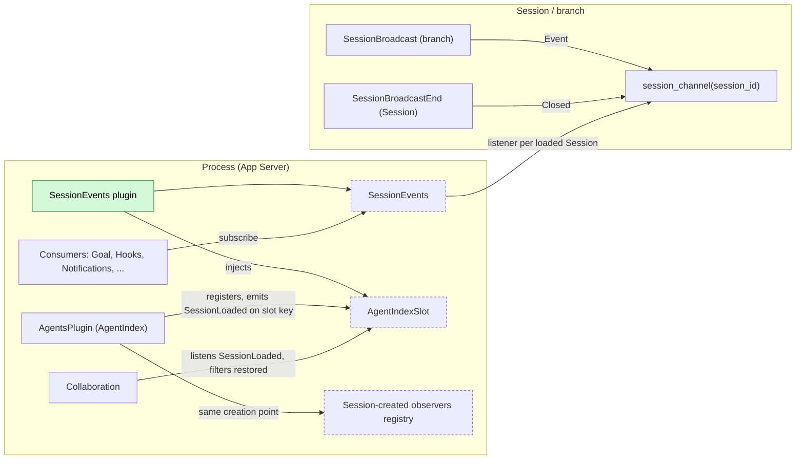
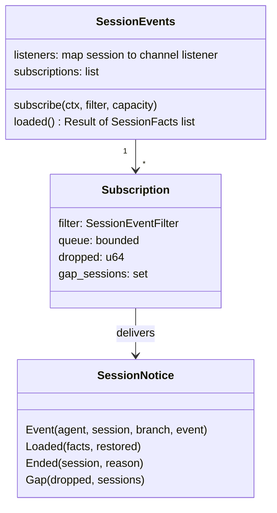
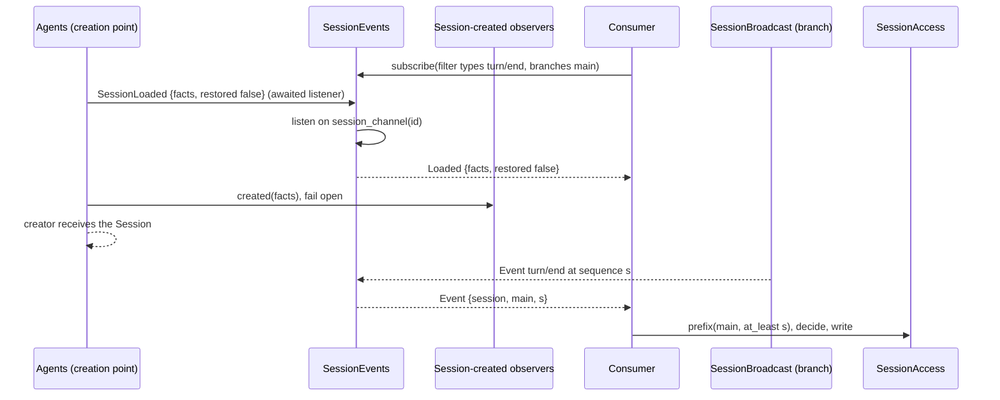
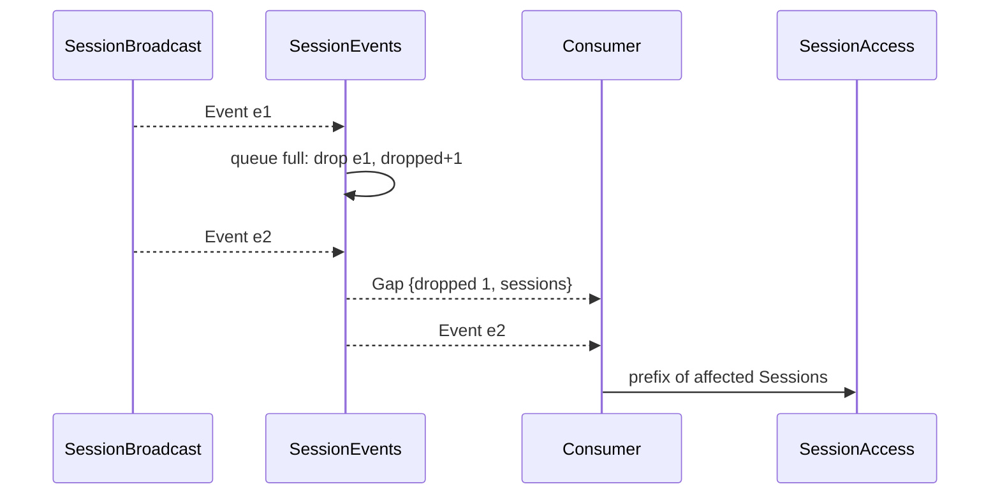
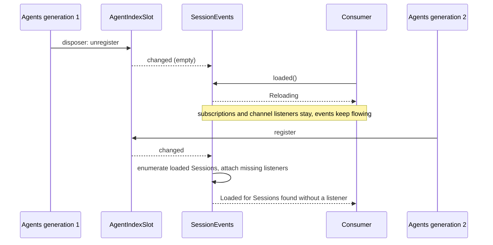

# Session broadcast subscription

Status: Draft. Overall design: [overview §4 plugin catalog](../overview.md#4-plugin-catalog), [§5.3 observer flow](../overview.md#53-observer-through-sessionevents-sessiontitle), [§9 open questions](../overview.md#9-open-questions) (adopted: reuse the Session broadcast, decision E7). Phase: P0. Language: Rust.

A process plugin subscribes once and receives live events of all loaded Sessions, filtered by event type, Session and branch, plus Session lifecycle notices; the `Loaded` notice carries the Session's [`SessionFacts`](session-access.md#a3-sessionfacts). Delivery is live, unordered across Sessions, non-resumable and lossy under backpressure with an explicit gap notice. It is an observation trigger only: decisions read the fixed Timeline prefix through [session-access](session-access.md). `SessionEvents` is a facade that resolves AgentIndex through the stable slot, so subscriptions survive an Agents reload.

The contract reuses the existing per-Session broadcast (`SessionBroadcast`, `session_channel`) rather than adding a second bus ([single-tree](../../architecture/rust-agent/single-tree.md), events). The consumer list includes Notifications, SessionTitle, Hooks, Goal, Scheduler and ShellInput.

## 1. Structure



`SessionEvents` depends only on the slot, which depends on nothing, so neither an Agents reload nor a consumer's reload ends other subscriptions. Session discovery uses the `SessionLoaded` notice that Agents emits at the same point where it calls Session-created observers ([session-boundary](session-boundary.md#a3-session-created-observers-agents)).

| Part | Scope | Depends on | Provides | Status |
| --- | --- | --- | --- | --- |
| `SessionBroadcast` | Branch | `B:Dispatcher`, `B:TimelineIdentity` | `SessionBroadcastEvent::Event` on `session_channel(session_id)` | Existing ([session_broadcast.rs](../../../crates/dim-agent-capabilities/src/session_broadcast.rs)) |
| `SessionBroadcastEnd` | Session | `S:SessionIdentity` | `SessionBroadcastEvent::Closed` on close (not on idle unload) | Existing |
| `AgentsPlugin` | Process | `Arc<AgentIndexSlot>` | `SessionLoaded { facts, restored }` on `AgentIndexSlot::loaded_key()`, generalizing the crate-private `SessionRestored` | Supplement |
| `SessionEventsPlugin` | Process | `Arc<AgentIndexSlot>` | `SessionEvents` | Proposed (overview §4) |
| Collaboration | Process | existing | restore listener moves to `SessionLoaded` and filters `restored: true` | Change |
| Consumers | Process | `Arc<SessionEvents>` | — | Per plugin |

Contracts defined here (owner: SessionEvents): `SessionEvents`, `SessionEventFilter`, `SessionNotice`, `SessionEnd`, `SessionEventStream`, `SubscribeError`, the `SessionLoaded` notice shape, and the delivery guarantees. Contracts depended on: the Session broadcast, `AgentIndexSlot` ([session-access](session-access.md#a1-sessionaccess)), `SessionFacts`, the public data contract of `AgentEvent`/`EventKind::key()`, `Session::closed()`/`is_unloading()`/`failure()`. Subscribers depend on this contract only; the provider filters by opaque type keys and never interprets payloads.

## 2. Data and state



Nothing is persisted and nothing is written to a Timeline. Channel listeners are rebuilt on `apply` and on every new Agents generation by enumerating loaded Sessions; subscriptions belong to their subscribers' contexts.

| State | Owner | Rebuild |
| --- | --- | --- |
| Per-Session channel listener and close watcher | `SessionEvents` | On `apply` and on every slot registration: listen to `SessionLoaded` first, then enumerate loaded Sessions, deduplicating by Session id and incarnation |
| Subscriber queue, filter, dropped count | `SessionEvents`, per subscription | Not rebuilt; a new `SessionEvents` generation starts with none |
| Consumer progress | Each consumer | Consumer's own document |

## 3. Flows

### 3.1 Creation, subscription and a turn end



Because Agents awaits `SessionLoaded` listeners before observers and before handing out the Session, no input of a new Session precedes the listener, and observers' inputs are delivered. Consumers filter by `facts` (for example `interactive` and `collaboration_role`) instead of reading Session configuration.

### 3.2 Overflow and resynchronization



A gap is never silent: before the next delivered record the subscriber receives the count and affected Sessions, and resynchronizes by reading prefixes.

## 4. Timing and conflicts

### 4.1 Agents reload



Sessions and their channels survive an Agents reload, so live events continue; no Session can be created during the window. Only `loaded()` returns `Reloading`. If a listener had to be re-attached, the subscriber receives `Loaded` for it and treats events of the window as possibly missed.

### 4.2 Other key rows

| Scenario | Order | Outcome | Owner |
| --- | --- | --- | --- |
| `turn/end` delivered, then interrupt or new input committed | `turn/end` < later facts | Consumer reads to the published head and sees the later facts | Consumer |
| Input withdrawn before consumption | `input/message` < `input/withdrawn` | Both delivered as events; pending derivations read the prefix (pending rule in [session-access A.5](session-access.md#a5-withdrawal)) | Consumer |
| Session restore | `SessionLoaded {restored true}` < `branch/resume` dispatch | `Loaded` then the restored branch's new events; observers are not called | SessionEvents |
| Queue full | — | Records dropped; `Gap` precedes the next record | SessionEvents |

Full table: Appendix B.

## 5. Context mapping

No model-visible effect. The subscription writes no Timeline event, adds no tool, input or prompt source, and delivered records are never projected into model context. A consumer that wants the model to see something writes input through session-access, whose mapping applies. Diagnostics of `SessionEvents` go to the process diagnostics channel, never to the model.

## 6. Interfaces (summary)

| Interface | Purpose |
| --- | --- |
| `SessionEvents::subscribe(ctx, filter, capacity)` | Live filtered stream owned by the subscriber's context |
| `SessionEvents::loaded()` | Loaded Sessions with their facts; `Reloading` during an Agents window |
| `SessionEventFilter` | Type keys (empty = notices only), Sessions, branches |
| `SessionNotice` | `Event`, `Loaded { facts, restored }`, `Ended`, `Gap` |
| `SessionLoaded` (Agents) | Emitted at the creation point and on restore, before the creator receives the Session |

## 7. Security

Subscribers are trusted in-process plugins and see every Session's events, including user content and tool results. The service is never exported over RPC or rutis links by this contract; RemoteGateway and clients keep their per-Session attachment. Consumers must not copy event content into diagnostics or external messages beyond what their own document permits.

## Appendix A. Interface details

```rust
/// Process service; key TypeKey::of::<SessionEvents>().
impl SessionEvents {
    /// Registers a subscription owned by `ctx`; it ends when the stream drops or `ctx` unloads.
    /// `capacity` bounds queued records (>= 1) (A5). Never returns Reloading.
    pub fn subscribe(&self, ctx: &Ctx, filter: SessionEventFilter, capacity: usize)
        -> Result<SessionEventStream, SubscribeError>;
    /// Loaded Sessions, resolved through the current AgentIndex.
    pub fn loaded(&self) -> Result<Vec<SessionFacts>, SubscribeError>;
}
pub struct SessionEventFilter {      // (A4)
    pub types: Option<BTreeSet<String>>,    // EventKind::key(); None = all; Some(empty) = notices only
    pub sessions: Option<BTreeSet<String>>, // None = all loaded Sessions, including later ones
    pub branches: Option<BTreeSet<String>>, // branch ids, e.g. {"main"}; None = all
}
pub enum SessionNotice {
    Event { agent_id: String, session_id: String, branch_id: String, event: Arc<AgentEvent> },
    Loaded { facts: SessionFacts, restored: bool },
    Ended { session_id: String, reason: SessionEnd },
    Gap { dropped: u64, sessions: BTreeSet<String> },  // since the previous delivered record
}
pub enum SessionEnd { Closed, Unloaded, Failed }
pub enum SubscribeError { Invalid(String), Closed, Reloading }
impl SessionEventStream {
    pub async fn next(&mut self) -> Option<SessionNotice>;  // None: subscription ended
}
/// Agents supplement; emitted with `parallel` (awaited) on AgentIndexSlot::loaded_key().
pub struct SessionLoaded { pub facts: SessionFacts, pub restored: bool }
```

`types` uses `EventKind::key()` strings today and registered type keys once #2 lands. `Loaded`, `Ended` and `Gap` are delivered regardless of `types`; `sessions` and `branches` filters apply to them where they name a Session. A filter with `types: Some(empty)` delivers notices only (ShellInput's close detection).

`SessionLoaded` is emitted by Agents from every path that registers a newly loaded Session, at the same creation point that calls the Session-created observers: `session.create`, Agents `launch`, Collaboration member creation (including `establish`), fork (all with `restored: false`), and restore inside `acquire` (`restored: true`). The listener order at that point is: `SessionLoaded` listeners (awaited), then Session-created observers for creations (awaited, fail open), then the creator receives the Session. Collaboration's existing restore listener (`collaboration.rs`) subscribes to `SessionLoaded` and acts only on `restored: true`, keeping today's behavior (A1).

Delivery guarantees:

| Guarantee | Statement |
| --- | --- |
| Liveness | Only events dispatched after the subscription is registered and after the Session's channel listener exists. No history, cursor or replay |
| Published | Every delivered event has been dispatched by its branch Dispatcher, hence published; session-access reads through at least `event.sequence` are valid |
| Identity | Each `Event` carries agent, Session and branch ids and the branch-local `event.sequence` |
| Per-branch order | Strictly increasing sequence per branch; gaps are announced, never silent (A2) |
| Cross-branch and cross-Session order | None |
| Loss | On a full queue the record is dropped and counted; `Gap` precedes the next delivered record (A3) |
| Duplicates | None within one subscription; restore does not re-dispatch stored events |
| Completeness | Not guaranteed: events dispatched while a Session is being built (main `branch/start`, initial prompt adoption) and terminal facts written by cleanup after a Dispatcher stopped ([lifecycle §5](../../architecture/rust-agent/lifecycle.md)) are never broadcast |

The rule for consumers: a notice is a hint to look. Decisions read the fixed prefix through session-access, write through session-access, and tolerate events never received.

Mechanics:

| Step | Path |
| --- | --- |
| Source | Branch `SessionBroadcast` registers `Dispatcher::subscribe_all`; per dispatched event it `emit`s on `session_channel(session_id)` and returns without waiting (existing). No Timeline write |
| Session discovery | `SessionEvents` listens on `AgentIndexSlot::loaded_key()`; the handler registers a channel listener with `on(host.ctx, &session_channel(id), listener)` on the Agent host ctx (outlives the Session, so `Closed` arrives; precedent `Connection::attach`) and spawns a task awaiting `Session::closed()` |
| Fan-out | The channel listener matches each record against every subscription's filter and `try_send`s; a full queue increments the dropped count. It never awaits |
| End of Session | `Closed` on the channel or completion of `Session::closed()` produces `Ended` (`Closed`, `Unloaded` if `Session::is_unloading()`, `Failed` if `Session::failure()`); the listener is disposed |
| Subscriber lifecycle | `subscribe` registers the subscription and its removal with the subscriber's `ctx.effect`. `SessionEvents`'s own disposer disposes channel listeners, cancels close watchers and ends all streams |
| StateCell and rebuild | None |
| Recheck | Consumers only, from a prefix read through session-access |
| Agents reload | Facade rule (§4.1); no consumer reloads |
| `SessionEvents` reload | Streams end (`next()` returns `None`); consumers resubscribe in a new task or on their next `apply` and resynchronize through `loaded()` and prefixes |
| Process restart | Nothing persisted; no replay |

## Appendix B. Full conflict table

| Scenario | Sequence order | Outcome | Owner of the decision |
| --- | --- | --- | --- |
| Event dispatched before subscription | dispatch < subscribe | Not delivered; consumer reads prefix if needed | Consumer |
| New Session's first input | `SessionLoaded` handled < first `input/message` | Delivered from the first input on, including observers' inputs | SessionEvents |
| `turn/end` delivered, then turn interrupt or new input committed | `turn/end` < later facts | Consumer reads to the published head and sees them | Consumer |
| Turn `stop/interrupt` | interrupt dispatched | Delivered like any event | — |
| Branch-scoped interrupt and branch close | branch interrupt < terminal facts < Dispatcher stop | Facts dispatched before the stop are delivered; cleanup terminal facts are not; a later session-access call returns `BranchMissing` | Consumer |
| Concurrent Steer/Queue/Append inputs | Timeline order | Delivered in sequence order per branch | — |
| `input/withdrawn` of a pending input | input < withdrawn | Delivered; a consumer deriving pending inputs excludes it from the prefix | Consumer |
| Tool batch not settled | `step/tool-call` < results | Only the whole batch's `step/tool-result` is delivered | ToolExecutor |
| Compaction | `context/compaction` | Delivered as an event | — |
| Child branch creation | `branch/create` (parent) < child `branch/start` | Child events arrive with the child's branch id from its first dispatch | — |
| Member or launched Session created | `SessionLoaded {facts}` | `Loaded` carries `collaboration_role`, `interactive`, `created_by`; consumers filter (decision E14) | Consumer |
| Queue full | — | Records dropped, `Gap` precedes the next record | SessionEvents |
| Session idle unload | `Session::closed()` without `Closed` | `Ended { Unloaded }` | SessionEvents |
| Session restore | `SessionLoaded {restored true}` < `branch/resume` dispatch | `Loaded` then new events; Collaboration's listener acts; observers not called | SessionEvents, Collaboration |
| Session close | `Closed` is the last record | `Ended { Closed }` | SessionEvents |
| Agents reload | — | Streams continue; `loaded()` returns `Reloading`; listeners re-attached where missing | SessionEvents facade |
| `SessionEvents` reload | — | Streams end; consumers resubscribe; window events lost | rutis lifecycle; consumer |
| Process restart | — | No replay; consumers recover from their storage and prefixes | Consumer |
| Resource node offline | Session capabilities Pending | Fewer events; subscription unaffected | — |
| Dispatcher fault on a branch | — | No more events from that branch | — |
| Client detach | — | No effect | — |
| Duplicate or late notice after resubscribe | — | Cannot occur within a subscription; consumers dedupe by `(session, branch, sequence)` if they persist progress | Consumer |

## Appendix C. Errors and recovery

| Case | Result |
| --- | --- |
| `capacity == 0`, or an empty `sessions` or `branches` set | `SubscribeError::Invalid` |
| `SessionEvents` unloading | `SubscribeError::Closed`; existing streams return `None` |
| `loaded()` during an Agents window | `SubscribeError::Reloading` |
| Listener registration fails for a loaded Session (host ctx unloading) | Session skipped with a diagnostic; subscribers get `Ended { Failed }` |
| Subscriber drops the stream without disposing | Removed on the next send attempt and on its ctx unload |

## Appendix D. Acceptance

Flow tests in the App Server test suite:

1. Two Sessions, one subscription on `turn/end`: both turn ends arrive with correct ids and sequences; other types do not.
2. A Session created after subscribing delivers `Loaded` with its facts and then its first input, including an observer's input.
3. Branch filter `main` excludes a child branch's events; `types: Some(empty)` delivers only notices.
4. Capacity 1 with a burst: `Gap` with the count precedes the next record; per-branch sequences increase.
5. Close yields `Ended { Closed }`; idle unload `Ended { Unloaded }`; restore `Loaded { restored: true }` without re-delivery; Collaboration's restore handling runs only for restores.
6. Agents reload: streams continue; `loaded()` returns `Reloading` in the window.
7. Subscriber unload removes the subscription; `SessionEvents` reload ends streams.

## Appendix E. Assumptions

| # | Assumption | Basis | Effect if rejected |
| --- | --- | --- | --- |
| A1 | Discovery uses `SessionLoaded`, emitted from the Agents creation point and restore, before the creator receives the Session | Decision record R3; `SessionRestored` precedent | Another hook is needed; first events may be missed |
| A2 | Per-branch delivery order is guaranteed | Judgment (free from Dispatcher order) | Consumers must not rely on it |
| A3 | Overflow drops records with a `Gap` instead of closing the subscription | Overview §4 (no ordering guarantee, no resumable reads); policy is judgment | Slow consumers lose the subscription |
| A4 | Filters are by event type key, Session id and branch id only; Session attributes are filtered by consumers from `Loaded` facts | Judgment | Richer filters added later |
| A5 | Subscribers choose their own queue capacity | Judgment | A shared default and cap would be defined here |

## Appendix F. Open questions

| Question | Description |
| --- | --- |
| Branch-end notice | No broadcast record marks a single branch's close; add one only if a consumer needs it beyond `BranchMissing` |
| Remote nodes | Whether a subscription spans Sessions on other control nodes (overview §6.3 future extension) |
| Overview registration | The SessionAccess plugin (provider of `AgentIndexSlot`, `SessionAccess`, `SessionResources`) is not listed in overview §4 |
