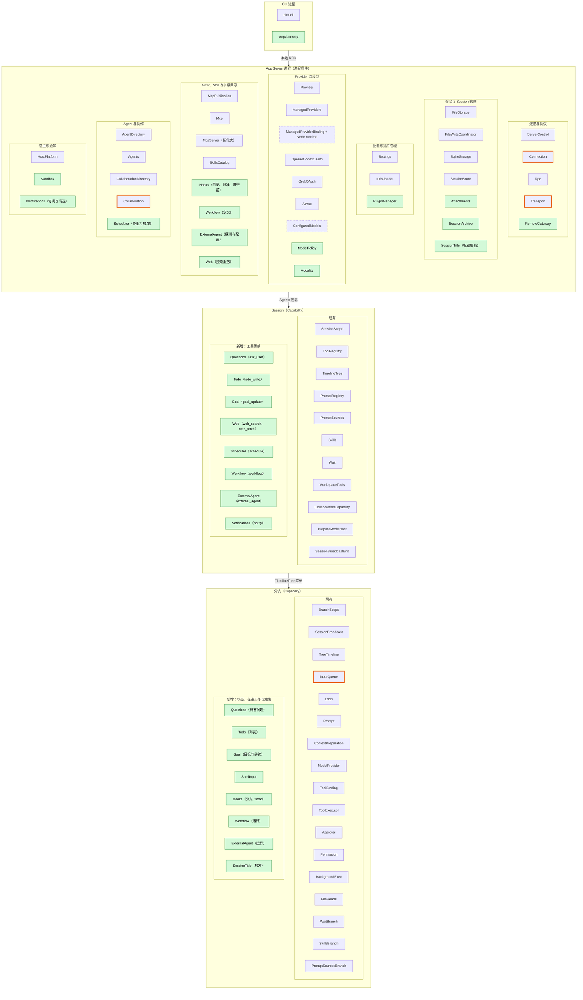
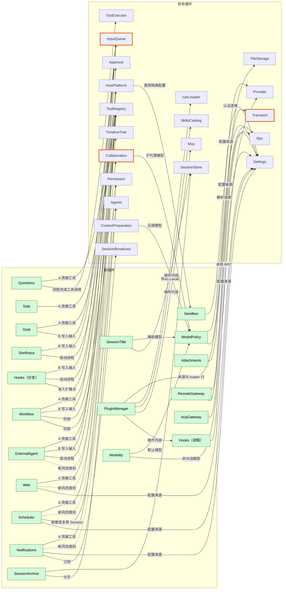

# 总体设计：未设计功能的插件化

状态：草案

本文以 [CLI 功能清单](../feature-list.md) 为目标，找出现有插件职责尚未覆盖的功能，把它们设计成插件，并说明这些插件如何接入现有体系。每个新插件的详细需求另写在 `docs/design/plugins/<名称>.md`，按第 10 节的模板编写。

现有插件及其内容不在本文修改范围内。现有插件需要的补充与变更登记在第 7 节，由对应插件另行设计。

## 1. 范围与前提

| 项 | 约定 |
| --- | --- |
| 终端形态 | 只设计 scrollback。功能清单中标为“仅全屏 TUI”的项不在范围内 |
| 多模态 | 只设计图片。功能清单中“仅限特定 Desktop 构建”的命令不在范围内 |
| 动态事件 | 以 [#2](https://github.com/arcships/dim/issues/2) 已完成为前提：插件在运行时注册自己的事件类型（类型名、数据格式），注册随插件生命周期，Timeline 按注册校验写入。新插件不向内核事件枚举增加类型，也不设过渡方案 |
| 模型上下文 | 按 [ADR 001](../adr/001-harness-foundation.md) 的提议：插件事件不直接投影进模型上下文；给模型看的内容经采用的输入或工具结果进入。#2 中“由注册的投影规则决定”的方案与此不同，见第 12 节 |
| 配置与插件管理 | 依赖 [#3](https://github.com/arcships/dim/issues/3) 的部分按 ADR 001 的“按来源写入、再发布到根 loader”方案设计，并逐处标注 |
| 现有设计 | [时间总线](../architecture/rust-agent/time-bus.md)、[设计规则](../architecture/rust-agent/principles.md)、[单树装配](../architecture/rust-agent/single-tree.md)、[生命周期](../architecture/rust-agent/lifecycle.md)、[事件驱动流程](../architecture/rust-agent/event-driven-flows.md) 与 ADR 001 的信任合同对所有新插件同样适用 |

## 2. 现有体系

| 层 | 职责 | 现有插件（按职责分组） |
| --- | --- | --- |
| CLI | 终端交互、命令、渲染；不执行 Agent | `dim-cli` |
| App Server 进程 | 协议与连接、Session 目录与持久化、配置来源、Provider 与账号、MCP、Skill 目录、协作目录 | Transport、Connection、Rpc、ServerControl；AgentDirectory、Agents、SessionStore、SqliteStorage；Settings；Provider、ManagedProviders、各 OAuth、Aimux；McpPublication、Mcp；SkillsCatalog；Collaboration、CollaborationDirectory；FileStorage、FileWriteCoordinator、HostPlatform |
| Session | 工具注册、提示词来源、分支树、协作工具 | ToolRegistry、PromptRegistry、PromptSources、Skills、Wait、WorkspaceTools、TimelineTree、CollaborationCapability（`agent` 工具） |
| 分支 | 输入、循环、上下文、模型、工具执行、准入 | InputQueue、Loop、Prompt、ContextPreparation、ModelProvider、ToolBinding、ToolExecutor、Approval、Permission、BackgroundExec、FileReads、WaitBranch、SkillsBranch、PromptSourcesBranch、TreeTimeline |

各插件的职责见 [plugins](../architecture/rust-agent/plugins/README.md)、[单树装配](../architecture/rust-agent/single-tree.md) 的进程插件表与 [工具贡献](../architecture/rust-agent/tool-contributions.md)。

## 3. 接入方式

新插件通过以下五种方式接入。需要现有插件配合的改动单独登记在第 7 节，不在新插件中顺带修改。

| 方式 | 机制 | 现有先例 |
| --- | --- | --- |
| **A 贡献工具** | Session 插件向 ToolRegistry 贡献工具；分支经 ToolBinding 采用并固定处理器；ToolExecutor 执行；Approval 与 Permission 准入。模型只读工具结果的 `content` | WorkspaceTools、Skills、Wait、TimelineTree、CollaborationCapability |
| **B 输入注入** | 插件把最终内容写成 `input/message`：面向模型的内容放在 raw 块中，用户内容（含图片块）放在 `user` 中；按模式由 InputQueue 采用、Loop 消费后进入上下文。Queue 可开始 turn，Steer 插入当前 turn 并可结束 `wait`，Append 不开始 turn | BackgroundExec 完成通知、协作回报 |
| **C 提示词来源** | 向 PromptRegistry 注册命名来源；分支由 PromptSourcesBranch 发现变化并经 Prompt 采用 | AGENTS.md、Skill 列表、环境与日期 |
| **D 脱离工作** | 由发起它的**分支**上的插件执行、取消、恢复和结算；开始与终态写在发起分支；完成时以 Steer 输入唤醒；查询与停止由所有者的工具提供（[事件驱动流程](../architecture/rust-agent/event-driven-flows.md) §3） | BackgroundExec |
| **E 进程服务** | App Server 进程插件；配置经 Settings 按来源写入；对外提供管理 RPC；外部协议适配与 Rpc 平级 | Mcp、Provider、SkillsCatalog |

共同约束：

1. **事件最少化**：只为影响后续行为的结果新增事件（时间总线第 3 条）。能由已有事实推出的状态不另设事件：工具调用与工具结果、`input/*`、`turn/*`、`stop/interrupt` 都是可消费的事实。过程输出（进度、日志）走诊断通道，不写 Timeline。
2. **所有权**：插件只写自己声明的事件；发起工作的插件写该工作的开始与终态。状态机只依据自己消费过的事件做决定，不读其他插件的内存状态，但可以消费同样的事件自建视图（时间总线第 2 条）。
3. **外部入口**：RPC 不直接写事件。RPC 调用所有者插件的服务，所有者在边界校验后写自己的事件，先例为 `approval.respond`。与中断等并发时，按序号接受第一个有效的结果。
4. **重载与副作用**：开始事实已写、终态未写的工作，在重载或重启时以“未在恢复中存活”结算，不重新执行（时间总线第 5 条）。
5. **作用域可见性**：进程插件不读取 Session 或分支状态，所需的值由调用方作为参数传入。
6. **中断**：插件取消自己的在途工作、释放资源后再写终态（[中断](../architecture/rust-agent/interrupt.md)）。
7. **准入**：新工具声明风险类别，由 Permission 与 Approval 准入；新类别登记在第 7 节。
8. **管理面**：管理级 RPC 只对受保护的本地连接开放，WebSocket 远程调用方不可用。可以执行命令或改变宿主配置的方法一律是管理级。
9. **在途工作**：不建立共享的在途工作登记。每个所有者提供自己的查询与停止，汇总只在 CLI 层显示（[事件驱动流程](../architecture/rust-agent/event-driven-flows.md) §3 “在途工作识别”暂不设计）。

### 3.1 Capability 与进程插件

Capability 经 Session 级或 Timeline（分支）级工厂注册到 Agent 实例，以 `SessionScope`/`BranchScope` 实例键提供服务，经 Timeline 事件与声明的服务协作（[设计规则](../architecture/rust-agent/principles.md) §1）。不经这两种工厂注册的 rutis 插件是进程插件，如 App Server 进程插件与 FileStorage、HostPlatform、SkillsCatalog。Session 级能力不注册分支实例事件（[单树装配](../architecture/rust-agent/single-tree.md)），需要写事件或持有在途工作的部分放在分支级。

| 判断项 | Capability | 进程插件 |
| --- | --- | --- |
| 状态归属 | 属于某个 Session 或分支，可由 Timeline 重建 | 跨 Session 共享，存于进程存储或配置 |
| Timeline | 写入或消费事件 | 不写 Timeline；或管理 Session 本身（创建、删除、调度） |
| 对 Agent 实例的贡献 | 工具、输入、提示词来源 | 无，或经服务供 Capability 使用 |
| 资源 | 自己发起的在途工作 | 宿主资源：存储、隔离、网络服务、外部协议端口 |
| 生命周期 | 随 Session 或分支：中断、重载、关闭 | 随进程或 loader |

功能同时具备两侧特征时，拆为进程插件与 Capability，沿用 SkillsCatalog（进程）、Skills（Session）、SkillsBranch（分支）的分法。

| 类别 | 新插件与拆分 |
| --- | --- |
| Capability | Questions（Session：工具；分支：待答问题）、Todo（Session：工具；分支：列表）、Goal（Session：工具；分支：目标状态与继续）、ShellInput（分支） |
| 进程插件 + Capability | Web（进程：搜索服务配置；Session：工具）、Hooks（进程：目录、批准与提交前 Hook；分支：执行）、Scheduler（进程：作业与触发；Session：`schedule` 工具）、Workflow（进程：定义；Session：工具；分支：运行）、ExternalAgent（进程：探测与配置；Session：工具；分支：运行）、Notifications（进程：订阅与发送；Session：`notify` 工具）、SessionTitle（进程：标题元数据与生成；分支：首个 turn 结束后请求生成） |
| 进程插件 | Attachments、ModelPolicy、PluginManager、Sandbox、SessionArchive、RemoteGateway、Modality |
| 非 daemon 插件 | AcpGateway（CLI 进程中的协议适配） |

拆分后的命名在各插件需求文档中确定。

### 3.2 插件架构图

以下是目标结构，手绘，只用于说明新插件的位置。当前装配以 [生成图](../architecture/rust-agent/generated/) 为准。绿色为新插件（同一插件拆分的各部分用同一名称加括号说明），橙色边框为第 7 节中有“变更”的现有插件，虚线框为按配置启用的现有插件。

#### 全量分布

#### 新插件接入关系

箭头表示“使用”或“接入”，标注对应第 3 节的接入方式。拆分插件除 Hooks 外按插件整体画出，各部分见下表。

#### 新插件位置

| 新插件 | 进程部分 | Session 部分 | 分支部分 | 挂接的现有插件 |
| --- | --- | --- | --- | --- |
| Questions | — | `ask_user` 工具 | 待答问题 | ToolRegistry、ToolExecutor |
| Todo | — | `todo_write` 工具 | 列表 | ToolRegistry |
| Goal | — | `goal_update` 工具 | 目标状态与继续 | ToolRegistry、InputQueue |
| ShellInput | — | — | 命令执行 | HostPlatform、InputQueue |
| Hooks | 目录、批准、Session 开始与提交前 Hook | — | 分支 Hook | Settings、Approval、HostPlatform、InputQueue |
| Workflow | 定义 | `workflow` 工具 | 运行 | Settings、ToolRegistry、TimelineTree、Collaboration、InputQueue |
| ExternalAgent | 探测与配置 | `external_agent` 工具 | 运行 | ToolRegistry、HostPlatform、InputQueue |
| Web | 搜索服务配置 | `web_search`、`web_fetch` 工具 | — | Settings、ToolRegistry、Permission |
| Scheduler | 作业与触发 | `schedule` 工具 | — | Settings、Agents、ToolRegistry |
| Notifications | 订阅与发送 | `notify` 工具 | — | Settings、Session 广播、ToolRegistry |
| SessionTitle | 标题服务 | — | 首个 turn 结束后触发 | SessionStore、ModelPolicy |
| Attachments | 附件 | — | — | FileStorage |
| ModelPolicy | 模型策略 | — | — | Settings、Provider |
| SessionArchive | 导出、删除、清理、分叉 | — | — | SessionStore、Agents |
| PluginManager | 插件市场与安装 | — | — | Settings、rutis-loader、SkillsCatalog、Mcp、Hooks |
| Sandbox | 隔离配置 | — | — | Settings、HostPlatform |
| RemoteGateway | 远程访问 | — | — | Transport、Rpc |
| Modality | 多模态任务 | — | — | Provider、ModelPolicy |
| AcpGateway | CLI 进程 | — | — | Rpc（本地 RPC） |

## 4. 功能归属

“现有”表示由现有插件职责覆盖；“扩展”表示属于现有插件职责但现有设计未写到，见第 7 节；“新”表示第 5 节的新插件；“CLI”表示只在 CLI 层实现，见第 8 节；“范围外”见第 1 节。

### Provider 与模型

| 功能 | 归属 |
| --- | --- |
| OAuth / API-key Provider、Provider 管理、`/connect`、`/models` | 现有：Provider、ManagedProviders、各 OAuth、Aimux |
| `/effort`、`/fast` | 扩展：Prompt、ModelProvider |
| 子代理模型、辅助模型 | 新：ModelPolicy |

### Session 管理

| 功能 | 归属 |
| --- | --- |
| `/new`、`/resume`、Session 列表、`/history` | 现有：Agents、SessionStore |
| `/timeline` | CLI（读取历史） |
| Session 标题 | 新：SessionTitle |
| `/export`、Session 分叉、删除与清理、请求快照导出 | 新：SessionArchive |
| 文件回滚、文件与对话回滚 | 范围外（仅全屏 TUI） |

### 会话内交互

| 功能 | 归属 |
| --- | --- |
| 发送、排队、自动发送、Steer、中断 | 现有：InputQueue、Loop |
| `Ctrl+S`、`/queue`、取回编辑、删除排队消息 | 扩展：InputQueue |
| 多行编辑、输入历史、命令补全、Skill 与文件引用、粘贴、剪贴板、复制、打开链接 | CLI |
| 图片附件、大段粘贴转文本附件、混合附件 | 新：Attachments |
| `!command`、`!!command` | 新：ShellInput |
| 流式输出、运行状态、文件变更反馈 | 现有事件，CLI 渲染 |
| 工具审批 | 现有：Approval、Permission |
| 用户提问 | 新：Questions |
| Todo 状态 | 新：Todo |
| 后台任务查看与停止 | 各所有者提供（BackgroundExec、Collaboration、Workflow、ExternalAgent），CLI 汇总 |

### 系统管理

| 功能 | 归属 |
| --- | --- |
| `/exit`、`/theme`、`/keys`、升级 | CLI |
| `/settings` | 各项归属对应插件；CLI 汇总入口 |
| `/usage` | 扩展：ContextPreparation（上下文用量）、ManagedProviders（套餐用量） |
| `/language` | CLI（界面）；扩展：PromptSources（提示词语言） |
| `/debug`、调试日志 | 现有：Trace 诊断通道 |
| `/stats`、鼠标设置 | 范围外（仅全屏 TUI） |

### Agent 行为

| 功能 | 归属 |
| --- | --- |
| `/agent` | 扩展：Agents、Prompt |
| `/goal`、目标继续 | 新：Goal |
| `/approvals`、命令规则 | 扩展：Permission、Settings |
| 权限策略三档 | 现有：Permission |
| 沙箱 | 新：Sandbox |
| `/compact`、自动压缩 | 扩展：ContextPreparation（手动入口；生产用压缩宿主尚未提供） |
| `/scheduled`、定时任务 | 新：Scheduler |

### 扩展

| 功能 | 归属 |
| --- | --- |
| `/plugins`、`/reload-plugins`、插件市场、插件安装 | 新：PluginManager |
| `/skills` 查看与启用、`/reload-skills`、Skill 来源 | 现有：SkillsCatalog、Skills；安装与移除归 PluginManager |
| `plan` Skill、`AGENTS.md` | 现有：Skill 内容、PromptSources |
| `/mcp`、MCP 连接 | 现有：Mcp、Settings；HTTP/SSE 的 OAuth 授权为扩展 |
| `/workflow`、`/workflow:save`、工作流管理 | 新：Workflow |
| `/external-agents`、外部 Agent | 新：ExternalAgent |
| 并行子代理 | 现有：Collaboration；模型选择归 ModelPolicy |
| Hooks | 新：Hooks |
| 网页搜索与抓取 | 新：Web |
| Slack 与飞书 | 新：Notifications |

### 工作区工具

`read`、`write`、`edit`、`glob`、`grep`、`exec`、`wait` 均由现有 WorkspaceTools、BackgroundExec、Wait 覆盖。

### 远程与外部访问

| 功能 | 归属 |
| --- | --- |
| JSON-RPC 常驻服务 | 现有：Transport、Rpc |
| ACP | 新：AcpGateway |
| `/web`、Web 访问、`/remote`、远程服务、手机配对、远程 Session | 新：RemoteGateway |
| VS Code | CLI |

### CLI 命令

子命令体系、`exec --json`、`exec --verify` 属于 CLI；各子命令调用对应插件的 RPC。

### 多模态

| 功能 | 归属 |
| --- | --- |
| `image generate`、`image edit`、`image enhance`、`modality`、`modality task` | 新：Modality |
| `image read` | 现有：视觉模型经 `read` 读取图片 |
| 视频、语音、音乐、音频、3D、动作、实时、OCR | 范围外（仅 Desktop） |

## 5. 新插件

每个插件给出作用域、职责、接入方式、事件、对外接口和与现有插件的关系。事件与接口名为设计建议，以各插件需求文档为准。

### 5.1 Questions

| 项 | 设计 |
| --- | --- |
| 作用域 | Session（工具贡献）+ 分支（待答问题） |
| 职责 | 模型向用户提问并等待回答：单选、多选、多问题、自定义回答 |
| 接入 | A：工具 `ask_user`；等待回答是该工具调用的在途工作，回答作为工具结果返回 |
| 事件 | 无。问题内容是工具调用的参数，回答或取消是工具结果；待答问题即“有调用、无结果”的 `ask_user` |
| 接口 | RPC `session.question.respond {call_id, answers}` 调用分支服务，边界校验后完成工具调用 |
| 关系 | 中断时以取消结束工具调用；回答与中断并发时按序号先到者生效。重载时未完成的调用按现有工具恢复规则结算。非交互 Session（如 `exec`、定时作业创建的 Session）在创建配置中不贡献 `ask_user`，不依据客户端是否连接来决定 |

### 5.2 Todo

| 项 | 设计 |
| --- | --- |
| 作用域 | Session（工具贡献）+ 分支（列表状态） |
| 职责 | 记录模型的任务拆解、当前项与完成状态 |
| 接入 | A：工具 `todo_write` 整体替换列表；工具结果 `content` 返回当前列表 |
| 事件 | 无。列表由本工具的调用结果重建 |
| 接口 | 分支只读状态供 CLI 显示 |
| 关系 | 子分支从固定祖先前缀继承列表，与其模型上下文中可见的父分支结果一致，此后各自维护 |

### 5.3 Goal

| 项 | 设计 |
| --- | --- |
| 作用域 | Session（工具贡献）+ 分支（目标状态与继续） |
| 职责 | 设置、编辑、暂停、恢复、清除目标；目标未完成时自动继续；记录完成或受阻 |
| 接入 | A：工具 `goal_update` 报告完成或受阻；B：继续时写入 Queue 模式的继续输入，raw 块标明来自目标 |
| 事件 | `goal/changed {action: set \| edit \| pause \| resume \| clear, objective?}`：只记录用户的变更 |
| 接口 | RPC `session.goal.set/edit/pause/resume/clear` 调用分支服务，由 Goal 写 `goal/changed` |
| 关系 | 完成与受阻由 `goal_update` 的工具结果推出；`stop/interrupt` 使目标进入暂停，由消费中断推出；连续继续次数由本插件写入的继续输入计数，达到上限即暂停。是否继续只依据本插件消费过的 `turn/end`、`input/*`、`stop/interrupt`，不读 InputQueue 或 Loop 的状态。中断与继续输入并发时，继续输入可能排在中断之后并开始一个 turn；此 turn 中 `goal_update` 与提示词来源反映目标已暂停，模型据此结束，最多多出一个 turn |

### 5.4 ShellInput

| 项 | 设计 |
| --- | --- |
| 作用域 | 分支 |
| 职责 | 执行用户在输入框发起的 `!command` 与 `!!command` |
| 接入 | D：命令作为本插件的工作执行；B：`!command` 的终态与 Append 模式输入在同一原子批次写入，在下一次模型请求时进入上下文，不单独开始 turn |
| 事件 | `shell/started {run_id, command, cwd, context}`、`shell/ended {run_id, exit_code, output, truncated}` |
| 接口 | RPC `session.shell.run`、`session.shell.stop`：管理级，只对本地连接开放 |
| 关系 | 经 HostPlatform 启动进程，按 Sandbox 配置隔离；用户在本地直接发起，不经 Approval。`!!command` 只写事件，不写输入。重载时未结束的命令按共同约束 4 结算，不重新执行 |

### 5.5 Attachments

| 项 | 设计 |
| --- | --- |
| 作用域 | 进程 |
| 职责 | 在输入边界把附件转为最终内容；保存文本附件 |
| 接入 | B：图片在提交边界转为 `user` 内容中的图片块（最终内容）；文本附件保存到 Session 附件目录，输入中以文件路径出现，由模型按需 `read` |
| 事件 | 无 |
| 接口 | RPC `attachment.put` 保存文本附件并返回路径 |
| 关系 | 经 FileStorage 写入。导出与分叉时附件文件随 Session 复制，只随 Session 删除，保证历史引用完整。模型不支持图片时在提交边界拒绝。终端创建的临时图片缓存由 CLI 清理 |

### 5.6 Web

| 项 | 设计 |
| --- | --- |
| 作用域 | 进程（搜索服务配置与 HTTP 资源）+ Session（工具贡献） |
| 职责 | 网页搜索与网页正文抓取 |
| 接入 | A：工具 `web_search`、`web_fetch`；抓取结果转为有界正文 |
| 事件 | 无；结果即工具结果 |
| 接口 | 搜索服务与凭据引用经 Settings 配置 |
| 关系 | 工具风险类别为“网络” |

### 5.7 ModelPolicy

| 项 | 设计 |
| --- | --- |
| 作用域 | 进程 |
| 职责 | 为辅助用途选择模型：子代理、辅助任务（标题、压缩、摘要）、默认多模态模型 |
| 接入 | E：策略为“继承调用方模型 / 固定模型与推理强度 / 由 Agent 选择（仅子代理）” |
| 事件 | 无；策略是配置 |
| 接口 | 服务 `ModelPolicy::resolve(role, caller_selection)`：调用方传入自己已采用的模型选择；RPC 管理策略 |
| 关系 | 经 Provider 解析连接；Collaboration、SessionTitle、压缩宿主、Modality 使用它 |

### 5.8 SessionTitle

| 项 | 设计 |
| --- | --- |
| 作用域 | 进程（标题元数据与生成）+ 分支（触发） |
| 职责 | 自动生成 Session 标题；支持手动改名 |
| 接入 | 主分支的触发部分消费第一个正常结束的 `turn/end`，请求进程服务生成；进程服务用 ModelPolicy 的辅助模型生成并写入 SessionStore 元数据 |
| 事件 | 无。标题是 Session 目录元数据，带来源字段 `auto` 或 `manual` |
| 接口 | RPC `session.rename` 直接写元数据，Session 未装载时也可改名；Session 列表读取元数据 |
| 关系 | 元数据只有一个写入方。自动标题只在来源不是 `manual` 时写入，以修订检查保证手动标题不被覆盖。生成失败或进行中被卸载不影响 Session，下次装载不重新生成已有标题 |

### 5.9 Hooks

Hooks 不是新的扩展机制，而是把命令 Hook 配置映射到现有机制的适配层：同步 before、Capability 订阅、业务所有者管理的异步准入，以及插件体系。进程内插件需要 Hook 能力时直接使用 before 或订阅，不经本插件。

| 项 | 设计 |
| --- | --- |
| 作用域 | 进程（目录、批准、Session 开始与用户提交 Hook）+ 分支（工具调用前后、turn 结束、通知 Hook） |
| 职责 | 在生命周期节点执行用户、项目、插件来源的命令 Hook |
| 接入 | 命令 Hook 会启动外部进程，不能放进同步 before（before 在提交锁内运行，不执行 I/O）。各时机的映射：Session 开始与用户提交在 RPC 边界执行，用户提交 Hook 可以拒绝提交或以 raw 块附加内容；工具调用前的 Hook 经 Approval 的准入扩展点异步执行，由业务所有者管理（[单树装配](../architecture/rust-agent/single-tree.md) 同步 before）；工具调用后、turn 结束与通知 Hook 由分支 Capability 订阅对应事件后异步执行；需要注入的输出经 B 写入 |
| 事件 | 无。拦截决定记录在所有者的事实中（输入是否写入、工具结果为拒绝）；注入的输出本身是输入；执行记录走诊断通道 |
| 接口 | RPC `hooks.catalog`、`hooks.approve`、`hooks.set_enabled`、`hooks.disable_all`：管理级 |
| 关系 | Session 开始 Hook 只在创建 Session 时执行，恢复与重载不重新执行。观察类 Hook 只由实时分发触发，重载后的新一代从明确位置接手，不补跑。项目与插件来源的 Hook 需要宿主本地批准才能执行，批准绑定配置指纹。准入扩展点上的 Hook 在中断时取消，对应调用以取消结算。插件来源依赖 #3 |

### 5.10 Scheduler

| 项 | 设计 |
| --- | --- |
| 作用域 | 进程（作业与触发）+ Session（工具贡献） |
| 职责 | 定时任务的创建、编辑、暂停、恢复、删除、立即运行与执行历史 |
| 接入 | E：到点时经 Agents 新建或复用 Session，提交作业提示词，raw 块标明来自定时作业；A：工具 `schedule` 供模型管理作业 |
| 事件 | 无。作业与执行历史存于进程存储 |
| 接口 | RPC `schedule.list/save/delete/set_enabled/run_now/history`：管理级 |
| 关系 | 作业字段：周期、提示词、工作目录、模型、新建或复用 Session；作业创建的 Session 为非交互 Session。触发要求 daemon 存活；错过的时间窗跳过，不补跑。工具 `schedule` 的风险类别为“持久配置” |

### 5.11 Workflow

| 项 | 设计 |
| --- | --- |
| 作用域 | 进程（定义）+ Session（工具贡献）+ 分支（运行） |
| 职责 | 查看工作流、提供参数并启动；查看阶段、日志、状态与结果；停止；保存工作流供复用 |
| 接入 | D：一次运行是发起分支上 Workflow 的脱离工作，各阶段在子分支（TimelineTree）或协作成员（Collaboration）中执行；完成时以 Steer 输入唤醒发起分支；A：工具 `workflow` 提供启动、状态与停止 |
| 事件 | `workflow/started {run_id, workflow, params}`、`workflow/ended {run_id, outcome, summary}`。阶段进度从子分支与协作成员的事实读取，日志走诊断通道 |
| 接口 | RPC `workflow.list/save/start/status/stop` |
| 关系 | 定义文件经 Settings 的用户与项目来源保存；项目来源的定义需要宿主本地批准才能运行。阶段模型经 ModelPolicy 选择。运行不跨重载恢复，按共同约束 4 结算 |

### 5.12 ExternalAgent

| 项 | 设计 |
| --- | --- |
| 作用域 | 进程（探测与配置）+ Session（工具贡献）+ 分支（运行） |
| 职责 | 把本机已安装的 Claude Code、Codex、Cursor、OpenCode 等作为外部执行者，委派任务、查看进度、取消 |
| 接入 | D：每次委派是发起分支上的脱离工作，经 HostPlatform 以非交互方式启动，支持 ACP 的外部 Agent 经 ACP 客户端连接；完成时以 Steer 输入回报；A：工具 `external_agent` |
| 事件 | `external_agent/started {run_id, agent, cwd}`、`external_agent/ended {run_id, outcome, summary}`。过程输出走诊断通道 |
| 接口 | RPC `external_agents.list/set_enabled`：管理级 |
| 关系 | 工具风险类别为“外部进程”；按 Sandbox 配置隔离。运行不跨重载恢复，按共同约束 4 结算 |

### 5.13 PluginManager

| 项 | 设计 |
| --- | --- |
| 作用域 | 进程 |
| 职责 | 插件市场（Git 来源）的增删与更新；搜索、查看、安装（市场、本地路径、Git URL）、启用、停用、重载、移除插件 |
| 接入 | E：插件清单声明其内容：Skill、Hook、MCP 配置、工作流、能力插件；安装即写入来源并发布 loader 行 |
| 事件 | 无 Timeline 事件；状态来自 loader 条目 |
| 接口 | RPC `plugin.marketplace.*`、`plugin.install/remove/set_enabled/reload/list`：管理级 |
| 关系 | 依赖 #3（loader 管理）；Rust 以外语言的能力插件依赖 [#4](https://github.com/arcships/dim/issues/4)。插件内容按来源接入 SkillsCatalog、Hooks、Mcp、Workflow。插件内的可执行内容需要宿主本地批准 |

### 5.14 Sandbox

| 项 | 设计 |
| --- | --- |
| 作用域 | 进程 |
| 职责 | 为进程执行提供操作系统级隔离：文件、网络、进程 |
| 接入 | 调用方启动进程时把隔离配置传给 HostPlatform |
| 事件 | 无；被拒绝的操作体现在调用方的结果中 |
| 接口 | 隔离配置来自 Settings 的宿主本地来源，按用户与工作区作用域区分；平台不支持时明确报告 |
| 关系 | 隔离配置不来自 Timeline，回放与分叉不改变隔离。Permission 的权限预设是准入，不放宽隔离；准入与隔离互不替代。适用于 `exec`、ShellInput、分支 Hook，ExternalAgent 与 MCP stdio 是否默认隔离见第 12 节。平台后端：macOS seatbelt，Linux landlock 或 bubblewrap；Windows 无后端时明确不可用 |

### 5.15 Notifications

| 项 | 设计 |
| --- | --- |
| 作用域 | 进程（订阅与发送）+ Session（工具贡献） |
| 职责 | 任务完成、待审批、待回答、定时作业结束时发送通知；发送 Slack 与飞书消息 |
| 接入 | E：订阅 Session 广播；A：工具 `notify` 供模型主动发送 |
| 事件 | 无 Timeline 事件；发送记录走诊断通道 |
| 接口 | 渠道与凭据引用经 Settings 配置 |
| 关系 | 工具 `notify` 的风险类别为“外发消息”。终端内提醒由 CLI 完成 |

### 5.16 SessionArchive

| 项 | 设计 |
| --- | --- |
| 作用域 | 进程 |
| 职责 | 导出对话（Markdown、JSON）；删除 Session；按时间或保留数量清理，先预览；从历史消息分叉出新 Session；导出模型请求快照 |
| 接入 | E |
| 事件 | 无。分叉来源记录在新 Session 的元数据中 |
| 接口 | RPC `session.export`、`session.delete`、`session.cleanup`（含预览）、`session.fork`、`session.request_export` |
| 关系 | 删除先关闭 Session 再删除持久数据；Loop 未空闲时拒绝。分叉复制来源截点之前的事实及其引用闭包（附件、事件声明），不重放副作用，语义与分支截点一致；分叉不复制宿主安全设置 |

### 5.17 AcpGateway

| 项 | 设计 |
| --- | --- |
| 作用域 | CLI 进程 |
| 职责 | `dimcode acp` 在标准输入输出上提供 ACP 服务，供编辑器连接 |
| 接入 | 协议适配：ACP 会话对应 dim Session；提示对应提交；更新来自 Session 事件；权限请求对应 `approval.request` |
| 事件 | 无 |
| 接口 | ACP 协议 |
| 关系 | 与 CLI 一样经本地 RPC 连接 daemon，不在 daemon 中另开执行路径 |

### 5.18 RemoteGateway

| 项 | 设计 |
| --- | --- |
| 作用域 | 进程 |
| 职责 | Web 工作区与远程访问：启动与停止服务、认证、访问令牌轮换、手机配对（二维码或配对码）、设备授权与撤销、远程访问 Session |
| 接入 | E：建在 Transport 的 WebSocket 之上，增加认证、配对与设备授权；提供 Web 工作区静态资源 |
| 事件 | 无 Timeline 事件；设备与令牌存于进程存储 |
| 接口 | RPC `remote.start/stop/status/pair/devices/revoke/rotate_token`：管理级 |
| 关系 | 远程客户端只能使用 Session 级方法。认证、断线与 TLS 部署的取舍与 [#5](https://github.com/arcships/dim/issues/5) 的待定问题一并决定 |

### 5.19 Modality

| 项 | 设计 |
| --- | --- |
| 作用域 | 进程 |
| 职责 | 图片生成、编辑（参考图与遮罩）、增强；异步任务的状态查询、等待与取消；查看能力与默认模型 |
| 接入 | E：经 Provider 调用非对话类模型 |
| 事件 | 无 Timeline 事件；任务存于进程存储 |
| 接口 | RPC `modality.capabilities`、`modality.task.*`；CLI `image`、`modality` 子命令 |
| 关系 | 需要 Provider 支持非对话类模型；默认模型经 ModelPolicy |

## 6. 新增 Timeline 事件

按共同约束 1 逐个审查后，新增事件共 8 种：

| 事件 | 写入方 | 为什么需要 |
| --- | --- | --- |
| `goal/changed` | Goal | 用户对目标的设置、编辑、暂停、恢复、清除是外部输入，决定后续是否继续，无法由其他事实推出 |
| `shell/started`、`shell/ended` | ShellInput | 命令是有副作用的在途工作，开始事实用于重载时结算；`!!command` 的终端记录也只存在于此 |
| `workflow/started`、`workflow/ended` | Workflow（分支） | 脱离工作的开始与终态必须写在发起分支 |
| `external_agent/started`、`external_agent/ended` | ExternalAgent（分支） | 同上 |
| `input/withdrawn` | InputQueue | 删除尚未采用的排队消息必须成为事实，队列状态才能重建；见第 7 节 |

不设事件的情况与依据：

| 原设想 | 处理 | 依据 |
| --- | --- | --- |
| `question/*` | 用 `ask_user` 的工具调用与工具结果 | 问题与回答已是事实 |
| `todo/updated` | 用 `todo_write` 的工具结果 | 列表已是事实 |
| `goal/completed`、`goal/blocked` | 用 `goal_update` 的工具结果 | 同上 |
| 目标因中断或达到上限暂停 | 由 `stop/interrupt` 与继续输入计数推出 | 可由已有事实重建 |
| `session/titled` | SessionStore 元数据 | 标题不影响分支后续行为 |
| `hook/*` | 拦截决定记录在所有者事实中，注入内容是输入，执行记录走诊断通道 | Hook 是现有机制上的适配，不是新的事实来源 |
| `workflow/stage_*`、`external_agent/progress` | 子分支事实与诊断通道 | 过程输出不影响后续行为 |
| 输入来源 | `input/message` 的 raw 块 | 现有结构已支持，不改冻结事件 |
| 排队消息转为 Steer | `input/withdrawn` 加新的 Steer 输入，同一批次写入 | 不另设事件 |

## 7. 现有插件的补充与变更

现有插件需要两类改动：一类是功能清单中属于其职责、但现有设计未覆盖的功能；另一类是新插件接入时需要现有插件提供的配合。本文只登记，具体设计写入对应插件的需求文档。

- **补充**：新增服务、方法或配置项，原有行为不变。
- **变更**：原有行为或合同改变，需要说明兼容与迁移。

所有现有事件类型改为经 #2 的注册机制声明，属于 #2 本身的工作，不在下表重复。`input/message` 的结构不变：附件以现有图片块与文件路径表达，来源以 raw 块表达。

### 7.1 分支与 Session 能力

| 插件 | 类型 | 内容 | 原因 |
| --- | --- | --- | --- |
| InputQueue | 变更 | 新增 `input/withdrawn`：撤回尚未采用的输入，撤回的输入不再采用，队列状态与可撤回性由事件重建；提供撤回、以及“撤回并以 Steer 重新写入”的服务，经 Session 边界调用 | `Ctrl+S`、`/queue`、取回编辑、删除排队消息 |
| Permission | 补充 | 风险类别“网络”“外发消息”“持久配置”“外部进程”，并规定 FullAccess 是否自动放行各类别；来自 Settings 的跨 Session 规则来源；允许命令清单 | Web、Notifications、Scheduler、ExternalAgent；`/approvals`、命令规则 |
| Approval | 补充 | 工具调用前的准入扩展点：已登记的准入方（如 Hooks）在策略判定后、执行前给出允许或拒绝，中断时取消并以取消结算 | Hooks |
| Prompt、ModelProvider | 补充 | 模型参数（推理强度、快速模式）随模型配置采用，并传入模型请求 | `/effort`、`/fast` |
| Prompt | 补充 | 在 Session 内切换 Agent 配置（提示词、模型、工具集）作为一次配置采用 | `/agent` |
| PromptSources | 补充 | 提示词语言来源 | `/language` |
| ContextPreparation | 补充 | 查询当前上下文用量与预算；手动压缩入口；接入生产用压缩宿主（`ContextModelHost` 的提供者，经 ModelPolicy 选择模型） | `/usage`、`/compact`、自动压缩 |
| HostPlatform | 补充 | 启动进程时接受调用方传入的隔离配置并套用；平台不支持时明确报告 | Sandbox |

### 7.2 App Server 进程插件

| 插件 | 类型 | 内容 | 原因 |
| --- | --- | --- | --- |
| Settings | 补充 | 新的配置来源：权限规则、Hook 定义与 Hook 批准、工作流定义与批准、Web 搜索服务、通知渠道、模型策略、沙箱配置、插件市场；统一的凭据引用 | Hooks、Workflow、Web、Notifications、ModelPolicy、Sandbox、PluginManager、Permission 规则 |
| Rpc | 补充 | 第 5 节各插件的方法；方法分为 Session 级与管理级，供网关判断可用范围 | 全部新插件；RemoteGateway |
| Transport、Connection | 变更 | 远程连接携带认证后的设备身份；按身份限制可用方法 | RemoteGateway |
| Agents | 补充 | 以非交互配置新建或复用 Session 并提交首条输入；从另一 Session 的截点创建 Session | Scheduler；SessionArchive 分叉 |
| SessionStore | 补充 | Session 元数据（标题及其来源、分叉来源）与修订检查；Session 删除与按时间或数量清理（含预览）；附件随 Session 复制与删除 | SessionTitle、SessionArchive、Attachments |
| Collaboration | 变更 | 子代理模型改由 ModelPolicy 选择，调用方传入主 Session 已采用的模型 | ModelPolicy |
| Provider | 补充 | 非对话类模型（图片） | Modality |
| ManagedProviders | 补充 | 查询套餐用量；未提供时明确不可用 | `/usage` |
| Mcp | 补充 | HTTP/SSE 连接的 OAuth 授权；接受插件来源的配置 | MCP 连接；PluginManager |
| SkillsCatalog | 补充 | 接受插件来源的 Skill 根；安装与移除由 PluginManager 发起 | PluginManager |
| Trace | 补充 | 导出指定步骤的模型请求快照，可过滤推理、工具记录与压缩内容 | 请求快照导出 |
| Session 广播 | 待确认 | 进程级订阅所有 Session 的结束、待审批、待回答等事件 | Notifications |

## 8. CLI 层

以下只在 CLI 中实现，不新增插件：多行编辑、输入历史、命令补全、`$` 与 `@` 引用、粘贴与拖放路径、剪贴板、消息复制、打开链接、`/timeline`、`/exit`、`/theme`、`/keys`、界面语言、升级、VS Code 集成、子命令体系、`exec --json`、`exec --verify` 修复循环、后台任务汇总显示。

## 9. 横切约定

| 主题 | 约定 |
| --- | --- |
| 事件 | 每个插件在需求文档中列出声明的事件、数据格式与消费规则（哪些状态机必须消费、消费后达到什么效果），并说明为什么不能由已有事实推出 |
| 上下文 | 只经 A 或 B 进入模型上下文；持续生效的规则经 C |
| 配置 | 每项配置有明确来源（用户、工作区、Session）和唯一写入路径；凭据只以引用形式出现在配置中 |
| 信任 | 来自项目文件或插件的可执行内容（Hook、MCP、工作流、能力插件）需要宿主本地批准，批准绑定配置指纹；读取配置不产生执行权限 |
| 安全设置 | 宿主安全设置（隔离、批准）不写入 Timeline；回放与分叉不恢复或放宽权限 |
| 持久化 | 进程级存储变更遵循现有存储兼容策略；不跨不兼容格式复用版本号 |
| 协议 | 新 RPC 方法区分 Session 级与管理级；管理级只对受保护的本地连接开放 |
| 国际化 | 用户可见文案由 CLI 负责；模型可见文案由提示词来源负责 |

## 10. 插件需求文档模板

每个新插件的需求文档 `docs/design/plugins/<名称>.md` 包含：

1. 用户流程：从用户或模型的操作到可见结果
2. 范围：负责与不负责的内容
3. 作用域与依赖：拆分、作用域、注入的服务、提供的服务
4. 事件：类型名、数据格式、写入方、消费规则，以及不能由已有事实推出的理由
5. 状态：拥有的状态及如何由 Timeline 或进程存储重建
6. 接口：工具（含风险类别）、RPC（Session 级或管理级）、CLI 入口
7. 错误与恢复：取消、中断、重载、进程退出时的结算
8. 安全：准入、信任、隔离、敏感数据
9. 验收：需要的流程测试

## 11. 实施阶段

| 阶段 | 内容 |
| --- | --- |
| P0 地基 | #2 动态事件；RPC 方法分级约定；Permission 新风险类别 |
| P1 核心交互 | Questions、Todo、ShellInput、Attachments、ModelPolicy、SessionTitle、SessionArchive；InputQueue 撤回、Permission 规则、模型参数；CLI 子命令与 `exec --json` |
| P2 能力扩展 | Goal、Web、Sandbox、Hooks（用户与项目来源）、Scheduler、Workflow、Notifications；Mcp OAuth；生产用压缩宿主 |
| P3 外部集成 | ExternalAgent、AcpGateway、RemoteGateway、Modality；PluginManager（依赖 #3、#4） |

## 12. 待对齐问题

| 问题 | 说明 |
| --- | --- |
| 事件进入上下文的方式 | #2 已定“由注册的投影规则决定”，ADR 001 提议“只经输入与工具结果”。本文按后者设计，需维护者对齐 |
| 定时任务的存活条件 | 功能清单写“交互终端进程存活”，本文按 daemon 存活设计 |
| 远程访问 | 认证、断线与 TLS 部署与 #5 的待定问题相关 |
| Sandbox 的覆盖面 | ExternalAgent 与 MCP stdio 进程是否默认受隔离 |
| FullAccess 与新风险类别 | 外发消息与持久配置是否在 FullAccess 下仍需询问 |
| 进程级订阅 | Notifications 所需的跨 Session 订阅是否复用 Session 广播 |
