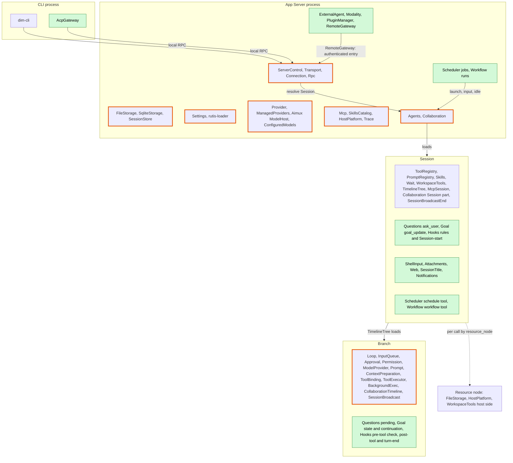
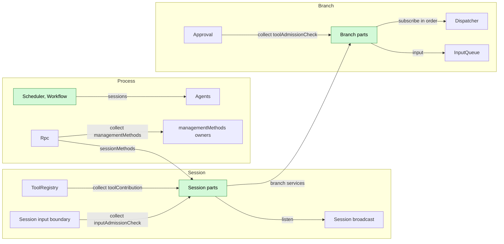
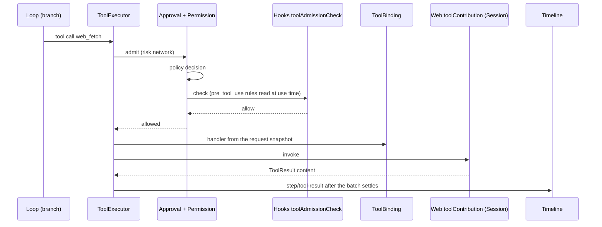
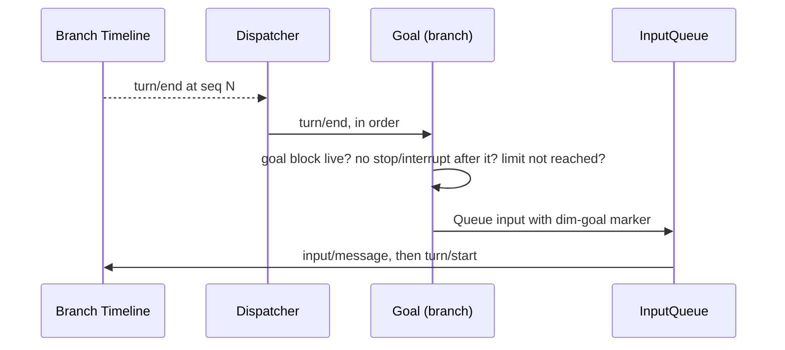
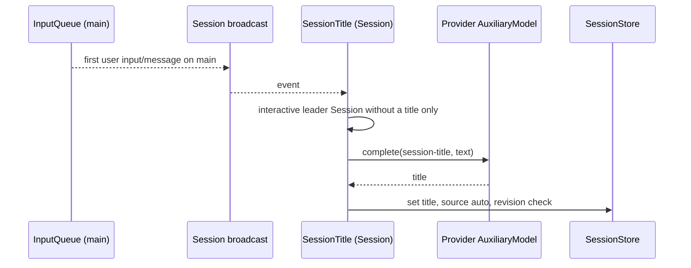
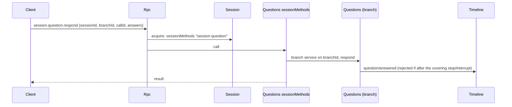
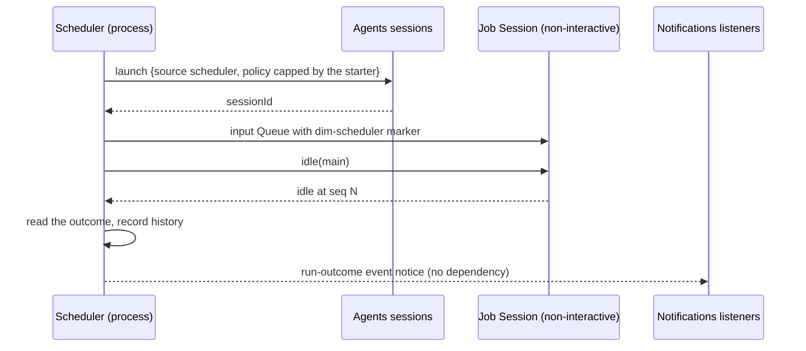
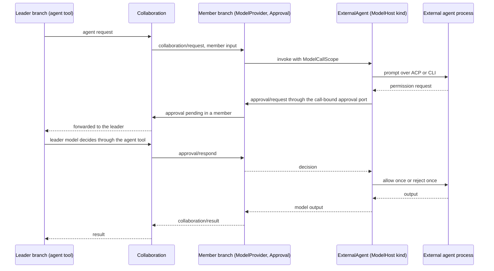

# Overall design: plugins for undesigned features

Status: Draft

This document starts from the [CLI feature list](../feature-list.md), identifies the features that existing plugins do not cover, and places the new plugins in the existing system. Each new plugin is designed in `docs/design/plugins/<Name>.md`. Supplements to existing plugins are listed in [Appendix B](#appendix-b-supplements-to-existing-plugins) and designed by the plugin that owns them.

> **Scope rule** ([ADR 002](../adr/002-plugin-scope.md)): a plugin part lives at the scope that owns its state and lifecycle (process, Session or branch), and parts integrate only through mechanisms the runtime already has. No new mechanism is introduced. Every contract is language-neutral (D5): a named service with a scope, an instance key and data-only methods, so plugins in any language provide or use it ([§3.1](#31-contract-form)). The two contracts describe supplements to existing interfaces: [methods and admission checks](contracts/session-boundary.md) (Rpc, Approval, the Session input boundary, ToolRegistry) and [session access](contracts/session-access.md) (Agents, the Session facade, InputQueue).

The main body covers premises, the scope diagram and assignment, integration, the catalog, key flows, constraints, events, phases and open questions. The appendices cover feature ownership, supplements to existing plugins, the implementation language, the CLI layer and the document template.

## 1. Scope and premises

| Item | Convention |
| --- | --- |
| Terminal form | Only scrollback is designed. Items marked "full-screen TUI only" in the feature list are out of scope |
| Multimodality | All categories are targeted (image, video, speech, music, audio, 3D assets, motion, realtime, OCR). "Specific Desktop builds only" is an availability constraint ([Modality](plugins/Modality.md)) |
| Not planned | The Todo status and the `plan` Skill |
| Dynamic events | Assumes [#2](https://github.com/arcships/dim/issues/2): plugins register their own event types at runtime, registration follows the plugin lifecycle, and Timeline validates writes |
| Model context | Per [ADR 001](../adr/001-harness-foundation.md): the model sees only adopted input and tool results, and plugin events are not projected. The divergence from #2 is open ([§9](#9-open-questions)) |
| Configuration | [ADR 002](../adr/002-plugin-scope.md) D4: structural plugin configuration (enable, paths, node binding, listener addresses) lives in loader rows (#3 editable layer) and may reload the row. Business configuration lives in the owner's business source, is read at use time and never reloads. Project files and host-local approvals keep their own authority (ADR 001). The project directory is `.dimcode/` |
| Existing design | [Time bus](../architecture/rust-agent/time-bus.md), [design rules](../architecture/rust-agent/principles.md), [single-tree assembly](../architecture/rust-agent/single-tree.md), [lifecycle](../architecture/rust-agent/lifecycle.md), [event-driven flows](../architecture/rust-agent/event-driven-flows.md), [tool contributions](../architecture/rust-agent/tool-contributions.md) and the ADR 001 trust contract apply |

## 2. Scope assignment

Green parts are new and orange-bordered parts are changed. Each new plugin part sits at the scope that owns its state. A feature with parts at two scopes is one plugin package with one part per scope, as SkillsCatalog, Skills and SkillsBranch are. Optional Session and branch parts are installed only when the plugin is enabled, never as placeholders.

| Plugin | Process | Session | Branch | Reason |
| --- | --- | --- | --- | --- |
| Questions | — | `ask_user` tool; `session.question.*` methods; not installed in non-interactive Sessions | Pending questions, `question/*` facts, following Approval | A question belongs to a branch's turn |
| Goal | — | `goal_update` tool; `session.goal.*` methods | Goal state as a keyed raw input block; continuation decided from branch events in order through the Dispatcher; writes branch inputs | A goal belongs to a branch, and continuation follows its events in order |
| Hooks | — | Rules from business sources; Session-start Hooks; `inputAdmissionCheck` for `user_prompt_submit` | Pre-tool `toolAdmissionCheck` for Approval; post-tool and turn-end Hooks from the Dispatcher | Rules apply to a Session; execution happens in a branch |
| ShellInput | — | `shell.*` methods (level management); runs in the Session's workspace and writes its input | — | Commands belong to the Session |
| Attachments | — | `attachment.put`; Session files through SessionStore | — | Attachments are Session data |
| Web | — | `web_search`, `web_fetch` tools | — | No state shared across Sessions |
| SessionTitle | — | Observes the first user input through the Session broadcast; `session.rename`; title stored by SessionStore | — | The title belongs to the Session |
| Notifications | — | Observes the Session broadcast; `notify` tool | — | Triggers are the Session's events |
| Scheduler | Jobs, triggers, history | `schedule` tool | — | Schedules span Sessions |
| Workflow | Definitions, runs | `workflow` tool | — | A run spans Sessions |
| ExternalAgent | Connections, ModelHost kind | — | — | External agent connections are shared |
| Modality | Tasks, realtime connections | — | — | Tasks and provider connections are shared |
| PluginManager | Marketplaces, packages | — | — | Installation is per host |
| RemoteGateway | Remote entry, devices | — | — | An external entry |
| AcpGateway | CLI process | — | — | A client |

Management is not a plugin. Management methods are `managementMethods` services collected into Rpc's method table with level `management`, and each entry serves the levels it is configured for ([methods](contracts/session-boundary.md)).

## 3. Integration by existing mechanisms

Plugins never add wiring plugins (ADR 002 D2). Each need maps to a mechanism that already exists at the plugin's own scope:

| Need | Mechanism | Used by |
| --- | --- | --- |
| Offer a tool to a Session | Session-scoped `toolContribution` ([methods A.7](contracts/session-boundary.md#a7-tool-contribution)) or `SessionToolSource` ([tool contributions](../architecture/rust-agent/tool-contributions.md)) | Questions, Goal, Web, Notifications, Scheduler, Workflow |
| Offer instructions | PromptRegistry prompt sources | Existing |
| Observe a Session's events | The existing Session broadcast (`session/<id>` channel), from a Session-scoped plugin | SessionTitle, Notifications, Hooks Session-start |
| Observe and act on a branch's events in order | The branch Dispatcher, from a branch-scoped plugin | Goal, Questions, Hooks post-tool and turn-end |
| Put content into the model context | Branch input (raw blocks, keyed blocks) or tool results ([session access](contracts/session-access.md#a2-source-input-conventions)) | Goal, Hooks, ShellInput, Scheduler, Workflow |
| Check a tool call before execution | Branch-scoped `toolAdmissionCheck`, collected by Approval ([methods and admission checks](contracts/session-boundary.md#a3-tool-admission-check)) | Hooks |
| Check an input before it is written | Session-scoped `inputAdmissionCheck`, run by the Session input boundary ([methods A.6](contracts/session-boundary.md#a6-input-admission-check)) | Hooks `user_prompt_submit` |
| Client method about a Session | `sessionMethods`, which Rpc dispatches through the Session ([A.1](contracts/session-boundary.md#a1-method-contributions)) | Questions, Goal, SessionTitle, Attachments, ShellInput |
| Host management method | `managementMethods`, collected by Rpc into its method table, level `management` | Existing management methods, Scheduler, Workflow, Hooks, Notifications, ExternalAgent, Modality, PluginManager, RemoteGateway, Web |
| Reach other Sessions | Agents' `sessions` service (`launch`, `input`, `history`, `idle`, ...), as Collaboration does ([session access](contracts/session-access.md#a1-the-sessions-service)) | Scheduler, Workflow |
| React to another process plugin's outcome | An event notice, not a dependency | Scheduler run outcomes |

The arrows are dependency edges, and they point to the same or an enclosing scope (D3). A collector depends on its contributions (ToolRegistry on tools, Approval on checks, Rpc on method owners), so a contributor reload reloads its collector. Reloads follow only rare structural operations (install, upgrade, enable, disable, crash). Their propagation, including failing in-flight turns, is an accepted and documented cost, and nothing is added to prevent it. Business configuration changes never reload (D4).

### 3.1 Contract form

Every contract the designs define or use is a named service (ADR 002 D5): service name (camelCase), scope, instance key, and methods marked `sync` or `async` whose requests, replies and errors are serializable data. Cancellation is a cancel request or the consumer dropping the call. A plugin declares what it provides in its `provides` and loader row; consumers collect by service name and scope. rutis calls such services across languages (rutis-bridge runtimes, `host_key(name)`, `TypeKey::named`), so a TypeScript or Python part satisfies a contract without a hand-written Rust binding. Rust traits, `TypeKey`, `Contributions<T>` and `AgentBuilder` calls appear only in each document's "Rust binding" appendix.

| Service | Scope | Key | Methods | Defined in |
| --- | --- | --- | --- | --- |
| `sessionMethods` | Session | namespace | `describe(): async -> MethodDecl[]`; `call(MethodCall): async -> MethodReply` | [methods A.1](contracts/session-boundary.md#a1-method-contributions) |
| `managementMethods` | process | namespace | same | [methods A.1](contracts/session-boundary.md#a1-method-contributions) |
| `toolAdmissionCheck` | branch | check name | `check(ToolCallRequest): async -> {verdict, reason?}` | [methods A.3](contracts/session-boundary.md#a3-tool-admission-check) |
| `inputAdmissionCheck` | Session | check name | `check(InputRequest): async -> {verdict, reason?, blocks?}` | [methods A.6](contracts/session-boundary.md#a6-input-admission-check) |
| `toolContribution` | Session | tool name | `declaration(): sync -> ToolDeclaration`; `execute(ToolCall): async -> ToolResult` | [methods A.7](contracts/session-boundary.md#a7-tool-contribution) |
| `sessions` | process | — | `launch`, `input`, `lookup`, `history`, `withdraw`, `stop`, `idle` | [session access A.1](contracts/session-access.md#a1-the-sessions-service) |
| `modelKind` | process | kind | request and stream as data | [ExternalAgent](plugins/ExternalAgent.md) |

The runtime's existing typed services (Timeline, Dispatcher, ToolHost and others) stay as they are. Exposing them by name to non-Rust Session and branch parts is the work of [#4](https://github.com/arcships/dim/issues/4); rutis itself already calls across languages.

## 4. Plugin catalog

| Plugin | Scopes | Role | Phase | Language | Document |
| --- | --- | --- | --- | --- | --- |
| Questions | Session + branch | `ask_user`; pending questions and answers; `session.question.respond` | P1 | Rust | [Questions](plugins/Questions.md) |
| ShellInput | Session | `!command` / `!!command` as `shell.run/stop/list` (level management) | P1 | Rust | [ShellInput](plugins/ShellInput.md) |
| Attachments | Session | `attachment.put` for large text; Session files | P1 | Rust | [Attachments](plugins/Attachments.md) |
| SessionTitle | Session | Title from the first user input; `session.rename` | P1 | TypeScript first | [SessionTitle](plugins/SessionTitle.md) |
| Goal | Session + branch | Goal as a keyed input block; continuation; `goal_update`; `session.goal.*` | P2 | TypeScript first | [Goal](plugins/Goal.md) |
| Web | Session | `web_search`, `web_fetch` | P2 | TypeScript first | [Web](plugins/Web.md) |
| Hooks | Session + branch | Command Hooks: Session start, pre-tool admission check, post-tool, turn end | P2 | Rust | [Hooks](plugins/Hooks.md) |
| Scheduler | Process + Session | Scheduled jobs; `schedule` tool; run-outcome notice | P2 | TypeScript first | [Scheduler](plugins/Scheduler.md) |
| Workflow | Process + Session | Multi-stage runs across Sessions; `workflow` tool | P2 | TypeScript first | [Workflow](plugins/Workflow.md) |
| Notifications | Session | Delivery to channels; `notify` tool | P2 | TypeScript first | [Notifications](plugins/Notifications.md) |
| ExternalAgent | Process | External agents as a ModelHost provider kind | P3 | TypeScript first | [ExternalAgent](plugins/ExternalAgent.md) |
| AcpGateway | CLI process | ACP server over local RPC | P3 | TypeScript first | [AcpGateway](plugins/AcpGateway.md) |
| RemoteGateway | Process | Remote entry, pairing, devices | P3 | Rust | [RemoteGateway](plugins/RemoteGateway.md) |
| Modality | Process | Multimodal tasks and realtime connections | P3 | TypeScript first | [Modality](plugins/Modality.md) |
| PluginManager | Process | Marketplaces, packages, `PluginContents` | P3 | Rust | [PluginManager](plugins/PluginManager.md) |

| Contract | Owner | Defines |
| --- | --- | --- |
| [Methods and admission checks](contracts/session-boundary.md) | Rpc, Approval, Session input boundary, ToolRegistry | `sessionMethods`, `managementMethods`, `callChannel`, entry levels, `unknown_method`/`service_reloading`/`input_denied`, migration and compatibility of existing management methods, `toolAdmissionCheck`, `inputAdmissionCheck`, `toolContribution` |
| [Session access](contracts/session-access.md) | Agents, InputQueue | the `sessions` service; `launch` with a capped policy, `SessionConfig` fields `interactive`/`resource_node`/`created_by`, source raw blocks, fixed-prefix read, withdrawal |

## 5. Key flows

### 5.1 Tool call with a Session tool and a branch admission check

A denial by a check settles like a policy denial. If Hooks reloads during the turn, Approval reloads with it and the turn ends `Failed`, which D3 accepts.

### 5.2 Goal continuation from the branch Dispatcher

Goal decides only from branch events it has consumed in order, and its pending-input derivation excludes withdrawn inputs. A `stop/interrupt` pauses the goal. If the interrupt lands after the continuation input, at most one extra turn runs, and the model sees the paused block.

### 5.3 Observer through the Session broadcast (SessionTitle)

A manual title is never overwritten. The title is SessionStore metadata, not a Timeline fact.

### 5.4 Session method through the Session (Questions)

### 5.5 Scheduled run through Agents

### 5.6 Collaboration delegation to an external agent

The permission request becomes an ordinary dim approval (existing `approval/request` and `approval/respond` facts). A Collaboration member's approval goes to the leader's model, and with no leader the user decides. `always` options are never selected.

## 6. Common constraints

### 6.1 Integration methods

The table in [§3](#3-integration-by-existing-mechanisms) is exhaustive. A new plugin part is created only for state or behaviour at its scope that no existing plugin owns, and changes within existing responsibilities are recorded in [Appendix B](#appendix-b-supplements-to-existing-plugins).

### 6.2 Constraints

1. **Minimal events**: add an event only for an outcome that affects later behaviour and cannot be derived from tool calls and results, `input/*`, `turn/*` or `stop/interrupt` (time bus rule 3). Process output goes to diagnostics.
2. **Ownership**: declaring an event type defines its data contract. Producers use the owner's public service. Whoever starts work writes its start and terminal facts. Decisions use only consumed facts, never another plugin's memory.
3. **External entry**: RPC never writes events. It calls the owning service, which validates and writes (precedent `approval.respond`). Races are decided by Timeline sequence.
4. **Reload and side effects**: work that started but did not terminate is settled as "did not survive recovery" and is never re-executed. Resuming observation of an external job by polling a saved handle is allowed.
5. **Scope**: each part depends only on its own or an enclosing scope (D3). Session and branch parts read `S:SessionConfig`. Process parts read a Session only through Agents' `sessions` service.
6. **Interrupt**: a plugin cancels in-flight work and releases resources before writing terminal facts ([interrupt](../architecture/rust-agent/interrupt.md)).
7. **Admission**: new tools declare a risk category. The new categories `outbound_message` and `persistent_configuration` are allowed automatically under FullAccess. Sessions started by automation use the starter's policy as an upper bound, which Scheduler jobs and Workflow definitions may narrow. Runs started by a management method default to read-only unless declared, capped by host configuration. `workflow` uses the `agent` tool's risk category.
8. **Reload cost**: a contributor reload reloads its collector and may fail in-flight turns. This is accepted and documented in each plugin's conflict table, never prevented (D3).
9. **Management plane**: methods that run commands or change host configuration declare `level: management`. Local RPC serves both levels, RemoteGateway serves `session`, and a rutis link serves `management` only when explicitly exported (host administrator rights). There are no identity tiers. `hello`, `daemon.*`, `agent.*` and the existing `session.*` methods stay Rpc built-ins.
10. **Remote Session methods**: paired devices may call every `session`-level method, including `session.permission.update` (compatibility change, [methods A.5](contracts/session-boundary.md#a5-migration-and-compatibility)).
11. **In-flight work**: there is no shared registry. Each owner provides its own query and stop, and the CLI aggregates them.
12. **Withdrawal**: one contract owned by InputQueue: `input/withdrawn {input_id}`, the Rpc built-in `session.input.withdraw`, and own-source withdrawal for plugins. "Withdraw and re-submit as Steer" is one atomic batch. Every pending-input derivation excludes withdrawn inputs.
13. **Input admission**: every input write passes the Session input boundary, which runs the Session's `inputAdmissionCheck`s; a denial writes nothing and returns `input_denied` to the caller.
14. **Low business coupling**: raw-block markers and keys, configuration keys and method namespaces carry the owner's prefix. Purposes passed to shared services are consumer-owned keys (`session-title`, `compaction`, `collaboration.member`, `modality.<category>`). Collectors never name contributors.
15. **Interactive Sessions**: `session.create` sets `interactive` and `created_by`. Exec, ACP and automation create non-interactive Sessions, which do not install Questions. Notifications and SessionTitle act only on interactive leader Sessions.

### 6.3 Multiple nodes

rutis nodes connect through links, export and import services, run plugins on the peer (`peer:<node>/<plugin>`) and forward events ([rutis nodes](https://github.com/arcships/rutis/blob/main/docs/guide/nodes.md), [#5](https://github.com/arcships/dim/issues/5)).

| Rule | Content |
| --- | --- |
| Control node | Hosts the App Server: Timeline, Sessions, configuration sources, Providers, scheduling |
| Resource node | Where host resources live (files, processes, shell, isolation, local CLIs). Each Session binds one as `SessionConfig.resource_node`, fixed at creation; the default is the control node |
| Host services | FileStorage, HostPlatform, isolation and the WorkspaceTools host side of the Session's resource node are resolved through the Session's assembly (imported services for a peer node). Process plugins with no Session (Modality OCR, ExternalAgent bridges) name a node in their own configuration |
| Node-bound data | Host-local approvals, isolation configuration and the external agent directory are identified by node and path |
| Offline | A call on an offline resource node fails with `node_unavailable`; dependents do not reload or go Pending. This requires services imported over a rutis link to stay registered while the link is down and fail calls (requirement on [#5](https://github.com/arcships/dim/issues/5)) |
| Authentication | Reuses the rutis link token; the management level is exported only when configured |
| Future | Cross-control-node collaboration is not designed here |

### 6.4 Conventions

| Topic | Convention |
| --- | --- |
| Context | Model context only through tool results and inputs; standing rules through prompt sources or keyed raw blocks |
| Configuration | One source and one write path per item. Structural items live in loader rows; business items live in the owner's business source (Settings source or own store). Credentials are references resolved by the Settings credential resolver |
| Trust | Executable content from project files or plugins (Hooks, MCP, workflows, capability plugins) needs host-local approval from the Settings host-local approval service, recorded as `{owner namespace, node, workspace, source, id, fingerprint}` (SHA-256 over the canonical executable content) |
| Security settings | Host security settings never enter the Timeline, and replay and fork never restore or widen them. The permission preset is a Timeline fact (`permission/changed`) inherited by child branches and reset to the default on fork |
| Persistence | Process storage uses the App Server process storage contract (per-plugin root, UTF-8 and binary atomic replace, lock, format version). Session files live under SessionStore |
| Protocol | Rpc built-ins take precedence over contributed methods |
| Internationalization | User-visible text belongs to the CLI; model-visible text to prompt sources |

## 7. New Timeline events

| Event | Writer | Why it is needed |
| --- | --- | --- |
| `question/asked {call_id, turn_id, request_id, questions}` | Questions (branch) | Pending state cannot be derived, because results publish only after the whole batch (precedent Approval) |
| `question/answered {call_id, answers, declined}` | Questions (branch), through `session.question.respond` | Ordered against interrupts by sequence |
| `question/cancelled {call_id, reason}` | Questions (branch) | Ends a pending question on interrupt, branch close or reload |
| `input/withdrawn {input_id}` | InputQueue | Queue state and withdrawability must be rebuildable |

| Idea | Handling | Reason |
| --- | --- | --- |
| `goal/*` | Keyed raw blocks, including terminal blocks | Goal state is input |
| `shell/*` | `!command` result written as Append input | Not branch in-flight work |
| `hook/*` | Admission denials, injected input, diagnostics | Hooks uses existing mechanisms |
| `external_agent/*` | Collaboration facts, member events, approval facts | External agents are model connections |
| `session/titled` | SessionStore metadata | Does not affect branch behaviour |
| `workflow/*`, scheduled run outcomes | Tool results, report input, process storage, event notice | Process-level outcomes |
| Queued message to Steer | `input/withdrawn` + new Steer input in one batch | No separate event |

## 8. Phases

Prerequisites always land in an earlier phase than their consumers.

| Phase | Content |
| --- | --- |
| P0 Foundation | #2 dynamic events; `SessionConfig` fields set by `session.create`; `sessions` service with `launch`; `sessionMethods` dispatch; `managementMethods` in Rpc's table with migration of existing management methods; entry levels; `toolAdmissionCheck` in Approval; `inputAdmissionCheck` in the Session input boundary; `toolContribution` in ToolRegistry; Permission categories; Settings business sources with change notification, credential resolver, host-local approval service; App Server process storage (incl. binary); Provider purpose policy and `AuxiliaryModel`; SessionStore metadata and Session files; FileStorage listing and removal; HostPlatform argv helper |
| P1 Core interaction | Questions, ShellInput, Attachments, SessionTitle; InputQueue withdrawal; Permission rules; model parameters; SessionStore deletion, cleanup and fork; HostPlatform isolation; Collaboration supplements; #4 named exposure of the runtime's typed services for non-Rust Session and branch parts; CLI subcommands, image conversion, `/export`, `exec --json` |
| P2 Capability extension | Goal, Web, Hooks (user and project sources), Scheduler, Workflow, Notifications; ModelProvider `ModelCallScope` and model-call approvals; Transport `EntryHost`; Mcp OAuth; production compaction host |
| P3 External integration | ExternalAgent, AcpGateway, RemoteGateway, Modality; PluginManager (#3, #4); resource node import (#5) |

The HostPlatform exec-shell change recorded in ADR 002 (business configuration read per spawn) is separate work and blocks no phase.

## 9. Open questions

| Question | Status |
| --- | --- |
| How events enter context | Open (maintainer alignment): #2 says registered projection rules; ADR 001 says only input and tool results. This design follows ADR 001 |
| MCP stdio isolation | Open: whether MCP stdio processes are isolated by default |
| Remote access trade-offs | Open: authentication, disconnection and TLS deployment, related to [#5](https://github.com/arcships/dim/issues/5) ([RemoteGateway](plugins/RemoteGateway.md)) |
| TypeScript Session parts | Open: SessionTitle, Goal, Web, Notifications and the Session parts of Scheduler and Workflow provide neutral contracts by name; those that also use the runtime's typed services (Timeline, Dispatcher, InputQueue) need #4 to expose them by name, otherwise they start in Rust |
| Scheduled job outcome for Notifications | Decided: job Sessions are non-interactive, so Scheduler publishes a run-outcome notice that Notifications listens to, with no dependency |
| Scheduled task liveness | Decided: the daemon must be alive ([Scheduler](plugins/Scheduler.md)) |
| FullAccess and new categories | Decided: allowed automatically (constraint 7) |
| External agent permissions | Decided: ordinary dim approval, forwarded to the leader for Collaboration members (§5.4, [ExternalAgent](plugins/ExternalAgent.md)) |
| External conversation continuation | Proposed: re-initialize from the branch history ([ExternalAgent](plugins/ExternalAgent.md)) |
| Permission preset on fork | Decided: reset on fork (§6.4) |
| Reload propagation | Decided: accepted cost of rare structural operations ([ADR 002](../adr/002-plugin-scope.md) D3) |

## Appendix A. Feature ownership

"Existing" means covered by existing plugins. "Extension" means an existing responsibility, listed in Appendix B. "New" means a new plugin (§4). "CLI" refers to Appendix D.

| Area | Feature | Ownership |
| --- | --- | --- |
| Providers | OAuth / API-key Providers, `/connect`, `/models` | Existing: Provider, ManagedProviders, OAuth plugins, Aimux |
| Providers | `/effort`, `/fast` | Extension: Prompt, ModelProvider |
| Providers | Sub-agent and auxiliary models | Extension: Provider (purpose policy, `AuxiliaryModel`) |
| Sessions | `/new`, `/resume`, Session list, `/history` | Existing: Agents, SessionStore |
| Sessions | `/timeline`, `/export` | CLI |
| Sessions | Session titles | New: SessionTitle |
| Sessions | Fork, deletion, cleanup | Extension: SessionStore, Agents |
| Sessions | Request snapshot export | Extension: Trace |
| Sessions | File and conversation rollback | Out of scope (full-screen TUI only) |
| Interaction | Send, queue, auto-send, Steer, interrupt | Existing: InputQueue, Loop |
| Interaction | `Ctrl+S`, `/queue`, recall, delete queued messages | Extension: InputQueue (withdrawal) |
| Interaction | Multi-line editing, history, completion, references, paste, clipboard, copy, links | CLI |
| Interaction | Large pastes, mixed attachments | New: Attachments; the CLI converts images to image blocks |
| Interaction | `!command`, `!!command` | New: ShellInput |
| Interaction | Streaming output, run status, file change feedback | Existing events, rendered by the CLI |
| Interaction | Tool approval | Existing: Approval, Permission |
| Interaction | User questions | New: Questions |
| Interaction | Todo status | Not planned |
| Interaction | Viewing and stopping background tasks | Each owner (BackgroundExec, Collaboration, Workflow, ShellInput), aggregated by the CLI |
| System | `/exit`, `/theme`, `/keys`, upgrade | CLI |
| System | `/settings` | Each item belongs to its plugin; the CLI aggregates |
| System | `/usage` | Extension: ContextPreparation, ManagedProviders |
| System | `/language` | CLI; Extension: PromptSources |
| System | `/debug`, debug logs | Existing: Trace diagnostics |
| System | `/stats`, mouse settings | Out of scope |
| Agent behaviour | `/agent` | Extension: Agents, Prompt |
| Agent behaviour | `/goal`, continuation, Goal mode | New: Goal (mode is covered by goal state) |
| Agent behaviour | `/approvals`, command rules | Extension: Permission, Settings |
| Agent behaviour | Three permission levels | Existing: Permission |
| Agent behaviour | Sandbox | Extension: HostPlatform |
| Agent behaviour | `/compact`, automatic compaction | Extension: ContextPreparation |
| Agent behaviour | `/scheduled`, scheduled tasks | New: Scheduler |
| Extensions | `/plugins`, `/reload-plugins`, marketplace | New: PluginManager |
| Extensions | `/skills`, `/reload-skills`, Skill sources | Existing: SkillsCatalog, Skills; installation by PluginManager |
| Extensions | `plan` Skill | Not planned |
| Extensions | `AGENTS.md` | Existing: PromptSources |
| Extensions | `/mcp`, MCP connections | Existing: Mcp, Settings; Extension: HTTP/SSE OAuth |
| Extensions | `/workflow`, `/workflow:save` | New: Workflow |
| Extensions | `/external-agents` | New: ExternalAgent, delegated through Collaboration |
| Extensions | Parallel sub-agents | Existing: Collaboration; Extension: Provider model selection |
| Extensions | Hooks | New: Hooks |
| Extensions | Web search and fetch | New: Web |
| Extensions | Slack and Feishu | New: Notifications |
| Workspace tools | `read`, `write`, `edit`, `glob`, `grep`, `exec`, `wait` | Existing: WorkspaceTools, BackgroundExec, Wait |
| Remote access | JSON-RPC resident service | Existing: Transport, Rpc |
| Remote access | ACP | New: AcpGateway |
| Remote access | `/web`, `/remote`, phone pairing, remote Sessions | New: RemoteGateway |
| Remote access | VS Code | CLI |
| CLI commands | Subcommands, `exec --json`, `exec --verify` | CLI, calling each plugin's RPC |
| Multimodality | `image generate/edit/enhance`, `modality`, `modality task` | New: Modality |
| Multimodality | `image read` | Existing: a vision model reads images through `read` |
| Multimodality | `video`, `speech`, `music`, `audio`, `asset`, `motion`, `realtime` | New: Modality (provider-executed) |
| Multimodality | `ocr` | New: Modality (host-executed; OCR runtime component) |

## Appendix B. Supplements to existing plugins

A **supplement** adds services, methods or configuration. A **change** alters existing behaviour or contracts and needs compatibility notes. Declaring existing event types through #2 is #2's work, and `input/message` is unchanged.

### B.1 Session and branch capabilities

| Plugin | Type | Content | Reason |
| --- | --- | --- | --- |
| Approval | Supplement | Collects the branch's `toolAdmissionCheck` services and consults every check after the policy decision and before execution; any denial denies ([methods A.3](contracts/session-boundary.md#a3-tool-admission-check)). Accepts `approval/request` raised through the call-bound approval port while a model step is open | Hooks; ExternalAgent |
| InputQueue | Change | `input/withdrawn {input_id}`; own-source withdrawal service; "withdraw and re-submit as Steer" as one batch; queue state rebuilt from events ([session access A.4](contracts/session-access.md#a4-withdrawal)) | `Ctrl+S`, `/queue`; AcpGateway, Scheduler |
| Runtime Session facade | Supplement | Lookup of `sessionMethods` by namespace; fixed-prefix history read; Session input boundary running `inputAdmissionCheck`s before every write, `input_denied` on denial ([methods A.6](contracts/session-boundary.md#a6-input-admission-check)) | Rpc; process callers; Hooks |
| ToolRegistry | Supplement | Accepts named `toolContribution` services besides existing registrations ([methods A.7](contracts/session-boundary.md#a7-tool-contribution)) | Non-Rust Session tools |
| Agent assembly | Supplement | Collects the named services each installed plugin declares in `provides` (Rust binding: `AgentBuilder::session_methods`, `tool_admission_check`, `input_admission_check`); optional Session and branch parts installed per enabled plugin and per `interactive` | All Session plugins |
| Permission | Supplement | Categories `outbound_message`, `persistent_configuration` (allowed under FullAccess); command rules read at use time | Notifications, Scheduler; `/approvals` |
| ModelProvider | Supplement | Passes `ModelCallScope` (session, branch, request and step ids, `SessionConfig`) with a call-bound approval port | ExternalAgent |
| Prompt, ModelProvider | Supplement | Model parameters (effort, fast mode); switching Agent configuration as one adoption | `/effort`, `/fast`, `/agent` |
| PromptSources | Supplement | Prompt language source | `/language` |
| ContextPreparation | Supplement | Usage query; manual compaction; production compaction host with purpose `compaction` | `/usage`, `/compact` |
| FileStorage | Supplement | Directory listing and removal under a root | Session files, cleanup |
| HostPlatform | Supplement | OS isolation at process start (macOS seatbelt, Linux landlock or bubblewrap, Windows explicitly unavailable), per-node host-local configuration; exec-argv helper; exec shell read per spawn (ADR 002) | Sandbox; ShellInput, Hooks, ExternalAgent |

### B.2 App Server process plugins

| Plugin | Type | Content | Reason |
| --- | --- | --- | --- |
| Rpc | Change | Method table: built-ins, then the collected `managementMethods` (replacing `When<ProductServices>` and `When<ExecutionServices>`), then the Session's `sessionMethods`; `callChannel` for providers. Entry levels per connection. Built-in `session.input.withdraw`. `session.submit` returns `input_denied`. `session.create {interactive, client}`. `title`/`titleSource` in Session lists. Image validation on `session.submit` ([methods](contracts/session-boundary.md)) | All method owners |
| Transport, Connection | Change | `EntryHost` with upgrade authenticators; `ConnectionEntry {name, levels, device_id}` | RemoteGateway |
| Agents | Supplement | The `sessions` service; `SessionConfig` fields; `launch` with a policy capped by the starter; creation from another Session's cut; profiles with an external agent as model ([session access](contracts/session-access.md)) | Scheduler, Workflow, fork, ExternalAgent |
| Collaboration | Change | Member models by purpose `collaboration.member`; `establish(leader, agent)` from outside a branch; member approvals forwarded to the leader | Workflow; ExternalAgent |
| SessionStore | Supplement | Title metadata with revision checks; deletion and cleanup; fork (copies facts before the cut, resets the permission preset); Session files on the resource node, shared on fork and deleted with the last owner | SessionTitle, Attachments, fork |
| Settings | Supplement | Business sources with change notification (D4); credential-reference resolver; host-local approval service | Hooks, Workflow, Web, Notifications, ExternalAgent, PluginManager, Mcp |
| Provider | Supplement | Per-purpose policy with one write path; `AuxiliaryModel::complete(purpose, …)`; non-conversational connections per Modality category; external agent connection type | SessionTitle, compaction, Collaboration, Modality, ExternalAgent |
| Aimux / ModelHost | Supplement | Provider kinds from other plugins; requests of a kind without a provider fail before acceptance | ExternalAgent |
| App Server | Supplement | Process storage contract generalizing `pluginFiles` | Scheduler, Workflow, ExternalAgent, Modality, RemoteGateway, PluginManager |
| Mcp, Provider, SkillsCatalog, ManagedProviders, OAuth plugins | Change | Provide their existing management methods as `managementMethods` (wire-compatible) | Rpc migration |
| ManagedProviders | Supplement | Plan usage query | `/usage` |
| Mcp | Supplement | HTTP/SSE OAuth; configuration from `PluginContents` (`mcp`) | MCP; PluginManager |
| SkillsCatalog | Supplement | Skill roots from `PluginContents` (`skills`) | PluginManager |
| Trace | Supplement | Model request snapshot export | Snapshot export |

## Appendix C. Implementation language

| TypeScript first | Rust |
| --- | --- |
| Business rules still need validation | Security boundaries and admission: command execution, approval checks, isolation, remote entry |
| Mainly external I/O or protocols | Input and Session method boundary |
| Not on the turn hot path | Settlement of in-flight tool calls |
| Failure affects only that feature | Loader and plugin management; base services |

TypeScript process plugins run today as loader rows (Node starts only when configured, [App Server](../../crates/dim-app-server/README.md)). TypeScript parts provide and use the neutral contracts of [§3.1](#31-contract-form) by name; Session and branch parts that also use the runtime's typed services need [#4](https://github.com/arcships/dim/issues/4) to expose them by name, and #2 (§9). The API-key baseline does not depend on Node: TypeScript-first features ship with a pinned Node and are explicitly unavailable without it. When a plugin moves from TypeScript to Rust, its neutral contracts, event types, tool and method names and storage formats stay unchanged; the move only swaps the loader row, flow tests pass unchanged, and only one implementation is loaded at a time. Existing-plugin supplements are Rust.

## Appendix D. CLI layer

The following are implemented only in the CLI: multi-line editing, input history, command completion, `$` and `@` references, paste and drag-and-drop paths, clipboard, message copy, opening links, `/timeline`, `/export`, `/exit`, `/theme`, `/keys`, interface language, upgrade, VS Code integration, the subcommand system, `exec --json`, the `exec --verify` repair loop, aggregated background tasks, and Modality category listing with unavailability reasons.

## Appendix E. Plugin document template

Plugin and contract documents use this layout:

- A header (status, overview link, phase, language) and a summary.
- 1 Structure: a scope diagram and a part table with each part's scope.
- 2 Data and state.
- 3 Flows: sequence diagrams.
- 4 Timing and conflicts: key races, including reload propagation, in a short table.
- 5 Context mapping.
- 6 Interfaces (summary).
- 7 Security.
- Appendices for interface details, the full conflict table (with an `input/withdrawn` row where inputs are derived), errors and recovery, acceptance, assumptions and open questions.
