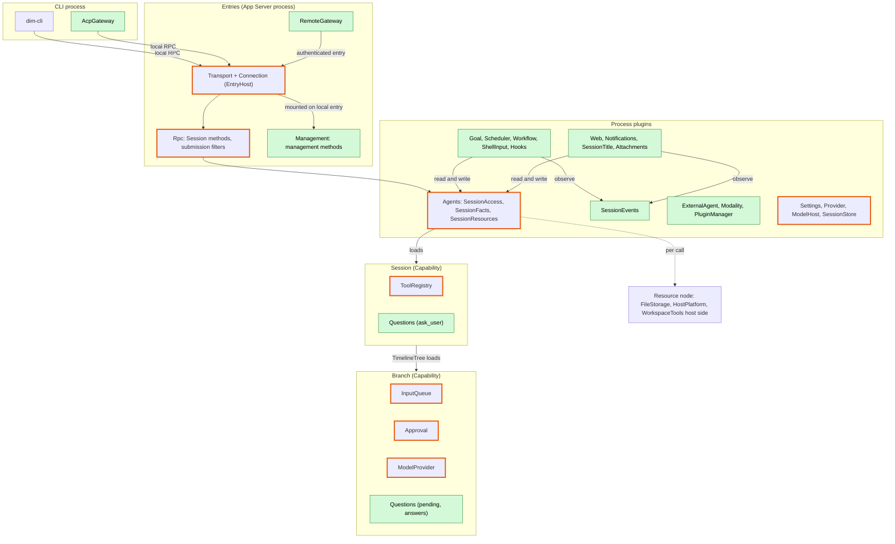
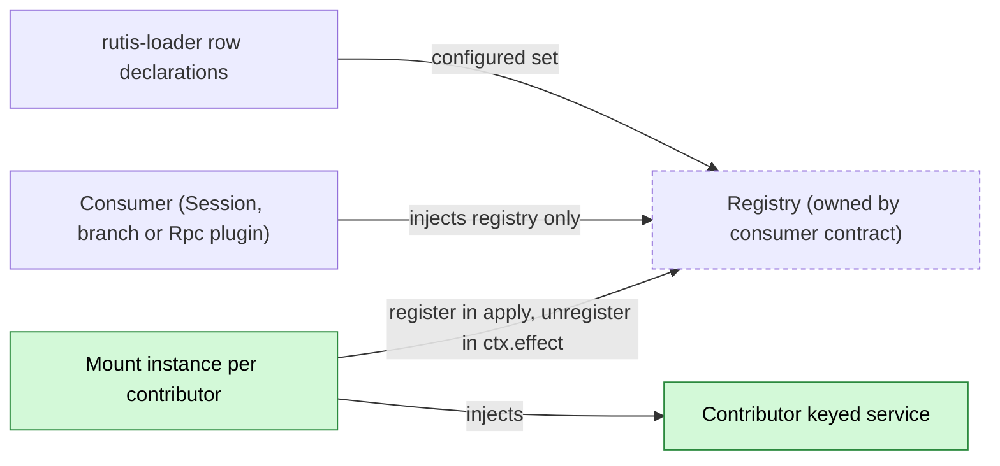
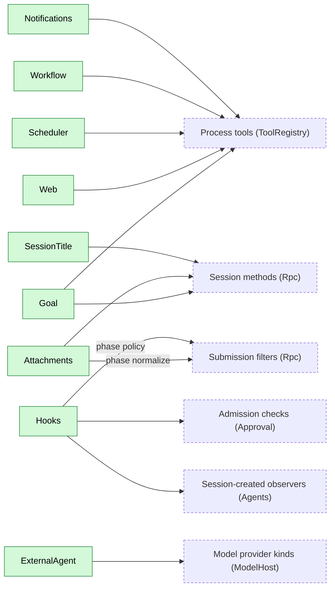
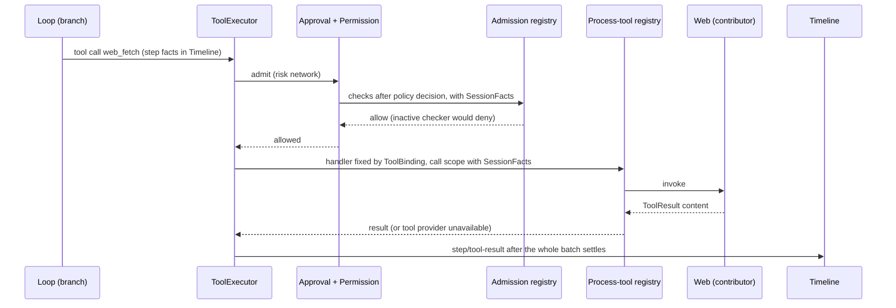
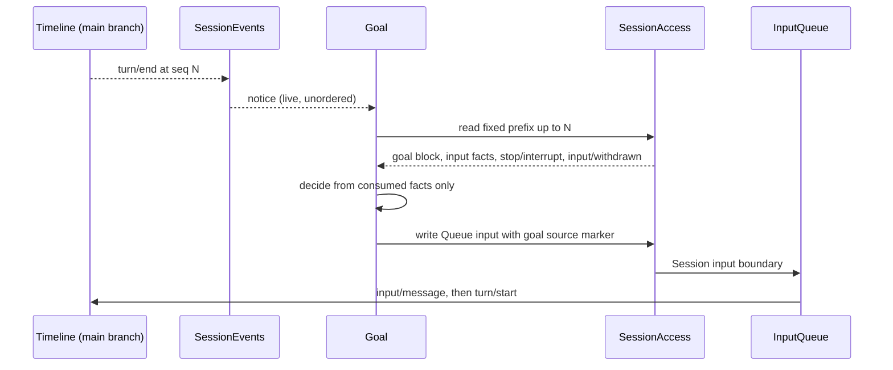
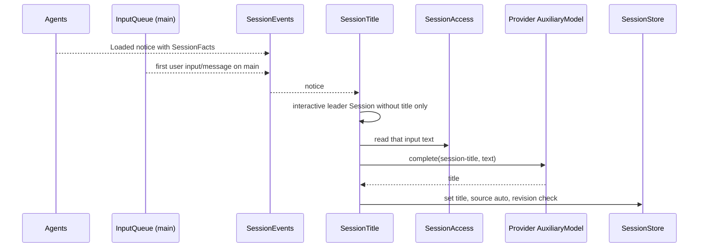
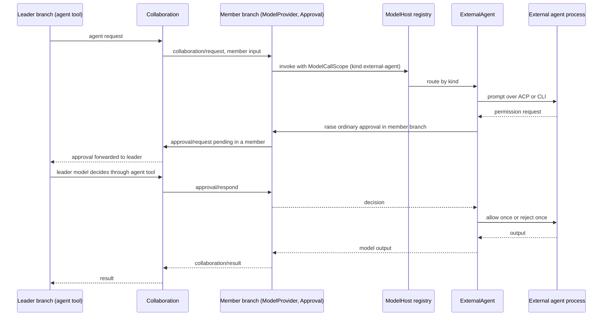
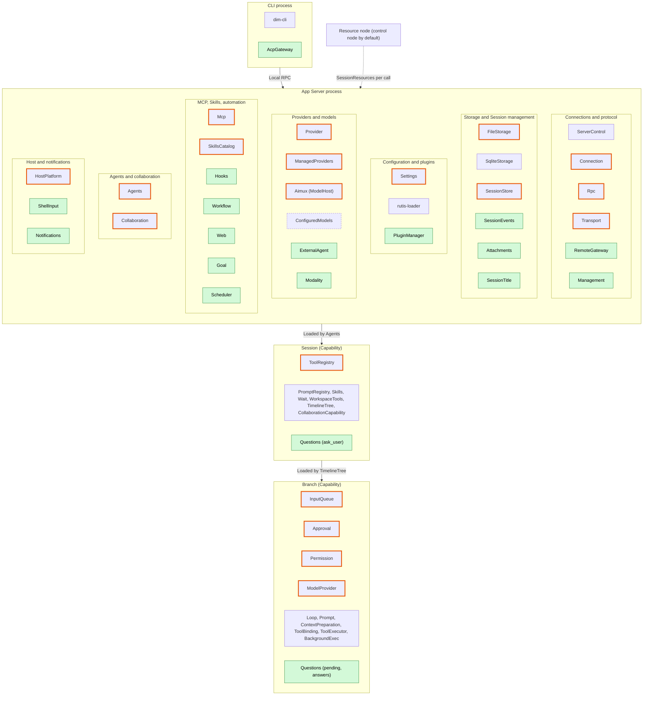
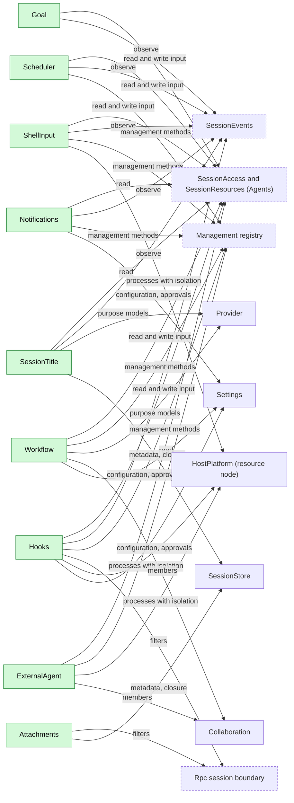

# Overall design: plugins for undesigned features

Status: Draft

This document takes the [CLI feature list](../feature-list.md) as its target, identifies the features that existing plugin responsibilities do not cover, and shows how the new plugins fit into the existing system. Each new plugin is designed in `docs/design/plugins/<Name>.md`; shared contracts are designed in `docs/design/contracts/*.md`. Supplements and changes that existing plugins need are registered in [Appendix C](#appendix-c-supplements-and-changes-to-existing-plugins) and designed by the owning plugin.

The main body is structure first: premises, layers, extension registries, the plugin catalog, the key cross-plugin flows, the common constraints, events, phases and open questions. Per-feature ownership, per-plugin summaries, the supplement registry and the language plan are in the appendices.

## 1. Scope and premises

| Item | Convention |
| --- | --- |
| Terminal form | Only scrollback is designed. Items marked "full-screen TUI only" in the feature list are out of scope |
| Multimodality | The target covers all categories (image, video, speech, music, audio, 3D assets, motion, realtime, OCR). "Specific Desktop builds only" is an availability constraint, not a scope limit ([Modality](plugins/Modality.md)) |
| Not planned | The Todo status and the `plan` Skill |
| Dynamic events | Assumes [#2](https://github.com/arcships/dim/issues/2): plugins register their own event types at runtime, registration follows the plugin lifecycle, Timeline validates writes. No kernel enum additions, no transitional scheme |
| Model context | Per [ADR 001](../adr/001-harness-foundation.md): plugin events are not projected into model context; the model sees only adopted input and tool results. Divergence from #2 is open ([§9](#9-open-questions)) |
| Configuration | Per [#3](https://github.com/arcships/dim/issues/3): user-managed plugin intent and configuration go to the loader editable layer through typed Settings operations. Project files and host-local approvals keep their own authority ("write by source", ADR 001). The project configuration directory is `.dimcode/` |
| Existing design | [Time bus](../architecture/rust-agent/time-bus.md), [design rules](../architecture/rust-agent/principles.md), [single-tree assembly](../architecture/rust-agent/single-tree.md), [lifecycle](../architecture/rust-agent/lifecycle.md), [event-driven flows](../architecture/rust-agent/event-driven-flows.md) and the ADR 001 trust contract apply to all new plugins |

## 2. Layered architecture

Notice: process plugins never reach into Sessions directly; they read, write and observe through Agents' facades (SessionAccess, SessionEvents) and reach host resources through SessionResources on the Session's resource node. Only Questions is a Capability; every other new plugin is a process plugin. Changed existing plugins are bordered orange; the full plugin-level diagram is in [Appendix D](#appendix-d-full-distribution-and-placement).

## 3. Extension registries

Every process-level extension point uses one pattern, defined in [extension-registry](contracts/extension-registry.md): the consumer owns a stable registry contract served by a process plugin that depends on no contributor; each contributor provides a keyed service and one mount instance per configured contributor registers it in `apply` and unregisters it in its `ctx.effect` after settling its own in-flight work. Session, branch and Rpc plugins inject only the registry, so a contributor's reload never reloads them.

Notice: the registry learns the configured set from loader declarations, so it can tell "absent by configuration" from "configured but inactive"; contributor configuration changes are volatile updates (set versions or availability flags), never reloads.

Notice: Session-visible registries are drawn here; Management's method registry follows the same rules and has its own contributors (ShellInput, Hooks, Scheduler, Workflow, ExternalAgent, PluginManager, RemoteGateway, Notifications, Modality). Web search backends and Modality adapters are plugin-internal registries of Web and Modality.

Behavior when a contributor is inactive (reload, Pending, disabled):

| Extension point (owner) | Contributor inactive | Its in-flight work | Stance |
| --- | --- | --- | --- |
| Process tools (ToolRegistry) | Its sets are revoked; branches adopt without them; retained pins return the existing stop error | That call gets "tool provider unavailable"; batch and turn continue | Withdraw-only |
| Admission checks (Approval) | Any configured-but-inactive checker: Approval denies calls reaching the check stage with a retryable reason | Cancelled check denies | Fail closed; rule in Approval's contract |
| Submission filters (Rpc) | `session.submit` returns `service_reloading`; nothing written | Cancelled filter rejects | Fail closed |
| Session-created observers (Agents) | Creation proceeds; diagnostic | Cancelled: nothing written | Fail open |
| Session methods (Rpc), management methods (Management) | That namespace returns `service_reloading`; others unaffected | Per method | — |
| Model provider kinds (ModelHost) | Requests of that kind fail before acceptance (transient); other kinds unaffected | Provider cancels its streams | — |
| Web search backends, Modality adapters and executors | Availability flag false | That call or task fails or is interrupted | — |
| Node services | `node_unavailable` per call | Per owner | — |

A contributor's unload never uses the `capability reloading` reason (that reason ends the turn `Failed`). SessionAccess and SessionEvents are facades that resolve AgentIndex per call and return `Reloading` during an Agents reload instead of reloading their consumers.

## 4. Plugin catalog

New plugins:

| Plugin | Scope | Role | Phase | Language | Document |
| --- | --- | --- | --- | --- | --- |
| Management | Process | Management-method registry, mounted per entry | P0 | Rust | [Management](plugins/Management.md) |
| SessionEvents | Process | Live, unordered process-level subscription to the Session broadcast | P0 | Rust | [session-broadcast-subscription](contracts/session-broadcast-subscription.md) |
| Questions | Session + branch | `ask_user`, pending questions and answer facts | P1 | Rust | [Questions](plugins/Questions.md) |
| ShellInput | Process | `!command` / `!!command` as management methods `shell.*` | P1 | Rust | [ShellInput](plugins/ShellInput.md) |
| Attachments | Process | Submission filter (normalize) and text attachments | P1 | Rust | [Attachments](plugins/Attachments.md) |
| SessionTitle | Process | Title from the first user input; `session.rename` | P1 | TypeScript first | [SessionTitle](plugins/SessionTitle.md) |
| Goal | Process | Goal as keyed input block; continuation; `goal_update` | P2 | TypeScript first | [Goal](plugins/Goal.md) |
| Web | Process | `web_search`, `web_fetch` | P2 | TypeScript first | [Web](plugins/Web.md) |
| Hooks | Process | Command Hooks mapped onto admission, filters, observers, subscription | P2 | Rust | [Hooks](plugins/Hooks.md) |
| Scheduler | Process | Scheduled jobs; `schedule` tool | P2 | TypeScript first | [Scheduler](plugins/Scheduler.md) |
| Workflow | Process | Multi-stage runs across Sessions; `workflow` tool | P2 | TypeScript first | [Workflow](plugins/Workflow.md) |
| Notifications | Process | Delivery to channels; `notify` tool | P2 | TypeScript first | [Notifications](plugins/Notifications.md) |
| ExternalAgent | Process | External agents as a ModelHost provider kind | P3 | TypeScript first | [ExternalAgent](plugins/ExternalAgent.md) |
| AcpGateway | CLI process | ACP server over local RPC | P3 | TypeScript first | [AcpGateway](plugins/AcpGateway.md) |
| RemoteGateway | Process | Remote entry, pairing, devices | P3 | Rust | [RemoteGateway](plugins/RemoteGateway.md) |
| Modality | Process | Multimodal tasks and realtime connections | P3 | TypeScript first | [Modality](plugins/Modality.md) |
| PluginManager | Process | Marketplaces, packages, `PluginContents` | P3 | Rust | [PluginManager](plugins/PluginManager.md) |

Shared contracts:

| Contract | Owner | Defines |
| --- | --- | --- |
| [extension-registry](contracts/extension-registry.md) | Each consumer | Registry, mount, configured vs active, withdrawal stance per extension point |
| [process-tool-contribution](contracts/process-tool-contribution.md) | ToolRegistry | Process-level tool sets and per-call Session values |
| [session-access](contracts/session-access.md) | Agents | `SessionAccess` (read prefix, write input, withdraw own input), `SessionFacts`, `SessionResources` |
| [session-broadcast-subscription](contracts/session-broadcast-subscription.md) | SessionEvents | `SessionEvents` subscription, `SessionNotice` (incl. `Loaded` with SessionFacts) |
| [session-boundary](contracts/session-boundary.md) | Rpc, Agents, SessionStore | Submission filters with phases, Session-method contributions, Session-created observers, `SessionClosure` |

Per-plugin summaries are in [Appendix B](#appendix-b-per-plugin-summaries).

## 5. Key cross-plugin flows

### 5.1 Tool call through a process tool

Notice: the process tool sees only values passed per call (SessionFacts, call identity); an inactive contributor yields a per-call error, never a turn failure. Hooks' pre-tool checks run inside Approval's admission stage.

### 5.2 Input injection through SessionAccess (Goal continuation)

Notice: the subscription only wakes Goal; the decision uses the fixed prefix it read, and pending-input derivations exclude withdrawn inputs. If `stop/interrupt` lands before the continuation, at most one extra turn occurs and the model sees the paused block.

### 5.3 Observer through SessionEvents (SessionTitle)

Notice: the trigger is the first user input on the main branch, not the end of a turn; a manual title is never overwritten, and the title is directory metadata, not a Timeline fact.

### 5.4 Collaboration delegation to an external agent

Notice: the external agent's permission request becomes an ordinary dim approval in the member Session; for a Collaboration member the leader's model decides, and with no leader the user decides as usual. `always` options are never selected.

## 6. Common constraints

### 6.1 Integration methods

A new plugin first uses existing mechanisms; a plugin is created only for responsibilities they cannot express; changes inside existing responsibilities are registered in Appendix C.

| Method | Mechanism | Precedent |
| --- | --- | --- |
| A Tool contribution | Session plugins contribute Session-scoped tools; process plugins contribute through the process-tool registry ([process-tool-contribution](contracts/process-tool-contribution.md)). ToolBinding fixes handlers, ToolExecutor executes, Approval and Permission admit. The model reads only `ToolResult.content` | WorkspaceTools, Skills, Wait |
| B Input injection | Final content as `input/message`: raw blocks for model-facing content, `user` for user content (incl. images). Queue starts a turn, Steer inserts, Append does not start a turn. Keyed raw blocks stay in effect; `retire` ends a key; compaction keeps the latest live block per key. Process plugins write through [SessionAccess](contracts/session-access.md) | BackgroundExec notices |
| C Prompt source | Named source in PromptRegistry, adopted through PromptSourcesBranch and Prompt | AGENTS.md, Skill list |
| D Detached work | The starting branch's plugin executes, cancels, recovers and settles; start and terminal facts on that branch; Steer wakes it ([event-driven flows](../architecture/rust-agent/event-driven-flows.md) §3) | BackgroundExec |
| E Process service | App Server process plugin; configuration by source through Settings; Session methods via Rpc's registry, management methods via Management; boundary processing (submission filters, user commands) belongs here | Mcp, Provider |

### 6.2 Constraints

1. **Minimal events**: add an event only for an outcome that affects later behavior and cannot be derived from tool calls/results, `input/*`, `turn/*` or `stop/interrupt` (time bus rule 3). Process output goes to the diagnostics channel.
2. **Ownership**: declaring an event type defines its data contract, not exclusive production; producers use the owner's public port. The starter of work writes its start and terminal facts. Decisions use only consumed facts, never another plugin's in-memory state.
3. **External entry**: RPC never writes events; it calls the owning service, which validates at the boundary and writes (precedent `approval.respond`). Races are decided by Timeline sequence.
4. **Reload and side effects**: work started but not terminated is settled as "did not survive recovery" and never re-executed (time bus rule 5). Modality's resumed polling of provider tasks with a saved handle is observation, not re-execution.
5. **Scope visibility**: process plugins never read Session or branch state. Values come per call as [SessionFacts](contracts/session-access.md) `{session_id, agent_id, cwd, resource_node, interactive, collaboration_role, created_by}`, owned by Agents, fixed at creation, exposed by `SessionAccess::facts` and in the `Loaded` notice. It replaces every per-contract copy of Session values.
6. **Interrupt**: a plugin cancels its in-flight work and releases resources before writing terminal facts ([interrupt](../architecture/rust-agent/interrupt.md)).
7. **Admission**: new tools declare a risk category. New categories `outbound_message` and `persistent_configuration` are allowed automatically under FullAccess. Sessions started by automation use the starter's policy as an upper bound; Scheduler jobs and Workflow definitions may narrow it; runs started by a management method default to read-only unless the job or definition declares more, capped by host configuration. The `workflow` tool uses the same risk category as Collaboration's `agent` tool.
8. **Extension registries**: every process-level extension point follows [extension-registry](contracts/extension-registry.md) (§3). No Session, branch or Rpc plugin injects a contributor in its `Deps`; ToolRegistry, Approval, Rpc filters and Session methods, Agents observers and ModelHost kinds inject only their registry. Every contributor to a Session-visible registry supports volatile configuration.
9. **Management plane**: methods that execute commands or change host configuration are contributed to [Management](plugins/Management.md), never to Rpc. Management is callable only where mounted: the local entry by default, RemoteGateway not by default, other nodes only after it is exported over a rutis link (equivalent to granting host administrator rights). No identity tiers or per-method authorization. Contributions may declare a per-call progress sink and connection-bound notifications. Rpc keeps `hello`, `daemon.ping` and `agent.*`; `daemon.shutdown` moves to Management.
10. **Remote Session methods**: paired remote devices may call all Session methods, including `session.permission.update`; previously local-only execution methods become available to remote entries (recorded in Management's compatibility table).
11. **In-flight work**: no shared registry; each owner provides its own query and stop; the CLI aggregates.
12. **Withdrawal**: one contract owned by InputQueue: Session method `session.input.withdraw {sessionId, branchId, inputId}`, `SessionAccess::withdraw` limited to the caller's own source, data contract `input/withdrawn {input_id}`. "Withdraw and re-submit as Steer" is one InputQueue atomic batch. Every "pending input" derivation excludes withdrawn inputs, and every conflict table has an `input/withdrawn` row.
13. **Low business coupling**: plugins depend on contracts, not on other plugins' internals. An extension point's contract is defined by its consumer. Raw-block keys, source markers, configuration keys and method names carry the owner's prefix. Optional dependencies are explicit (`When`). Purposes passed to shared services are opaque consumer-owned keys (`session-title`, `compaction`, `collaboration.member`, `modality.<category>`). Blocks added at the submission boundary carry per-block source attribution from the filter's registered name.
14. **Interactive Sessions**: `session.create` gains `interactive`; exec, ACP and automation create non-interactive Sessions, which get no `ask_user`. Notifications and SessionTitle act only on interactive leader Sessions.

### 6.3 Multiple nodes

rutis nodes connect through links, export and import services, run plugins on the peer (`peer:<node>/<plugin>`) and forward events ([rutis nodes](https://github.com/arcships/rutis/blob/main/docs/guide/nodes.md), [#5](https://github.com/arcships/dim/issues/5)).

| Rule | Content |
| --- | --- |
| Control node | Hosts the App Server: Timeline, Sessions, Capabilities, configuration sources, Providers, scheduling |
| Resource node | Where host resources live (files, processes, shell, isolation, local CLIs, browsers). Each Session binds one in its creation configuration (`SessionFacts.resource_node`), fixed after creation; default is the control node |
| Resource services | Reached only through [SessionResources](contracts/session-access.md) (Agents), resolved per call: FileStorage, HostPlatform, isolation, WorkspaceTools host side. Process tools, submission filters and management methods may use it. Users do not distinguish local from imported services |
| Node-bound data | Host-local approvals, isolation configuration, the external agent directory and attachment storage are identified by node + path |
| Offline | Node-bound services are resolved per call; an offline node yields `node_unavailable` for calls on that node only, never Pending for other nodes |
| Authentication | Reuses the rutis link token; Management is exported only when explicitly configured |
| Future | Cross-control-node collaboration is not designed here |

### 6.4 Conventions

| Topic | Convention |
| --- | --- |
| Context | Model context only through A or B; standing rules through C or keyed raw blocks |
| Configuration | Each item has one source and one write path; credentials are references resolved by the Settings credential resolver |
| Trust | Executable content from project files or plugins (Hooks, MCP, workflows, capability plugins) needs host-local approval from the Settings approval service, recorded as `{owner namespace, node, workspace, source, id, fingerprint}`; fingerprint is SHA-256 over the canonical executable content declared by the owner |
| Security settings | Host security settings (isolation, approvals) never enter the Timeline; replay and fork never restore or widen them. Exception: the permission preset is Session configuration, a Timeline fact (`permission/changed`) inherited by child branches; it is reset to the default when a Session is forked |
| Persistence | Process storage uses the App Server process storage contract (per-plugin root, UTF-8 and binary atomic replace, lock, format version); format versions are never reused |
| Protocol | Session methods go to Rpc through its Session-method registry; management methods to Management |
| Internationalization | User-visible text belongs to the CLI; model-visible text to prompt sources |

## 7. New Timeline events

After review against constraint 1 there are four new events:

| Event | Writer | Why it is needed |
| --- | --- | --- |
| `question/asked {call_id, turn_id, request_id, questions}` | Questions (branch) | Pending cannot be derived: results publish only after the whole batch; precedent Approval |
| `question/answered {call_id, answers, declined}` | Questions, via `session.question.respond` | Compared with interrupts by sequence number |
| `question/cancelled {call_id, reason}` | Questions (branch) | Ends a pending question on interrupt, branch close or reload |
| `input/withdrawn {input_id}` | InputQueue (Session method and SessionAccess) | Queue state and withdrawability must be rebuildable |

Ideas handled without events:

| Idea | Handling | Reason |
| --- | --- | --- |
| `goal/*` | Keyed raw blocks incl. terminal blocks | Goal state is input; Goal mode is covered by that state |
| `shell/*` | `!command` result written as Append input | Not branch in-flight work |
| `hook/*` | Owners' facts, injected input, diagnostics | Hooks adapts existing mechanisms |
| `external_agent/*` | Collaboration facts and ordinary member events | External agents are model connections |
| `session/titled` | SessionStore metadata | Does not affect branch behavior |
| `workflow/*` | Tool results, report input, process storage | Runs belong to the process |
| Input source | Raw blocks of `input/message` with per-block attribution | Existing structure suffices |
| Queued message to Steer | `input/withdrawn` + new Steer input in one batch | No separate event |

## 8. Phases

Prerequisites always land in an earlier phase than their consumers.

| Phase | Content |
| --- | --- |
| P0 Foundation | #2 dynamic events; [extension-registry](contracts/extension-registry.md) and the registries of ToolRegistry, Approval (admission checks, SessionFacts injection, fail-closed rule), Rpc (submission filters with phases, Session methods), Agents (Session-created observers), ModelHost kinds; SessionFacts and `interactive` on `session.create`; SessionAccess, SessionResources, SessionEvents; Management with progress sink and notifications, migration of existing management methods and `daemon.shutdown`; Permission categories; Settings volatile configuration, credential resolver, host-local approval service; App Server process storage (incl. binary); Provider purpose policy and `AuxiliaryModel`; SessionStore metadata and `SessionClosure`; FileStorage listing and removal; HostPlatform argv helper |
| P1 Core interaction | Questions, ShellInput, Attachments, SessionTitle; InputQueue withdrawal; Permission rules; model parameters; SessionStore deletion, cleanup and fork (preset reset); HostPlatform isolation; Collaboration supplements (purpose selection, `establish`, member approval forwarded to leader); CLI subcommands, `/export`, `exec --json` |
| P2 Capability extension | Goal, Web, Hooks (user and project sources), Scheduler, Workflow, Notifications; ModelProvider `ModelCallScope` and model-call approvals; Transport `EntryHost`; Mcp OAuth; production compaction host |
| P3 External integration | ExternalAgent, AcpGateway, RemoteGateway, Modality; PluginManager (#3, #4); resource node import (#5) |

## 9. Open questions

| Question | Status |
| --- | --- |
| How events enter context | Open (maintainer alignment): #2 says registered projection rules; ADR 001 says only input and tool results. This design follows ADR 001 |
| MCP stdio isolation | Open: whether MCP stdio processes are isolated by default |
| Remote access trade-offs | Open: authentication, disconnection and TLS deployment relate to [#5](https://github.com/arcships/dim/issues/5) ([RemoteGateway](plugins/RemoteGateway.md)) |
| Session method of a branch capability | Open: `session.question.respond` resolves the branch's Questions service through the Session facade like `approval.respond`; Questions has no process part to contribute to the Rpc Session-method registry ([Questions](plugins/Questions.md), [session-boundary](contracts/session-boundary.md)) |
| Scheduled task liveness | Decided: the daemon must be alive; differs from the feature-list wording ([Scheduler](plugins/Scheduler.md)) |
| FullAccess and new categories | Decided: allowed automatically (constraint 7) |
| Process-level subscription | Decided: reuses the Session broadcast ([session-broadcast-subscription](contracts/session-broadcast-subscription.md)) |
| External agent permissions | Decided: ordinary dim approval, forwarded to the leader for Collaboration members ([ExternalAgent](plugins/ExternalAgent.md), §5.4) |
| External conversation continuation | Proposed: re-initialize from the branch history ([ExternalAgent](plugins/ExternalAgent.md)) |
| Permission preset on fork | Decided: Session configuration, reset on fork (§6.4) |
| Purpose keys | Decided: one key per consumer (constraint 13) |

## Appendix A. Feature ownership

"Existing": covered by existing plugins. "Extension": existing responsibility, see Appendix C. "New": new plugin (§4). "CLI": Appendix E. Availability does not affect ownership.

### Providers and models

| Feature | Ownership |
| --- | --- |
| OAuth / API-key Providers, Provider management, `/connect`, `/models` | Existing: Provider, ManagedProviders, OAuth plugins, Aimux |
| `/effort`, `/fast` | Extension: Prompt, ModelProvider |
| Sub-agent models, auxiliary models | Extension: Provider (per-purpose policy, `AuxiliaryModel`) |

### Session management

| Feature | Ownership |
| --- | --- |
| `/new`, `/resume`, Session list, `/history` | Existing: Agents, SessionStore |
| `/timeline`, `/export` | CLI |
| Session titles | New: SessionTitle |
| Session fork, deletion and cleanup | Extension: SessionStore, Agents |
| Request snapshot export | Extension: Trace |
| File rollback, file and conversation rollback | Out of scope (full-screen TUI only) |

### In-session interaction

| Feature | Ownership |
| --- | --- |
| Send, queue, auto-send, Steer, interrupt | Existing: InputQueue, Loop |
| `Ctrl+S`, `/queue`, recall for editing, delete queued messages | Extension: InputQueue (withdrawal) |
| Multi-line editing, input history, completion, Skill and file references, paste, clipboard, copy, links | CLI |
| Image attachments, large pastes as text attachments, mixed attachments | New: Attachments |
| `!command`, `!!command` | New: ShellInput |
| Streaming output, run status, file change feedback | Existing events, rendered by CLI |
| Tool approval | Existing: Approval, Permission |
| User questions | New: Questions |
| Todo status | Not planned |
| Viewing and stopping background tasks | Each owner (BackgroundExec, Collaboration, Workflow, ShellInput), aggregated by CLI |

### System management

| Feature | Ownership |
| --- | --- |
| `/exit`, `/theme`, `/keys`, upgrade | CLI |
| `/settings` | Each item belongs to its plugin; CLI aggregates |
| `/usage` | Extension: ContextPreparation, ManagedProviders |
| `/language` | CLI; Extension: PromptSources |
| `/debug`, debug logs | Existing: Trace diagnostics |
| `/stats`, mouse settings | Out of scope (full-screen TUI only) |

### Agent behavior

| Feature | Ownership |
| --- | --- |
| `/agent` | Extension: Agents, Prompt |
| `/goal`, goal continuation, switching Goal mode | New: Goal (mode is covered by goal state) |
| `/approvals`, command rules | Extension: Permission, Settings |
| Three permission policy levels | Existing: Permission |
| Sandbox | Extension: HostPlatform |
| `/compact`, automatic compaction | Extension: ContextPreparation |
| `/scheduled`, scheduled tasks | New: Scheduler |

### Extensions

| Feature | Ownership |
| --- | --- |
| `/plugins`, `/reload-plugins`, marketplace, installation | New: PluginManager |
| `/skills`, `/reload-skills`, Skill sources | Existing: SkillsCatalog, Skills; installation by PluginManager |
| `plan` Skill | Not planned |
| `AGENTS.md` | Existing: PromptSources |
| `/mcp`, MCP connections | Existing: Mcp, Settings; HTTP/SSE OAuth is an extension |
| `/workflow`, `/workflow:save`, workflow management | New: Workflow |
| `/external-agents`, external agents | New: ExternalAgent, delegated through Collaboration |
| Parallel sub-agents | Existing: Collaboration; model selection is a Provider extension |
| Hooks | New: Hooks |
| Web search and fetch | New: Web |
| Slack and Feishu | New: Notifications |

### Workspace tools

`read`, `write`, `edit`, `glob`, `grep`, `exec` and `wait` are covered by WorkspaceTools, BackgroundExec and Wait.

### Remote and external access

| Feature | Ownership |
| --- | --- |
| JSON-RPC resident service | Existing: Transport, Rpc |
| ACP | New: AcpGateway |
| `/web`, Web access, `/remote`, phone pairing, remote Sessions | New: RemoteGateway |
| VS Code | CLI |

### CLI commands

The subcommand system, `exec --json` and `exec --verify` belong to the CLI; each subcommand calls the RPC of its plugin.

### Multimodality

| Feature | Ownership |
| --- | --- |
| `image generate`, `image edit`, `image enhance`, `modality`, `modality task` | New: Modality |
| `image read` | Existing: a vision model reads images through `read` |
| `video`, `speech`, `music`, `audio`, `asset`, `motion`, `realtime` | New: Modality (provider-executed; currently specific Desktop builds) |
| `ocr` | New: Modality (host-executed; requires the OCR runtime component) |

## Appendix B. Per-plugin summaries

Names here are summaries; each plugin document is authoritative.

### B.1 Questions

Session (`ask_user`, resolving the calling branch's service per call, like Wait) + branch (pending questions and answers, like Approval); no process part. After admission the handler asks the branch service, which writes `question/asked`; the answer is written as `question/answered` by `session.question.respond`; the branch consumes it by sequence and completes the handler. An answer is accepted only if it precedes the `stop/interrupt` covering the turn; otherwise `question/cancelled`. Reload settles pending questions with `question/cancelled`. No timeout; the user may decline a whole call. Non-interactive Sessions do not get `ask_user`. [Questions](plugins/Questions.md)

### B.2 Goal

Process. Goal as a keyed raw block written through SessionAccess; Session methods `session.goal.set/edit/pause/resume/clear/get` contributed to Rpc's Session-method registry; `goal_update` process tool writes a terminal block (completed or blocked). Continuation per §5.2: on `turn/end`, read the fixed prefix, exclude withdrawn inputs, write a Queue continuation with the goal marker. `stop/interrupt` pauses the goal; a continuation limit pauses it. No separate Goal mode. No events. [Goal](plugins/Goal.md)

### B.3 ShellInput

Process. Management methods `shell.run`, `shell.stop`, `shell.list` with a per-call progress sink. Runs on the Session's resource node through SessionResources with that node's isolation, without Approval (user-initiated). `!command` result is written as Append input; `!!command` output goes only to the caller and diagnostics. One command per Session at a time; a command ends on stop, Session close, plugin unload or daemon exit; branch interrupt does not stop it. No events. [ShellInput](plugins/ShellInput.md)

### B.4 Attachments

Process. Submission filter in phase `normalize`: images become `user` image blocks; unsupported models are rejected at the boundary. Text attachments are saved on the Session's resource node via SessionResources (FileStorage) and appear as paths. Session method `attachment.put`. On fork, attachments have shared ownership (no byte copy) through `SessionClosure`; removed only when no Session references them. Fork to another resource node is out of scope. No events. [Attachments](plugins/Attachments.md)

### B.5 Web

Process. `web_search` and `web_fetch` process tools, risk `network` (existing). Search backends are a plugin-internal registry; credentials are references. Volatile configuration. No events. [Web](plugins/Web.md)

### B.6 SessionTitle

Process. Triggered when the first user input on the main branch is written (§5.3); only that input's text goes to `AuxiliaryModel::complete("session-title", …)`; title stored as SessionStore metadata with source `auto` or `manual` and a revision check. Session method `session.rename`; list fields `title`, `titleSource`. Only interactive leader Sessions. No events. [SessionTitle](plugins/SessionTitle.md)

### B.7 Hooks

Process; an adapter over existing mechanisms. Pre-tool Hooks: admission checker in Approval's registry (fail closed; `pre_tool_use` default `on_error` is deny). User-submit Hooks: submission filter in phase `policy`, may reject or add attributed raw blocks. Session-start Hooks: Agents Session-created observer, only for Sessions created through `session.create`, fail open. Post-tool, turn-end and notification Hooks: SessionEvents, writes through SessionAccess. Commands run on the Session's resource node. Project Hooks live under `.dimcode/`; project and plugin Hooks need host-local approval. Management methods `hooks.catalog/approve/revoke/set_enabled/disable_all`. No events. [Hooks](plugins/Hooks.md)

### B.8 Scheduler

Process. Jobs and history in process storage; when due, launches or reuses a non-interactive Session through Agents and writes the job input through SessionAccess with a scheduler marker. `schedule` tool, risk `persistent_configuration`. Run policy: starter's policy as upper bound; jobs created by a management method default to read-only unless declared, capped by host configuration. Requires the daemon to be alive; missed windows are skipped. Management methods `schedule.list/save/delete/set_enabled/run_now/history`. No events. [Scheduler](plugins/Scheduler.md)

### B.9 Workflow

Process. Definitions (user, project `.dimcode/workflows/`, plugin contents), runs and stage advancement in process storage. Stages run in new non-interactive Sessions or as Collaboration members created with `establish`. `workflow` tool uses the `agent` tool's risk category; stage policy is capped by the starter. Results report to the starter as Steer input; runs settled `interrupted` after restart are reported once and not resumed. Project definitions need host-local approval. Management methods `workflow.list/save/start/status/stop/approve/revoke`. No events. [Workflow](plugins/Workflow.md)

### B.10 ExternalAgent

Process; registers as the ModelHost provider for its connection kind. Detects agents per node; bridges through ACP or non-interactive CLI on the agent's node via per-node mounts. Per Session + branch conversation identity and cursor in process storage; history initialization from the branch's visible history; no retry when acceptance is uncertain. Permission requests become ordinary dim approvals (§5.4). Management methods `external_agents.list/set_enabled/configure`. No events. [ExternalAgent](plugins/ExternalAgent.md)

### B.11 Notifications

Process. Triggers from SessionEvents (turn completed or failed, approval pending, question pending) for interactive leader Sessions only; pending-input derivation excludes withdrawn inputs. `notify` tool, risk `outbound_message`. Channels and credential references through Settings; `notifications.test` management method. Delivery records go to diagnostics. Inbound actions are out of scope. [Notifications](plugins/Notifications.md)

### B.12 PluginManager

Process. Marketplaces, install, enable, disable, reload, remove; writes to the loader editable layer through typed Settings operations; peer-node packages as `peer:<node>/<plugin>` rows through per-node mounts. Publishes `PluginContents`; consumers define their content type keys (`skills`, `hooks`, `mcp`, `workflows`). Executable content needs host-local approval. No auto-upgrade. Management methods `plugin.marketplace.*`, `plugin.install/remove/set_enabled/reload/list/configure/approve/revoke`. [PluginManager](plugins/PluginManager.md)

### B.13 RemoteGateway

Process. Authenticated remote entry on Transport's `EntryHost`; pairing, devices, token rotation; serves the Web workspace. Management is not mounted by default; paired devices may call all Session methods. Devices and tokens in process storage. Management methods `remote.start/stop/status/pair/devices/revoke/rotate_token`. [RemoteGateway](plugins/RemoteGateway.md)

### B.14 Modality

Process. Capability query, model or executor selection by purpose `modality.<category>`, task submit, status, wait, cancel, realtime connections (connection-bound notifications). Provider tasks with a saved handle resume by polling after restart; host tasks (OCR) run on the Session's resource node or a named node. The CLI lists all categories and marks unavailable ones with their reason. No model-visible tool. Tasks in process storage (binary). Management methods `modality.capabilities/configure/task.*/realtime.*`. [Modality](plugins/Modality.md)

| Category | CLI entry | Operations | Executor | Lifecycle |
| --- | --- | --- | --- | --- |
| Image | `image` | Generate, edit, enhance, understand | Provider; understanding via `read` | Async task |
| Video | `video` | Generate, edit, enhance | Provider | Async task |
| Speech | `speech` | Synthesize, transcribe | Provider | Async task |
| Music | `music` | Generate | Provider | Async task |
| Audio | `audio` | Generate | Provider | Async task |
| 3D assets | `asset` | Generate | Provider | Async task |
| Motion | `motion` | Motion data generation | Provider | Async task |
| Realtime | `realtime` | Realtime connection | Provider | Connection, not a task |
| OCR | `ocr` | Text recognition for images and PDFs | Host runtime component | Async task |

Availability dimensions: build, platform, runtime resources, adapter.

### B.15 AcpGateway

CLI process. `dimcode acp` over stdio; ACP session ↔ non-interactive dim Session; prompt ↔ submission; updates from Session events; permission requests ↔ approvals; withdrawal through `session.input.withdraw`. Client `mcpServers` ignored (documented conformance deviation). ACP schema and conformance tests shared with ExternalAgent, not runtime code. [AcpGateway](plugins/AcpGateway.md)

### B.16 Management

Process. Registry of management methods following [extension-registry](contracts/extension-registry.md); per-entry mounting; `management.methods`; per-call progress sink and connection-bound notifications. Existing `mcp.*`, `provider.*`, `skills.*`, `account.*` and `daemon.shutdown` move here. [Management](plugins/Management.md)

### B.17 SessionEvents

Process. Live, unordered subscription to all Sessions' broadcast by opaque type keys plus notices (`Loaded` with SessionFacts, `Closed`, `Gap`); facade that returns `Reloading` during an Agents reload. Decisions read the fixed prefix through SessionAccess. [session-broadcast-subscription](contracts/session-broadcast-subscription.md)

## Appendix C. Supplements and changes to existing plugins

**Supplement** adds services, methods or configuration; **Change** alters existing behavior or contracts and needs compatibility notes. Declaring existing event types through #2 is #2's work. `input/message` is unchanged.

### C.1 Branch and Session capabilities

| Plugin | Type | Content | Reason |
| --- | --- | --- | --- |
| ToolRegistry | Supplement | Injects the process-tool registry ([extension-registry](contracts/extension-registry.md), [process-tool-contribution](contracts/process-tool-contribution.md)), presented to each Session as one dynamic source; withdraw-only; in-flight calls of an inactive contributor get "tool provider unavailable" | Goal, Web, Scheduler, Workflow, Notifications, packaged code |
| InputQueue | Change | `input/withdrawn {input_id}`; Session method `session.input.withdraw {sessionId, branchId, inputId}`; withdrawal method behind `SessionAccess::withdraw` (own source only); "withdraw and re-submit as Steer" as one atomic batch; queue state rebuilt from events | `Ctrl+S`, `/queue`, recall, delete; AcpGateway, Scheduler, Goal |
| Permission | Supplement | Categories `outbound_message` and `persistent_configuration`, allowed automatically under FullAccess (`network` already exists); cross-Session rule source from Settings; allowed-command list | Notifications, Scheduler; `/approvals` |
| Approval | Supplement | Admission-check registry: checks run after the policy decision and before execution; Approval injects SessionFacts for requests; configured-but-inactive checker denies with a retryable reason; cancelled check denies; accepts approvals raised by a model provider during a model call | Hooks; ExternalAgent |
| ModelProvider | Supplement | Passes `ModelCallScope` (call identity: session, branch, request and step ids + SessionFacts reference) to ModelHost providers; carries the approval port for model-call approvals | ExternalAgent |
| Prompt, ModelProvider | Supplement | Model parameters (reasoning effort, fast mode) adopted with the model configuration | `/effort`, `/fast` |
| Prompt | Supplement | Switching Agent configuration (prompt, model, tools) adopted as one configuration | `/agent` |
| PromptSources | Supplement | Prompt language source | `/language` |
| ContextPreparation | Supplement | Context usage query; manual compaction; production compaction host using `AuxiliaryModel` with purpose `compaction` | `/usage`, `/compact` |
| FileStorage, HostPlatform, WorkspaceTools | Supplement | Host-side services exported by the resource node and resolved per call through SessionResources | Multiple nodes (§6.3); #5 |
| FileStorage | Supplement | Directory listing and removal of an empty directory or file under a root | Attachments |
| HostPlatform | Supplement | OS isolation applied at process start (macOS seatbelt, Linux landlock or bubblewrap, Windows explicitly unavailable); per-node host-local configuration, never Timeline; presets do not relax isolation. Exec-argv helper for shell commands | Sandbox; ShellInput, Hooks, ExternalAgent |

### C.2 App Server process plugins

| Plugin | Type | Content | Reason |
| --- | --- | --- | --- |
| Settings | Supplement | Authority split per #3 (loader editable layer for user intent; project files under `.dimcode/` and `.mcp.json` keep file authority); credential-reference resolver (not keyed by Provider); volatile configuration (change notification without reload), mandatory for contributors to Session-visible registries; host-local approval service (§6.4 Trust) | Hooks, Workflow, Web, Notifications, ExternalAgent, PluginManager, Mcp, Permission rules |
| Rpc | Change | Carries only Session methods plus `hello`, `daemon.ping`, `agent.*`; existing management methods and `daemon.shutdown` move to Management. Submission-filter registry with phases (`normalize` before `policy`, ties by name) and Session-method contribution registry (namespace per contributor, reserved Rpc names) per [session-boundary](contracts/session-boundary.md); Rpc never names a contributor. New methods and fields: `session.question.respond`, `session.input.withdraw`, `interactive` on `session.create`, `title`/`titleSource` in Session lists, `hook_rejected` and `attachment_*` errors on `session.submit`, `hello.features` | Management, Questions, Goal, SessionTitle, Attachments, Hooks, AcpGateway, RemoteGateway |
| Transport, Connection | Change | `EntryHost` with upgrade authenticators; connections carry `{mounts_management, device_id}`; management is gated by mounting, not identity | RemoteGateway |
| Agents | Supplement | `SessionFacts` fixed at creation, exposed by `SessionAccess::facts` and the `Loaded` notice; `SessionAccess` and `SessionResources` ([session-access](contracts/session-access.md)); Session-created observer registry covering every creation path, `SessionLoaded` derived from the same point, Collaboration's restore listener filters `restored: true` ([session-boundary](contracts/session-boundary.md)); `launch` with creation configuration (resource node, non-interactive, policy capped by the starter) returning a lease, the caller writing the first input through SessionAccess; creation from another Session's cut point; profiles with an external agent as model and no tools | Scheduler, Workflow, Hooks, SessionEvents, fork, ExternalAgent |
| SessionStore | Supplement | Metadata (title and source, fork source) with revision checks; deletion (closes first, rejected when Loop is not idle) and cleanup by time or count with preview; fork copies facts before the cut and their reference closure via `SessionClosure` participants ([session-boundary](contracts/session-boundary.md)), resets the permission preset to the default, never copies host security settings; attachments shared, not copied | SessionTitle, fork and cleanup, Attachments |
| SessionEvents (new) | New process plugin | See B.17 | Goal, SessionTitle, Hooks, Notifications, Scheduler, ShellInput |
| Collaboration | Change | Member models selected by Provider for purpose `collaboration.member`, caller passes the leader's adopted model; `establish(leader, agent)` creates members from outside a branch; member approvals are forwarded to the leader, whose model decides through the `agent` tool | Sub-agent models; Workflow; ExternalAgent |
| Provider | Supplement | Per-purpose policy storage with a single write path; purposes are opaque consumer keys; policies: inherit caller's model, fixed model and effort, or Agent's choice (members only); `AuxiliaryModel::complete(purpose, …)` for one-shot calls; non-conversational model connections per Modality category; external agent connection type | SessionTitle, compaction, Collaboration, Modality, ExternalAgent |
| Aimux / ModelHost | Supplement | Registry of providers by connection kind ([extension-registry](contracts/extension-registry.md)); Aimux stays the native provider and knows no other | ExternalAgent |
| App Server | Supplement | Process storage contract generalizing `pluginFiles`: per-plugin root, UTF-8 and binary atomic replace, lock, format version, for both languages | Scheduler, Workflow, ExternalAgent, Modality, RemoteGateway, PluginManager |
| Management (new) | New process plugin | Contributions may declare a per-call progress sink and connection-bound notifications | ShellInput, Modality |
| ManagedProviders | Supplement | Plan usage query; explicitly unavailable when not provided | `/usage` |
| Mcp | Supplement | HTTP/SSE OAuth; accepts configuration from `PluginContents` (key `mcp`) | MCP; PluginManager |
| SkillsCatalog | Supplement | Accepts Skill roots from `PluginContents` (key `skills`) | PluginManager |
| Trace | Supplement | Model request snapshot export with optional filtering | Request snapshot export |

## Appendix D. Full distribution and placement

### D.1 Capability or process plugin

A Capability is registered through a Session- or branch-scoped factory and collaborates through Timeline events and declared services ([design rules](../architecture/rust-agent/principles.md) §1). Other rutis plugins are process plugins. Session-scoped capabilities do not register branch instance events; parts that write events or hold in-flight work go at branch scope.

| Criterion | Capability | Process plugin |
| --- | --- | --- |
| State | Belongs to a Session or branch, rebuilt from Timeline | Shared across Sessions, in process storage or configuration |
| Timeline | Writes or consumes events | Does not write Timeline, or manages Sessions |
| Contribution | Tools, input, prompt sources | None, or services used by Capabilities |
| Resources | Its own in-flight work | Host resources, external ports and processes |
| Lifecycle | Session or branch | Process or loader |

A feature with both sides is split (precedent SkillsCatalog / Skills / SkillsBranch). Tools come from process-level contributions; observation uses SessionEvents; decisions read the fixed prefix through SessionAccess and write through it. A new Capability is created only for in-branch behavior no mechanism expresses; among the new plugins only Questions qualifies.

### D.2 Full distribution diagram

Hand-drawn target; the current assembly is in the [generated diagrams](../architecture/rust-agent/generated/). Green: new; orange border: changed (Appendix C); dashed: enabled by configuration.

Notice: this diagram is for orientation; integration relations are in §2, §3 and §5.

### D.3 Integration relations

Notice: every arrow ends at a contract or an existing owner's public service; no new plugin depends on another new plugin's internals. PluginManager, RemoteGateway and Modality also contribute to the Management registry (omitted for size).

## Appendix E. CLI layer

Implemented only in the CLI: multi-line editing, input history, command completion, `$` and `@` references, paste and drag-and-drop paths, clipboard, message copy, opening links, `/timeline`, `/export`, `/exit`, `/theme`, `/keys`, interface language, upgrade, VS Code integration, the subcommand system, `exec --json`, the `exec --verify` repair loop, aggregated display of background tasks, and Modality category listing with unavailability reasons.

## Appendix F. Implementation language and migration

### F.1 Premises

| Item | Current state and constraints |
| --- | --- |
| TS process service plugins | Runnable: Node runtime and `definePlugin` plugins load as loader rows and provide async services used by contract; Node starts only when configured ([App Server](../../crates/dim-app-server/README.md)) |
| TS capability plugins | Need the language-neutral capability port of [#4](https://github.com/arcships/dim/issues/4), and #2 |
| Node dependency | The API-key baseline does not depend on Node; TS-first applies only to optional features, shipped with a pinned Node (`.node-version`); without Node those features are explicitly unavailable |
| Registry mounts | Contributors in TS register through the same registry mounts; a Node runtime restart withdraws their contributions per §3 and never reloads Session plugins |

### F.2 Criteria

| TypeScript first | Rust |
| --- | --- |
| Business rules still need validation | Security boundaries and admission: command execution, approval, isolation, remote entry, management plane |
| Mainly external I/O or protocols | Input and submission boundary |
| Not on the turn hot path | Kernel hot path, settlement of in-flight tool calls |
| Failure affects only that feature | Loader and plugin management backbone; base services |

### F.3 Assignment

| Plugin | Language | Rationale | Prerequisites |
| --- | --- | --- | --- |
| ExternalAgent | TypeScript first | ACP TS SDK; external CLIs need validation | ModelHost kind registry, `ModelCallScope`, model-call approvals, process storage |
| Modality | TypeScript first (provider categories) | Multimodal APIs change quickly | Provider non-conversational connections, purpose policy, process storage (binary), Management notifications |
| Notifications | TypeScript first | Slack and Feishu SDKs | SessionEvents, SessionFacts, process-tool registry, credential resolver |
| SessionTitle | TypeScript first | Strategy needs validation | SessionEvents, SessionAccess, SessionStore metadata, `AuxiliaryModel`, Session-method registry |
| Scheduler | TypeScript first | Scheduling rules need validation | Agents `launch`, SessionAccess, process-tool registry, process storage |
| AcpGateway | TypeScript first | Local RPC client; merge into the Rust CLI later | `session.input.withdraw`, `interactive` on `session.create` |
| Web | TypeScript first | #4 lists `web` as first migration target | Process-tool registry, credential resolver, volatile configuration |
| Workflow | TypeScript first | Orchestration rules need validation | Agents `launch`, Collaboration `establish`, process-tool registry, process storage |
| Goal | TypeScript first | Continuation strategy needs validation | SessionEvents, SessionAccess, process-tool registry, Session-method registry |
| SessionEvents | Rust | Base service | — |
| Management | Rust | Management plane backbone | — |
| Questions | Rust | Tied to settlement of in-flight tool calls | `interactive` on `session.create` |
| ShellInput | Rust | Command execution, security boundary | SessionResources, Management progress sink |
| Attachments | Rust | Submission boundary | Submission-filter registry, SessionResources, `SessionClosure` |
| Hooks | Rust | Admission path and command execution | Approval registry, filter and observer registries, host-local approval service |
| RemoteGateway | Rust | Remote entry | Transport `EntryHost` |
| PluginManager | Rust | Loader and plugin management backbone | #3 |
| Supplements and changes to existing plugins | Rust | Existing plugins are Rust | — |

### F.4 Moving from TS to Rust

| Constraint | Content |
| --- | --- |
| Contract first | Service contracts, event types and formats, tool names and parameters, Session and management methods are defined language-independently |
| Stable identity | Plugin identity, event types and process storage formats do not change with the language; replacement swaps the loader row |
| Same acceptance | Flow tests use only public interfaces and pass unchanged after migration |
| When to convert | After the contract is stable and covered; or for performance, resource, distribution or security reasons |
| No coexistence | One implementation of a plugin is loaded at a time |

## Appendix G. Plugin document template

Plugin and contract documents follow this layout: a header (status, overview link, phase, language) and summary; 1 Structure (module diagram, part table); 2 Data and state; 3 Flows (sequence diagrams); 4 Timing and conflicts (key races, short table); 5 Context mapping; 6 Interfaces (summary); 7 Security; appendices for interface details, the full conflict table (including an `input/withdrawn` row where inputs are derived), errors and recovery, acceptance, assumptions and open questions.
