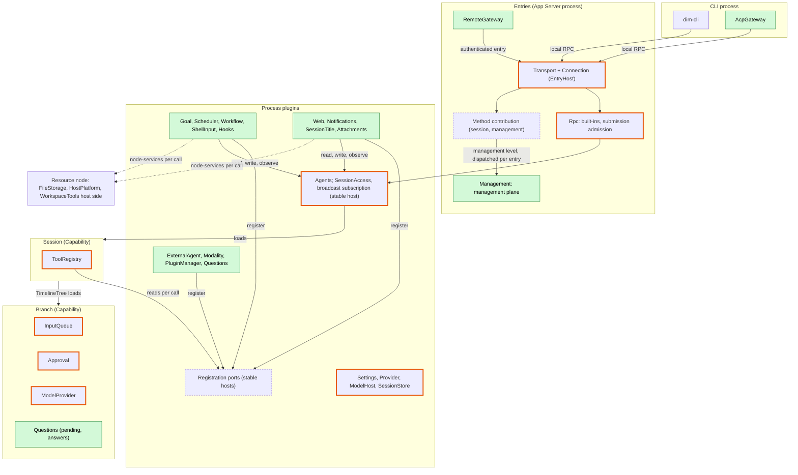
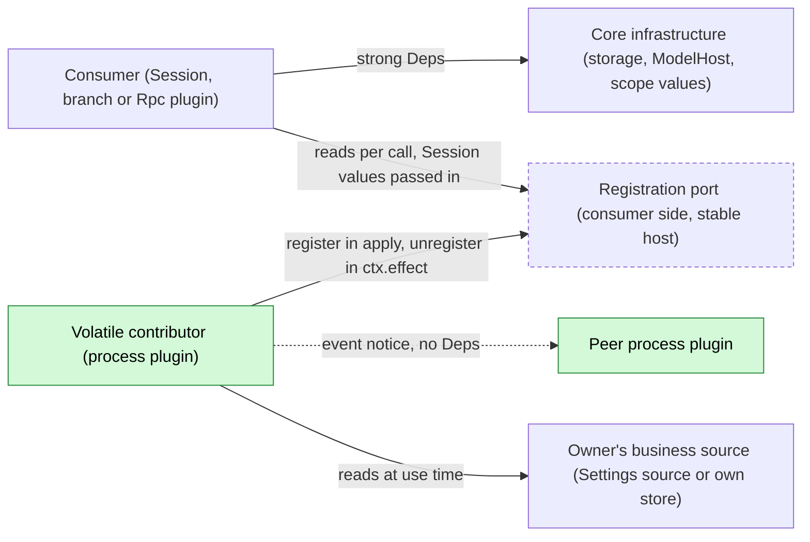
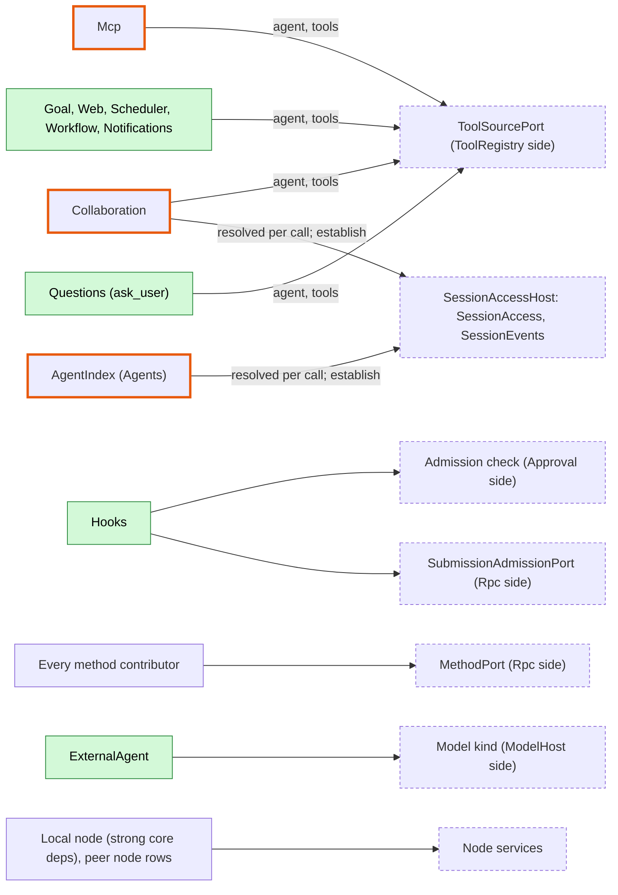
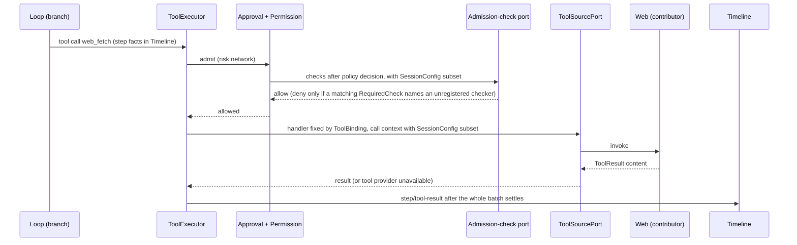
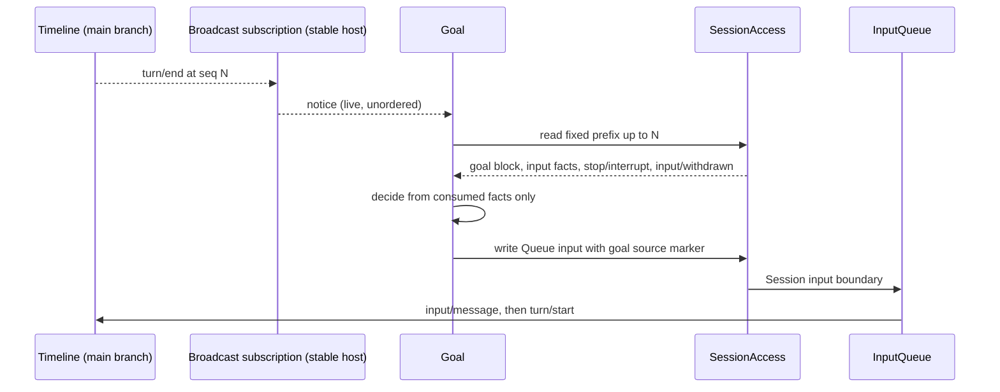
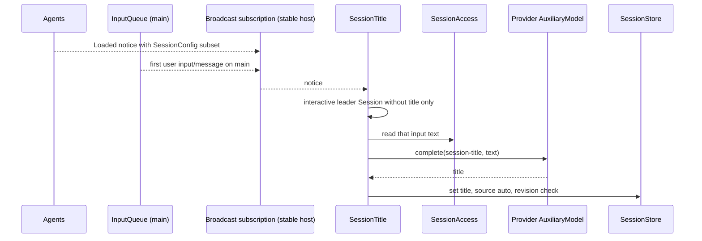
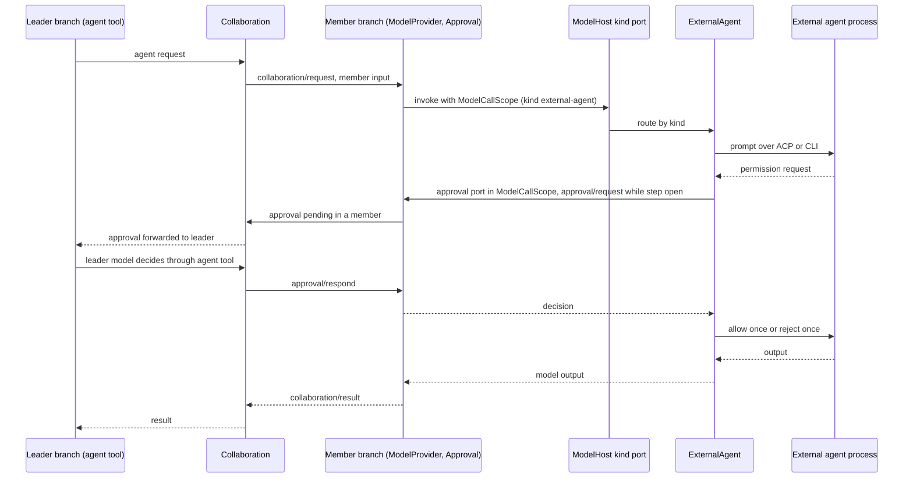
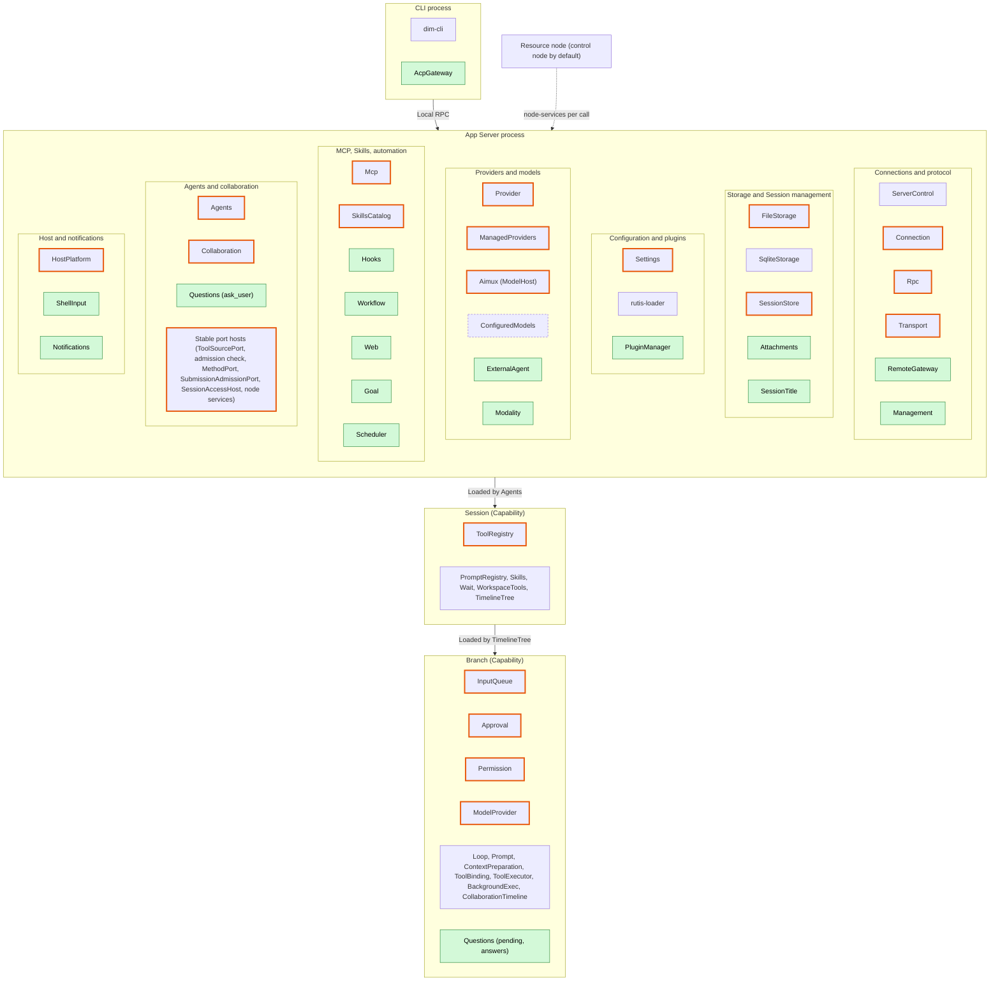
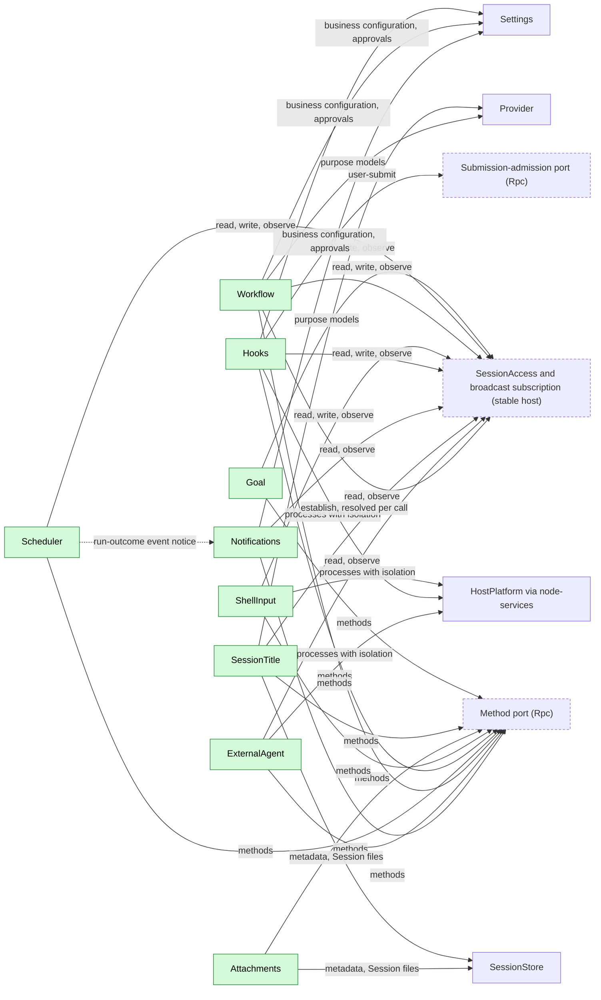

# Overall design: plugins for undesigned features

Status: Draft

This document takes the [CLI feature list](../feature-list.md) as its target, identifies the features that existing plugin responsibilities do not cover, and shows how the new plugins fit into the existing system. Each new plugin is designed in `docs/design/plugins/<Name>.md`; shared contracts are designed in `docs/design/contracts/*.md`. Supplements and changes that existing plugins need are registered in [Appendix C](#appendix-c-supplements-and-changes-to-existing-plugins) and designed by the owning plugin.

> **Net new mechanisms: consumer-owned registration ports** ([ADR 002](../adr/002-dependency-direction.md)): tool source, admission check, submission admission, method, model kind and node services. Methods declare `level: session | management` ([session-boundary](contracts/session-boundary.md)). Everything else is exposure of existing interfaces (the public Session interface as [SessionAccess](contracts/session-access.md), the Session broadcast as a [process-level subscription](contracts/session-broadcast-subscription.md), `SessionConfig`) or a supplement to an existing plugin (Appendix C).

The main body is structure first: premises, layers, dependency direction and ports, the plugin catalog, the key cross-plugin flows, the common constraints, events, phases and open questions. Per-feature ownership, per-plugin summaries, the supplement registry and the language plan are in the appendices.

## 1. Scope and premises

| Item | Convention |
| --- | --- |
| Terminal form | Only scrollback is designed. Items marked "full-screen TUI only" in the feature list are out of scope |
| Multimodality | The target covers all categories (image, video, speech, music, audio, 3D assets, motion, realtime, OCR). "Specific Desktop builds only" is an availability constraint, not a scope limit ([Modality](plugins/Modality.md)) |
| Not planned | The Todo status and the `plan` Skill |
| Dynamic events | Assumes [#2](https://github.com/arcships/dim/issues/2): plugins register their own event types at runtime, registration follows the plugin lifecycle, Timeline validates writes. No kernel enum additions, no transitional scheme |
| Model context | Per [ADR 001](../adr/001-harness-foundation.md): plugin events are not projected into model context; the model sees only adopted input and tool results. Divergence from #2 is open ([§9](#9-open-questions)) |
| Configuration | Per [#3](https://github.com/arcships/dim/issues/3) as confined by [ADR 002](../adr/002-dependency-direction.md) D5: structural plugin configuration (plugin intent, paths, node binding) goes to the loader editable layer through typed Settings operations; business configuration goes to the owning plugin's business source. Project files and host-local approvals keep their own authority ("write by source", ADR 001). The project configuration directory is `.dimcode/` |
| Existing design | [Time bus](../architecture/rust-agent/time-bus.md), [design rules](../architecture/rust-agent/principles.md), [single-tree assembly](../architecture/rust-agent/single-tree.md), [lifecycle](../architecture/rust-agent/lifecycle.md), [event-driven flows](../architecture/rust-agent/event-driven-flows.md) and the ADR 001 trust contract apply to all new plugins |

## 2. Layered architecture

Notice: process plugins never reach into Sessions directly; they read, write and observe through the existing public Session interface (SessionAccess and the broadcast subscription, hosted in a stable plugin that resolves Agents per call), register contributions into consumer-owned ports (§3) and reach host resources through the node services port by the Session's `resource_node`. Only Questions has a scope part (its branch part); every other new plugin is a process plugin. Changed existing plugins are bordered orange; the full plugin-level diagram is in [Appendix D](#appendix-d-full-distribution-and-placement).

## 3. Dependency direction and ports

[ADR 002](../adr/002-dependency-direction.md) fixes how plugins depend on each other. Dependencies point from the party that changes more often to the party that changes less often (D1): a consumer never declares `Deps`, `When`, `Gate` or `Contributions` on a provider that can reload or become unavailable for unrelated reasons. Strong dependencies stay correct for core infrastructure (storage, ServerControl, Aimux's `ModelHost`, scope values, HostPlatform, stable first-party contributors such as `branch`, `wait`, `skill` and PromptSources).

Where a consumer accepts contributions from volatile plugins, the consumer side owns a stable registration port (D2): the contributor depends on the port, registers in `apply` and unregisters in `ctx.effect`; Session and branch consumers depend on the same port and read or watch it; values about the calling Session are passed per call. Precedent: ManagedProviderBinding registering into ManagedProviders.

Notice: arrows are dependency edges; a contributor reload removes only its own registrations, its own in-flight calls end with a per-call "provider unavailable" outcome (never `capability reloading`, which ends the turn `Failed`), and consumers never reload.

Notice: Management is a level-filtered view of the method port. The model selection/connection port (Provider, ConfiguredModels) and the Provider secret port are omitted. Hooks' Session-start Hooks need no port: they observe the broadcast `Created` notice.

| Port (consumer side) | Host plugin (Deps) | Contributors | Contributor gone | Fail-closed requirement (D6) |
| --- | --- | --- | --- | --- |
| Tool source (ToolRegistry, [process-tool-contribution](contracts/process-tool-contribution.md)) | `ToolSourcePort` (none) | `register(ctx, name, provider)`: Mcp, Collaboration `agent`, Goal, Web, Scheduler, Workflow, Notifications, Questions `ask_user` (filtered per call by `interactive`); `agent` and `ask_user` reach their branch part through `ToolCallScope::branch_service::<T>()` | Its sets disappear; branches adopt without them; that call gets "tool provider unavailable"; batch and turn continue | — |
| Admission check (Approval) | Approval's admission-check port, stable process plugin (no contract file yet) | Hooks (`pre_tool_use`) | Cancelled check denies | Deny with a retryable reason only when a `RequiredCheck` record matching the calling Session names an unregistered checker |
| Submission admission (Rpc, [session-boundary](contracts/session-boundary.md)) | `SubmissionAdmissionPort` (Settings) | Hooks (`user_prompt_submit`) | Cancelled check rejects | `session.submit` returns `service_reloading`, nothing written, only when a `RequiredCheck` record (in the checker owner's Settings section) matching the Session names an unregistered checker |
| Method (Rpc, [session-boundary](contracts/session-boundary.md)) | `MethodPort` (none) | Every method contributor; Management is a level-filtered view | `lookup`: `NotRegistered` or level not dispatched → `-32601` `unknown_method`; `Unloading` → `service_reloading`; started call → `operation_interrupted` | — |
| Model kind (ModelHost) | Model kind port on the Aimux/ModelHost side (stable) | ExternalAgent | Requests of that kind fail before acceptance; availability from adopted Provider connection entries | — |
| Model selection/connection; Provider secret | Stable process plugin | Provider, ConfiguredModels; secret supplier | Per request | — |
| Session access and broadcast subscription ([session-access](contracts/session-access.md), [session-broadcast-subscription](contracts/session-broadcast-subscription.md)) | `SessionAccessHost` (AgentDirectory, Loader): `SessionAccess`, `SessionEvents` | AgentIndex through `register_index` (resolved per call, `Reloading` during an Agents reload); Collaboration through `register_establish`, called with `establish` | Per call | — |
| Node services | Node services port, stable process plugin | Local node (strong core deps); peer nodes as structural loader rows per configured link | `node_unavailable` per call | — |
| Web search backend, Modality adapter, ExternalAgent node | Their owner (Web, Modality, ExternalAgent) | Backends, adapters, per-node bridges | That call or task fails | Availability from `web.search.service`, purpose policies, enabled entries |

The last row's contributors reload with their volatile owner; both sides are volatile, so this is accepted (move the port to a stable plugin if that changes).

Further rules:

- **Scope parts only for scope state** (D3): a Session or branch part exists only to hold that scope's state or write its Timeline (Questions' branch part, CollaborationTimeline); no static placeholders in every assembly.
- **Events between peers** (D4): a process plugin that only needs another plugin's outcomes uses an event notice (Scheduler run outcomes for Notifications), never `When<…>` on a volatile peer.
- **Structural vs business configuration** (D5): enable/disable, paths, node binding and listener addresses are loader rows and may reload the row; business configuration lives in the owner's business source, is read at use time and changes by data update plus notification, never a reload.
- **Fail closed from adopted configuration** (D6): loader declarations or the presence of a configured plugin never deny; adopted business configuration stays readable while the checker is down.

## 4. Plugin catalog

New plugins:

| Plugin | Scope | Role | Phase | Language | Document |
| --- | --- | --- | --- | --- | --- |
| Management | Process | Management plane: listing and export of `management`-level methods, migration, `daemon.shutdown` | P0 | Rust | [Management](plugins/Management.md) |
| Questions | Process + branch | `ask_user` registered into the tool source port; branch part holds pending questions and answer facts; contributes `session.question.respond` | P1 | Rust | [Questions](plugins/Questions.md) |
| ShellInput | Process | `!command` / `!!command` as management methods `shell.*` | P1 | Rust | [ShellInput](plugins/ShellInput.md) |
| Attachments | Process | `attachment.put` for large text; files in the Session directory | P1 | Rust | [Attachments](plugins/Attachments.md) |
| SessionTitle | Process | Title from the first user input; `session.rename` | P1 | TypeScript first | [SessionTitle](plugins/SessionTitle.md) |
| Goal | Process | Goal as keyed input block; continuation; `goal_update` | P2 | TypeScript first | [Goal](plugins/Goal.md) |
| Web | Process | `web_search`, `web_fetch` | P2 | TypeScript first | [Web](plugins/Web.md) |
| Hooks | Process | Command Hooks mapped onto admission checks, submission admission and the broadcast subscription | P2 | Rust | [Hooks](plugins/Hooks.md) |
| Scheduler | Process | Scheduled jobs; `schedule` tool; run-outcome notice | P2 | TypeScript first | [Scheduler](plugins/Scheduler.md) |
| Workflow | Process | Multi-stage runs across Sessions; `workflow` tool | P2 | TypeScript first | [Workflow](plugins/Workflow.md) |
| Notifications | Process | Delivery to channels; `notify` tool | P2 | TypeScript first | [Notifications](plugins/Notifications.md) |
| ExternalAgent | Process | External agents as a ModelHost provider kind | P3 | TypeScript first | [ExternalAgent](plugins/ExternalAgent.md) |
| AcpGateway | CLI process | ACP server over local RPC | P3 | TypeScript first | [AcpGateway](plugins/AcpGateway.md) |
| RemoteGateway | Process | Remote entry, pairing, devices | P3 | Rust | [RemoteGateway](plugins/RemoteGateway.md) |
| Modality | Process | Multimodal tasks and realtime connections | P3 | TypeScript first | [Modality](plugins/Modality.md) |
| PluginManager | Process | Marketplaces, packages, `PluginContents` | P3 | Rust | [PluginManager](plugins/PluginManager.md) |

The Session broadcast subscription and SessionAccess are not new plugins: they expose the existing broadcast and public Session interface from a stable host on the Agents side into which AgentIndex registers (§3, Appendix C).

Shared contracts (the port model itself is [ADR 002](../adr/002-dependency-direction.md)):

| Contract | Owner | Defines |
| --- | --- | --- |
| [process-tool-contribution](contracts/process-tool-contribution.md) | ToolRegistry | Tool source port: process-level tool sets and per-call Session values |
| [session-access](contracts/session-access.md) | Agents side (stable host) | Exposure of the public Session interface: read prefix, `config`, write input, withdraw own input |
| [session-broadcast-subscription](contracts/session-broadcast-subscription.md) | Agents side (stable host) | Process-level subscription to the existing broadcast; notices `Created`, `Loaded{restored}` with a `SessionConfig` subset, `Closed`, `Gap` |
| [session-boundary](contracts/session-boundary.md) | Rpc | Method port with `level: session \| management`; submission-admission port |

Per-plugin summaries are in [Appendix B](#appendix-b-per-plugin-summaries).

## 5. Key cross-plugin flows

### 5.1 Tool call through a process tool

Notice: the process tool sees only values passed per call (the `SessionConfig` subset, call identity); an unregistered contributor yields a per-call error, never a turn failure. Hooks' pre-tool checks run inside Approval's admission stage.

### 5.2 Input injection through SessionAccess (Goal continuation)

Notice: the subscription only wakes Goal; the decision uses the fixed prefix it read, and pending-input derivations exclude withdrawn inputs. If `stop/interrupt` lands before the continuation, at most one extra turn occurs and the model sees the paused block.

### 5.3 Observer through the broadcast subscription (SessionTitle)

Notice: the trigger is the first user input on the main branch, not the end of a turn; a manual title is never overwritten, and the title is directory metadata, not a Timeline fact.

### 5.4 Collaboration delegation to an external agent

Notice: the external agent's permission request becomes an ordinary dim approval in the member Session through the call-bound approval port (ModelProvider and Approval supplements; existing `approval/request` and `approval/respond` facts, no new event). For a Collaboration member the leader's model decides; with no leader the user decides as usual. `always` options are never selected.

## 6. Common constraints

### 6.1 Integration methods

A new plugin first uses existing mechanisms; a plugin is created only for responsibilities they cannot express; changes inside existing responsibilities are registered in Appendix C.

| Method | Mechanism | Precedent |
| --- | --- | --- |
| A Tool contribution | Session plugins contribute Session-scoped tools; process plugins register into the tool source port ([process-tool-contribution](contracts/process-tool-contribution.md)). ToolBinding fixes handlers, ToolExecutor executes, Approval and Permission admit. The model reads only `ToolResult.content` | WorkspaceTools, Skills, Wait |
| B Input injection | Final content as `input/message`: raw blocks for model-facing content, `user` for user content (incl. images). Queue starts a turn, Steer inserts, Append does not start a turn. Keyed raw blocks stay in effect; `retire` ends a key; compaction keeps the latest live block per key. Process plugins write through [SessionAccess](contracts/session-access.md) | BackgroundExec notices |
| C Prompt source | Named source in PromptRegistry, adopted through PromptSourcesBranch and Prompt | AGENTS.md, Skill list |
| D Detached work | The starting branch's plugin executes, cancels, recovers and settles; start and terminal facts on that branch; Steer wakes it ([event-driven flows](../architecture/rust-agent/event-driven-flows.md) §3) | BackgroundExec |
| E Process service | App Server process plugin; structural configuration in loader rows, business configuration in its own business source read at use time; methods through the [method port](contracts/session-boundary.md) (`level: session` or `management`); user-submit policy through the submission-admission port | Mcp, Provider |

### 6.2 Constraints

1. **Minimal events**: add an event only for an outcome that affects later behavior and cannot be derived from tool calls/results, `input/*`, `turn/*` or `stop/interrupt` (time bus rule 3). Process output goes to the diagnostics channel.
2. **Ownership**: declaring an event type defines its data contract, not exclusive production; producers use the owner's public port. The starter of work writes its start and terminal facts. Decisions use only consumed facts, never another plugin's in-memory state.
3. **External entry**: RPC never writes events; it calls the owning service, which validates at the boundary and writes (precedent `approval.respond`). Races are decided by Timeline sequence.
4. **Reload and side effects**: work started but not terminated is settled as "did not survive recovery" and never re-executed (time bus rule 5). Resuming observation of an external job by polling a saved handle is allowed; it is observation, not replay (e.g. Modality provider tasks).
5. **Scope visibility**: process plugins never read Session or branch state. Values come from the existing `SessionConfig` through `SessionAccess::config(session_id)`, with proposed fields `interactive`, `resource_node` and `created_by` (Agents supplement); the broadcast `Loaded` notice and process-tool call contexts carry the needed subset. No separate facts type.
6. **Interrupt**: a plugin cancels its in-flight work and releases resources before writing terminal facts ([interrupt](../architecture/rust-agent/interrupt.md)).
7. **Admission**: new tools declare a risk category. New categories `outbound_message` and `persistent_configuration` are allowed automatically under FullAccess. Sessions started by automation use the starter's policy as an upper bound; Scheduler jobs and Workflow definitions may narrow it; runs started by a management method default to read-only unless the job or definition declares more, capped by host configuration. The `workflow` tool uses the same risk category as Collaboration's `agent` tool.
8. **Dependency direction** ([ADR 002](../adr/002-dependency-direction.md), §3): no consumer declares a dependency on a volatile provider; contributions go through consumer-owned stable ports, peer outcomes through event notices. A contributor's unload removes its registrations and ends only its own in-flight calls with "provider unavailable"; consumers never reload. Session or branch parts exist only for scope state or Timeline writes. Business configuration is read at use time from the owner's business source, never from loader rows. Fail-closed points deny only for adopted business configuration that requires an unregistered check.
9. **Management plane**: methods that execute commands or change host configuration declare `level: management` and never `session`. Entries dispatch levels: local RPC dispatches both, RemoteGateway only `session`, other nodes `management` only after explicit export over a rutis link (equivalent to granting host administrator rights). No identity tiers or per-method authorization. Contributions may declare a per-call progress sink and connection-bound notifications. Rpc keeps `hello`, `daemon.ping` and `agent.*`; `daemon.shutdown` moves to Management.
10. **Remote Session methods**: paired remote devices may call all `session`-level methods, including `session.permission.update`; previously local-only execution methods become available to remote entries (recorded in Management's compatibility table).
11. **In-flight work**: no shared registry; each owner provides its own query and stop; the CLI aggregates.
12. **Withdrawal**: one contract owned by InputQueue: Session method `session.input.withdraw {sessionId, branchId, inputId}`, `SessionAccess::withdraw` limited to the caller's own source, data contract `input/withdrawn {input_id}`. "Withdraw and re-submit as Steer" is one InputQueue atomic batch. Every "pending input" derivation excludes withdrawn inputs, and every conflict table has an `input/withdrawn` row.
13. **Low business coupling**: plugins depend on contracts, not on other plugins' internals. A port's contract is defined by its consumer. Raw-block keys, source markers, configuration keys and method names carry the owner's prefix. No `When<…>` on a volatile peer. Purposes passed to shared services are opaque consumer-owned keys (`session-title`, `compaction`, `collaboration.member`, `modality.<category>`). Blocks appended at submission admission carry per-block source attribution from the checker's registered name.
14. **Interactive Sessions**: `session.create` sets `interactive` and `created_by` in `SessionConfig`; exec, ACP and automation create non-interactive Sessions, which get no `ask_user`. Notifications and SessionTitle act only on interactive leader Sessions.

### 6.3 Multiple nodes

rutis nodes connect through links, export and import services, run plugins on the peer (`peer:<node>/<plugin>`) and forward events ([rutis nodes](https://github.com/arcships/rutis/blob/main/docs/guide/nodes.md), [#5](https://github.com/arcships/dim/issues/5)).

| Rule | Content |
| --- | --- |
| Control node | Hosts the App Server: Timeline, Sessions, Session directories, Capabilities, configuration sources, Providers, scheduling |
| Resource node | Where host resources live (files, processes, shell, isolation, local CLIs, browsers). Each Session binds one as `SessionConfig.resource_node`, fixed after creation; default is the control node |
| Node services | A multi-node concern, not a Session concept: FileStorage, HostPlatform, isolation and WorkspaceTools host side are resolved per call by node id through the node services port ([ADR 002](../adr/002-dependency-direction.md)): the local node registers with strong core dependencies, peer nodes are structural loader rows per configured link; callers take the node id from `SessionConfig` or their own configuration. Users do not distinguish local from imported services |
| Node-bound data | Host-local approvals, isolation configuration and the external agent directory are identified by node + path |
| Offline | An offline node yields `node_unavailable` for calls on that node only, never Pending for other nodes |
| Authentication | Reuses the rutis link token; `management`-level methods are exported only when explicitly configured |
| Future | Cross-control-node collaboration is not designed here |

### 6.4 Conventions

| Topic | Convention |
| --- | --- |
| Context | Model context only through A or B; standing rules through C or keyed raw blocks |
| Configuration | Each item has one source and one write path; structural configuration in loader rows, business configuration in the owner's business source (ADR 002 D5); credentials are references resolved by the Settings credential resolver |
| Trust | Executable content from project files or plugins (Hooks, MCP, workflows, capability plugins) needs host-local approval from the Settings host-local approval service, recorded as `{owner namespace, node, workspace, source, id, fingerprint}`; fingerprint is SHA-256 over the canonical executable content declared by the owner |
| Security settings | Host security settings (isolation, approvals) never enter the Timeline; replay and fork never restore or widen them. Exception: the permission preset is Session configuration, a Timeline fact (`permission/changed`) inherited by child branches; it is reset to the default when a Session is forked |
| Persistence | Process storage uses the App Server process storage contract (per-plugin root, UTF-8 and binary atomic replace, lock, format version); format versions are never reused. Session files (e.g. text attachments) live in the Session directory owned by SessionStore |
| Protocol | Rpc built-ins take precedence over contributed methods; contributed methods are dispatched by level per entry |
| Internationalization | User-visible text belongs to the CLI; model-visible text to prompt sources |

## 7. New Timeline events

After review against constraint 1 there are four new events:

| Event | Writer | Why it is needed |
| --- | --- | --- |
| `question/asked {call_id, turn_id, request_id, questions}` | Questions (branch) | Pending cannot be derived: results publish only after the whole batch; precedent Approval |
| `question/answered {call_id, answers, declined}` | Questions, via `session.question.respond` | Compared with interrupts by sequence number |
| `question/cancelled {call_id, reason}` | Questions (branch) | Ends a pending question on interrupt, branch close or reload |
| `input/withdrawn {input_id}` | InputQueue (Session method and SessionAccess) | Queue state and withdrawability must be rebuildable |

Ideas handled without events:

| Idea | Handling | Reason |
| --- | --- | --- |
| `goal/*` | Keyed raw blocks incl. terminal blocks | Goal state is input; Goal mode is covered by that state |
| `shell/*` | `!command` result written as Append input | Not branch in-flight work |
| `hook/*` | Owners' facts, injected input, diagnostics | Hooks adapts existing mechanisms |
| `external_agent/*` | Collaboration facts, ordinary member events, existing approval facts | External agents are model connections |
| `session/titled` | SessionStore metadata | Does not affect branch behavior |
| `workflow/*` | Tool results, report input, process storage | Runs belong to the process |
| Scheduled run outcome | Scheduler run-outcome notice, not a Timeline fact | Process-level outcome |
| Input source | Raw blocks of `input/message` with per-block attribution | Existing structure suffices |
| Queued message to Steer | `input/withdrawn` + new Steer input in one batch | No separate event |

## 8. Phases

Prerequisites always land in an earlier phase than their consumers.

| Phase | Content |
| --- | --- |
| P0 Foundation | #2 dynamic events; the stable ports of [ADR 002](../adr/002-dependency-direction.md): tool source (ToolRegistry), admission check (Approval, D6 fail-closed rule), submission admission and method (Rpc), model kind (ModelHost), node services; `SessionConfig` fields `interactive`, `resource_node`, `created_by` set by `session.create`; SessionAccess and the broadcast subscription (incl. `Created`) in a stable host with AgentIndex registering into it; Management with progress sink and notifications, migration of existing management methods and `daemon.shutdown`; Permission categories; Settings business configuration sources with change notification, credential resolver, host-local approval service; App Server process storage (incl. binary); Provider purpose policy and `AuxiliaryModel`; SessionStore metadata and Session files; FileStorage listing and removal; HostPlatform argv helper |
| P1 Core interaction | Questions, ShellInput, Attachments, SessionTitle; InputQueue withdrawal; Permission rules; model parameters; SessionStore deletion, cleanup and fork (preset reset, shared Session files); HostPlatform isolation; Collaboration supplements (purpose selection, `establish`, member approval forwarded to leader); CLI subcommands, image conversion, `/export`, `exec --json` |
| P2 Capability extension | Goal, Web, Hooks (user and project sources), Scheduler (incl. run-outcome notice), Workflow, Notifications; ModelProvider `ModelCallScope` and Approval model-call approvals; Transport `EntryHost`; Mcp OAuth; production compaction host |
| P3 External integration | ExternalAgent, AcpGateway, RemoteGateway, Modality; PluginManager (#3, #4); resource node import (#5) |

The existing-plugin changes recorded in ADR 002 ([C.3](#c3-existing-plugin-changes-recorded-by-adr-002)) are separate work with their own tests and block no phase.

## 9. Open questions

| Question | Status |
| --- | --- |
| How events enter context | Open (maintainer alignment): #2 says registered projection rules; ADR 001 says only input and tool results. This design follows ADR 001 |
| MCP stdio isolation | Open: whether MCP stdio processes are isolated by default |
| Remote access trade-offs | Open: authentication, disconnection and TLS deployment relate to [#5](https://github.com/arcships/dim/issues/5) ([RemoteGateway](plugins/RemoteGateway.md)) |
| Session method of a branch capability | Decided: Questions' process part contributes `session.question.respond` at level `session` through the method port and resolves the branch's service like `approval.respond` ([Questions](plugins/Questions.md)) |
| Scheduled job outcome for Notifications | Decided: job Sessions are non-interactive (excluded per constraint 14); Scheduler publishes a run-outcome event notice that Notifications listens to, with no dependency edge (ADR 002 D4; [Scheduler](plugins/Scheduler.md)) |
| Scheduled task liveness | Decided: the daemon must be alive; differs from the feature-list wording ([Scheduler](plugins/Scheduler.md)) |
| FullAccess and new categories | Decided: allowed automatically (constraint 7) |
| Process-level subscription | Decided: reuses the Session broadcast, served from a stable host ([session-broadcast-subscription](contracts/session-broadcast-subscription.md)) |
| Dependency direction and configuration placement | Proposed: [ADR 002](../adr/002-dependency-direction.md) (consumer-owned ports, events between peers, structural vs business configuration, D6 fail closed) |
| Ports owned by volatile plugins | Accepted risk: Web search backends, Modality adapters and ExternalAgent node bridges reload with their owner; move the port to a stable plugin if that becomes unacceptable |
| External agent permissions | Decided: ordinary dim approval, forwarded to the leader for Collaboration members ([ExternalAgent](plugins/ExternalAgent.md), §5.4) |
| External conversation continuation | Proposed: re-initialize from the branch history ([ExternalAgent](plugins/ExternalAgent.md)) |
| Permission preset on fork | Decided: Session configuration, reset on fork (§6.4) |
| Purpose keys | Decided: one key per consumer (constraint 13) |

## Appendix A. Feature ownership

"Existing": covered by existing plugins. "Extension": existing responsibility, see Appendix C. "New": new plugin (§4). "CLI": Appendix E. Availability does not affect ownership.

### Providers and models

| Feature | Ownership |
| --- | --- |
| OAuth / API-key Providers, Provider management, `/connect`, `/models` | Existing: Provider, ManagedProviders, OAuth plugins, Aimux |
| `/effort`, `/fast` | Extension: Prompt, ModelProvider |
| Sub-agent models, auxiliary models | Extension: Provider (per-purpose policy, `AuxiliaryModel`) |

### Session management

| Feature | Ownership |
| --- | --- |
| `/new`, `/resume`, Session list, `/history` | Existing: Agents, SessionStore |
| `/timeline`, `/export` | CLI |
| Session titles | New: SessionTitle |
| Session fork, deletion and cleanup | Extension: SessionStore, Agents |
| Request snapshot export | Extension: Trace |
| File rollback, file and conversation rollback | Out of scope (full-screen TUI only) |

### In-session interaction

| Feature | Ownership |
| --- | --- |
| Send, queue, auto-send, Steer, interrupt | Existing: InputQueue, Loop |
| `Ctrl+S`, `/queue`, recall for editing, delete queued messages | Extension: InputQueue (withdrawal) |
| Multi-line editing, input history, completion, Skill and file references, paste, clipboard, copy, links | CLI |
| Large pastes as text attachments, mixed attachments | New: Attachments (`attachment.put`); the CLI converts images to image content blocks |
| `!command`, `!!command` | New: ShellInput |
| Streaming output, run status, file change feedback | Existing events, rendered by CLI |
| Tool approval | Existing: Approval, Permission |
| User questions | New: Questions |
| Todo status | Not planned |
| Viewing and stopping background tasks | Each owner (BackgroundExec, Collaboration, Workflow, ShellInput), aggregated by CLI |

### System management

| Feature | Ownership |
| --- | --- |
| `/exit`, `/theme`, `/keys`, upgrade | CLI |
| `/settings` | Each item belongs to its plugin; CLI aggregates |
| `/usage` | Extension: ContextPreparation, ManagedProviders |
| `/language` | CLI; Extension: PromptSources |
| `/debug`, debug logs | Existing: Trace diagnostics |
| `/stats`, mouse settings | Out of scope (full-screen TUI only) |

### Agent behavior

| Feature | Ownership |
| --- | --- |
| `/agent` | Extension: Agents, Prompt |
| `/goal`, goal continuation, switching Goal mode | New: Goal (mode is covered by goal state) |
| `/approvals`, command rules | Extension: Permission, Settings |
| Three permission policy levels | Existing: Permission |
| Sandbox | Extension: HostPlatform |
| `/compact`, automatic compaction | Extension: ContextPreparation |
| `/scheduled`, scheduled tasks | New: Scheduler |

### Extensions

| Feature | Ownership |
| --- | --- |
| `/plugins`, `/reload-plugins`, marketplace, installation | New: PluginManager |
| `/skills`, `/reload-skills`, Skill sources | Existing: SkillsCatalog, Skills; installation by PluginManager |
| `plan` Skill | Not planned |
| `AGENTS.md` | Existing: PromptSources |
| `/mcp`, MCP connections | Existing: Mcp, Settings; HTTP/SSE OAuth is an extension |
| `/workflow`, `/workflow:save`, workflow management | New: Workflow |
| `/external-agents`, external agents | New: ExternalAgent, delegated through Collaboration |
| Parallel sub-agents | Existing: Collaboration; model selection is a Provider extension |
| Hooks | New: Hooks |
| Web search and fetch | New: Web |
| Slack and Feishu | New: Notifications |

### Workspace tools

`read`, `write`, `edit`, `glob`, `grep`, `exec` and `wait` are covered by WorkspaceTools, BackgroundExec and Wait.

### Remote and external access

| Feature | Ownership |
| --- | --- |
| JSON-RPC resident service | Existing: Transport, Rpc |
| ACP | New: AcpGateway |
| `/web`, Web access, `/remote`, phone pairing, remote Sessions | New: RemoteGateway |
| VS Code | CLI |

### CLI commands

The subcommand system, `exec --json` and `exec --verify` belong to the CLI; each subcommand calls the RPC of its plugin.

### Multimodality

| Feature | Ownership |
| --- | --- |
| `image generate`, `image edit`, `image enhance`, `modality`, `modality task` | New: Modality |
| `image read` | Existing: a vision model reads images through `read` |
| `video`, `speech`, `music`, `audio`, `asset`, `motion`, `realtime` | New: Modality (provider-executed; currently specific Desktop builds) |
| `ocr` | New: Modality (host-executed; requires the OCR runtime component) |

## Appendix B. Per-plugin summaries

Names here are summaries; each plugin document is authoritative.

### B.1 Questions

Process part (`ask_user` registered into the [tool source port](contracts/process-tool-contribution.md), filtered per call by `interactive`, resolving the calling branch's Questions part through `ToolCallScope::branch_service`) + branch part (pending questions and answers, like Approval; kept because it writes `question/*` facts). No Session placeholder. The process part contributes `session.question.respond` (level `session`) through the method port. After admission the handler asks the branch service, which writes `question/asked`; the answer is written as `question/answered` by `session.question.respond`; the branch consumes it by sequence and completes the handler. An answer is accepted only if it precedes the `stop/interrupt` covering the turn; otherwise `question/cancelled`. Reload settles pending questions with `question/cancelled`. No timeout; the user may decline a whole call. Non-interactive Sessions do not get `ask_user`. [Questions](plugins/Questions.md)

### B.2 Goal

Process. Goal as a keyed raw block written through SessionAccess; methods `session.goal.set/edit/pause/resume/clear/get` contributed at level `session`; `goal_update` process tool writes a terminal block (completed or blocked). Continuation per §5.2: on `turn/end`, read the fixed prefix, exclude withdrawn inputs, write a Queue continuation with the goal marker. `stop/interrupt` pauses the goal; a continuation limit (`goal.maxContinuations`, Goal's business configuration) pauses it. No separate Goal mode. No events. [Goal](plugins/Goal.md)

### B.3 ShellInput

Process. Methods `shell.run`, `shell.stop`, `shell.list` at level `management` with a per-call progress sink. Runs on the Session's `resource_node` through `node-services` with that node's isolation, without Approval (user-initiated). `!command` result is written as Append input; `!!command` output goes only to the caller and diagnostics. One command per Session at a time; a command ends on stop, Session close, plugin unload or daemon exit; branch interrupt does not stop it. No events. [ShellInput](plugins/ShellInput.md)

### B.4 Attachments

Process. No submission filter and no fork or delete participant. The CLI sends images as image content blocks in `session.submit` (Rpc validates them against model capability as part of submit validation) and calls `attachment.put` (level `session`) for large text, then references the returned path. Files live in the Session directory owned by SessionStore; on fork they are shared (no byte copy) and SessionStore deletes them with the last owning Session. Fork to another resource node is out of scope. No events. [Attachments](plugins/Attachments.md)

### B.5 Web

Process. `web_search` and `web_fetch` process tools, risk `network` (existing). Search backends register into Web's own search-backend port and reload with Web; `web.*` is Web's business configuration, read at use time; credentials are references. No events. [Web](plugins/Web.md)

### B.6 SessionTitle

Process. Triggered when the first user input on the main branch is written (§5.3); only that input's text goes to `AuxiliaryModel::complete("session-title", …)`; title stored as SessionStore metadata with source `auto` or `manual` and a revision check. Method `session.rename` (level `session`); Session list fields `title`, `titleSource`. Only interactive leader Sessions. `sessionTitle.*` is its business configuration. No events. [SessionTitle](plugins/SessionTitle.md)

### B.7 Hooks

Process; an adapter over existing mechanisms. Pre-tool Hooks: registered into Approval's admission-check port (`pre_tool_use` default `on_error` is deny). User-submit Hooks: registered into Rpc's submission-admission port, may reject or append attributed raw blocks. Session-start Hooks: observe the broadcast `Created` notice, only for `created_by = Client`, fail open; injected context is written through SessionAccess. Post-tool, turn-end and notification Hooks: broadcast subscription, writes through SessionAccess. Commands run on the Session's `resource_node` through `node-services`. Hooks writes `RequiredCheck` records in its Settings section for adopted `pre_tool_use` and `user_prompt_submit` rules; Approval and Rpc fail closed only when a matching record's checker is unregistered (D6). User rules and `disable_all` live in Hooks' business source; project Hooks live under `.dimcode/`; project and plugin Hooks need host-local approval. Management-level methods `hooks.catalog/approve/revoke/set_enabled/disable_all`. No events. [Hooks](plugins/Hooks.md)

### B.8 Scheduler

Process. Jobs and history in process storage; when due, launches or reuses a non-interactive Session through Agents and writes the job input through SessionAccess with a scheduler marker. `schedule` tool, risk `persistent_configuration`. Run policy: starter's policy as upper bound; jobs created by a management method default to read-only unless declared, capped by host configuration. Publishes a run-outcome event notice (Scheduler-owned contract, no dependency edge) that Notifications listens to, since job Sessions are non-interactive. Requires the daemon to be alive; missed windows are skipped. Management-level methods `schedule.list/save/delete/set_enabled/run_now/history`. No events. [Scheduler](plugins/Scheduler.md)

### B.9 Workflow

Process. Definitions (user, project `.dimcode/workflows/`, plugin contents), runs and stage advancement in process storage. Stages run in new non-interactive Sessions or as Collaboration members created with `establish`, resolved per call through the Session access port (no `When<…>`). `workflow` tool uses the `agent` tool's risk category; stage policy is capped by the starter. Results report to the starter as Steer input; runs settled `interrupted` after restart are reported once and not resumed. Project definitions need host-local approval. Management-level methods `workflow.list/save/start/status/stop/approve/revoke`. No events. [Workflow](plugins/Workflow.md)

### B.10 ExternalAgent

Process; registers into ModelHost's model kind port. Detects agents per node; bridges through ACP or non-interactive CLI on the agent's node via per-node bridges: structural loader rows bound to a node, present only while an agent is enabled there, registering into ExternalAgent's node port. Entries `external_agents.*` are business configuration. Per Session + branch conversation identity and cursor in process storage; history initialization from the branch's visible history; no retry when acceptance is uncertain. Permission requests become ordinary dim approvals through the approval port in `ModelCallScope` (§5.4). Management-level methods `external_agents.list/set_enabled/configure`. No events. [ExternalAgent](plugins/ExternalAgent.md)

### B.11 Notifications

Process. Triggers from the broadcast subscription (turn completed or failed, approval pending, question pending) for interactive leader Sessions only, and from Scheduler's run-outcome notice for scheduled jobs; pending-input derivation excludes withdrawn inputs. `notify` tool, risk `outbound_message`. The notifications document (channels, triggers, delays) and credential references are Notifications' business configuration; `notifications.test` management-level method. Delivery records go to diagnostics. Inbound actions are out of scope. [Notifications](plugins/Notifications.md)

### B.12 PluginManager

Process. Marketplaces, install, enable, disable, reload, remove; writes plugin intent (install, enable, node binding) to the loader editable layer through typed Settings operations; `plugins.configure` writes per-plugin business configuration to that plugin's business source; peer-node packages as `peer:<node>/<plugin>` loader rows. Publishes `PluginContents`; consumers define their content type keys (`skills`, `hooks`, `mcp`, `workflows`). Executable content needs host-local approval. No auto-upgrade; `plugin.update` is explicit. Management-level methods `plugin.marketplace.*`, `plugin.install/update/remove/set_enabled/reload/list/configure/approve/revoke`. [PluginManager](plugins/PluginManager.md)

### B.13 RemoteGateway

Process. Authenticated remote entry on Transport's `EntryHost`; pairing, devices, token rotation; serves the Web workspace. Dispatches only `session`-level methods; paired devices may call all of them. Devices and tokens in process storage; runtime settings in its business source, `enabled` stays structural. Management-level methods `remote.start/stop/status/pair/devices/revoke/rotate_token`. [RemoteGateway](plugins/RemoteGateway.md)

### B.14 Modality

Process. Capability query, model or executor selection by purpose `modality.<category>`, task submit, status, wait, cancel, realtime connections (connection-bound notifications). Provider tasks with a saved handle resume by polling after restart; host tasks (OCR) run on the control node by default (Modality has no Session) or on a named node through `node-services`. The CLI lists all categories and marks unavailable ones with their reason. No model-visible tool. Adapters register into Modality's adapter port and reload with it; Modality settings are business configuration. Tasks in process storage (binary). Management-level methods `modality.capabilities/configure/task.*/realtime.*`. [Modality](plugins/Modality.md)

| Category | CLI entry | Operations | Executor | Lifecycle |
| --- | --- | --- | --- | --- |
| Image | `image` | Generate, edit, enhance, understand | Provider; understanding via `read` | Async task |
| Video | `video` | Generate, edit, enhance | Provider | Async task |
| Speech | `speech` | Synthesize, transcribe | Provider | Async task |
| Music | `music` | Generate | Provider | Async task |
| Audio | `audio` | Generate | Provider | Async task |
| 3D assets | `asset` | Generate | Provider | Async task |
| Motion | `motion` | Motion data generation | Provider | Async task |
| Realtime | `realtime` | Realtime connection | Provider | Connection, not a task |
| OCR | `ocr` | Text recognition for images and PDFs | Host runtime component | Async task |

Availability dimensions: build, platform, runtime resources, adapter.

### B.15 AcpGateway

CLI process. `dimcode acp` over stdio; ACP session ↔ non-interactive dim Session created by `session.create` with `created_by` set directly (no `hello` change); prompt ↔ submission; updates from Session events; permission requests ↔ approvals; withdrawal through `session.input.withdraw`. Client `mcpServers` ignored (documented conformance deviation). ACP schema and conformance tests shared with ExternalAgent, not runtime code. [AcpGateway](plugins/AcpGateway.md)

### B.16 Management

Process. Management plane as a level-filtered view of Rpc's [method port](contracts/session-boundary.md): listing and export of `management`-level methods, `management.methods`, migration and compatibility. Existing `mcp.*`, `provider.*`, `skills.*`, `account.*` and `daemon.shutdown` move here. [Management](plugins/Management.md)

## Appendix C. Supplements and changes to existing plugins

**Supplement** adds services, methods or configuration; **Change** alters existing behavior or contracts and needs compatibility notes. Declaring existing event types through #2 is #2's work. `input/message` is unchanged.

### C.1 Branch and Session capabilities

| Plugin | Type | Content | Reason |
| --- | --- | --- | --- |
| ToolRegistry | Supplement | Owns the tool source port ([process-tool-contribution](contracts/process-tool-contribution.md)), hosted in the stable `ToolSourcePort` plugin (contributors `register(ctx, name, provider)`; sets per `ToolScope`; handlers reach the calling branch through `ToolCallScope::branch_service::<T>()`) and read by each Session as one dynamic source with per-call Session values; withdraw-only; in-flight calls of an unregistered contributor get "tool provider unavailable" | Goal, Web, Scheduler, Workflow, Notifications, packaged code |
| InputQueue | Change | `input/withdrawn {input_id}`; Session method `session.input.withdraw {sessionId, branchId, inputId}`; withdrawal method behind `SessionAccess::withdraw` (own source only); "withdraw and re-submit as Steer" as one atomic batch; queue state rebuilt from events | `Ctrl+S`, `/queue`, recall, delete; AcpGateway, Scheduler, Goal |
| Permission | Supplement | Categories `outbound_message` and `persistent_configuration`, allowed automatically under FullAccess (`network` already exists); cross-Session rules read at use time through a stable Settings port, never a reloading dependency of Approval; allowed-command list | Notifications, Scheduler; `/approvals` |
| Approval | Supplement | Owns the admission-check port ([ADR 002](../adr/002-dependency-direction.md); no contract file yet), hosted in a stable process plugin: checks run after the policy decision and before execution with the `SessionConfig` subset; denies with a retryable reason only when a `RequiredCheck` record ([session-boundary A.3](contracts/session-boundary.md#a3-submission-admission-port)) matching the calling Session names a checker that is not registered (D6); cancelled check denies. Accepts `approval/request` raised through the call-bound approval port while a model step is open (existing request/respond facts, no new event) | Hooks; ExternalAgent |
| ModelProvider | Supplement | Passes `ModelCallScope` (call identity: session, branch, request and step ids + `SessionConfig` subset) to ModelHost providers; the scope carries a call-bound approval port reaching the branch's Approval | ExternalAgent |
| Prompt, ModelProvider | Supplement | Model parameters (reasoning effort, fast mode) adopted with the model configuration | `/effort`, `/fast` |
| Prompt | Supplement | Switching Agent configuration (prompt, model, tools) adopted as one configuration | `/agent` |
| PromptSources | Supplement | Prompt language source | `/language` |
| ContextPreparation | Supplement | Context usage query; manual compaction; production compaction host using `AuxiliaryModel` with purpose `compaction` | `/usage`, `/compact` |
| FileStorage, HostPlatform, WorkspaceTools | Supplement | Host-side services exported by a node and resolved per call by node id through the node services port; the local node registers with strong core dependencies | Multiple nodes (§6.3); #5 |
| FileStorage | Supplement | Directory listing and removal of an empty directory or file under a root | SessionStore Session files, cleanup |
| HostPlatform | Supplement | OS isolation applied at process start (macOS seatbelt, Linux landlock or bubblewrap, Windows explicitly unavailable); per-node host-local configuration, never Timeline; presets do not relax isolation. Exec-argv helper for shell commands | Sandbox; ShellInput, Hooks, ExternalAgent |

### C.2 App Server process plugins

| Plugin | Type | Content | Reason |
| --- | --- | --- | --- |
| Settings | Supplement | Authority split per #3 confined by ADR 002 D5 (loader editable layer for structural plugin configuration; business configuration in each owner's Settings source or own store, read at use time, changed by data update plus notification; project files under `.dimcode/` and `.mcp.json` keep file authority); credential-reference resolver (not keyed by Provider); host-local approval service (§6.4 Trust) | Hooks, Workflow, Web, Notifications, ExternalAgent, PluginManager, Mcp, Permission rules |
| Rpc | Change | Carries Rpc built-ins (`hello`, `daemon.ping`, `agent.*`) and owns the method port ([session-boundary](contracts/session-boundary.md)), hosted in the stable `MethodPort` plugin; contributors register, entries dispatch by level; registration state alone decides (`MethodPort::lookup`: `NotRegistered` or a level the entry does not dispatch → `-32601` `unknown_method`; `Unloading` → `service_reloading`; `operation_interrupted` after the call started); built-ins take precedence, reserved names are protected; Rpc never names a contributor. Existing management methods move to Management, and `daemon.shutdown` moves to Management (E21). Previously local-only execution Session methods become available to remote entries (E3). Owns the submission-admission port, hosted in the stable `SubmissionAdmissionPort` plugin (Deps: Settings; used by Hooks; fails closed only when a matching `RequiredCheck` record, kept in the checker owner's Settings section, names an unregistered checker, D6). Registered methods and fields: `session.question.respond` (Questions), `session.goal.set/edit/pause/resume/clear/get` (Goal), `session.rename` (SessionTitle), `attachment.put` (Attachments), `session.input.withdraw` (InputQueue), `interactive` and `created_by` set by `session.create`, `title`/`titleSource` in Session lists, image validation against model capability and `hook_rejected` on `session.submit`, `hello.features` | Management, Questions, Goal, SessionTitle, Attachments, Hooks, AcpGateway, RemoteGateway |
| Transport, Connection | Change | `EntryHost` with upgrade authenticators; connections carry `ConnectionEntry {name, levels, device_id}` ([RemoteGateway](plugins/RemoteGateway.md)); management is gated by the levels an entry dispatches, not identity | RemoteGateway |
| Agents | Supplement | `SessionConfig` fields `interactive`, `resource_node`, `created_by` ([session-access](contracts/session-access.md)); SessionAccess as a facade over the existing public Session interface (read prefix, `config`, write input, withdraw own input) and the process-level subscription, both hosted in the stable `SessionAccessHost` plugin depending only on AgentDirectory and Loader, into which AgentIndex registers (`register_index`) and is resolved per call (`Reloading` during an Agents reload); process-level subscription to the existing Session broadcast with notices `Created`, `Loaded{restored}` (with a `SessionConfig` subset), `Closed`, `Gap` ([session-broadcast-subscription](contracts/session-broadcast-subscription.md)); Collaboration's restore listener filters `restored: true`; `launch` with creation configuration (resource node, non-interactive, `policy` field resolved against the starter's current policy as upper bound) returning a lease, the caller writing the first input through SessionAccess; creation from another Session's cut point; profiles with an external agent as model and no tools | Goal, SessionTitle, Hooks, Notifications, Scheduler, Workflow, ShellInput, fork, ExternalAgent |
| SessionStore | Supplement | Metadata (title and source, fork source) with revision checks; deletion (closes first, rejected when Loop is not idle) and cleanup by time or count with preview; fork copies facts before the cut, resets the permission preset to the default, never copies host security settings; Session files (text attachments) are stored on the Session's resource node under a per-Session attachments root through that node's `node-services` FileStorage (the Session directory when the resource node is the control node), owned and recorded by SessionStore, shared on fork without a byte copy and deleted with the last owning Session | SessionTitle, fork and cleanup, Attachments |
| Collaboration | Change | Member models selected by Provider for purpose `collaboration.member`, caller passes the leader's adopted model; `establish(leader, agent)` creates members from outside a branch; member approvals are forwarded to the leader, whose model decides through the `agent` tool; `establish` registered into `SessionAccessHost` (`register_establish`) and called per call through `SessionAccess::establish` | Sub-agent models; Workflow; ExternalAgent |
| Provider | Supplement | Per-purpose policy storage with a single write path; purposes are opaque consumer keys; policies: inherit caller's model, fixed model and effort, or Agent's choice (members only); `AuxiliaryModel::complete(purpose, …)` for one-shot calls; non-conversational model connections per Modality category; external agent connection type; registers into the model selection/connection port read by Agents and ModelProvider | SessionTitle, compaction, Collaboration, Modality, ExternalAgent |
| Aimux / ModelHost | Supplement | Model kind port ([ADR 002](../adr/002-dependency-direction.md)) on the stable ModelHost side; requests of a kind without a registered provider fail before acceptance; Aimux stays the native provider and knows no other | ExternalAgent |
| App Server | Supplement | Process storage contract generalizing `pluginFiles`: per-plugin root, UTF-8 and binary atomic replace, lock, format version, for both languages | Scheduler, Workflow, ExternalAgent, Modality, RemoteGateway, PluginManager |
| Management (new) | New process plugin | Management plane as a level-filtered view of the method port (B.16); `management`-level contributions may declare a per-call progress sink and connection-bound notifications | ShellInput, Modality |
| ManagedProviders | Supplement | Plan usage query; explicitly unavailable when not provided | `/usage` |
| Mcp | Supplement | HTTP/SSE OAuth; accepts configuration from `PluginContents` (key `mcp`) | MCP; PluginManager |
| SkillsCatalog | Supplement | Accepts Skill roots from `PluginContents` (key `skills`) | PluginManager |
| Trace | Supplement | Model request snapshot export with optional filtering | Request snapshot export |

### C.3 Existing-plugin changes recorded by ADR 002

Future changes recorded in [ADR 002](../adr/002-dependency-direction.md#review-of-existing-plugins); implementing them is separate work with its own tests and does not block the designs.

| Id | Plugins | Change |
| --- | --- | --- |
| A1 | Mcp, ToolRegistry | Remove McpSession; Mcp registers tool sets into the tool source port, derived per call from the Session's working directory and the MCP catalog |
| A2 | Collaboration, ToolRegistry | Remove Collaboration's Session part; `agent` registers into the tool source port; CollaborationTimeline stays a branch capability, reached by the `agent` handler per call through `ToolCallScope::branch_service`, and reaches Collaboration per call through a stable port |
| A3 | Rpc; Mcp, Settings, SkillsCatalog, Provider, OAuth, ManagedProviders | Services register methods into Rpc's method port; Rpc no longer depends on them |
| A4 | Agents | Reads Settings and model selection at use time through stable ports; depends only on AgentDirectory, Loader and storage |
| A5 | Provider, Agents, ModelProvider | The secret supplier registers into a Provider secret port (failure per request); model selection resolved through a stable port that Provider and ConfiguredModels register into |
| A6 | HostPlatform | Exec shell is business configuration read per spawn |

## Appendix D. Full distribution and placement

### D.1 Capability or process plugin

A Capability is registered through a Session- or branch-scoped factory and collaborates through Timeline events and declared services ([design rules](../architecture/rust-agent/principles.md) §1). Other rutis plugins are process plugins. Session-scoped capabilities do not register branch instance events; parts that write events or hold in-flight work go at branch scope.

| Criterion | Capability | Process plugin |
| --- | --- | --- |
| State | Belongs to a Session or branch, rebuilt from Timeline | Shared across Sessions, in process storage or configuration |
| Timeline | Writes or consumes events | Does not write Timeline, or manages Sessions |
| Contribution | Tools, input, prompt sources | None, or services used by Capabilities |
| Resources | Its own in-flight work | Host resources, external ports and processes |
| Lifecycle | Session or branch | Process or loader |

A feature with both sides is split (precedent SkillsCatalog / Skills / SkillsBranch). A scope part exists only for scope state or Timeline writes ([ADR 002](../adr/002-dependency-direction.md) D3). Tools come from process-level contributions; observation uses the broadcast subscription; decisions read the fixed prefix through SessionAccess and write through it. A new Capability is created only for in-branch behavior no mechanism expresses; among the new plugins only Questions' branch part qualifies.

### D.2 Full distribution diagram

Hand-drawn target; the current assembly is in the [generated diagrams](../architecture/rust-agent/generated/). Green: new; orange border: changed (Appendix C); dashed: enabled by configuration.

Notice: this diagram is for orientation; integration relations are in §2, §3 and §5. CollaborationCapability and McpSession leave the Session per ADR 002 (C.3).

### D.3 Integration relations

Notice: every solid arrow ends at a port, contract or stable owner's public service; the dotted arrow is an event notice with no dependency edge; no new plugin depends on another new plugin's internals. PluginManager, RemoteGateway, Modality and Questions also contribute methods (omitted for size).

## Appendix E. CLI layer

Implemented only in the CLI: multi-line editing, input history, command completion, `$` and `@` references, paste and drag-and-drop paths, clipboard, message copy, opening links, `/timeline`, `/export`, `/exit`, `/theme`, `/keys`, interface language, upgrade, VS Code integration, the subcommand system, `exec --json`, the `exec --verify` repair loop, aggregated display of background tasks, and Modality category listing with unavailability reasons.

## Appendix F. Implementation language and migration

### F.1 Premises

| Item | Current state and constraints |
| --- | --- |
| TS process service plugins | Runnable: Node runtime and `definePlugin` plugins load as loader rows and provide async services used by contract; Node starts only when configured ([App Server](../../crates/dim-app-server/README.md)) |
| TS capability plugins | Need the language-neutral capability port of [#4](https://github.com/arcships/dim/issues/4), and #2 |
| Node dependency | The API-key baseline does not depend on Node; TS-first applies only to optional features, shipped with a pinned Node (`.node-version`); without Node those features are explicitly unavailable |
| Port registration | Contributors in TS register into the same ports; a Node runtime restart unregisters all of them together; consumers do not reload (§3) |

### F.2 Criteria

| TypeScript first | Rust |
| --- | --- |
| Business rules still need validation | Security boundaries and admission: command execution, approval, isolation, remote entry, management plane |
| Mainly external I/O or protocols | Input and submission boundary |
| Not on the turn hot path | Kernel hot path, settlement of in-flight tool calls |
| Failure affects only that feature | Loader and plugin management backbone; base services |

### F.3 Assignment

| Plugin | Language | Rationale | Prerequisites |
| --- | --- | --- | --- |
| ExternalAgent | TypeScript first | ACP TS SDK; external CLIs need validation | ModelHost model kind port, `ModelCallScope`, model-call approvals, process storage |
| Modality | TypeScript first (provider categories) | Multimodal APIs change quickly | Provider non-conversational connections, purpose policy, process storage (binary), Management notifications |
| Notifications | TypeScript first | Slack and Feishu SDKs | Broadcast subscription, `SessionConfig`, Scheduler run-outcome notice, tool source port, credential resolver |
| SessionTitle | TypeScript first | Strategy needs validation | Broadcast subscription, SessionAccess, SessionStore metadata, `AuxiliaryModel`, method port |
| Scheduler | TypeScript first | Scheduling rules need validation | Agents `launch`, SessionAccess, tool source port, process storage |
| AcpGateway | TypeScript first | Local RPC client; merge into the Rust CLI later | `session.input.withdraw`, `interactive` and `created_by` on `session.create` |
| Web | TypeScript first | #4 lists `web` as first migration target | Tool source port, credential resolver, business configuration source |
| Workflow | TypeScript first | Orchestration rules need validation | Agents `launch`, Collaboration `establish` via `SessionAccess` (`SessionAccessHost`), tool source port, process storage |
| Goal | TypeScript first | Continuation strategy needs validation | Broadcast subscription, SessionAccess, tool source port, method port |
| Management | Rust | Management plane backbone | — |
| Questions | Rust | Tied to settlement of in-flight tool calls | `interactive` on `session.create` |
| ShellInput | Rust | Command execution, security boundary | `node-services`, method port with progress sink |
| Attachments | Rust | Session file handling | Method port, SessionStore Session files |
| Hooks | Rust | Admission path and command execution | Admission-check port, submission-admission port, broadcast `Created` notice, host-local approval service |
| RemoteGateway | Rust | Remote entry | Transport `EntryHost` |
| PluginManager | Rust | Loader and plugin management backbone | #3 |
| Supplements and changes to existing plugins | Rust | Existing plugins are Rust | — |

### F.4 Moving from TS to Rust

| Constraint | Content |
| --- | --- |
| Contract first | Service contracts, event types and formats, tool names and parameters, Session and management methods are defined language-independently |
| Stable identity | Plugin identity, event types and process storage formats do not change with the language; replacement swaps the loader row |
| Same acceptance | Flow tests use only public interfaces and pass unchanged after migration |
| When to convert | After the contract is stable and covered; or for performance, resource, distribution or security reasons |
| No coexistence | One implementation of a plugin is loaded at a time |

## Appendix G. Plugin document template

Plugin and contract documents follow this layout: a header (status, overview link, phase, language) and summary; 1 Structure (module diagram, part table); 2 Data and state; 3 Flows (sequence diagrams); 4 Timing and conflicts (key races, short table); 5 Context mapping; 6 Interfaces (summary); 7 Security; appendices for interface details, the full conflict table (including an `input/withdrawn` row where inputs are derived), errors and recovery, acceptance, assumptions and open questions.
