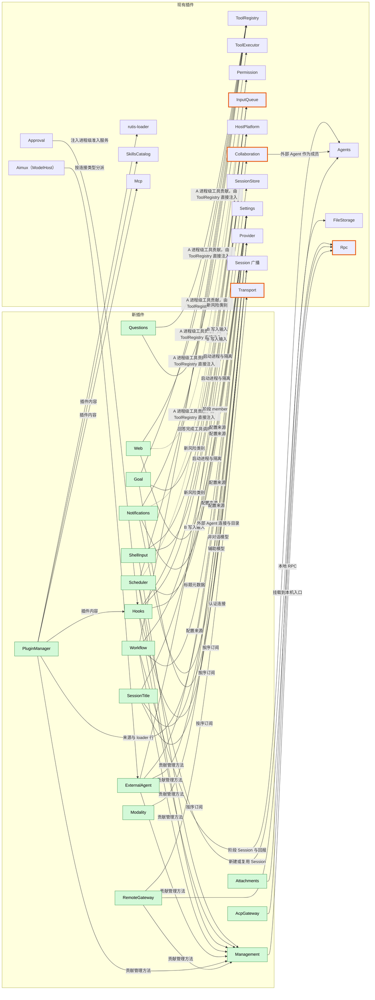

# 总体设计：未设计功能的插件化

状态：草案

本文以 [CLI 功能清单](../feature-list.md) 为目标，找出现有插件职责尚未覆盖的功能，把它们设计成插件，并说明这些插件如何接入现有体系。每个新插件的详细需求另写在 `docs/design/plugins/<名称>.md`，按第 10 节的模板编写。

现有插件及其内容不在本文修改范围内。现有插件需要的补充与变更登记在第 7 节，由对应插件另行设计。

## 1. 范围与前提

| 项 | 约定 |
| --- | --- |
| 终端形态 | 只设计 scrollback。功能清单中标为“仅全屏 TUI”的项不在范围内 |
| 多模态 | 只设计图片。功能清单中“仅限特定 Desktop 构建”的命令不在范围内 |
| 不做 | 功能清单中的 Todo 状态与 `plan` Skill |
| 动态事件 | 以 [#2](https://github.com/arcships/dim/issues/2) 已完成为前提：插件在运行时注册自己的事件类型（类型名、数据格式），注册随插件生命周期，Timeline 按注册校验写入。新插件不向内核事件枚举增加类型，也不设过渡方案 |
| 模型上下文 | 按 [ADR 001](../adr/001-harness-foundation.md) 的提议：插件事件不直接投影进模型上下文；给模型看的内容经采用的输入或工具结果进入。#2 中“由注册的投影规则决定”的方案与此不同，见第 13 节 |
| 配置与插件管理 | 依赖 [#3](https://github.com/arcships/dim/issues/3) 的部分按 ADR 001 的“按来源写入、再发布到根 loader”方案设计，并逐处标注 |
| 现有设计 | [时间总线](../architecture/rust-agent/time-bus.md)、[设计规则](../architecture/rust-agent/principles.md)、[单树装配](../architecture/rust-agent/single-tree.md)、[生命周期](../architecture/rust-agent/lifecycle.md)、[事件驱动流程](../architecture/rust-agent/event-driven-flows.md) 与 ADR 001 的信任合同对所有新插件同样适用 |

## 2. 现有体系

| 层 | 职责 | 现有插件（按职责分组） |
| --- | --- | --- |
| CLI | 终端交互、命令、渲染；不执行 Agent | `dim-cli` |
| App Server 进程 | 协议与连接、Session 目录与持久化、配置来源、Provider 与账号、MCP、Skill 目录、协作目录 | Transport、Connection、Rpc、ServerControl；AgentDirectory、Agents、SessionStore、SqliteStorage；Settings；Provider、ManagedProviders、各 OAuth、Aimux；McpPublication、Mcp；SkillsCatalog；Collaboration、CollaborationDirectory；FileStorage、FileWriteCoordinator、HostPlatform |
| Session | 工具注册、提示词来源、分支树、协作工具 | ToolRegistry、PromptRegistry、PromptSources、Skills、Wait、WorkspaceTools、TimelineTree、CollaborationCapability（`agent` 工具） |
| 分支 | 输入、循环、上下文、模型、工具执行、准入 | InputQueue、Loop、Prompt、ContextPreparation、ModelProvider、ToolBinding、ToolExecutor、Approval、Permission、BackgroundExec、FileReads、WaitBranch、SkillsBranch、PromptSourcesBranch、TreeTimeline、CollaborationTimeline |

各插件的职责见 [plugins](../architecture/rust-agent/plugins/README.md)、[单树装配](../architecture/rust-agent/single-tree.md) 的进程插件表与 [工具贡献](../architecture/rust-agent/tool-contributions.md)。

## 3. 接入方式

新插件先判断能否用现有机制或现有插件实现：before、Capability 订阅、工具贡献、所有者管理的准入、带 key 的 raw 输入、后台 `exec`、模型连接、插件与 loader 体系。只有现有机制无法表达的职责才新建插件；属于现有插件职责的改动登记在第 7 节。

| 方式 | 机制 | 现有先例 |
| --- | --- | --- |
| **A 贡献工具** | 工具经 ToolRegistry 进入 Session：Session 插件贡献 Session 级工具；进程插件提供进程级工具贡献，由 ToolRegistry 在 `Deps` 中直接注入，不经中间插件，执行所需的 Session 上下文由调用传入。分支经 ToolBinding 采用并固定处理器；ToolExecutor 执行；Approval 与 Permission 准入。模型只读工具结果的 `content` | WorkspaceTools、Skills、Wait、TimelineTree、CollaborationCapability |
| **B 输入注入** | 插件把最终内容写成 `input/message`：面向模型的内容放在 raw 块中，用户内容（含图片块）放在 `user` 中；按模式由 InputQueue 采用、Loop 消费后进入上下文。Queue 可开始 turn，Steer 插入当前 turn 并可结束 `wait`，Append 不开始 turn。带 `key` 的 raw 块持续生效：同 key 的新块取代旧块，`retire` 结束该 key，压缩后保留每个仍生效 key 的最新块 | BackgroundExec 完成通知、协作结果 |
| **C 提示词来源** | 向 PromptRegistry 注册命名来源；分支由 PromptSourcesBranch 发现变化并经 Prompt 采用 | AGENTS.md、Skill 列表、环境与日期 |
| **D 脱离工作** | 由发起它的**分支**上的插件执行、取消、恢复和结算；开始与终态写在发起分支；完成时以 Steer 输入唤醒；查询与停止由所有者的工具提供（[事件驱动流程](../architecture/rust-agent/event-driven-flows.md) §3） | BackgroundExec、Collaboration 的 request |
| **E 进程服务** | App Server 进程插件；配置经 Settings 按来源写入；对外提供管理 RPC；外部协议适配与 Rpc 平级；在 RPC 边界执行的处理（提交前转换、用户发起的命令）也属于此类 | Mcp、Provider、SkillsCatalog |

共同约束：

1. **事件最少化**：只为影响后续行为的结果新增事件（时间总线第 3 条）。能由已有事实推出的状态不另设事件：工具调用与工具结果、`input/*`、`turn/*`、`stop/interrupt` 都是可消费的事实。过程输出（进度、日志）走诊断通道，不写 Timeline。
2. **所有权**：插件只写自己声明的事件；发起工作的插件写该工作的开始与终态。状态机只依据自己消费过的事件做决定，不读其他插件的内存状态，但可以消费同样的事件自建视图（时间总线第 2 条）。
3. **外部入口**：RPC 不直接写事件。RPC 调用所有者插件的服务，所有者在边界校验后写入，先例为 `approval.respond`。与中断等并发时，按序号接受第一个有效的结果。
4. **重载与副作用**：开始事实已写、终态未写的工作，在重载或重启时以“未在恢复中存活”结算，不重新执行（时间总线第 5 条）。
5. **作用域可见性**：进程插件不读取 Session 或分支状态，所需的值由调用方作为参数传入。
6. **中断**：插件取消自己的在途工作、释放资源后再写终态（[中断](../architecture/rust-agent/interrupt.md)）。
7. **准入**：新工具声明风险类别，由 Permission 与 Approval 准入；新类别登记在第 7 节。
8. **管理面**：执行命令或改变宿主配置的方法是管理方法，由插件贡献给 Management 插件（5.16），不直接加入 Rpc。入口挂载了 Management 才能调用管理方法：本机 RPC 入口默认挂载，RemoteGateway 默认不挂载，其他节点经 rutis link 导出 Management 服务后才能使用。授权由装配与 link 配置决定，不另设身份分级。
9. **在途工作**：不建立共享的在途工作登记。每个所有者提供自己的查询与停止，汇总只在 CLI 层显示（[事件驱动流程](../architecture/rust-agent/event-driven-flows.md) §3 “在途工作识别”暂不设计）。

### 3.1 多节点

rutis 节点之间经 link 连接，可以导出与导入服务、在对端运行插件（`peer:<节点>/<插件>`）、转发事件（[rutis 节点](https://github.com/arcships/rutis/blob/main/docs/guide/nodes.md)，[#5](https://github.com/arcships/dim/issues/5)）。本文不预设资源在本机或远程，按以下规则设计：

| 规则 | 内容 |
| --- | --- |
| 控制节点 | App Server 所在节点承载 Timeline、Session、Capability、配置来源、Provider 与调度 |
| 资源节点 | 文件、进程、shell、隔离、本机安装的 CLI、浏览器等宿主资源所在的节点。每个 Session 在创建配置中绑定一个资源节点，创建后不变；未指定时为控制节点自身，单机时行为与现在相同 |
| 资源服务 | 访问宿主资源一律经 Session 绑定的资源服务（FileStorage、HostPlatform、WorkspaceTools 的宿主侧）。资源节点不是控制节点时，这些服务由对端导出、按 Session 导入；使用方不区分本机与导入的服务 |
| 绑定节点的数据 | 宿主本地批准、隔离配置、外部 Agent 目录、附件存放位置都以“节点 + 路径”标识 |
| 管理面 | 见共同约束 8：是否能管理由 Management 挂载与导出决定 |
| 离线 | 按生命周期依赖处理：依赖资源服务的插件随依赖进入 Pending，节点恢复后重新装载；在途工作按现有生命周期合同结算，不另设离线状态 |
| 认证 | 沿用 rutis link 的 token，不另设计；Management 只在显式配置时导出 |
| 未来扩展 | 跨控制节点协作：Collaboration 的 member 可以是另一个 App Server 上的 Session，本文不设计 |

### 3.2 Capability 与进程插件

Capability 经 Session 级或 Timeline（分支）级工厂注册到 Agent 实例，以 `SessionScope`/`BranchScope` 实例键提供服务，经 Timeline 事件与声明的服务协作（[设计规则](../architecture/rust-agent/principles.md) §1）。不经这两种工厂注册的 rutis 插件是进程插件，如 App Server 进程插件与 FileStorage、HostPlatform、SkillsCatalog。Session 级能力不注册分支实例事件（[单树装配](../architecture/rust-agent/single-tree.md)），需要写事件或持有在途工作的部分放在分支级。

| 判断项 | Capability | 进程插件 |
| --- | --- | --- |
| 状态归属 | 属于某个 Session 或分支，可由 Timeline 重建 | 跨 Session 共享，存于进程存储或配置 |
| Timeline | 写入或消费事件 | 不写 Timeline；或管理 Session 本身（创建、删除、调度） |
| 对 Agent 实例的贡献 | 工具、输入、提示词来源 | 无，或经服务供 Capability 使用 |
| 资源 | 自己发起的在途工作 | 宿主资源：存储、隔离、网络服务、外部协议端口、外部进程 |
| 生命周期 | 随 Session 或分支：中断、重载、关闭 | 随进程或 loader |

功能同时具备两侧特征时，拆为进程插件与 Capability，沿用 SkillsCatalog（进程）、Skills（Session）、SkillsBranch（分支）的分法。工具可以由进程级贡献提供；按序观察 Session 事件可以经进程级订阅 Session 广播完成，写入经 Session 的公开输入接口；Session 状态能由 Timeline 推出时不设 Session 或分支部分。只有现有机制都无法表达的分支内行为才新建 Capability。

| 类别 | 新插件与拆分 |
| --- | --- |
| Capability | 无。新功能全部由进程插件与现有机制实现 |
| 进程插件 | Management、Questions、Goal、ShellInput、Attachments、SessionTitle、Web、Hooks、Scheduler、Workflow、Notifications、ExternalAgent、PluginManager、RemoteGateway、Modality。其中 Questions、Goal、Web、Scheduler、Workflow、Notifications 以进程级工具贡献提供工具 |
| 非 daemon 插件 | AcpGateway（CLI 进程中的协议适配） |

拆分后的命名在各插件需求文档中确定。

### 3.3 插件架构图

以下是目标结构，手绘，只用于说明新插件的位置。当前装配以 [生成图](../architecture/rust-agent/generated/) 为准。绿色为新插件（同一插件拆分的各部分用同一名称加括号说明），橙色边框为第 7 节中有“变更”的现有插件，虚线框为按配置启用的现有插件。

#### 全量分布

```mermaid
flowchart TB
  classDef new fill:#d3f9d8,stroke:#2b8a3e,color:#000
  classDef changed stroke:#e8590c,stroke-width:3px
  classDef optional stroke-dasharray:4 3

  subgraph CLIP["CLI 进程"]
    cli["dim-cli"]
    acp["AcpGateway"]:::new
  end

  subgraph PROC["App Server 进程（进程插件）"]
    direction TB
    subgraph PC["连接与协议"]
      ServerControl["ServerControl"]
      Connection["Connection"]:::changed
      Rpc["Rpc"]:::changed
      Transport["Transport"]:::changed
      RemoteGateway["RemoteGateway"]:::new
      Management["Management"]:::new
    end
    subgraph PS["存储与 Session 管理"]
      FileStorage["FileStorage"]
      FileWriteCoordinator["FileWriteCoordinator"]
      SqliteStorage["SqliteStorage"]
      SessionStore["SessionStore"]
      Attachments["Attachments"]:::new
      SessionTitle["SessionTitle"]:::new
    end
    subgraph PCFG["配置与插件管理"]
      Settings["Settings"]
      Loader["rutis-loader"]
      PluginManager["PluginManager"]:::new
    end
    subgraph PM["Provider 与模型"]
      Provider["Provider"]
      ManagedProviders["ManagedProviders"]
      NodeBinding["ManagedProviderBinding + Node runtime"]:::optional
      CodexOAuth["OpenAICodexOAuth"]
      GrokOAuth["GrokOAuth"]
      Aimux["Aimux"]
      ConfiguredModels["ConfiguredModels"]:::optional
      ExternalAgent["ExternalAgent（外部 Agent 连接）"]:::new
      Modality["Modality"]:::new
    end
    subgraph PE["MCP、Skill 与扩展目录"]
      McpPublication["McpPublication"]
      Mcp["Mcp"]
      McpServer["McpServer（按代次）"]
      SkillsCatalog["SkillsCatalog"]
      HooksP["Hooks"]:::new
      WorkflowP["Workflow"]:::new
      WebP["Web"]:::new
      QuestionsP["Questions"]:::new
      GoalP["Goal"]:::new
    end
    subgraph PA["Agent 与协作"]
      AgentDirectory["AgentDirectory"]
      Agents["Agents"]
      CollaborationDirectory["CollaborationDirectory"]
      Collaboration["Collaboration"]:::changed
      SchedulerP["Scheduler"]:::new
    end
    subgraph PH["宿主与通知"]
      HostPlatform["HostPlatform"]
      ShellInput["ShellInput"]:::new
      NotificationsP["Notifications"]:::new
    end
  end

  subgraph SES["Session（Capability）"]
    direction TB
    subgraph SEX["现有（无新增）"]
      SessionScope["SessionScope"]
      ToolRegistry["ToolRegistry"]
      TimelineTree["TimelineTree"]
      PromptRegistry["PromptRegistry"]
      PromptSources["PromptSources"]
      Skills["Skills"]
      Wait["Wait"]
      WorkspaceTools["WorkspaceTools"]
      CollabCap["CollaborationCapability"]
      PrepareModelHost["PrepareModelHost"]
      SessionBroadcastEnd["SessionBroadcastEnd"]
    end
  end

  subgraph BR["分支（Capability）"]
    direction TB
    subgraph BEX["现有（无新增）"]
      BranchScope["BranchScope"]
      SessionBroadcast["SessionBroadcast"]
      TreeTimeline["TreeTimeline"]
      InputQueue["InputQueue"]:::changed
      Loop["Loop"]
      Prompt["Prompt"]
      ContextPreparation["ContextPreparation"]
      ModelProvider["ModelProvider"]
      ToolBinding["ToolBinding"]
      ToolExecutor["ToolExecutor"]
      Approval["Approval"]
      Permission["Permission"]
      BackgroundExec["BackgroundExec"]
      FileReads["FileReads"]
      WaitBranch["WaitBranch"]
      SkillsBranch["SkillsBranch"]
      PromptSourcesBranch["PromptSourcesBranch"]
      CollabTimeline["CollaborationTimeline"]
    end
  end

  RN["资源节点（默认即控制节点；可经 rutis link 导入）"]
  CLIP -->|本地 RPC| PROC
  RN -.->|资源服务按 Session 导入| SES
  WebP & SchedulerP & WorkflowP & NotificationsP & QuestionsP & GoalP -.->|进程级工具贡献| ToolRegistry
  PROC -->|Agents 装载| SES
  SES -->|TimelineTree 装载| BR
```

#### 新插件接入关系

箭头表示“使用”或“接入”，标注对应第 3 节的接入方式。拆分插件按插件整体画出，各部分见下表。

#### 新插件位置

| 新插件 | 进程部分 | Session 部分 | 分支部分 | 挂接的现有插件 |
| --- | --- | --- | --- | --- |
| Questions | `ask_user` 工具与等待中的调用 | — | — | ToolRegistry、ToolExecutor |
| Goal | `goal_update` 工具、`session.goal.*` 方法与继续 | — | — | ToolRegistry、Session 广播、InputQueue |
| ShellInput | RPC 边界执行命令 | — | — | HostPlatform（Session 绑定）、InputQueue、Management |
| Attachments | 提交边界转换与文本附件 | — | — | FileStorage |
| Web | 搜索与抓取；`web_search`、`web_fetch` 工具 | — | — | Settings、ToolRegistry、Permission |
| SessionTitle | 订阅与标题生成 | — | — | Session 广播、Provider、SessionStore |
| Hooks | 目录、批准与全部时机的执行 | — | — | Settings、Approval、Session 广播、HostPlatform、InputQueue |
| Scheduler | 作业与触发；`schedule` 工具 | — | — | Settings、Agents、ToolRegistry、Management |
| Workflow | 定义、运行与阶段推进；`workflow` 工具 | — | — | Settings、ToolRegistry、Agents、Collaboration、Management |
| ExternalAgent | 外部 Agent 目录、连接与桥接 | — | — | Provider、Aimux、Agents、Collaboration、HostPlatform |
| Notifications | 订阅与发送；`notify` 工具 | — | — | Settings、Session 广播、ToolRegistry |
| PluginManager | 插件市场与安装 | — | — | Settings、rutis-loader、SkillsCatalog、Mcp、Hooks |
| RemoteGateway | 远程访问 | — | — | Transport、Rpc |
| Modality | 多模态任务 | — | — | Provider |
| AcpGateway | CLI 进程 | — | — | Rpc（本地 RPC） |
| Management | 管理方法的汇集与挂载 | — | — | Rpc、各插件的管理贡献 |

## 4. 功能归属

“现有”表示由现有插件职责覆盖；“扩展”表示属于现有插件职责但现有设计未写到，见第 7 节；“新”表示第 5 节的新插件；“CLI”表示只在 CLI 层实现，见第 8 节；“范围外”与“不做”见第 1 节。

### Provider 与模型

| 功能 | 归属 |
| --- | --- |
| OAuth / API-key Provider、Provider 管理、`/connect`、`/models` | 现有：Provider、ManagedProviders、各 OAuth、Aimux |
| `/effort`、`/fast` | 扩展：Prompt、ModelProvider |
| 子代理模型、辅助模型 | 扩展：Provider（按用途选择模型） |

### Session 管理

| 功能 | 归属 |
| --- | --- |
| `/new`、`/resume`、Session 列表、`/history` | 现有：Agents、SessionStore |
| `/timeline` | CLI（读取历史） |
| Session 标题 | 新：SessionTitle |
| `/export` | CLI（读取历史并格式化为 Markdown 或 JSON） |
| Session 分叉、删除与清理 | 扩展：SessionStore、Agents |
| 请求快照导出 | 扩展：Trace |
| 文件回滚、文件与对话回滚 | 范围外（仅全屏 TUI） |

### 会话内交互

| 功能 | 归属 |
| --- | --- |
| 发送、排队、自动发送、Steer、中断 | 现有：InputQueue、Loop |
| `Ctrl+S`、`/queue`、取回编辑、删除排队消息 | 扩展：InputQueue |
| 多行编辑、输入历史、命令补全、Skill 与文件引用、粘贴、剪贴板、复制、打开链接 | CLI |
| 图片附件、大段粘贴转文本附件、混合附件 | 新：Attachments |
| `!command`、`!!command` | 新：ShellInput |
| 流式输出、运行状态、文件变更反馈 | 现有事件，CLI 渲染 |
| 工具审批 | 现有：Approval、Permission |
| 用户提问 | 新：Questions |
| Todo 状态 | 不做 |
| 后台任务查看与停止 | 各所有者提供（BackgroundExec、Collaboration、Workflow），CLI 汇总 |

### 系统管理

| 功能 | 归属 |
| --- | --- |
| `/exit`、`/theme`、`/keys`、升级 | CLI |
| `/settings` | 各项归属对应插件；CLI 汇总入口 |
| `/usage` | 扩展：ContextPreparation（上下文用量）、ManagedProviders（套餐用量） |
| `/language` | CLI（界面）；扩展：PromptSources（提示词语言） |
| `/debug`、调试日志 | 现有：Trace 诊断通道 |
| `/stats`、鼠标设置 | 范围外（仅全屏 TUI） |

### Agent 行为

| 功能 | 归属 |
| --- | --- |
| `/agent` | 扩展：Agents、Prompt |
| `/goal`、目标继续 | 新：Goal |
| `/approvals`、命令规则 | 扩展：Permission、Settings |
| 权限策略三档 | 现有：Permission |
| 沙箱 | 扩展：HostPlatform |
| `/compact`、自动压缩 | 扩展：ContextPreparation（手动入口；生产用压缩宿主尚未提供） |
| `/scheduled`、定时任务 | 新：Scheduler |

### 扩展

| 功能 | 归属 |
| --- | --- |
| `/plugins`、`/reload-plugins`、插件市场、插件安装 | 新：PluginManager |
| `/skills` 查看与启用、`/reload-skills`、Skill 来源 | 现有：SkillsCatalog、Skills；安装与移除归 PluginManager |
| `plan` Skill | 不做 |
| `AGENTS.md` | 现有：PromptSources |
| `/mcp`、MCP 连接 | 现有：Mcp、Settings；HTTP/SSE 的 OAuth 授权为扩展 |
| `/workflow`、`/workflow:save`、工作流管理 | 新：Workflow |
| `/external-agents`、外部 Agent | 新：ExternalAgent，经 Collaboration 委派 |
| 并行子代理 | 现有：Collaboration；模型选择为 Provider 扩展 |
| Hooks | 新：Hooks |
| 网页搜索与抓取 | 新：Web |
| Slack 与飞书 | 新：Notifications |

### 工作区工具

`read`、`write`、`edit`、`glob`、`grep`、`exec`、`wait` 均由现有 WorkspaceTools、BackgroundExec、Wait 覆盖。

### 远程与外部访问

| 功能 | 归属 |
| --- | --- |
| JSON-RPC 常驻服务 | 现有：Transport、Rpc |
| ACP | 新：AcpGateway |
| `/web`、Web 访问、`/remote`、远程服务、手机配对、远程 Session | 新：RemoteGateway |
| VS Code | CLI |

### CLI 命令

子命令体系、`exec --json`、`exec --verify` 属于 CLI；各子命令调用对应插件的 RPC。

### 多模态

| 功能 | 归属 |
| --- | --- |
| `image generate`、`image edit`、`image enhance`、`modality`、`modality task` | 新：Modality |
| `image read` | 现有：视觉模型经 `read` 读取图片 |
| 视频、语音、音乐、音频、3D、动作、实时、OCR | 范围外（仅 Desktop） |

## 5. 新插件

每个插件给出作用域、职责、接入方式、事件、对外接口和与现有插件的关系。事件与接口名为设计建议，以各插件需求文档为准。

### 5.1 Questions

| 项 | 设计 |
| --- | --- |
| 作用域 | 进程 |
| 职责 | 模型向用户提问并等待回答：单选、多选、多问题、自定义回答 |
| 接入 | A：以进程级工具贡献提供 `ask_user`；处理器按 `call_id` 持有等待中的调用，回答作为工具结果返回 |
| 事件 | 无。问题内容是工具调用的参数，回答或取消是工具结果；待答问题即“有调用、无结果”的 `ask_user` |
| 接口 | Session 方法 `session.question.respond {call_id, answers}`：边界校验后完成对应调用 |
| 关系 | 中断时 ToolExecutor 取消工具调用，等待随之释放；回答与中断并发时先结算者生效。重载时未完成的调用按现有工具恢复规则结算。非交互 Session（如 `exec`、定时作业创建的 Session）由 ToolRegistry 按 Session 配置不提供 `ask_user`，不依据客户端是否连接来决定 |

### 5.2 Goal

| 项 | 设计 |
| --- | --- |
| 作用域 | 进程 |
| 职责 | 设置、编辑、暂停、恢复、清除目标；目标未完成时自动继续；记录完成或受阻 |
| 接入 | B：目标以带 key 的 raw 输入块表达，设置、编辑、暂停、恢复由 `session.goal.*` 在边界经 Session 输入写入同 key 的新块（内容含目标与状态），清除以 `retire` 结束该 key，目标因此持续留在上下文中。A：以进程级工具贡献提供无状态的 `goal_update`，报告完成或受阻。继续：经进程级订阅 Session 广播按序号观察目标所在分支的事件，需要继续时经 Session 输入写入 Queue 模式的继续输入，raw 块标明来自目标 |
| 事件 | 无。目标与其状态由该 key 的输入块推出；完成与受阻由 `goal_update` 的工具结果推出 |
| 接口 | Session 方法 `session.goal.set/edit/pause/resume/clear` |
| 关系 | 是否继续只依据按序号观察到的 `turn/end`、`input/*`、`stop/interrupt` 与 `goal_update` 结果，不读 InputQueue 或 Loop 的状态。`stop/interrupt` 使目标进入暂停，并写入同 key 的“已暂停”块；连续继续次数由带来源标记的继续输入计数，达到上限即暂停。进程重启后经 Session 的公开读取接口从历史重建。中断与继续输入并发时，继续输入可能排在中断之后并开始一个 turn；此 turn 中模型从目标块看到已暂停并结束，最多多出一个 turn |

### 5.3 ShellInput

| 项 | 设计 |
| --- | --- |
| 作用域 | 进程（RPC 边界） |
| 职责 | 执行用户在输入框发起的 `!command` 与 `!!command` |
| 接入 | E：在 RPC 边界执行命令，与 Hooks 的用户提交 Hook 相同；B：`!command` 结束后把命令与有界输出写成 Append 模式输入，在下一次模型请求时进入上下文，不单独开始 turn |
| 事件 | 无。`!command` 的结果即输入；`!!command` 的输出只返回给发起的客户端并写入诊断通道 |
| 接口 | 管理方法 `session.shell.run`、`session.shell.stop`，贡献给 Management |
| 关系 | 在 Session 的资源节点上执行：经 Session 绑定的 HostPlatform 启动进程并套用该节点的隔离配置；用户直接发起，不经 Approval。命令不属于分支的在途工作，不受分支中断影响，由 `session.shell.stop` 停止；daemon 退出时终止 |

### 5.4 Attachments

| 项 | 设计 |
| --- | --- |
| 作用域 | 进程（提交边界） |
| 职责 | 在提交边界把附件转为最终内容；保存文本附件 |
| 接入 | B：图片在提交边界转为 `user` 内容中的图片块（最终内容）；文本附件保存到 Session 资源节点上的附件目录（经 Session 绑定的 FileStorage），输入中以该节点上的文件路径出现，由模型按需 `read` |
| 事件 | 无 |
| 接口 | RPC `attachment.put` 保存文本附件并返回路径 |
| 关系 | 附件与模型的 `read` 位于同一资源节点。分叉时附件文件随 Session 复制，只随 Session 删除，保证历史引用完整。模型不支持图片时在提交边界拒绝。终端创建的临时图片缓存由 CLI 清理 |

### 5.5 Web

| 项 | 设计 |
| --- | --- |
| 作用域 | 进程 |
| 职责 | 网页搜索与网页正文抓取 |
| 接入 | A：以进程级工具贡献提供 `web_search`、`web_fetch`；抓取结果转为有界正文 |
| 事件 | 无；结果即工具结果 |
| 接口 | 搜索服务与凭据引用经 Settings 配置 |
| 关系 | 工具风险类别为“网络”。可作为 [#4](https://github.com/arcships/dim/issues/4) 跨语言插件的首个迁移对象 |

### 5.6 SessionTitle

| 项 | 设计 |
| --- | --- |
| 作用域 | 进程 |
| 职责 | 自动生成 Session 标题；支持手动改名 |
| 接入 | E：订阅 Session 广播，主分支第一个正常结束的 turn 之后，用 Provider 按“辅助”用途选出的模型生成标题，写入 SessionStore 元数据 |
| 事件 | 无。标题是 Session 目录元数据，带来源字段 `auto` 或 `manual` |
| 接口 | RPC `session.rename` 直接写元数据，Session 未装载时也可改名；Session 列表读取元数据 |
| 关系 | 元数据只有一个写入方。自动标题只在来源不是 `manual` 时写入，以修订检查保证手动标题不被覆盖。生成失败不影响 Session；已有标题的 Session 不再生成。依赖进程级订阅 Session 广播，见第 13 节 |

### 5.7 Hooks

Hooks 不是新的扩展机制，而是把命令 Hook 配置映射到现有机制的适配层：同步 before、准入扩展点、Session 广播订阅、Session 输入与插件体系。进程内插件需要 Hook 能力时直接使用 before 或订阅，不经本插件。

| 项 | 设计 |
| --- | --- |
| 作用域 | 进程 |
| 职责 | 在生命周期节点执行用户、项目、插件来源的命令 Hook |
| 接入 | 命令 Hook 会启动外部进程，不能放进同步 before（before 在提交锁内运行，不执行 I/O）。各时机的映射：Session 开始与用户提交在 RPC 边界执行，用户提交 Hook 可以拒绝提交或以 raw 块附加内容；工具调用前的 Hook 作为进程级准入服务，由 Approval 在 `Deps` 中注入并异步调用，由业务所有者管理（[单树装配](../architecture/rust-agent/single-tree.md) 同步 before）；工具调用后、turn 结束与通知 Hook 经进程级订阅 Session 广播后异步执行；需要注入的输出经 Session 输入写入。命令一律在 Session 的资源节点上经 Session 绑定的 HostPlatform 执行 |
| 事件 | 无。拦截决定记录在所有者的事实中（输入是否写入、工具结果为拒绝）；注入的输出本身是输入；执行记录走诊断通道 |
| 接口 | 管理方法 `hooks.catalog`、`hooks.approve`、`hooks.set_enabled`、`hooks.disable_all`，贡献给 Management |
| 关系 | Session 开始 Hook 只在创建 Session 时执行，恢复与重载不重新执行。观察类 Hook 只由实时广播触发，不补跑。项目与插件来源的 Hook 需要宿主本地批准才能执行，批准绑定节点、工作区与配置指纹。准入服务上的 Hook 在中断时取消，对应调用以取消结算。插件来源依赖 #3 |

### 5.8 Scheduler

| 项 | 设计 |
| --- | --- |
| 作用域 | 进程 |
| 职责 | 定时任务的创建、编辑、暂停、恢复、删除、立即运行与执行历史 |
| 接入 | E：到点时经 Agents 新建或复用 Session，提交作业提示词，raw 块标明来自定时作业；A：以进程级工具贡献提供 `schedule`，供模型管理作业 |
| 事件 | 无。作业与执行历史存于进程存储 |
| 接口 | 管理方法 `schedule.list/save/delete/set_enabled/run_now/history`，贡献给 Management |
| 关系 | 作业字段：周期、提示词、资源节点与工作目录、模型、新建或复用 Session；作业创建的 Session 为非交互 Session。触发要求 daemon 存活；错过的时间窗跳过，不补跑。工具 `schedule` 的风险类别为“持久配置” |

### 5.9 Workflow

一次工作流运行跨多个 Agent 与 Session，不属于发起它的分支，归进程级的 Workflow 所有。

| 项 | 设计 |
| --- | --- |
| 作用域 | 进程 |
| 职责 | 工作流定义的查看与保存；提供参数并启动；推进阶段；查看阶段、日志、状态与结果；停止 |
| 接入 | E：运行记录、阶段推进与日志存于进程存储；各阶段经 Agents 新建非交互 Session 执行，或作为 Collaboration 的 member（含外部 Agent）执行。A：以进程级工具贡献提供 `workflow`，由模型启动、查询与停止。由工具启动时，工具结果返回 `run_id`；运行结束后经发起 Session 的公开接口以 Steer 输入回报结果 |
| 事件 | 无。工具结果与回报输入已是发起分支上的事实；运行状态归进程存储 |
| 接口 | 管理方法 `workflow.list/save/start/status/stop`，贡献给 Management |
| 关系 | 发起 Session 未装载时经 Agents 恢复后回报；发起方 turn 被中断不停止运行，与 Collaboration 对已送达 request 的规则一致。定义文件经 Settings 的用户与项目来源保存；项目来源的定义需要宿主本地批准才能运行。阶段模型经 Provider 按用途选择 |

### 5.10 ExternalAgent

外部 Agent 不另设运行时，而是作为一种模型连接接入：以外部 Agent 为模型的 Session 照常由 Loop 与 ModelProvider 驱动，模型调用由本插件桥接到外部 Agent。因此外部 Agent 既可以作为 Collaboration 的 member 被委派，也可以直接作为 Session 使用。

| 项 | 设计 |
| --- | --- |
| 作用域 | 进程 |
| 职责 | 按节点探测已安装的 Claude Code、Codex、Cursor、OpenCode 等；启用、停用与配置；把模型调用桥接到外部 Agent：支持 ACP 的经 ACP 客户端连接，其余以非交互 CLI 调用 |
| 接入 | E：作为 Provider 目录中的一类连接（每个外部 Agent 一项）；Aimux（ModelHost）按连接类型把请求分派给本插件。Agent profile 选择外部 Agent 为模型时不装配工具，外部 Agent 使用自己的工具 |
| 事件 | 无。委派沿用 Collaboration 的事实；member Session 内是普通的 turn 与模型输出事件 |
| 接口 | 管理方法 `external_agents.list/set_enabled/configure`，贡献给 Management |
| 关系 | 模型请求中只把上次外部调用之后新消费的输入发给外部 Agent，外部会话身份按 dim Session 保存在进程存储中，用于续接。中断取消外部调用。外部 Agent 目录按节点区分，连接身份包含节点；桥接以 `peer:<节点>/<插件>` 行在外部 Agent 所在节点运行，经该节点的 HostPlatform 启动进程并套用隔离配置。外部 Agent 自身的权限请求如何处理见第 13 节 |

### 5.11 Notifications

| 项 | 设计 |
| --- | --- |
| 作用域 | 进程 |
| 职责 | 任务完成、待审批、待回答、定时作业结束时发送通知；发送 Slack 与飞书消息 |
| 接入 | E：订阅 Session 广播；A：以进程级工具贡献提供 `notify`，供模型主动发送 |
| 事件 | 无 Timeline 事件；发送记录走诊断通道 |
| 接口 | 渠道与凭据引用经 Settings 配置 |
| 关系 | 工具 `notify` 的风险类别为“外发消息”。终端内提醒由 CLI 完成 |

### 5.12 PluginManager

| 项 | 设计 |
| --- | --- |
| 作用域 | 进程 |
| 职责 | 插件市场（Git 来源）的增删与更新；搜索、查看、安装（市场、本地路径、Git URL）、启用、停用、重载、移除插件 |
| 接入 | E：插件清单声明其内容：Skill、Hook、MCP 配置、工作流、能力插件；安装即写入来源并发布 loader 行，管理操作对应 loader 操作；安装指定目标节点，对端节点上的插件以 `peer:<节点>/<插件>` 行加载 |
| 事件 | 无 Timeline 事件；状态来自 loader 条目 |
| 接口 | 管理方法 `plugin.marketplace.*`、`plugin.install/remove/set_enabled/reload/list`，贡献给 Management |
| 关系 | 依赖 #3（loader 管理）；Rust 以外语言的能力插件依赖 #4。插件内容按来源接入 SkillsCatalog、Hooks、Mcp、Workflow。插件内的可执行内容需要宿主本地批准 |

### 5.13 RemoteGateway

| 项 | 设计 |
| --- | --- |
| 作用域 | 进程 |
| 职责 | Web 工作区与远程访问：启动与停止服务、认证、访问令牌轮换、手机配对（二维码或配对码）、设备授权与撤销、远程访问 Session |
| 接入 | E：建在 Transport 的 WebSocket 之上，增加认证、配对与设备授权；提供 Web 工作区静态资源 |
| 事件 | 无 Timeline 事件；设备与令牌存于进程存储 |
| 接口 | 管理方法 `remote.start/stop/status/pair/devices/revoke/rotate_token`，贡献给 Management |
| 关系 | 默认不挂载 Management，远程客户端只能使用 Session 方法。认证、断线与 TLS 部署的取舍与 [#5](https://github.com/arcships/dim/issues/5) 的待定问题一并决定 |

### 5.14 Modality

| 项 | 设计 |
| --- | --- |
| 作用域 | 进程 |
| 职责 | 图片生成、编辑（参考图与遮罩）、增强；异步任务的状态查询、等待与取消；查看能力与默认模型 |
| 接入 | E：经 Provider 调用非对话类模型 |
| 事件 | 无 Timeline 事件；任务存于进程存储 |
| 接口 | RPC `modality.capabilities`、`modality.task.*`；CLI `image`、`modality` 子命令 |
| 关系 | 需要 Provider 支持非对话类模型；默认模型经 Provider 按用途选择 |

### 5.15 AcpGateway

| 项 | 设计 |
| --- | --- |
| 作用域 | CLI 进程 |
| 职责 | `dimcode acp` 在标准输入输出上提供 ACP 服务，供编辑器连接 |
| 接入 | 协议适配：ACP 会话对应 dim Session；提示对应提交；更新来自 Session 事件；权限请求对应 `approval.request` |
| 事件 | 无 |
| 接口 | ACP 协议 |
| 关系 | 与 CLI 一样经本地 RPC 连接 daemon，不在 daemon 中另开执行路径。ACP 协议的编解码与 ExternalAgent 的 ACP 客户端共用 |

### 5.16 Management

| 项 | 设计 |
| --- | --- |
| 作用域 | 进程 |
| 职责 | 汇集各插件贡献的管理方法，并把它们挂载到指定入口 |
| 接入 | E：插件以命名贡献登记管理方法（同 ToolRegistry 的工具贡献）；入口是否挂载 Management 由装配决定：本机 RPC 入口默认挂载，RemoteGateway 默认不挂载；其他节点经 rutis link `export` Management 服务后使用 |
| 事件 | 无 |
| 接口 | 各插件贡献的管理方法；`management.methods` 列出当前入口可用的方法 |
| 关系 | 不做身份分级或逐方法授权：能否管理只取决于入口是否挂载、link 是否导出。现有的 `mcp.*`、`provider.*`、`skills.*`、`account.*` 等管理方法迁入 Management，见第 7 节 Rpc 的变更 |

## 6. 新增 Timeline 事件

按共同约束 1 逐个审查后，新增事件只有 1 种：

| 事件 | 写入方 | 为什么需要 |
| --- | --- | --- |
| `input/withdrawn` | InputQueue | 撤回尚未采用的排队消息必须成为事实，队列状态才能重建；见第 7 节 |

不设事件的情况与依据：

| 原设想 | 处理 | 依据 |
| --- | --- | --- |
| `question/*` | `ask_user` 的工具调用与工具结果 | 问题与回答已是事实 |
| `goal/*` | 带 key 的 raw 输入块与 `goal_update` 的工具结果 | 目标与状态已是输入事实；中断导致的暂停可由 `stop/interrupt` 推出 |
| `shell/*` | 在 RPC 边界执行，`!command` 的结果写为输入 | 不是分支内的在途工作 |
| `hook/*` | 拦截决定记录在所有者事实中，注入内容是输入，执行记录走诊断通道 | Hook 是现有机制上的适配 |
| `external_agent/*` | Collaboration 的事实与 member Session 内的普通事件 | 外部 Agent 作为模型连接接入 |
| `session/titled` | SessionStore 元数据 | 标题不影响分支后续行为 |
| `workflow/*` | 工具结果与回报输入；运行状态、阶段与日志归进程存储 | 运行归进程所有，不是分支的脱离工作 |
| 输入来源 | `input/message` 的 raw 块 | 现有结构已支持，不改冻结事件 |
| 排队消息转为 Steer | `input/withdrawn` 加新的 Steer 输入，同一批次写入 | 不另设事件 |

## 7. 现有插件的补充与变更

现有插件需要两类改动：一类是功能清单中属于其职责、但现有设计未覆盖的功能；另一类是新插件接入时需要现有插件提供的配合。本文只登记，具体设计写入对应插件的需求文档。

- **补充**：新增服务、方法或配置项，原有行为不变。
- **变更**：原有行为或合同改变，需要说明兼容与迁移。

所有现有事件类型改为经 #2 的注册机制声明，属于 #2 本身的工作，不在下表重复。`input/message` 的结构不变：附件以现有图片块与文件路径表达，来源与目标以 raw 块表达。

### 7.1 分支与 Session 能力

| 插件 | 类型 | 内容 | 原因 |
| --- | --- | --- | --- |
| ToolRegistry | 补充 | 在 `Deps` 中直接注入进程插件提供的进程级工具贡献，与 Session 级贡献一起组成工具集合；依赖随配置启用，生命周期随依赖；按 Session 配置过滤（如非交互 Session 不提供 `ask_user`） | Questions、Goal、Web、Scheduler、Workflow、Notifications |
| InputQueue | 变更 | 新增 `input/withdrawn`：撤回尚未采用的输入，撤回的输入不再采用，队列状态与可撤回性由事件重建；提供撤回、以及“撤回并以 Steer 重新写入”的服务，经 Session 边界调用 | `Ctrl+S`、`/queue`、取回编辑、删除排队消息 |
| Permission | 补充 | 风险类别“网络”“外发消息”“持久配置”，并规定 FullAccess 是否自动放行各类别；来自 Settings 的跨 Session 规则来源；允许命令清单 | Web、Notifications、Scheduler；`/approvals`、命令规则 |
| Approval | 补充 | 工具调用前的准入扩展点：在 `Deps` 中注入进程级准入服务（如 Hooks），在策略判定后、执行前异步调用，给出允许或拒绝；中断时取消并以取消结算 | Hooks |
| Prompt、ModelProvider | 补充 | 模型参数（推理强度、快速模式）随模型配置采用，并传入模型请求 | `/effort`、`/fast` |
| Prompt | 补充 | 在 Session 内切换 Agent 配置（提示词、模型、工具集）作为一次配置采用 | `/agent` |
| PromptSources | 补充 | 提示词语言来源 | `/language` |
| ContextPreparation | 补充 | 查询当前上下文用量与预算；手动压缩入口；接入生产用压缩宿主（`ContextModelHost` 的提供者，模型经 Provider 按“辅助”用途选择） | `/usage`、`/compact`、自动压缩 |
| FileStorage、HostPlatform、WorkspaceTools | 补充 | 宿主侧服务可由资源节点导出、按 Session 导入；Session 内的使用方经 Session 绑定的服务访问，不直接使用控制节点的进程服务 | 多节点（3.1）；依赖 #5 |
| HostPlatform | 补充 | 操作系统级隔离：启动进程时套用调用方传入的隔离配置（文件、网络、进程）；平台后端 macOS seatbelt、Linux landlock 或 bubblewrap，Windows 无后端时明确不可用。隔离在启动进程的节点上生效，配置按节点区分，来自 Settings 的宿主本地来源，不来自 Timeline；Permission 的权限预设是准入，不放宽隔离 | 沙箱；ShellInput、Hooks、ExternalAgent |

### 7.2 App Server 进程插件

| 插件 | 类型 | 内容 | 原因 |
| --- | --- | --- | --- |
| Settings | 补充 | 新的配置来源：权限规则、Hook 定义与批准、工作流定义与批准、Web 搜索服务、通知渠道、按用途的模型策略、沙箱配置、外部 Agent、插件市场；统一的凭据引用 | Hooks、Workflow、Web、Notifications、Provider、HostPlatform、ExternalAgent、PluginManager、Permission 规则 |
| Rpc | 变更 | 只承载 Session 方法；管理方法改由 Management 贡献与挂载，现有管理方法迁入 Management | Management；RemoteGateway |
| Transport、Connection | 变更 | 远程连接携带认证后的设备身份；按身份限制可用方法 | RemoteGateway |
| Provider | 补充 | `ModelSelectionHost` 按用途（子代理、辅助任务、默认多模态）选择模型：继承调用方传入的模型、固定模型与推理强度、由 Agent 选择（仅子代理）；外部 Agent 连接类型；非对话类模型 | 子代理与辅助模型；ExternalAgent；Modality |
| Aimux | 补充 | 按连接类型把模型请求分派给 ExternalAgent 桥接 | ExternalAgent |
| Agents | 补充 | Session 创建配置包含资源节点，创建后不变；以非交互配置新建或复用 Session 并提交首条输入；从另一 Session 的截点创建 Session；以外部 Agent 为模型、不装配工具的 profile | Scheduler；Session 分叉；ExternalAgent |
| SessionStore | 补充 | Session 元数据（标题及其来源、分叉来源）与修订检查；删除（先关闭 Session，Loop 未空闲时拒绝）与按时间或数量清理（含预览）；分叉复制来源截点之前的事实及其引用闭包（附件、事件声明），不复制宿主安全设置；附件随 Session 复制与删除 | SessionTitle、Session 分叉与清理、Attachments |
| Collaboration | 变更 | 子代理模型改由 Provider 按“子代理”用途选择，调用方传入主 Session 已采用的模型 | 子代理模型 |
| Collaboration | 补充 | 外部 Agent 可作为 member 目标，在 `list`、`inspect` 中列出 | ExternalAgent |
| ManagedProviders | 补充 | 查询套餐用量；未提供时明确不可用 | `/usage` |
| Mcp | 补充 | HTTP/SSE 连接的 OAuth 授权；接受插件来源的配置 | MCP 连接；PluginManager |
| SkillsCatalog | 补充 | 接受插件来源的 Skill 根；安装与移除由 PluginManager 发起 | PluginManager |
| Trace | 补充 | 导出指定步骤的模型请求快照，可过滤推理、工具记录与压缩内容 | 请求快照导出 |
| Session 广播 | 待确认 | 进程级按序号订阅所有 Session 的事件（turn 结束、输入、中断、工具结果、待审批、待回答等） | Notifications、SessionTitle、Hooks、Goal |

## 8. CLI 层

以下只在 CLI 中实现，不新增插件：多行编辑、输入历史、命令补全、`$` 与 `@` 引用、粘贴与拖放路径、剪贴板、消息复制、打开链接、`/timeline`、`/export`（读取历史并格式化）、`/exit`、`/theme`、`/keys`、界面语言、升级、VS Code 集成、子命令体系、`exec --json`、`exec --verify` 修复循环、后台任务汇总显示。

## 9. 横切约定

| 主题 | 约定 |
| --- | --- |
| 事件 | 每个插件在需求文档中列出声明的事件、数据格式与消费规则（哪些状态机必须消费、消费后达到什么效果），并说明为什么不能由已有事实推出 |
| 上下文 | 只经 A 或 B 进入模型上下文；持续生效的规则经 C 或带 key 的 raw 输入块 |
| 配置 | 每项配置有明确来源（用户、工作区、Session）和唯一写入路径；凭据只以引用形式出现在配置中 |
| 信任 | 来自项目文件或插件的可执行内容（Hook、MCP、工作流、能力插件）需要宿主本地批准，批准绑定节点、工作区与配置指纹；读取配置不产生执行权限 |
| 安全设置 | 宿主安全设置（隔离、批准）不写入 Timeline；回放与分叉不恢复或放宽权限 |
| 持久化 | 进程级存储变更遵循现有存储兼容策略；不跨不兼容格式复用版本号 |
| 协议 | Session 方法进入 Rpc；管理方法贡献给 Management，由挂载与导出决定可用范围 |
| 节点 | 访问宿主资源只经 Session 绑定的资源服务；不假设资源节点就是控制节点 |
| 国际化 | 用户可见文案由 CLI 负责；模型可见文案由提示词来源负责 |

## 10. 插件需求文档模板

每个新插件的需求文档 `docs/design/plugins/<名称>.md` 包含：

1. 用户流程：从用户或模型的操作到可见结果
2. 范围：负责与不负责的内容
3. 作用域与依赖：拆分、作用域、注入的服务、提供的服务
4. 事件：类型名、数据格式、写入方、消费规则，以及不能由已有事实推出的理由
5. 状态：拥有的状态及如何由 Timeline 或进程存储重建
6. 接口：工具（含风险类别）、Session 方法、管理方法、CLI 入口；涉及宿主资源时说明使用哪个节点的服务
7. 错误与恢复：取消、中断、重载、进程退出时的结算
8. 安全：准入、信任、隔离、敏感数据
9. 验收：需要的流程测试

## 11. 开发语言与迁移路径

### 11.1 前提

| 项 | 现状与约束 |
| --- | --- |
| TS 进程服务插件 | 已可运行：Node 运行时与 `definePlugin` 插件作为 loader 行装载，插件提供异步服务，Rust 侧按服务合同使用；未配置时不启动 Node（[App Server](../../crates/dim-app-server/README.md) 的 managed provider 先例） |
| TS 能力插件 | 读写 Timeline、贡献工具、订阅分支事件需要 [#4](https://github.com/arcships/dim/issues/4) 的语言中立能力端口，并依赖 #2 |
| Node 依赖 | API-key 基础流程不依赖 Node。TS 先行只用于可选功能；Node 不可用时这些功能明确不可用 |

### 11.2 判断标准

| TS 先行 | Rust |
| --- | --- |
| 业务规则仍需验证 | 安全边界与准入：执行命令、批准、隔离、远程入口、管理面 |
| 主要工作是外部 I/O 或协议：HTTP API、ACP、第三方 SDK | 输入与提交边界 |
| 不在 turn 的热路径上 | 内核热路径与在途工具调用的结算 |
| 失败只影响该功能 | loader 与插件管理骨干；被其他插件依赖的基础服务 |

### 11.3 划分

| 插件 | 语言 | 理由 | 前置条件 |
| --- | --- | --- | --- |
| ExternalAgent | TS 先行 | ACP 有 TS SDK；各外部 CLI 行为差异大，需要验证 | Aimux 分派到桥接的服务合同 |
| Modality | TS 先行 | 各服务商图片 API 变化快 | Provider 非对话模型的服务合同 |
| Notifications | TS 先行 | Slack、飞书 SDK | 进程级订阅 Session 广播；进程级工具贡献的服务合同 |
| SessionTitle | TS 先行 | 生成策略需要验证 | 进程级订阅；SessionStore 元数据与模型选择的服务合同 |
| Scheduler | TS 先行 | 调度规则需要验证 | Agents 新建或复用 Session 的服务合同；进程级工具贡献的服务合同 |
| AcpGateway | TS 先行 | 只是本地 RPC 客户端，可先以独立程序验证 ACP 映射，再并入 Rust CLI | 无 |
| Web | TS 先行 | #4 已把 `web` 列为首个迁移对象；工具以进程服务提供，不需要能力端口 | 进程级工具贡献的服务合同 |
| Workflow | TS 先行 | 编排规则需要验证；运行归进程，不需要能力端口 | Agents、Collaboration 与进程级工具贡献的服务合同 |
| Goal | TS 先行 | 继续策略需要验证；不需要能力端口 | 进程级订阅 Session 广播；进程级工具贡献的服务合同 |
| Management | Rust | 管理面骨干 | — |
| Questions | Rust | 与在途工具调用的结算紧密相关，逻辑简单 | — |
| ShellInput | Rust | 执行命令，属于安全边界 | — |
| Attachments | Rust | 提交边界 | — |
| Hooks | Rust | 准入路径与命令执行，属于安全边界 | — |
| RemoteGateway | Rust | 远程入口 | — |
| PluginManager | Rust | loader 与插件管理骨干 | #3 |
| 现有插件的补充与变更 | Rust | 现有插件为 Rust | — |

### 11.4 从 TS 转为 Rust

| 约束 | 内容 |
| --- | --- |
| 先定合同 | 服务合同、事件类型名与数据格式、工具名与参数、Session 方法与管理方法在需求文档中与语言无关地定义，TS 与 Rust 实现遵守同一份 |
| 稳定身份 | 插件声明身份、事件类型与进程存储格式不随实现语言改变；替换只换 loader 行，历史事件与已存数据照常可读 |
| 同一套验收 | 流程测试只经公开接口（Session 方法、管理方法、工具、事件），不依赖实现语言，迁移后原样通过 |
| 转换时机 | 合同稳定且验收覆盖后；或出现性能、资源、分发（去掉 Node 依赖）、安全上的要求时 |
| 不并存 | 同一插件同一时刻只装载一种实现 |

## 12. 实施阶段

| 阶段 | 内容 |
| --- | --- |
| P0 地基 | #2 动态事件；Management 与现有管理方法迁入；Permission 新风险类别 |
| P1 核心交互 | Questions、ShellInput、Attachments、SessionTitle；InputQueue 撤回、Permission 规则、模型参数、Provider 按用途选择模型、SessionStore 删除清理与分叉；CLI 子命令、`/export` 与 `exec --json` |
| P2 能力扩展 | Goal、Web、HostPlatform 隔离、Hooks（用户与项目来源）、Scheduler、Workflow、Notifications；Mcp OAuth；生产用压缩宿主 |
| P3 外部集成 | ExternalAgent、AcpGateway、RemoteGateway、Modality；PluginManager（依赖 #3、#4）；资源节点导入（依赖 #5） |

## 13. 待对齐问题

| 问题 | 说明 |
| --- | --- |
| 事件进入上下文的方式 | #2 已定“由注册的投影规则决定”，ADR 001 提议“只经输入与工具结果”。本文按后者设计，需维护者对齐 |
| 定时任务的存活条件 | 功能清单写“交互终端进程存活”，本文按 daemon 存活设计 |
| 远程访问 | 认证、断线与 TLS 部署与 #5 的待定问题相关 |
| 隔离的覆盖面 | MCP stdio 进程是否默认受隔离 |
| FullAccess 与新风险类别 | 外发消息与持久配置是否在 FullAccess 下仍需询问 |
| 进程级订阅 | Notifications、SessionTitle、Hooks 与 Goal 所需的跨 Session 按序订阅是否复用 Session 广播 |
| 外部 Agent 的权限 | 外部 Agent 自身的权限请求（如 ACP 的权限请求）映射为 dim 审批，还是按配置的权限模式自动应答 |
| 外部会话续接 | 外部 Agent 不支持续接或续接失败时，是新开外部会话并附带历史摘要，还是明确失败 |
