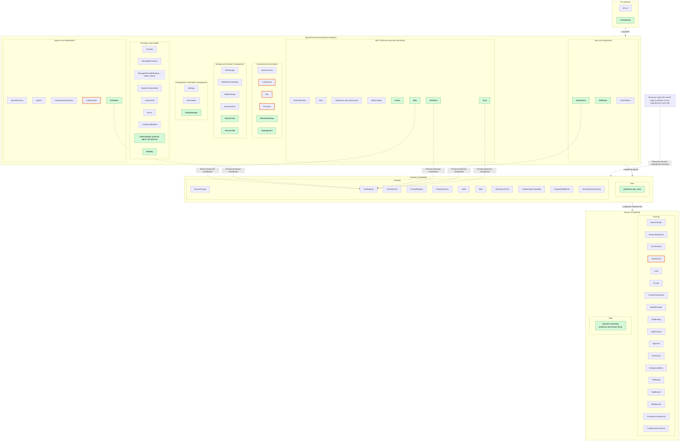
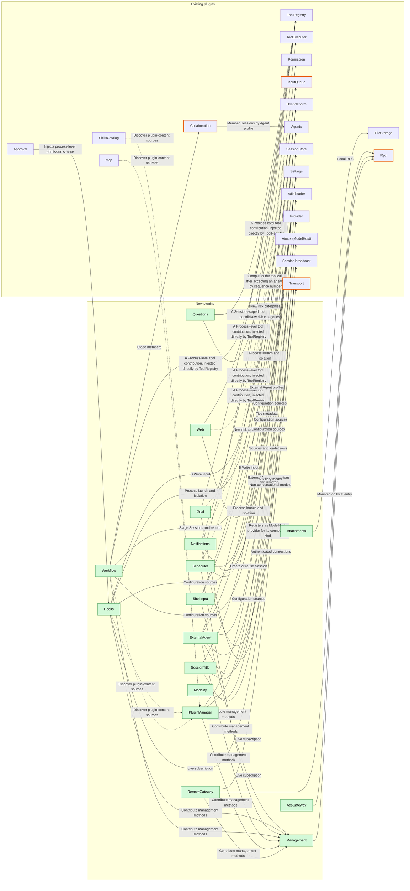

# Overall design: plugins for undesigned features

Status: Draft

This document takes the [CLI feature list](../feature-list.md) as its target, identifies the features that existing plugin responsibilities do not yet cover, designs them as plugins, and describes how these plugins integrate with the existing system. The detailed requirements of each new plugin are written separately in `docs/design/plugins/<name>.md`, following the template in section 10.

Existing plugins and their contents are outside the scope of changes in this document. Supplements and changes that existing plugins need are registered in section 7 and designed separately by the corresponding plugin.

## 1. Scope and premises

| Item | Convention |
| --- | --- |
| Terminal form | Only scrollback is designed. Items marked "full-screen TUI only" in the feature list are out of scope |
| Multimodality | The target design covers all multimodal categories (image, video, speech, music, audio, 3D assets, motion, realtime, OCR). "Specific Desktop builds only" is an availability constraint on build and packaging and does not narrow the target scope; availability and target scope are described separately, see 5.14 |
| Not planned | The Todo status and the `plan` Skill from the feature list |
| Dynamic events | Assumes [#2](https://github.com/arcships/dim/issues/2) is complete: plugins register their own event types (type name, data format) at runtime, registration follows the plugin lifecycle, and Timeline validates writes against the registration. New plugins do not add types to the kernel event enum, and there is no transitional scheme |
| Model context | Per the proposal in [ADR 001](../adr/001-harness-foundation.md): plugin events are not projected directly into model context; content shown to the model enters through adopted input or tool results. The scheme in #2 where this is "decided by registered projection rules" differs from this, see section 13 |
| Configuration and plugin management | Per [#3](https://github.com/arcships/dim/issues/3): user-managed plugin intent (enable, disable, plugin configuration) is written to the loader editable layer through typed Settings operations and persisted; the loader editable layer is its authority. Project files (such as `.mcp.json`, project Hooks, project workflows) and host-local approvals keep their own authority and are handled per ADR 001's "write by source" |
| Existing design | The [time bus](../architecture/rust-agent/time-bus.md), [design rules](../architecture/rust-agent/principles.md), [single-tree assembly](../architecture/rust-agent/single-tree.md), [lifecycle](../architecture/rust-agent/lifecycle.md), [event-driven flows](../architecture/rust-agent/event-driven-flows.md) and the trust contract of ADR 001 apply equally to all new plugins |

## 2. Existing system

| Layer | Responsibility | Existing plugins (grouped by responsibility) |
| --- | --- | --- |
| CLI | Terminal interaction, commands, rendering; does not run the Agent | `dim-cli` |
| App Server process | Protocol and connections, Session directory and persistence, configuration sources, Providers and accounts, MCP, Skill directory, collaboration directory | Transport, Connection, Rpc, ServerControl; AgentDirectory, Agents, SessionStore, SqliteStorage; Settings; Provider, ManagedProviders, the OAuth plugins, Aimux; McpPublication, Mcp; SkillsCatalog; Collaboration, CollaborationDirectory; FileStorage, FileWriteCoordinator, HostPlatform |
| Session | Tool registration, prompt sources, branch tree, collaboration tools | ToolRegistry, PromptRegistry, PromptSources, Skills, Wait, WorkspaceTools, TimelineTree, CollaborationCapability (`agent` tool) |
| Branch | Input, loop, context, model, tool execution, admission | InputQueue, Loop, Prompt, ContextPreparation, ModelProvider, ToolBinding, ToolExecutor, Approval, Permission, BackgroundExec, FileReads, WaitBranch, SkillsBranch, PromptSourcesBranch, TreeTimeline, CollaborationTimeline |

The responsibilities of each plugin are described in [plugins](../architecture/rust-agent/plugins/README.md), the process plugin table of [single-tree assembly](../architecture/rust-agent/single-tree.md), and [tool contributions](../architecture/rust-agent/tool-contributions.md).

## 3. Integration methods

A new plugin first checks whether it can be implemented with existing mechanisms or existing plugins: before, Capability subscription, tool contribution, owner-managed admission, keyed raw input, background `exec`, model connections, and the plugin and loader system. A new plugin is created only for responsibilities that existing mechanisms cannot express; changes that belong to existing plugin responsibilities are registered in section 7.

| Method | Mechanism | Existing precedent |
| --- | --- | --- |
| **A Tool contribution** | Tools enter the Session through ToolRegistry: Session plugins contribute Session-scoped tools; process plugins provide process-level tool contributions, which ToolRegistry injects directly in `Deps` without an intermediate plugin, and the Session context needed for execution is passed in by the call. The branch adopts tools and fixes their handlers through ToolBinding; ToolExecutor executes; Approval and Permission handle admission. The model reads only the `content` of tool results | WorkspaceTools, Skills, Wait, TimelineTree, CollaborationCapability |
| **B Input injection** | The plugin writes the final content as `input/message`: model-facing content goes in raw blocks, user content (including image blocks) goes in `user`; InputQueue adopts it by mode and Loop consumes it into context. Queue can start a turn, Steer inserts into the current turn and can end `wait`, Append does not start a turn. Raw blocks with a `key` stay in effect: a new block with the same key replaces the old one, `retire` ends that key, and compaction keeps the latest block of each key still in effect | BackgroundExec completion notices, collaboration results |
| **C Prompt source** | Registers a named source with PromptRegistry; the branch detects changes through PromptSourcesBranch and adopts them through Prompt | AGENTS.md, Skill list, environment and date |
| **D Detached work** | The plugin on the **branch** that started it executes, cancels, recovers and settles it; start and terminal state are written on the starting branch; on completion it wakes the branch with Steer input; query and stop are provided by the owner's tools ([event-driven flows](../architecture/rust-agent/event-driven-flows.md) §3) | BackgroundExec, Collaboration's request |
| **E Process service** | App Server process plugin; configuration is written by source through Settings; provides management RPC externally; external protocol adapters sit at the same level as Rpc; processing performed at the RPC boundary (pre-submission transformation, user-initiated commands) also belongs here | Mcp, Provider, SkillsCatalog |

Common constraints:

1. **Minimal events**: add events only for outcomes that affect later behavior (time bus rule 3). State that can be derived from existing facts gets no separate event: tool calls and tool results, `input/*`, `turn/*` and `stop/interrupt` are all consumable facts. Process output (progress, logs) goes through the diagnostics channel and is not written to Timeline.
2. **Ownership**: the declarer of an event type defines the data contract but does not hold exclusive write access: legitimate producers write shared events through the owner's public port, for example any plugin writes `input/message` through the Session input interface (time bus rule 2, ADR 001). The plugin that starts a piece of work writes that work's start and terminal state. A state machine decides only on events it has consumed and does not read other plugins' in-memory state, but it may consume the same events to build its own view (time bus rule 2).
3. **External entry**: RPC does not write events directly. RPC calls the owner plugin's service, and the owner writes after validating at the boundary; the precedent is `approval.respond`. When it races with an interrupt or similar, the Timeline sequence number decides: the valid fact with the earlier sequence number takes effect.
4. **Reload and side effects**: work whose start fact is written but whose terminal state is not is settled as "did not survive recovery" on reload or restart, and is not re-executed (time bus rule 5).
5. **Scope visibility**: process plugins do not read Session or branch state; the values they need are passed in as parameters by the caller.
6. **Interrupt**: a plugin cancels its own in-flight work and releases resources before writing the terminal state ([interrupt](../architecture/rust-agent/interrupt.md)).
7. **Admission**: new tools declare a risk category and are admitted by Permission and Approval; new categories are registered in section 7.
8. **Management plane**: methods that execute commands or change host configuration are management methods; plugins contribute them to the Management plugin (5.16) instead of adding them directly to Rpc. Management methods are callable only on entries where Management is mounted: the local RPC entry mounts it by default, RemoteGateway does not by default, and other nodes can use it only after Management is exported as a service over a rutis link. Authorization is decided by assembly and link configuration; there are no separate identity tiers or per-method authorization. Exporting Management is equivalent to granting host administrator rights.
9. **In-flight work**: there is no shared registry of in-flight work. Each owner provides its own query and stop; aggregation is shown only in the CLI layer ("in-flight work identification" in [event-driven flows](../architecture/rust-agent/event-driven-flows.md) §3 is not designed for now).
10. **Low business coupling**: plugins depend on contracts, never on another plugin's internals or business knowledge. Dependencies are declared on service contracts, so any provider satisfying a contract can replace another. An extension point's contract is defined by its consumer (Approval defines admission, ToolRegistry defines tool contribution, ModelHost defines provider registration by connection kind), and provider-specific knowledge stays in the provider. Consuming another plugin's events uses only their public data contract, without inferring its internal state. Raw-block keys, source markers, configuration keys and management method names are namespaced by their owner. Optional dependencies are explicit (`When`); without them the feature is off. Purposes passed to shared services are opaque keys defined by the consumer.

### 3.1 Multiple nodes

rutis nodes connect through links and can export and import services, run plugins on the peer (`peer:<node>/<plugin>`), and forward events ([rutis nodes](https://github.com/arcships/rutis/blob/main/docs/guide/nodes.md), [#5](https://github.com/arcships/dim/issues/5)). This document does not presume that resources are local or remote, and designs by the following rules:

| Rule | Content |
| --- | --- |
| Control node | The node hosting the App Server carries Timeline, Sessions, Capabilities, configuration sources, Providers and scheduling |
| Resource node | The node where host resources live: files, processes, shell, isolation, locally installed CLIs, browsers, and so on. Each Session binds one resource node in its creation configuration, which does not change after creation; when unspecified it is the control node itself, and single-machine behavior is the same as today |
| Resource services | Host resources are always accessed through the resource services bound to the Session (FileStorage, HostPlatform, the host side of WorkspaceTools). When the resource node is not the control node, these services are exported by the peer and imported per Session; users of the services do not distinguish local from imported services |
| Node-bound data | Host-local approvals, isolation configuration, the external Agent directory and attachment storage locations are all identified by "node + path" |
| Management plane | See common constraint 8: whether management is possible is decided by Management mounting and export. Exporting Management to a node hands host administrator rights to that node, including changing approvals and configuration and running shell without approval |
| Offline | Handled by lifecycle dependencies: plugins that depend on resource services enter Pending along with the dependency and are reloaded after the node recovers; in-flight work is settled under the existing lifecycle contract, with no separate offline state |
| Authentication | Reuses the rutis link token, not designed separately; Management is exported only when explicitly configured |
| Future extension | Cross-control-node collaboration: a Collaboration member can be a Session on another App Server; not designed in this document |

### 3.2 Capabilities and process plugins

A Capability is registered with the Agent instance through a Session-scoped or Timeline (branch)-scoped factory, provides services under `SessionScope`/`BranchScope` instance keys, and collaborates through Timeline events and declared services ([design rules](../architecture/rust-agent/principles.md) §1). rutis plugins not registered through either factory are process plugins, such as the App Server process plugins and FileStorage, HostPlatform and SkillsCatalog. Session-scoped capabilities do not register branch instance events ([single-tree assembly](../architecture/rust-agent/single-tree.md)); parts that need to write events or hold in-flight work go at branch scope.

| Criterion | Capability | Process plugin |
| --- | --- | --- |
| State ownership | Belongs to a Session or branch and can be rebuilt from Timeline | Shared across Sessions, stored in process storage or configuration |
| Timeline | Writes or consumes events | Does not write Timeline; or manages Sessions themselves (create, delete, schedule) |
| Contribution to the Agent instance | Tools, input, prompt sources | None, or services used by Capabilities |
| Resources | In-flight work it started itself | Host resources: storage, isolation, network services, external protocol ports, external processes |
| Lifecycle | Follows the Session or branch: interrupt, reload, close | Follows the process or loader |

When a feature has characteristics of both sides, it is split into a process plugin and a Capability, following the SkillsCatalog (process), Skills (Session), SkillsBranch (branch) split. Tools can be provided by process-level contributions; observing Session events can be done through a process-level live subscription to the Session broadcast, and when a decision depends on them the plugin reads the fixed prefix through the Session's public read interface and writes through the Session's public input interface; when Session state can be derived from Timeline, no Session or branch part is created. A new Capability is created only for in-branch behavior that no existing mechanism can express.

| Category | New plugins and splits |
| --- | --- |
| Process plugin + Capability | Questions (Session: `ask_user` tool, which resolves the calling branch's service per call, following Wait; branch: pending questions and answer facts, following Approval) |
| Process plugin | Management, Goal, ShellInput, Attachments, SessionTitle, Web, Hooks, Scheduler, Workflow, Notifications, ExternalAgent, PluginManager, RemoteGateway, Modality. Of these, Goal, Web, Scheduler, Workflow and Notifications provide tools through process-level tool contributions |
| Non-daemon plugin | AcpGateway (protocol adapter in the CLI process) |

Names after splitting are decided in each plugin's requirement document.

### 3.3 Plugin architecture diagrams

The following is the target structure, drawn by hand, only to show where the new plugins sit. The current assembly is defined by the [generated diagrams](../architecture/rust-agent/generated/). Green marks new plugins (parts split from the same plugin use the same name with a parenthetical note), an orange border marks existing plugins with a "Change" in section 7, and a dashed box marks existing plugins enabled by configuration.

#### Full distribution

#### New plugin integration relations

Arrows mean "uses" or "integrates with", labeled with the integration method from section 3. Split plugins are drawn as a whole; their parts are listed in the table below.

#### New plugin placement

| New plugin | Process part | Session part | Branch part | Existing plugins it attaches to |
| --- | --- | --- | --- | --- |
| Questions | — | `ask_user` tool | Pending questions and answer facts | ToolRegistry, ToolExecutor, TreeCommands |
| Goal | `goal_update` tool, `session.goal.*` methods and continuation | — | — | ToolRegistry, Session broadcast, InputQueue |
| ShellInput | Command execution at the RPC boundary | — | — | HostPlatform (Session-bound), InputQueue, Management |
| Attachments | Submission-boundary transformation and text attachments | — | — | FileStorage |
| Web | Search and fetch; `web_search`, `web_fetch` tools | — | — | Settings, ToolRegistry, Permission |
| SessionTitle | Subscription and title generation | — | — | Session broadcast, Provider, SessionStore |
| Hooks | Directory, approval and execution at every timing point | — | — | Settings, Approval, Session broadcast, HostPlatform, InputQueue |
| Scheduler | Jobs and triggers; `schedule` tool | — | — | Settings, Agents, ToolRegistry, Management |
| Workflow | Definitions, runs and stage advancement; `workflow` tool | — | — | Settings, ToolRegistry, Agents, Collaboration, Management |
| ExternalAgent | External Agent directory, connections and bridging | — | — | Provider, Aimux (ModelHost provider registration), Agents (profiles), HostPlatform |
| Notifications | Subscription and delivery; `notify` tool | — | — | Settings, Session broadcast, ToolRegistry |
| PluginManager | Plugin marketplace and installation; typed plugin-content sources | — | — | Settings (loader editable layer), rutis-loader; content owners discover its sources |
| RemoteGateway | Remote access | — | — | Transport, Rpc |
| Modality | Tasks and realtime connections for all multimodal categories | — | — | Provider, HostPlatform (OCR) |
| AcpGateway | CLI process | — | — | Rpc (local RPC) |
| Management | Collection and mounting of management methods | — | — | Rpc, each plugin's management contributions |

## 4. Feature ownership

"Existing" means covered by existing plugin responsibilities; "Extension" means it belongs to existing plugin responsibilities but the existing design does not cover it, see section 7; "New" means a new plugin in section 5; "CLI" means implemented only in the CLI layer, see section 8; "Out of scope" and "Not planned" see section 1. Availability (build, platform, runtime resources, adapters) does not affect ownership.

### Providers and models

| Feature | Ownership |
| --- | --- |
| OAuth / API-key Providers, Provider management, `/connect`, `/models` | Existing: Provider, ManagedProviders, the OAuth plugins, Aimux |
| `/effort`, `/fast` | Extension: Prompt, ModelProvider |
| Sub-agent models, auxiliary models | Extension: Provider (model selection by purpose) |

### Session management

| Feature | Ownership |
| --- | --- |
| `/new`, `/resume`, Session list, `/history` | Existing: Agents, SessionStore |
| `/timeline` | CLI (reads history) |
| Session titles | New: SessionTitle |
| `/export` | CLI (reads history and formats it as Markdown or JSON) |
| Session fork, deletion and cleanup | Extension: SessionStore, Agents |
| Request snapshot export | Extension: Trace |
| File rollback, file and conversation rollback | Out of scope (full-screen TUI only) |

### In-session interaction

| Feature | Ownership |
| --- | --- |
| Send, queue, auto-send, Steer, interrupt | Existing: InputQueue, Loop |
| `Ctrl+S`, `/queue`, recall for editing, delete queued messages | Extension: InputQueue |
| Multi-line editing, input history, command completion, Skill and file references, paste, clipboard, copy, open links | CLI |
| Image attachments, large pastes converted to text attachments, mixed attachments | New: Attachments |
| `!command`, `!!command` | New: ShellInput |
| Streaming output, run status, file change feedback | Existing events, rendered by CLI |
| Tool approval | Existing: Approval, Permission |
| User questions | New: Questions |
| Todo status | Not planned |
| Viewing and stopping background tasks | Provided by each owner (BackgroundExec, Collaboration, Workflow), aggregated by CLI |

### System management

| Feature | Ownership |
| --- | --- |
| `/exit`, `/theme`, `/keys`, upgrade | CLI |
| `/settings` | Each item belongs to its plugin; CLI provides the aggregate entry |
| `/usage` | Extension: ContextPreparation (context usage), ManagedProviders (plan usage) |
| `/language` | CLI (interface); Extension: PromptSources (prompt language) |
| `/debug`, debug logs | Existing: Trace diagnostics channel |
| `/stats`, mouse settings | Out of scope (full-screen TUI only) |

### Agent behavior

| Feature | Ownership |
| --- | --- |
| `/agent` | Extension: Agents, Prompt |
| `/goal`, goal continuation | New: Goal |
| `/approvals`, command rules | Extension: Permission, Settings |
| Three permission policy levels | Existing: Permission |
| Sandbox | Extension: HostPlatform |
| `/compact`, automatic compaction | Extension: ContextPreparation (manual entry; the production compaction host is not yet provided) |
| `/scheduled`, scheduled tasks | New: Scheduler |

### Extensions

| Feature | Ownership |
| --- | --- |
| `/plugins`, `/reload-plugins`, plugin marketplace, plugin installation | New: PluginManager |
| `/skills` viewing and enabling, `/reload-skills`, Skill sources | Existing: SkillsCatalog, Skills; installation and removal belong to PluginManager |
| `plan` Skill | Not planned |
| `AGENTS.md` | Existing: PromptSources |
| `/mcp`, MCP connections | Existing: Mcp, Settings; OAuth authorization for HTTP/SSE is an extension |
| `/workflow`, `/workflow:save`, workflow management | New: Workflow |
| `/external-agents`, external Agents | New: ExternalAgent, delegated through Collaboration |
| Parallel sub-agents | Existing: Collaboration; model selection is a Provider extension |
| Hooks | New: Hooks |
| Web search and fetch | New: Web |
| Slack and Feishu | New: Notifications |

### Workspace tools

`read`, `write`, `edit`, `glob`, `grep`, `exec` and `wait` are all covered by the existing WorkspaceTools, BackgroundExec and Wait.

### Remote and external access

| Feature | Ownership |
| --- | --- |
| JSON-RPC resident service | Existing: Transport, Rpc |
| ACP | New: AcpGateway |
| `/web`, Web access, `/remote`, remote service, phone pairing, remote Sessions | New: RemoteGateway |
| VS Code | CLI |

### CLI commands

The subcommand system, `exec --json` and `exec --verify` belong to the CLI; each subcommand calls the RPC of the corresponding plugin.

### Multimodality

| Feature | Ownership |
| --- | --- |
| `image generate`, `image edit`, `image enhance`, `modality`, `modality task` | New: Modality |
| `image read` | Existing: a vision model reads images through `read` |
| `video`, `speech`, `music`, `audio`, `asset`, `motion`, `realtime` | New: Modality (provider-executed; currently shipped only with specific Desktop builds) |
| `ocr` | New: Modality (host-executed; requires the OCR runtime component) |

## 5. New plugins

Each plugin lists its scope, responsibility, integration method, events, external interfaces and relations to existing plugins. Event and interface names are design suggestions; each plugin's requirement document is authoritative.

### 5.1 Questions

A tool call that "has a call but no result" does not mean "waiting for an answer": admission precedes the handler, and ToolExecutor publishes results only after the whole batch of calls finishes, so an answered question still has no result during that time. Pending and answered therefore need their own facts, and the flow follows Approval.

| Item | Design |
| --- | --- |
| Scope | Session (`ask_user` tool, which resolves the calling branch's service per call, following Wait) + branch (pending questions and answer facts, following Approval) |
| Responsibility | The model asks the user a question and waits for the answer: single choice, multiple choice, multiple questions, custom answer |
| Integration | A: after admission passes, the tool handler asks the branch service to register the question and waits; the branch writes `question/asked`; the answer is written as `question/answered` through the Session boundary; the branch consumes the answer by sequence number and then completes the handler, and the answer is returned as the tool result |
| Events | `question/asked {call_id, questions}`: the question becomes pending, written by the branch; `question/answered {call_id, answers}`: the answer fact, written through the boundary and consumed by the branch by sequence number; `question/cancelled {call_id, reason}`: a pending question ends because of interrupt, branch close or reload, written by the branch |
| Interfaces | Session method `session.question.respond {call_id, answers}`: calls the branch service, which writes `question/answered` after boundary validation |
| Relations | A pending question is one that is `asked` and has no `answered` or `cancelled` yet. Answer and interrupt are decided by sequence number: `question/answered` is accepted only if its sequence number precedes the `stop/interrupt` covering that turn; otherwise the question ends with `question/cancelled`. On reload, unfinished questions are settled with `question/cancelled`. Non-interactive Sessions (such as `exec` and Sessions created by scheduled jobs) do not contribute `ask_user` in their creation configuration |

### 5.2 Goal

| Item | Design |
| --- | --- |
| Scope | Process |
| Responsibility | Set, edit, pause, resume and clear the goal; continue automatically while the goal is unfinished; record completion or blocking |
| Integration | B: the goal is expressed as a keyed raw input block; set, edit, pause and resume are handled by `session.goal.*`, which at the boundary writes a new block with the same key through Session input (content includes the goal and its status), and clear ends the key with `retire`, so the goal stays in context. A: provides `goal_update` through a process-level tool contribution to report completion or blocking; before returning the tool result, the handler writes a terminal block with the same key through Session input (completed or blocked, with an explanation), so that the goal block replayed after compaction is no longer "in progress". Continuation: learns of `turn/end` on the goal's branch through a process-level live subscription to the Session broadcast, then reads the fixed prefix up to that sequence number through the Session's public read interface to decide; when continuation is needed it writes a Queue-mode continuation input through Session input, with the raw block marking it as coming from the goal |
| Events | None. The goal and its status (including completed and blocked) are derived from the input blocks of that key |
| Interfaces | Session methods `session.goal.set/edit/pause/resume/clear` |
| Relations | Whether to continue depends only on the goal block, `input/*` and `stop/interrupt` in the fixed prefix that was read, not on InputQueue or Loop state; reading the fixed prefix consumes those facts, so the subscription itself does not need ordering guarantees. `stop/interrupt` pauses the goal and writes a "paused" block with the same key; consecutive continuations are counted by continuation inputs carrying the source marker, and reaching the limit pauses the goal. `turn/end` missed while the process restarts is not replayed; the goal keeps its state and continues when the user resumes it or at the next `turn/end`. When interrupt and continuation input race, the continuation input may be ordered after the interrupt and start a turn; in that turn the model sees from the goal block that it is paused and ends, so at most one extra turn occurs |

### 5.3 ShellInput

| Item | Design |
| --- | --- |
| Scope | Process (RPC boundary) |
| Responsibility | Execute `!command` and `!!command` entered by the user in the input box |
| Integration | E: executes the command at the RPC boundary, the same as Hooks' user-submit Hook; B: after `!command` finishes, writes the command and its bounded output as Append-mode input, which enters context on the next model request without starting a turn on its own |
| Events | None. The result of `!command` is the input; the output of `!!command` is returned only to the originating client and written to the diagnostics channel |
| Interfaces | Management methods `session.shell.run` and `session.shell.stop`, contributed to Management |
| Relations | Runs on the Session's resource node: starts the process through the Session-bound HostPlatform and applies that node's isolation configuration; initiated directly by the user, without Approval. The command is not in-flight work of the branch and is not affected by branch interrupt; it is stopped by `session.shell.stop` and terminated when the daemon exits |

### 5.4 Attachments

| Item | Design |
| --- | --- |
| Scope | Process (submission boundary) |
| Responsibility | Convert attachments into final content at the submission boundary; save text attachments |
| Integration | B: images are converted at the submission boundary into image blocks in the `user` content (final content); text attachments are saved to the attachment directory on the Session's resource node (through the Session-bound FileStorage), appear in the input as file paths on that node, and are `read` by the model as needed |
| Events | None |
| Interfaces | RPC `attachment.put` saves a text attachment and returns its path |
| Relations | Attachments and the model's `read` are on the same resource node. On fork, attachment files are copied with the Session and deleted only with the Session, keeping historical references intact. When the model does not support images, they are rejected at the submission boundary. Temporary image caches created by the terminal are cleaned up by the CLI |

### 5.5 Web

| Item | Design |
| --- | --- |
| Scope | Process |
| Responsibility | Web search and web page body fetching |
| Integration | A: provides `web_search` and `web_fetch` through a process-level tool contribution; fetch results are converted into bounded body text |
| Events | None; the result is the tool result |
| Interfaces | The search service and credential references are configured through Settings |
| Relations | The tool risk category is "network". Can be the first migration target for [#4](https://github.com/arcships/dim/issues/4) cross-language plugins |

### 5.6 SessionTitle

| Item | Design |
| --- | --- |
| Scope | Process |
| Responsibility | Generate Session titles automatically; support manual renaming |
| Integration | E: subscribes to the Session broadcast; after the first turn on the main branch that ends normally, generates a title with the model Provider selects for the "auxiliary" purpose and writes it to SessionStore metadata |
| Events | None. The title is Session directory metadata, with a source field of `auto` or `manual` |
| Interfaces | RPC `session.rename` writes the metadata directly and can rename a Session that is not loaded; the Session list reads the metadata |
| Relations | The metadata has a single writer. An automatic title is written only when the source is not `manual`, and a revision check ensures a manual title is not overwritten. Generation failure does not affect the Session; a Session that already has a title is not regenerated. Depends on process-level subscription to the Session broadcast, see section 13 |

### 5.7 Hooks

Hooks is not a new extension mechanism but an adapter layer that maps command Hook configuration onto existing mechanisms: synchronous before, admission extension points, Session broadcast subscription, Session input and the plugin system. In-process plugins that need Hook capabilities use before or subscription directly, without this plugin.

| Item | Design |
| --- | --- |
| Scope | Process |
| Responsibility | Execute command Hooks from user, project and plugin sources at lifecycle points |
| Integration | Command Hooks start external processes and cannot go into synchronous before (before runs inside the commit lock and performs no I/O). Mapping per timing point: Session start and user submit run at the RPC boundary, and a user-submit Hook can reject the submission or attach content as a raw block; pre-tool-call Hooks act as a process-level admission service, which Approval injects in `Deps` and calls asynchronously, managed by the business owner ([single-tree assembly](../architecture/rust-agent/single-tree.md) synchronous before); post-tool-call, turn-end and notification Hooks run asynchronously after a process-level subscription to the Session broadcast; output that needs injecting is written through Session input. Commands always run on the Session's resource node through the Session-bound HostPlatform |
| Events | None. Interception decisions are recorded in the owner's facts (whether the input was written, a tool result of denial); injected output is itself input; execution records go through the diagnostics channel |
| Interfaces | Management methods `hooks.catalog`, `hooks.approve`, `hooks.set_enabled` and `hooks.disable_all`, contributed to Management |
| Relations | Session-start Hooks run only when a Session is created, not again on resume or reload. Observation Hooks are triggered only by the live broadcast and are not replayed. Hooks from project and plugin sources need host-local approval to run; the approval is bound to the node, workspace and configuration fingerprint. Hooks on the admission service are cancelled on interrupt, and the corresponding call is settled as cancelled. Plugin sources depend on #3 |

### 5.8 Scheduler

| Item | Design |
| --- | --- |
| Scope | Process |
| Responsibility | Create, edit, pause, resume, delete and run scheduled tasks immediately, and keep execution history |
| Integration | E: when due, creates or reuses a Session through Agents and submits the job prompt, with the raw block marking it as coming from a scheduled job; A: provides `schedule` through a process-level tool contribution so the model can manage jobs |
| Events | None. Jobs and execution history are stored in process storage |
| Interfaces | Management methods `schedule.list/save/delete/set_enabled/run_now/history`, contributed to Management |
| Relations | Job fields: schedule, prompt, resource node and working directory, model, create or reuse Session; Sessions created by jobs are non-interactive Sessions. Triggering requires the daemon to be alive; missed time windows are skipped, not replayed. The risk category of the `schedule` tool is "persistent configuration" |

### 5.9 Workflow

A workflow run spans multiple Agents and Sessions, does not belong to the branch that started it, and is owned by the process-level Workflow.

| Item | Design |
| --- | --- |
| Scope | Process |
| Responsibility | View and save workflow definitions; provide parameters and start; advance stages; view stages, logs, status and results; stop |
| Integration | E: run records, stage advancement and logs are stored in process storage; each stage runs in a new non-interactive Session created through Agents, or as a Collaboration member (including external Agents). A: provides `workflow` through a process-level tool contribution, with which the model starts, queries and stops runs. When started by the tool, the tool result returns `run_id`; after the run ends, the result is reported as Steer input through the starting Session's public interface |
| Events | None. The tool result and the report input are already facts on the starting branch; run status belongs to process storage |
| Interfaces | Management methods `workflow.list/save/start/status/stop`, contributed to Management |
| Relations | When the starting Session is not loaded, it is recovered through Agents before reporting; interrupting the starter's turn does not stop the run, consistent with Collaboration's rule for delivered requests. Definition files are saved through Settings' user and project sources; definitions from the project source need host-local approval to run. Stage models are selected by Provider by purpose |

### 5.10 ExternalAgent

External Agents get no separate runtime; they integrate as a kind of model connection: a Session whose model is an external Agent is driven by Loop and ModelProvider as usual, and this plugin bridges model calls to the external Agent. An external Agent can therefore be delegated to as a Collaboration member, or used directly as a Session.

| Item | Design |
| --- | --- |
| Scope | Process |
| Responsibility | Detect installed Claude Code, Codex, Cursor, OpenCode and others per node; enable, disable and configure them; bridge model calls to the external Agent: those that support ACP connect through an ACP client, the rest are invoked as non-interactive CLIs |
| Integration | E: acts as a kind of connection in the Provider directory (one entry per external Agent) and registers itself as the ModelHost provider for its connection kind; ModelHost routes requests by connection kind without knowing this plugin. When an Agent profile selects an external Agent as its model, no tools are assembled; the external Agent uses its own tools |
| Events | None. Delegation reuses Collaboration's facts; inside the member Session there are ordinary turn and model output events |
| Interfaces | Management methods `external_agents.list/set_enabled/configure`, contributed to Management |

| Contract | Content |
| --- | --- |
| Branch isolation | External conversation identity and the input delivery cursor are kept in process storage per "Session + branch" and are not shared between branches |
| History initialization | The first time a branch calls the external Agent, a new external conversation is created, and the visible history before the branch's cut point (user input, assistant replies, tool results) is rendered as text as the first content; a child branch initializes from its own inherited history and does not continue or modify the parent branch's external conversation. Switching to an external Agent in the middle of a conversation initializes the same way |
| Subsequent calls | Only input newly consumed after the cursor is delivered, then the cursor advances |
| Forwarded fields | Forwarded: user content (text, plus images when the model supports them) and the text of raw input blocks. Not forwarded: dim's system prompt, tool declarations and sampling parameters; parameters such as reasoning effort are mapped only when the external Agent supports them |
| Retry | Follows ModelProvider's existing failure policy: the external Agent may have executed tools before returning any output, so there is no retry when it cannot be determined whether the request was accepted; failures known to occur before acceptance (launch failure, connection refused) can be retried |
| Node | The external Agent directory is per node, and connection identity includes the node; the bridge runs on the node where the external Agent lives as a `peer:<node>/<plugin>` row, starting the process through that node's HostPlatform and applying isolation configuration |
| Interrupt | Interrupt cancels the external call; how the external Agent's own permission requests are handled is in section 13 |

### 5.11 Notifications

| Item | Design |
| --- | --- |
| Scope | Process |
| Responsibility | Send notifications when a task completes, approval is pending, an answer is pending, or a scheduled job ends; send Slack and Feishu messages |
| Integration | E: subscribes to the Session broadcast; A: provides `notify` through a process-level tool contribution so the model can send proactively |
| Events | No Timeline events; delivery records go through the diagnostics channel |
| Interfaces | Channels and credential references are configured through Settings |
| Relations | The risk category of the `notify` tool is "outbound message". In-terminal reminders are handled by the CLI |

### 5.12 PluginManager

| Item | Design |
| --- | --- |
| Scope | Process |
| Responsibility | Add, remove and update plugin marketplaces (Git sources); search, view, install (marketplace, local path, Git URL), enable, disable, reload and remove plugins |
| Integration | E: the plugin manifest declares its content: Skills, Hooks, MCP configuration, workflows, capability plugins; install, enable/disable and configuration are written to the loader editable layer through typed Settings operations (#3), and management operations map to loader operations; installation specifies a target node, and plugins on a peer node are loaded as `peer:<node>/<plugin>` rows |
| Events | No Timeline events; state comes from loader entries |
| Interfaces | Management methods `plugin.marketplace.*` and `plugin.install/remove/set_enabled/reload/list`, contributed to Management |
| Relations | Depends on #3 (loader management); capability plugins in languages other than Rust depend on #4. PluginManager installs packages and publishes typed plugin-content sources; consumers (Skill, Hook, MCP and workflow owners) discover the content types they understand through that generic contract, and PluginManager does not know them. Executable content in plugins needs host-local approval |

### 5.13 RemoteGateway

| Item | Design |
| --- | --- |
| Scope | Process |
| Responsibility | Web workspace and remote access: start and stop the service, authentication, access token rotation, phone pairing (QR code or pairing code), device authorization and revocation, remote access to Sessions |
| Integration | E: built on top of Transport's WebSocket, adding authentication, pairing and device authorization; serves the Web workspace static assets |
| Events | No Timeline events; devices and tokens are stored in process storage |
| Interfaces | Management methods `remote.start/stop/status/pair/devices/revoke/rotate_token`, contributed to Management |
| Relations | Management is not mounted by default, so remote clients can use only Session methods. Trade-offs for authentication, disconnection and TLS deployment are decided together with the open questions in [#5](https://github.com/arcships/dim/issues/5) |

### 5.14 Modality

The target design covers all categories; availability by build, platform, runtime resources and adapters is reported separately. Declaring a capability or command does not mean an executable adapter exists.

| Item | Design |
| --- | --- |
| Scope | Process |
| Responsibility | Unified entry for multimodal capabilities: capability query, default model or executor selection, task submission and results, task status query, wait and cancel |
| Integration | E: provider-executed categories call non-conversational models through Provider; host-executed categories (OCR) run through the host runtime component on the Session's resource node or a specified node |
| Events | No Timeline events; tasks and results are stored in process storage |
| Interfaces | Service and management methods `modality.capabilities` (including availability per category) and `modality.task.submit/status/wait/cancel`; CLI subcommands per category |
| Relations | The default model or executor is selected by Provider by purpose (category). Results are files or structured data, written to the output location specified by the caller or to the task result |

| Category | CLI entry | Operations | Executor | Lifecycle |
| --- | --- | --- | --- | --- |
| Image | `image` | Generate, edit (reference image and mask), enhance, understand | Provider; understanding through a vision model's `read` | Async task |
| Video | `video` | Generate, edit, enhance | Provider | Async task |
| Speech | `speech` | Synthesize, transcribe | Provider | Async task |
| Music | `music` | Generate | Provider | Async task |
| Audio | `audio` | Generate | Provider | Async task |
| 3D assets | `asset` | Generate | Provider | Async task |
| Motion | `motion` | Motion data generation | Provider | Async task |
| Realtime | `realtime` | Realtime connection | Provider | Connection: open, send and receive, close; not a task |
| OCR | `ocr` | Text recognition for images and PDFs | Host runtime component | Async task |

| Availability dimension | Description |
| --- | --- |
| Build | Some categories ship only with specific builds (such as Desktop) |
| Platform | Host-executed categories depend on platform support |
| Runtime resources | For example, whether the OCR runtime component is installed |
| Adapter | Whether an adapter exists for the corresponding provider or executor |

`modality.capabilities` reports availability per category along these dimensions; unavailable categories report the reason explicitly and are not silently hidden.

### 5.15 AcpGateway

| Item | Design |
| --- | --- |
| Scope | CLI process |
| Responsibility | `dimcode acp` provides an ACP service over standard input and output for editors to connect to |
| Integration | Protocol adapter: an ACP session maps to a dim Session; a prompt maps to a submission; updates come from Session events; permission requests map to `approval.request` |
| Events | None |
| Interfaces | ACP protocol |
| Relations | Connects to the daemon over local RPC like the CLI, and does not open a separate execution path in the daemon. The ACP schema and conformance tests are shared with ExternalAgent's ACP client; the two sides can be implemented in different languages (for example ExternalAgent first in TS and AcpGateway in the Rust CLI); what is shared is the protocol definition and tests, not the same runtime code, so migrating languages does not affect the sharing |

### 5.16 Management

| Item | Design |
| --- | --- |
| Scope | Process |
| Responsibility | Collect the management methods contributed by plugins and mount them on specified entries |
| Integration | E: plugins register management methods as named contributions (like ToolRegistry's tool contributions); whether an entry mounts Management is decided by assembly: the local RPC entry mounts it by default, RemoteGateway does not by default; other nodes use it after the Management service is `export`ed over a rutis link |
| Events | None |
| Interfaces | The management methods contributed by each plugin; `management.methods` lists the methods available on the current entry |
| Relations | No identity tiers or per-method authorization: whether management is possible depends only on whether the entry mounts it and whether the link exports it. Existing management methods such as `mcp.*`, `provider.*`, `skills.*` and `account.*` move into Management, see the Rpc change in section 7 |

## 6. New Timeline events

After reviewing each against common constraint 1, there are 4 new events in total:

| Event | Writer | Why it is needed |
| --- | --- | --- |
| `question/asked`, `question/answered`, `question/cancelled` | Questions (branch; `answered` is written through the boundary) | Pending and answered cannot be derived from tool calls and results: results are published only after the whole batch of calls finishes; answers must be compared with interrupts by sequence number; precedent Approval |
| `input/withdrawn` | InputQueue | Withdrawing a queued message that has not been adopted must become a fact for queue state to be rebuildable; see section 7 |

Cases without events and the reasoning:

| Original idea | Handling | Reasoning |
| --- | --- | --- |
| `goal/*` | Keyed raw input blocks, including terminal blocks for completed and blocked | The goal and its status are already input facts; pausing caused by interrupt can be derived from `stop/interrupt` |
| `shell/*` | Executed at the RPC boundary; the result of `!command` is written as input | Not in-flight work within a branch |
| `hook/*` | Interception decisions are recorded in the owner's facts, injected content is input, execution records go through the diagnostics channel | Hooks are an adapter over existing mechanisms |
| `external_agent/*` | Collaboration's facts and ordinary events inside the member Session | External Agents integrate as model connections |
| `session/titled` | SessionStore metadata | Titles do not affect later branch behavior |
| `workflow/*` | Tool results and report input; run status, stages and logs belong to process storage | Runs are owned by the process, not detached work of a branch |
| Input source | Raw blocks of `input/message` | The existing structure already supports it; frozen events are not changed |
| Converting a queued message to Steer | `input/withdrawn` plus a new Steer input, written in the same batch | No separate event |

## 7. Supplements and changes to existing plugins

Existing plugins need two kinds of changes: features in the feature list that belong to their responsibilities but that the existing design does not cover; and cooperation that new plugins need from existing plugins to integrate. This document only registers them; the concrete design goes into each plugin's requirement document.

- **Supplement**: adds services, methods or configuration items; existing behavior is unchanged.
- **Change**: existing behavior or contracts change; compatibility and migration must be described.

Declaring all existing event types through the #2 registration mechanism is part of #2's own work and is not repeated in the tables below. The structure of `input/message` is unchanged: attachments are expressed with existing image blocks and file paths, and sources and goals with raw blocks.

### 7.1 Branch and Session capabilities

| Plugin | Type | Content | Reason |
| --- | --- | --- | --- |
| ToolRegistry | Supplement | Injects process-level tool contributions provided by process plugins directly in `Deps`, forming the tool set together with Session-scoped contributions; dependencies are enabled by configuration and their lifecycle follows the dependency | Goal, Web, Scheduler, Workflow, Notifications |
| InputQueue | Change | Adds `input/withdrawn`: withdraws input not yet adopted; withdrawn input is no longer adopted, and queue state and withdrawability are rebuilt from events; provides withdraw and "withdraw and rewrite as Steer" services, called through the Session boundary | `Ctrl+S`, `/queue`, recall for editing, delete queued messages |
| Permission | Supplement | Risk categories "network", "outbound message" and "persistent configuration", and whether FullAccess automatically allows each category; a cross-Session rule source from Settings; an allowed-command list | Web, Notifications, Scheduler; `/approvals`, command rules |
| Approval | Supplement | Admission extension point before tool calls: injects process-level admission services (such as Hooks) in `Deps` and calls them asynchronously after the policy decision and before execution, returning allow or deny; on interrupt they are cancelled and settled as cancelled | Hooks |
| Prompt, ModelProvider | Supplement | Model parameters (reasoning effort, fast mode) are adopted with the model configuration and passed into model requests | `/effort`, `/fast` |
| Prompt | Supplement | Switching the Agent configuration (prompt, model, tool set) within a Session is adopted as one configuration | `/agent` |
| PromptSources | Supplement | Prompt language source | `/language` |
| ContextPreparation | Supplement | Query current context usage and budget; manual compaction entry; integrate the production compaction host (provider of `ContextModelHost`, with the model selected by Provider for the "auxiliary" purpose) | `/usage`, `/compact`, automatic compaction |
| FileStorage, HostPlatform, WorkspaceTools | Supplement | Host-side services can be exported by the resource node and imported per Session; users within a Session access them through Session-bound services and do not use the control node's process services directly | Multiple nodes (3.1); depends on #5 |
| HostPlatform | Supplement | OS-level isolation: applies the isolation configuration passed by the caller (files, network, processes) when starting a process; platform backends are macOS seatbelt, Linux landlock or bubblewrap, and Windows is explicitly unavailable when there is no backend. Isolation takes effect on the node that starts the process; configuration is per node and comes from the host-local source in Settings, not from Timeline; Permission's permission presets are admission and do not relax isolation | Sandbox; ShellInput, Hooks, ExternalAgent |

### 7.2 App Server process plugins

| Plugin | Type | Content | Reason |
| --- | --- | --- | --- |
| Settings | Supplement | Separates authority per #3: user-managed plugin intent and plugin configuration (plugin enable/disable, Web search service, notification channels, per-purpose model policy, sandbox configuration, external Agents, plugin marketplaces, cross-Session permission rules) is written to the loader editable layer through typed Settings operations; project files (project Hooks, project workflows, `.mcp.json`) keep file authority; host-local approvals (Hooks, workflows, MCP) keep their own approval files. Credentials appear only as references | Hooks, Workflow, Web, Notifications, Provider, HostPlatform, ExternalAgent, PluginManager, Permission rules |
| Rpc | Change | Carries only Session methods; management methods are instead contributed to and mounted by Management, and existing management methods move into Management | Management; RemoteGateway |
| Transport, Connection | Change | Remote connections carry the authenticated device identity, used for Session-level access; management methods are not authorized by identity but by whether Management is mounted | RemoteGateway |
| Provider | Supplement | `ModelSelectionHost` selects models by purpose, an opaque key defined by the consumer (for example Collaboration's sub-agent purpose or Modality's category purposes); Provider stores and resolves a policy per key without enumerating consumers. Policies: inherit the model passed by the caller, a fixed model and reasoning effort, or selection by the Agent (sub-agents only); external Agent connection type; non-conversational models for each multimodal category | Sub-agent and auxiliary models; ExternalAgent; Modality |
| Aimux | Supplement | Generic ModelHost provider registration by connection kind: requests for a kind are routed to its registered provider; Aimux remains the provider for native connections and knows no other provider | ExternalAgent |
| Agents | Supplement | The Session creation configuration includes the resource node, which does not change after creation; creates or reuses a Session with a non-interactive configuration and submits the first input; creates a Session from another Session's cut point; a profile with an external Agent as its model and no assembled tools | Scheduler; Session fork; ExternalAgent |
| SessionStore | Supplement | Session metadata (title and its source, fork source) and revision checks; deletion (closes the Session first, rejected when Loop is not idle) and cleanup by time or count (with preview); fork copies the facts before the source cut point and their reference closure (attachments, event declarations), without copying host security settings; attachments are copied and deleted with the Session | SessionTitle, Session fork and cleanup, Attachments |
| Collaboration | Change | Sub-agent models are instead selected by Provider for the "sub-agent" purpose, with the caller passing the model already adopted by the main Session | Sub-agent models |
| ManagedProviders | Supplement | Query plan usage; explicitly unavailable when not provided | `/usage` |
| Mcp | Supplement | OAuth authorization for HTTP/SSE connections; accepts configuration from plugin sources | MCP connections; PluginManager |
| SkillsCatalog | Supplement | Accepts Skill roots from plugin sources; installation and removal are initiated by PluginManager | PluginManager |
| Trace | Supplement | Exports model request snapshots for a specified step, with optional filtering of reasoning, tool records and compacted content | Request snapshot export |
| Session broadcast | To confirm | Process-level live subscription to events of all Sessions (turn end, tool results, pending approval, pending answer, and so on); no ordering guarantee and no resumable reads; users that need correctness read the Timeline fixed prefix | Notifications, SessionTitle, Hooks, Goal |

## 8. CLI layer

The following are implemented only in the CLI, with no new plugins: multi-line editing, input history, command completion, `$` and `@` references, paste and drag-and-drop paths, clipboard, message copy, opening links, `/timeline`, `/export` (reads history and formats it), `/exit`, `/theme`, `/keys`, interface language, upgrade, VS Code integration, the subcommand system, `exec --json`, the `exec --verify` repair loop, and aggregated display of background tasks.

## 9. Cross-cutting conventions

| Topic | Convention |
| --- | --- |
| Events | Each plugin lists in its requirement document the events it declares, their data formats and consumption rules (which state machines must consume them and what effect consumption has), and explains why they cannot be derived from existing facts |
| Context | Model context is entered only through A or B; rules that stay in effect go through C or keyed raw input blocks |
| Configuration | Each configuration item has an explicit source (user, workspace, Session) and a single write path; credentials appear in configuration only as references |
| Trust | Executable content from project files or plugins (Hooks, MCP, workflows, capability plugins) needs host-local approval, bound to the node, workspace and configuration fingerprint; reading configuration does not grant execution rights |
| Security settings | Host security settings (isolation, approvals) are not written to Timeline; replay and fork do not restore or relax permissions |
| Persistence | Process-level storage changes follow the existing storage compatibility policy; version numbers are not reused across incompatible formats |
| Protocol | Session methods go into Rpc; management methods are contributed to Management, and mounting and export decide where they are available |
| Nodes | Host resources are accessed only through the Session-bound resource services; do not assume the resource node is the control node |
| Internationalization | User-visible text is the CLI's responsibility; model-visible text is the responsibility of prompt sources |

## 10. Plugin requirement template

Each new plugin's requirement document `docs/design/plugins/<name>.md` contains:

1. User flow: from the user's or model's action to the visible result
2. Scope: what it is and is not responsible for
3. Scope and dependencies: split, scope, injected services, provided services
4. Events: type names, data formats, writers, consumption rules, and the reason they cannot be derived from existing facts
5. State: the state it owns and how it is rebuilt from Timeline or process storage
6. Interfaces: tools (including risk category), Session methods, management methods, CLI entries; when host resources are involved, which node's services are used
7. Errors and recovery: settlement on cancel, interrupt, reload and process exit
8. Security: admission, trust, isolation, sensitive data
9. Acceptance: the flow tests needed

## 11. Implementation language and migration path

### 11.1 Premises

| Item | Current state and constraints |
| --- | --- |
| TS process service plugins | Already runnable: the Node runtime and `definePlugin` plugins load as loader rows, plugins provide async services, and the Rust side uses them by service contract; Node does not start when not configured (precedent: the managed provider in [App Server](../../crates/dim-app-server/README.md)) |
| TS capability plugins | Reading and writing Timeline, contributing tools and subscribing to branch events need the language-neutral capability port of [#4](https://github.com/arcships/dim/issues/4), and depend on #2 |
| Node dependency | The API-key baseline flow does not depend on Node. TypeScript first applies only to optional features. On delivery, TS plugins are published as plugin packages and shipped with distributions that bundle a pinned Node version (the same as distributions with account plugins; the version is in `.node-version`); when Node is unavailable, these features are explicitly unavailable |

### 11.2 Criteria

| TypeScript first | Rust |
| --- | --- |
| Business rules still need validation | Security boundaries and admission: command execution, approval, isolation, remote entry, management plane |
| The main work is external I/O or protocols: HTTP APIs, ACP, third-party SDKs | Input and submission boundary |
| Not on the turn hot path | Kernel hot path and settlement of in-flight tool calls |
| Failure affects only that feature | loader and plugin management backbone; base services that other plugins depend on |

### 11.3 Assignment

| Plugin | Language | Rationale | Prerequisites |
| --- | --- | --- | --- |
| ExternalAgent | TypeScript first | ACP has a TS SDK; external CLIs differ widely and need validation | ModelHost provider registration contract |
| Modality | TypeScript first (provider categories); OCR depends on the runtime component | Providers' multimodal APIs change quickly | Service contract for Provider non-conversational models |
| Notifications | TypeScript first | Slack and Feishu SDKs | Process-level subscription to the Session broadcast; service contract for process-level tool contributions |
| SessionTitle | TypeScript first | The generation strategy needs validation | Process-level subscription; service contracts for SessionStore metadata and model selection |
| Scheduler | TypeScript first | Scheduling rules need validation | Service contract for Agents creating or reusing Sessions; service contract for process-level tool contributions |
| AcpGateway | TypeScript first | It is only a local RPC client, so the ACP mapping can first be validated as a standalone program and then merged into the Rust CLI | None |
| Web | TypeScript first | #4 already lists `web` as the first migration target; tools are provided as a process service and do not need the capability port | Service contract for process-level tool contributions |
| Workflow | TypeScript first | Orchestration rules need validation; runs belong to the process and do not need the capability port | Service contracts for Agents, Collaboration and process-level tool contributions |
| Goal | TypeScript first | The continuation strategy needs validation; does not need the capability port | Process-level live subscription to the Session broadcast; service contracts for Session read and input; service contract for process-level tool contributions |
| Management | Rust | Management plane backbone | — |
| Questions | Rust | Branch facts are tightly tied to settlement of in-flight tool calls | — |
| ShellInput | Rust | Executes commands; part of the security boundary | — |
| Attachments | Rust | Submission boundary | — |
| Hooks | Rust | Admission path and command execution; part of the security boundary | — |
| RemoteGateway | Rust | Remote entry | — |
| PluginManager | Rust | loader and plugin management backbone | #3 |
| Supplements and changes to existing plugins | Rust | Existing plugins are Rust | — |

### 11.4 Moving from TS to Rust

| Constraint | Content |
| --- | --- |
| Contract first | Service contracts, event type names and data formats, tool names and parameters, Session methods and management methods are defined language-independently in the requirement document, and TS and Rust implementations follow the same definition |
| Stable identity | Plugin declared identity, event types and process storage formats do not change with the implementation language; replacement only swaps the loader row, and historical events and stored data remain readable |
| Same acceptance | Flow tests use only public interfaces (Session methods, management methods, tools, events), do not depend on the implementation language, and pass unchanged after migration |
| When to convert | After the contract is stable and covered by acceptance; or when performance, resource, distribution (removing the Node dependency) or security requirements arise |
| No coexistence | Only one implementation of a plugin is loaded at a time |

## 12. Phases

| Phase | Content |
| --- | --- |
| P0 Foundation | #2 dynamic events; Management and migration of existing management methods; new Permission risk categories; service contracts: process-level live subscription to the Session broadcast, process-level tool contributions, Session read and input |
| P1 Core interaction | Questions, ShellInput, Attachments, SessionTitle (depends on the P0 subscription contract); InputQueue withdrawal, Permission rules, model parameters, Provider model selection by purpose, SessionStore deletion, cleanup and fork; CLI subcommands, `/export` and `exec --json` |
| P2 Capability extension | Goal, Web, HostPlatform isolation, Hooks (user and project sources), Scheduler, Workflow, Notifications; Mcp OAuth; production compaction host |
| P3 External integration | ExternalAgent, AcpGateway, RemoteGateway, Modality; PluginManager (depends on #3, #4); resource node import (depends on #5) |

## 13. Open questions

| Question | Description |
| --- | --- |
| How events enter context | #2 decided that registered projection rules determine it; ADR 001 proposes "only through input and tool results". This document designs for the latter; maintainers need to align |
| Liveness condition for scheduled tasks | The feature list says "the interactive terminal process is alive"; this document designs for the daemon being alive |
| Remote access | Authentication, disconnection and TLS deployment relate to the open questions in #5 |
| Isolation coverage | Whether MCP stdio processes are isolated by default |
| FullAccess and new risk categories | Whether outbound messages and persistent configuration still require asking under FullAccess |
| Process-level subscription | Whether the cross-Session live subscription needed by Notifications, SessionTitle, Hooks and Goal reuses the Session broadcast |
| External Agent permissions | Whether the external Agent's own permission requests (such as ACP permission requests) map to dim approval, or are answered automatically according to the configured permission mode |
| External conversation continuation | When an external Agent does not support continuation or continuation fails, whether to open a new external conversation with a history summary attached, or fail explicitly |
