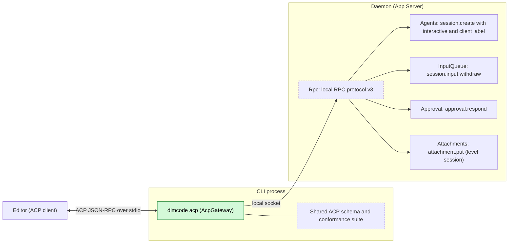
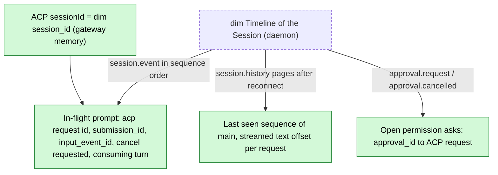
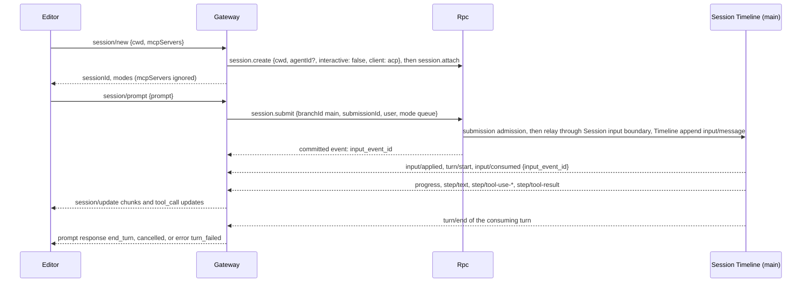
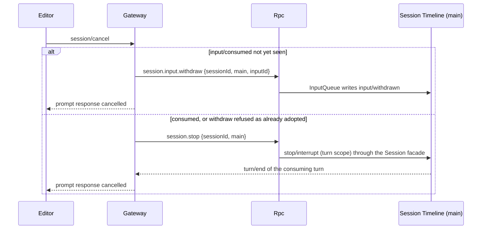
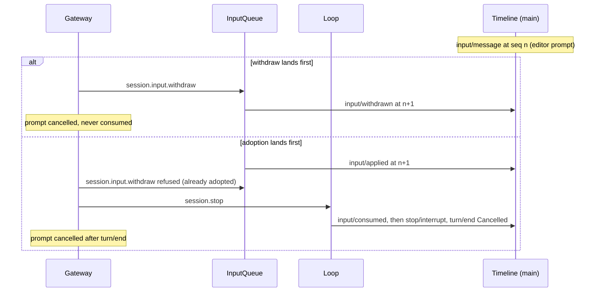

# AcpGateway

Status: Draft. Overall design: [overview §B.15](../overview.md#b15-acpgateway). Phase: P3. Language: TypeScript first as a standalone program, then merged into the Rust CLI ([overview §F.3](../overview.md#f3-assignment)).

`dimcode acp` serves the Agent Client Protocol (ACP) over standard input and output so that editors can drive dim. It is a protocol adapter in the CLI process: it connects to the daemon over local RPC exactly like the CLI, maps each ACP session to a non-interactive dim Session, each ACP prompt to a `session.submit`, Session events to ACP `session/update` notifications, and dim approval requests to ACP permission requests. It opens no execution path in the daemon, writes nothing except through existing or registered Session methods, and declares no event.

## 1. Structure

The gateway depends on public RPC only; no daemon plugin knows it exists, and replacing it with another ACP implementation over the same RPC changes nothing in the daemon. The schema and suite are shared with [ExternalAgent](ExternalAgent.md) (client side); no runtime code is shared.

| Part | Scope | Depends on | Provides |
| --- | --- | --- | --- |
| `dimcode acp` | CLI process (not a daemon plugin) | Local RPC protocol v3 ([protocol.rs](../../../crates/dim-app-server/src/protocol.rs), [tree_protocol.rs](../../../crates/dim-app-server/src/tree_protocol.rs)): `hello`, `session.create` (with `interactive` and `client`, Agents supplement), `session.attach`/`detach`, `session.submit`, `session.input_lookup`, `session.history`, `session.stop`, `session.permission.update`, `approval.respond`; `session.input.withdraw` (InputQueue, decisions R7); `attachment.put` ([Attachments](Attachments.md)); notifications `session.event`, `session.state`, `session.model.progress`, `approval.request`, `approval.cancelled`, `session.closed`; CLI daemon discovery | ACP agent on stdio; the ACP↔dim mapping of this document |

## 2. Data and state

All gateway state is CLI process memory derived from notifications and `session.history`; it affects no branch. After a lost connection the gateway re-attaches and rebuilds from history after the last seen sequence; open permission asks lost on gateway exit leave the approvals pending in dim for another client.

## 3. Flows

### 3.1 New session and prompt

The consuming turn is the turn open on `main` at the sequence of `input/consumed {input_event_id}`; its `turn/end` decides the response (`Completed` → `end_turn`, `Cancelled` → `cancelled`, `Failed` → `turn_failed`). Every decision uses notifications in per-branch sequence order or `session.history` pages, never wall clock.

### 3.2 Cancel

Withdrawal is tried first because it leaves no trace in history; InputQueue refuses it once the input is adopted (`input/applied`), and the gateway falls back to `session.stop`. After `session/cancel` the prompt always responds `cancelled` (ACP rule), whatever the turn's outcome; pending ACP permission requests of the Session are answered `cancelled` by the client side.

### 3.3 Permission

`approval.request {sessionId, branchId, requestId, source, call {name, input}, reason}` from any branch of the Session → `session/request_permission {sessionId, toolCall: {toolCallId: call_id or requestId, title: name, kind, rawInput: input}, options: [{optionId: "allow", kind: "allow_once"}, {optionId: "deny", kind: "reject_once"}]}`. Selected `allow` → `approval.respond {decision: allow}`; `deny` → `deny`; outcome `cancelled` → no answer (A10). Approval validates the answer at its boundary, writes `approval/respond`, consumes it by sequence and rechecks the current policy. No `*_always` option is offered.

### 3.4 Load and multi-client

`session/load {sessionId, cwd}` attaches and replays `main` history as updates before responding (`cwd` mismatch → `invalid_params`). Several ACP sessions share one connection and stream independently. A Session attached in the terminal CLI too streams the CLI's turns to the editor; the editor's Queue prompt waits behind them.

## 4. Timing and conflicts

Withdraw versus adoption is decided by InputQueue on Timeline order; the gateway never guesses from timing. The narrow case "adopted, stop lands before consumption" leaves the input pending per the interrupt contract (Appendix B).

| Scenario | Order | Outcome | Owner |
| --- | --- | --- | --- |
| Another client withdraws the editor's input | `input/withdrawn` of `input_event_id` | Prompt `cancelled` | InputQueue, Gateway |
| Turn completes before the stop lands | `turn/end` < `stop/interrupt` | Prompt `cancelled` (cancel was requested); the stop covers no turn | Loop, Gateway |
| Model asks a question in a loaded interactive Session | `question/asked` | Shown as a `tool_call` update "waiting for an answer in another dim client" (A13); the prompt waits; `session/cancel` interrupts and Questions writes `question/cancelled` | Questions, Gateway |
| Approval answered by another client | `approval/respond` earlier | The editor's later answer is rejected; ignored | Approval |
| Daemon restart mid-turn | turn settled `Failed` | Catch-up from history; `turn_failed` (or `cancelled` if cancel was requested) | Loop |

All other rows: [Appendix B](#appendix-b-full-conflict-table).

## 5. Context mapping

| Source | Model sees | Placement |
| --- | --- | --- |
| ACP prompt `text` | `Text` user content | One user message at the Queue input's consumed position |
| ACP `image` | `Image` (base64) after `session.submit` model-capability validation | Same message |
| Embedded text `resource` ≤ 32 KiB | `Text` `"<uri>\n<text>"` (A6) | Same message |
| Larger `resource` | `attachment.put`, then a text reference to the returned path (A6) | Same message |
| `resource_link` | `Text` line `"@<uri>"` (A6) | Same message |
| `session/set_mode` | Nothing: `permission/changed` is Session configuration, not model text | — |

The gateway writes no raw blocks, keys, prompt sources or tool declarations. Its inputs survive compaction only through the summary; child branches see them if consumed before their cut. ACP Sessions are non-interactive, so `ask_user` is never declared there; otherwise the context is the same as any Queue input. The model never sees ACP identities, `mcpServers`, client capabilities, updates or diagnostics.

## 6. Interfaces (summary)

| Interface | Kind | Purpose |
| --- | --- | --- |
| `dimcode acp [--agent <agent_id>]` | CLI entry | Start the ACP agent on stdio ([A.1](#a1-cli-entry)) |
| ACP methods `initialize`, `session/new`, `session/load`, `session/prompt`, `session/cancel`, `session/set_mode` | ACP (agent side) | Mapped to RPC ([A.2](#a2-acp-methods)) |
| `session/update`, `session/request_permission` | ACP (agent → client) | Updates and permission asks ([A.3](#a3-prompt-content-and-updates)) |
| ACP schema and conformance suite | Shared with ExternalAgent | Boundary validation and tests |

## 7. Security

The gateway has the authority of a local CLI client: the local socket's ownership checks apply, and it calls only Session methods plus `session.create`, never management methods, so editors cannot change host configuration (isolation, host-local approvals, plugins). ACP modes change the Session's permission preset, which is Session configuration (`permission/changed`, decisions E4), bounded by what a local client may already do and reset on fork. Permission answers go through `approval.respond`, where Approval rechecks current policy; `allow_always` is never offered. Client-supplied `mcpServers` are never started, so an editor cannot make the daemon run commands (documented ACP conformance deviation, E13). Embedded resources become user content and follow Timeline rules.

## Appendix A. Interface details

### A.1 CLI entry

`dimcode acp [--agent <agent_id>]` connects to or starts the daemon like other CLI commands (A1); stdout carries only ACP JSON-RPC; diagnostics go to stderr and the CLI log. `--agent` selects the Agent profile for `session/new` (default: the default Agent).

### A.2 ACP methods

| ACP | dim | Notes |
| --- | --- | --- |
| `initialize` | `hello {protocolVersion: 3}` once per process | Reply: `agentCapabilities { loadSession: true, promptCapabilities { image: true, audio: false, embeddedContext: true } }`, `authMethods: []` (A2) |
| `authenticate` | — | Not offered; the local transport authenticates |
| `session/new {cwd, mcpServers}` | `session.create {cwd, agentId?, interactive: false, client: "acp"}` (A14), then `session.attach` | `sessionId` = dim session id; `modes` = permission presets, current = the Session's (A3); `mcpServers` ignored (E13) |
| `session/load {sessionId, cwd, mcpServers}` | `session.attach`, then `session.history` of `main` from 0 | Replay before the response; `cwd` mismatch → `invalid_params`; an already-open session returns the same mapping; the Session keeps its own `interactive` fact |
| `session/prompt {sessionId, prompt}` | `session.submit {sessionId, branchId: "main", submissionId: <uuid>, user, mode: "queue"}` | Response when the consuming turn ends; a second prompt while one is in flight → `prompt_in_progress` (A4) |
| `session/cancel {sessionId}` | `session.input.withdraw {sessionId, branchId: "main", inputId: input_event_id}` if unconsumed, else (or if refused) `session.stop {sessionId, branchId: "main"}` | Prompt responds `cancelled` |
| `session/set_mode {sessionId, modeId}` | `session.permission.update` | (A3) |

The gateway never calls client `fs/*` or `terminal/*`: dim works on its own resource node (A5).

### A.3 Prompt content and updates

`audio` and binary `resource` blocks are rejected with `unsupported_content`; nothing is submitted. Updates come from the attachment notifications of the mapped Session; only `main` produces message updates (A7):

| dim | ACP update |
| --- | --- |
| `session.model.progress` text and `step/text` (per request, Unicode scalar offset) | `agent_message_chunk` with the not-yet-sent suffix only |
| `step/thinking` | `agent_thought_chunk` |
| `input/message` with user content not submitted by this gateway session | `user_message_chunk` (A8) |
| `step/tool-use-start` | `tool_call {toolCallId: call_id, title: name, kind, status: pending}` |
| `step/tool-use` | `tool_call_update {rawInput, locations}` |
| `step/tool-start` | `tool_call_update {status: in_progress}` |
| `step/tool-result` (each call, published with the whole batch) | `tool_call_update {status: completed or failed, content: text of ToolResult.content bounded 16 KiB}` |
| `question/asked` (interactive Sessions only) | `tool_call_update` with text "waiting for an answer in another dim client" (A13) |
| Raw-block-only inputs, `exec/*`, `collaboration/*`, `context/*`, `branch/*`, `input/withdrawn` | No message update (A8) |

`kind` from the tool name: `read`→`read`; `write`, `edit`→`edit`; `glob`, `grep`→`search`; `exec`→`execute`; `web_fetch`, `web_search`→`fetch`; else `other` (A9). `locations` uses a `path` input field when present.

### A.4 Mechanics per step

| Step | Path |
| --- | --- |
| Prompt write | `session.submit` → submission admission ([session-boundary](../contracts/session-boundary.md), submission-admission port; fail closed only when a `RequiredCheck` record matching the Session names a checker that is not registered ([ADR 002](../../adr/002-plugin-scope.md) D6): `service_reloading`, nothing written) → `SessionLease::relay` → Session input boundary `validate` → `Timeline::append` of `input/message`; the reply carries the committed event |
| Adoption | InputQueue (Dispatcher) appends `input/applied`; Loop appends `turn/start`, `input/consumed` and runs the turn |
| Withdraw | `session.input.withdraw` → InputQueue validates (own branch, not adopted) and writes `input/withdrawn` |
| Stop | `session.stop` writes turn-scoped `stop/interrupt` through the Session facade and waits for settlement |
| Approval | `approval.respond` → Approval validates, writes `approval/respond`, consumes it by sequence |
| State | No `StateCell`, no Dispatcher; gateway memory only |
| Daemon reload | Calls return `service_reloading`; the gateway retries with the same `submissionId` after `session.input_lookup` (`accepted` → no resubmission) |
| Restart or lost connection | Reconnect, re-attach each mapped Session, read `session.history` after the last seen sequence; an in-flight prompt is resolved from those facts |
| Gateway exit (stdin EOF) | `session.detach` for each Session; running turns continue; nothing is stopped |

## Appendix B. Full conflict table

| Scenario | Order | Outcome | Owner |
| --- | --- | --- | --- |
| Cancel before the submit reply | — | Wait for the reply, then cancel | Gateway |
| Cancel before adoption | `input/withdrawn` < `input/applied` | Withdrawn; `cancelled`; nothing in history but the withdrawn input | InputQueue |
| Cancel after adoption, before consumption | `input/applied` < withdraw attempt | Withdraw refused; `session.stop`; the consuming turn ends `Cancelled` → `cancelled` | InputQueue, Loop |
| Adopted, stop lands before `turn/start` | `stop/interrupt` < `input/consumed` | Prompt `cancelled` once `session.stop` returns with the input unconsumed; the input stays pending (interrupt contract) and runs with the next driving input, mirrored as `user_message_chunk` (A11) | Loop, Gateway |
| Cancel after consumption | consumed < `stop/interrupt` | Turn `Cancelled`; `cancelled`; sent text stays | Loop |
| Turn completes before the stop | `turn/end` < `stop/interrupt` | `cancelled` | Gateway |
| Other client withdraws the input | `input/withdrawn` | `cancelled` | InputQueue |
| Other client stops the turn | `stop/interrupt` | `cancelled` | Loop |
| Other client's Queue input pending | Timeline order | The editor's prompt ends with the turn that consumed it | InputQueue, Loop |
| Steer from another client | consumed in the same turn | Prompt continues; content mirrored | Loop |
| Tool batch not settled | — | Completed updates only when the batch's results are published | ToolExecutor |
| Approval answered elsewhere | earlier `approval/respond` | Later editor answer rejected, ignored | Approval |
| Approval cancelled by stop while the editor asks | `approval/cancelled` | ACP request cannot be retracted; later answer ignored | Approval |
| Question in a loaded interactive Session | `question/asked` | Waits for another client; cancel interrupts → `question/cancelled` (A13) | Questions |
| ACP-created Session | — | Non-interactive: no `ask_user` | Agents |
| Compaction during the prompt | — | No update; streaming unaffected | — |
| Child branch created by the model | — | No message updates; its approvals forwarded | Gateway (A7) |
| Branch interrupt or Session close | `session.closed` | In-flight prompt `cancelled`; later `session_not_found` | Gateway |
| Session idle-unload while attached | — | Attachment keeps it loaded | AgentIndex |
| Resource node offline | capabilities Pending | Prompt waits; `turn/end` decides | rutis lifecycle |
| A matching `RequiredCheck` record's checker is not registered (D6) | — | `service_reloading`, nothing written; retried after `input_lookup` | Rpc |
| Daemon reload mid-submit | — | `input_lookup` decides resubmission | Gateway |
| Daemon restart mid-turn | turn settled `Failed` | `turn_failed` after catch-up | Loop |
| Duplicate `session/prompt` | — | `prompt_in_progress` | Gateway |
| Two ACP sessions load one dim Session | — | Same mapping; one in-flight prompt | Gateway |
| Editor disconnects | — | Detach (not close); turn continues; approvals wait for another client | Connection |

## Appendix C. Errors and recovery

| Error (`error.data.code`) | When |
| --- | --- |
| `session_not_found` | Unknown or closed session id |
| `prompt_in_progress` | Second concurrent prompt on one ACP session |
| `unsupported_content` | Audio or binary resources; image rejected by `session.submit` validation (code passed through) |
| `turn_failed` | The consuming turn ended `Failed` and no cancel was requested |
| `daemon_unavailable` | Connection lost and not re-established within 30 s (A12) |
| `invalid_params` | ACP parameter validation, `cwd` mismatch on load |

Parameters are validated at the stdio boundary against the shared schema. Gateway exit settles nothing in the daemon.

## Appendix D. Acceptance

Flow tests driving `dimcode acp` over stdio against a mock-model daemon, plus the shared conformance suite (agent side):

1. initialize, new, prompt → chunks without duplication across progress and committed text; `end_turn`; the created Session is non-interactive and declares no `ask_user`.
2. Tool call updates; permission allow and deny; approval answered by another client.
3. Cancel before adoption (withdrawn), after adoption (stop), after consumption; stop racing turn end; another client's withdrawal.
4. `session/load` replays history in order; a loaded interactive Session's question shows the waiting update and cancel ends it.
5. Daemon restart mid-prompt: catch-up, `turn_failed`; reload mid-submit with `input_lookup`.
6. Images and embedded resources; audio rejected; `mcpServers` ignored.
7. Editor EOF detaches without stopping the turn.

## Appendix E. Assumptions

| # | Assumption | Basis | Effect if rejected |
| --- | --- | --- | --- |
| A1 | `dimcode acp` connects to or starts the daemon like other CLI commands | Overview §B.15; start behavior is judgment | Requires a running daemon |
| A2 | No ACP authentication methods | Judgment (local transport) | Add an auth method |
| A3 | ACP modes map to dim permission presets | Feature list (policy levels); judgment | No modes |
| A4 | One in-flight prompt per ACP session | Judgment | Queue prompts |
| A5 | Client `fs`/`terminal` capabilities unused | Overview §6.3 | Editor-buffer reads via the client |
| A6 | Resource conversions and 32 KiB threshold | Judgment | Other renderings |
| A7 | Message updates only from `main`; approvals from all branches | Judgment (ACP has no branches) | Branch-aware updates |
| A8 | Mirror other clients' user content; not raw-block inputs | Judgment | Show runtime inputs |
| A9 | Tool kind by name table | Judgment | Kind from tool metadata |
| A10 | Client `cancelled` permission outcome sends no answer | ACP cancel semantics; judgment | Answer `deny` |
| A11 | An input adopted before the stop stays pending and runs later | Interrupt contract | Requires withdrawal of adopted inputs |
| A12 | Reconnect window 30 s | Judgment | Other bound |
| A13 | Questions in loaded interactive Sessions are shown as waiting, not answered over ACP | Decisions E13; ACP has no question request | Map to an ACP elicitation if one is standardized |
| A14 | `session.create` gains an optional client label; ACP passes `acp`, recorded in `SessionConfig.created_by` as `Client` with that label (Agents supplement) | Judgment; `hello.clientKind` not needed | ACP Sessions not distinguishable |
| A15 | "ACP Session display" (feature list, `/settings`) is a CLI display preference owned by the CLI: whether Sessions whose `created_by` carries the client label `acp` appear in CLI Session lists, default shown; nothing in this adapter | Feature list names only the setting | Defined elsewhere; adapter unchanged |

## Appendix F. Open questions

| Question | Description |
| --- | --- |
| Client label | `SessionOrigin::Client` must carry the optional label of A14; owned by the Agents supplement |
| "ACP Session display" | Confirm A15 with the CLI settings design |
