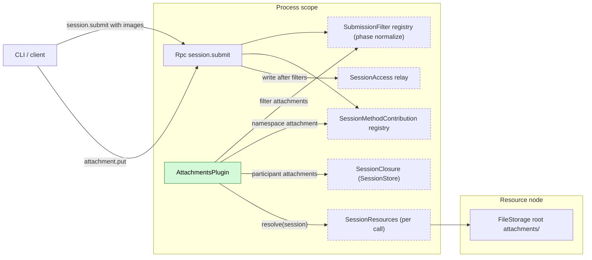
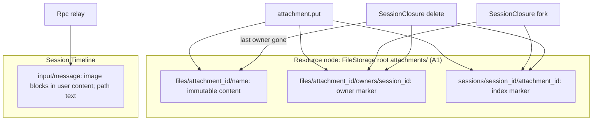
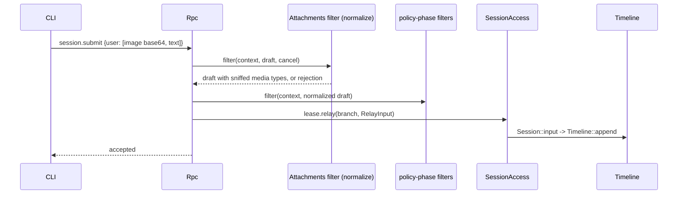
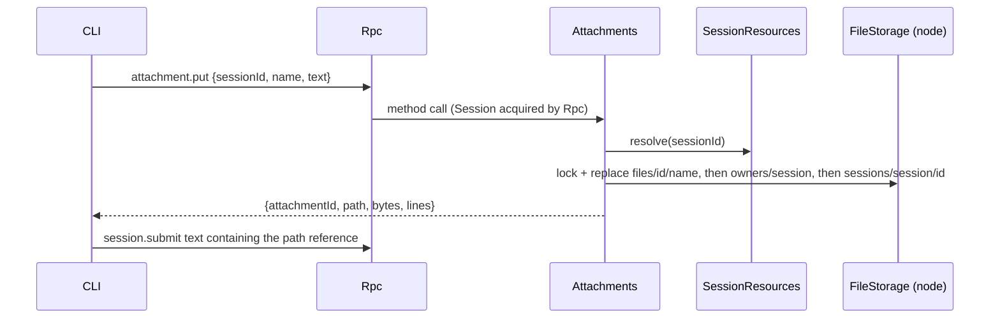
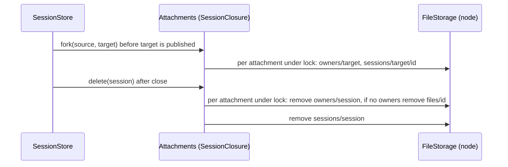
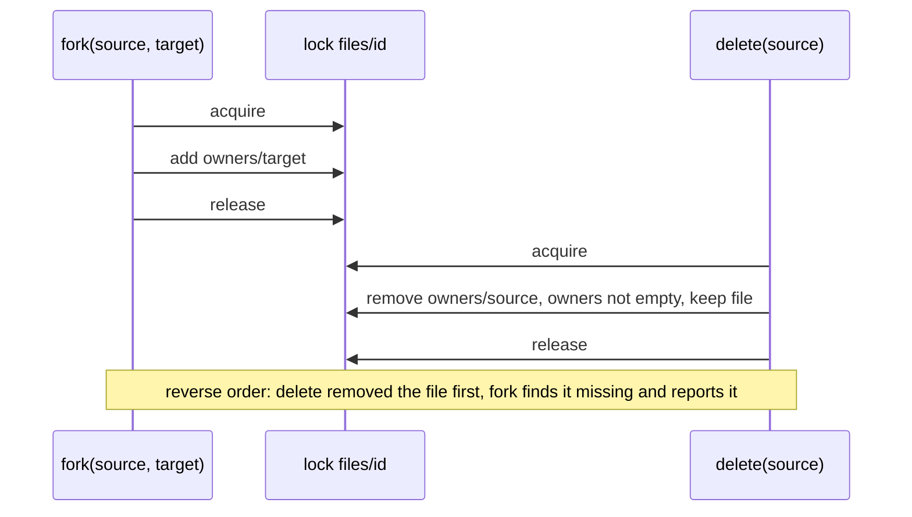

# Attachments

Status: Draft. Overall design: [overview §5.4](../overview.md#54-attachments). Phase: P1. Language: Rust.

Turns attachments into final content at the submission boundary. Images are validated and normalized into image blocks of the submitted `user` content by a submission filter in phase `normalize`; text attachments (large pastes) are stored as immutable files on the Session's resource node and referenced by path, for the model to `read` as needed. A fork shares the source's files by ownership markers (no byte copy); files are removed when no Session references them. Process plugin, no events.

## 1. Structure

Attachments plugs into three consumer-owned registries and never writes the Timeline: Rpc relays the filtered submission as the user's input. Node access goes through SessionResources per call, so an offline node fails only that Session's `attachment.put`.

| Part | Scope | Depends on | Provides |
| --- | --- | --- | --- |
| `AttachmentsPlugin` | Process (App Server) | `SessionResources` ([session-access](../contracts/session-access.md)); FileStorage on the node | `SubmissionFilter` named `attachments`, phase `normalize`; `SessionMethodContribution` namespace `attachment`; `SessionClosure` participant named `attachments` (all three in [session-boundary](../contracts/session-boundary.md), mounted per the [extension-registry](../contracts/extension-registry.md) pattern) |

Contracts depended on: the Rpc submission-filter registry and its phases, `SessionMethodContribution`, SessionStore's `SessionClosure` ([session-boundary](../contracts/session-boundary.md)); `SessionResources` per call; `FileStorage::register_root`, `path`, `lock`, `replace` (existing) plus a listing/removal supplement (open question F3); Provider catalog image capability only through the value the submission context carries.

Contracts defined here: `attachment.put`, the on-disk layout of the attachment root, the error codes, accepted image formats and limits. Attachments never reads Session or branch state and names no other filter or participant.

## 2. Data and state

All Attachments state is on the resource node and read on demand (no memory cache, nothing to rebuild on restart). `attachment_id` is a random UUID and paths never contain a Session id, so a fork's inherited history keeps valid paths. `FileStorage::lock` on `files/<attachment_id>` serializes marker changes and removal.

Events: none (overview §5.4). Images are part of the existing `input/message` written by Rpc's `SessionLease::relay` after the filters; the user stays the author and Attachments adds no blocks of its own. Text attachments appear only as paths in user text. Ownership changes follow process-level Session lifecycle operations; nothing in a branch depends on them.

## 3. Flows

### 3.1 Image at submit

Phase `normalize` runs before every `policy` filter, so policy filters see final image blocks; ties within a phase are ordered by name. A rejection writes nothing and the CLI keeps the draft.

### 3.2 Text paste

The path is returned only after the content and both markers exist. The model later reads the file with `read` on the same node.

### 3.3 Fork and delete

No bytes are copied; content is immutable and the fork's inherited paths stay valid. Both operations are idempotent; a crash leaves markers that a repeated call finishes.

## 4. Timing and conflicts

### 4.1 Fork racing delete of the source

The per-attachment lock decides; the fork reports a missing file instead of creating a dangling marker.

| Scenario | Outcome |
| --- | --- |
| Filter configured but inactive | `session.submit` → `service_reloading`; nothing written (fail closed) |
| Model switched after submit to one without images | Image reaches the new model; its adapter rejects or drops it |
| `input/withdrawn` of an image input | Never consumed; files of text attachments stay owned until Session delete |
| Branch close between filter and write | `relay` fails `BranchMissing`; nothing written |
| Resource node offline | Images unaffected (content only); `attachment.put` → `node_unavailable` |

Full table: Appendix B.

## 5. Context mapping

| Attachment | What the model sees | Placement |
| --- | --- | --- |
| Image | `ContentBlock::Image` inside the input's user message (after its raw blocks) | Consumed position (`input/consumed`) |
| Text attachment | The path inside the user text; content only through a later `read` result | User message at the consumed position; content at that tool result's position |

Compaction keeps neither images nor file contents verbatim, only the summary (a path survives if the summary keeps it; the file stays on disk). Child branches inherit consumed inputs before the cut; forked Sessions inherit the fixed prefix and the shared files stay readable. Non-interactive Sessions use the same boundary when input comes through `session.submit`; inputs written by process plugins through `SessionAccess::input` do not pass the filter (A10). The model never sees attachment ids, markers, rejected submissions or diagnostics.

## 6. Interfaces (summary)

| Interface | Kind | Purpose |
| --- | --- | --- |
| Filter `attachments` | SubmissionFilter, phase `normalize` | Validate and normalize image blocks; reject unsupported input |
| `attachment.put` | Session method (Rpc contribution) | Store a text attachment on the resource node, return its path |
| Participant `attachments` | SessionClosure | Share files on fork; release them on delete |
| `attachment_*` errors | `appError` on `session.submit` and `attachment.put` | Rejection reasons |

## 7. Security

Images are decoded only to validate headers and limits. Text attachments are written under an authorized FileStorage root with symlink-safe traversal, never at client-chosen paths (`name` is a file name). Files are readable through `read` under the Session's permission policy; attachments confer no extra authority. Paired remote devices may call `attachment.put` and `session.submit` like any Session method. Contents are user data replayed to the model; the CLI must not attach secrets implicitly. A fork never widens access: it reads only files its inherited history references, on the same node.

## Appendix A. Interface details

### A.1 Submission filter

| Input block | Handling |
| --- | --- |
| `Text` | Unchanged |
| `Image { source: Base64 }` | Decode; sniff the format from magic bytes (declared `media_type` ignored); accept PNG, JPEG, WebP, GIF (feature list); set `media_type`; enforce limits (A3) |
| `Image { source: Url }` | Rejected `attachment_invalid` (A4) |
| Any image, context says the model has no image input | Rejected `attachment_unsupported_model` |
| Any image, capability unknown or not carried | Accepted; the model adapter decides (A5) |

Limits (A3): at most 20 images per submission, 5 MiB decoded each, 8000 px per side; violations rejected, never resized. Blocks keep their order. The filter has no side effect; cancellation drops the work. Rejections carry `filter: "attachments"` and surface as `invalid_params` with `appError` `attachment_invalid` / `attachment_too_large` / `attachment_unsupported_model`.

### A.2 `attachment.put`

`attachment.put {sessionId, name?, text}` → `{attachmentId, path, bytes, lines}`.

| Rule | Content |
| --- | --- |
| `name` | `[A-Za-z0-9._-]{1,64}`, no leading dot; default `paste.txt` |
| `text` | UTF-8, at most 10 MiB (A3); empty rejected |
| Node | `SessionResources` resolved per call; written through that node's FileStorage |
| Write order | `files/<id>/<name>` atomically (`lock` + `replace`), then `owners/<sessionId>`, then `sessions/<sessionId>/<id>` |
| `path` | Absolute path on the resource node, as `read` there resolves it |
| Errors | `session_closed`, `node_unavailable`, `attachment_invalid`, `attachment_too_large`, `service_reloading` |

Rpc acquires the Session as for any Session method; Attachments holds no lease.

### A.3 SessionClosure participant

| Operation | Steps |
| --- | --- |
| `fork(source, target)` | For each marker in `sessions/<source>/`, under the attachment lock: create `owners/<target>` and `sessions/<target>/<id>`; a missing file is reported. Idempotent. Same resource node only (A11) |
| `delete(session)` | For each marker in `sessions/<session>/`, under the lock: remove `owners/<session>`; if `owners/` is empty remove `files/<id>`; remove the marker; finally `sessions/<session>/`. Idempotent |

### A.4 Mechanics

| Step | Mechanics |
| --- | --- |
| Submit | Rpc runs filters by phase then name → `SessionLease::relay(branch, RelayInput)` → `Session::input` → `Branch::input` → boundary `validate` → `Timeline::append`. The write is Rpc's |
| Consumption | InputQueue (`input/applied`), Loop (`input/consumed`); the input lives in InputQueue's `StateCell<InputSnapshot>` until consumed |
| Recheck | None; the image capability is the context value at submit time |
| Terminal facts | None |
| Unload | Registry rules: filter inactive → `session.submit` `service_reloading`; namespace inactive → `attachment.put` `service_reloading`; in-flight `put` checks cancellation before commit; a file without markers is garbage (A8) |
| Restart | No memory state; files and markers persist |

### A.5 CLI contract

The CLI reads images (clipboard, `@`, pasted paths) and sends them as base64 image blocks in `session.submit`; pastes above its threshold go through `attachment.put`, and it inserts `[Pasted text: <path> (<lines> lines)]` (A6). On rejection the draft is kept. Temporary image files are deleted by the CLI after the submit reply.

## Appendix B. Full conflict table

| Scenario | Sequence order | Outcome | Owner of the decision |
| --- | --- | --- | --- |
| Image submitted while a turn runs | input by mode | Applied and consumed like any input | InputQueue, Loop |
| Turn interrupt before the image input is consumed | applied < I | Pending; consumed by the next turn | Loop |
| `input/withdrawn` of the input | input < withdrawn | Never consumed; text files stay owned by the Session | InputQueue |
| Branch close between filter and write | close < write | `relay` fails `BranchMissing`; nothing written | Runtime facade |
| Model switched after submit | input < `context/configured` < consumed | New model's adapter rejects or drops the image | ModelProvider |
| Concurrent Steer/Queue/Append | Timeline order | Unaffected | InputQueue |
| `attachment.put`, submit never sent | — | File owned by the Session; removed with it | Attachments |
| `attachment.put` racing Session delete | marker after delete scan | Marker survives; repeated delete removes it (A8) | Attachments |
| Fork racing delete of the source | lock order | Target marker first: file kept. Delete first: fork reports missing | Attachments lock |
| Compaction | consumed < compaction | Only through the summary; files stay | ContextPreparation |
| Child branch cut | consumed < cut | Child inherits image and path; same files | History projection |
| Filter configured but inactive | — | `session.submit` `service_reloading`; nothing written | Rpc registry |
| `attachment` namespace inactive | — | `attachment.put` `service_reloading` | Rpc registry |
| Participant inactive during fork or delete | — | Per SessionClosure contract (F4) | SessionStore |
| Rpc reload during submit | — | `service_reloading`; client checks `session.input_lookup` then retries with the same `submissionId` | Rpc, client |
| Process restart | — | No state lost | — |
| Resource node offline | — | Filter unaffected; `attachment.put` `node_unavailable` for that Session; `read` fails like any `read` | SessionResources |
| Duplicate or late `attachment.put` | — | New attachment each call (A9) | Attachments |
| Paired remote device submits | — | Same boundary and filters | Rpc |
| Session unload/restore | — | Files independent of loading | — |
| Client detach | — | No effect | — |

## Appendix C. Errors and recovery

| Code | Meaning |
| --- | --- |
| `attachment_invalid` | Unsupported or undecodable image, URL source, bad name, empty text |
| `attachment_too_large` | Over a limit of A.1/A.2 |
| `attachment_unsupported_model` | Images for a model without image input |
| `node_unavailable` | Resource node services unreachable |
| `session_closed`, `service_reloading` | As for other Session methods |

A failed filter leaves no fact. A failed `attachment.put` may leave an unreferenced file; Session delete and a startup sweep of `files/` without `owners/` remove it (A8). No mutation is retried automatically (FileStorage rule).

## Appendix D. Acceptance

1. PNG/JPEG/WebP/GIF accepted with sniffed media types; a mislabeled JPEG corrected; BMP and URL rejected; nothing written on rejection.
2. Non-vision model: `attachment_unsupported_model`; unknown capability: accepted.
3. Limits: 21 images, 6 MiB image, 9000 px side rejected.
4. `attachment.put` returns a path `read` resolves on the resource node (local and imported node).
5. Fork then delete source: fork still reads the file; delete fork: file removed; no bytes copied.
6. A test `policy`-phase filter sees normalized image blocks.
7. Inactive filter: `session.submit` `service_reloading`, nothing written.
8. Offline node: `attachment.put` fails for that Session only.
9. Interrupt, withdrawal and branch-close rows through public RPC.

## Appendix E. Assumptions

| # | Assumption | Basis | Effect if rejected |
| --- | --- | --- | --- |
| A1 | Root `attachments/` in the node's dim home | Judgment | Other location; layout unchanged |
| A2 | Image normalization is phase `normalize` | Session-boundary phases; judgment | Policy filters see raw client blocks |
| A3 | Limits: 20 images, 5 MiB, 8000 px, 10 MiB text; reject rather than resize | Edge-case reference; judgment | Different limits or resizing |
| A4 | URL image sources rejected | Overview §5.4 "final content"; judgment | Provider fetches URLs |
| A5 | Unknown model capability accepts images | Judgment | Unknown rejected |
| A6 | CLI chooses the paste threshold and reference format | Overview §8 (CLI); judgment | Server returns a formatted reference |
| A7 | Fork shares immutable files by markers | Maintainer decision; copied bytes at a new path would break inherited paths | Byte copy plus path rewriting, impossible for fixed history |
| A8 | Unreferenced files removed by delete passes and a startup sweep | Judgment | Orphans accumulate |
| A9 | No deduplication | Judgment | Content-addressed ids |
| A10 | Only `session.submit` passes the filter | Session-boundary; judgment | Other writers validate their own images |
| A11 | A fork keeps the source's resource node; fork to another node is out of scope | Overview §3.1; maintainer decision | Files must be copied to the same path on the other node |

## Appendix F. Open questions

| # | Question | Description |
| --- | --- | --- |
| F1 | Overview §5.4/§7.2 "copied" | Implemented as shared ownership (A7); wording should read "kept available to the fork" |
| F2 | Image capability in the submission context | The filter needs Rpc to pass the Session's adopted model image capability (from the published `context/configured` and the Provider catalog); without it every image is accepted (A5) |
| F3 | FileStorage listing/removal | Supplement: list a directory and remove a file or empty directory under a root |
| F4 | SessionClosure participant inactive | Fork must not complete without the participant's markers (fail closed), and delete must be retried when it returns; to be fixed in the session-boundary contract |
