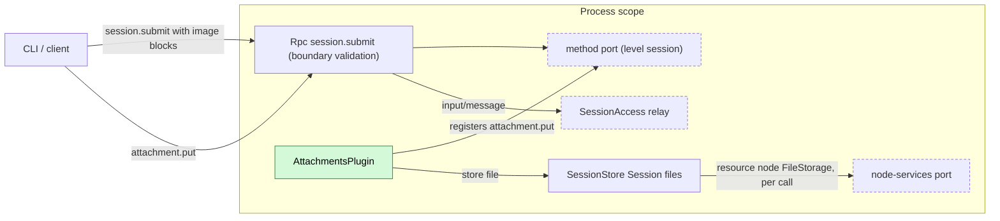
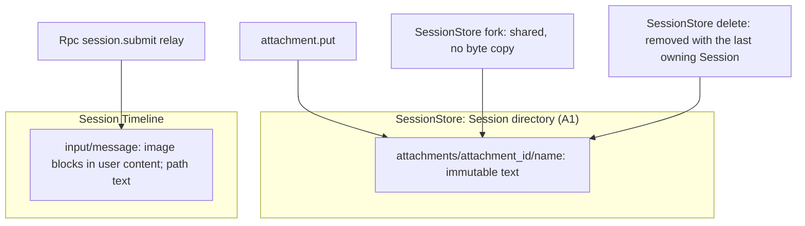
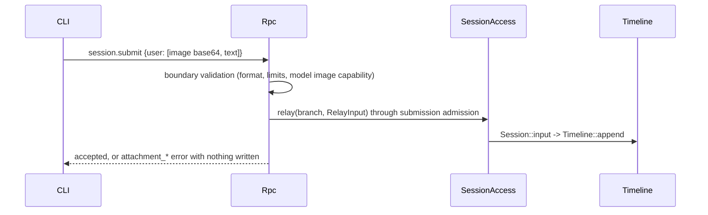
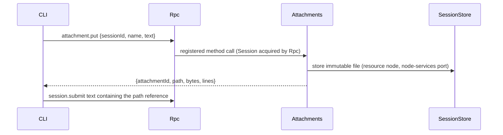

# Attachments

Status: Draft. Overall design: [overview B.4](../overview.md#b4-attachments). Phase: P1. Language: Rust.

Lets the user attach images and large text to a submission. Images need no plugin: the CLI sends them as image content blocks in `session.submit`, and Rpc validates them at the submission boundary. Attachments is a small process plugin that registers one Session method, `attachment.put`, into Rpc's [method port](../contracts/session-boundary.md). The method stores a text attachment (a large paste) as an immutable Session file owned by SessionStore on the Session's resource node and returns its path; the user's text references the path and the model reads the file with `read` when needed. Fork sharing and deletion of those files are SessionStore behavior. No events.

## 1. Structure

Attachments touches only the method port and SessionStore, both stable ([ADR 002](../../adr/002-plugin-scope.md) D2); it never writes the Timeline, never sees images and owns no data of its own.

| Part | Scope | Depends on | Provides |
| --- | --- | --- | --- |
| `AttachmentsPlugin` | Process (App Server) | [Method port](../contracts/session-boundary.md); SessionStore Session-file supplement | Session method `attachment.put` (`level: session`) registered into the method port |

Contracts depended on: the method port (Rpc acquires the Session and passes it to `level: session` handlers); a SessionStore supplement that stores an immutable file on the Session's resource node through the node-services port, shares it on fork and removes it with the last owning Session (overview Appendix C, SessionStore); Rpc's `session.submit` validation of image blocks (Rpc supplement). Contracts defined here: `attachment.put`, its error codes and limits, the CLI reference format. Attachments names no other plugin's internal type.

## 2. Data and state

Attachments has no state: files belong to the Session's data in SessionStore, and images exist only inside the `input/message` Rpc relays with the user as author. `attachment_id` is a random UUID, so a fork's inherited history keeps valid paths because SessionStore shares the files instead of copying them (A6).

Events: none. Images are part of the existing `input/message`; text attachments appear only as paths in user text.

## 3. Flows

### 3.1 Image at submit

Validation happens before submission admission, so an admission checker sees final image blocks. A rejection writes nothing and the CLI keeps the draft.

### 3.2 Text paste

The path is returned only after the file is durable. The model later reads it with `read`.

## 4. Timing and conflicts

| Scenario | Outcome |
| --- | --- |
| Attachments not registered | `attachment.put` gets the method port's unregistered outcome; images unaffected |
| Model switched after submit to one without images | Image reaches the new model; its adapter rejects or drops it |
| `input/withdrawn` of an image input | Never consumed; text files stay with the Session |
| Fork racing delete of the source | Decided by SessionStore's fork/delete ordering; files shared, never copied |
| Resource node offline | Images unaffected; `read` of a path fails like any `read` |

Full table: Appendix B.

## 5. Context mapping

| Attachment | What the model sees | Placement |
| --- | --- | --- |
| Image | `ContentBlock::Image` inside the input's user message (after its raw blocks) | Consumed position (`input/consumed`) |
| Text attachment | The path inside the user text; content only through a later `read` result | User message at the consumed position; content at that tool result's position |

Compaction keeps neither images nor file contents verbatim, only the summary (a path survives if the summary keeps it; the file stays). Child branches inherit consumed inputs before the cut; forked Sessions inherit the fixed prefix and the shared files stay readable. Inputs written by process plugins through `SessionAccess::input` do not pass `session.submit` validation (A8). The model never sees attachment ids, rejected submissions or diagnostics.

## 6. Interfaces (summary)

| Interface | Kind | Purpose |
| --- | --- | --- |
| `attachment.put` | Session method (method port, `level: session`) | Store a text attachment in the Session directory, return its path |
| Image blocks in `session.submit` | Rpc boundary validation (supplement) | Validate format, limits and model capability |
| `attachment_*` errors | `appError` on `session.submit` and `attachment.put` | Rejection reasons |

## 7. Security

Images are decoded only to validate headers and limits. Text attachments are written by SessionStore under the Session directory, never at client-chosen paths (`name` is a file name). Files are readable through `read` under the Session's permission policy; attachments confer no extra authority. Paired remote devices may call `attachment.put` and `session.submit` like any Session method. Contents are user data replayed to the model; the CLI must not attach secrets implicitly. A fork reads only files its inherited history references.

## Appendix A. Interface details

### A.1 Image validation at `session.submit` (Rpc supplement)

| Input block | Handling |
| --- | --- |
| `Text` | Unchanged |
| `Image { source: Base64 }` | Decode; sniff the format from magic bytes (declared `media_type` ignored); accept PNG, JPEG, WebP, GIF (feature list); set `media_type`; enforce limits (A2) |
| `Image { source: Url }` | Rejected `attachment_invalid` (A3) |
| Any image, the adopted model has no image input | Rejected `attachment_unsupported_model` |
| Any image, capability unknown | Accepted; the model adapter decides (A4) |

Limits (A2): at most 20 images per submission, 5 MiB decoded each, 8000 px per side; violations rejected, never resized. Blocks keep their order. Errors surface as `invalid_params` with `appError` `attachment_invalid` / `attachment_too_large` / `attachment_unsupported_model`.

### A.2 `attachment.put`

`attachment.put {sessionId, name?, text}` → `{attachmentId, path, bytes, lines}`.

| Rule | Content |
| --- | --- |
| `name` | `[A-Za-z0-9._-]{1,64}`, no leading dot; default `paste.txt` |
| `text` | UTF-8, at most 10 MiB (A2); empty rejected |
| Storage | SessionStore writes `attachments/<attachmentId>/<name>` atomically under the Session's attachments root on its resource node, through that node's FileStorage from the node-services port, resolved per call (A1); an offline node returns `node_unavailable` |
| `path` | Absolute path on the Session's resource node, as `read` resolves it for the Session |
| Errors | `session_closed`, `attachment_invalid`, `attachment_too_large`, `node_unavailable`, `service_reloading` |

Rpc acquires the Session as for any Session method; Attachments holds no lease. An in-flight call checks cancellation before SessionStore commits.

### A.3 CLI contract

The CLI reads images (clipboard, `@`, pasted paths) and sends them as base64 image blocks in `session.submit`; pastes above its threshold go through `attachment.put`, and it inserts `[Pasted text: <path> (<lines> lines)]` (A5). On rejection the draft is kept. Temporary image files are deleted by the CLI after the submit reply.

## Appendix B. Full conflict table

| Scenario | Sequence order | Outcome | Owner of the decision |
| --- | --- | --- | --- |
| Image submitted while a turn runs | input by mode | Applied and consumed like any input | InputQueue, Loop |
| Turn interrupt before the image input is consumed | applied < I | Pending; consumed by the next turn | Loop |
| `input/withdrawn` of the input | input < withdrawn | Never consumed; text files stay with the Session | InputQueue |
| Branch close between validation and write | close < write | `relay` fails `BranchMissing`; nothing written | Runtime facade |
| Model switched after submit | input < `context/configured` < consumed | New model's adapter rejects or drops the image | ModelProvider |
| Concurrent Steer/Queue/Append | Timeline order | Unaffected | InputQueue |
| `attachment.put`, submit never sent | — | File stays with the Session; removed with it | SessionStore |
| `attachment.put` racing Session delete | — | `session_closed`, or the file is removed by the delete | SessionStore |
| Fork racing delete of the source | — | Per SessionStore's fork/delete ordering | SessionStore |
| Compaction | consumed < compaction | Only through the summary; files stay | ContextPreparation |
| Child branch cut | consumed < cut | Child inherits image and path; same files | History projection |
| Attachments unloaded | — | Registration removed; `attachment.put` gets the method port's unregistered outcome; an in-flight call before commit ends `operation_interrupted` | Method port |
| Rpc reload during submit | — | `service_reloading`; client checks `session.input_lookup` then retries with the same `submissionId` | Rpc, client |
| Process restart | — | No state lost | — |
| Duplicate or late `attachment.put` | — | New attachment each call (A7) | Attachments |
| Paired remote device submits | — | Same boundary validation | Rpc |
| Session unload/restore, client detach | — | No effect | — |

## Appendix C. Errors and recovery

| Code | Meaning |
| --- | --- |
| `attachment_invalid` | Unsupported or undecodable image, URL source, bad name, empty text |
| `attachment_too_large` | Over a limit of A.1/A.2 |
| `attachment_unsupported_model` | Images for a model without image input |
| `session_closed`, `service_reloading` | As for other Session methods |
| `node_unavailable` | The Session's resource node is unreachable through the node-services port |

A rejected submission leaves no fact. A file stored without a later submit is removed with its Session. No mutation is retried automatically.

## Appendix D. Acceptance

1. PNG/JPEG/WebP/GIF accepted with sniffed media types; a mislabeled JPEG corrected; BMP and URL rejected; nothing written on rejection.
2. Non-vision model: `attachment_unsupported_model`; unknown capability: accepted.
3. Limits: 21 images, 6 MiB image, 9000 px side rejected.
4. `attachment.put` returns a path `read` resolves for the Session.
5. Fork then delete source: fork still reads the file; delete fork: file removed; no bytes copied.
6. Attachments not registered: `attachment.put` gets the method port's unregistered outcome; image submits unaffected.
7. Interrupt, withdrawal and branch-close rows through public RPC.

## Appendix E. Assumptions

| # | Assumption | Basis | Effect if rejected |
| --- | --- | --- | --- |
| A1 | Text attachments are Session files owned by SessionStore and stored on the Session's resource node under a per-Session attachments root, written and removed through that node's FileStorage from the node-services port; SessionStore keeps the ownership record on the control node. For a Session on the control node this is the Session directory | Judgment; `read` runs on the resource node | Other layout or inline text content |
| A2 | Limits: 20 images, 5 MiB, 8000 px, 10 MiB text; reject rather than resize | Edge-case reference; judgment | Different limits or resizing |
| A3 | URL image sources rejected | Overview "final content"; judgment | Provider fetches URLs |
| A4 | Unknown model capability accepts images | Judgment | Unknown rejected |
| A5 | CLI chooses the paste threshold and reference format | Overview Appendix E (CLI); judgment | Server returns a formatted reference |
| A6 | Fork shares immutable files (SessionStore behavior) | Maintainer decision; copied bytes at a new path would break inherited paths | Byte copy plus path rewriting, impossible for fixed history |
| A7 | No deduplication | Judgment | Content-addressed ids |
| A8 | Only `session.submit` validates images | Judgment | Other writers validate their own images |
| A9 | A fork keeps the source's resource node; fork to another node is out of scope | Maintainer decision | Files must be made available on the other node |

## Appendix F. Open questions

| # | Question | Description |
| --- | --- | --- |
| F1 | Image capability at the boundary | Rpc needs the Session's adopted model image capability (published `context/configured` plus the Provider catalog); without it every image is accepted (A4) |
