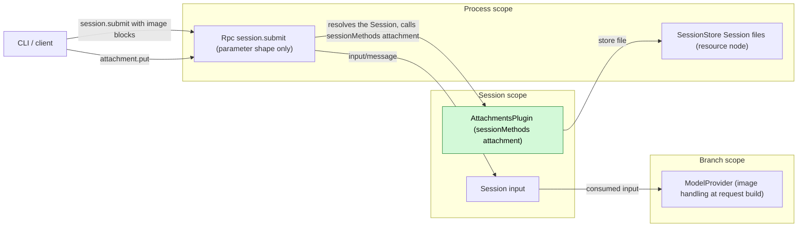
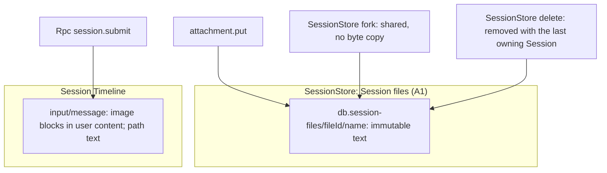
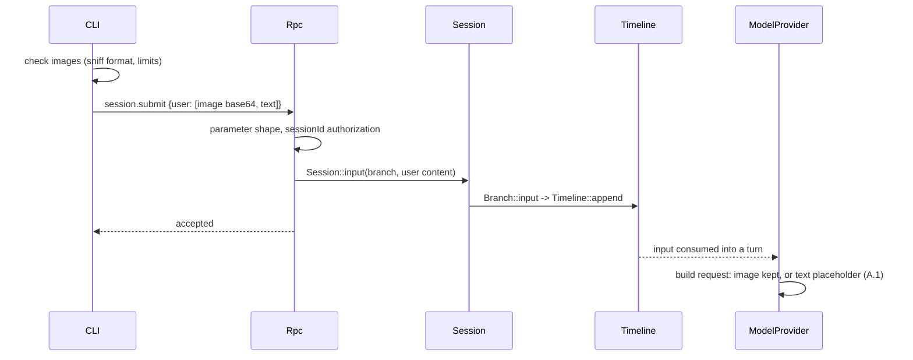
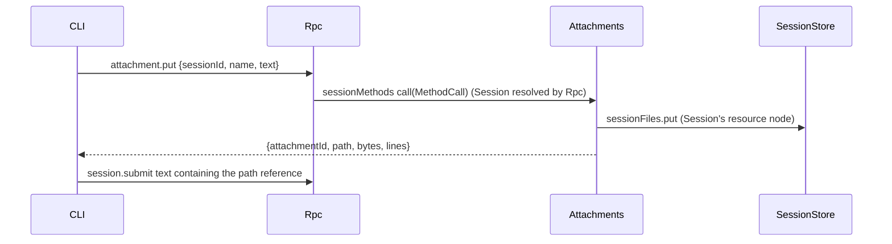

# Attachments

Status: Draft. Overall design: [overview §4](../overview.md#4-plugin-catalog). Phase: P1. Language: Rust. Scope: Session ([ADR 002](../../adr/002-plugin-scope.md)).

> **Offline resource nodes.** Rows about an offline resource node describe P3 multi-node behaviour. #5 is withdrawn (rutis is an external dependency, and it withdraws imported services when a link drops), so these rows are redesigned in P3 following overview §6.3: node services are looked up on each call by `resourceNode`. In P1/P2 every Session uses the control node.

Lets the user attach images and large text to a submission. Images need no plugin: the CLI checks them (format sniffing, limits) and sends them as image content blocks in `session.submit`; Rpc checks only the parameter shape, and ModelProvider handles the model's image capability when it builds each request (proposed ModelProvider supplement, [overview Appendix B.1](../overview.md#b1-session-and-branch-capabilities)). Attachments is a small Session plugin that provides one Session method, `attachment.put`, through a `sessionMethods` service (Session scope, key `attachment`) ([session-boundary](../contracts/session-boundary.md)); contracts are given in language-neutral form, the Rust form is [Appendix G](#appendix-g-rust-binding). The method stores a text attachment (a large paste) as an immutable Session file owned by SessionStore on the Session's resource node and returns its path; the user's text references the path and the model reads the file with `read` when needed. Fork sharing and deletion of those files are SessionStore behavior. No events.

## 1. Structure

Attachments depends only on SessionStore, an enclosing-scope plugin ([ADR 002](../../adr/002-plugin-scope.md) D3); it never writes the Timeline, never sees images and owns no data of its own. It declares its service in the plugin's `provides` and is installed only in Sessions where it is enabled.

| Part | Scope | Depends on | Provides |
| --- | --- | --- | --- |
| `AttachmentsPlugin` | Session | `S:SessionIdentity`; SessionStore `sessionFiles` | `sessionMethods` key `attachment` (`attachment.put`) |

Contracts depended on: `sessionMethods` (Rpc resolves the Session and calls it); a SessionStore supplement, the process service `sessionFiles`, that stores an immutable file on the Session's resource node, shares it on fork and removes it with the last owning Session ([session files](../appserver/session-files.md), [overview Appendix B.2](../overview.md#b2-app-server-process-plugins)); the node-offline rule ([overview §6.3](../overview.md#63-multiple-nodes)): a store on an offline resource node fails `node_unavailable` while Attachments stays loaded, because SessionStore looks up the node's FileStorage on each call ([#38](https://github.com/arcships/dim/issues/38), [session files §2](../appserver/session-files.md#2-structure)); ModelProvider's image handling when it builds a request (proposed supplement, A.1 and [overview Appendix B.1](../overview.md#b1-session-and-branch-capabilities)). Contracts defined here: `attachment.put`, its error codes and limits, the CLI image checks and reference format. Attachments names no other plugin's internal type.

## 2. Data and state

Attachments has no state: files belong to the Session's data in SessionStore, and images exist only inside the `input/message` Rpc writes with the user as author. `attachmentId` is the Session file's id, a random UUID chosen by SessionStore. A fork's inherited history keeps valid paths because SessionStore shares the files instead of copying them, and their directory belongs to no single Session (A6).

Events: none. Images are part of the existing `input/message`; text attachments appear only as paths in user text.

## 3. Flows

### 3.1 Image at submit

The CLI rejects an unsupported or oversized image before sending and keeps the draft. Rpc does not inspect images. ModelProvider decides per request from the request's model, so the input in history never changes.

### 3.2 Text paste

The path is returned only after the file is durable. The model later reads it with `read`.

## 4. Timing and conflicts

| Scenario | Outcome |
| --- | --- |
| Attachments not enabled | `attachment.put` gets `unknown_method`; images unaffected |
| Model switched after submit to one without images | ModelProvider sends a text placeholder instead of the image (A.1) |
| `input/deleted` of an image input | Never applied or consumed; text files stay with the Session |
| Fork racing delete of the source | A fork committed first keeps the files, shared and never copied; otherwise the fork fails ([session files §6](../appserver/session-files.md#6-deletion-crash-recovery-and-serialization)) |
| Resource node offline | `attachment.put` fails `node_unavailable`; images unaffected; `read` of a path fails like any `read`; nothing reloads or goes Pending |

Full table: Appendix B.

## 5. Context mapping

| Attachment | What the model sees | Placement |
| --- | --- | --- |
| Image | Image content block inside the input's user message (after its raw blocks); a text placeholder when the request's model cannot take it (A.1) | Consumed position (`input/consumed`) |
| Text attachment | The path inside the user text; content only through a later `read` result | User message at the consumed position; content at that tool result's position |

Compaction keeps neither images nor file contents verbatim, only the summary (a path survives if the summary keeps it; the file stays). Child branches inherit consumed inputs before the cut; forked Sessions inherit the fixed prefix and the shared files stay readable. Images from any writer get the same ModelProvider handling (A8). The model never sees attachment ids, images the CLI rejected or diagnostics.

## 6. Interfaces (summary)

| Interface | Kind | Purpose |
| --- | --- | --- |
| `attachment.put` | `sessionMethods` (Session, key `attachment`) | Store a text attachment as a Session file, return its path |
| CLI image checks | Client contract (A.1, A.3) | Sniff the format and enforce limits before submitting |
| Image handling at request build | ModelProvider supplement (proposed, A.1) | Send each image block or replace it with a text placeholder per the request's model |
| `attachment_*` errors | `appError` on `attachment.put` | Rejection reasons |

## 7. Security

The CLI decodes images only to check headers and limits; ModelProvider decodes them only to check what the request's adapter accepts; Rpc does not inspect them. Text attachments are written by SessionStore under its Session-files directory, never at client-chosen paths (`name` is a file name). Files are readable through `read` under the Session's permission policy; attachments confer no extra authority. Paired remote devices may call `attachment.put` and `session.submit` like any Session method; their images skip the CLI checks, and ModelProvider's handling is the server-side guard. Contents are user data replayed to the model; the CLI must not attach secrets implicitly. Reading a file never prompts and records no grant; [session files §11](../appserver/session-files.md#11-security) gives how reads are admitted and what path-scoped file access must keep.

## 8. Rule check

| Rule | How this document complies |
| --- | --- |
| Principles §4 rule 1 (commands for others' state) | Attachments changes no other module's Timeline state; files are stored through SessionStore's own typed operation, as for process-level state without a Timeline. |
| Principles §4 rule 2 (handover) | Attachments never touches inputs; images enter only inside `input/message` and are handed to Loop by `input/applied` as usual. |
| Principles §4 rule 3 (before callbacks only) | No check at the RPC or Session entry: Rpc checks only parameter shape, image checks live in the CLI and in ModelProvider's request building (principles §4 rule 3). |
| Principles §4 rule 4 (no business meaning in core) | No core change; ModelProvider's image handling applies to every image block regardless of writer. |
| Principles §4 rule 5 (batch) | Not applicable: Attachments decides on no event. |
| Principles §4 rule 6 (context from handed-over events) | Images reach the model only from consumed inputs; deleted inputs never enter context. |
| Principles §4 rule 7 (public events and services only) | Attachments uses only `sessionMethods` and SessionStore's public Session-file operation. |
| Principles §4 rule 8 (requirements to mechanism owners) | No runtime or rutis requirement: the offline rule relies on SessionStore looking up the node's FileStorage on each call (#38), not on the withdrawn #5. The ModelProvider supplement is a requirement to another plugin and is listed in [overview Appendix B.1](../overview.md#b1-session-and-branch-capabilities), with the reasons in A.1. |
| Principles §4 rule 9 (only facts later decisions use) | Attachments writes no event; text files are SessionStore state and images ride in the existing `input/message`. |
| Principles §1 (Capability and App Server boundary) | Attachments is a Session Capability in its own crate; Rpc holds no image logic. |
| ADR 002 D1 (scope follows state) | Session scope: `attachment.put` acts for its own Session. The text files are that Session's data, kept by the process-scoped SessionStore because forks share them. |
| ADR 002 D2 (no wiring modules) | No wiring module; Attachments depends only on SessionStore. |
| ADR 002 D3 (dependencies follow scope) | Its only dependency, SessionStore, is in the enclosing process scope; a SessionStore reload reloads Attachments. |
| ADR 002 D4 (structural vs business configuration) | Enabling is structural; Attachments has no business configuration (limits are fixed, A2). |
| ADR 002 D5 (language-neutral contracts) | Contracts are neutral; the Rust form is Appendix G. |

## 9. Requirements raised to mechanism owners

None of its own to the runtime or rutis. The offline rule relies on SessionStore looking up the node's FileStorage on each call ([#38](https://github.com/arcships/dim/issues/38)), not on [#5](https://github.com/arcships/dim/issues/5), which is withdrawn.

The ModelProvider supplement (image handling at request build) is a requirement to another plugin; it is listed in [overview Appendix B.1](../overview.md#b1-session-and-branch-capabilities) and specified in A.1.

## Appendix A. Interface details

### A.1 Image handling (CLI checks and ModelProvider supplement)

Rpc checks only the `session.submit` parameter shape (well-formed content blocks) and `sessionId` authorization; it does not decode, sniff or limit images (principles §4 rule 3).

CLI checks, before submitting:

| Image | Handling |
| --- | --- |
| File, clipboard or pasted path | Decode; sniff the format from magic bytes (any declared type ignored); accept PNG, JPEG, WebP, GIF (feature list); set `media_type`; enforce limits (A2) |
| URL | Never sent (A3) |
| Rejected | Not sent; the draft is kept and the reason shown |

Limits (A2): at most 20 images per submission, 5 MiB decoded each, 8000 px per side; violations rejected, never resized. Blocks keep their order.

ModelProvider supplement (proposed, [overview Appendix B.1](../overview.md#b1-session-and-branch-capabilities)), applied to every image block when it builds a model request:

| Image block | Request content |
| --- | --- |
| The request's model accepts image input and the adapter accepts the block's format and size | Sent as is |
| The model does not accept image input (Provider catalog) | Text `[Image omitted: the current model does not accept images.]` |
| Capability unknown | Sent as is; the provider decides (A4) |
| URL source, undecodable data, or a format or size the adapter does not accept | Text `[Image omitted: the image cannot be sent to this model.]` (A10) |

The history is never changed; each request decides again from its own model.

Why ModelProvider: image checks may not sit at the RPC entry or in App Server (principles §4 rule 3 and §1), and CLI checks do not cover raw clients or other writers. Rejected: Rpc validation on `session.submit` (an entry check); a before callback on `input/message` (the model of the consuming request is not known at write time); an Attachments upload method (other writers would be missed). The supplement writes no event and leaves history unchanged; it decides per request from the adopted `context/configured` and the Provider catalog, so interrupts and reloads affect only the request being built.

### A.2 `attachment.put`

Service `sessionMethods`, Session scope, key `attachment`. `describe()` returns one `MethodDecl`: `{name: "attachment.put", mutating: true, interruption: report, progress: false, notifications: [], reply: direct}`. `call(MethodCall)` with params `{sessionId, name?, text}` replies `{attachmentId, path, bytes, lines}` as `MethodReply`; errors are `MethodError` data.

| Rule | Content |
| --- | --- |
| `name` | `[A-Za-z0-9._-]{1,64}`, no leading dot; default `paste.txt` |
| `text` | UTF-8, at most 10 MiB (A2); empty rejected |
| Storage | SessionStore's `sessionFiles.put` writes the text once, read-only, at `<db>.session-files/<fileId>/<name>` (next to the native database `<db>`) on the Session's resource node, and `attachmentId` is that `fileId` (A1, [session files](../appserver/session-files.md)); an offline node returns `node_unavailable` |
| `path` | Absolute path on the Session's resource node, as `read` resolves it for the Session |
| Errors | `session_closed`, `attachment_invalid`, `attachment_too_large`, `node_unavailable`, `service_reloading`, `unknown_method` |

Rpc resolves the Session as for any Session method. A cancel request on an in-flight call is checked before SessionStore commits.

### A.3 CLI contract

The CLI reads images (clipboard, `@`, pasted paths), checks them (A.1) and sends them as base64 image blocks in `session.submit`; pastes above its threshold go through `attachment.put`, and it inserts `[Pasted text: <path> (<lines> lines)]` (A5). On rejection the draft is kept. Temporary image files are deleted by the CLI after the submit reply.

## Appendix B. Full conflict table

| Scenario | Sequence order | Outcome | Owner of the decision |
| --- | --- | --- | --- |
| Image submitted while a turn runs | input by mode | Applied and consumed like any input | InputQueue, Loop |
| Turn interrupt before the image input is consumed | applied < I | Pending; consumed by the next turn | Loop |
| `input/withdraw` of the input while held | input < withdraw < `input/deleted` | Never applied or consumed; text files stay with the Session | InputQueue |
| Branch close between submit and write | close < write | `Session::input` fails `BranchMissing`; nothing written | Runtime facade |
| Model switched after submit | input < `context/configured` < consumed | Placeholder if the new model does not accept images (A.1) | ModelProvider |
| Image the adapter cannot accept (undecodable, unsupported format, too large) | consumed < request | Placeholder in each request; the input in history is unchanged | ModelProvider |
| Concurrent Steer/Queue/Append | Timeline order | Unaffected | InputQueue |
| `attachment.put`, submit never sent | — | File stays with the Session; removed with it | SessionStore |
| `attachment.put` racing Session delete | — | `session_closed`, or the file is removed by the delete | SessionStore |
| Fork racing delete of the source | — | A fork committed first keeps the files; otherwise the fork fails ([session files §6](../appserver/session-files.md#6-deletion-crash-recovery-and-serialization)) | SessionStore |
| Compaction | consumed < compaction | Only through the summary; files stay | ContextPreparation |
| Child branch cut | consumed < cut | Child inherits image and path; same files | History projection |
| Attachments reloaded | — | `attachment.put` gets `service_reloading`; an in-flight call before commit ends `operation_interrupted` | Rpc |
| Rpc reload during submit | — | `service_reloading`; client checks `session.input_lookup` then retries with the same `submissionId` | Rpc, client |
| Process restart | — | No state lost | — |
| Duplicate or late `attachment.put` | — | New attachment each call (A7) | Attachments |
| Paired remote device submits | — | No CLI checks; ModelProvider handling applies (A.1) | ModelProvider |
| Session unload/restore, client detach | — | No effect | — |
| Resource node offline at `attachment.put` | — | `node_unavailable`; nothing stored; Attachments stays loaded; a retry succeeds once the node is back (SessionStore looks up the node's FileStorage per call, #38) | SessionStore |

## Appendix C. Errors and recovery

| Code | Meaning |
| --- | --- |
| `attachment_invalid` | Bad name, empty text |
| `attachment_too_large` | Text over the A.2 limit |
| `session_closed`, `service_reloading` | As for other Session methods |
| `node_unavailable` | The Session's resource node is unreachable |
| `unknown_method` | Attachments not enabled in the Session |

An image the CLI rejects is never sent. A file stored without a later submit is removed with its Session. No mutation is retried automatically.

## Appendix D. Acceptance

1. CLI: PNG/JPEG/WebP/GIF accepted with sniffed media types; a mislabeled JPEG corrected; BMP and URL rejected before sending; the draft is kept.
2. Non-vision model: the request carries the placeholder and the input in history is unchanged; unknown capability: the image is sent.
3. CLI limits: 21 images, 6 MiB image, 9000 px side rejected before sending. A raw `session.submit` with an undecodable image is accepted by Rpc and replaced by the placeholder in the request.
4. `attachment.put` returns a path `read` resolves for the Session.
5. Fork then delete source: fork still reads the file; delete fork: file removed; no bytes copied.
6. Attachments not enabled: `attachment.put` gets `unknown_method`; image submits unaffected.
7. Interrupt, withdrawal and branch-close rows through public RPC.
8. Offline resource node: `attachment.put` fails `node_unavailable` without reloading Attachments; it succeeds after the node returns.

## Appendix E. Assumptions

| # | Assumption | Basis | Effect if rejected |
| --- | --- | --- | --- |
| A1 | Text attachments are Session files owned by SessionStore and stored on the Session's resource node under `<db>.session-files/<fileId>/`, a directory no single Session owns, so the path survives forks and the source's deletion; SessionStore keeps the ownership rows on the control node ([session files](../appserver/session-files.md)) | Judgment; `read` runs on the resource node | Other layout or inline text content |
| A2 | Limits: 20 images, 5 MiB, 8000 px (CLI), 10 MiB text (`attachment.put`); reject rather than resize | Edge-case reference; judgment | Different limits or resizing |
| A3 | The CLI never sends URL image sources; ModelProvider replaces them | Overview "final content"; judgment | Provider fetches URLs |
| A4 | With unknown model capability ModelProvider sends images | Judgment | Unknown replaced by the placeholder |
| A5 | CLI chooses the paste threshold and reference format | [Overview Appendix D](../overview.md#appendix-d-cli-layer) (CLI); judgment | Server returns a formatted reference |
| A6 | Fork shares immutable files (SessionStore behavior) | Maintainer decision; copied bytes at a new path would break inherited paths | Byte copy plus path rewriting, impossible for fixed history |
| A7 | No deduplication | Judgment | Content-addressed ids |
| A8 | Image handling happens in ModelProvider at request build, so it covers images from every writer | Maintainer decision: feature checks belong to their owners | Each writer checks its own images |
| A9 | A fork keeps the source's resource node; fork to another node is out of scope | Maintainer decision | Files must be made available on the other node |
| A10 | An image the request cannot carry becomes a text placeholder instead of failing the model call | Judgment: the input stays in history, so a failing call would repeat every turn | Model calls fail until the input leaves context |

## Appendix F. Open questions

None. Image capability is handled by ModelProvider at request build (A.1, [overview Appendix B.1](../overview.md#b1-session-and-branch-capabilities)).

## Appendix G. Rust binding

Attachments is implemented in Rust.

| Neutral contract | Rust binding |
| --- | --- |
| `sessionMethods` key `attachment` | `SessionMethodContribution(Arc<dyn MethodProvider>)`, key `SessionScope::named_key::<SessionMethodContribution>("attachment")`; `describe` = `methods()`, `call` = `call(MethodCall, CallChannel, CancellationToken)`; cancel request = `CancellationToken` |
| Image content block | `ContentBlock::Image { source: Base64 \| Url, media_type }` |
