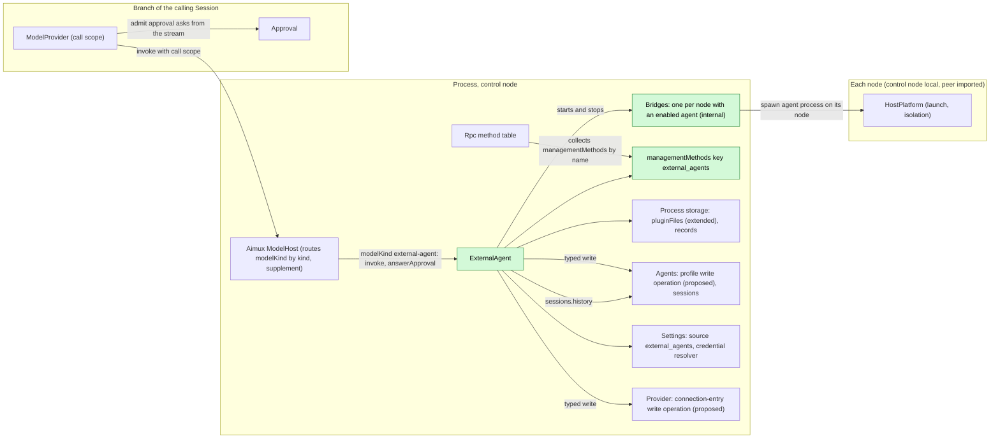
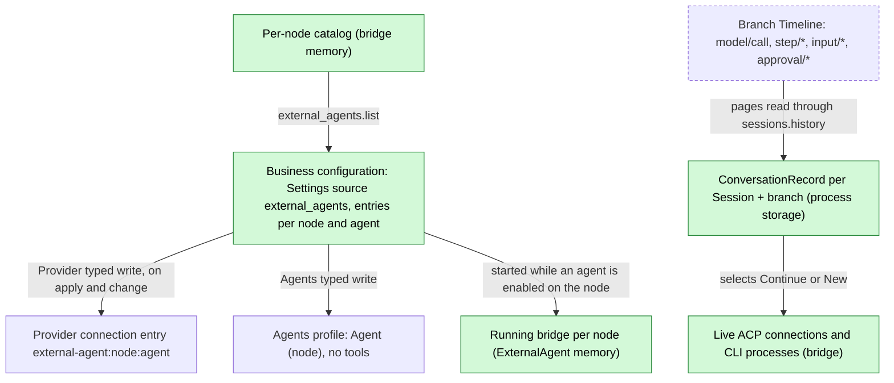
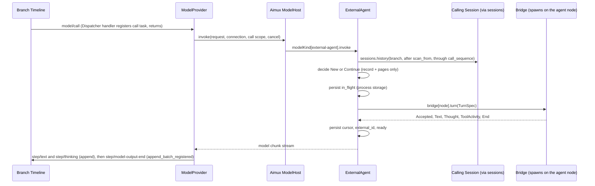
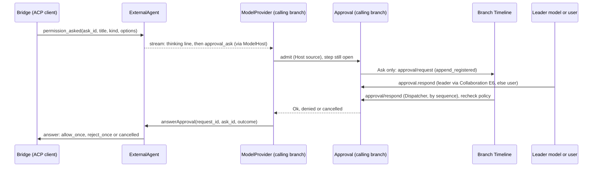
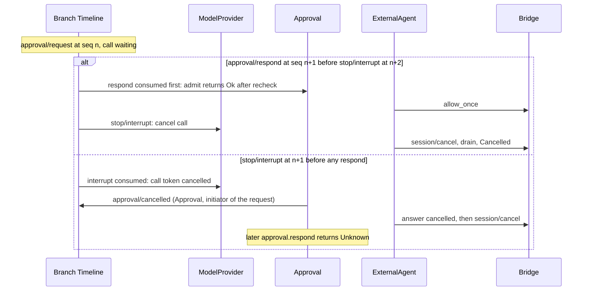

# ExternalAgent

Status: Needs redesign. Overall design: [overview §4](../overview.md#4-plugin-catalog); scope: [ADR 002](../../adr/002-plugin-scope.md) (process). Phase: P3. Language: TypeScript first ([overview Appendix C](../overview.md#appendix-c-implementation-language)).

> **Needs redesign.** The approval part of this document is withdrawn and must not be implemented ([#28](https://github.com/arcships/dim/issues/28)): no `approval_ask` / `approval_ask_withdrawn` items in the model stream, no ModelProvider dependency on Approval, no `answerApproval` on `modelKind`, no synthetic thinking line, no Approval supplement. Direction for the redesign: an external agent's permission request is written as an `input/message` to the branch where the main model runs, and ExternalAgent offers a tool with which the main model decides; that tool call goes through dim's Approval and Permission like any other. Also for the redesign ([#37](https://github.com/arcships/dim/issues/37)): bridges become loader rows (`peer:<node>/...` on remote nodes) reconciled from the business configuration, instead of processes ExternalAgent starts and stops itself; the document describes one way ExternalAgent attaches to ModelHost.

ExternalAgent makes locally installed coding agents (Claude Code, Codex, Cursor, OpenCode, ZCode and similar) usable as a kind of model connection. A Session whose model is an external agent runs through Loop and ModelProvider as usual: ExternalAgent provides the `modelKind` service for kind `external-agent`, which Aimux's ModelHost routes to (an Aimux supplement), turns each dim model request into one external turn and turns the external stream back into model output chunks. External agents use their own tools; their permission requests come back in the stream as approval asks, which ModelProvider admits as ordinary dim approvals in the Session that runs the call. ExternalAgent writes no Timeline event of its own. All contracts are language-neutral named services ([ADR 002 D5](../../adr/002-plugin-scope.md#d5-contracts-are-language-neutral)); the Rust forms are in [Appendix G](#appendix-g-rust-binding).

## 1. Structure



External agent connections, records and per-node processes are shared across Sessions, so ExternalAgent is a process plugin ([ADR 002](../../adr/002-plugin-scope.md) D1). It depends on Aimux, Agents, Provider and Settings at the same scope. Routing by kind is an Aimux supplement: ModelHost collects `modelKind` services by name and routes requests whose resolved connection has kind `external-agent` to the instance with that key. Dependencies follow scope (D3): an Aimux, Agents, Provider or Settings reload reloads ExternalAgent, failing its in-flight external calls; this rare structural cost is accepted and documented. ModelProvider does not depend on ExternalAgent: while no `modelKind` instance with key `external-agent` is registered, requests for the kind fail before acceptance (transient) and other kinds are unaffected. Bridges are business configuration, not structure (D4): a bridge is an internal component of the ExternalAgent process plugin, one per node with at least one enabled agent, which ExternalAgent starts and stops itself when enablement changes; enabling an agent adds no loader row and reloads nothing. A bridge runs agent processes on its node through that node's `HostPlatform` (the control node's own, or a peer node's imported over the rutis link; [overview §6.3](../overview.md#63-multiple-nodes)) and speaks ACP or the CLI protocol over their standard streams. While a peer link is down the imported `HostPlatform` stays registered and its calls fail `node_unavailable`, so nothing reloads and only the calls targeting that node fail (requirement on [#5](https://github.com/arcships/dim/issues/5), stated in §9.1). #5 covers only that per-call failure: the agent processes already running on the node are ended by that node's own `HostPlatform` when its link to the control node drops (HostPlatform supplement, [overview Appendix B](../overview.md#appendix-b-supplements-to-existing-plugins)). ExternalAgent never reaches Approval: ModelProvider admits the approval asks the stream carries.

| Part | Scope | Depends on | Provides |
| --- | --- | --- | --- |
| `ExternalAgent` | Process, control node | Aimux (ModelHost routing by kind), Agents (profile write operation, proposed; `sessions` for history reads), Provider (connection-entry write operation, proposed), Settings (source `external_agents`, credential resolver), each node's `HostPlatform` (used by its bridge), `pluginFiles` (extended) for conversation records | `modelKind` key `external-agent`; `managementMethods` key `external_agents`; internal bridges, one per node with an enabled agent |

**Contracts depended on**: the Aimux supplement (ModelHost collects `modelKind` by name and routes by kind with the call scope, A.2); two further supplements: **ModelProvider** admits `approval_ask` stream items through its branch's Approval and answers them with `answerApproval`, and **Approval** accepts a `Host`-source admission while a model step is open, reusing `approval/request`, `approval/respond` and `approval/cancelled` (no new event); the model chunk and failure data of the existing model contract ([host.rs](../../../crates/dim-agent-capabilities/src/host.rs)) and ModelProvider's failure policy ([recovery.rs](../../../crates/dim-agent-capabilities/src/model_provider/recovery.rs)); Approval's `admit` ([Approval](../../architecture/rust-agent/plugins/Approval.md)); the Collaboration supplement "member approval forwarded to the leader" (decisions E6); `sessions` ([session-access](../contracts/session-access.md)); `managementMethods` collected by Rpc ([session-boundary](../contracts/session-boundary.md)); [`pluginFiles` (extended)](../../../crates/dim-app-server/README.md#trusted-plugin-storage) (a TypeScript part uses it natively); Settings' typed write operations and change notification for the business source `external_agents` ([ADR 002 D4](../../adr/002-plugin-scope.md#d4-structural-configuration-and-business-configuration-are-separate)); Provider's connection-entry write operation and Agents' profile write operation (both proposed, owned and shaped by those plugins; Appendix F); each node's `HostPlatform` (overview Appendix B supplement, including ending the processes it started when its link to the control node drops). Existing typed services are reached by name from a TypeScript part once [#4](https://github.com/arcships/dim/issues/4) exposes them ([session-access §9](../contracts/session-access.md#9-requirements-raised-to-mechanism-owners)). **Contracts defined here**: `modelKind` key `external-agent` and its target `{node, agent}`; the conversation record; the approval call shape `external_agent.<kind>`; business configuration `external_agents.*`; methods `external_agents.*`; the ACP schema and conformance suite shared with [AcpGateway](AcpGateway.md) (client side). Provider, Agents, Approval and Collaboration never name this plugin.

## 2. Data and state



ExternalAgent's business configuration ([ADR 002](../../adr/002-plugin-scope.md) D4) is one document in its Settings source `external_agents`: `{ nodes: { <node>: { <agent>: { enabled, executable?, args?, env?, reasoning? } } } }`. Settings validates it against the schema ExternalAgent declares and applies defaults on write and when reading a persisted file; ExternalAgent uses it as delivered and reads it at use time. It is written only through ExternalAgent's typed writes from its own management methods (A.1); a change is a data update plus notification, never a reload. They are the source of truth for enablement. ExternalAgent requests the matching connection entries and profiles only through Provider's and Agents' public typed write operations; those owners validate and store them, and when a client must show the change the owner emits its own Session broadcast notice. ExternalAgent never writes their state in any other way, so entries and profiles are rebuildable from the configuration. Bridges are started and stopped by ExternalAgent on change; nothing structural changes. Conversation records hold only the delivery cursor and external identity; every delivery decision is recomputed from Timeline pages plus the record. The bridge holds nothing that must survive.

```text
ConversationRecord {
  key: (session_id, branch_id),
  target: { node, agent },
  external_id: String,          // ACP sessionId or CLI conversation id
  cursor: u64,                  // sequence of the model/call of the last accepted call on this branch
  scan_from: u64,               // lowest local sequence that may hold an input/message not yet consumed
  last_request_id: String,
  state: ready | in_flight { request_id } | uncertain,
}
```

Records live in `pluginFiles` (extended) under this plugin's root (atomic replace, binary-safe, format version). At `apply`, every `in_flight` record becomes `uncertain`; records are kept 30 days after last use (A12).

## 3. Flows

### 3.1 Model call (initialize or continue)



The decision reads only facts at or before `call_sequence` (dispatched, so published, and a batch boundary) and the record; it never reads another plugin's memory. The record is written ahead of the external turn, so a restart can tell that a turn may have started.

Delivery decision, given record `R`, request `Q`, scope `S`:

1. Scan local events of `S.branch` in `(R.scan_from, S.call_sequence]` (whole local branch without a usable record): `input/message`, `input/consumed` with sequence `> R.cursor`, output events (`step/text`, `step/thinking`, `step/tool-use-start`) with sequence `> R.cursor`.
2. **Initialize** when there is no record, `R.target` differs, `R.state = uncertain`, or an output in the range belongs to a request other than `R.last_request_id` (another model answered). Opens `New` and sends a transcript of `Q.messages` (§5) plus the instruction to answer the last user message.
3. **Continue** otherwise: `Continue { external_id }` with the consumed inputs of the range in consumption order.
4. New `scan_from` = lowest sequence of a collected `input/message` not consumed by `S.call_sequence`, else `S.call_sequence`. An empty delta fails before acceptance with `external_agent_no_input` (A8).

`Q.messages` on a child branch is the ancestor prefix up to the cut plus local events, so a child initializes from its own history and never touches the parent's conversation; a fork (new Session id) does the same.

### 3.2 External permission request



The permission request is an ordinary call admission in the Session running the external call (for a delegated member, the member Session), made by ModelProvider through the two supplements of §1: Permission's preset decides first, and only `Ask` writes `approval/request`. Forwarding to a leader is Collaboration's rule (E6); ExternalAgent only sees the outcome. A thinking line is emitted before the ask, so the call already has visible output while it waits (§4).

Mapping: ACP `toolCall.kind` → call name `external_agent.<kind>` and risk: `read`, `search` → `read_filesystem`; `edit`, `delete`, `move` → `write_filesystem`; `execute` → `execute_process`; `fetch` → `network`; others → unclassified (A7). `admit` `Ok` selects an `allow_once` option; denial selects `reject_once`; when the needed once-option is absent, or the ask was cancelled, the bridge answers outcome `cancelled`. `*_always` is never selected. Non-interactive CLI adapters have no request channel: their launch arguments put the agent in its own non-auto-approving mode, so a request it cannot ask is refused by the agent (A16).

### 3.3 Delegation and interrupt

1. A leader Session whose resource node is `build-box` asks the `agent` tool for "Codex (build-box)". Collaboration creates a member Session with that profile; the member inherits the leader's resource node `build-box`, so the bridge runs Codex on `build-box` in the member's cwd. A leader on another node gets `external_agent_wrong_node` before acceptance (A13).
2. Interrupt: ModelProvider cancels the call token; the bridge sends ACP `session/cancel` (or signals the CLI), answers any pending permission request `cancelled`, drains to the prompt response, and after 10 s grace (A4) kills the process. Text already received stays; the next input continues the same conversation if the cancel was acknowledged.

## 4. Timing and conflicts



Answer versus interrupt is decided by Dispatcher order of sequence numbers on the calling branch; the request is always ended by Approval. The external agent learns only the decision that won.

| Scenario | Order | Outcome | Owner |
| --- | --- | --- | --- |
| Approval pending, no answer for a long time | — | No dim timeout; the call stays open; the user or leader can interrupt (A17) | Approval, Collaboration |
| External agent withdraws its request or ends its prompt while dim asks | bridge `permission_withdrawn` | ExternalAgent ends the ask with an `approval_ask_withdrawn` stream item; ModelProvider cancels the admission; Approval writes `approval/cancelled`; a late answer returns Unknown | ExternalAgent, Approval |
| Leader unavailable (unloaded, turn ended, its request to the member stopped) | per Collaboration | Collaboration's supplement decides delivery or fallback to the user; stopping the member request interrupts the member turn (row above) | Collaboration |
| Steer while an approval is pending | `input/applied` after the thinking line | Not a replacement (visible output exists); Loop delivers the Steer in the next request | Loop |
| ExternalAgent reload with a pending approval | — | Call gets "provider unavailable" (not `capability reloading`); ask cancelled; its bridges stop, cancelling and killing their processes; record `uncertain` | ExternalAgent, ModelProvider |
| Agent node offline | link down; the node's `HostPlatform` import stays registered | Calls for that node fail before acceptance `node_unavailable` (transient); agent processes already running there are ended by the node's own `HostPlatform`; nothing reloads; other nodes unaffected (requirement on #5) | ExternalAgent, node's HostPlatform |
| Process restart mid-call | `model/call` and `approval/request` unended | Approval recovery writes `approval/cancelled`; ModelProvider fails the call without invoking; record `uncertain`; nothing re-sent | Approval, ModelProvider |

All other rows: [Appendix B](#appendix-b-full-conflict-table).

## 5. Context mapping

| Audience | Sees | Form |
| --- | --- | --- |
| External agent, initialize | `Q.messages` as one text prompt `<dim-history>`: `[user]`, `[assistant]`, `[tool call <name>] <input JSON>`, `[tool result] <content text>`, images as `[image]`, thinking omitted (A14); then the instruction | ACP text block or CLI stdin |
| External agent, continue | Per consumed input: raw block texts verbatim, then user content (images as ACP image blocks when the agent declares `promptCapabilities.image`, else `[image omitted]`) | Prompt blocks |
| External agent, never | dim system prompt, prompt sources, tool declarations, sampling parameters, `metadata`, other plugins' events, diagnostics; `config.reasoning` only through an adapter reasoning flag | — |
| Calling Session's history | External reply as `step/text`; tool activity and permission lines as `step/thinking` (`[tool] <title>: <status>`, `[permission] <title>: <state>`) | Model output facts |
| Leader model (member approval) | The approval's `call` (`external_agent.<kind>`, `{agent, title, kind, raw_input}` bounded to 4 KiB, A18) as Collaboration renders it in the `agent` tool | Collaboration's tool result |
| User | `approval.request` with the same call shape | Client UI |

Keyed blocks are delivered once at consumption; "in effect" and retirement have no meaning externally, and a re-initialization sends only what the projection holds. Committed external output enters history like any model output: compaction summarizes it, children inherit it up to the cut, a later native model sees it as assistant messages, and an interrupted output keeps text and drops thinking. Collaboration's and Workflow's results read the last request's text, so tool activity never pollutes results. Non-interactive Sessions behave identically; the approval mapping is the same because approvals are not `ask_user`.

## 6. Interfaces (summary)

| Interface | Kind | Purpose |
| --- | --- | --- |
| `external_agents.list` / `set_enabled` / `configure` | `managementMethods` (process, key `external_agents`) | Per-node detection, enablement, configuration ([A.1](#a1-management-methods)) |
| `modelKind` key `external-agent`, target `{node, agent}` | Process service routed by Aimux's ModelHost (Aimux supplement) | Model calls for external profiles ([A.2](#a2-provider-registration-and-call-scope)) |
| Approval call `external_agent.<kind>` | Approval admission (Host source) by ModelProvider | External permission requests |
| ACP schema and conformance suite | Shared with AcpGateway | Client side ([A.5](#a5-shared-acp-schema)) |

## 7. Security

External agents run with their own accounts and tools; dim admits their actions only where they ask, through the calling Session's policy and Approval, and cannot stop actions the agent takes without asking: the node's HostPlatform isolation is the enforcement boundary, and replay or fork never widens it. `*_always` is never selected. Credentials are environment values resolved from references by Settings' resolver at launch and never written to records, Timeline, diagnostics or replies. Enabling an agent is a feature switch, plain business configuration and not an approval ([overview §6.4](../overview.md#64-conventions)), changed through management methods only (process plugins, never served to paired remote devices); the model cannot enable agents. Executables are resolved on the node, never from project files.

## 8. Rule check

Rules: [principles §1 and §4](../../architecture/rust-agent/principles.md), [ADR 002](../../adr/002-plugin-scope.md) D1–D5.

| Rule | How this document complies |
| --- | --- |
| §4.1 Command events for others' state | ExternalAgent writes no Timeline event; approvals are written by Approval from ModelProvider's admission, and Provider entries and Agents profiles change only through their owners' typed write operations (rule 9). |
| §4.2 No take-back after hand-off | Only consumed inputs are delivered; a withdrawn input never reaches `input/consumed`, and after hand-off only the call's cancellation (`stop/interrupt`) applies. |
| §4.3 Intervene only through before callbacks | Not applicable: ExternalAgent adds no entry check and no before callback. |
| §4.4 Core mechanisms carry no business meaning | The ModelProvider, Approval and Aimux supplements are generic (a model kind by name, `approval_ask` stream items, a host-source admission) and name no plugin. |
| §4.5 Read the whole batch before deciding | The delivery decision reads facts up to `call_sequence`, which is dispatched and a batch boundary (§3.1). |
| §4.6 Model context holds only handed-over events | The external agent receives only consumed inputs and the projected history (§5). |
| §4.7 Only public events and services | ExternalAgent reads history through `sessions`, uses owners' public write operations and never reads another plugin's memory. |
| §4.8 Requirements to mechanism owners | #5 is stated in §9.1; #4 in [session-access §9](../contracts/session-access.md#9-requirements-raised-to-mechanism-owners); the Aimux, ModelProvider, Approval, Agents, Provider and HostPlatform supplements are in [overview Appendix B](../overview.md#appendix-b-supplements-to-existing-plugins). |
| §4.9 Only facts later decisions use enter the Timeline | Configuration, Provider entries, Agents profiles and conversation records stay out of the Timeline and change through typed operations; the owners notify clients. |
| §1 Capability and App Server boundary | ExternalAgent is a process plugin, not a Capability; storage is the `pluginFiles` plugin. |
| ADR 002 D1 | Connections, records and agent processes are shared across Sessions, so the plugin is process-scoped. |
| ADR 002 D2 | No wiring module: ModelHost collects `modelKind` and Rpc collects `managementMethods` by name. |
| ADR 002 D3 | Aimux, Agents, Provider and Settings reloads reload ExternalAgent, an accepted, documented cost. |
| ADR 002 D4 | Enablement, adapter settings and bridges are business configuration applied without reload; no loader row depends on them. |
| ADR 002 D5 | `modelKind`, the methods, the approval call and the chunks are given as named services and data; Rust forms are in Appendix G. |

## 9. Requirements raised to mechanism owners

### 9.1 Imported services stay registered while a link is down (#5)

Withdrawn: rutis is an external dependency, so no requirement is raised to it. Behaviour while a node is offline follows rutis' existing node behaviour.

| Item | Content |
| --- | --- |
| Blocked by | ADR 002 D3 and overview §6.3 (offline rule): a peer node's `HostPlatform` (and other node services) is imported over a rutis link; if the import is withdrawn when the link drops, every dependent (ExternalAgent, Sessions bound to that node, Hooks, RemoteGateway, PluginManager code rows) reloads or goes Pending, so one offline node disturbs unrelated work. |
| Existing mechanisms considered | Loader rows per node toggled by plugins: rejected, business state would drive structure (D4). A plugin-side proxy that catches missing imports: rejected, it is an adapter around the mechanism (§4.8). Reconnect-and-reload: rejected, reloads fail in-flight work on other nodes. |
| Generic capability | A service imported over a rutis link stays registered while the link is down; calls fail at once with `node_unavailable` and succeed again after reconnection; no business meaning. |
| Sequence, batch, interrupt, reload | No Timeline effect: a failed call becomes an ordinary failed tool result or model failure in its own batch; interrupts work as usual; no dependent reloads or goes Pending. #5 guarantees only that each call fails `node_unavailable`; processes started over the link before it dropped are ended by the node's own `HostPlatform`, a HostPlatform supplement listed in [overview Appendix B](../overview.md#appendix-b-supplements-to-existing-plugins), not part of #5. |
| Owner and issue | rutis (links and imports), [#5](https://github.com/arcships/dim/issues/5). Other documents link here. |

## Appendix A. Interface details

### A.1 Management methods

`managementMethods` key `external_agents`: `describe(): async -> MethodDecl[]` lists the methods below; `call(MethodCall): async -> MethodReply` dispatches them with JSON params and results.

| Method | Params | Result | `mutating` |
| --- | --- | --- | --- |
| `external_agents.list` | `refresh?` | Per node: agent, executable, version, protocol (ACP or CLI), enabled, configuration (references only); offline nodes marked `node_unavailable` | no |
| `external_agents.set_enabled` | `node`, `agent`, `enabled` | New state | yes |
| `external_agents.configure` | `node`, `agent`, `executable?`, `args?`, `env?: {name: credential reference}`, `reasoning?` | New configuration | yes |

Detection runs each adapter's probe through the node's `HostPlatform` at load and on `refresh` (A1); detected agents stay disabled until enabled (A3). `set_enabled` and `configure` write the `external_agents` document through Settings' typed write with the revision they read (CAS); ExternalAgent applies the change notification without a reload. Enabling the first agent on a node starts that node's bridge, disabling the last stops it; no loader row is added or removed. Enabling `(node, agent)` requests, through Provider's public connection-entry write operation (proposed), the entry `external-agent:<node>:<agent>` with one model `default` (A2) and target `{node, agent}`, and, through Agents' public profile write operation (proposed), a profile `{ name: "<Agent> (<node>)", system_prompt: "", tools: [], model: { provider_id: "external-agent:<node>:<agent>", model_id: "default" } }`. Disabling requests removal of both through the same operations; Provider and Agents decide and emit their own notices; existing Sessions keep their adopted model and fail their next call with `external_agent_disabled`. Profiles are listed by Agents like any Agent, so Collaboration's `agent` tool can request them.

### A.2 Provider registration and call scope

`modelKind`, process scope, key = connection kind (`external-agent`). ModelHost (Aimux supplement) collects instances by name and routes by the resolved connection's kind.

| Method | Mode | Request | Reply |
| --- | --- | --- | --- |
| `invoke` | async, streamed | `{request: model request (serialized form of the existing model request contract), target: {node, agent}, scope: {sessionId, branchId, turnId, requestId, callSequence, cwd, resourceNode, interactive, collaborationRole}}` | Stream of items: model chunks (A.4), `{approval_ask: {askId, operationId, call: {name, input}, risk?}}`, `{approval_ask_withdrawn: {askId}}`; ends with a stop chunk or an error `{code, origin, transient}` |
| `answerApproval` | async | `{requestId, askId, outcome: allow \| deny \| cancelled}` | `{}`; unknown ask → `{}` (late answers are ignored) |

Cancellation is a protocol action: the consumer drops the `invoke` stream or sends its cancel request; open asks are then answered `cancelled` internally. `operationId = "external-agent:<requestId>:<ask_n>"`. ModelProvider supplement: on `approval_ask` it calls its branch's `Approval::admit` with source `Host {operationId}` and the call, and returns the outcome through ModelHost's `answerApproval`; on `approval_ask_withdrawn` it cancels that admission. Approval supplement: such an admission is accepted while `step/model-start` is open; its facts are the ordinary approval facts, with no model-visible effect. When a request's adopted Provider connection entry `external-agent:<node>:<agent>` exists but no `modelKind` instance with that key is registered, ModelHost fails it before acceptance (transient); other kinds are unaffected.

### A.3 Bridge and adapters

The bridge is internal to ExternalAgent, not a named service: one per node with an enabled agent, started and stopped by ExternalAgent on configuration change. Its interface is listed for the conversation logic and tests only.

| Operation | Mode | Request | Reply |
| --- | --- | --- | --- |
| `detect` | async | `{}` | `[{agent, executable, version, protocol: acp \| cli}]` |
| `turn` | async, streamed | `TurnSpec {turn_id, agent, config, cwd, conversation: {new} \| {continue: {external_id}}, prompt: PromptBlock[]}` | Stream of `TurnUpdate`: `{accepted: {external_id}}`, `{text}`, `{thought}`, `{tool_activity: {id, title, status}}`, `{permission_asked: {ask_id, title, kind, raw_input?, options}}`, `{permission_withdrawn: {ask_id}}`, `{usage}`, `{end: reason}`; or an error `{code, transient}` |
| `answer` | async | `{turn_id, ask_id, answer: allow \| reject \| cancelled}` | `{}` |

Cancellation: the consumer drops the `turn` stream or sends its cancel request; the bridge then runs the adapter's cancel path below. While the node's link is down, every `HostPlatform` call fails `node_unavailable`, so every bridge operation for that node fails the same way.

| Adapter | Open | Turn | Cancel |
| --- | --- | --- | --- |
| ACP client | Spawn the ACP command through the node's HostPlatform (cwd, isolation); `initialize` with fs and terminal client capabilities off; `session/new {cwd, mcpServers: []}`, or `session/load` for a known `external_id` when `loadSession` is declared | `session/prompt`; `session/update` streams; `session/request_permission` → `permission_asked`; `accepted` once the request is written | `session/cancel`, answer pending permission requests `cancelled`, drain; kill after grace (A4) |
| Non-interactive CLI | Per turn spawn with the conversation id when continuing; restrictive permission flags (A16) | Prompt on stdin, structured output parsed per adapter; `Accepted` after spawn and complete stdin write | Interrupt signal, grace, kill |

One ACP process per conversation, closed after 10 min idle (A5). Adapter definitions are data inside this plugin (A6).

### A.4 Stream mapping and request fields

Model chunks are given in neutral form (`kind` plus data, the serialized form of the existing model chunk contract); the Rust variants are in Appendix G.

| External | Model chunk |
| --- | --- |
| `Accepted` | `message_start {message_id: "<external_id>:<request_id>"}` |
| Message chunk / CLI text | `text {delta}`; an open thinking block is closed first |
| Thought chunk / CLI reasoning | `thinking {delta}`; an open text block is closed first with `text_end` |
| `tool_call`, `tool_call_update` status change | `thinking {delta: "[tool] <title>: <status>"}` (A9); never `tool_start` (no tools offered; ModelProvider rejects unoffered calls) |
| Permission asked / decided | `thinking {delta: "[permission] <title>: asked"}`, then `allowed`, `denied` or `cancelled` |
| `plan`, `available_commands_update`, `current_mode_update`, history replayed by `session/load` | Not forwarded; diagnostics |
| Usage reported by the adapter | `usage` (A10) |
| End `end_turn` | Close open block, `message_stop {reason: end_turn}` |
| End `max_tokens` | `message_stop {reason: max_tokens}` |
| End `max_turn_requests`, `refusal`, CLI non-zero exit | Failure, non-transient (A11) |
| End `cancelled` after our cancel | Stream ends without `message_stop`; ModelProvider reports `Cancelled` |

`content` chunks are not emitted. Request fields (of the serialized model request): `messages` only at initialization; `system`, `tools`, sampling fields, `provider_options`, `metadata`, `capability_snapshot` not forwarded.

Retry safety: failures before `Accepted` that may be retried (spawn failure, connection refused, `node_unavailable`) are failures with `{origin: transport, transient: true}`; every other failure is non-transient. ModelProvider stops on non-transient errors and once a non-`MessageStart` chunk arrived, so a turn the agent may have started is never sent twice. The record is unchanged before `Accepted`, so a retry computes the same delta.

### A.5 Shared ACP schema

Pinned protocol version, generated types per language, transcript-based conformance suite shared with AcpGateway; fixtures cover initialize, new/load, prompt with text and image, streamed updates, cancel during a prompt, a permission request answered allow, reject and cancelled, a permission request during cancel, and process exit mid-prompt. No runtime code is shared ([overview §4](../overview.md#4-plugin-catalog)).

### A.6 Mechanics per step

| Step | Path |
| --- | --- |
| Request | Loop writes `input/consumed`* and `step/model-start`; ContextPreparation writes `model/call` (`Timeline::append`); ModelProvider consumes it on its Dispatcher, registers the call task, returns |
| Resolve | In the task: Provider resolves `{kind: external-agent, target}`; ModelHost calls `modelKind[external-agent].invoke` with the call scope |
| Read | `sessions.history {sessionId, branchId, after: scan_from, through: call_sequence}`; a Session that cannot be read fails before acceptance, transient |
| Write-ahead | Persist `in_flight` before sending; on `Accepted` persist cursor, `last_request_id`, `scan_from`, `external_id`; an attempt ending before `Accepted` restores the record |
| Output | ModelProvider commits chunks (`Timeline::append`) and writes `step/model-output-end` with `append_batch_registered`; `StateCell<ModelProgress>` shows uncommitted text |
| Approval | ModelProvider admits the `approval_ask`; Approval `append_registered` of `approval/request` (waiter registered in the commit lock); `approval/respond` consumed on the branch Dispatcher; Approval writes `approval/cancelled` on every other end; ModelProvider calls `answerApproval` |
| End | External end or confirmed cancel → `ready`; kill or lost link after `Accepted` → `uncertain` |
| Reload | On unload ExternalAgent ends its open asks `cancelled`, stops its bridges (they cancel and kill their processes) and its `modelKind` instance leaves; each call ends with a provider-unavailable failure, never `CAPABILITY_RELOADING` |
| Restart | ModelProvider rebuild fails unended `model/call`s; Approval rebuild cancels unmatched requests; `apply` marks `in_flight` records `uncertain` |

ExternalAgent itself appends nothing, subscribes to no Dispatcher and owns no Session state.

## Appendix B. Full conflict table

| Scenario | Order | Outcome | Owner |
| --- | --- | --- | --- |
| Turn interrupt before `model/call` consumed | interrupt < `model/call` | `Cancelled` without invoking | ModelProvider |
| Interrupt before `Accepted` | — | Attempt cancelled; nothing sent; record unchanged | Bridge, ModelProvider |
| Interrupt after `Accepted` | `model/call` < interrupt | Cancel sent; updates until the prompt response committed; `Cancelled`; record `ready`, cursor advanced | Bridge, ModelProvider |
| Cancel not acknowledged within grace | — | Killed; `Cancelled`; `uncertain`; next call initializes | Bridge |
| `approval/respond` before interrupt | respond < interrupt | Decision delivered; then cancel as above | Approval |
| Interrupt before `approval/respond` | interrupt < respond | `approval/cancelled`; ask answered `cancelled`; late respond Unknown | Approval |
| Policy changed while asking | `permission/changed` < respond | Recheck after allow; `Deny` → `approval/cancelled`, ask answered reject | Approval |
| Preset decides without asking | — | `Allow`/`Deny` returned at once; no event | Permission |
| Several asks in one call | — | Independent approvals in arrival order | Approval |
| Permission request arriving during cancel drain | — | Answered `cancelled` without asking | Bridge |
| External agent withdraws its request | `permission_withdrawn` | Ask cancelled; `approval/cancelled` | ExternalAgent, Approval |
| Leader unavailable for a member approval | — | Collaboration supplement decides; ExternalAgent waits for a fact | Collaboration |
| No answer, no interrupt | — | Waits indefinitely (A17) | — |
| Steer before any visible chunk | `input/applied` (Steer) during call | ModelProvider replaces the request, cancels; next request delivers the Steer (and earlier inputs if not accepted) | ModelProvider, Bridge |
| Steer after visible output (incl. permission line) | — | Not replaced; new request in the same turn | Loop |
| `input/withdraw` of a queued input while held | input < withdraw < `input/deleted` | Never applied or consumed, so never delivered; `scan_from` passes it once consumption moves past | InputQueue, Bridge |
| Concurrent Queue/Append inputs | Timeline order | Delivered in consumption order | Loop, Bridge |
| Tool batch not settled | — | No dim tool calls in these requests | — |
| Compaction before a call | `context/compaction` < `model/call` | Continue unaffected; initialize includes the summary | ContextPreparation, Bridge |
| Child branch cut, including between `approval/request` and respond | any | Child has no record and initializes; Approval tracks local requests only, so the parent's request stays the parent's | Bridge, Approval |
| Branch interrupt or close mid-call | branch interrupt | As interrupt; Approval close cancels asks | ModelProvider, Approval |
| Native model in between | foreign outputs after cursor | Re-initialize | Bridge |
| Pre-acceptance transient failure | — | Retried with the same delta | ModelProvider |
| ExternalAgent reload mid-call | — | Provider-unavailable failure; killed; `uncertain`; ModelProvider not reloaded | ExternalAgent |
| Agents, Aimux, Provider or Settings reload | — | ExternalAgent reloads (D3, accepted); in-flight external calls fail as on its own reload | ExternalAgent |
| Process restart mid-call | unended facts | Settled by rebuilds; `uncertain`; nothing re-sent | ModelProvider, Approval |
| Session unload and restore | — | Records persist; ACP process closed by idle; reopen with `session/load` or initialize | Bridge |
| Agent node offline | link down; `HostPlatform` import stays registered | `node_unavailable` transient before acceptance, retried within bound, then `Failed`; running agent processes there are ended by the node's `HostPlatform`; nothing reloads; other nodes unaffected (requirement on #5) | ExternalAgent |
| Link lost after `Accepted` | — | Non-transient failure; asks cancelled; the node's `HostPlatform` ends the agent process; `uncertain` | Bridge, node's HostPlatform |
| Session resource node differs from agent node | — | `external_agent_wrong_node`, non-transient (A13) | ExternalAgent |
| Duplicate `set_enabled` | — | Idempotent | ExternalAgent |
| Enable or disable while calls run on that node | configuration change notice | No reload; enabling starts the node's bridge; disabling stops new calls (`external_agent_disabled`) and the bridge stops once its open turns end | ExternalAgent |
| Client detach | — | No effect; pending approvals wait for another client or the leader | — |

## Appendix C. Errors and recovery

| Code | Before acceptance | Meaning |
| --- | --- | --- |
| `external_agent_not_installed` | yes, non-transient | Executable not found on the node |
| `external_agent_auth_required` | yes, non-transient | Agent needs its own login; presentation names the command |
| `external_agent_launch_failed` | yes, transient | Spawn or connection failure |
| `node_unavailable` | yes, transient | Agent enabled on the node but the node's link is down; the imported `HostPlatform` fails the call |
| `external_agent_disabled`, `external_agent_wrong_node`, `external_agent_no_input` | yes, non-transient | A.1, §3.3, §3.1 |
| `external_agent_protocol` | either | Malformed output; killed; `uncertain` if after acceptance |
| `external_agent_exited` | no | Process exited or link lost mid-turn; `uncertain` |
| provider unavailable | either | ExternalAgent unloading; asks cancelled first |

Errors surface as a failed model output; committed text stays. Continuation failure or an `uncertain` record re-initializes (A15).

## Appendix D. Acceptance

Flow tests through public interfaces with a scripted ACP agent and a scripted CLI:

1. First call initializes; second delivers only the new input; an Append input is delivered with its consuming request; a deleted Queue input (`input/deleted`) is never delivered.
2. Text, thought and tool activity map to `step/text` and one `step/thinking` block; no `step/tool-use-start`.
3. Interrupt before and after acceptance; ignored cancel → `uncertain` → next call initializes.
4. Steer before visible output replaces the request; after output (including a permission line) it becomes a new request.
5. Transient pre-acceptance failure retried; post-acceptance failure not.
6. Child branch and native↔external switch initialize; parent conversation untouched.
7. Restart with `in_flight` record and a pending approval → `uncertain`, `approval/cancelled`; no resend.
8. Collaboration request to an external profile returns the external reply; a leader on another node gets `external_agent_wrong_node`.
9. Permission: WorkspaceWrite `execute` → `approval/request`; allow → `allow_once`, deny → `reject_once`; ReadOnly `execute` → reject without event; FullAccess → allow without event; no `allow_once` option → `cancelled`.
10. Member Session: the approval reaches the leader through Collaboration and the leader's decision is delivered; without a leader the user answers via `approval.request`.
11. Interrupt racing `approval.respond` in both orders; external withdrawal cancels the approval; ExternalAgent reload cancels it without reloading ModelProvider.
12. One offline peer node fails only its calls, and its own `HostPlatform` ends the agent processes it was running; other nodes and native connections continue.
13. Shared ACP conformance suite passes on the client side.
14. Enabling and disabling agents adds or removes no loader row and reloads nothing; the connection entry and profile change only through Provider's and Agents' write operations.

## Appendix E. Assumptions

| # | Assumption | Basis | Effect if rejected |
| --- | --- | --- | --- |
| A1 | Detection on load and explicit refresh, not by watching | Judgment | Background polling |
| A2 | One model `default` per external agent | Judgment | Per-agent model lists |
| A3 | Detected agents are disabled until enabled | Judgment (they spend the user's accounts) | Default on |
| A4 | Cancel grace 10 s | Judgment | Other bound |
| A5 | One ACP process per conversation, closed after 10 min idle | Judgment | Shared process |
| A6 | Adapter definitions are data inside the plugin | [Overview Appendix C](../overview.md#appendix-c-implementation-language) | Per-agent plugins |
| A7 | ACP tool kind → call name `external_agent.<kind>` and risk category mapping | Decisions E6 (ordinary approval); mapping is judgment | Single unclassified category (always asks under WorkspaceWrite) |
| A8 | An empty delta fails the call | Judgment | Send a continuation prompt |
| A9 | External tool activity rendered as thinking lines | Judgment | Text, or diagnostics only |
| A10 | Usage only when the adapter reports it | Judgment | — |
| A11 | `max_turn_requests` and `refusal` fail the request | Judgment | Map to `EndTurn` |
| A12 | Records kept 30 days after last use | Judgment | Other retention or deletion on Session close |
| A13 | An external agent serves only Sessions whose resource node is its node | Overview §6.3; judgment | Cross-node working directories |
| A14 | Transcript format; thinking omitted | [Overview §4](../overview.md#4-plugin-catalog) lists the content; format is judgment | Another rendering |
| A15 | Uncertain or failed continuation re-initializes from history | Overview §9 (still open) | Explicit failure |
| A16 | CLI adapters launch in the agent's own non-auto-approving mode; they cannot ask dim | Judgment (no request channel) | Per-CLI permission bridges |
| A17 | No timeout on an external permission approval | Approval has none; Questions precedent (E24) | Timeout answering reject |
| A18 | Approval call input `{agent, title, kind, raw_input}` with `raw_input` bounded to 4 KiB | Judgment | Other shape |

## Appendix F. Open questions

| Question | Description |
| --- | --- |
| Supplement cost | Admitting `approval_ask` items makes ModelProvider depend on its branch's Approval, so an Approval reload reloads ModelProvider (rare, accepted per D3) |
| External conversation continuation | Overview §9; this design re-initializes (A15) |
| Owners' write operations | Agents' profile write operation and Provider's connection-entry write operation are proposed here (ExternalAgent writes their state only through them, principles §4 rule 9); their shapes and notices are for those owners to define |
| ACP `session/load` | Whether a `ready` record after a process restart should continue via `session/load` rather than initialize |

## Appendix G. Rust binding

One binding of the neutral contracts, for a Rust implementation; a TypeScript implementation uses the same names and data through its rutis-bridge runtime.

| Neutral | Rust |
| --- | --- |
| `modelKind` key `external-agent` | Provider registered with ModelHost in `apply`, unregistered in `ctx.effect`; `invoke(Arc<ModelRequest>, ConnectionTarget, ModelCallScope, CancellationToken) -> HostFuture<ModelStream>`; approval asks as `ModelChunk` extension items; `answer_approval(request_id, ask_id, outcome)` |
| Model chunk and failure data | `ModelChunk`, `HostError::Failed` with `ModelFailureFacts { origin: Transport, transient }`, `ModelOutputOutcome::Failed` ([host.rs](../../../crates/dim-agent-capabilities/src/host.rs)) |
| ModelProvider admission | `B:Approval` `admit(AdmitCall { source: BranchSource::Host { operation_id }, call }, risk, cancel)` |
| Bridge (internal) | Trait below, implemented inside ExternalAgent per node over that node's `HostPlatform` |
| Model chunks (A.4) | `ModelChunk::{MessageStart, Text, Thinking, TextEnd, Usage, MessageStop}` |
| Process storage | `pluginFiles` (extended) scope opened in `apply` |
| `sessions.history` | `AgentIndex` get, then `Session::local_page(branch_id, after, limit, through)` |
| `managementMethods` key `external_agents` | Looked up by Rpc per call, not a dependency of Rpc ([methods Appendix F](../contracts/session-boundary.md#appendix-f-rust-binding)) |

```rust
trait Bridge { // internal, not exported
    async fn detect(&self) -> Vec<Detected>;
    async fn turn(&self, spec: TurnSpec, cancel: CancellationToken) -> Result<TurnStream, BridgeError>;
}
enum Conversation { New, Continue { external_id: String } }
enum TurnUpdate { Accepted { external_id: String }, Text(String), Thought(String),
                  ToolActivity { id: String, title: String, status: String },
                  PermissionAsked { ask_id: String, title: String, kind: String,
                                    raw_input: Option<JsonObject>, options: Vec<PermissionOption> },
                  PermissionWithdrawn { ask_id: String }, Usage(Usage), End(EndReason) }
impl TurnStream { fn answer(&self, ask_id: &str, answer: PermissionAnswer); } // Allow | Reject | Cancelled
```
