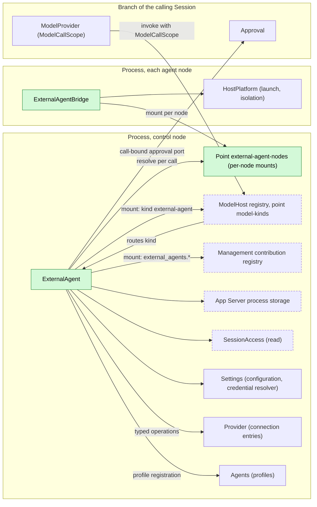
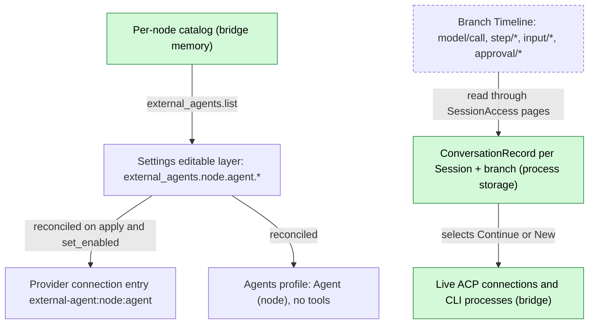
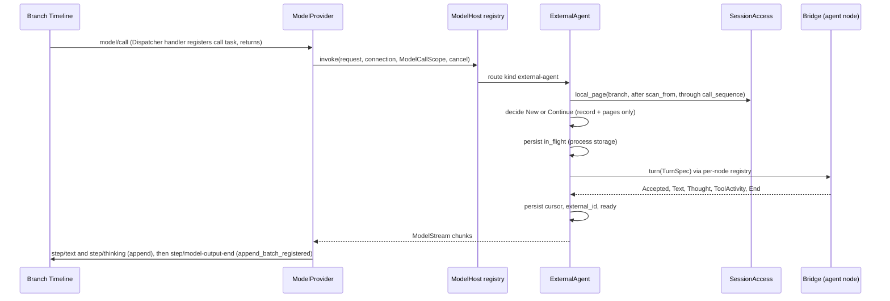
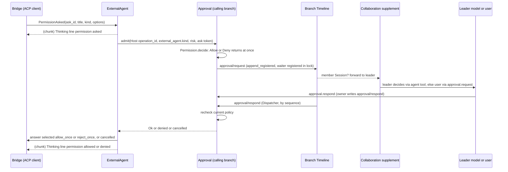
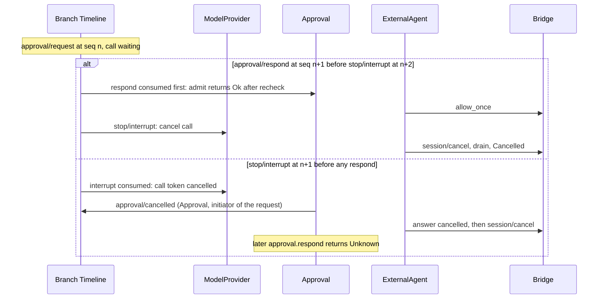

# ExternalAgent

Status: Draft. Overall design: [overview §5.10](../overview.md#510-externalagent). Phase: P3. Language: TypeScript first ([overview §11.3](../overview.md#113-assignment)).

ExternalAgent makes locally installed coding agents (Claude Code, Codex, Cursor, OpenCode, ZCode and similar) usable as a kind of model connection. A Session whose model is an external agent runs through Loop and ModelProvider as usual: ExternalAgent is the ModelHost provider for the connection kind `external-agent`, turns each dim model request into one external turn and turns the external stream back into model output chunks. External agents use their own tools; their permission requests become ordinary dim approvals in the Session that runs the call. ExternalAgent writes no Timeline event of its own.

## 1. Structure



ExternalAgent never sits in a Session's or branch's dependency chain: it registers into consumer-owned registries ([extension-registry](../contracts/extension-registry.md): ModelHost point `model-kinds`, Management), and owns its own point `external-agent-nodes` built on the same `ExtensionRegistry` with one mount per bridge row, so its reload never reloads ModelProvider, and one offline node only fails the calls targeting that node. Approval is reached only through the port ModelProvider passes with the call.

| Part | Scope | Depends on | Provides |
| --- | --- | --- | --- |
| `ExternalAgent` | Process, control node | ModelHost provider-kind registry; Management registry; `SessionAccess` (read); App Server process storage; Settings typed configuration and credential-reference resolver; Provider typed connection-entry operations; Agents profile registration; its own `ExternalAgentNode` registry | Provider for kind `external-agent`; management contribution `external_agents` |
| `ExternalAgentBridge` | Process, one row per node: local row, `peer:<node>/ExternalAgentBridge` elsewhere ([overview §3.1](../overview.md#31-multiple-nodes)) | That node's `HostPlatform` | `ExternalAgentNode`, mounted into ExternalAgent's per-node registry, exported over the link |

**Contracts depended on**: ModelHost provider-kind registry and the ModelProvider supplement `ModelCallScope` (call identity, `SessionFacts` reference, call-bound approval port: §A.2); the existing `ModelDriver`/`ModelStream`/`ModelChunk`/`HostError`/`ModelFailureFacts` contract ([host.rs](../../../crates/dim-agent-capabilities/src/host.rs)) and ModelProvider's failure policy ([recovery.rs](../../../crates/dim-agent-capabilities/src/model_provider/recovery.rs)); Approval's existing `admit` ([Approval](../../architecture/rust-agent/plugins/Approval.md)); the Collaboration supplement "member approval forwarded to the leader" (decisions E6); [session-access](../contracts/session-access.md); [extension-registry](../contracts/extension-registry.md); App Server process storage; Settings; [Management](Management.md). **Contracts defined here**: the connection kind `external-agent` and its target `{node, agent}`; `ExternalAgentNode`; the conversation record; the approval call shape `external_agent.<kind>`; configuration keys `external_agents.*`; methods `external_agents.*`; the ACP schema and conformance suite shared with [AcpGateway](AcpGateway.md) (client side). ModelHost, Provider, Agents, Approval and Collaboration never name this plugin.

## 2. Data and state



Configuration is the source of truth for enablement; connection entries and profiles are reconciled from it through their owners' typed operations, so they are rebuildable. Conversation records hold only the delivery cursor and external identity; every delivery decision is recomputed from Timeline pages plus the record. The bridge holds nothing that must survive.

```text
ConversationRecord {
  key: (session_id, branch_id),
  target: { node, agent },
  external_id: String,          // ACP sessionId or CLI conversation id
  cursor: u64,                  // sequence of the model/call of the last accepted call on this branch
  scan_from: u64,               // lowest local sequence that may hold an input/message not yet consumed
  last_request_id: String,
  state: ready | in_flight { request_id } | uncertain,
}
```

Records live in App Server process storage under this plugin's root (atomic replace, format version). At `apply`, every `in_flight` record becomes `uncertain`; records are kept 30 days after last use (A12).

## 3. Flows

### 3.1 Model call (initialize or continue)



The decision reads only facts at or before `call_sequence` (dispatched, so published, and a batch boundary) and the record; it never reads another plugin's memory. The record is written ahead of the external turn, so a restart can tell that a turn may have started.

Delivery decision, given record `R`, request `Q`, scope `S`:

1. Scan local events of `S.branch` in `(R.scan_from, S.call_sequence]` (whole local branch without a usable record): `input/message`, `input/consumed` with sequence `> R.cursor`, output events (`step/text`, `step/thinking`, `step/tool-use-start`) with sequence `> R.cursor`.
2. **Initialize** when there is no record, `R.target` differs, `R.state = uncertain`, or an output in the range belongs to a request other than `R.last_request_id` (another model answered). Opens `New` and sends a transcript of `Q.messages` (§5) plus the instruction to answer the last user message.
3. **Continue** otherwise: `Continue { external_id }` with the consumed inputs of the range in consumption order.
4. New `scan_from` = lowest sequence of a collected `input/message` not consumed by `S.call_sequence`, else `S.call_sequence`. An empty delta fails before acceptance with `external_agent_no_input` (A8).

`Q.messages` on a child branch is the ancestor prefix up to the cut plus local events, so a child initializes from its own history and never touches the parent's conversation; a fork (new Session id) does the same.

### 3.2 External permission request



The permission request is an ordinary call admission in the Session running the external call (for a delegated member, the member Session): Permission's preset decides first, and only `Ask` writes `approval/request`. Forwarding to a leader is Collaboration's rule (E6); ExternalAgent only sees the outcome of `admit`. A thinking line is emitted before asking, so the call already has visible output while it waits (§4).

Mapping: ACP `toolCall.kind` → call name `external_agent.<kind>` and risk: `read`, `search` → `read_filesystem`; `edit`, `delete`, `move` → `write_filesystem`; `execute` → `execute_process`; `fetch` → `network`; others → unclassified (A7). `admit` `Ok` selects an `allow_once` option; denial selects `reject_once`; when the needed once-option is absent, or the ask was cancelled, the bridge answers outcome `cancelled`. `*_always` is never selected. Non-interactive CLI adapters have no request channel: their launch arguments put the agent in its own non-auto-approving mode, so a request it cannot ask is refused by the agent (A16).

### 3.3 Delegation and interrupt

1. A leader Session whose resource node is `build-box` asks the `agent` tool for "Codex (build-box)". Collaboration creates a member Session with that profile; the member inherits the leader's resource node `build-box`, so the bridge runs Codex on `build-box` in the member's cwd. A leader on another node gets `external_agent_wrong_node` before acceptance (A13).
2. Interrupt: ModelProvider cancels the call token; the bridge sends ACP `session/cancel` (or signals the CLI), answers any pending permission request `cancelled`, drains to the prompt response, and after 10 s grace (A4) kills the process. Text already received stays; the next input continues the same conversation if the cancel was acknowledged.

## 4. Timing and conflicts



Answer versus interrupt is decided by Dispatcher order of sequence numbers on the calling branch; the request is always ended by Approval. The external agent learns only the decision that won.

| Scenario | Order | Outcome | Owner |
| --- | --- | --- | --- |
| Approval pending, no answer for a long time | — | No dim timeout; the call stays open; the user or leader can interrupt (A17) | Approval, Collaboration |
| External agent withdraws its request or ends its prompt while dim asks | bridge `PermissionWithdrawn` | ExternalAgent cancels the ask token; Approval writes `approval/cancelled`; a late answer returns Unknown | ExternalAgent, Approval |
| Leader unavailable (unloaded, turn ended, its request to the member stopped) | per Collaboration | Collaboration's supplement decides delivery or fallback to the user; stopping the member request interrupts the member turn (row above) | Collaboration |
| Steer while an approval is pending | `input/applied` after the thinking line | Not a replacement (visible output exists); Loop delivers the Steer in the next request | Loop |
| ExternalAgent reload with a pending approval | — | Call gets "provider unavailable" (not `capability reloading`); ask cancelled; process killed; record `uncertain` | ExternalAgent, ModelProvider |
| Agent node offline | that node's mount inactive | Calls for that node fail before acceptance `node_unavailable` (transient); other nodes unaffected | ExternalAgent registry |
| Process restart mid-call | `model/call` and `approval/request` unended | Approval recovery writes `approval/cancelled`; ModelProvider fails the call without invoking; record `uncertain`; nothing re-sent | Approval, ModelProvider |

All other rows: [Appendix B](#appendix-b-full-conflict-table).

## 5. Context mapping

| Audience | Sees | Form |
| --- | --- | --- |
| External agent, initialize | `Q.messages` as one text prompt `<dim-history>`: `[user]`, `[assistant]`, `[tool call <name>] <input JSON>`, `[tool result] <content text>`, images as `[image]`, thinking omitted (A14); then the instruction | ACP text block or CLI stdin |
| External agent, continue | Per consumed input: raw block texts verbatim, then user content (images as ACP image blocks when the agent declares `promptCapabilities.image`, else `[image omitted]`) | Prompt blocks |
| External agent, never | dim system prompt, prompt sources, tool declarations, sampling parameters, `metadata`, other plugins' events, diagnostics; `config.reasoning` only through an adapter reasoning flag | — |
| Calling Session's history | External reply as `step/text`; tool activity and permission lines as `step/thinking` (`[tool] <title>: <status>`, `[permission] <title>: <state>`) | Model output facts |
| Leader model (member approval) | The approval's `call` (`external_agent.<kind>`, `{agent, title, kind, raw_input}` bounded to 4 KiB, A18) as Collaboration renders it in the `agent` tool | Collaboration's tool result |
| User | `approval.request` with the same call shape | Client UI |

Keyed blocks are delivered once at consumption; "in effect" and retirement have no meaning externally, and a re-initialization sends only what the projection holds. Committed external output enters history like any model output: compaction summarizes it, children inherit it up to the cut, a later native model sees it as assistant messages, and an interrupted output keeps text and drops thinking. Collaboration's and Workflow's results read the last request's text, so tool activity never pollutes results. Non-interactive Sessions behave identically; the approval mapping is the same because approvals are not `ask_user`.

## 6. Interfaces (summary)

| Interface | Kind | Purpose |
| --- | --- | --- |
| `external_agents.list` / `set_enabled` / `configure` | Management methods | Per-node detection, enablement, configuration ([A.1](#a1-management-methods)) |
| Kind `external-agent`, target `{node, agent}` | ModelHost registry contribution | Model calls for external profiles ([A.2](#a2-provider-registration-and-call-scope)) |
| `ExternalAgentNode` | Per-node process service | `detect`, `turn` with answerable permission asks ([A.3](#a3-bridge-service-and-adapters)) |
| Approval call `external_agent.<kind>` | Approval admission (Host source) | External permission requests |
| ACP schema and conformance suite | Shared with AcpGateway | Client side ([A.5](#a5-shared-acp-schema)) |

## 7. Security

External agents run with their own accounts and tools; dim admits their actions only where they ask, through the calling Session's policy and Approval, and cannot stop actions the agent takes without asking: the node's HostPlatform isolation is the enforcement boundary, and replay or fork never widens it. `*_always` is never selected. Credentials are environment values resolved from references by Settings' resolver at launch and never written to records, Timeline, diagnostics or replies. Enabling an agent is host configuration through Management only; the model cannot enable agents. Executables are resolved on the node, never from project files.

## Appendix A. Interface details

### A.1 Management methods

| Method | Params | Result | `mutating` |
| --- | --- | --- | --- |
| `external_agents.list` | `refresh?` | Per node: agent, executable, version, protocol (ACP or CLI), enabled, configuration (references only); offline nodes marked `node_unavailable` | no |
| `external_agents.set_enabled` | `node`, `agent`, `enabled` | New state | yes |
| `external_agents.configure` | `node`, `agent`, `executable?`, `args?`, `env?: {name: credential reference}`, `reasoning?` | New configuration | yes |

Detection runs at load and on `refresh` (A1); detected agents stay disabled until enabled (A3). Configuration changes are volatile updates, never reloads. Enabling `(node, agent)` reconciles, through Provider's typed connection-entry operation, the entry `external-agent:<node>:<agent>` with one model `default` (A2) and target `{node, agent}`, and, through Agents' profile registration, a profile `{ name: "<Agent> (<node>)", system_prompt: "", tools: [], model: { provider_id: "external-agent:<node>:<agent>", model_id: "default" } }`. Disabling removes both; existing Sessions keep their adopted model and fail their next call with `external_agent_disabled`. Profiles are listed by `AgentIndex` like any Agent, so Collaboration's `agent` tool can request them.

### A.2 Provider registration and call scope

```rust
// Registry owned by ModelHost (overview §7.2 Aimux supplement, extension-registry.md);
// one mount instance registers kind "external-agent" in apply, unregisters in its ctx.effect.
fn invoke(&self, request: Arc<ModelRequest>, target: ConnectionTarget, scope: ModelCallScope,
          cancel: CancellationToken) -> HostFuture<'_, ModelStream>;
// ModelCallScope (ModelProvider supplement): session_id, branch_id, turn_id, request_id,
// call_sequence, SessionFacts (cwd, resource_node, interactive, collaboration_role, ...),
// plus the call-bound approval port used here:
trait CallApproval {   // bound by ModelProvider to its branch's Approval
    async fn admit(&self, operation_id: String, call: ApprovalCallData, risk: Option<String>,
                   cancel: CancellationToken) -> Result<(), HostError>;
}
```

The port forwards to the existing `Approval::admit(AdmitCall { source: BranchSource::Host { operation_id }, call }, risk, cancel)`; `operation_id = "external-agent:<request_id>:<ask_n>"`. While the kind is inactive, ModelHost fails requests of the kind before acceptance (transient); other kinds are unaffected.

### A.3 Bridge service and adapters

```rust
trait ExternalAgentNode {   // per node; resolved per call from ExternalAgent's node registry
    async fn detect(&self) -> Vec<Detected>;   // agent, executable, version, protocol
    async fn turn(&self, spec: TurnSpec, cancel: CancellationToken) -> Result<TurnStream, BridgeError>;
}
struct TurnSpec { agent: String, config: AgentConfig, cwd: String, conversation: Conversation, prompt: Vec<PromptBlock> }
enum Conversation { New, Continue { external_id: String } }
enum TurnUpdate { Accepted { external_id: String }, Text(String), Thought(String),
                  ToolActivity { id: String, title: String, status: String },
                  PermissionAsked { ask_id: String, title: String, kind: String,
                                    raw_input: Option<JsonObject>, options: Vec<PermissionOption> },
                  PermissionWithdrawn { ask_id: String }, Usage(Usage), End(EndReason) }
impl TurnStream { fn answer(&self, ask_id: &str, answer: PermissionAnswer); } // Allow | Reject | Cancelled
```

| Adapter | Open | Turn | Cancel |
| --- | --- | --- | --- |
| ACP client | Spawn the ACP command through the node's HostPlatform (cwd, isolation); `initialize` with fs and terminal client capabilities off; `session/new {cwd, mcpServers: []}`, or `session/load` for a known `external_id` when `loadSession` is declared | `session/prompt`; `session/update` streams; `session/request_permission` → `PermissionAsked`; `Accepted` once the request is written | `session/cancel`, answer pending permission requests `cancelled`, drain; kill after grace (A4) |
| Non-interactive CLI | Per turn spawn with the conversation id when continuing; restrictive permission flags (A16) | Prompt on stdin, structured output parsed per adapter; `Accepted` after spawn and complete stdin write | Interrupt signal, grace, kill |

One ACP process per conversation, closed after 10 min idle (A5). Adapter definitions are data inside this plugin (A6).

### A.4 Stream mapping and request fields

| External | `ModelChunk` |
| --- | --- |
| `Accepted` | `MessageStart { message_id: "<external_id>:<request_id>" }` |
| Message chunk / CLI text | `Text(delta)`; an open thinking block is closed first |
| Thought chunk / CLI reasoning | `Thinking(delta)`; an open text block is closed first with `TextEnd` |
| `tool_call`, `tool_call_update` status change | `Thinking("[tool] <title>: <status>")` (A9); never `ToolStart` (no tools offered; ModelProvider rejects unoffered calls) |
| Permission asked / decided | `Thinking("[permission] <title>: asked")`, then `allowed`, `denied` or `cancelled` |
| `plan`, `available_commands_update`, `current_mode_update`, history replayed by `session/load` | Not forwarded; diagnostics |
| Usage reported by the adapter | `Usage` (A10) |
| End `end_turn` | Close open block, `MessageStop { reason: EndTurn }` |
| End `max_tokens` | `MessageStop { reason: MaxTokens }` |
| End `max_turn_requests`, `refusal`, CLI non-zero exit | `HostError::Failed`, non-transient (A11) |
| End `cancelled` after our cancel | Stream ends without `MessageStop`; ModelProvider reports `Cancelled` |

`ModelChunk::Content` is not emitted. Request fields: `messages` only at initialization; `system`, `tools`, sampling fields, `provider_options`, `metadata`, `capability_snapshot` not forwarded.

Retry safety: failures before `Accepted` that may be retried (spawn failure, connection refused, `node_unavailable`) are `HostError::Failed` with `ModelFailureFacts { origin: Transport, transient: true }`; every other failure is non-transient. ModelProvider stops on non-transient errors and once a non-`MessageStart` chunk arrived, so a turn the agent may have started is never sent twice. The record is unchanged before `Accepted`, so a retry computes the same delta.

### A.5 Shared ACP schema

Pinned protocol version, generated types per language, transcript-based conformance suite shared with AcpGateway; fixtures cover initialize, new/load, prompt with text and image, streamed updates, cancel during a prompt, a permission request answered allow, reject and cancelled, a permission request during cancel, and process exit mid-prompt. No runtime code is shared ([overview §5.15](../overview.md#515-acpgateway)).

### A.6 Mechanics per step

| Step | Path |
| --- | --- |
| Request | Loop writes `input/consumed`* and `step/model-start`; ContextPreparation writes `model/call` (`Timeline::append`); ModelProvider consumes it on its Dispatcher, registers the call task, returns |
| Resolve | In the task: Provider resolves `{kind: external-agent, target}`; ModelHost routes to the registered provider with `ModelCallScope` |
| Read | `SessionAccess` facade, resolved per call (`Reloading` during an Agents reload fails before acceptance, transient); `local_page(branch_id, after, limit, through = call_sequence)` |
| Write-ahead | Persist `in_flight` before sending; on `Accepted` persist cursor, `last_request_id`, `scan_from`, `external_id`; an attempt ending before `Accepted` restores the record |
| Output | ModelProvider commits chunks (`Timeline::append`) and writes `step/model-output-end` with `append_batch_registered`; `StateCell<ModelProgress>` shows uncommitted text |
| Approval | Approval `append_registered` of `approval/request` (waiter registered in the commit lock); `approval/respond` consumed on the branch Dispatcher; Approval writes `approval/cancelled` on every other end |
| End | External end or confirmed cancel → `ready`; kill or lost link after `Accepted` → `uncertain` |
| Reload | Mount disposer cancels the plugin's call tokens (asks cancelled first), kills processes, then unregisters; each call ends with a provider-unavailable failure, never `CAPABILITY_RELOADING` |
| Restart | ModelProvider rebuild fails unended `model/call`s; Approval rebuild cancels unmatched requests; `apply` marks `in_flight` records `uncertain` |

ExternalAgent itself appends nothing, subscribes to no Dispatcher and owns no `StateCell`.

## Appendix B. Full conflict table

| Scenario | Order | Outcome | Owner |
| --- | --- | --- | --- |
| Turn interrupt before `model/call` consumed | interrupt < `model/call` | `Cancelled` without invoking | ModelProvider |
| Interrupt before `Accepted` | — | Attempt cancelled; nothing sent; record unchanged | Bridge, ModelProvider |
| Interrupt after `Accepted` | `model/call` < interrupt | Cancel sent; updates until the prompt response committed; `Cancelled`; record `ready`, cursor advanced | Bridge, ModelProvider |
| Cancel not acknowledged within grace | — | Killed; `Cancelled`; `uncertain`; next call initializes | Bridge |
| `approval/respond` before interrupt | respond < interrupt | Decision delivered; then cancel as above | Approval |
| Interrupt before `approval/respond` | interrupt < respond | `approval/cancelled`; ask answered `cancelled`; late respond Unknown | Approval |
| Policy changed while asking | `permission/changed` < respond | Recheck after allow; `Deny` → `approval/cancelled`, ask answered reject | Approval |
| Preset decides without asking | — | `Allow`/`Deny` returned at once; no event | Permission |
| Several asks in one call | — | Independent approvals in arrival order | Approval |
| Permission request arriving during cancel drain | — | Answered `cancelled` without asking | Bridge |
| External agent withdraws its request | `PermissionWithdrawn` | Ask cancelled; `approval/cancelled` | ExternalAgent, Approval |
| Leader unavailable for a member approval | — | Collaboration supplement decides; ExternalAgent waits for a fact | Collaboration |
| No answer, no interrupt | — | Waits indefinitely (A17) | — |
| Steer before any visible chunk | `input/applied` (Steer) during call | ModelProvider replaces the request, cancels; next request delivers the Steer (and earlier inputs if not accepted) | ModelProvider, Bridge |
| Steer after visible output (incl. permission line) | — | Not replaced; new request in the same turn | Loop |
| `input/withdrawn` of a queued input | withdrawn before consumption | Never consumed, so never delivered; `scan_from` passes it once consumption moves past | InputQueue, Bridge |
| Concurrent Queue/Append inputs | Timeline order | Delivered in consumption order | Loop, Bridge |
| Tool batch not settled | — | No dim tool calls in these requests | — |
| Compaction before a call | `context/compaction` < `model/call` | Continue unaffected; initialize includes the summary | ContextPreparation, Bridge |
| Child branch cut, including between `approval/request` and respond | any | Child has no record and initializes; Approval tracks local requests only, so the parent's request stays the parent's | Bridge, Approval |
| Branch interrupt or close mid-call | branch interrupt | As interrupt; Approval close cancels asks | ModelProvider, Approval |
| Native model in between | foreign outputs after cursor | Re-initialize | Bridge |
| Pre-acceptance transient failure | — | Retried with the same delta | ModelProvider |
| ExternalAgent reload mid-call | — | Provider-unavailable failure; killed; `uncertain`; ModelProvider not reloaded | ExternalAgent |
| Agents reload during resolve | — | `SessionAccess` `Reloading` → transient before acceptance | SessionAccess |
| Process restart mid-call | unended facts | Settled by rebuilds; `uncertain`; nothing re-sent | ModelProvider, Approval |
| Session unload and restore | — | Records persist; ACP process closed by idle; reopen with `session/load` or initialize | Bridge |
| Agent node offline | mount inactive | `node_unavailable` transient before acceptance, retried within bound, then `Failed`; other nodes unaffected | ExternalAgent |
| Link lost after `Accepted` | — | Non-transient failure; asks cancelled; `uncertain` | Bridge |
| Session resource node differs from agent node | — | `external_agent_wrong_node`, non-transient (A13) | ExternalAgent |
| Duplicate `set_enabled` | — | Idempotent | ExternalAgent |
| Client detach | — | No effect; pending approvals wait for another client or the leader | — |

## Appendix C. Errors and recovery

| Code | Before acceptance | Meaning |
| --- | --- | --- |
| `external_agent_not_installed` | yes, non-transient | Executable not found on the node |
| `external_agent_auth_required` | yes, non-transient | Agent needs its own login; presentation names the command |
| `external_agent_launch_failed` | yes, transient | Spawn or connection failure |
| `node_unavailable` | yes, transient | Agent node mount inactive |
| `external_agent_disabled`, `external_agent_wrong_node`, `external_agent_no_input` | yes, non-transient | A.1, §3.3, §3.1 |
| `external_agent_protocol` | either | Malformed output; killed; `uncertain` if after acceptance |
| `external_agent_exited` | no | Process exited or link lost mid-turn; `uncertain` |
| provider unavailable | either | ExternalAgent unloading; asks cancelled first |

Errors surface as `ModelOutputOutcome::Failed`; committed text stays. Continuation failure or an `uncertain` record re-initializes (A15).

## Appendix D. Acceptance

Flow tests through public interfaces with a scripted ACP agent and a scripted CLI:

1. First call initializes; second delivers only the new input; an Append input is delivered with its consuming request; a withdrawn Queue input is never delivered.
2. Text, thought and tool activity map to `step/text` and one `step/thinking` block; no `step/tool-use-start`.
3. Interrupt before and after acceptance; ignored cancel → `uncertain` → next call initializes.
4. Steer before visible output replaces the request; after output (including a permission line) it becomes a new request.
5. Transient pre-acceptance failure retried; post-acceptance failure not.
6. Child branch and native↔external switch initialize; parent conversation untouched.
7. Restart with `in_flight` record and a pending approval → `uncertain`, `approval/cancelled`; no resend.
8. Collaboration request to an external profile returns the external reply; a leader on another node gets `external_agent_wrong_node`.
9. Permission: WorkspaceWrite `execute` → `approval/request`; allow → `allow_once`, deny → `reject_once`; ReadOnly `execute` → reject without event; FullAccess → allow without event; no `allow_once` option → `cancelled`.
10. Member Session: the approval reaches the leader through Collaboration and the leader's decision is delivered; without a leader the user answers via `approval.request`.
11. Interrupt racing `approval.respond` in both orders; external withdrawal cancels the approval; ExternalAgent reload cancels it without reloading ModelProvider.
12. One offline peer node fails only its calls; other nodes and native connections continue.
13. Shared ACP conformance suite passes on the client side.

## Appendix E. Assumptions

| # | Assumption | Basis | Effect if rejected |
| --- | --- | --- | --- |
| A1 | Detection on load and explicit refresh, not by watching | Judgment | Background polling |
| A2 | One model `default` per external agent | Judgment | Per-agent model lists |
| A3 | Detected agents are disabled until enabled | Judgment (they spend the user's accounts) | Default on |
| A4 | Cancel grace 10 s | Judgment | Other bound |
| A5 | One ACP process per conversation, closed after 10 min idle | Judgment | Shared process |
| A6 | Adapter definitions are data inside the plugin | Overview §11.3 | Per-agent plugins |
| A7 | ACP tool kind → call name `external_agent.<kind>` and risk category mapping | Decisions E6 (ordinary approval); mapping is judgment | Single unclassified category (always asks under WorkspaceWrite) |
| A8 | An empty delta fails the call | Judgment | Send a continuation prompt |
| A9 | External tool activity rendered as thinking lines | Judgment | Text, or diagnostics only |
| A10 | Usage only when the adapter reports it | Judgment | — |
| A11 | `max_turn_requests` and `refusal` fail the request | Judgment | Map to `EndTurn` |
| A12 | Records kept 30 days after last use | Judgment | Other retention or deletion on Session close |
| A13 | An external agent serves only Sessions whose resource node is its node | Overview §3.1; judgment | Cross-node working directories |
| A14 | Transcript format; thinking omitted | Overview §5.10 lists the content; format is judgment | Another rendering |
| A15 | Uncertain or failed continuation re-initializes from history | Overview §13 (still open) | Explicit failure |
| A16 | CLI adapters launch in the agent's own non-auto-approving mode; they cannot ask dim | Judgment (no request channel) | Per-CLI permission bridges |
| A17 | No timeout on an external permission approval | Approval has none; Questions precedent (E24) | Timeout answering reject |
| A18 | Approval call input `{agent, title, kind, raw_input}` with `raw_input` bounded to 4 KiB | Judgment | Other shape |

## Appendix F. Open questions

| Question | Description |
| --- | --- |
| Call-bound approval port | `ModelCallScope` must carry an approval port bound to the branch's Approval; this requires ModelProvider to inject `B:Approval` (an Approval reload then reloads ModelProvider, rare). To be registered with the ModelProvider supplement in overview §7.1 |
| Approval during a model step | `approval/request` with a `Host` source is written while `step/model-start` is open; clients and history projection must tolerate it (no model-visible effect expected) |
| External conversation continuation | Overview §13; this design re-initializes (A15) |
| ACP `session/load` | Whether a `ready` record after a process restart should continue via `session/load` rather than initialize |
