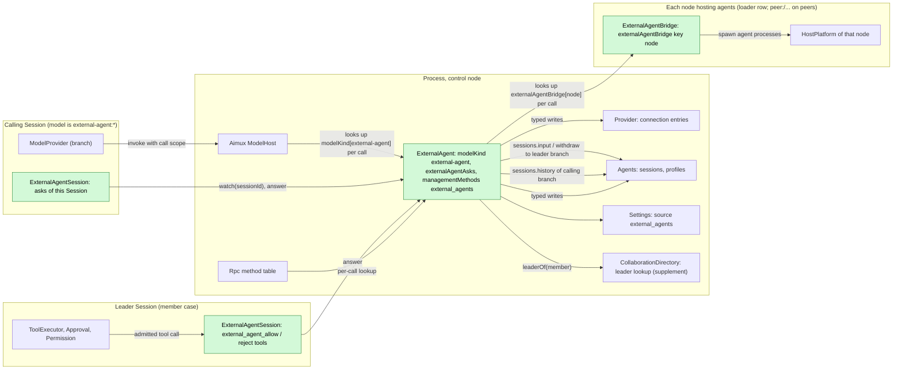
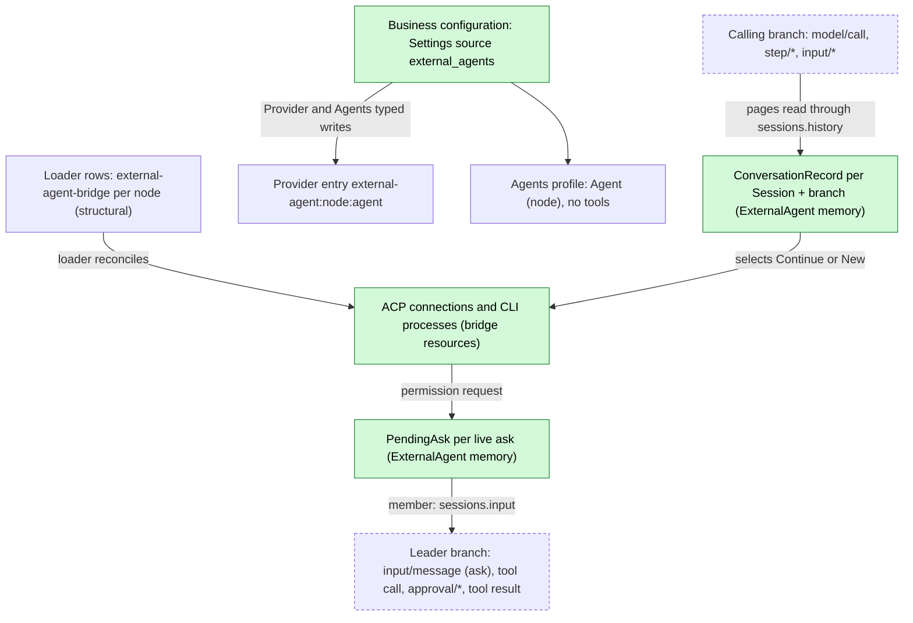
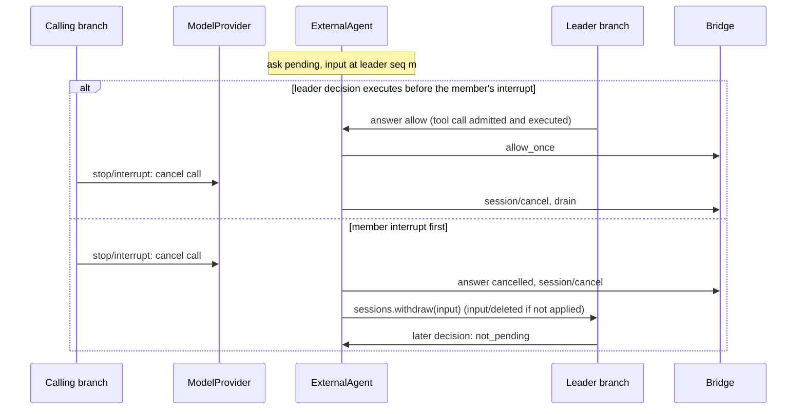

# ExternalAgent

Status: Draft (redesign, [#145](https://github.com/arcships/dim/issues/145)). Overall design: [overview §4](../overview.md#4-plugin-catalog); scope: [ADR 002](../../adr/002-plugin-scope.md) (process, with per-node bridge rows and a Session part). Phase: P3. Language: TypeScript first ([overview Appendix C](../overview.md#appendix-c-implementation-language)).

ExternalAgent makes locally installed coding agents (Claude Code, Codex, Cursor, OpenCode, ZCode and similar) usable as models. A Session whose adopted model is the Provider entry `external-agent:<node>:<agent>` runs through Loop and ModelProvider unchanged: the entry is an ordinary Provider entry ([auxiliary model](../appserver/auxiliary-model.md), S4), and Aimux's ModelHost looks up the `modelKind` service keyed `external-agent` on each call. ExternalAgent turns each model request into one external turn and turns what the agent produced back into model chunks. The external agent runs its own tools. The model stream carries only the text and thinking the agent produced. dim never adds approval items or synthetic lines to it.

When the agent asks permission for one of its own actions, ExternalAgent asks the calling Session's interaction counterpart outside the model stream. A Collaboration leader's model receives the ask as an input and decides with a tool, and that tool call passes the leader's Approval and Permission like any other. Without a leader, the user answers through a Session method. A Session with no counterpart rejects the ask. Agent processes live in per-node bridge plugins that the loader manages. All contracts are language-neutral named services ([ADR 002 D5](../../adr/002-plugin-scope.md#d5-contracts-are-language-neutral)); the Rust forms are in [Appendix G](#appendix-g-rust-binding).

Changes from the previous draft, which is superseded:

| Previous draft | This design | Why |
| --- | --- | --- |
| `approval_ask` / `approval_ask_withdrawn` items in the model stream; ModelProvider admitted them through Approval and answered with `answerApproval`; an Approval host-source supplement | No approval data in the model contract. The ask goes to the counterpart as an input plus a decision tool, or to the user through a Session method (§3.2). ModelProvider and Approval are unchanged | [#28](https://github.com/arcships/dim/issues/28); [ADR 003](../../adr/003-approval-scope.md) D1; principles §4 rule 4 |
| A synthetic thinking line before each ask, and tool activity as `[tool]` thinking lines, so that a Steer would not replace the request | Only agent-produced text and thought reach the stream; tool activity is a Session broadcast notice. ModelProvider's replace-unless-visible-output rule applies as written (§4) | #28 |
| ExternalAgent started and stopped one bridge per node itself | `ExternalAgentBridge` is a loader row per node (`peer:<node>/external-agent-bridge` on peers); the loader reconciles it and its effect ends its processes (§3.4) | [#37](https://github.com/arcships/dim/issues/37); principles §1 |
| ModelHost was described both as collecting `modelKind` (a dependency cycle) and as accepting a registration | One link: ModelHost looks up `modelKind[<kind>]` on each call without depending on its providers, as Rpc does for `managementMethods`. Neither side depends on the other (§1) | #37; ADR 002 D3 |
| Conversation records persisted in `pluginFiles` | Records live in ExternalAgent's memory as handles of live external conversations, and the next call after a loss re-initializes (§2) | #37 side note; principles §4 rule 4 |

## 1. Structure



External agent connections, catalogs and live conversations are shared across Sessions, so ExternalAgent is a process plugin (ADR 002 D1). Agent processes are host resources of a node, so they belong to a plugin on that node: `ExternalAgentBridge` is a process plugin with one loader row per node that hosts agents. The control node's row is part of the product profile whenever ExternalAgent is enabled. A peer node's row is `peer:<node>/external-agent-bridge`, added or removed only by PluginManager's structural operations (ADR 002 D4: node binding is structural). The loader reconciles these rows like any other. A peer row waits while its node or link is gone and loads again when it returns. The bridge's resources are released by its own `ctx.effect` whenever the row unloads. Enabling an agent on a node is business configuration and never adds a row.

Asks of a Session are per-Session work, and the tools that decide them are offered to Sessions, so the plugin has one Session part, `ExternalAgentSession`, installed in every Session while ExternalAgent is enabled (ADR 002 D2: tools through `toolContribution`, client methods through `sessionMethods`, notices through the Session broadcast). Its assembly never depends on the Session's model or role, so the tool set and prompt prefix stay stable across model switches and forks.

Dependencies point from the extension to the core and never form a cycle:

- ModelHost looks up `modelKind[<kind>]` on each call and never depends on ExternalAgent. ExternalAgent does not depend on Aimux.
- ExternalAgent looks up `externalAgentBridge[<node>]` on each call and does not depend on any bridge. A bridge does not depend on ExternalAgent.
- `ExternalAgentSession` depends on the enclosing process service `externalAgentAsks`.

A missing, Pending or reloading part therefore fails only the calls that need it.

| Part | Scope | Depends on | Provides |
| --- | --- | --- | --- |
| `ExternalAgent` | Process, control node | Provider (connection-entry write operation, proposed), Agents (profile write operation, proposed; `sessions`), Settings (source `external_agents`), CollaborationDirectory (`leaderOf`, supplement); looks up `externalAgentBridge` per call | `modelKind` key `external-agent`; `externalAgentAsks`; `managementMethods` key `external_agents` |
| `ExternalAgentBridge` | Process, one loader row per node hosting agents | That node's `HostPlatform` | `externalAgentBridge` key = node name (exported to the control node over the link) |
| `ExternalAgentSession` | Session | `externalAgentAsks` | `toolContribution` `external_agent_allow`, `external_agent_reject`; `sessionMethods` namespace `external_agent`; Session broadcast notices `externalAgent.*` |

**Contracts depended on.**

- The Aimux supplement: ModelHost looks up `modelKind` by the resolved connection's kind on each call, and the call fails before acceptance when no provider is registered (A.2).
- The ModelProvider supplement that passes `ModelCallScope` to the model kind ([overview Appendix B](../overview.md#appendix-b-supplements-to-existing-plugins)).
- Provider's external-agent connection type and connection-entry write operation, and Agents' profile write operation (both proposed and owned by those plugins; Appendix F).
- The existing model chunk and failure data ([host.rs](../../../crates/dim-agent-capabilities/src/host.rs)) and ModelProvider's failure policy ([recovery.rs](../../../crates/dim-agent-capabilities/src/model_provider/recovery.rs)).
- `sessions` (`input` with source raw blocks, `withdraw`, `history`; [session-access](../contracts/session-access.md)).
- `toolContribution` and `sessionMethods` ([session-boundary](../contracts/session-boundary.md)), and the Session broadcast.
- The Collaboration supplement `leaderOf` (A.6).
- Settings' typed writes and change notification for the business source `external_agents`.
- Each node's `HostPlatform`.
- Existing typed services are reached by name from a TypeScript part once [#4](https://github.com/arcships/dim/issues/4) exposes them.

**Contracts defined here.**

- `modelKind` key `external-agent` and its target `{node, agent}`.
- `externalAgentBridge`, `externalAgentAsks`, and the two decision tools.
- The `external_agent` Session methods and notices.
- The ask input form (marker `external_agent:ask`).
- Business configuration `external_agents.*` and methods `external_agents.*`.
- The ACP schema and conformance suite shared with [AcpGateway](AcpGateway.md) (client side).

Provider, Agents, Approval, Permission, ModelProvider and Collaboration never name this plugin.

## 2. Data and state



**Business configuration** ([ADR 002](../../adr/002-plugin-scope.md) D4) is one document in the Settings source `external_agents`: `{ nodes: { <node>: { <agent>: { enabled, executable?, args?, env?, reasoning? } } } }`. Settings validates it against ExternalAgent's schema and applies defaults; ExternalAgent reads it at use time and passes the entry with each bridge call, so a bridge reads no configuration of its own. It is written only through ExternalAgent's management methods (A.1). `env` values are ordinary strings of this document, which may hold an agent's credentials; ExternalAgent owns them ([settings-service §1.2](../appserver/settings-service.md#12-decision-secrets-belong-to-their-owner)): the source has a user file only, so `env` never sits in a project file, and no Settings resolver is involved. A change is a data update plus notification, never a reload. Provider entries and Agents profiles are requested through those owners' public typed write operations and are rebuildable from this document.

**Loader rows.** Each node's `external-agent-bridge` row is structural configuration: it says which nodes may run agents, not which agents run there. `external_agents.list` reports a node without an active bridge as `no_bridge`.

**Conversation record.** A record is held in ExternalAgent's memory as a handle of one live external conversation. It is never persisted:

```text
ConversationRecord {
  key: (session_id, branch_id),
  target: { node, agent },
  external_id: String,          // ACP sessionId or CLI conversation id, owned by the bridge
  cursor: u64,                  // sequence of the model/call of the last accepted call on this branch
  scan_from: u64,               // lowest local sequence that may hold an input/message not yet consumed
  last_request_id: String,
  state: ready | in_flight { request_id } | uncertain,
}
```

Every delivery decision is recomputed from Timeline pages plus the record (§3.1). Losing the record (ExternalAgent reload, process restart, eviction after A12) only makes the next call on that branch initialize from history (A15). The key includes the branch and Session ids, so a child branch or a fork, which has a new branch or Session id, never continues another branch's external conversation.

**Pending ask.** A pending ask is held in ExternalAgent's memory for as long as the external request waits for an answer. It is part of a live I/O exchange, so it is settled, never rebuilt, on reload:

```text
PendingAsk {
  ask_id: String,               // "<request_id>:<n>", unique per call
  call: { session_id, branch_id, request_id },
  agent: { node, agent }, title: String, kind: String, raw_input: JSON (bounded to 4 KiB, A18),
  route: leader { session_id, branch_id, input_id } | client | none,
}
```

**Timeline.** The calling branch gets ordinary model facts only. In the member case, the leader branch gets an ordinary input, an ordinary tool call with its ordinary approval facts, and a tool result. ExternalAgent declares no event type and writes nothing except inputs and withdrawals through `sessions`.

**Not in the Timeline** (principles §4 rule 9): configuration, Provider entries, profiles, records, pending asks, tool activity, client answers, processes. Tool activity and asks shown to clients go through Session broadcast notices.

## 3. Flows

### 3.1 Model call (initialize or continue)

```mermaid
sequenceDiagram
  participant TL as Calling branch Timeline
  participant MP as ModelProvider
  participant MH as Aimux ModelHost
  participant EA as ExternalAgent
  participant SA as sessions
  participant BR as Bridge on the agent's node
  TL->>MP: model/call (Dispatcher handler registers call task, returns)
  MP->>MH: invoke(request, connection, call scope, cancel)
  MH->>EA: modelKind[external-agent].invoke (looked up per call)
  EA->>SA: history(branch, after scan_from, through call_sequence)
  EA->>EA: decide New or Continue (record + pages only); record in_flight
  EA->>BR: externalAgentBridge[node].turn(TurnSpec)
  BR-->>EA: accepted, text, thought, activity, permission_asked, end
  EA-->>MP: model chunks (message_start, text, thinking, usage, message_stop)
  MP->>TL: step/text, step/thinking, then step/model-output-end
```

The decision reads only facts at or before `call_sequence` (dispatched, so published, and a batch boundary) and the record; it never reads another plugin's memory.

Delivery decision, given record `R`, request `Q`, scope `S`:

1. Scan local events of `S.branch` in `(R.scan_from, S.call_sequence]` (the whole local branch without a record): `input/message`, `input/consumed` with sequence `> R.cursor`, and output events (`step/text`, `step/thinking`, `step/tool-use-start`) with sequence `> R.cursor`.
2. **Initialize** when any of these holds: there is no record, `R.target` differs, `R.state = uncertain`, or an output in the range belongs to a request other than `R.last_request_id` (another model answered). Initialization opens `New` and sends a transcript of `Q.messages` (§5) plus the instruction to answer the last user message.
3. **Continue** otherwise: `Continue { external_id }` with the consumed inputs of the range in consumption order. If the bridge no longer holds the conversation and cannot load it, it replies `conversation_lost` before acceptance, and ExternalAgent initializes instead within the same invocation, since nothing was sent.
4. The new `scan_from` is the lowest sequence of a collected `input/message` not consumed by `S.call_sequence`, else `S.call_sequence`. An empty delta fails before acceptance with `external_agent_no_input` (A8).

`Q.messages` on a child branch is the ancestor prefix up to the cut plus local events, so a child initializes from its own history and never touches the parent's conversation; a fork does the same.

A call without a Session scope (for example an `auxiliaryModel.complete` call with an `external-agent:*` model) fails before acceptance with `external_agent_no_session`. SessionTitle already skips titling for such models.

### 3.2 External permission request

The agent's own action is not a dim tool call, so dim's Approval does not admit it ([ADR 003](../../adr/003-approval-scope.md) D1). The decision belongs to the calling Session's interaction counterpart ([overview §6.2](../overview.md#62-constraints) item 15). ExternalAgent picks the route from the call scope's `SessionConfig` when the ask arrives:

| Calling Session | Route | Who decides | Authority |
| --- | --- | --- | --- |
| `collaborationRole = member`, `leaderOf` returns a leader | `leader`: an `input/message` (Steer) to the leader branch; the leader model calls `external_agent_allow` or `external_agent_reject` | The leader's model | The decision is a leader tool call, so the leader's Permission and Approval admit it like any other (an allow under WorkspaceWrite asks the user through the leader's `approval/request`) |
| Otherwise `interactive` (including a member with no leader) | `client`: a Session broadcast notice in the calling Session; a client answers with `session.external_agent.answer` | The user | The user's own answer; no agent decision, so no Approval |
| `interactive = false` | `none` | Nobody | Answered `reject` at once (A19) |

```mermaid
sequenceDiagram
  participant BR as Bridge (ACP client)
  participant EA as ExternalAgent
  participant SA as sessions
  participant LB as Leader branch (Loop, ToolExecutor, Approval, Permission)
  participant ES as ExternalAgentSession (leader)
  participant U as User
  BR->>EA: permission_asked(ask_id, title, kind, raw_input, options)
  EA->>EA: PendingAsk, route = leaderOf(member)
  EA->>SA: input(leader branch, Steer, raw block external_agent:ask key ask_id)
  LB->>LB: input/applied, consumed by the next request
  LB->>LB: model calls external_agent_allow {askId, title}
  LB->>LB: Permission: unclassified risk; WorkspaceWrite asks
  U-->>LB: approval.respond (only when asked)
  LB->>ES: execute admitted call
  ES->>EA: answer {askId, allow, title, decider}
  EA->>BR: answer allow_once
  ES-->>LB: tool result "allowed"
```

Answer rules:

- `externalAgentAsks.answer` accepts only the route's decider. On the leader route that is the leader Session and branch that received the input, and the allow form must echo the ask's `title`. On the client route it is the calling Session's own Session method. Any other answer returns `not_yours`; one for an ended ask returns `not_pending`, with no effect.
- Allow selects an `allow_once` option and reject selects `reject_once`. When the needed once-option is absent, the bridge answers `cancelled`. `*_always` is never selected.
- When an ask ends without an answer (the call is cancelled, the agent withdraws it, the bridge or ExternalAgent unloads), ExternalAgent answers the agent `cancelled` if it still waits. On the leader route, ExternalAgent withdraws the leader input through `sessions.withdraw` (InputQueue writes `input/deleted` only if it was not yet applied). On the client route, the Session part emits `externalAgent.askEnded`. A decision tool called later for that ask gets `not_pending`.
- Several asks in one call are independent and are routed in arrival order.
- Non-interactive CLI adapters have no request channel. Their launch arguments put the agent in its own non-auto-approving mode, so the agent itself refuses an action it cannot ask about (A16).

Mapping of ACP `toolCall.kind` (shown to the decider only, A7): `read`, `search` → reads files; `edit`, `delete`, `move` → writes files; `execute` → runs a process; `fetch` → network; others → other. The decision tool's risk does not vary with the kind: allowing another agent's action is always unclassified for the leader's Permission (A.6).

### 3.3 Delegation and interrupt

1. A leader Session whose resource node is `build-box` asks the `agent` tool for "Codex (build-box)". Collaboration creates a member Session with that profile. The member inherits the leader's resource node, so the bridge on `build-box` runs Codex in the member's cwd. A leader on another node gets `external_agent_wrong_node` before acceptance (A13). The `agent` tool is detached work, so the leader branch keeps running and can consume the ask inputs (§3.2).
2. Interrupt of the member's call: ModelProvider cancels the call token, and ExternalAgent ends the call's pending asks as in §3.2. The bridge sends ACP `session/cancel` (or signals the CLI), drains to the prompt response, and kills the process after a 10 s grace (A4). Text already received stays. The next input continues the same conversation if the cancel was acknowledged.
3. Interrupt of the leader's turn cancels an unexecuted decision tool call. The ask stays pending until another decision, the member's interrupt, or Collaboration stopping the member request, which interrupts the member's turn.

### 3.4 Bridge lifecycle

| Event | Who acts | Effect |
| --- | --- | --- |
| ExternalAgent enabled in the product profile | Loader | Control-node bridge row loads with it |
| PluginManager enables the bridge on peer node `n` | Loader | Adds `peer:n/external-agent-bridge`; the row loads on `n` once the link is up and registers `externalAgentBridge[n]` on the control node through the link |
| Link to `n` drops | Loader (peer row behaviour) | The row stops: its effect cancels turns, answers the agent's pending permission requests `cancelled` and kills its processes; lookups of `externalAgentBridge[n]` find nothing, so calls for `n` fail `node_unavailable`; when the link returns the row loads again |
| Agent enabled or disabled on a node | ExternalAgent (business configuration) | No row change and no reload; calls for a disabled agent fail `external_agent_disabled`; the bridge closes that agent's idle connections |
| Bridge crash or reload | Loader | As a dropped link, local to that node |

The bridge holds nothing that must survive: live connections, per-conversation ACP processes (closed after 10 min idle, A5) and their pending permission requests.

## 4. Timing and conflicts



The ask is a live exchange between ExternalAgent and the bridge. ExternalAgent's memory decides whether a decision arrived before the call ended, and the external agent learns only the outcome that won. Each branch's own facts keep Timeline order: the member's interrupt on the member branch, and the decision tool call and its approval on the leader branch.

| Scenario | Order | Outcome | Owner |
| --- | --- | --- | --- |
| Ask pending, no decision for a long time | — | No dim timeout; the call stays open; the user or leader can interrupt (A17) | Counterpart |
| Steer on the calling branch before any visible output (agent still working or waiting on an ask) | `input/applied` (Steer) during the call | ModelProvider replaces the request as for any model and cancels; ExternalAgent cancels the turn and ends pending asks; actions the agent already took stay done; next request delivers the Steer | ModelProvider, ExternalAgent |
| Steer after visible output | — | Not replaced; Loop delivers it in the next request | Loop |
| Agent withdraws its request or ends its prompt | bridge `permission_withdrawn` | Ask ended as in §3.2 | ExternalAgent |
| Leader under ReadOnly | — | `external_agent_allow` is denied by the leader's Permission; the model can still reject; otherwise the ask waits | Permission |
| ExternalAgent reload mid-call | — | Asks ended; streams end with provider unavailable; records lost, so the next call initializes | ExternalAgent |
| Bridge row stops (link down, crash, structural op) | — | Turns on that node fail: `node_unavailable` before acceptance (transient), `external_agent_exited` after (record `uncertain`); other nodes unaffected | Loader, bridge |
| Process restart mid-call | unended `model/call` | ModelProvider rebuild fails the call; nothing re-sent; a leftover ask input yields `not_pending` | ModelProvider |

All other rows: [Appendix B](#appendix-b-full-conflict-table).

## 5. Context mapping

| Audience | Sees | Form |
| --- | --- | --- |
| External agent, initialize | `Q.messages` as one text prompt `<dim-history>`: `[user]`, `[assistant]`, `[tool call <name>] <input JSON>`, `[tool result] <content text>`, images as `[image]`, thinking omitted (A14); then the instruction | ACP text block or CLI stdin |
| External agent, continue | Per consumed input: raw block texts verbatim, then user content (images as ACP image blocks when the agent declares `promptCapabilities.image`, else `[image omitted]`) | Prompt blocks |
| External agent, never | dim system prompt, prompt sources, tool declarations, sampling parameters, `metadata`, other plugins' events, diagnostics; `config.reasoning` only through an adapter reasoning flag | — |
| Calling Session's history | The agent's message as `step/text`, its thought as `step/thinking`; nothing else | Model output facts |
| Leader model (member case) | The ask input (A.6): agent, member Session, title, kind, bounded raw input, and how to decide; the decision tool's result | Adopted input, tool result |
| User | Leader route: the leader's ordinary `approval.request` for an allow call when its preset asks. Client route: `externalAgent.ask` notices. Both routes: `externalAgent.activity` notices | Client UI |

Committed external output enters history like any model output: compaction summarizes it, children inherit it up to the cut, a later native model sees it as assistant messages, and an interrupted output keeps its text and drops its thinking. Collaboration's and Workflow's results read the last request's text. The ask input is a keyed raw block of the leader's own history, so the leader's context holds only asks that were handed over (`input/applied`), never withdrawn ones.

## 6. Interfaces (summary)

| Interface | Kind | Purpose |
| --- | --- | --- |
| `modelKind` key `external-agent`, target `{node, agent}` | Process service, looked up per call by ModelHost | Model calls for external profiles ([A.2](#a2-model-kind-and-call-scope)) |
| `externalAgentBridge` key node | Process service of each bridge row, looked up per call by ExternalAgent | Detection and turns on a node ([A.3](#a3-bridge-and-adapters)) |
| `externalAgentAsks` | Process service | `watch`, `pending` and `answer` for the Session part ([A.6](#a6-asks)) |
| `external_agent_allow`, `external_agent_reject` | `toolContribution` (Session) | The leader model's decision ([A.6](#a6-asks)) |
| `session.external_agent.asks` / `answer` | `sessionMethods` namespace `external_agent` | Client route ([A.6](#a6-asks)) |
| `externalAgent.ask`, `externalAgent.askEnded`, `externalAgent.activity` | Session broadcast notices | Client display ([A.6](#a6-asks)) |
| `external_agents.list` / `set_enabled` / `configure` | `managementMethods` key `external_agents` | Detection, enablement, configuration ([A.1](#a1-management-methods)) |
| ACP schema and conformance suite | Shared with AcpGateway | Client side ([A.5](#a5-shared-acp-schema)) |

## 7. Security

- External agents run with their own accounts and tools. dim decides their actions only when they ask, and only through the counterpart. It cannot stop actions an agent takes without asking. The node's HostPlatform isolation is the enforcement boundary, and replay or fork never widens it.
- On the leader route, authority is the leader's: the decision is a leader tool call, and an allow needs whatever the leader's preset and rules require. The allow form must echo the ask's title, so an approval shown to the user names the action being allowed, and a mismatched title has no effect. Only the routed decider can answer an ask.
- On the client route, the answer is the user's own, given through a Session method that any client of that Session (including a paired device, [overview §6.2](../overview.md#62-constraints) item 10) may call.
- `*_always` is never selected.
- Credentials are `env` values that ExternalAgent reads from its own document on the control node at turn time ([settings-service §1.2](../appserver/settings-service.md#12-decision-secrets-belong-to-their-owner)). They are passed to the bridge over the authenticated link and never written to records, Timeline, notices, diagnostics or replies. Whether ExternalAgent later keeps them in an OS keychain instead is its own choice, not a Settings contract.
- Enabling an agent is a feature switch, plain business configuration and not an approval ([ADR 003](../../adr/003-approval-scope.md) D2). It is changed only through management methods, which are never served to paired devices. The model cannot enable agents. Adding a bridge to a node is a structural operation of PluginManager. Executables are resolved on the node, never from project files.

## 8. Rule check

Rules: [principles §1 and §4](../../architecture/rust-agent/principles.md), [ADR 002](../../adr/002-plugin-scope.md) D1–D5.

| Rule | How this document complies |
| --- | --- |
| §4.1 Command events for others' state | ExternalAgent declares no event. It changes a branch only by writing inputs through `sessions`, and it removes an ask input only through the `input/withdraw` command, whose result InputQueue decides. Provider entries and Agents profiles change only through their owners' typed write operations. The decision on the leader route is an ordinary tool call that the leader's Approval and Permission decide. |
| §4.2 No take-back after hand-off | Only consumed inputs are delivered to the agent. Once an ask input is applied, ExternalAgent no longer withdraws it and answers a late decision `not_pending`. After hand-off to ModelProvider, only cancellation of the call applies. |
| §4.3 Intervene only through before callbacks | Not applicable: no entry check and no before callback. |
| §4.4 Core mechanisms carry no business meaning | The model contract is unchanged: no approval items and no synthetic output. ModelHost's per-call lookup by kind and `leaderOf` are generic and name no plugin. ModelProvider's replace rule applies to external models as written. |
| §4.5 Read the whole batch before deciding | The delivery decision reads facts up to `call_sequence`, which is dispatched and a batch boundary (§3.1). |
| §4.6 Model context holds only handed-over events | The agent receives only consumed inputs and the projected history. The leader model sees an ask only after its input is applied, and withdrawn ask inputs never enter its context (§5). |
| §4.7 Only public events and services | History through `sessions`, the leader through CollaborationDirectory's public lookup, writes through owners' operations; no other plugin's memory is read. |
| §4.8 Infrastructure unchanged by default | No change to the Timeline, Dispatcher, event envelope, assembly or the Session facade (§9). The supplements to Aimux, ModelProvider, Provider, Agents and Collaboration are listed in [overview Appendix B](../overview.md#appendix-b-supplements-to-existing-plugins). |
| §4.9 Only facts later decisions use enter the Timeline | Model output and the leader's input and tool call are needed later. Configuration, entries, profiles, records, asks, client answers and tool activity stay out, and clients see them through notices. |
| §1 Capability and App Server boundary | ExternalAgent and its bridges are process plugins, loaded as loader rows. `ExternalAgentSession` is the only Capability. No second lifecycle manager: agent processes are the bridge row's resources, released by its effect. The service graph is acyclic (§1). |
| ADR 002 D1 | Connections and live conversations are shared across Sessions (process). Agent processes are a node's host resources (a bridge row per node). Asks and decision tools are per Session (Session part). |
| ADR 002 D2 | No wiring module. ModelHost and Rpc look up named services per call, tools use `toolContribution`, client methods use `sessionMethods`, and other Sessions are reached through `sessions`. |
| ADR 002 D3 | ExternalAgent depends on Provider, Agents, Settings and CollaborationDirectory; their reload reloads it, an accepted and documented cost. No core part depends on ExternalAgent or a bridge, so their absence fails only external-agent calls. |
| ADR 002 D4 | Agent entries are business configuration applied without reload. Bridge rows are structural (node binding), changed by PluginManager, never by ExternalAgent. |
| ADR 002 D5 | `modelKind`, `externalAgentBridge`, `externalAgentAsks`, the tools, methods, notices and chunks are named services and data; Rust forms are in Appendix G. |

## 9. Requirements raised to mechanism owners

None. The design needs no change to the Timeline, Dispatcher, event envelope, assembly or the Session facade. rutis is used as it is: loader rows, peer rows, per-call service lookup by name, and links. What it needs from other plugins are supplements, listed in [overview Appendix B](../overview.md#appendix-b-supplements-to-existing-plugins):

- Aimux: per-call lookup of `modelKind` by kind.
- ModelProvider: `ModelCallScope`.
- Provider: the external-agent connection type and the connection-entry write operation.
- Agents: the profile write operation.
- Collaboration: `leaderOf`.
- HostPlatform: isolation.

### 9.1 Imported services stay registered while a link is down (#5)

Withdrawn: rutis is an external dependency, so no requirement is raised to it. Offline nodes follow rutis' existing behaviour and [overview §6.3](../overview.md#63-multiple-nodes): node services are looked up on each call, and a call for an offline node fails with `node_unavailable`. A dropped link stops ExternalAgent's peer bridge row, whose own effect ends its processes (§3.4). Other documents link here for this decision.

## Appendix A. Interface details

### A.1 Management methods

`managementMethods` key `external_agents`: `describe(): async -> MethodDecl[]` lists the methods below; `call(MethodCall): async -> MethodReply` dispatches them with JSON params and results.

| Method | Params | Result | `mutating` |
| --- | --- | --- | --- |
| `external_agents.list` | `refresh?` | Per node: bridge state (`active`, `no_bridge`, `node_unavailable`); per agent: executable, version, protocol (ACP or CLI), enabled, configuration (references only) | no |
| `external_agents.set_enabled` | `node`, `agent`, `enabled` | New state | yes |
| `external_agents.configure` | `node`, `agent`, `executable?`, `args?`, `env?: {name: value}`, `reasoning?` | New configuration | yes |

Detection calls each node's bridge `detect` at load and on `refresh` (A1). Detected agents stay disabled until enabled (A3). `set_enabled` and `configure` write the `external_agents` document through Settings' typed write with the revision they read (CAS), and ExternalAgent applies the change notification without a reload.

Enabling `(node, agent)` requests two entries:

- Through Provider's public connection-entry write operation (proposed): the entry `external-agent:<node>:<agent>` with one model `default` (A2) and target `{node, agent}`.
- Through Agents' public profile write operation (proposed): the profile `{ name: "<Agent> (<node>)", system_prompt: "", tools: [], model: { provider_id: "external-agent:<node>:<agent>", model_id: "default" } }`.

Enabling an agent on a node without an active bridge is allowed and listed as `no_bridge`; its calls fail `node_unavailable` until a bridge row runs there. Disabling requests removal of both entries; existing Sessions keep their adopted model and fail their next call with `external_agent_disabled`. Profiles are listed by Agents like any Agent, so Collaboration's `agent` tool can request them.

### A.2 Model kind and call scope

`modelKind`, process scope, key = connection kind (`external-agent`). Aimux supplement: ModelHost resolves the request's connection through Provider as today. For a connection of a kind it does not drive itself, it looks up `modelKind[<kind>]` by name on that call, holding no dependency on its provider. Without a provider, the call fails before acceptance with `{code: model_kind_unavailable, origin: transport, transient: true}`, and other kinds are unaffected.

| Method | Mode | Request | Reply |
| --- | --- | --- | --- |
| `invoke` | async, streamed | `{request: serialized model request, target: {node, agent}, scope: ModelCallScope {sessionId, branchId, turnId, requestId, callSequence, config: SessionConfig}}` | Stream of model chunks (A.4); ends with `message_stop` or an error `{code, origin, transient}` |

Cancellation is a protocol action: the consumer drops the stream or sends its cancel request. The call's pending asks then end as in §3.2. While ExternalAgent unloads, its open streams end with `{code: provider_unavailable, transient}`, transient only before `message_start`. `scope.config` supplies `cwd`, `resourceNode`, `interactive` and `collaborationRole`. Without `scope`, the call fails `external_agent_no_session`.

### A.3 Bridge and adapters

`externalAgentBridge`, process scope, key = node name, provided by each bridge row and exported to the control node over the link.

| Method | Mode | Request | Reply |
| --- | --- | --- | --- |
| `detect` | async | `{adapters}` | `[{agent, executable, version, protocol: acp \| cli}]` |
| `turn` | async, streamed | `TurnSpec {turnId, agent, config (the entry, with its env), cwd, conversation: {new} \| {continue: {externalId}}, prompt: PromptBlock[]}` | Stream of `TurnUpdate`: `{accepted: {externalId}}`, `{text}`, `{thought}`, `{activity: {id, title, status}}`, `{permissionAsked: {askId, title, kind, rawInput?, options}}`, `{permissionWithdrawn: {askId}}`, `{usage}`, `{end: reason}`; or an error `{code, transient}` (`conversation_lost` before `accepted` when a continued conversation is gone) |
| `answer` | async | `{turnId, askId, answer: allow \| reject \| cancelled}` | `{}`; unknown ask → `{}` |

Cancellation: the consumer drops the `turn` stream or sends its cancel request, and the bridge runs the adapter's cancel path. Pending permission requests of a cancelled turn are answered `cancelled` by the bridge itself.

| Adapter | Open | Turn | Cancel |
| --- | --- | --- | --- |
| ACP client | Spawn the ACP command through the node's HostPlatform (cwd, isolation); `initialize` with fs and terminal client capabilities off; `session/new {cwd, mcpServers: []}`, or `session/load` for a known `externalId` when `loadSession` is declared | `session/prompt`; `session/update` streams; `session/request_permission` → `permissionAsked`; `accepted` once the request is written | `session/cancel`, answer pending permission requests `cancelled`, drain; kill after grace (A4) |
| Non-interactive CLI | Per turn spawn with the conversation id when continuing; restrictive permission flags (A16) | Prompt on stdin, structured output parsed per adapter; `accepted` after spawn and complete stdin write | Interrupt signal, grace, kill |

One ACP process per conversation, closed after 10 min idle (A5). Adapter definitions are data inside the bridge package (A6).

### A.4 Stream mapping and request fields

Model chunks in neutral form (`kind` plus data, the serialized form of the existing model chunk contract).

| External | Model chunk |
| --- | --- |
| `accepted` | `message_start {message_id: "<externalId>:<requestId>"}` |
| Message chunk / CLI text | `text {delta}`; an open thinking block is closed first |
| Thought chunk / CLI reasoning | `thinking {delta}`; an open text block is closed first with `text_end` |
| `activity` (ACP `tool_call`, `tool_call_update`) | No chunk; `externalAgent.activity` notice in the calling Session (A9) |
| `permissionAsked` / `permissionWithdrawn` | No chunk; §3.2 |
| `plan`, `available_commands_update`, `current_mode_update`, history replayed by `session/load` | Not forwarded; diagnostics |
| Usage reported by the adapter | `usage` (A10) |
| End `end_turn` | Close open block, `message_stop {reason: end_turn}` |
| End `max_tokens` | `message_stop {reason: max_tokens}` |
| End `max_turn_requests`, `refusal`, CLI non-zero exit | Failure, non-transient (A11) |
| End `cancelled` after our cancel | Stream ends without `message_stop`; ModelProvider reports `Cancelled` |

`tool_start`, `tool_use` and `content` chunks are never emitted: no tools are offered, and every chunk corresponds to something the agent produced. Request fields: `messages` only at initialization; `system`, `tools`, sampling fields, `provider_options`, `metadata` and `capability_snapshot` are not forwarded.

Retry safety: failures before `accepted` that may be retried (spawn failure, connection refused, `node_unavailable`, `model_kind_unavailable`) are failures with `{origin: transport, transient: true}`; every other failure is non-transient. ModelProvider stops on non-transient errors and once a non-`message_start` chunk arrived, so a turn the agent may have started is never sent twice. The record is unchanged before `accepted`, so a retry computes the same delta.

### A.5 Shared ACP schema

Pinned protocol version, generated types per language, and a transcript-based conformance suite shared with AcpGateway. Fixtures cover initialize, new/load, prompt with text and image, streamed updates, cancel during a prompt, a permission request answered allow, reject and cancelled, a permission request during cancel, and process exit mid-prompt. No runtime code is shared ([overview §4](../overview.md#4-plugin-catalog)).

### A.6 Asks

**`externalAgentAsks`** (process, provided by ExternalAgent):

| Method | Mode | Request | Reply |
| --- | --- | --- | --- |
| `watch` | async, streamed | `{sessionId}` | Stream of `{ask: AskView}` and `{ended: {askId, outcome: allowed \| rejected \| cancelled}}` for asks routed `client` in that Session, and `{activity: {requestId, id, title, status}}` for that Session's external calls; dropping ends it |
| `pending` | async | `{sessionId}` | `AskView[]` routed `client` in that Session |
| `answer` | async | `{askId, decision: allow \| reject, title?, decider: {sessionId, branchId?}}` | `{outcome: allowed \| rejected}` or error `not_pending`, `not_yours`, `title_mismatch` |

`AskView = {askId, requestId, agent: "<Agent> (<node>)", title, kind, rawInput}`.

**Collaboration supplement `leaderOf`**: a read on CollaborationDirectory's public service, `leaderOf({sessionId}) -> {sessionId, branchId} | none`, the leader branch that delegated to a member Session. It is generic, a member's counterpart, and names no plugin. ExternalAgent calls it once per ask.

**Ask input** (leader route): `sessions.input {sessionId, branchId, mode: steer, submissionId: "external_agent:<uuid>", blocks: [raw block {marker: "external_agent:ask", key: <askId>, text}]}`, with text:

```text
[external agent permission request]
ask: <askId>
agent: <Agent> (<node>), working for member session <sessionId>
action: <title>
kind: <kind>
input: <rawInput JSON, at most 4 KiB>
Decide with external_agent_allow {askId, title} or external_agent_reject {askId}.
```

Steer starts a turn when the leader branch is idle and is consumed at the next boundary otherwise (A20). When the ask ends unanswered, ExternalAgent calls `sessions.withdraw` with the `inputId` that `input` returned. If the input was already applied, `notHeld` is the expected reply.

**Tools** (`toolContribution`, provided by `ExternalAgentSession` in every Session):

| Tool | Input | Risk | Execution | Result `content` |
| --- | --- | --- | --- | --- |
| `external_agent_allow` | `{askId, title}` | `external_agent_action` (unclassified: ReadOnly denies, WorkspaceWrite asks, FullAccess allows) | `answer {askId, allow, title, decider: {sessionId, branchId}}` from `ToolCall` | `Allowed <askId>.`, or `Ask <askId> is no longer pending.`, `Ask <askId> was not sent to this session.`, `Title does not match ask <askId>.` (`isError`) |
| `external_agent_reject` | `{askId}` | `session` (allowed by every preset unless disallowed) | `answer {askId, reject, decider}` | `Rejected <askId>.` or the same errors |

The reject tool's risk lets a leader under ReadOnly refuse an ask it cannot allow.

**Session methods** (`sessionMethods` namespace `external_agent`): `session.external_agent.asks {}` → `pending` of this Session; `session.external_agent.answer {askId, decision}` → `answer` with `decider: {sessionId}`.

**Notices** (Session broadcast, emitted by `ExternalAgentSession` from its `watch` stream after `activated()`): `externalAgent.ask {AskView}`, `externalAgent.askEnded {askId, outcome}`, `externalAgent.activity {requestId, id, title, status}`. A reconnecting client reads `session.external_agent.asks`.

### A.7 Mechanics per step

| Step | Path |
| --- | --- |
| Request | Loop writes `input/consumed`* and `step/model-start`; ContextPreparation writes `model/call`; ModelProvider consumes it on its Dispatcher, registers the call task, returns |
| Resolve | In the task: Provider resolves `{kind: external-agent, target}`; ModelHost looks up `modelKind[external-agent]` and calls `invoke` with the call scope |
| Read | `sessions.history {sessionId, branchId, after: scan_from, through: call_sequence}`; a Session that cannot be read fails before acceptance, transient |
| Turn | ExternalAgent looks up `externalAgentBridge[node]` (absent: `node_unavailable`), records `in_flight`, calls `turn`; on `accepted` updates cursor, `last_request_id`, `scan_from`, `external_id`; an attempt ending before `accepted` restores the record |
| Output | ModelProvider commits chunks and writes `step/model-output-end` as for any model |
| Ask | §3.2; leader route through `sessions.input` and the leader's ToolExecutor; client route through `watch` and the Session method |
| End | External end or confirmed cancel → `ready`; kill or lost link after `accepted` → `uncertain` |
| Reload | ExternalAgent unload: end asks (answer `cancelled`, withdraw leader inputs), end streams `provider_unavailable`; records dropped. Bridge unload: its effect cancels turns and kills processes |
| Restart | ModelProvider rebuild fails unended `model/call`s; ExternalAgent starts with no records or asks |

ExternalAgent itself appends no event, subscribes to no Dispatcher and owns no branch state. `ExternalAgentSession` owns no state: it relays the `watch` stream as notices and forwards tool and method calls.

## Appendix B. Full conflict table

| Scenario | Order | Outcome | Owner |
| --- | --- | --- | --- |
| Turn interrupt before `model/call` consumed | interrupt < `model/call` | `Cancelled` without invoking | ModelProvider |
| Interrupt before `accepted` | — | Attempt cancelled; nothing sent; record unchanged | Bridge, ModelProvider |
| Interrupt after `accepted` | `model/call` < interrupt | Cancel sent; updates until the prompt response committed; `Cancelled`; record `ready`, cursor advanced | Bridge, ModelProvider |
| Cancel not acknowledged within grace | — | Killed; `Cancelled`; `uncertain`; next call initializes | Bridge |
| Decision executes before the member's interrupt | — | Decision delivered; then cancel as above | ExternalAgent |
| Member interrupt before any decision | — | Ask answered `cancelled`; leader input withdrawn if unapplied; later decision `not_pending` | ExternalAgent, InputQueue |
| Leader's allow call waits on the leader's approval while the member is interrupted | — | Ask ends; if the user then approves, the executed call returns `not_pending` | ExternalAgent |
| Leader's allow call denied or rejected by the leader's Approval | — | No answer; the ask stays pending; the model may reject | Approval, Permission |
| Leader under ReadOnly or `disallowedTools` lists the allow tool | — | Allow denied; reject allowed unless also disallowed | Permission |
| Allow with a wrong title | — | `title_mismatch`, no effect | ExternalAgent |
| Decision from a Session that was not routed the ask | — | `not_yours`, no effect | ExternalAgent |
| Several asks in one call | — | Independent asks in arrival order | ExternalAgent |
| Permission request arriving during cancel drain | — | Answered `cancelled` by the bridge without routing | Bridge |
| Agent withdraws its request | `permissionWithdrawn` | Ask ended (§3.2) | ExternalAgent |
| Member with no leader (leader closed, `leaderOf` none) | — | Client route if interactive, else reject | ExternalAgent |
| Leader branch closed or leader Session unloaded after the input | — | `sessions.withdraw` fails or `notHeld`; ask waits until the member is interrupted or Collaboration stops it | Collaboration, ExternalAgent |
| Client route, no client attached | — | Ask waits; a client that connects later lists it with `session.external_agent.asks` | Client |
| Two clients answer | answer order at ExternalAgent | First wins; second `not_pending` | ExternalAgent |
| Non-interactive Session | — | Reject at once | ExternalAgent |
| No answer, no interrupt | — | Waits indefinitely (A17) | — |
| Steer before any visible chunk | `input/applied` (Steer) during the call | ModelProvider replaces the request and cancels; asks ended; next request delivers the Steer | ModelProvider, ExternalAgent |
| Steer after visible output | — | Not replaced; new request in the same turn | Loop |
| `input/withdraw` of a queued input while held | input < withdraw < `input/deleted` | Never consumed, so never delivered | InputQueue |
| Concurrent Queue/Append inputs | Timeline order | Delivered in consumption order | Loop, ExternalAgent |
| Compaction before a call | `context/compaction` < `model/call` | Continue unaffected; initialize includes the summary | ContextPreparation, ExternalAgent |
| Child branch cut | any | Child has no record and initializes; asks of the parent's calls stay the parent's | ExternalAgent |
| Fork | any | New Session id, so no record; initializes | ExternalAgent |
| Branch interrupt or close mid-call | branch interrupt | As interrupt | ModelProvider, ExternalAgent |
| Native model in between | foreign outputs after cursor | Re-initialize | ExternalAgent |
| Pre-acceptance transient failure | — | Retried with the same delta | ModelProvider |
| Continued conversation gone from the bridge | `conversation_lost` before `accepted` | Initialize in the same invocation | ExternalAgent |
| ExternalAgent reload mid-call | — | Asks ended; `provider_unavailable`; records dropped; ModelProvider and Aimux not reloaded | ExternalAgent |
| Agents, Provider, Settings or CollaborationDirectory reload | — | ExternalAgent reloads (D3, accepted); in-flight calls fail as on its own reload | ExternalAgent |
| Aimux reload | — | Its in-flight calls fail per Aimux; ExternalAgent sees dropped streams as cancellation; nothing else reloads | Aimux |
| `ExternalAgentSession` reload | — | Notices pause; asks keep waiting in ExternalAgent; a re-attached part resumes `watch` | ExternalAgentSession |
| Process restart mid-call | unended facts | Settled by ModelProvider's rebuild; nothing re-sent; stale ask inputs yield `not_pending` | ModelProvider |
| Session unload and restore | — | Record survives in memory while ExternalAgent stays loaded; ACP process closed by idle; reopen with `session/load` or initialize | ExternalAgent, bridge |
| Agent node offline or bridge row stopped | — | `node_unavailable` before acceptance, transient, retried within bound, then failed; nothing else reloads | Loader, ExternalAgent |
| Link lost after `accepted` | — | Non-transient `external_agent_exited`; asks ended; the bridge's effect ends its processes; `uncertain` | Bridge |
| Session resource node differs from agent node | — | `external_agent_wrong_node`, non-transient (A13) | ExternalAgent |
| Duplicate `set_enabled` | — | Idempotent | ExternalAgent |
| Enable or disable while calls run on that node | configuration change notice | No reload; disabling fails new calls with `external_agent_disabled`; running turns finish | ExternalAgent |
| Client detach | — | No effect; pending asks wait | — |

## Appendix C. Errors and recovery

| Code | Before acceptance | Meaning |
| --- | --- | --- |
| `external_agent_not_installed` | yes, non-transient | Executable not found on the node |
| `external_agent_auth_required` | yes, non-transient | Agent needs its own login; presentation names the command |
| `external_agent_launch_failed` | yes, transient | Spawn or connection failure |
| `node_unavailable` | yes, transient | No active bridge for the node (link down, row stopped, or never added) |
| `model_kind_unavailable` | yes, transient | ModelHost found no `modelKind[external-agent]` (ExternalAgent not loaded) |
| `external_agent_disabled`, `external_agent_wrong_node`, `external_agent_no_input`, `external_agent_no_session` | yes, non-transient | A.1, §3.3, §3.1, A.2 |
| `external_agent_protocol` | either | Malformed output; killed; `uncertain` if after acceptance |
| `external_agent_exited` | no | Process exited or link lost mid-turn; `uncertain` |
| `provider_unavailable` | either | ExternalAgent unloading; asks ended first |

Errors surface as a failed model output; committed text stays. Continuation failure or an `uncertain` record re-initializes (A15).

## Appendix D. Acceptance

Flow tests through public interfaces with a scripted ACP agent and a scripted CLI:

1. First call initializes; second delivers only the new input; an Append input is delivered with its consuming request; a deleted Queue input is never delivered.
2. Text and thought map to `step/text` and `step/thinking`; tool activity produces only `externalAgent.activity` notices; no `step/tool-use-start` and no chunk without an agent counterpart.
3. Interrupt before and after acceptance; ignored cancel → `uncertain` → next call initializes.
4. Steer before visible output (including while an ask is pending) replaces the request and ends the ask; after output it becomes a new request.
5. Transient pre-acceptance failure retried; post-acceptance failure not; `conversation_lost` initializes within the same call.
6. Child branch, fork and native↔external switch initialize; parent conversation untouched.
7. Member Session: an ask reaches the leader branch as one Steer input with marker `external_agent:ask`; the leader model's `external_agent_allow` under WorkspaceWrite writes the leader's `approval/request`; approve → `allow_once`; deny → no answer; `external_agent_reject` → `reject_once`; FullAccess allows without an approval; ReadOnly denies allow and permits reject; wrong title → `title_mismatch`; no `allow_once` option → `cancelled`.
8. Member interrupt before the decision: agent answered `cancelled`, unapplied leader input deleted, later decision `not_pending`.
9. Interactive Session without a leader: `externalAgent.ask` notice; `session.external_agent.answer` delivers; a second answer `not_pending`; reconnecting client lists pending asks. Non-interactive Session rejects at once.
10. ModelProvider, Approval and the model chunk types are unchanged (no approval data in the model contract).
11. ExternalAgent reload mid-call ends asks and streams without reloading ModelProvider or Aimux; absent ExternalAgent gives `model_kind_unavailable` before acceptance.
12. Bridge rows: enabling an agent adds no row; stopping a peer row fails only that node's calls with `node_unavailable` and ends its processes; the row's return restores calls; other nodes and native connections continue.
13. Collaboration request to an external profile returns the external reply; a leader on another node gets `external_agent_wrong_node`.
14. Shared ACP conformance suite passes on the client side.

## Appendix E. Assumptions

| # | Assumption | Basis | Effect if rejected |
| --- | --- | --- | --- |
| A1 | Detection on load and explicit refresh, not by watching | Judgment | Background polling |
| A2 | One model `default` per external agent | Judgment | Per-agent model lists |
| A3 | Detected agents are disabled until enabled | Judgment (they spend the user's accounts) | Default on |
| A4 | Cancel grace 10 s | Judgment | Other bound |
| A5 | One ACP process per conversation, closed after 10 min idle | Judgment | Shared process |
| A6 | Adapter definitions are data inside the bridge package | [Overview Appendix C](../overview.md#appendix-c-implementation-language) | Per-agent plugins |
| A7 | ACP tool kind shown to the decider as a coarse category; the decision tool's risk is fixed | Permission risk is static per tool; judgment | Per-kind decision tools |
| A8 | An empty delta fails the call | Judgment | Send a continuation prompt |
| A9 | External tool activity is a notice, not model output | #28 (no synthetic output); principles §4 rule 9 | Diagnostics only |
| A10 | Usage only when the adapter reports it | Judgment | — |
| A11 | `max_turn_requests` and `refusal` fail the request | Judgment | Map to `EndTurn` |
| A12 | In-memory records are evicted after 24 h without use | Judgment | Other bound |
| A13 | An external agent serves only Sessions whose resource node is its node | Overview §6.3; judgment | Cross-node working directories |
| A14 | Transcript format; thinking omitted | [Overview §4](../overview.md#4-plugin-catalog) lists the content; format is judgment | Another rendering |
| A15 | A lost record, uncertain state or failed continuation re-initializes from history | Overview §9 (still open) | Persisted records with `session/load` (Appendix F) |
| A16 | CLI adapters launch in the agent's own non-auto-approving mode; they cannot ask dim | Judgment (no request channel) | Per-CLI permission bridges |
| A17 | No timeout on an ask | Approval has none; Questions precedent | Timeout answering reject |
| A18 | `rawInput` bounded to 4 KiB in asks | Judgment | Other bound |
| A19 | A non-interactive Session rejects asks at once | Overview §6.2 item 15 (no counterpart) | Cancel the call instead |
| A20 | The ask input uses Steer | Responsiveness while the leader runs | Queue (waits for the leader's turn to end) |

## Appendix F. Open questions

| Question | Description |
| --- | --- |
| Persisted records | Records are memory-only, so a dim restart re-initializes every external conversation. Persisting `{external_id, cursor}` would allow `session/load` after a restart, at the cost of a storage format and of handling records for deleted or forked Sessions (the #37 side note) |
| Client route and Questions | The client route resembles a question to the counterpart. If the Questions redesign ([#144](https://github.com/arcships/dim/issues/144)) offers a generic counterpart mechanism, the `external_agent` methods and notices could use it instead |
| `leaderOf` shape | The read is proposed here; its exact form belongs to Collaboration |
| Owners' write operations | Agents' profile write operation and Provider's connection-entry write operation are proposed here (principles §4 rule 9); their shapes and notices are for those owners to define |
| Bridge rows from business configuration | [#37](https://github.com/arcships/dim/issues/37) suggested rows "reconciled from the business configuration". This design keeps rows structural (ADR 002 D4) and leaves enablement per agent as business configuration; the loader reconciles rows from loader configuration |
| Decision tools in every Session | Two tool declarations are added to every Session while ExternalAgent is enabled, for a stable prefix (#30); assembling them only in Sessions that may lead would change the prefix with the role |

## Appendix G. Rust binding

One binding of the neutral contracts, for a Rust implementation; a TypeScript implementation uses the same names and data through its rutis-bridge runtime.

| Neutral | Rust |
| --- | --- |
| `modelKind` key `external-agent` | Named service provided by ExternalAgent; ModelHost looks it up per call by `TypeKey::named("modelKind")` and instance key, without a `Deps` entry; `invoke(Arc<ModelRequest>, ConnectionTarget, ModelCallScope, CancellationToken) -> HostFuture<ModelStream>` |
| Model chunk and failure data | `ModelChunk::{MessageStart, Text, Thinking, TextEnd, Usage, MessageStop}`, `HostError::Failed` with `ModelFailureFacts { origin: Transport, transient }` ([host.rs](../../../crates/dim-agent-capabilities/src/host.rs)) |
| `externalAgentBridge` key node | Named service of each bridge row, looked up per call |
| `externalAgentAsks` | Process service; `ExternalAgentSession` declares it in `Deps` and starts `watch` after `SessionLifecycle::activated()` |
| Tools | Two `toolContribution` services of `ExternalAgentSession` |
| `sessions` | `AgentIndex` plus the `Session` facade ([session-access Appendix E](../contracts/session-access.md#appendix-e-rust-binding)) |
| `managementMethods` key `external_agents` | Looked up by Rpc per call, not a dependency of Rpc |

```rust
trait Bridge { // externalAgentBridge
    async fn detect(&self, adapters: Vec<AdapterDef>) -> Vec<Detected>;
    async fn turn(&self, spec: TurnSpec, cancel: CancellationToken) -> Result<TurnStream, BridgeError>;
    async fn answer(&self, turn_id: &str, ask_id: &str, answer: PermissionAnswer); // Allow | Reject | Cancelled
}
enum Conversation { New, Continue { external_id: String } }
enum TurnUpdate { Accepted { external_id: String }, Text(String), Thought(String),
                  Activity { id: String, title: String, status: String },
                  PermissionAsked { ask_id: String, title: String, kind: String,
                                    raw_input: Option<JsonObject>, options: Vec<PermissionOption> },
                  PermissionWithdrawn { ask_id: String }, Usage(Usage), End(EndReason) }
```
