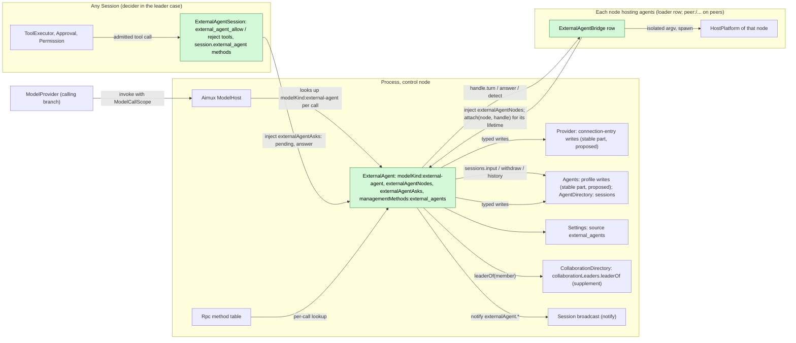
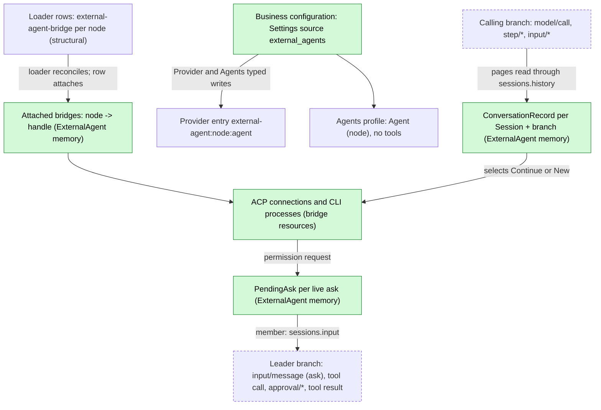
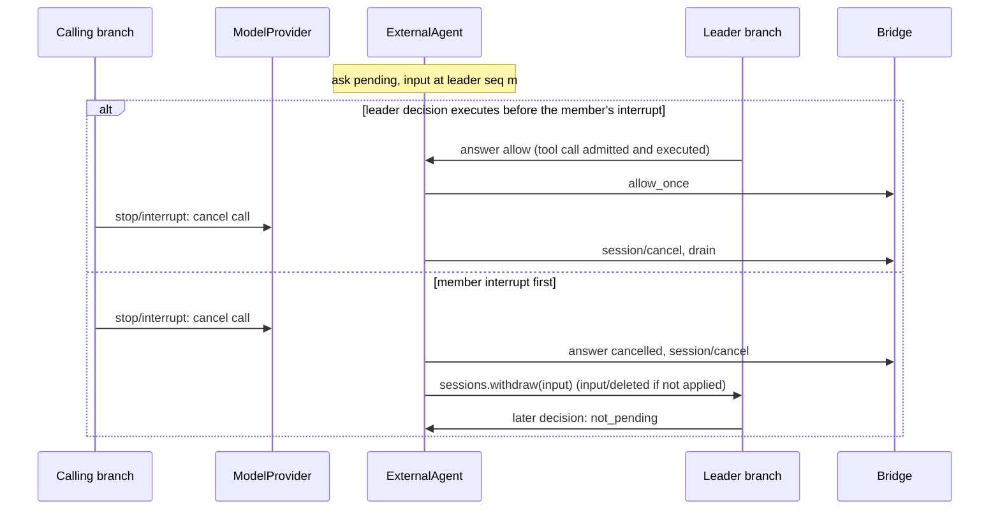

# ExternalAgent

Status: Draft, Ready candidate (redesign, [#145](https://github.com/arcships/dim/issues/145)); what remains for Ready is listed in [§10](#10-ready-status). Overall design: [overview §4](../overview.md#4-plugin-catalog); scope: [ADR 002](../../adr/002-plugin-scope.md) (process, with per-node bridge rows and a Session part). Phase: P3. Language: TypeScript first ([overview Appendix C](../overview.md#appendix-c-implementation-language)).

ExternalAgent makes locally installed coding agents (Claude Code, Codex, Cursor, OpenCode, ZCode and similar) usable as models. A Session whose adopted model is the Provider entry `external-agent:<node>:<agent>` runs through Loop and ModelProvider unchanged: the entry is an ordinary Provider entry ([auxiliary model](../appserver/auxiliary-model.md), S4) that Provider resolves to a connection of kind `external-agent`, and Aimux's ModelHost looks up the process service `modelKind:external-agent` on each call for that kind. ExternalAgent turns each model request into one external turn and turns what the agent produced back into model chunks. The external agent runs its own tools. The model stream carries only the text and thinking the agent produced. dim never adds approval items or synthetic lines to it.

When the agent asks permission for one of its own actions, ExternalAgent asks the calling Session's interaction counterpart outside the model stream. A Collaboration leader's model receives the ask as an input and decides with a tool, and that tool call passes the leader's Approval and Permission like any other. Without a leader, the user answers through a Session method. A Session with no counterpart rejects the ask. Agent processes live in per-node bridge rows that the loader manages; each bridge attaches itself to ExternalAgent for its own lifetime. All contracts are language-neutral named services ([ADR 002 D5](../../adr/002-plugin-scope.md#d5-contracts-are-language-neutral)); the Rust forms are in [Appendix G](#appendix-g-rust-binding).

Changes from the previous draft, which the redesign in [#182](https://github.com/arcships/dim/pull/182) superseded:

| Previous draft | This design | Why |
| --- | --- | --- |
| `approval_ask` / `approval_ask_withdrawn` items in the model stream; ModelProvider admitted them through Approval and answered with `answerApproval`; an Approval host-source supplement | No approval data in the model contract. The ask goes to the counterpart as an input plus a decision tool, or to the user through a Session method (§3.2). ModelProvider and Approval are unchanged | [#28](https://github.com/arcships/dim/issues/28); [ADR 003](../../adr/003-approval-scope.md) D1; principles §4 rule 4 |
| A synthetic thinking line before each ask, and tool activity as `[tool]` thinking lines, so that a Steer would not replace the request | Only agent-produced text and thought reach the stream; tool activity is a Session broadcast notice. ModelProvider's replace-unless-visible-output rule applies as written (§4) | #28 |
| ExternalAgent started and stopped one bridge per node itself | `ExternalAgentBridge` is a loader row per node (`peer:<node>/external-agent-bridge` on peers); the loader reconciles it and its effect ends its processes (§3.4) | [#37](https://github.com/arcships/dim/issues/37); principles §1 |
| ModelHost was described both as collecting `modelKind` (a dependency cycle) and as accepting a registration | ModelHost (native) looks up `modelKind:<kind>` on each call without depending on its provider, as Rpc does for `managementMethods`. Neither side depends on the other (§1) | #37; ADR 002 D3 |
| Conversation records persisted in `pluginFiles` | Records live in ExternalAgent's memory as handles of live external conversations, and the next call after a loss re-initializes (§2) | #37 side note; principles §4 rule 4 |

Corrections in this revision, from checking every cited contract against main:

| Assumption in #182 | Current main | This revision |
| --- | --- | --- |
| ExternalAgent (TypeScript) looks up `externalAgentBridge[<node>]` on each call | A TypeScript row reaches only services it declares in `inject`; the JavaScript API has no per-use lookup ([sessions-service D1](../appserver/sessions-service.md), [process TypeScript §5.1](../process-typescript.md#51-proposed-p6p7-access-through-declared-feature-dependencies)) | Registration form, as #37 accepted: each bridge row injects ExternalAgent's `externalAgentNodes` and attaches a by-reference handle for its lifetime (§1, A.3) |
| "Async, streamed" methods | rutis-bridge 0.12.1 methods are `sync` or `async`; values may be function references and an AbortSignal | A streamed reply is an `async` call that receives a sink function by reference and resolves when the stream ends (§6, "Streamed calls") |
| `ExternalAgentSession` emits `externalAgent.*` notices from a `watch` stream | Notices are emitted by the owner of the state with `notify`; no TypeScript binding exists ([session notices §4](../appserver/session-notices.md#4-emitting)) | ExternalAgent, which owns pending asks and calls, emits the notices itself; `watch` and the relay are removed; the TypeScript binding of `notify` is raised in §9.1 |
| ModelHost resolves "a connection of a kind it does not drive" | `ModelConnection` is the closed enum `Local \| Http \| Bedrock`, and `ModelDriver::invoke(request, connection, cancel)` carries no call scope ([host.rs](../../../crates/dim-agent-capabilities/src/host.rs)) | The supplements are stated exactly: `ModelConnection::Kind {kind, target}` and an optional `ModelCallScope` argument (§9.2) |
| Ask input `{blocks: [raw block {marker, key, text}]}` | `InputWrite.rawBlocks: [{text, key?}]`; the marker is the first raw block, an element `<dim-<source> ...>` ([session access A.1, A.2](../contracts/session-access.md#a2-source-input-conventions)) | Ask input rewritten to the contract; the unused key is dropped (A.6) |
| ExternalAgent depends on Provider and Agents and reloads with them, "an accepted cost" | A process owner injected by Session tool rows must keep a stable dependency boundary; a reloading dependency retires the owner and the tools of every existing Session ([process TypeScript §5.1](../process-typescript.md#51-proposed-p6p7-access-through-declared-feature-dependencies)) | ExternalAgent injects only parts that never reload; Provider's and Agents' write operations are requested from such parts (§9.3) |
| Open question: the client route could use a generic counterpart mechanism from Questions | The Questions redesign keeps a question as a pending `ask_user` tool call ([Questions](Questions.md)); it offers no generic counterpart service | Resolved: the `external_agent` methods and notices stay (Appendix F) |

## 1. Structure



External agent connections, catalogs and live conversations are shared across Sessions, so ExternalAgent is a process plugin (ADR 002 D1). Agent processes are host resources of a node, so they belong to a plugin on that node: `ExternalAgentBridge` is a process plugin with one loader row per node that hosts agents. The control node's row is part of the product profile whenever ExternalAgent is enabled. A peer node's row is `peer:<node>/external-agent-bridge`, added or removed only by PluginManager's structural operations (ADR 002 D4: node binding is structural). The loader reconciles these rows like any other. A peer row waits while its node or link is gone and loads again when it returns. The bridge's resources are released by its own `ctx.effect` whenever the row unloads. Enabling an agent on a node is business configuration and never adds a row.

A bridge row injects `externalAgentNodes` (on a peer, imported over the link) and, in `apply`, attaches a by-reference handle for its node. The attachment lasts exactly as long as the row: the row's effect detaches it, and a dropped link or exited runtime closes the reference, which ExternalAgent treats as detached. This is the registration form #37 accepted (the volatile side depends on the stable owner and registers for its own lifetime). It replaces a per-call lookup that a TypeScript caller cannot make.

Asks of a Session are per-Session work, and the tools that decide them are offered to Sessions, so the plugin has one Session part, `ExternalAgentSession`, a C4 TypeScript Session row installed in every Session while ExternalAgent is enabled (ADR 002 D2: tools through `toolContribution`, client methods through `sessionMethods`). Its assembly never depends on the Session's model or role, so the tool set and prompt prefix stay stable across model switches and forks. It owns no state and emits nothing: notices come from ExternalAgent, which owns the asks.

Dependencies point from the extension to the core and never form a cycle:

- ModelHost looks up `modelKind:<kind>` on each call and never depends on ExternalAgent. ExternalAgent does not depend on Aimux.
- Each bridge row depends on ExternalAgent (`externalAgentNodes`) and its node's HostPlatform. ExternalAgent depends on no bridge.
- `ExternalAgentSession` depends on ExternalAgent (`externalAgentAsks`).
- ExternalAgent depends only on parts that never reload: AgentDirectory (`sessions`), Settings, CollaborationDirectory, and the stable parts serving Provider's and Agents' write operations (§9.3).

A missing, Pending or reloading part therefore fails only the calls that need it, and ExternalAgent reloads only for its own structural changes.

| Part | Scope | Depends on (`inject`) | Provides |
| --- | --- | --- | --- |
| `ExternalAgent` | Process row, control node | `sessions`, `settings`, `collaborationLeaders` (supplement), `providerEntries` and `agentProfiles` (proposed write operations, stable parts) | `modelKind:external-agent`; `externalAgentNodes`; `externalAgentAsks`; `managementMethods:external_agents`; Settings source `external_agents`; `externalAgent.*` notices |
| `ExternalAgentBridge` | Process row, one per node hosting agents | `externalAgentNodes`; that node's HostPlatform exec-argv helper | Nothing by name; a `BridgeHandle` by reference through `attach` |
| `ExternalAgentSession` | Session row (C4) | `externalAgentAsks` | `toolContribution:external_agent_allow`, `toolContribution:external_agent_reject`; `sessionMethods:session.external_agent` |

**Contracts depended on.**

- The Aimux, ModelProvider and Provider supplements of §9.2: `ModelConnection::Kind`, the optional `ModelCallScope` argument, per-call lookup of `modelKind:<kind>`.
- Provider's external-agent connection type and connection-entry write operation, and Agents' profile write operation, both served from parts that never reload (§9.3; owned by those plugins).
- The existing model chunk and failure data ([host.rs](../../../crates/dim-agent-capabilities/src/host.rs)) and the shared recovery loop `invoke_with_recovery` ([recovery.rs](../../../crates/dim-agent-capabilities/src/model_provider/recovery.rs)).
- `sessions` (`input` with `rawBlocks`, `withdraw`, `history`; [session-access A.1](../contracts/session-access.md#a1-the-sessions-service)), implemented by AgentDirectory.
- `toolContribution` and `sessionMethods` ([session-boundary](../contracts/session-boundary.md)) through the C4 binding ([session TypeScript](../session-typescript.md)); process rows and management methods through #4 ([process TypeScript](../process-typescript.md)).
- Session broadcast notices ([session notices](../appserver/session-notices.md)) and the TypeScript binding of `notify` (§9.1).
- The Collaboration supplement `leaderOf` (§9.4).
- Settings' typed writes and `settings.changed` for the business source `external_agents`.
- Each node's HostPlatform exec-argv helper and isolation (overview Appendix B, P3).
- rutis links that export `externalAgentNodes` from the control node to linked nodes (link configuration, overview §6.3).

**Contracts defined here.**

- `modelKind:external-agent` and its target `{node, agent}`.
- `externalAgentNodes` and `BridgeHandle`; `externalAgentAsks`; the two decision tools.
- The `session.external_agent` methods and `externalAgent.*` notices.
- The ask input form (marker element `dim-external-agent`, source `external-agent`).
- Business configuration `external_agents.*` and methods `external_agents.*`.
- The ACP schema and conformance suite shared with [AcpGateway](AcpGateway.md) (client side).

Provider, Agents, Approval, Permission, ModelProvider and Collaboration never name this plugin.

## 2. Data and state



**Business configuration** ([ADR 002](../../adr/002-plugin-scope.md) D4) is one document in the Settings source `external_agents`, declared by ExternalAgent's process row: `{ nodes: { <node>: { <agent>: { enabled, executable?, args?, env?, reasoning? } } } }`. Settings validates it against ExternalAgent's schema and applies defaults; ExternalAgent reads it at use time and passes the entry with each bridge call, so a bridge reads no configuration of its own. It is written only through ExternalAgent's management methods (A.1). `env` values are ordinary strings of this document, which may hold an agent's credentials; ExternalAgent owns them ([settings-service §1.2](../appserver/settings-service.md#12-decision-secrets-belong-to-their-owner)): the source is user-scope only, so `env` never sits in a project file, and no Settings resolver is involved. A change is a data update plus `settings.changed`, never a reload. Provider entries and Agents profiles are requested through those owners' public typed write operations and are rebuildable from this document.

**Loader rows.** Each node's `external-agent-bridge` row is structural configuration: it says which nodes may run agents, not which agents run there.

**Attached bridges.** ExternalAgent keeps `node -> {registration, handle}` in memory from `attach` until `detach` or until the handle's reference closes. It is a live I/O resource: never persisted, rebuilt only by bridges attaching again after ExternalAgent reloads (they reload with it, since they depend on it). `external_agents.list` reports a configured node without an attached bridge as `unavailable`.

**Conversation record.** A record is held in ExternalAgent's memory as a handle of one live external conversation. It is never persisted:

```text
ConversationRecord {
  key: (session_id, branch_id),
  target: { node, agent },
  external_id: String,          // ACP sessionId or CLI conversation id, owned by the bridge
  cursor: u64,                  // sequence of the model/call of the last accepted call on this branch
  scan_from: u64,               // lowest local sequence that may hold an input/message not yet consumed
  last_request_id: String,
  state: ready | in_flight { request_id } | uncertain,
}
```

Every delivery decision is recomputed from Timeline pages plus the record (§3.1). Losing the record (ExternalAgent reload, process restart, eviction after A12) only makes the next call on that branch initialize from history (A15). The key includes the branch and Session ids, so a child branch or a fork, which has a new branch or Session id, never continues another branch's external conversation.

**Pending ask.** A pending ask is held in ExternalAgent's memory for as long as the external request waits for an answer. It is part of a live I/O exchange, so it is settled, never rebuilt, on reload:

```text
PendingAsk {
  ask_id: String,               // "<request_id>:<n>", unique per call
  call: { session_id, branch_id, request_id },
  agent: { node, agent }, title: String, kind: String, raw_input: JSON (bounded to 4 KiB, A18),
  route: leader { session_id, branch_id, input_id } | client | none,
}
```

**Timeline.** The calling branch gets ordinary model facts only. In the member case, the leader branch gets an ordinary input, an ordinary tool call with its ordinary approval facts, and a tool result. ExternalAgent declares no event type and writes nothing except inputs and withdrawals through `sessions`.

**Not in the Timeline** (principles §4 rule 9): configuration, Provider entries, profiles, attachments, records, pending asks, tool activity, client answers, processes. What clients show goes through `externalAgent.*` notices.

## 3. Flows

### 3.1 Model call (initialize or continue)

```mermaid
sequenceDiagram
  participant TL as Calling branch Timeline
  participant MP as ModelProvider
  participant MH as Aimux ModelHost
  participant EA as ExternalAgent
  participant SA as sessions
  participant BR as Bridge handle of the agent's node
  TL->>MP: model/call (Dispatcher handler registers call task, returns)
  MP->>MP: resolve connection: Kind {external-agent, target}
  MP->>MH: invoke(request, connection, scope, cancel)
  MH->>EA: modelKind:external-agent.invoke(request, target, scope, onChunk, signal)
  EA->>SA: history(branch, after scan_from, through call_sequence), paged
  EA->>EA: decide New or Continue (record + pages only); record in_flight
  EA->>BR: turn(TurnSpec, onUpdate, signal)
  BR-->>EA: accepted, text, thought, activity, permissionAsked, end
  EA-->>MH: onChunk(message_start, text, thinking, usage, message_stop)
  MH-->>MP: ModelStream
  MP->>TL: step/text, step/thinking, then step/model-output-end
```

The decision reads only facts at or before `call_sequence` (dispatched, so published, and a batch boundary) and the record; it never reads another plugin's memory.

Delivery decision, given record `R`, request `Q`, scope `S`:

1. Scan local events of `S.branchId` in `(R.scan_from, S.callSequence]` (the whole local branch without a record), in pages of `sessions.history`: `input/message`, `input/consumed` with sequence `> R.cursor`, and output events (`step/text`, `step/thinking`, `step/tool-use-start`) with sequence `> R.cursor`.
2. **Initialize** when any of these holds: there is no record, `R.target` differs, `R.state = uncertain`, or an output in the range belongs to a request other than `R.last_request_id` (another model answered). Initialization opens `New` and sends a transcript of `Q.messages` (§5) plus the instruction to answer the last user message.
3. **Continue** otherwise: `Continue { external_id }` with the consumed inputs of the range in consumption order. If the bridge no longer holds the conversation and cannot load it, it replies `conversation_lost` before acceptance, and ExternalAgent initializes instead within the same invocation, since nothing was sent.
4. The new `scan_from` is the lowest sequence of a collected `input/message` not consumed by `S.callSequence`, else `S.callSequence`. An empty delta fails before acceptance with `external_agent_no_input` (A8).

`Q.messages` on a child branch is the ancestor prefix up to the cut plus local events, so a child initializes from its own history and never touches the parent's conversation; a fork does the same.

A call without a Session scope (an `auxiliaryModel.complete` call with an `external-agent:*` model) fails before acceptance with `external_agent_no_session`. SessionTitle already skips titling for such models ([auxiliary model §8](../appserver/auxiliary-model.md)).

### 3.2 External permission request

The agent's own action is not a dim tool call, so dim's Approval does not admit it ([ADR 003](../../adr/003-approval-scope.md) D1). The decision belongs to the calling Session's interaction counterpart ([overview §6.2](../overview.md#62-constraints) item 15). ExternalAgent picks the route from the call scope's `SessionConfig` when the ask arrives:

| Calling Session | Route | Who decides | Authority |
| --- | --- | --- | --- |
| `collaborationRole = member`, `leaderOf` returns a leader | `leader`: an `input/message` (Steer) to the branch `leaderOf` names; the leader model calls `external_agent_allow` or `external_agent_reject` | The leader's model | The decision is a leader tool call, so the leader's Permission and Approval admit it like any other (an allow under WorkspaceWrite asks the user through the leader's `approval/request`) |
| Otherwise `interactive` (including a member whose leader is gone) | `client`: an `externalAgent.ask` notice on the calling Session; a client answers with `session.external_agent.answer` | The user | The user's own answer; no agent decision, so no Approval |
| `interactive = false` | `none` | Nobody | Answered `reject` at once (A19) |

```mermaid
sequenceDiagram
  participant BR as Bridge (ACP client)
  participant EA as ExternalAgent
  participant SA as sessions
  participant LB as Leader branch (Loop, ToolExecutor, Approval, Permission)
  participant ES as ExternalAgentSession (leader)
  participant U as User
  BR->>EA: permissionAsked(askId, title, kind, rawInput, options)
  EA->>EA: PendingAsk, route = leaderOf(member)
  EA->>SA: input(leader branch, steer, rawBlocks [<dim-external-agent kind="ask">])
  LB->>LB: input/applied, consumed by the next request
  LB->>LB: model calls external_agent_allow {askId, title}
  LB->>LB: Permission: unclassified risk; WorkspaceWrite asks
  U-->>LB: approval.respond (only when asked)
  LB->>ES: execute admitted call
  ES->>EA: answer {askId, allow, title, decider}
  EA->>BR: answer allow_once
  ES-->>LB: tool result "Allowed"
```

Answer rules:

- `externalAgentAsks.answer` accepts only the route's decider. On the leader route that is the Session and branch that received the input, and the allow form must echo the ask's `title`. On the client route it is the calling Session's own Session method. Any other answer returns `not_yours`; one for an ended ask returns `not_pending`, with no effect.
- Allow selects an `allow_once` option and reject selects `reject_once`. When the needed once-option is absent, the bridge answers `cancelled`. `*_always` is never selected.
- When an ask ends without an answer (the call is cancelled, the agent withdraws it, the bridge detaches or ExternalAgent unloads), ExternalAgent answers the agent `cancelled` if it still waits. On the leader route, ExternalAgent withdraws the leader input through `sessions.withdraw` (InputQueue writes `input/deleted` only if it was not yet applied). On the client route, ExternalAgent emits `externalAgent.askEnded`. A decision tool called later for that ask gets `not_pending`.
- Several asks in one call are independent and are routed in arrival order.
- Non-interactive CLI adapters have no request channel. Their launch arguments put the agent in its own non-auto-approving mode, so the agent itself refuses an action it cannot ask about (A16).

Mapping of ACP `toolCall.kind` (shown to the decider only, A7): `read`, `search` → reads files; `edit`, `delete`, `move` → writes files; `execute` → runs a process; `fetch` → network; others → other. The decision tool's risk does not vary with the kind: allowing another agent's action is always unclassified for the leader's Permission (A.6).

### 3.3 Delegation and interrupt

1. A leader Session whose resource node is `build-box` asks the `agent` tool for "Codex (build-box)". Collaboration creates a member Session with that profile; the member gets the leader's cwd and permission policy. The member inherits the leader's resource node, so the bridge on `build-box` runs Codex in the member's cwd. A leader on another node gets `external_agent_wrong_node` before acceptance (A13). The `agent` tool is detached work, so the leader branch keeps running and can consume the ask inputs (§3.2).
2. Interrupt of the member's call: ModelProvider cancels the call token, Aimux aborts the `invoke` signal, and ExternalAgent ends the call's pending asks as in §3.2. The bridge sends ACP `session/cancel` (or signals the CLI), drains to the prompt response, and kills the process after a 10 s grace (A4). Text already received stays. The next input continues the same conversation if the cancel was acknowledged.
3. Interrupt of the leader's turn cancels an unexecuted decision tool call. The ask stays pending until another decision, the member's interrupt, or Collaboration stopping the member request, which interrupts the member's turn.

### 3.4 Bridge lifecycle

| Event | Who acts | Effect |
| --- | --- | --- |
| ExternalAgent enabled in the product profile | Loader | Control-node bridge row loads after ExternalAgent and attaches |
| PluginManager enables the bridge on peer node `n` | Loader | Adds `peer:n/external-agent-bridge`; once the link is up the row loads on `n`, imports `externalAgentNodes` and attaches `n`; ExternalAgent runs `detect` on it |
| Link to `n` drops | Loader (peer row behaviour) | The row stops: its effect cancels turns, answers the agent's pending permission requests `cancelled` and kills its processes; the handle's reference closes, so ExternalAgent ends that node's asks and calls for `n` fail `node_unavailable`; when the link returns the row loads and attaches again |
| Agent enabled or disabled on a node | ExternalAgent (business configuration) | No row change and no reload; calls for a disabled agent fail `external_agent_disabled`; the bridge closes that agent's idle connections |
| Bridge crash or reload | Loader | As a dropped link, local to that node |
| ExternalAgent reload | Loader | Every bridge row reloads with it (D3): all turns end, processes are killed, rows attach to the new generation |

The bridge holds nothing that must survive: live connections, per-conversation ACP processes (closed after 10 min idle, A5) and their pending permission requests.

## 4. Timing and conflicts



The ask is a live exchange between ExternalAgent and the bridge. ExternalAgent's memory decides whether a decision arrived before the call ended, and the external agent learns only the outcome that won. Each branch's own facts keep Timeline order: the member's interrupt on the member branch, and the decision tool call and its approval on the leader branch.

| Scenario | Order | Outcome | Owner |
| --- | --- | --- | --- |
| Ask pending, no decision for a long time | — | No dim timeout; the call stays open; the user or leader can interrupt (A17) | Counterpart |
| Steer on the calling branch before any visible output (agent still working or waiting on an ask) | `input/applied` (Steer) during the call | ModelProvider replaces the request as for any model and cancels; ExternalAgent cancels the turn and ends pending asks; actions the agent already took stay done; next request delivers the Steer | ModelProvider, ExternalAgent |
| Steer after visible output | — | Not replaced; Loop delivers it in the next request | Loop |
| Agent withdraws its request or ends its prompt | bridge `permissionWithdrawn` | Ask ended as in §3.2 | ExternalAgent |
| Leader under ReadOnly | — | `external_agent_allow` is denied by the leader's Permission; the model can still reject; otherwise the ask waits | Permission |
| Leader Session sampled its tool table before `ExternalAgentSession` was Active | branch initialization | The leader has no decision tools; the ask input still arrives; the ask waits until the member is interrupted. Governed by [#241](https://github.com/arcships/dim/issues/241) (§10) | ToolRegistry |
| ExternalAgent reload mid-call | — | Asks ended; streams end `provider_unavailable`; records and attachments dropped; bridges reload with it and kill their processes; existing Sessions keep retired decision tools until reloaded (C3 cost, [process TypeScript §5.1](../process-typescript.md#51-proposed-p6p7-access-through-declared-feature-dependencies)) | ExternalAgent, loader |
| Bridge row stops (link down, crash, structural op) | — | Turns on that node fail: `node_unavailable` before acceptance (transient), `external_agent_exited` after (record `uncertain`); other nodes unaffected | Loader, bridge |
| Process restart mid-call | unended `model/call` | ModelProvider rebuild fails the call; nothing re-sent; a leftover ask input yields `not_pending` | ModelProvider |

All other rows: [Appendix B](#appendix-b-full-conflict-table).

## 5. Context mapping

| Audience | Sees | Form |
| --- | --- | --- |
| External agent, initialize | `Q.messages` as one text prompt `<dim-history>`: `[user]`, `[assistant]`, `[tool call <name>] <input JSON>`, `[tool result] <content text>`, images as `[image]`, thinking omitted (A14); then the instruction | ACP text block or CLI stdin |
| External agent, continue | Per consumed input: raw block texts verbatim, then user content (images as ACP image blocks when the agent declares `promptCapabilities.image`, else `[image omitted]`) | Prompt blocks |
| External agent, never | dim system prompt, prompt sources, tool declarations, sampling parameters, `metadata`, other plugins' events, diagnostics; `config.reasoning` only through an adapter reasoning flag | — |
| Calling Session's history | The agent's message as `step/text`, its thought as `step/thinking`; nothing else | Model output facts |
| Leader model (member case) | The ask input (A.6): agent, member Session, title, kind, bounded raw input, and how to decide; the decision tool's result | Adopted input, tool result |
| User | Leader route: the leader's ordinary `approval.request` for an allow call when its preset asks. Client route: `externalAgent.ask` / `askEnded` notices. Both routes: `externalAgent.activity` notices | Client UI |

Committed external output enters history like any model output: compaction summarizes it, children inherit it up to the cut, a later native model sees it as assistant messages, and an interrupted output keeps its text and drops its thinking. Collaboration's and Workflow's results read the last request's text. The ask input is a raw block of the leader's own history, so the leader's context holds only asks that were handed over (`input/applied`), never withdrawn ones.

## 6. Interfaces (summary)

| Interface | Kind | Purpose |
| --- | --- | --- |
| `modelKind:external-agent`, target `{node, agent}` | Process service, looked up per call by ModelHost | Model calls for external profiles ([A.2](#a2-model-kind-and-call-scope)) |
| `externalAgentNodes` | Process service, injected by bridge rows | `attach` / `detach` of a node's `BridgeHandle` ([A.3](#a3-bridge-and-adapters)) |
| `BridgeHandle` | By-reference object of one bridge row | `detect`, `turn`, `answer` on a node ([A.3](#a3-bridge-and-adapters)) |
| `externalAgentAsks` | Process service, injected by `ExternalAgentSession` | `pending` and `answer` ([A.6](#a6-asks)) |
| `external_agent_allow`, `external_agent_reject` | `toolContribution` (Session) | The leader model's decision ([A.6](#a6-asks)) |
| `session.external_agent.asks` / `answer` | `sessionMethods` namespace `session.external_agent` | Client route ([A.6](#a6-asks)) |
| `externalAgent.ask`, `externalAgent.askEnded`, `externalAgent.activity` | Session broadcast notices, source `ExternalAgent` | Client display ([A.6](#a6-asks)) |
| `external_agents.list` / `set_enabled` / `configure` | `managementMethods` key `external_agents` | Detection, enablement, configuration ([A.1](#a1-management-methods)) |
| ACP schema and conformance suite | Shared with AcpGateway | Client side ([A.5](#a5-shared-acp-schema)) |

**Streamed calls.** `modelKind.invoke` and `BridgeHandle.turn` produce a sequence of items. Over rutis-bridge they are `async` methods whose request carries a sink function by reference (`onChunk`, `onUpdate`) and an AbortSignal: the callee calls the sink once per item and awaits each call before the next, so items keep their order and the consumer applies backpressure; the call resolves when the sequence ends and rejects with the error that ends it. Aborting the signal is the cancel request. A closed reference (link drop, runtime exit) fails the call. This uses only references and signals that rutis-bridge 0.12.1 already carries.

## 7. Security

- External agents run with their own accounts and tools. dim decides their actions only when they ask, and only through the counterpart. It cannot stop actions an agent takes without asking. The node's HostPlatform isolation is the enforcement boundary, and replay or fork never widens it.
- On the leader route, authority is the leader's: the decision is a leader tool call, and an allow needs whatever the leader's preset and rules require. The allow form must echo the ask's title, so an approval shown to the user names the action being allowed, and a mismatched title has no effect. Only the routed decider can answer an ask.
- On the client route, the answer is the user's own, given through a Session method that any client of that Session (including a paired device, [overview §6.2](../overview.md#62-constraints) item 10) may call.
- `*_always` is never selected.
- Credentials are `env` values that ExternalAgent reads from its own document on the control node at turn time ([settings-service §1.2](../appserver/settings-service.md#12-decision-secrets-belong-to-their-owner)). They are passed to the bridge handle over the authenticated link and never written to records, Timeline, notices, diagnostics or replies. Whether ExternalAgent later keeps them in an OS keychain instead is its own choice, not a Settings contract.
- Enabling an agent is a feature switch, plain business configuration and not an approval ([ADR 003](../../adr/003-approval-scope.md) D2). It is changed only through management methods, which are never served to paired devices. The model cannot enable agents. Adding a bridge to a node is a structural operation of PluginManager. Executables are resolved on the node, never from project files.
- `externalAgentNodes` is exported only over authenticated rutis links to nodes the control node trusts; a bridge attaches only its own node. Attaching runs no agent: turns start only from model calls of Sessions that adopted an enabled entry.

## 8. Rule check

Rules: [principles §1 and §4](../../architecture/rust-agent/principles.md), [ADR 002](../../adr/002-plugin-scope.md) D1–D5.

| Rule | How this document complies |
| --- | --- |
| §4.1 Command events for others' state | ExternalAgent declares no event. It changes a branch only by writing inputs through `sessions`, and it removes an ask input only through the `input/withdraw` command, whose result InputQueue decides. Provider entries and Agents profiles change only through their owners' typed write operations. The decision on the leader route is an ordinary tool call that the leader's Approval and Permission decide. |
| §4.2 No take-back after hand-off | Only consumed inputs are delivered to the agent. Once an ask input is applied, the withdrawal has no effect (`notHeld`) and a late decision gets `not_pending`. After hand-off to ModelProvider, only cancellation of the call applies. |
| §4.3 Intervene only through before callbacks | Not applicable: no entry check and no before callback. |
| §4.4 Core mechanisms carry no business meaning | The model contract is unchanged: no approval items and no synthetic output. `ModelConnection::Kind`, the optional `ModelCallScope`, per-call lookup by kind and `leaderOf` are generic and name no plugin. ModelProvider's replace rule applies to external models as written. |
| §4.5 Read the whole batch before deciding | The delivery decision reads facts up to `callSequence`, which is dispatched and a batch boundary (§3.1). |
| §4.6 Model context holds only handed-over events | The agent receives only consumed inputs and the projected history. The leader model sees an ask only after its input is applied, and withdrawn ask inputs never enter its context (§5). |
| §4.7 Only public events and services | History through `sessions`, the leader through `collaborationLeaders.leaderOf`, writes through owners' operations, notices through `notify`; no other plugin's memory is read. |
| §4.8 Infrastructure unchanged by default | Timeline, Dispatcher, event envelope, loader and the Session facade are unchanged. One binding is requested from the notice owner (§9.1); the rest are plugin supplements (§9.2–9.4). |
| §4.9 Only facts later decisions use enter the Timeline | Model output and the leader's input and tool call are needed later. Configuration, entries, profiles, attachments, records, asks, client answers and tool activity stay out, and clients see them through notices. |
| §1 Capability and App Server boundary | ExternalAgent and its bridges are process rows; `ExternalAgentSession` is a Session row. No second lifecycle manager: agent processes are the bridge row's resources, released by its effect, and an attachment lives exactly as long as its row. The service graph is acyclic (§1). |
| ADR 002 D1 | Connections and live conversations are shared across Sessions (process). Agent processes are a node's host resources (a bridge row per node). Decision tools and client methods are per Session (Session part). |
| ADR 002 D2 | No wiring module. ModelHost and Rpc look up named services per call, bridges attach through an injected service, tools use `toolContribution`, client methods use `sessionMethods`, and other Sessions are reached through `sessions`. |
| ADR 002 D3 | ExternalAgent injects only parts that never reload (§1, §9.3), so it reloads only for its own structural changes. Its reload reloads its bridges and retires the decision tools of existing Sessions (accepted C3 cost). No core part depends on ExternalAgent or a bridge, so their absence fails only external-agent calls. |
| ADR 002 D4 | Agent entries are business configuration applied without reload. Bridge rows are structural (node binding), changed by PluginManager, never by ExternalAgent. |
| ADR 002 D5 | `modelKind`, `externalAgentNodes`, `BridgeHandle`, `externalAgentAsks`, the tools, methods, notices and chunks are named services and data; Rust forms are in Appendix G. |

## 9. Requirements raised to mechanism owners

The design changes no Timeline, Dispatcher, event envelope, loader or Session facade contract. rutis is used as it is: loader rows, peer rows, injected services, references and AbortSignals, and links. One binding is requested from a mechanism owner (§9.1). The other items are supplements owned by plugins, already listed in [overview Appendix B](../overview.md#appendix-b-supplements-to-existing-plugins) and stated exactly here so their owners can accept them.

### 9.1 TypeScript binding of Session notices

| Item | Content |
| --- | --- |
| Blocked | ExternalAgent owns pending asks and call activity, so it must emit `externalAgent.*` notices after its own changes ([session notices §4](../appserver/session-notices.md#4-emitting): the owner emits). Its process row is TypeScript, and session notices §4 "Non-rust owners" states there is no binding |
| Mechanisms considered | A `watch` stream relayed by the Session part (the #182 form): the Session part does not own the state and still has no way to emit; Timeline events: forbidden by principles §4 rule 9 for display-only data; a management method that clients poll: loses the live display and moves Session data into the management surface |
| Needed | `notify(sessionId, {source, kind, data})` for TypeScript process rows, with the native contract unchanged: synchronous, no dependency, dropped when nobody listens, no replay. Source is the row's declared owner name |
| Effect on sequence, batch, interrupt, reload | None: notices are not events. While the owner row reloads it emits nothing, as for native owners |
| Owner | Session notices / #4 TypeScript bindings (dim runtime). To be filed as an issue with this section when the maintainer accepts it |

### 9.2 Model kind supplements (Provider, ModelProvider, Aimux)

| Owner | Supplement |
| --- | --- |
| Provider | An `external-agent` connection type whose entries resolve to `ModelConnection::Kind { kind: "external-agent", target: {node, agent} }`, a new variant of the request-local connection data in [host.rs](../../../crates/dim-agent-capabilities/src/host.rs). It carries no credential and needs no recovery (`recovery: None`, `failure_policy: None`) |
| ModelProvider | Passes `ModelCallScope {sessionId, branchId, turnId, requestId, callSequence, config: SessionConfig}` as a new optional argument of `ModelDriver::invoke`; AuxiliaryModel passes none. Retry, recovery and Steer replacement are unchanged |
| Aimux | For `ModelConnection::Kind`, looks up the process service `modelKind:<kind>` on that call without a dependency, and calls `invoke` with a sink and an AbortSignal (§6); without a provider the call fails before acceptance with `ModelFailureFacts {origin: Transport, transient: true}`. Its own kinds ignore the scope |

### 9.3 Owners' write operations from stable parts (Provider, Agents)

ExternalAgent is injected by `ExternalAgentSession` in every Session and by every bridge row. If it injected a part that reloads (Provider's catalog part, the Agents index), each such reload would retire ExternalAgent, kill every agent process and remove the decision tools from every existing Session until reload ([process TypeScript §5.1](../process-typescript.md#51-proposed-p6p7-access-through-declared-feature-dependencies) requires a new availability decision for that). The proposed connection-entry write (`providerEntries`) and profile write (`agentProfiles`) are therefore requested from parts that never reload and look up the current owner on each call, as AgentDirectory does for `sessions` ([sessions-service D1](../appserver/sessions-service.md)). A call while the owner reloads fails `reloading`, and ExternalAgent's management method reports it. Shapes and notices remain the owners' to define.

### 9.4 `leaderOf` (Collaboration)

A neutral named service on CollaborationDirectory, which has no dependencies and never reloads: `collaborationLeaders.leaderOf({sessionId}) -> {sessionId, branchId} | null`, the leader Session of a member and the branch to which Collaboration delivers that member's results (today its main branch). It is generic, names no plugin and is read once per ask. Collaboration's own proposed member-approval route ([overview Appendix B](../overview.md#appendix-b-supplements-to-existing-plugins), #29) is not reused: it answers dim approvals of the member branch through Approval, while an external ask is not a dim tool call.

### 9.5 Imported services stay registered while a link is down (#5)

Withdrawn: rutis is an external dependency, so no requirement is raised to it. Offline nodes follow rutis' existing behaviour and [overview §6.3](../overview.md#63-multiple-nodes): a dropped link stops ExternalAgent's peer bridge row, whose own effect ends its processes, and closes its handle reference, so calls for that node fail `node_unavailable` (§3.4). Other documents link to §9 for this decision.

## 10. Ready status

Answered by this revision: how asks reach the counterpart without faked model output (§3.2), how bridges live and fail (§3.4, registration form), how turns are cancelled and reloaded (§3.3, §4, A.7), how streamed calls cross the TypeScript boundary (§6), and how notices are owned (§9.1). External tool calls and results never enter the Timeline: the agent's tools are its own, and dim records only the text and thought it produced (A9).

Remaining for Ready:

| Item | Needed from |
| --- | --- |
| Accept the registration form for bridges (§1) and the stable dependency boundary (§9.3) | Maintainer |
| Accept §9.1 and file it | Maintainer, notice owner |
| Accept the exact supplements §9.2 and §9.4 | Provider, ModelProvider, Aimux, Collaboration owners |
| Decide what a Session's tool table means while optional providers start ([#241](https://github.com/arcships/dim/issues/241)); a leader without decision tools cannot answer asks | #241 |
| P3 prerequisites: `SessionConfig.resourceNode`, HostPlatform exec-argv helper and isolation, link export of `externalAgentNodes` | P3 owners (overview §6.3, Appendix B) |
| Decisions D1–D3 of Appendix F | Maintainer |

## Appendix A. Interface details

### A.1 Management methods

`managementMethods:external_agents` on ExternalAgent's process row: `describe(): async -> MethodDecl[]` lists the methods below; `call(MethodCall): async -> MethodReply` dispatches them with JSON params and results.

| Method | Params | Result | `mutating` |
| --- | --- | --- | --- |
| `external_agents.list` | `refresh?` | Per configured or attached node: bridge state (`attached`, `unavailable`); per agent: executable, version, protocol (ACP or CLI), enabled, configuration (references only) | no |
| `external_agents.set_enabled` | `node`, `agent`, `enabled` | New state | yes |
| `external_agents.configure` | `node`, `agent`, `executable?`, `args?`, `env?: {name: value}`, `reasoning?` | New configuration | yes |

Detection calls a bridge's `detect` when it attaches and on `refresh` (A1). Detected agents stay disabled until enabled (A3). `set_enabled` and `configure` write the `external_agents` document through Settings' typed write with the revision they read (CAS), and ExternalAgent applies `settings.changed` without a reload.

Enabling `(node, agent)` requests two entries:

- Through `providerEntries` (proposed, §9.3): the entry `external-agent:<node>:<agent>` with one model `default` (A2) and target `{node, agent}`.
- Through `agentProfiles` (proposed, §9.3): the profile `{ name: "<Agent> (<node>)", system_prompt: "", tools: [], model: { provider_id: "external-agent:<node>:<agent>", model_id: "default" } }`.

Enabling an agent on a node without an attached bridge is allowed and listed as `unavailable`; its calls fail `node_unavailable` until a bridge attaches. Disabling requests removal of both entries; existing Sessions keep their adopted model and fail their next call with `external_agent_disabled`. Profiles are listed by Agents like any Agent, so Collaboration's `agent` tool can request them. A write that fails because an owner is reloading is reported to the caller; the document stays the source, and enabling again repeats both writes.

### A.2 Model kind and call scope

`modelKind:external-agent`, process scope, provided by ExternalAgent. ModelHost reaches it as §9.2 describes.

| Method | Mode | Request | Reply |
| --- | --- | --- | --- |
| `invoke` | async, streamed (§6) | `{request: serialized ModelRequest, target: {node, agent}, scope: ModelCallScope}`, `onChunk`, signal | Chunks through `onChunk` (A.4); resolves after `message_stop`, rejects with `{code, origin, transient}` |

Aborting the signal is cancellation; the call's pending asks then end as in §3.2. While ExternalAgent unloads, its open calls reject with `{code: provider_unavailable, transient}`, transient only before `message_start`. `scope.config` supplies `cwd`, `resourceNode`, `interactive` and `collaborationRole`. Without `scope`, the call fails `external_agent_no_session`.

### A.3 Bridge and adapters

`externalAgentNodes`, process scope, provided by ExternalAgent and exported to linked nodes:

| Method | Mode | Request | Reply |
| --- | --- | --- | --- |
| `attach` | async | `{node, handle: BridgeHandle}` | `{registration}`; replaces an earlier attachment of the same node, whose turns then fail as on detach |
| `detach` | async | `{registration}` | `{}`; no effect when that registration was already replaced or closed |

A bridge row attaches in `apply` and detaches in its effect. A closed handle reference counts as detached.

`BridgeHandle`, by reference, one per bridge row:

| Method | Mode | Request | Reply |
| --- | --- | --- | --- |
| `detect` | async | `{adapters}` | `[{agent, executable, version, protocol: acp \| cli}]` |
| `turn` | async, streamed (§6) | `TurnSpec {turnId, agent, config (the entry, with its env), cwd, conversation: {new} \| {continue: {externalId}}, prompt: PromptBlock[]}`, `onUpdate`, signal | `TurnUpdate` items: `{accepted: {externalId}}`, `{text}`, `{thought}`, `{activity: {id, title, status}}`, `{permissionAsked: {askId, title, kind, rawInput?, options}}`, `{permissionWithdrawn: {askId}}`, `{usage}`; resolves `{end: reason}`; rejects `{code, transient}` (`conversation_lost` before `accepted` when a continued conversation is gone) |
| `answer` | async | `{turnId, askId, answer: allow \| reject \| cancelled}` | `{}`; unknown ask → `{}` |

Cancellation: the consumer aborts the `turn` signal and the bridge runs the adapter's cancel path. Pending permission requests of a cancelled turn are answered `cancelled` by the bridge itself.

| Adapter | Open | Turn | Cancel |
| --- | --- | --- | --- |
| ACP client | Spawn the ACP command with the node's HostPlatform exec-argv helper (cwd, isolation); `initialize` with fs and terminal client capabilities off; `session/new {cwd, mcpServers: []}`, or `session/load` for a known `externalId` when `loadSession` is declared | `session/prompt`; `session/update` streams; `session/request_permission` → `permissionAsked`; `accepted` once the request is written | `session/cancel`, answer pending permission requests `cancelled`, drain; kill after grace (A4) |
| Non-interactive CLI | Per turn spawn with the conversation id when continuing; restrictive permission flags (A16) | Prompt on stdin, structured output parsed per adapter; `accepted` after spawn and complete stdin write | Interrupt signal, grace, kill |

One ACP process per conversation, closed after 10 min idle (A5). Adapter definitions are data inside the bridge package (A6).

### A.4 Stream mapping and request fields

Model chunks in neutral form (`kind` plus data, the serialized form of the existing `ModelChunk`).

| External | Model chunk |
| --- | --- |
| `accepted` | `message_start {message_id: "<externalId>:<requestId>"}` |
| Message chunk / CLI text | `text {delta}`; an open thinking block is closed first with `thinking_end {thinking}` (its whole text) |
| Thought chunk / CLI reasoning | `thinking {delta}`; an open text block is closed first with `text_end` |
| `activity` (ACP `tool_call`, `tool_call_update`) | No chunk; `externalAgent.activity` notice on the calling Session (A9) |
| `permissionAsked` / `permissionWithdrawn` | No chunk; §3.2 |
| `plan`, `available_commands_update`, `current_mode_update`, history replayed by `session/load` | Not forwarded; diagnostics |
| Usage reported by the adapter | `usage` (A10) |
| End `end_turn` | Close the open block, `message_stop {message_id, reason: end_turn}` |
| End `max_tokens` | Close the open block, `message_stop {message_id, reason: max_tokens}` |
| End `max_turn_requests`, `refusal`, CLI non-zero exit | Failure, non-transient (A11) |
| End `cancelled` after our cancel | Call rejects without `message_stop`; ModelProvider reports `Cancelled` |

`tool_start`, `tool_arguments`, `tool_use` and `content` chunks are never emitted: no tools are offered, and every chunk corresponds to something the agent produced. Request fields: `messages` only at initialization; `system`, `tools`, sampling fields, `provider_options`, `metadata` and `capability_snapshot` are not forwarded.

Retry safety: failures before `accepted` that may be retried (spawn failure, connection refused, `node_unavailable`, `model_kind_unavailable`) are failures with `{origin: transport, transient: true}`; every other failure is non-transient. The shared recovery loop stops on non-transient errors and once a non-`message_start` chunk arrived, so a turn the agent may have started is never sent twice. The record is unchanged before `accepted`, so a retry computes the same delta.

### A.5 Shared ACP schema

Pinned protocol version, generated types per language, and a transcript-based conformance suite shared with AcpGateway. Fixtures cover initialize, new/load, prompt with text and image, streamed updates, cancel during a prompt, a permission request answered allow, reject and cancelled, a permission request during cancel, and process exit mid-prompt. No runtime code is shared ([overview §4](../overview.md#4-plugin-catalog)).

### A.6 Asks

**`externalAgentAsks`** (process, provided by ExternalAgent):

| Method | Mode | Request | Reply |
| --- | --- | --- | --- |
| `pending` | async | `{sessionId}` | `AskView[]` routed `client` in that Session |
| `answer` | async | `{askId, decision: allow \| reject, title?, decider: {sessionId, branchId?}}` | `{outcome: allowed \| rejected}` or error `not_pending`, `not_yours`, `title_mismatch` |

`AskView = {askId, requestId, agent: "<Agent> (<node>)", title, kind, rawInput}`.

**Ask input** (leader route): `sessions.input` with

```text
{ sessionId, branchId,            // from leaderOf
  mode: "steer",
  submissionId: "external-agent:<uuid>",
  rawBlocks: [ { text: "<dim-external-agent kind=\"ask\" ask=\"<askId>\">\n...\n</dim-external-agent>" } ],
  content: [] }
```

The element body:

```text
An external agent asks permission for an action.
agent: <Agent> (<node>), working for member session <sessionId>
action: <title>
kind: <kind>
input: <rawInput JSON, at most 4 KiB>
Decide with external_agent_allow {askId: "<askId>", title: "<title>"} or external_agent_reject {askId: "<askId>"}.
```

Steer starts a turn when the leader branch is idle and is consumed at the next boundary otherwise (A20). When the ask ends unanswered, ExternalAgent calls `sessions.withdraw` with the `inputId` that `input` returned. If the input was already applied, `notHeld` is the expected reply. An uncertain `input` outcome is resolved with `sessions.lookup` by `submissionId` before withdrawing.

**Tools** (`toolContribution`, provided by `ExternalAgentSession` in every Session):

| Tool | Input | Risk | Execution | Result `content` |
| --- | --- | --- | --- | --- |
| `external_agent_allow` | `{askId, title}` | `external_agent_action`, which Permission treats as unclassified: ReadOnly denies, WorkspaceWrite asks, FullAccess allows | `answer {askId, allow, title, decider: {sessionId, branchId}}` from `ToolCall` | `Allowed <askId>.`, or `Ask <askId> is no longer pending.`, `Ask <askId> was not sent to this session.`, `Title does not match ask <askId>.` (`isError`) |
| `external_agent_reject` | `{askId}` | `session` (allowed by every preset unless disallowed) | `answer {askId, reject, decider}` | `Rejected <askId>.` or the same errors |

The reject tool's risk lets a leader under ReadOnly refuse an ask it cannot allow. A call through a retired provider generation returns C4's unavailable result ([process TypeScript §5.1](../process-typescript.md#51-proposed-p6p7-access-through-declared-feature-dependencies)); the ask stays pending.

**Session methods** (`sessionMethods` namespace `session.external_agent`): `session.external_agent.asks {}` → `pending` of this Session; `session.external_agent.answer {askId, decision}` → `answer` with `decider: {sessionId}`.

**Notices** (Session broadcast, emitted by ExternalAgent with `notify` on the calling Session, source `ExternalAgent`, §9.1): kind `ask` with `AskView` (client route), kind `askEnded` with `{askId, outcome: allowed | rejected | cancelled}` (client route), kind `activity` with `{requestId, id, title, status}`. A client that attaches later reads `session.external_agent.asks`; notices are not replayed.

### A.7 Mechanics per step

| Step | Path |
| --- | --- |
| Request | Loop writes `input/consumed`* and `step/model-start`; ContextPreparation writes `model/call`; ModelProvider consumes it on its Dispatcher, registers the call task, returns |
| Resolve | In the task: Provider resolves `ModelConnection::Kind {external-agent, target}`; ModelHost looks up `modelKind:external-agent` and calls `invoke` with the call scope |
| Read | `sessions.history {sessionId, branchId, after: scan_from, through: callSequence}`, paged; a Session that cannot be read fails before acceptance, transient |
| Turn | ExternalAgent takes the attached handle of the node (absent: `node_unavailable`), records `in_flight`, calls `turn`; on `accepted` updates cursor, `last_request_id`, `scan_from`, `external_id`; an attempt ending before `accepted` restores the record |
| Output | ModelProvider commits chunks and writes `step/model-output-end` as for any model |
| Ask | §3.2; leader route through `sessions.input` and the leader's ToolExecutor; client route through notices and the Session method |
| End | External end or confirmed cancel → `ready`; kill or closed handle after `accepted` → `uncertain` |
| Reload | ExternalAgent unload: end asks (answer `cancelled`, withdraw leader inputs), reject open calls `provider_unavailable`; records and attachments dropped; bridge rows reload with it. Bridge unload: its effect cancels turns, kills processes and detaches |
| Restart | ModelProvider rebuild fails unended `model/call`s; ExternalAgent starts with no records, asks or attachments |

ExternalAgent itself appends no event, subscribes to no Dispatcher and owns no branch state. `ExternalAgentSession` owns no state: it forwards tool and method calls.

## Appendix B. Full conflict table

| Scenario | Order | Outcome | Owner |
| --- | --- | --- | --- |
| Turn interrupt before `model/call` consumed | interrupt < `model/call` | `Cancelled` without invoking | ModelProvider |
| Interrupt before `accepted` | — | Attempt cancelled; nothing sent; record unchanged | Bridge, ModelProvider |
| Interrupt after `accepted` | `model/call` < interrupt | Cancel sent; updates until the prompt response committed; `Cancelled`; record `ready`, cursor advanced | Bridge, ModelProvider |
| Cancel not acknowledged within grace | — | Killed; `Cancelled`; `uncertain`; next call initializes | Bridge |
| Decision executes before the member's interrupt | — | Decision delivered; then cancel as above | ExternalAgent |
| Member interrupt before any decision | — | Ask answered `cancelled`; leader input withdrawn if unapplied; later decision `not_pending` | ExternalAgent, InputQueue |
| Leader's allow call waits on the leader's approval while the member is interrupted | — | Ask ends; if the user then approves, the executed call returns `not_pending` | ExternalAgent |
| Leader's allow call denied or rejected by the leader's Approval | — | No answer; the ask stays pending; the model may reject | Approval, Permission |
| Leader under ReadOnly or `disallowedTools` lists the allow tool | — | Allow denied; reject allowed unless also disallowed | Permission |
| Leader has no decision tools (provider not sampled, retired after an ExternalAgent reload) | — | Ask input arrives; no decision possible; waits until the member is interrupted (#241) | ToolRegistry |
| Allow with a wrong title | — | `title_mismatch`, no effect | ExternalAgent |
| Decision from a Session that was not routed the ask | — | `not_yours`, no effect | ExternalAgent |
| Several asks in one call | — | Independent asks in arrival order | ExternalAgent |
| Permission request arriving during cancel drain | — | Answered `cancelled` by the bridge without routing | Bridge |
| Agent withdraws its request | `permissionWithdrawn` | Ask ended (§3.2) | ExternalAgent |
| Member with no leader (leader closed, `leaderOf` null) | — | Client route if interactive, else reject | ExternalAgent |
| Leader branch closed or leader Session unloaded after the input | — | `sessions.withdraw` fails or `notHeld`; ask waits until the member is interrupted or Collaboration stops it | Collaboration, ExternalAgent |
| `sessions.input` outcome uncertain | — | `sessions.lookup` by `submissionId` before withdrawing; `unknown` means nothing to withdraw | ExternalAgent |
| Client route, no client attached | — | Ask waits; a client that connects later lists it with `session.external_agent.asks` | Client |
| Two clients answer | answer order at ExternalAgent | First wins; second `not_pending` | ExternalAgent |
| Non-interactive Session | — | Reject at once | ExternalAgent |
| No answer, no interrupt | — | Waits indefinitely (A17) | — |
| Steer before any visible chunk | `input/applied` (Steer) during the call | ModelProvider replaces the request and cancels; asks ended; next request delivers the Steer | ModelProvider, ExternalAgent |
| Steer after visible output | — | Not replaced; new request in the same turn | Loop |
| `input/withdraw` of a queued input while held | input < withdraw < `input/deleted` | Never consumed, so never delivered | InputQueue |
| Concurrent Queue/Append inputs | Timeline order | Delivered in consumption order | Loop, ExternalAgent |
| Compaction before a call | `context/compaction` < `model/call` | Continue unaffected; initialize includes the summary | ContextPreparation, ExternalAgent |
| Child branch cut | any | Child has no record and initializes; asks of the parent's calls stay the parent's | ExternalAgent |
| Fork | any | New Session id, so no record; initializes | ExternalAgent |
| Branch interrupt or close mid-call | branch interrupt | As interrupt | ModelProvider, ExternalAgent |
| Native model in between | foreign outputs after cursor | Re-initialize | ExternalAgent |
| Pre-acceptance transient failure | — | Retried with the same delta | ModelProvider |
| Continued conversation gone from the bridge | `conversation_lost` before `accepted` | Initialize in the same invocation | ExternalAgent |
| ExternalAgent reload mid-call | — | Asks ended; `provider_unavailable`; records and attachments dropped; bridges reload and kill processes; ModelProvider and Aimux not reloaded | ExternalAgent, loader |
| Owner of `sessions`, `settings`, `collaborationLeaders` or a write part reloads | — | Never, by §9.3; a call during the owner's index reload fails `reloading` | Owners |
| Aimux reload | — | Its in-flight calls fail per Aimux; ExternalAgent sees the aborted signal as cancellation; nothing else reloads | Aimux |
| `ExternalAgentSession` reload | — | Tools of that Session follow C3; asks keep waiting in ExternalAgent | ToolRegistry |
| Process restart mid-call | unended facts | Settled by ModelProvider's rebuild; nothing re-sent; stale ask inputs yield `not_pending` | ModelProvider |
| Session unload and restore | — | Record survives in memory while ExternalAgent stays loaded; ACP process closed by idle; reopen with `session/load` or initialize | ExternalAgent, bridge |
| Agent node offline or bridge row stopped | — | `node_unavailable` before acceptance, transient, retried within bound, then failed; nothing else reloads | Loader, ExternalAgent |
| Handle reference closes after `accepted` (link lost) | — | Non-transient `external_agent_exited`; asks ended; the bridge's effect ends its processes; `uncertain` | Bridge |
| Bridge row of a node replaced by a new generation | new `attach` | Old registration replaced; its open turns fail as on detach; a late `detach` of the old one has no effect | ExternalAgent |
| Session resource node differs from agent node | — | `external_agent_wrong_node`, non-transient (A13) | ExternalAgent |
| Duplicate `set_enabled` | — | Idempotent | ExternalAgent |
| Enable or disable while calls run on that node | `settings.changed` | No reload; disabling fails new calls with `external_agent_disabled`; running turns finish | ExternalAgent |
| Client detach | — | No effect; pending asks wait | — |

## Appendix C. Errors and recovery

| Code | Before acceptance | Meaning |
| --- | --- | --- |
| `external_agent_not_installed` | yes, non-transient | Executable not found on the node |
| `external_agent_auth_required` | yes, non-transient | Agent needs its own login; presentation names the command |
| `external_agent_launch_failed` | yes, transient | Spawn or connection failure |
| `node_unavailable` | yes, transient | No attached bridge for the node (link down, row stopped, or never added) |
| `model_kind_unavailable` | yes, transient | ModelHost found no `modelKind:external-agent` (ExternalAgent not loaded) |
| `external_agent_disabled`, `external_agent_wrong_node`, `external_agent_no_input`, `external_agent_no_session` | yes, non-transient | A.1, §3.3, §3.1, A.2 |
| `external_agent_protocol` | either | Malformed output; killed; `uncertain` if after acceptance |
| `external_agent_exited` | no | Process exited or handle closed mid-turn; `uncertain` |
| `provider_unavailable` | either | ExternalAgent unloading; asks ended first |

Errors surface as a failed model output; committed text stays. Continuation failure or an `uncertain` record re-initializes (A15).

## Appendix D. Acceptance

Flow tests through public interfaces with a scripted ACP agent and a scripted CLI, in the actual Node runtime:

1. First call initializes; second delivers only the new input; an Append input is delivered with its consuming request; a deleted Queue input is never delivered.
2. Text and thought map to `step/text` and `step/thinking` with their end chunks; tool activity produces only `externalAgent.activity` notices; no `step/tool-use-start` and no chunk without an agent counterpart.
3. Interrupt before and after acceptance; ignored cancel → `uncertain` → next call initializes.
4. Steer before visible output (including while an ask is pending) replaces the request and ends the ask; after output it becomes a new request.
5. Transient pre-acceptance failure retried; post-acceptance failure not; `conversation_lost` initializes within the same call.
6. Child branch, fork and native↔external switch initialize; parent conversation untouched.
7. Member Session: an ask reaches the leader branch as one Steer input whose first raw block is `<dim-external-agent kind="ask" ...>`; the leader model's `external_agent_allow` under WorkspaceWrite writes the leader's `approval/request`; approve → `allow_once`; deny → no answer; `external_agent_reject` → `reject_once`; FullAccess allows without an approval; ReadOnly denies allow and permits reject; wrong title → `title_mismatch`; no `allow_once` option → `cancelled`.
8. Member interrupt before the decision: agent answered `cancelled`, unapplied leader input deleted, later decision `not_pending`.
9. Interactive Session without a leader: `externalAgent.ask` notice; `session.external_agent.answer` delivers; a second answer `not_pending`; a client attaching later lists pending asks. Non-interactive Session rejects at once.
10. ModelProvider, Approval and the model chunk types are unchanged apart from §9.2 (no approval data in the model contract).
11. ExternalAgent reload mid-call ends asks and calls without reloading ModelProvider or Aimux, and bridges re-attach; absent ExternalAgent gives `model_kind_unavailable` before acceptance.
12. Bridge rows: enabling an agent adds no row; stopping a peer row fails only that node's calls with `node_unavailable` and ends its processes; the row's return re-attaches; other nodes and native connections continue.
13. Collaboration request to an external profile returns the external reply; a leader on another node gets `external_agent_wrong_node`.
14. A Provider or Agents index reload leaves ExternalAgent, its bridges and the decision tools of existing Sessions loaded (§9.3).
15. Shared ACP conformance suite passes on the client side.

## Appendix E. Assumptions

| # | Assumption | Basis | Effect if rejected |
| --- | --- | --- | --- |
| A1 | Detection on attach and explicit refresh, not by watching | Judgment | Background polling |
| A2 | One model `default` per external agent | Judgment | Per-agent model lists |
| A3 | Detected agents are disabled until enabled | Judgment (they spend the user's accounts) | Default on |
| A4 | Cancel grace 10 s | Judgment | Other bound |
| A5 | One ACP process per conversation, closed after 10 min idle | Judgment | Shared process |
| A6 | Adapter definitions are data inside the bridge package | [Overview Appendix C](../overview.md#appendix-c-implementation-language) | Per-agent plugins |
| A7 | ACP tool kind shown to the decider as a coarse category; the decision tool's risk is fixed | Permission risk is static per tool ([permission.rs](../../../crates/dim-agent-capabilities/src/permission.rs)) | Per-kind decision tools |
| A8 | An empty delta fails the call | Judgment | Send a continuation prompt |
| A9 | External tool activity is a notice, not model output or Timeline facts | #28 (no synthetic output); principles §4 rule 9 | Diagnostics only |
| A10 | Usage only when the adapter reports it | Judgment | — |
| A11 | `max_turn_requests` and `refusal` fail the request | Judgment | Map to `EndTurn` |
| A12 | In-memory records are evicted after 24 h without use | Judgment | Other bound |
| A13 | An external agent serves only Sessions whose resource node is its node | Overview §6.3; judgment | Cross-node working directories |
| A14 | Transcript format; thinking omitted | [Overview §4](../overview.md#4-plugin-catalog) lists the content; format is judgment | Another rendering |
| A15 | A lost record, uncertain state or failed continuation re-initializes from history | Overview §9 | Persisted records with `session/load` (Appendix F D3) |
| A16 | CLI adapters launch in the agent's own non-auto-approving mode; they cannot ask dim | Judgment (no request channel) | Per-CLI permission bridges |
| A17 | No timeout on an ask | Approval has none; Questions precedent | Timeout answering reject |
| A18 | `rawInput` bounded to 4 KiB in asks | Judgment | Other bound |
| A19 | A non-interactive Session rejects asks at once | Overview §6.2 item 15 (no counterpart) | Cancel the call instead |
| A20 | The ask input uses Steer | Responsiveness while the leader runs | Queue (waits for the leader's turn to end) |

## Appendix F. Decisions and resolved questions

Maintainer decisions still open (the design assumes the first option):

| # | Decision | Options | Recommendation |
| --- | --- | --- | --- |
| D1 | Bridge rows | Structural rows changed by PluginManager, enablement per agent as business configuration (this design, ADR 002 D4); or rows reconciled from ExternalAgent's business configuration, as #37 first suggested | Structural: node binding is structural in ADR 002 D4, and a plugin writing loader rows would be a second configuration owner |
| D2 | Decision tools in every Session | Declared in every Session for a stable prefix (#30), two declarations even in Sessions that never lead; or only in leader-capable Sessions, changing the prefix with the role | Every Session |
| D3 | Persisted records | Memory only: a dim restart re-initializes every external conversation (this design); or persist `{external_id, cursor}` to allow `session/load` after a restart, at the cost of a storage format and of records for deleted or forked Sessions (the #37 side note) | Memory only for M2; revisit with usage data |

Resolved in this revision:

| Question | Resolution |
| --- | --- |
| Client route and Questions | The Questions redesign keeps a question as a pending `ask_user` tool call answered through `session.question.respond`; there is no generic counterpart service to reuse, and an external ask is not a dim tool call. The `session.external_agent` methods and notices stay |
| `leaderOf` shape | Stated exactly in §9.4 for Collaboration's acceptance |
| Owners' write operations | Stated in §9.3: served from stable parts; shapes stay the owners' |
| How ExternalAgent reaches a bridge from TypeScript | Registration form (§1, A.3) |
| How notices are emitted | By ExternalAgent as owner, with the binding of §9.1 |

## Appendix G. Rust binding

One binding of the neutral contracts, for a Rust implementation; a TypeScript implementation uses the same names and data through its rutis-bridge runtime (streamed calls as in §6).

| Neutral | Rust |
| --- | --- |
| `modelKind:external-agent` | Named process service provided by ExternalAgent; ModelHost looks it up per call by name, without a `Deps` entry; `invoke(Arc<ModelRequest>, ConnectionTarget, ModelCallScope, CancellationToken) -> HostFuture<ModelStream>` |
| `ModelConnection::Kind` | `ModelConnection::Kind { kind: String, target: serde_json::Value }` ([host.rs](../../../crates/dim-agent-capabilities/src/host.rs)) |
| `ModelDriver::invoke` | `invoke(request, connection, scope: Option<ModelCallScope>, cancel)` |
| Model chunk and failure data | `ModelChunk::{MessageStart, Text, TextEnd, Thinking, ThinkingEnd, Usage, MessageStop}`, `HostError::Failed` with `ModelFailureFacts { origin: Transport, transient }` |
| `externalAgentNodes` | Process service in ExternalAgent's `Deps` of each bridge; `attach` returns a registration whose drop detaches |
| `externalAgentAsks` | Process service; `ExternalAgentSession` declares it in `Deps` |
| Tools | Two `toolContribution` services of `ExternalAgentSession` |
| Notices | `session_broadcast::notify(ctx, session_id, Notice { source: "ExternalAgent", kind, data })` |
| `sessions` | `AgentIndex` plus the `Session` facade through AgentDirectory ([session-access Appendix E](../contracts/session-access.md#appendix-e-rust-binding)) |
| `managementMethods:external_agents` | Looked up by Rpc per call, not a dependency of Rpc |

```rust
trait BridgeHandle {
    async fn detect(&self, adapters: Vec<AdapterDef>) -> Vec<Detected>;
    async fn turn(&self, spec: TurnSpec, cancel: CancellationToken) -> Result<TurnStream, BridgeError>;
    async fn answer(&self, turn_id: &str, ask_id: &str, answer: PermissionAnswer); // Allow | Reject | Cancelled
}
enum Conversation { New, Continue { external_id: String } }
enum TurnUpdate { Accepted { external_id: String }, Text(String), Thought(String),
                  Activity { id: String, title: String, status: String },
                  PermissionAsked { ask_id: String, title: String, kind: String,
                                    raw_input: Option<JsonObject>, options: Vec<PermissionOption> },
                  PermissionWithdrawn { ask_id: String }, Usage(Usage), End(EndReason) }
```
