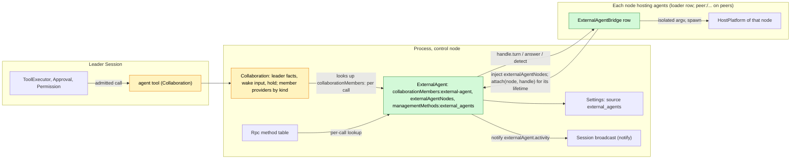
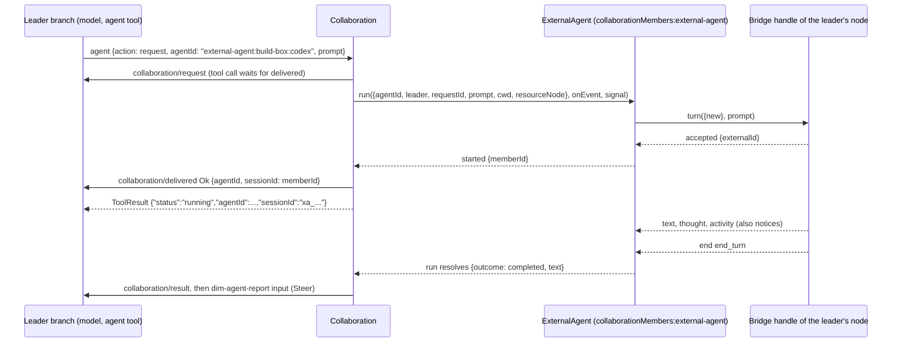

# ExternalAgent

Status: Draft (second redesign, [#145](https://github.com/arcships/dim/issues/145)). It supersedes the model framing of [#182](https://github.com/arcships/dim/pull/182). The maintainer's decisions of 2026-10-22 are recorded in [Appendix F](#appendix-f-recorded-decisions); what remains for Ready is listed in [§10](#10-ready-status). Overall design: [overview §4](../overview.md#4-plugin-catalog); scope: [ADR 002](../../adr/002-plugin-scope.md) (process, with per-node bridge rows). Phase: P3. Language: TypeScript first ([overview Appendix C](../overview.md#appendix-c-implementation-language)).

ExternalAgent lets a Session's model delegate work to locally installed coding agents (Claude Code, Codex, Cursor, OpenCode, ZCode and similar) the way it delegates to a sub-agent. An external agent is a **sub-agent, not a model**: the delegating Session keeps its own model, gives the external agent a task through Collaboration's `agent` tool, and later receives the agent's final report as the member's result. The external agent works in its own conversation with its own tools; dim never presents its output as dim model output.

ExternalAgent is one more **member kind** of Collaboration, dim's existing sub-agent mechanism ([collaboration.rs](../../../crates/dim-app-server/src/collaboration.rs)), rather than a parallel one. Collaboration keeps owning the delegation: the `agent` tool, the leader's `collaboration/*` facts, the `dim-agent-report` wake input, cancellation, reload settlement and the leader's Session hold. ExternalAgent supplies the member: it starts the external conversation, carries tasks and messages to it, reports activity and permission asks, and returns the final text. When the agent asks permission for one of its own actions, the ask travels on Collaboration's member-approval route ([#29](https://github.com/arcships/dim/issues/29), decided in #19) to the leader's model, whose decision is an ordinary tool call under the leader's own Approval and Permission. Agent processes live in per-node bridge rows that the loader manages. All contracts are language-neutral named services ([ADR 002 D5](../../adr/002-plugin-scope.md#d5-contracts-are-language-neutral)); Rust forms are in [Appendix G](#appendix-g-rust-binding).

## 0. Why a Collaboration member

| Shape | What it needs | Verdict |
| --- | --- | --- |
| **External agent as one more Collaboration member kind** (this design) | Collaboration looks up a member provider by kind per call and routes its existing operations to it; ExternalAgent implements the provider | Chosen: the model sees one delegation surface, and detached work keeps one owner whose contract already covers delivery, results, wake-up, cancel, close, reload and restart ([event-driven flows §3](../../architecture/rust-agent/event-driven-flows.md)). Persisted `collaboration/*` data is unchanged |
| An `external_agent` tool with its own detached-work events, owned by ExternalAgent | A second request/result/wake/cancel owner and a second sub-agent tool for the model | Rejected: duplicates Collaboration's owner rules, and the model must choose between two delegation surfaces |
| A member Session whose turns the external agent runs (the #182 framing) | A Provider entry, a model kind and ModelHost/ModelProvider changes, so that the agent's work appears as dim model output in a dim Session | Rejected by the maintainer: an external agent is a sub-agent, not a model |

What changed from #182, which this design supersedes:

| #182 (model framing) | This design |
| --- | --- |
| Provider entry `external-agent:<node>:<agent>`, `modelKind:external-agent`, `ModelConnection::Kind`, `ModelCallScope`, ModelHost lookup | Removed. No Provider, Aimux, ModelProvider or chunk-mapping supplement |
| Agents profiles with an external model, written by ExternalAgent | Removed. Collaboration lists external agents from ExternalAgent's catalog |
| Delivery decision from the calling branch's Timeline (records, cursor, transcript initialization) | Removed. A member receives only its task and the leader's messages, as dim members do |
| `external_agent_allow` / `external_agent_reject` tools, a Session part and a client route | Removed. Asks use Collaboration's member-approval route (§3.2); ExternalAgent has no Session part |
| SessionTitle and AuxiliaryModel exclusions of `external-agent:*` models | Removed; no such models exist |
| Memory-only member records | Members persist `{memberId, externalId, ...}` in ExternalAgent's own `pluginFiles` store and reopen with ACP `session/load` (or CLI resume) after an ExternalAgent reload or dim restart (§3.5, D5) |
| Kept | Per-node bridge loader rows that attach to ExternalAgent, ExternalAgent emitting its own notices, business configuration in Settings, the shared ACP schema |

## 1. Structure



External agent connections and live conversations are shared host resources, so ExternalAgent is a process plugin (ADR 002 D1). Agent processes are host resources of a node, so they belong to a plugin on that node: `ExternalAgentBridge` is a process plugin with one loader row per node that hosts agents. The control node's row is part of the product profile whenever ExternalAgent is enabled. A peer node's row is `peer:<node>/external-agent-bridge`, added or removed only by PluginManager's structural operations (ADR 002 D4: node binding is structural). A peer row waits while its node or link is gone and loads again when it returns. The bridge's resources are released by its own `ctx.effect` whenever the row unloads.

A bridge row injects `externalAgentNodes` (on a peer, imported over the link) and, in `apply`, attaches a by-reference handle for its node. The attachment lasts exactly as long as the row: the row's effect detaches it, and a dropped link or exited runtime closes the reference, which ExternalAgent treats as detached. This is the registration form #37 accepted. A TypeScript row cannot look up a service per call ([sessions-service D1](../appserver/sessions-service.md), [process TypeScript §5.1](../process-typescript.md#51-proposed-p6p7-access-through-declared-feature-dependencies)), so ExternalAgent never looks a bridge up.

Collaboration, which is native, looks up `collaborationMembers:<kind>` on each call without a dependency, as Rpc does for `managementMethods`. No core part and no Session depends on ExternalAgent; it injects only `settings` and `pluginFiles`, which never reload. ExternalAgent has no Session part: the delegation and decision tools are Collaboration's.

| Part | Scope | Depends on (`inject`) | Provides |
| --- | --- | --- | --- |
| `ExternalAgent` | Process row, control node | `settings`, `pluginFiles` | `collaborationMembers:external-agent`; `externalAgentNodes`; `managementMethods:external_agents`; Settings source `external_agents`; `externalAgent.activity` notices |
| `ExternalAgentBridge` | Process row, one per node hosting agents | `externalAgentNodes`; that node's HostPlatform exec-argv helper | Nothing by name; a `BridgeHandle` by reference through `attach` |
| Collaboration (change, §9.2) | Existing process, Session and branch parts | Looks up member providers per call | Routes its operations for non-Session members to the provider of their kind |

**Contracts depended on.** [`pluginFiles`](../../../crates/dim-app-server/README.md#trusted-plugin-storage) (storage envelope version 1, one file under the provisioned directory `external-agent/`); Collaboration's `agent` tool, `collaboration/*` events and detached-work behavior, with the member-provider change (§9.2) and the member-approval route (§9.3); Settings' typed writes and `settings.changed`; Session broadcast notices with the TypeScript binding of §9.1; process rows and management methods through #4 ([process TypeScript](../process-typescript.md)); each node's HostPlatform exec-argv helper and isolation (overview Appendix B, P3); `SessionConfig.resourceNode` (P3); rutis links that export `externalAgentNodes` to linked nodes.

**Contracts defined here.** The member-provider contract `collaborationMembers:<kind>` (with Collaboration, §9.2) and its `external-agent` implementation; the member store payload format 1 (§2); `externalAgentNodes` and `BridgeHandle`; `externalAgent.activity` notices; business configuration and methods `external_agents.*`; the ACP schema and conformance suite shared with [AcpGateway](AcpGateway.md) (client side).

Provider, Agents, Aimux, ModelProvider, Approval and Permission never name this plugin. Collaboration names member kinds only as lookup keys.

## 2. Data and state

**Business configuration** ([ADR 002](../../adr/002-plugin-scope.md) D4) is one user-scope document in the Settings source `external_agents`, declared by ExternalAgent's process row: `{ nodes: { <node>: { <agent>: { enabled, description?, executable?, args?, env?, reasoning? } } } }`. Settings validates it and applies defaults; ExternalAgent reads it at use time and passes the entry with each bridge call. It is written only through ExternalAgent's management methods (A.1). `env` values may hold an agent's credentials; ExternalAgent owns them ([settings-service §1.2](../appserver/settings-service.md#12-decision-secrets-belong-to-their-owner)), and the source has no project scope. A change is a data update plus `settings.changed`, never a reload.

**Loader rows.** Each node's `external-agent-bridge` row is structural: it says which nodes may run agents, not which agents run there.

**Attached bridges.** `node -> handle` in ExternalAgent's memory, from `attach` until `detach` or until the reference closes.

**Member record.** One per external member. The durable part lives in ExternalAgent's member store; the live part only in memory:

```text
StoredMember {                  // durable, member store payload format 1
  memberId: "xa_<uuid>",        // the member's sessionId in Collaboration's data
  leaderSessionId: String,      // the only Session that may address it
  agentId: "external-agent:<node>:<agent>", node, agent, protocol: "acp" | "cli",
  cwd: String,
  externalId: String,           // ACP sessionId or CLI conversation id
  restorable: bool,             // ACP agent declared loadSession, or the CLI adapter has a resume form
  queued: [{content, mode}],    // messages accepted for an idle member, not yet sent
}
LiveMember {                    // memory only
  state: dormant | idle | running { requestId },
  activity: [Entry],            // of the current or latest request; for read and notices
  asks: { askId -> {title, kind, detail} },
}
```

A member lives until Collaboration closes it (explicit `close`, or the leader Session's business close), or its restore fails. An ExternalAgent reload or a dim restart does not end it: records load as `dormant` and the next operation reopens the conversation (§3.5).

**Member store.** One `pluginFiles` file, `external-agent/members.json`, whose envelope text is the payload `{"format": 1, "members": [StoredMember]}`. The host provisions the `external-agent/` directory. `pluginFiles` has no delete or list operation, so all records share this one file. ExternalAgent rewrites it inside one `withLock` lease per change (read, change its own record, `replace`); it is the only writer, so the lease is the owner serializing its own state, not a cross-owner read-then-write. Format decision (AGENTS.md): payload format 1 is new; an incompatible change raises `format`. A reader that finds an unknown `format` or invalid payload does not rewrite, reset or migrate the file: ExternalAgent reports it through `external_agents.list` and in diagnostics, serves no stored member until an operator decides, and new members stay in memory only. Credentials are never stored here; `env` stays in Settings.

| Change | Write |
| --- | --- |
| New member reaches `accepted` | Add the record, then emit `started` (a crash in between leaves an external conversation without a record and an undelivered operation, which Collaboration settles as closed) |
| Message accepted for an idle or dormant member | Append to `queued`, then reply |
| Queued messages sent in a prompt | Clear them once the prompt is accepted |
| `close`, failed restore, not restorable after restart | Remove the record |

Unload, reload and shutdown never remove records; only the business events above do.

**Timeline.** ExternalAgent writes nothing to any Timeline and declares no event. The leader branch gets Collaboration's ordinary facts: `collaboration/request`, `collaboration/delivered`, `collaboration/message`, `collaboration/cancel`, `collaboration/close`, `collaboration/result`, the `dim-agent-report` input, and, for asks, the inputs, tool calls and approval facts of Collaboration's member-approval route. Their data formats are unchanged: an external member is `CollaborationTarget::Agent { agent_id: "external-agent:<node>:<agent>" }` when created and `Member { agent_id, session_id: <member_id> }` afterwards.

**Not in the Timeline** (principles §4 rule 9): configuration, attachments, member records (they live in the member store), activity, processes. Clients see activity through notices. A restored member's past requests and results stay in the leader's own `collaboration/*` facts.

## 3. Flows

### 3.1 Delegation



1. The leader's model calls `agent` `request` with an external `agentId` (new member) or with `agentId` + `sessionId` of an existing external member (next task). Collaboration writes `collaboration/request` as today.
2. Collaboration looks up the provider for the agent id's kind and calls `run`. ExternalAgent checks the entry (enabled, node attached, node equals the leader's resource node), creates or reuses the member, and starts the external turn with the task text. On `accepted` it emits `started {memberId}`, and Collaboration writes `collaboration/delivered`; the tool call returns. A refusal before `started` becomes `collaboration/delivered Error` with Collaboration's code and ExternalAgent's detail.
3. The request is detached work owned by Collaboration: it holds the leader Session, a turn interrupt of the leader does not stop it, and its result wakes the leader.
4. While running, `append` messages are queued and sent as a follow-up prompt in the same conversation when the current prompt ends; `steer` messages cancel the current prompt and prompt again with the message. The request completes when a prompt ends with no queued message.
5. `run` resolves with the outcome and the final text (A3). Collaboration writes `collaboration/result` and its `dim-agent-report` input exactly as for a Session member.

A member works in the leader's cwd on the leader's resource node, as Collaboration's Session members do. One task per member at a time: `run` on a running member is refused as `busy`.

### 3.2 Permission asks

The agent's own action is not a dim tool call, so dim's Approval does not admit it ([ADR 003](../../adr/003-approval-scope.md) D1). It is the work of a member, and #19 decided where a member's approvals go: to the leader branch as an input, decided by the leader's model with a Collaboration tool whose call passes the leader's Approval and Permission ([overview Appendix B](../overview.md#appendix-b-supplements-to-existing-plugins), Collaboration). An external member's ask uses that same route.

```mermaid
sequenceDiagram
  participant B as Bridge (ACP client)
  participant X as ExternalAgent
  participant C as Collaboration
  participant L as Leader branch (model, ToolExecutor, Approval, Permission)
  participant U as User
  B->>X: permissionAsked(askId, title, kind, rawInput, options)
  X-->>C: onEvent ask {askId, title, kind, detail}
  C->>L: member-approval input (Steer)
  L->>L: model calls Collaboration's allow decision
  L->>L: Permission: allow risk; WorkspaceWrite asks
  U-->>L: approval.respond (only when the leader's policy asks)
  L->>C: admitted decision
  C->>X: answer({memberId, askId, decision: allow})
  X->>B: answer allow_once
```

- ExternalAgent supplies `title`, a coarse `kind` (A5) and `detail` (the agent's raw input). Collaboration owns the input's text, the decision tools and their results.
- Allow selects an `allow_once` option and reject selects `reject_once`; when the needed option is absent the agent is answered `cancelled`. `*_always` is never selected.
- When an ask ends unanswered (the run is cancelled or ends, the agent withdraws it, the bridge detaches, ExternalAgent unloads), ExternalAgent answers the agent `cancelled` if it still waits and emits `askEnded`; Collaboration withdraws its input if unapplied, and a later decision gets `not_pending`.
- There is always a delegating branch. If it closes or is stopped, Collaboration cancels the run, which ends the asks. ExternalAgent has no client route of its own: the user takes part through the leader's Approval when the leader's policy asks.
- Non-interactive CLI adapters have no request channel. They launch in the agent's own non-auto-approving mode, so the agent refuses actions it cannot ask about (A6).

### 3.3 Cancel, close, interrupt

| Operation | Effect |
| --- | --- |
| `agent` `cancel` | Collaboration aborts the `run` signal; the bridge sends ACP `session/cancel` (or signals the CLI) and answers pending asks `cancelled`; `run` resolves `cancelled` when the agent ends the prompt with stop reason `cancelled` (or the CLI exits), the agent's own terminal fact; the report says `cancelled by leader`. The member stays and can take the next task |
| `agent` `close` | Cancel as above, then `close`: the conversation's process is closed and the record removed |
| Leader turn `stop/interrupt` | No effect on the running task (detached-work contract) |
| Leader branch stop or close | Collaboration aborts the run, as for Session members |
| Leader Session closes | Collaboration closes its members, external ones included |

### 3.4 Bridge lifecycle

| Event | Who acts | Effect |
| --- | --- | --- |
| ExternalAgent enabled in the product profile | Loader | Control-node bridge row loads after ExternalAgent and attaches |
| PluginManager enables the bridge on peer node `n` | Loader | Adds `peer:n/external-agent-bridge`; once the link is up the row loads on `n`, imports `externalAgentNodes` and attaches `n`; ExternalAgent runs `detect` on it |
| Link to `n` drops | Loader (peer row behaviour) | The row stops: its effect cancels turns and kills its processes; the reference closes, so ExternalAgent fails the running members on `n` (`run` rejects `external_agent_exited`) and closes them; new requests for `n` are refused `node_unavailable`; when the link returns the row attaches again |
| Agent enabled or disabled on a node | ExternalAgent (business configuration) | No row change and no reload; the catalog changes; requests for a disabled agent are refused; running members finish |
| Bridge crash or reload | Loader | As a dropped link, local to that node |
| ExternalAgent reload | Loader | Bridges reload with it; every running `run` rejects `provider_unavailable`; members load from the store as `dormant` and reopen on next use (§3.5) |

### 3.5 Restore after reload or restart

```mermaid
sequenceDiagram
  participant L as Leader (model)
  participant C as Collaboration
  participant X as ExternalAgent (restarted)
  participant S as pluginFiles members.json
  participant B as Bridge handle
  X->>S: read at apply; records become dormant
  Note over C: open request of the old generation already settled failed by Collaboration
  L->>C: agent request {agentId, sessionId: xa_...}
  C->>X: run({memberId, leader, prompt, ...})
  X->>X: leader matches record; node attached and equal to the leader's resource node
  X->>B: turn({load: {externalId}} , queued + prompt)
  alt load succeeds
    B-->>X: accepted (replayed history dropped)
    X-->>C: started; the request proceeds as §3.1
  else load fails or unsupported
    B-->>X: error load_failed / not_supported
    X->>S: remove record
    X-->>C: reject member_closed "could not restore ...; request a new member"
  end
```

- **Settlement stays with its owner.** A request open when ExternalAgent reloads or dim restarts is settled once, by Collaboration: an ExternalAgent reload makes `run` reject `provider_unavailable`, and a restart is settled by Collaboration's rebuild (`collaboration/result` failed). ExternalAgent never reports a result for an earlier generation's run and never resumes it. Restore brings back only the conversation; the member is `idle` (or `dormant`) and takes the next request as a new request. There is no double settlement because only Collaboration writes results.
- **Lazy reopen.** Records load as `dormant` at apply; nothing is spawned until an operation needs the conversation. `request` reopens it; `message` only queues (persisted); `read` answers from memory with an empty page and the note that activity before the restart is not kept; `close` removes the record without spawning.
- **ACP.** The bridge spawns the agent, checks `agentCapabilities.loadSession`, and sends `session/load {sessionId: externalId, cwd, mcpServers: []}`. Updates replayed by the load are dropped (not activity, not notices). Then the queued messages and the task are sent with `session/prompt`.
- **CLI.** An adapter whose data declares a resume form (for example a `--resume <id>` argument) continues by conversation id on the next spawn; that is the CLI reopen. An adapter without one marks its members `restorable: false`.
- **Failure is a clear refusal, never a silent new conversation.** A missing `loadSession`, a failed `session/load`, a CLI without resume, a changed node or a detached node make `run` reject before `started`. Collaboration reports `member_closed` with ExternalAgent's detail, for example `could not restore the conversation of Codex (build-box): session/load failed (session not found); request a new member`, or `Codex (build-box) cannot resume conversations after a restart; request a new member`. A load failure or missing support removes the record; an unattached node keeps it (the node may return).
- **Ownership checks survive restarts.** The stored `leaderSessionId` authorizes every operation, so a restored member answers only its leader. A fork of the leader has another Session id and is refused, matching Collaboration's fork rule (#127).

## 4. Timing and conflicts

Collaboration's facts order everything that reaches the leader; ExternalAgent's memory orders only the live exchange with the agent.

| Scenario | Order | Outcome | Owner |
| --- | --- | --- | --- |
| Leader turn interrupt while the request is undelivered | interrupt < `delivered` | Collaboration's existing rule: the operation is suppressed and the run aborted | Collaboration |
| Cancel while an ask waits on the leader's decision | — | Ask ends `cancelled`; unapplied ask input withdrawn; a later decision `not_pending`; report `cancelled` | ExternalAgent, Collaboration |
| Decision admitted before the cancel | — | Delivered to the agent, then the cancel | ExternalAgent |
| Leader under ReadOnly | — | The allow decision is denied by Permission; reject remains; otherwise the ask waits | Permission |
| Ask pending for a long time | — | No dim timeout; the leader can cancel (A7) | Leader |
| Append message while running | `collaboration/message` | Queued; sent as the next prompt in the same request | ExternalAgent |
| Steer message while running | `collaboration/message` steer | Current prompt cancelled; the message is the next prompt; text already produced stays in activity | ExternalAgent |
| Message to an idle member | — | Queued; prefixed to the next task | ExternalAgent |
| Request to a running member | — | `busy` | ExternalAgent |
| ExternalAgent reload mid-run | — | `run` rejects `provider_unavailable`; Collaboration writes `collaboration/result` failed; the member reloads as `dormant` and its next request reopens the conversation (§3.5) | Collaboration, ExternalAgent |
| Collaboration (leader) reload mid-run | — | Collaboration's existing settlement aborts the run and writes the result failed; the member stays and takes the next request | Collaboration |
| dim restart mid-run | — | The bridge's processes end with the old process; Collaboration's rebuild writes the result failed; ExternalAgent loads the member as `dormant`; the next request reopens it (§3.5) | Collaboration, ExternalAgent |
| Bridge row stops mid-run | — | `run` rejects `external_agent_exited`; result failed | Bridge, Collaboration |
| Leader Session forked | — | Collaboration's fork rule: the copied request names the source's member, which keeps working for the source ([#127](https://github.com/arcships/dim/issues/127)) | Collaboration |

All other rows: [Appendix B](#appendix-b-full-conflict-table).

## 5. What the model sees

All of it arrives through Collaboration's existing tool results and inputs (`ToolResult.content` is what the model reads):

| Moment | Leader model reads |
| --- | --- |
| `list` | External agents among `agents`: `{"agentId": "external-agent:build-box:codex", "name": "Codex (build-box)", "description": "..."}`; external members among `participants` with their `sessionId` (member id) and status |
| `inspect` | `{"agentId": ..., "profile": {"name", "description", "kind": "external-agent", "node", "agent", "version"}}` |
| `request` accepted | `{"status": "running", "agentId": "external-agent:build-box:codex", "sessionId": "xa_..."}`; the work continues detached |
| `request` refused | Collaboration's refusal text, for example `member_create_failed: codex is not enabled on build-box`, `member_create_failed: node build-box is unavailable`, `member_create_failed: codex needs its own login (run "codex login" on build-box)`, `busy: ...` |
| Progress | Not pushed into context. `read` returns the member's recent activity, `{entries: [{seq, kind: "text" \| "thought" \| "tool" \| "ask", ...}], nextCursor}`; after a restore, activity from before it is not kept and `read` says so |
| Permission ask | Collaboration's member-approval input (§3.2), naming the agent, member, action title, kind and bounded detail |
| Final report | The `dim-agent-report` input: `Status: completed\|failed\|cancelled.`, a preview of the final text, and how to read the full result with `result` |
| `result` | `{"resultId", "result": {agentId, sessionId, text, outcome}}` from the leader's own `collaboration/result` |
| Cancel | `{"status": "cancelled", ...}` from the tool, then a `cancelled` report |
| Errors after start | A `failed` report whose reason names the cause (`external agent exited`, `node build-box disconnected`, `external agent reloaded; the member can take a new task`, `refusal`, `max_turn_requests`) |
| Restore refused | `member_closed: could not restore the conversation of Codex (build-box): ...; request a new member` or `member_closed: Codex (build-box) cannot resume conversations after a restart; request a new member` |

The external agent sees only its task text, the leader's messages and its own conversation. It never sees the leader's history, dim prompts, tool declarations or other plugins' data. The leader's context holds the report and ask inputs only after they are applied, and withdrawn ask inputs never enter it.

## 6. Interfaces (summary)

| Interface | Kind | Purpose |
| --- | --- | --- |
| `collaborationMembers:external-agent` | Process service, looked up per call by Collaboration | Catalog and member operations ([A.2](#a2-member-provider)) |
| `externalAgentNodes` | Process service, injected by bridge rows | `attach` / `detach` of a node's `BridgeHandle` ([A.3](#a3-bridge-and-adapters)) |
| `BridgeHandle` | By-reference object of one bridge row | `detect`, `turn`, `answer` on a node ([A.3](#a3-bridge-and-adapters)) |
| `externalAgent.activity` | Session broadcast notice on the leader Session, source `ExternalAgent` | Live progress for clients ([A.4](#a4-activity-and-notices)) |
| `external_agents.list` / `set_enabled` / `configure` | `managementMethods:external_agents` | Detection, enablement, configuration ([A.1](#a1-management-methods)) |
| ACP schema and conformance suite | Shared with AcpGateway | Client side ([A.5](#a5-shared-acp-schema)) |

**Streamed calls.** `run` and `BridgeHandle.turn` produce a sequence of items. Over rutis-bridge 0.12.1 they are `async` methods whose request carries a sink function by reference (`onEvent`, `onUpdate`) and an AbortSignal: the callee calls the sink once per item and awaits each call before the next; the call resolves when the sequence ends and rejects with the error that ends it. Aborting the signal is cancellation; a closed reference fails the call.

## 7. Security

- External agents run with their own accounts and tools. dim decides their actions only when they ask, and only through the leader's model under the leader's Approval and Permission. It cannot stop actions an agent takes without asking. The node's HostPlatform isolation is the enforcement boundary; adapters launch agents in their most asking mode (A6).
- Authority is the leader's: an allow decision needs whatever the leader's preset and rules require, so a ReadOnly leader cannot allow, and a WorkspaceWrite leader's user is asked. `*_always` is never selected.
- Credentials are `env` values that ExternalAgent reads from its own user-scope document at turn time and passes to the bridge over the authenticated link. They are never written to Timelines, notices, diagnostics, activity or replies.
- Enabling an agent is business configuration, not an approval ([ADR 003](../../adr/003-approval-scope.md) D2), changed only through management methods, which are never served to paired devices. The model cannot enable agents. Adding a bridge to a node is a structural operation of PluginManager. Executables are resolved on the node, never from project files.
- `externalAgentNodes` is exported only over authenticated links; a bridge attaches only its own node, and attaching runs nothing.

## 8. Rule check

Rules: [principles §1 and §4](../../architecture/rust-agent/principles.md), [ADR 002](../../adr/002-plugin-scope.md) D1–D5.

| Rule | How this document complies |
| --- | --- |
| §4.1 Command events for others' state | ExternalAgent writes no event. Leader facts are Collaboration's; decisions are leader tool calls decided by the leader's Approval and Permission; withdrawals of ask inputs are Collaboration's `input/withdraw` commands. |
| §4.2 No take-back after hand-off | A task handed to the agent is only cancelled, never recalled; an applied ask input is never withdrawn, and a late decision gets `not_pending`. |
| §4.3 Before callbacks | Not applicable. |
| §4.4 Core mechanisms carry no business meaning | No core contract changes. Collaboration's provider lookup is by kind and names no plugin. |
| §4.5 Read the whole batch | ExternalAgent reads no Timeline. |
| §4.6 Model context holds only handed-over events | The leader sees external work only through applied report and ask inputs and tool results (§5). |
| §4.7 Only public events and services | ExternalAgent is reached through `collaborationMembers` and management methods, and reaches bridges through attached handles and clients through `notify`. |
| §4.8 Infrastructure unchanged by default | Timeline, Dispatcher, envelope, loader and facades are unchanged. One binding is requested (§9.1); the Collaboration items are plugin changes (§9.2, §9.3). |
| §4.9 Only facts later decisions use | Requests, deliveries, results and decisions are Collaboration's facts; configuration, member records (in ExternalAgent's own store), activity and processes stay out. Restore reads only the owner's store and never derives state from a Timeline. |
| §1 Capability and App Server boundary | Process rows only; agent processes are bridge row resources released by its effect; an attachment lives as long as its row; the service graph is acyclic (bridges → ExternalAgent → Settings, pluginFiles; Collaboration looks up per call). |
| ADR 002 D1 | Live conversations are shared host resources (process); agent processes are a node's (bridge row per node). Per-Session work stays Collaboration's. |
| ADR 002 D2 | No wiring module: Collaboration and Rpc look up by name per call; bridges attach through an injected service. |
| ADR 002 D3 | ExternalAgent injects only `settings` and `pluginFiles`, which never reload; nothing depends on ExternalAgent except its own bridges, so its absence fails only external delegations. |
| ADR 002 D4 | Agent entries are business configuration; bridge rows are structural and changed by PluginManager. |
| ADR 002 D5 | `collaborationMembers`, `externalAgentNodes`, `BridgeHandle`, notices and methods are named services and data. |

## 9. Requirements raised to mechanism owners

One binding is requested from a mechanism owner (§9.1). Two items are changes of Collaboration, a plugin, stated so its owner can accept them (§9.2, §9.3).

### 9.1 TypeScript binding of Session notices

| Item | Content |
| --- | --- |
| Blocked | ExternalAgent owns member activity and must emit `externalAgent.activity` after its own changes ([session notices §4](../appserver/session-notices.md#4-emitting): the owner emits). Its process row is TypeScript, and no binding exists |
| Mechanisms considered | Collaboration relaying activity: it does not own the state; Timeline events: display-only data, forbidden by principles §4 rule 9; only `read`: no live display for clients |
| Needed | `notify(sessionId, {source, kind, data})` for TypeScript process rows with the native contract unchanged: synchronous, no dependency, dropped when nobody listens, no replay |
| Effect on sequence, batch, interrupt, reload | None: notices are not events |
| Owner | Session notices / #4 TypeScript bindings (dim runtime). To be filed with this section when accepted |

### 9.2 Collaboration member providers

Collaboration's members are dim Sessions today: every operation goes through the member's `Session` (input, idle, stop, history). The change adds members provided by other plugins, keyed by kind:

- An `agentId` of the form `<kind>:<rest>` whose kind has a provider (`collaborationMembers:<kind>`, looked up per call by name, no dependency) is an external member. Agents' ids never contain such a prefix.
- `list` / `inspect` add the provider's `catalog()` entries; `request`, `message`, `cancel`, `close` and `read` call the provider (A.2); `result` is unchanged (it reads the leader's own facts).
- `collaboration/delivered` is written on the provider's `started`; `collaboration/result` on `run`'s resolution or rejection. The leader hold, wake input, interrupt, branch stop, leader close, unload and rebuild settlement apply unchanged, aborting the `run` signal where they stop a Session member.
- Collaboration keeps no relation for provider members: its directory is memory and does not survive a restart, while external members do. The provider authorizes every call by the `leader` Collaboration passes (its stored `leaderSessionId`), and `list` takes the leader's participants of that kind from `members({leader})`.
- Provider `close` is called only for business closes: the `close` action and the leader Session's close (which Collaboration already treats as deletion). Unload, reload and shutdown abort runs but never close provider members, so a restored member is still there.
- No event or persisted format changes: target and member ids already are strings.

### 9.3 Member-approval route accepts provider asks

#19 decided that member approvals go to the leader's model through a Collaboration tool that passes the leader's Approval and Permission ([overview Appendix B](../overview.md#appendix-b-supplements-to-existing-plugins); not yet designed in detail). For external members the route takes asks from the provider's `run` events (`ask`, `askEnded`) and returns decisions through the provider's `answer`. Constraint for its design: the allow decision must carry a Permission risk that ReadOnly denies and WorkspaceWrite asks (a tool's risk is static, so allow and reject are separate tools or the decision tool is classified at the allow level).

### 9.4 Imported services stay registered while a link is down (#5)

Withdrawn: rutis is an external dependency, so no requirement is raised to it. Offline nodes follow rutis' existing behaviour and [overview §6.3](../overview.md#63-multiple-nodes): a dropped link stops the peer bridge row, whose effect ends its processes, and closes its handle reference (§3.4). Other documents link to §9 for this decision.

## 10. Ready status

| Item | Needed from |
| --- | --- |
| Accept §9.2 and §9.3 | Collaboration owner |
| Design Collaboration's member-approval route (#19), which this design uses | Collaboration owner |
| Accept §9.1 (TypeScript `notify` binding) | Session notices owner (dim runtime) |
| P3 prerequisites: `SessionConfig.resourceNode`, HostPlatform exec-argv helper and isolation, link export of `externalAgentNodes` | P3 owners |

[#241](https://github.com/arcships/dim/issues/241) no longer applies: ExternalAgent contributes no tools.

## Appendix A. Interface details

### A.1 Management methods

`managementMethods:external_agents` on ExternalAgent's process row:

| Method | Params | Result | `mutating` |
| --- | --- | --- | --- |
| `external_agents.list` | `refresh?` | Per configured or attached node: `attached` or `unavailable`; per agent: executable, version, protocol (ACP or CLI), enabled, description, configuration (references only) | no |
| `external_agents.set_enabled` | `node`, `agent`, `enabled` | New state | yes |
| `external_agents.configure` | `node`, `agent`, `description?`, `executable?`, `args?`, `env?: {name: value}`, `reasoning?` | New configuration | yes |

Detection calls a bridge's `detect` when it attaches and on `refresh` (A1). Detected agents stay disabled until enabled (A2). Writes go through Settings' typed write with the revision read (CAS); ExternalAgent applies `settings.changed` without a reload. Enabling writes nothing else: the catalog is derived from this document.

### A.2 Member provider

`collaborationMembers:<kind>`, process scope; ExternalAgent provides kind `external-agent`.

| Method | Mode | Request | Reply |
| --- | --- | --- | --- |
| `catalog` | async | `{leader: {sessionId}, resourceNode}` | `[{agentId, name, description, profile}]`: enabled agents of that node |
| `members` | async | `{leader: {sessionId}}` | `[{agentId, sessionId: memberId, name, status: running \| idle \| dormant}]` of that leader |
| `run` | async, streamed (§6) | `{agentId, memberId?, leader: {sessionId, branchId}, requestId, prompt, cwd, resourceNode}`, `onEvent`, signal | Events `{started: {memberId}}`, `{activity: Entry}`, `{ask: {askId, title, kind, detail}}`, `{askEnded: {askId, outcome}}`; resolves `{outcome: completed \| failed \| cancelled, reason?, text}`; rejects `{code, detail}` before `started` |
| `message` | async | `{memberId, leader, content, mode: append \| steer}` | `{}` or `{code: member_closed}` |
| `answer` | async | `{memberId, askId, decision: allow \| reject}` | `{outcome: allowed \| rejected}` or `{code: not_pending}` |
| `read` | async | `{memberId, leader, after, limit}` | `{entries, nextCursor}` or `member_closed` |
| `close` | async | `{memberId, leader}` | `{}` |

Codes before `started` map to Collaboration refusals: `not_enabled`, `node_unavailable`, `wrong_node`, `not_installed`, `auth_required`, `launch_failed` → `member_create_failed` with ExternalAgent's detail text; `busy` → `busy`; `member_closed`, `restore_failed`, `not_restorable` → `member_closed` with the detail. A member is addressed only by its leader: a `leader` other than the stored one is `member_closed`. `run` on a `dormant` member reopens it first (§3.5).

`text` is the agent's message text after its last tool activity in the request's last prompt, or all message text of that prompt when it used no tools (A3).

### A.3 Bridge and adapters

`externalAgentNodes`, process scope, provided by ExternalAgent and exported to linked nodes:

| Method | Mode | Request | Reply |
| --- | --- | --- | --- |
| `attach` | async | `{node, handle: BridgeHandle}` | `{}` |
| `detach` | async | `{node}` | `{}` |

`BridgeHandle`, by reference, one per bridge row:

| Method | Mode | Request | Reply |
| --- | --- | --- | --- |
| `detect` | async | `{adapters}` | `[{agent, executable, version, protocol: acp \| cli}]` |
| `turn` | async, streamed | `TurnSpec {turnId, agent, config (the entry, with its env), cwd, conversation: {new} \| {continue: {externalId}} \| {load: {externalId}}, prompt: text}`, `onUpdate`, signal | `{accepted: {externalId}}`, `{text}`, `{thought}`, `{activity: {id, title, status}}`, `{permissionAsked: {askId, title, kind, rawInput?, options}}`, `{permissionWithdrawn: {askId}}`; resolves `{end: end_turn \| max_tokens \| max_turn_requests \| refusal \| cancelled}`; rejects `{code}` (`load_failed`, `load_unsupported` before `accepted` for `{load}`) |
| `answer` | async | `{turnId, askId, answer: allow \| reject \| cancelled}` | `{}` |

| Adapter | Open | Turn | Cancel |
| --- | --- | --- | --- |
| ACP client | Spawn with the node's HostPlatform exec-argv helper (cwd, isolation); `initialize` with fs and terminal client capabilities off; `session/new {cwd, mcpServers: []}`, or for `{load}` `session/load {sessionId, cwd, mcpServers: []}` when `loadSession` is declared (replayed updates dropped) | `session/prompt`; `session/update` → text, thought, activity; `session/request_permission` → `permissionAsked` | `session/cancel`, answer pending requests `cancelled`, wait for the prompt response; a following prompt is sent only after it |
| Non-interactive CLI | Spawn per prompt; continuing and `{load}` both use the adapter's resume form with the conversation id, and `{load}` is `load_unsupported` without one; restrictive permission flags (A6) | Prompt on stdin, structured output parsed per adapter | Interrupt signal, grace, kill |

One ACP process per member, from its first use until the member closes or the bridge row unloads; after that the conversation reopens with `{load}` (§3.5). Adapter definitions are data inside the bridge package.

Outcome mapping: `end_turn` → `completed`; `max_tokens`, `max_turn_requests`, `refusal`, CLI non-zero exit → `failed` with that reason; `cancelled` after our cancel → `cancelled`.

### A.4 Activity and notices

Each `text`, `thought` (folded per block), `activity` and ask becomes an activity entry `{seq, kind, ...}` in the member's activity of its current or latest request (cleared when the next request starts) and an `externalAgent.activity {memberId, agentId, entry}` notice on the leader Session (source `ExternalAgent`, §9.1). Notices are not replayed; a client that attaches later sees new activity only, and the leader's model reads past activity with `read`.

### A.5 Shared ACP schema

Pinned protocol version, generated types per language, and a transcript-based conformance suite shared with AcpGateway: initialize, new/load, prompt, streamed updates, cancel during a prompt, permission requests answered allow, reject and cancelled, a permission request during cancel, and process exit mid-prompt. No runtime code is shared.

## Appendix B. Full conflict table

| Scenario | Order | Outcome | Owner |
| --- | --- | --- | --- |
| Cancel before `started` | — | Run aborted; the turn cancelled if it started; `delivered` follows Collaboration's interrupted/closed rule | Collaboration |
| Cancel after `started` | — | Turn cancelled; asks ended; result `cancelled` | ExternalAgent, Collaboration |
| Agent ignores the cancel | — | `run` stays open until the agent ends the prompt; the leader can `close` the member, which ends its process | Leader, bridge |
| Several asks in one run | — | Independent, routed in arrival order | ExternalAgent, Collaboration |
| Permission request during cancel drain | — | Answered `cancelled` by the bridge | Bridge |
| Agent withdraws its request | `permissionWithdrawn` | `askEnded`; the route withdraws its input | ExternalAgent, Collaboration |
| Leader's allow denied or rejected by its Approval | — | No answer; ask waits; the model may reject | Approval, Permission |
| Two decisions for one ask | arrival at ExternalAgent | First wins; second `not_pending` | ExternalAgent |
| Leader closes while asks wait | — | Collaboration closes members; asks `cancelled`; processes closed | Collaboration, ExternalAgent |
| `read` while running | — | Entries up to now; `nextCursor` continues | ExternalAgent |
| Request for an agent on another node than the leader's resource node | — | `member_create_failed` (`wrong_node`) | ExternalAgent |
| Agent disabled while a member runs | `settings.changed` | Running task finishes; new requests refused | ExternalAgent |
| Agent needs login | before `started` | `member_create_failed` naming the login command | ExternalAgent |
| Duplicate `set_enabled` | — | Idempotent | ExternalAgent |
| Leader fork | — | The fork does not own the source's members (Collaboration, #127) | Collaboration |
| Message to a dormant member | — | Queued and persisted; sent with the next task after reopen | ExternalAgent |
| `close` of a dormant member | — | Record removed; nothing spawned | ExternalAgent |
| Restored member addressed by a forked leader | — | `member_closed` (stored leader differs) | ExternalAgent |
| Restore with the node detached | — | `member_closed` with `node unavailable`; record kept for the node's return | ExternalAgent |
| Member store has an unknown format | load | No stored member is served; file left untouched; reported in `external_agents.list` | ExternalAgent |
| Client detach | — | No effect | — |

## Appendix C. Errors

| Code | When | Model sees |
| --- | --- | --- |
| `not_enabled`, `not_installed`, `auth_required`, `launch_failed`, `node_unavailable`, `wrong_node` | Before `started` | `member_create_failed: <detail>` |
| `busy` | Request to a running member | `busy` |
| `member_closed` | Member gone (closed, another leader) | `member_closed` |
| `restore_failed`, `not_restorable` | Reopen after reload or restart failed or is impossible | `member_closed: <detail>` naming the agent and asking for a new member |
| `external_agent_exited` | Process exited or handle closed after `started` | Report `failed` |
| `provider_unavailable` | ExternalAgent unloading | Report `failed`; the member stays |
| `refusal`, `max_tokens`, `max_turn_requests` | The agent ended its prompt so | Report `failed` with the reason |

## Appendix D. Acceptance

Flow tests in the actual Node runtime through public interfaces, with a scripted ACP agent and a scripted CLI:

1. `list` shows enabled external agents of the leader's node; `request` returns `running` with a member id; the final text arrives as one `dim-agent-report` input and `result` returns it.
2. A second `request` to the same member continues its conversation; a request to a running member is `busy`.
3. Append and steer messages behave as §3.1 step 4; a message to a closed member is `member_closed`.
4. Cancel before and after `started`; close removes the member; a leader turn interrupt does not stop the task; a leader branch stop does.
5. A permission ask reaches the leader through Collaboration's member-approval route; WorkspaceWrite asks the user; approve → `allow_once`; reject → `reject_once`; ReadOnly denies allow; cancel while waiting withdraws the unapplied input and a later decision is `not_pending`; no `allow_once` option → `cancelled`.
6. Refusals before `started` (disabled, not installed, wrong node, unavailable node) produce `member_create_failed` with the detail; failures after `started` produce a `failed` report.
7. ExternalAgent reload mid-run writes one failed result and leaves Collaboration, Provider, ModelProvider and Sessions loaded; bridges re-attach; the next request to that member reopens it with `session/load` and its final text arrives as a normal report.
8. After a dim restart (disposable home), a stored member is listed as `dormant`, a queued message survives, the next request reopens the conversation, and Collaboration wrote exactly one failed result for the request open at the restart.
9. An agent without `loadSession`, a failing `session/load` and a CLI without resume each refuse the next request with `member_closed` and the restore detail, and remove the record; a forked leader cannot address the source's member.
10. An unknown member store `format` leaves the file untouched and serves no stored member.
11. Stopping a peer bridge row fails only that node's members; its return re-attaches.
12. No Provider entry, Agents profile or model kind exists for external agents; the leader's model and requests are unchanged.
13. Shared ACP conformance suite passes on the client side, including `session/load`.

## Appendix E. Assumptions

| # | Assumption | Basis | Effect if rejected |
| --- | --- | --- | --- |
| A1 | Detection on attach and explicit refresh | Judgment | Background polling |
| A2 | Detected agents are disabled until enabled | They spend the user's accounts | Default on |
| A3 | The result text is the agent's final message (after its last tool activity) of the last prompt | Matches Collaboration's "last turn text" for Session members | Whole transcript |
| A5 | ACP tool kind shown as a coarse category; the decision's risk is fixed | Permission risk is static per tool | Per-kind decisions |
| A6 | Agents launch in their own most asking mode; CLI adapters cannot ask dim and refuse instead | No request channel for CLIs | Per-CLI permission bridges |
| A7 | No timeout on an ask | Approval has none | Timeout answering reject |
| A8 | A member is closed only by `close` or its leader Session's close | Members belong to one leader | Orphaned conversations |

## Appendix F. Recorded decisions

Decided by the maintainer on 2026-10-22; D5's persistence design (§2, §3.5) confirmed afterwards, without automatic eviction ([#254](https://github.com/arcships/dim/pull/254)):

| # | Decision | Recorded |
| --- | --- | --- |
| D1 | Shape | One more Collaboration member kind (§0) |
| D2 | Approval surface | Collaboration's member-approval route from #19 (§3.2); ExternalAgent has no decision tools |
| D3 | Member id field | The `agent` tool's `sessionId` carries the external member id; no schema change |
| D4 | Delegation from ReadOnly leaders | Allowed; every allow is denied by the leader's Permission |
| D5 | Persisted members | Persist and restore: `{memberId, externalId, ...}` in ExternalAgent's `pluginFiles` store, reopened with ACP `session/load` or CLI resume after an ExternalAgent reload or dim restart; members that cannot be restored fail with a clear report; records are removed only on member close, leader Session close or restore failure (§2, §3.5) |
| D6 | Bridge rows | Structural rows changed by PluginManager (ADR 002 D4) |

**Non-goal: workspace isolation for concurrent members.** External members work in the leader's cwd, as Collaboration's Session members do, so two members (external or not) may edit the same files. Isolating them (for example a worktree per member) is not part of this design: it would be a Collaboration-wide change affecting dim members too, and it needs its own decisions on merging results back. It can be raised for Collaboration separately.

## Appendix G. Rust binding

| Neutral | Rust |
| --- | --- |
| `collaborationMembers:<kind>` | Named process service looked up by Collaboration per call by `TypeKey::named`, no `Deps` entry |
| Member store | `pluginFiles` file `external-agent/members.json`, payload `{format: 1, members: [StoredMember]}` |
| `externalAgentNodes` | Process service in each bridge's `Deps`; the bridge detaches in its effect |
| Notices | `session_broadcast::notify(ctx, leader_session_id, Notice { source: "ExternalAgent", kind: "activity", data })` |
| `managementMethods:external_agents` | Looked up by Rpc per call |

```rust
trait MemberProvider { // collaborationMembers:<kind>
    async fn catalog(&self, leader: &str, node: &str) -> Vec<CatalogEntry>;
    async fn members(&self, leader: &str) -> Vec<MemberEntry>;
    async fn run(&self, request: RunRequest, events: mpsc::Sender<MemberEvent>,
                 cancel: CancellationToken) -> Result<RunOutcome, MemberError>;
    async fn message(&self, member: &str, leader: &str, content: String, mode: MessageMode) -> Result<(), MemberError>;
    async fn answer(&self, member: &str, ask: &str, decision: Decision) -> Result<AskOutcome, MemberError>;
    async fn read(&self, member: &str, leader: &str, after: u64, limit: usize) -> Result<ActivityPage, MemberError>;
    async fn close(&self, member: &str, leader: &str);
}
enum MemberEvent { Started { member_id: String }, Activity(Entry),
                   Ask { ask_id: String, title: String, kind: String, detail: Option<JsonObject> },
                   AskEnded { ask_id: String, outcome: AskOutcome } }
```
