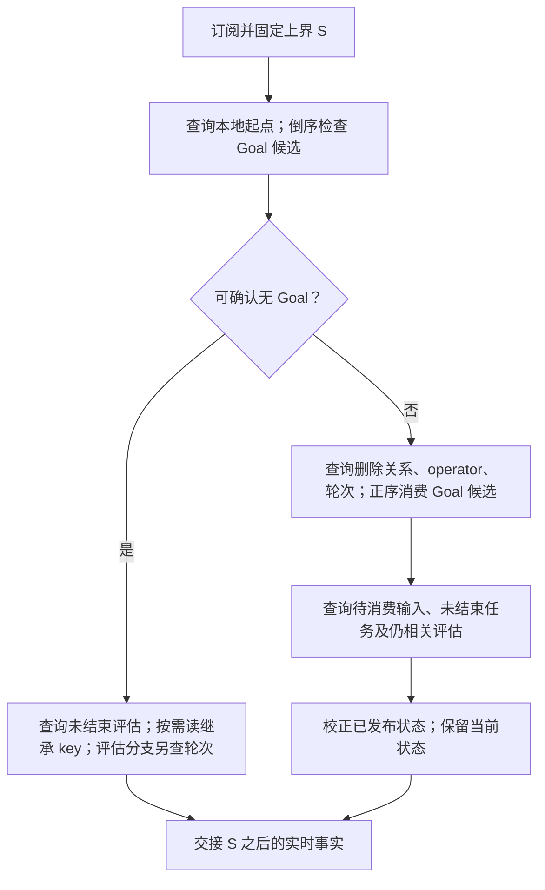

# Goal 属性查询与状态恢复

Status: Draft.
Scope: Goal 的 branch 恢复和 Session 状态读取；写命令、模型输入及事件格式不变。
Issue: [#1147](https://github.com/arcships/dim/issues/1147)。

后续正常读取目标见 [Goal 状态结果](Goal-state-read.md)（#1320）。该目标采用已完成结果与未处理输入索引；本文 Q1/Q2 与顺序 Fold 保留为旧格式初始化、语义对照和业务受影响范围的说明，不作为新设计下普通 get 的回退。

本设计以[统一状态记录契约](https://github.com/arcships/dim/blob/6c8dc8680f0ca22edcf21dd76ea656536c2fe232/docs/design/plugins/Goal.md)为前提，补充 [Goal](Goal.md) 的读取与恢复设计。目标是替换完整历史收集，不改变目标、续行、评估、删除补偿和恢复校正的业务结果。删除后的异步重算遵循 §6；正常送达仍直接更新 Goal 的当前状态。

## 1. 模块与读取范围

Goal 通过 `timeline.query` 提交结构化查询并接收结果；跨祖先读取通过已有 `treeCommands.query`。两者的范围、结果、错误和取消遵循 [Timeline 属性查询设计](../timeline-property-query.md)，Goal 不直接调用 Store。Goal 解释自己的文本标记，Timeline 不解析 `dim-goal`，不提供 `getGoalState`。

下面只画目标调用关系。查询结果沿原调用路径返回，不由 Store 直接交给 Goal。


一次恢复固定分支及上界 `S`，所有分页、关联和补充查询复用 `S`。先查该分支最近的 `branch/start` 或 `session/forked`，得到本地起点 `O`；Goal 运行状态只使用 `[O, S]`。祖先和 fork 复制前缀只用于恢复继承 key，不混入本地目标。没有 opening 时沿用既有完整恢复的本分支范围，不能套用无 Goal 快速返回，也不能扩展成祖先链；存储损坏错误仍由存储边界报告。

初始化沿用 Dispatcher 的订阅、恢复和交接契约。正常实时处理直接使用已经送达的事件，不再查询一次数据库。

## 2. 读取对象

查询返回字段行，不构造删减版 `AgentEvent`。下表的每个对象都显式选择位置；ID、类型和文本只在使用它们时选择。字段名的 Rust 绑定见 §9。

| 对象 | 返回字段 | 用途 |
| --- | --- | --- |
| Opening | 位置、事件类型 | 本地起点；区分普通分支和 fork |
| Goal 输入候选 | 位置、输入 ID、提交标识、blocks | 解释状态记录、变更、续行、报告和旧 key |
| 被删输入 | 位置 | 判定标记引用的输入是否失效；不读取被删输入正文 |
| 操作员输入 | 位置 | 最近一次操作员输入；不读取 user 正文 |
| 驱动输入 | 位置、输入 ID | 目前待消费的输入，或某轮开始前仍待消费的输入 |
| 轮次 | 最新 start 的位置；最新 end 的位置、turn ID、status 及该 end 之前最后 start 的位置；轮次结束计数 | 轮次是否打开、待决定的末轮、评估分支是否首轮 |
| 中断 | 最新 turn-scope interrupt 的位置 | 与最近激活位置比较 |
| 后台任务 | 未结束任务 ID | 保留当前任务集合，供实时 ended 删除 |
| 评估关系 | create 的位置、operation ID、branch ID；相关分支的 ended/failed 标识 | 对应评估身份、结束状态及决定去重 |
| 已发布 key | 输入位置、blocks | 恢复校正和继承 key；按块原顺序解释 |

`blocks` 沿用公开 `InputBlock`：有序的 `{key?, retire, text}` 数组。一次候选输入中的首块和其他块的关系有业务含义，不能分别取“任意一个匹配块”后假装它原来就在首位。这个对象不含 user 正文、工具结果、模型请求、执行输出、branch prompt 或 turn-end 的错误文本。

## 3. 查询条件与保留的遍历

以下名字只是本设计的查询标识，不新增公共 API 或 Reader。`live input` 表示在同一分支、同一固定范围内，没有 `input/deleted.input_id = input.id`；由关联条件实现。`pick last` 选择最后一条匹配事件；若一条输入内同 key 有多个块，仍由 Goal 从最后一个块向前解释。

| 查询 | 条件与结果 | Goal 是否继续遍历 |
| --- | --- | --- |
| Q0 本地起点 | `kind IN (branch/start, session/forked)`，各 kind 取最后一条，再按位置倒序取一条，返回 Opening；整次恢复只定位一次 | 否 |
| Q1 Goal 候选 | 本地 `input/message`，至少一个 block 的 text 以 `<dim-goal ` 开头，排除已删除输入；返回 Goal 输入候选。快速判断时倒序，完整计算时升序 | **是，只遍历候选输入和其 blocks**。前缀只是无漏报的粗筛，合法标记及语义由 Goal 判断 |
| Q2 被删输入 | 本地 `input/message`，存在对应 deletion；只返回输入位置，不要求 Goal 前缀 | 标记的 after 可能引用普通输入位置，不能只收集 Goal 触发；结束后释放临时集合 |
| Q3 操作员 | live input，user 字段存在，首块 text 不以 `<dim-` 开头；`pick last`，只返回位置 | 否；没有首块也满足“无 source 标记” |
| Q4 驱动输入 | live input，模式为 queue/steer，或 mode 缺失且 user 存在；排除已 consumed 的输入，返回 ID 和位置 | 只遍历结果集合；不是读取所有输入再筛选 |
| Q5 轮次与中断 | 分别取最后 start、最后 end、最后 turn-scope interrupt；若最新 start 晚于最新 end，另定位该 end 之前最后的 start；评估分支另取本地 end 的 count | 否；不能把当前打开轮次的 start 填到上一轮 end 中 |
| Q6 未结束任务 | `exec/started NOT EXISTS exec/ended`，按 task ID 关联，只返回 task ID | 只遍历当前未结束集合 |
| Q7 评估关系 | host 创建且 operation ID 前缀为 `goal:evaluate:`，只取身份字段；相关 ended/failed 用 branch ID 关联；过期但尚未结束的评估也必须返回，以便 Goal 结束它 | operation ID 中的评估序号由 Goal 解析；不读取 prompt 或分支输出 |
| Q8 已发布/继承 key | live input，存在指定 key 的 block，倒序取字段；本地范围从 O 开始，继承查询使用明确前缀范围 | 已发布 `goal:state` 只取最后输入；继承按三个 key 分别倒序分页，找到该 key 的有效标记即停，Goal 解释 retire |

Q1 不按 key 筛选：变更触发、续行、评估报告可以没有 key。它也不按 submission ID 的 `goal:` 前缀筛选，避免把“谁通常写它”当成事实格式。Q8 的已发布块与 Q1 计算出的运行状态是不同对象：已发布 key 可以存在，但其文本不能被 Goal 解释；校正不能把它提前过滤掉。

Q3 需要通用数组下标访问首块，而非 `any(block)`。其它块带 source 标记不代表首块带 source 标记。Q4 用存在性条件解释默认 mode，不需要把 `user` 返回给 Goal，也不需要新增 `hasUser` 字段。

Q1 与 Q8 可以附加 `data` 的文本候选条件 `goal`。Q1 的标记前缀和 Q8 的三个 key 都含这个 ASCII 词，因此索引排除不会漏掉合法输入；Goal 仍执行原来的前缀、key、删除关系与配对判断。索引不可用时保留完整候选路径。

Q1 一页不足以找到所需结果时使用 `next`；不积累此前各页。没有候选时不读取 13 类事件兜底。旧 key 也带 Goal 标记，使用同一个候选路径处理，不恢复旧的全事件 Reader。

### 3.1 删除关系和记录配对

Q2 先于 Q1 执行，使 Goal 知道 `after` 指向的输入是否已删除。Q1 排除被删输入自身，但不能仅按“记录输入未被删除”就认定记录有效；`after`、`trigger`、`restated` 和记录顺序的解释仍遵循统一状态记录契约。

带 `trigger` 的记录只与原始序号紧邻的下一条输入配对，不与“下一条候选”配对。若紧邻输入不在 Q1 结果中，Goal 按该位置读取其类型、ID 和提交标识来验证，并使用 Q2 判定删除；不得把过滤形成的序号空隙忽略。配对的输入已删除则记录不生效。候选跨页时最多保留一个待配对记录；看到原始下一位置不匹配即丢弃。分页不能改变这条规则。

### 3.2 SQL 能做什么

以下 SQL 表示查询语义，`events` 是范围已经固定的逻辑事件，不是新增表；物理格式与合并行由存储实现负责。

```sql
SELECT i.position, i.id, i.submission_id, i.blocks
FROM events AS i
WHERE i.kind = 'input/message'
  AND EXISTS (
    SELECT 1 FROM json_each(i.blocks) AS b
    WHERE substr(json_extract(b.value, '$.text'), 1, 10) = '<dim-goal '
  )
  AND NOT EXISTS (
    SELECT 1 FROM events AS d
    WHERE d.kind = 'input/deleted' AND d.input_id = i.id
  )
ORDER BY i.position;
```

游标和限量加在外层结果上，删除关联始终使用完整固定范围。SQL 不解析标记中的 `after`、`idle`、`evaluation`，也不把它们伪装成已有属性列。当前编码下，续行 count 等部分计算仍需要读取候选文本；将这些字段变为结构化事实是另一个事件格式决定，不属于本方案。

### 3.3 客户端状态读取

`session.goal.get` 由 Goal Session 部件提供，返回形状与错误归 [Goal A.3](Goal.md#a3-reading-the-goal)。它通过 branch facade 查询 Q0、Q2、Q1，并复用 Goal 的标记解释与配对规则。Q1 的每页消费完释放；仅在原始紧邻位置未出现在候选中时补查提交标识。不读取 Q3–Q8 的执行控制状态。

一次读取的成本随 Goal 候选数、被删输入位置数及 SQL 实际扫描量变化，不承诺常数时间。返回只有当前目标与截止位置，不把候选历史交给客户端。CLI 的目标命令前后各读一次，显示命令只读一次；聊天窗口和导出不触发此查询。

## 4. 每个状态从哪里得到

表中的“保留”是运行状态，不是旧 Fold 容器必须原样保留。恢复时不调用“先收集全部事件”的入口。

| 状态或旧容器 | 事实来源与计算 | 恢复后保留 |
| --- | --- | --- |
| objective、status/reason/summary、judge | Q1 按序解释变更、状态记录及旧 key；遵循被删触发、配对、旧 after 和 restated 规则。不能直接取最新文本块代替全部计算 | 当前目标和状态 |
| active、last_change、last_block、state_after、record_after、local_blocks、live keys | Q1 按原语义更新；restated 不推进回答/写入去重水位；旧 key 与 state record 的同输入关系保留 | 所需位置、计数及三个 key 的存活标志 |
| last_operator | Q3 | 一个位置 |
| continuations、count、idle | Q1 识别首块 continuation，只计入晚于 active 和 last_operator 的项；新的有效 set/resume 重置计数；idle 取该范围最后 continuation 的值 | count、idle；不保留 continuation 历史向量 |
| interrupts、interrupted | Q5 最后 turn-scope interrupt，与 active 比较 | 一个位置；不保留 interrupt 历史向量 |
| turn_start、turn_end、turn_open、turn_ends | Q5；start 晚于 end 表示轮次打开，end 自己保留其所属 start；只有评估分支需要 end count | 最新轮次字段及必要计数 |
| driving、pending_driving | Q4 的当前未消费集合；输入模式默认值用原契约解释 | 当前待消费 ID；不保存已消费输入 |
| turn_continuation_driven、continuation_inputs | 对当前 start、以及最新 end 所属的 start（不同时）查询当时仍待消费的输入：输入位置小于 start，且不存在 start 之前的 consumed；在 S 已删除的输入仍排除。此时只返回首块具有 Goal 前缀的候选 ID，再与 Q1 识别的 continuation 对应；当前待消费集合仍包含所有驱动输入 | 对应轮次的布尔值；当前待消费 continuation ID。不能用“现在是否 pending”替代“轮次开始时是否 pending” |
| open_tasks | Q6 | 当前未结束 task ID；不保留已结束任务 |
| requests、request_in_turn | Q1 中 evaluator 模式下的 completed 请求，限于当前所判定轮次的 start/end；判定请求时使用该位置的 judge，不能用最终 judge 解释旧请求 | 当前打开轮次和最新已结束轮次各最多一个请求及必要摘要 |
| evaluations、ended、failed | Q7；先解析 operation ID；保留当前决定相关的评估，以及所有尚未结束的评估（即使已被 last_block 取代，仍须结束其分支）；终态用 branch ID 关联。历史 create 若用于决定去重，单独读取对应 operation ID 的 Exists | 仍可能参与决定的评估身份和终态，不保留所有子分支历史 |
| conclusions、pending_conclusions | Q1 的首块报告与 Q7 的评估身份对应。每个评估只认第一条有效、未删除报告；报告必须晚于其 create。较新 operator、turn-end、after 回答以及 Goal 变更按原规则使结论失效 | 当前可参与决定的结论和延后处理的结论，包含必要文本；记录是否已被 Goal 输入回答，评估结束且回答后释放其身份与去重状态 |
| decided | Q1 的非 restated after，以及 Q7 的评估创建；只保留 opening、当前 turn-end/interrupt 和仍相关评估/结论的回答状态 | 当前决定的去重键；保留当前 opening、turn-end、interrupt、变更和未结算评估/结论的位置，不保存全部历史 after 字符串 |
| change_triggers、deleted、deleted_sequences | 删除时按 input ID 定位，再由 Q2/Q1 重算；已删除位置只用于本次计算 | 不保留完整触发/删除历史；本次临时集合结束即释放 |
| held_record | Q1 中等待紧邻 trigger 的记录，按 §3.1 处理 | 最多一个尚未配对的记录 |
| copied_live、inherited | Q8：fork 的复制前缀，或各祖先截止点；按 key 从近到远取有效结果 | 三个 key 的存活标志，不保存前缀输入 |
| written、restated、recorded、last_write、in_flight、retry | 本代写入去重、写锁和任务生命周期；不是完整历史缓存。按统一状态记录契约与重建状态衔接 | 正在进行或仍需重试的工作及写入水位；不把历史副作用重新排队 |

恢复可以分阶段读取：先确定 opening、operator 和当前轮次；Q1 计算 Goal 语义；再按结果限定 Q4/Q6/Q7 以及需要确认的去重键。Q1 中需要留待评估身份验证的报告，只保留仍可能有效的候选，验证完释放。最后比较 Q8 的已发布块，按原校正规则决定写入。

这些阶段不表示对同一候选历史反复全扫。实现应复用本次操作中已经得到的标量与必要候选；没有后续用途的数据立即释放。若仍需保留大量候选，必须列出其后续用途和数量，不得改名为“状态”后保存全部历史。

## 5. 启动、实时与按需读取



普通分支没有有效本地候选时不执行完整恢复，但仍查询尚未 ended/failed 的 Goal 评估身份并结束它们；清空目标不能取消分支结算义务。倒序检查到已验证的 opening clear，或与 live 触发输入紧邻配对的 retired 记录时，也保留该快速路径；相关触发、删除和配对须验证，不能凭一个任意文本块跳过重算。不能确认时才执行正序候选计算。评估分支即使没有本地 Goal，也按自己的契约恢复轮次并报告，不能沿用普通分支的提前返回。

实时事实在有效状态上直接更新，不为已经送达的事实回查。每次续行决定按需查询本轮 `step/tool-call` 的 Exists；评估创建报错才确认对应 operation ID 是否已创建；评估回复先定位本轮最后 request ID，再分页读该 request 的 text。上述读取不加入恢复候选流。

## 6. 删除后的重算与顺序

删除会改变先前输入的含义，所以不能只从删除位置向后计算，也不能继续使用旧内存状态作决定。Goal 使用一次自持重算任务，不新增常驻 worker、公共 Reader 或历史事件队列。

1. handler 收到 deletion，标记状态不可用于新决定，取消基于旧状态的决定任务，记录首次待处理删除位置及已送达位置，然后登记重算任务并返回。重算期间其它 handler 只推进送达位置，不保存完整事件。
2. 重算取得 Goal 写锁，等待已经进入写入的调用退出，然后固定当前提交上界 S。查询 S 内最后一个 Goal 订阅事件的位置，并等 Dispatcher 送达到该位置。不能直接等送达位置达到 S：S 可能是 Goal 不订阅的事件。
3. 在该锁内执行 §3–§4 的查询；数据库等待不持有 Goal 状态锁。若重算完成时已送达位置大于 S，丢弃结果并以新上界重算。多次删除、输入及控制事实都从 Timeline 读取，不设内存补发队列。
4. 在 Goal 状态锁内确认已送达位置未超过 S，替换状态，恢复可用性，然后释放写锁。命令等待有效性、取得写锁并等待已有 Goal 写入送达后，再检查一次有效性；失效则释放写锁重等。
5. 查询本轮删除范围内的 Goal 触发输入及其删除位置；已存在回答记录的触发仍按统一状态契约写删除补偿，`after` 是删除位置。加载时遗留的已发布块不一致才使用 `restated` 校正。然后重新判断当前欠缺的决定，不补执行历史决定。

仍在等待提交的命令在状态失效时取消该次未提交批次，等待重算后重新构造记录；已经提交的批次不重复提交。`written`、`restated` 等已写标记只在提交成功后登记，取消未提交写入不能阻止重算后补写。

取消旧决定任务不能撤回已经提交的事实。Goal 自身提交的原子性由输入入口保证；重算固定上界前与写入互斥，因此纳入已经提交的结果。任务在失效期间不重新启动决定；此前仍在退出的同键任务释放占用后，允许基于有效的新状态再判断。

重算失败保留“不可决定”状态并报告错误，等待的命令收到该错误；不能无限等待或把失败当作无 Goal。后续订阅事实触发重试，重载也重新执行读取。closing 取消读取、决定任务和等待者。错误、重试及关闭不改变已提交的历史。

## 7. 分页、内存与 API 缺口

分页分三类：短标识集合、Goal 候选 blocks、评估回复正文。`limit` 限制行数，不能保证字节上限。Goal 候选不会带回普通用户正文，但同一候选输入可以包含其它插件的大 block；现有数组投影不能仅返回匹配元素，不能声称这个开销已被消除。

本设计不预设“128 条 = 64 KiB”。实现时分别测量每页字段字节数、最大单行、Rust 峰值和 SQLite 临时内存，再选行数。单条超大输入仍须按契约正确处理；不能截断 Goal 文本或跳过该行。若需要硬字节上限，应另向查询机制提出字节分页/分块的通用合同，不能私加一个无法读取的输入上限。

常驻内存是当前业务状态、未完成集合和任务资源；临时内存是一页字段、删除位置、待配对的评估身份及一个待配对记录。评估身份按 create 位置与候选报告合并，以保证报告晚于 create；这批临时身份可能随评估历史增长，最终只保留当前决定和未结束分支需要的身份。删除集合和未完成集合可能增长，SQL 关联/排序也可能使用临时空间，不能把“一页”当作总内存证明。候选块 key/前缀没有专用索引时，存储仍可能扫描很多输入并解析 JSON；优化减少的是传回及持有的内容，不自动证明 CPU 常数化。

### Requirements raised to mechanism owners

| 所有者 / issue | 现有合同限制与替代办法 | 要求的通用能力 | 序号、批次、中断、重载影响 |
| --- | --- | --- | --- |
| Timeline 查询 / #1147 | Q3 必须判断首块；`any` 不等价，读取全部 blocks 再筛选会重现输入扫描 | 使用[字段路径合同](../timeline-property-query.md#22-字段和运算)的固定数组下标 `data.blocks[0].text`；缺元素或非数组为 missing。不增加 Goal 专用字段 | 不变更事件、提交或发布；复用固定范围和取消合同 |
| 存储 / #1147 | 候选前缀、删除反关联、operation ID 查找即使返回少量行仍可能扫描整个类型范围；仅用 `LIMIT` 不能解决 | 对本设计实际查询测量计划、VM 步数、候选字节和必要索引；新增索引走存储格式决定 | 不改变业务事实；不得静默扩充已提交 schema |

数组下标的语法和错误由 Timeline 查询合同定义。第一阶段不新增过滤数组投影、文本标记解析函数、Goal 投影表或业务结果缓存。

## 8. 验收与删减检查

复用 Goal 的公开命令、加载和产品流程，SQLite 与 Memory 比较目标状态、后续决定及写出的事实，不以私有 Fold 字段相等作为唯一验收。

| 场景 | 必须证明 |
| --- | --- |
| 普通历史很多、Goal 候选很少 | Goal 不接收普通 user 正文或 13 类完整历史；候选读取量与实际候选相关。另报 SQL 扫描成本，不能把返回量当扫描量 |
| keyless 触发、续行、报告；首块与其它块不同 | 候选不漏报；Q3 首块语义正确；状态与决定不变 |
| trigger/record 跨页、过滤后不相邻、trigger 被删除 | 仍按原始位置配对；无失效目标复活；保留补偿与旧 after/restated 规则 |
| 旧 objective/status、retired、只有候选但无有效标记、无 Goal 的评估分支 | 旧格式与分支边界正确；不拿“没有 state key”当作“没有 Goal” |
| 输入在轮次开始前 pending、开始后 consumed；之后 deleted；下一轮已开始 | continuation-driven 使用对应轮次开始时关系，并受截止 S 的删除影响；最新 end 不误用下一轮 start |
| evaluator completed、迟到/重复报告、后台任务延后结论、operator/新轮次使结论失效 | 恢复后的首次决定与既有行为一致，不重复启动评估或续行 |
| 删除期间新增事实、再次删除、命令和旧写任务并发、读失败或关闭 | 不用旧状态产生新写入；不丢事实、不锁内等待、不遗留事件队列；提交过的事实按补偿契约收敛 |
| 一个候选中混入大文本、很长结论、大量删除/未完成项 | 报告实际内存上界来源；不把行数冒充字节限制 |

删减决定：不保留 `events`、历史 interrupts/continuations 和全部已完成任务；不新增服务、Capability、持久化投影或常驻 worker。候选判断直接读取倒序候选页，空页已经回答“不存在”，不先额外调用一次 Exists。保留 Goal 候选的顺序计算，因为文本标记和先后状态有业务含义；保留当前未完成集合，因为实时终态和决定仍会使用。是否还可缩小某个集合，由表中后续用途和流程验证决定，不能为了删容器丢掉删除、去重或延后决定的语义。

### Rule check

| 规则 | 本设计 |
| --- | --- |
| principles §1；ADR 002 D1 | Goal branch 仍是 Capability，状态与读取任务归本分支；Session 入口不持有分支状态 |
| ADR 002 D2、D3 | 无接线部件、无新增服务；依赖既有 Timeline、Dispatcher、TreeCommands 及生命周期，不读其它插件内存 |
| ADR 002 D4、D5 | 无新增配置；语义以字段、范围、顺序表述，Rust 修改位置单列于 §9 |
| §4 规则 1、2 | 不修改其它部件状态；沿用输入及 consumed/deleted 的交接事实 |
| §4 规则 3、4 | 不增加 before；查询机制只处理通用属性，Goal 解释自己的标记 |
| §4 规则 5 | 原子记录与触发批次不变；不能用过滤后的相邻行代替原始顺序 |
| §4 规则 6、9 | 不增加上下文入口或历史事实种类；状态记录仍经既有输入采用路径 |
| §4 规则 7、8 | 使用公开字段；首元素缺口及替代办法在机制需求表中，未给其它模块强加 Goal 规则 |

## 9. Rust 修改位置与入口替换

| 位置/入口 | 修改 |
| --- | --- |
| `branch.rs::rebuild` | 执行 Q0–Q8 的阶段读取；取消 `rebuild_facts(KEYS)` 和完整事件收集 |
| `newest_goal_block` / `rebuild_without_goal` | 用 Q0 和 Q1 的倒序候选页替换四类型扫描；不因任意非 retire 文本就读取完整历史 |
| `copied_keys` / `inherited_keys` | 按 Q8 对三个 key 查询，固定前缀范围；只在最新候选标记无效时继续该 key 的候选页 |
| `published_state` | Q8 返回最后未删除、带 state key 的输入及 blocks，不再翻所有输入 |
| `fold.rs` | 消费明确字段及 Goal 文本；把表 §4 中的历史容器替换为当前状态；删除 `events` 和内存历史 `refold` |
| `ingest` / `change` / 写任务 | 正常事件直接消费；删除转入 §6 的不可决定状态和自持重算；所有写入共享有效性检查 |
| `created` / `turn_had_tool_call` / `reply` | 分别使用 Exists、Exists、最后 request ID + 该请求的 text 字段页，不加入恢复流 |

绑定使用 `TimelineQuery` 的固定 `through`、`QueryFilter::{Any, Prefix, Present, Exists, Not}`、`QuerySelect::{Fields, Exists, Count}`、`QueryPick::Last` 和 `QueryPage::after`。公共字段路径使用序列化名字：`position.sequence`、`data.blocks`、`data.submission_id`、`data.mode`、`data.user`、`data.input_id`、`data.turn_id`、`data.status`、`data.scope`、`data.task_id`、`data.branch`、`data.source.kind`、`data.source.operation_id`。`hasUser` 不作为伪字段加入结果。

当 Q4 读取轮次开始之前的 Goal 待消费输入时，首 block 的 `<dim-goal ` 前缀同时使用 `data` 的 `goal` 文本候选；采纳关联仍以原始输入 ID 和采纳事实的位置上界判断，不以筛选后的相邻行判断。
