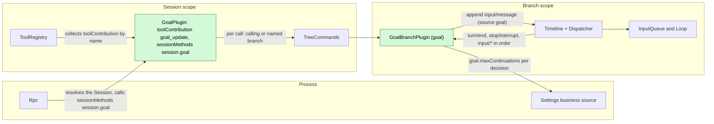
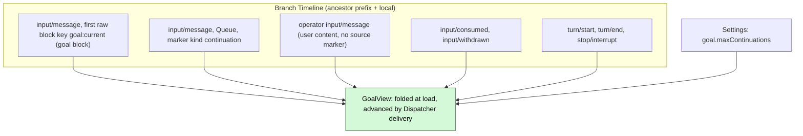
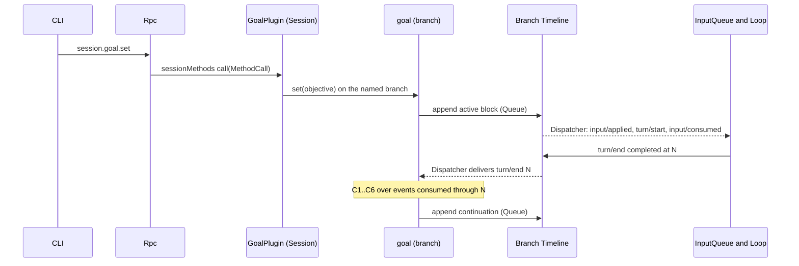
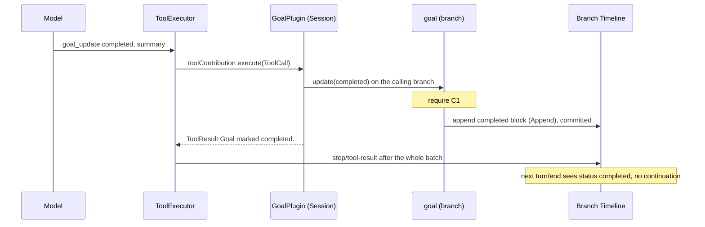
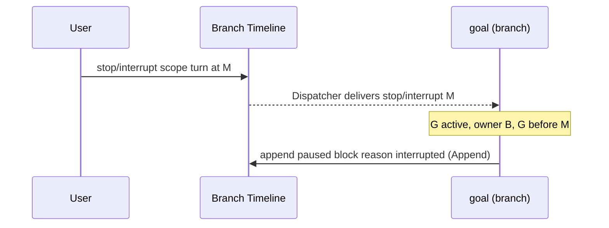
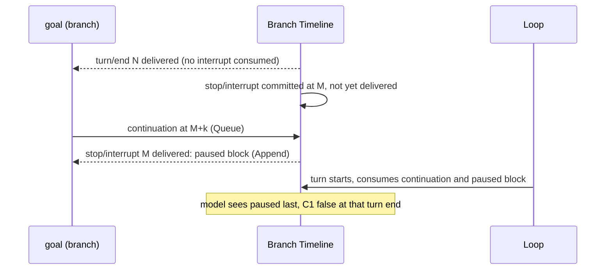

# Goal

Status: Draft. Overall design: [overview B.2](../overview.md#4-plugin-catalog). Phase: P2. Language: TypeScript first ([overview F.3](../overview.md#appendix-c-implementation-language)). Scope: Session + branch ([ADR 002](../../adr/002-plugin-scope.md)).

Goal keeps a standing objective on a branch and continues the branch automatically until the model reports the objective completed or blocked, the user pauses or interrupts, or a continuation limit is reached. The **branch part** owns the goal: its state exists only as a keyed raw input block on the branch Timeline, and continuation is decided from branch events consumed in order through the branch Dispatcher; it writes branch inputs. The **Session part** provides the `goal_update` tool as a `toolContribution` service (Session scope, key `goal_update`) and the `session.goal.*` methods through a `sessionMethods` service (Session scope, key `session.goal`) ([session-boundary](../contracts/session-boundary.md)); both resolve the branch part per call. Goal writes no events of its own and has no separate "Goal mode": the presence and status of a goal, visible through `session.goal.get` and the goal block, cover the feature-list wording "switch Goal mode". Every contract here is language-neutral (service name, scope, key, methods with data shapes), so a TypeScript implementation satisfies it without a hand-written Rust binding; the Rust form is [Appendix G](#appendix-g-rust-binding). Goal also uses the runtime's typed services (`S:TreeCommands`, `B:Timeline`, `B:Dispatcher`); exposing them by name to non-Rust capability parts is the work of [#4](https://github.com/arcships/dim/issues/4), and Goal starts in Rust until then ([overview §9](../overview.md#9-open-questions)).

## 1. Structure

All model-visible effects are `input/message` facts consumed by the existing InputQueue and Loop.

| Part | Scope | Depends on | Provides |
| --- | --- | --- | --- |
| `GoalPlugin` | Session | `S:TreeCommands` | `toolContribution` key `goal_update`; `sessionMethods` key `session.goal` (level `session`) |
| `GoalBranchPlugin` | Branch | `B:Timeline`, `B:Dispatcher`, Settings business source (enclosing scope) | `goal` (branch scope; `update`, `set`, `edit`, `pause`, `resume`, `clear`, `get`), used only by the Session part; the goal block and continuation formats under source `goal` |

Both parts declare their services in the plugin's `provides` and are installed only in Sessions where Goal is enabled; ToolRegistry and Rpc collect them by name and scope. `goal.maxContinuations` is business configuration in the Settings business source ([ADR 002](../../adr/002-plugin-scope.md) D4): read at each decision, changed by a data update, never a reload. Goal reads only public data contracts of `input/message`, `input/consumed`, `input/withdrawn`, `turn/start`, `turn/end` and `stop/interrupt`; it never reads another plugin's state.

## 2. Data and state

Goal owns no persistent state. The goal of branch `B` is a pure function of the events of `B` consumed so far; the branch part folds the prefix at load and advances the view on each Dispatcher delivery. Compaction does not change it because the view is built from events, not model context.

| Field | Derivation over the consumed events |
| --- | --- |
| `G` | Latest `input/message` whose first raw block has key `goal:current`; none or `retire` means no goal |
| `status`, `owner`, `reason`, `objective` | Attributes and body of `G`'s marker (Goal parses only its own format) |
| `interrupted` | A `stop/interrupt {scope: turn}` in `B`'s local events with sequence greater than `G` |
| `last_operator` | Latest operator input: `input/message` with `user` content not marked by a source (A5) |
| `count` | Goal continuation inputs with sequence greater than `max(G, last_operator)` |
| `pending_driving` | Local `input/message` with effective mode Queue or Steer that has neither `input/consumed` nor `input/withdrawn` |
| `turn_open` | A `turn/start` after the latest `turn/end` |

Runtime-only: the view and a branch-local mutex that serializes Dispatcher decisions, tool calls and method calls. Both are rebuilt by the load fold; a new generation never inherits them.

## 3. Flows

### 3.1 Set and continue

The continuation is appended from Goal's Dispatcher handler after the decision; InputQueue and Loop consume it through their own subscriptions. The handler appends and returns without awaiting dispatch.

### 3.2 Completion through `goal_update`

The terminal block precedes the batch's `step/tool-result`, so the goal replayed after compaction is never `active` again.

### 3.3 Interrupt pauses the goal

`scope: branch` interrupts are ignored: the branch is closing.

## 4. Timing and conflicts

### 4.1 Interrupt committed before the continuation (at most one extra turn)

Decided by sequence: the decision used only events consumed through `N`, so the continuation stands and the later `paused` block ends the goal. This extra turn is accepted (decision E18); Goal does not withdraw its continuation.

### 4.2 Reload

A reload of either part follows a rare structural operation. A Session part reload propagates to ToolRegistry like any contribution reload and may fail in-flight turns; this is an accepted cost ([ADR 002](../../adr/002-plugin-scope.md) D3). A branch part reload refolds the view; if the latest `turn/end` has no Goal write after it and the goal is active, the new generation takes that decision once (C4 and C5 deduplicate). A terminal block committed before a reload stands.

### 4.3 Other key rows

| Scenario | Sequence order | Outcome | Owner |
| --- | --- | --- | --- |
| User Queue/Steer input pending at decision | input < `turn/end` N, unconsumed | C5 fails: no continuation; the user's turn's end decides, count reset | Goal |
| Driving input withdrawn | input < `input/withdrawn` < N | Not pending; continuation proceeds | InputQueue; Goal |
| Another source's Queue follow-up after the same `turn/end` | both after N | Two Queue inputs, two turns in order; at most one continuation per `turn/end` | InputQueue; Goal |
| Child cut after the goal block | consumed < cut | Child sees the parent's goal as background; no continuation; `goal_update` there returns the owner error | Goal |

Full table: [Appendix B](#appendix-b-full-conflict-table).

## 5. Context mapping

| What the model sees | Form | Placement |
| --- | --- | --- |
| Goal state (`active`, `paused`, `completed`, `blocked`, cleared) | One `input/message` without `user` content whose only raw block is `<dim-goal kind="goal" status=... branch=...>` with key `goal:current` (clear uses `retire`) | At its `input/consumed` position; Queue blocks start the turn they drive, Append blocks join the next request |
| Continuation | `input/message`, Queue, `<dim-goal kind="continuation" count=k limit=L>`, no key | Start of the turn it drives |
| `goal_update` | Fixed tool declaration in the adopted `context/configured`; result in `ToolResult.content` | Tool-result position of its batch |

| Aspect | Rule |
| --- | --- |
| Compaction | The baseline replays the latest live `goal:current` block verbatim; retired goals are not replayed; continuations and earlier blocks survive only through the summary |
| Child branches | Inherit blocks consumed before the cut; the block names its owner branch and tells delegated work not to call `goal_update` (A3) |
| Non-interactive Sessions | Same mapping; continuations drive turns without a user present |
| Never visible | `submission_id`, mode, count of operator inputs, diagnostics, other plugins' events |

Exact texts: [Appendix A.5](#a5-model-visible-texts).

## 6. Interfaces (summary)

| Interface | Kind | Purpose |
| --- | --- | --- |
| `goal_update {status, summary}` | `toolContribution` (Session, key `goal_update`), risk `session` | Model reports completion or blocking; writes the terminal block |
| `session.goal.set/edit/pause/resume/clear` | `sessionMethods` (Session, key `session.goal`), level `session` | User controls the goal; each writes one block |
| `session.goal.get` | Same service | Current `GoalView` of a branch, replaces any "mode" query (A8) |
| `goal` | Branch service, internal to Goal | Goal state, decisions and writes |
| `goal.maxContinuations` | Business configuration (Settings) | Continuation limit, read at each decision |

Details: [Appendix A](#appendix-a-interface-details).

## 7. Security

Goal writes only `input/message` under source `goal` on its own branch; resulting turns run under the Session's Permission and Approval policy, and a goal grants no authority. Users cannot forge goal blocks: `session.submit` accepts no raw blocks and the marker renderer escapes the objective. `goal_update` is admitted under `session`. Diagnostics record Session id, branch id, decision and reason, never objective text.

## Appendix A. Interface details

### A.1 Tool `goal_update`

Service `toolContribution`, Session scope, key `goal_update`: `declaration(): sync -> ToolDeclaration` (name, the description in A.5, the parameter schema below, risk `session`); `execute(ToolCall): async -> ToolResult`; cancellation is a cancel request on the call.

| Item | Value |
| --- | --- |
| Parameters | `{status: "completed" \| "blocked", summary: string}`; `summary` 1..=2000 characters (A10) |
| Result | `ToolResult.content`: `Goal marked completed.` or `Goal marked blocked.`; errors: `No active goal on this branch.`, `The goal belongs to branch <id>; continue your assigned task without calling goal_update.` (A3) |
| Risk category | `session` (writes only branch input) (A9) |
| Offered | In every Session where Goal is enabled, all roles (A9) |
| Handler | Resolves the calling branch's `goal` service through `S:TreeCommands` and calls `goal.update`; under the branch mutex requires C1 (error result otherwise), appends the terminal block in Append mode, awaits commit, returns. On cancellation before the append nothing is written; once appended the write stands |

### A.2 Session methods

Service `sessionMethods`, Session scope, key `session.goal`. `describe()` returns one `MethodDecl` per row with `level: session`, `interruption: report`, `progress: false`, `notifications: []`, `reply: direct`, and `mutating: true` except for `get`. `call(MethodCall)` takes the params below and replies with the result as `MethodReply`; errors are `MethodError` data (Appendix C).

| Method | Params | Result | Write |
| --- | --- | --- | --- |
| `session.goal.set` | `{sessionId, branchId?, objective}` | `{goal, sequence}` | `active` block, Queue |
| `session.goal.edit` | `{sessionId, branchId?, objective}` | `{goal, sequence}` | Block with new objective and current status; Queue if `active`, Append otherwise (A1) |
| `session.goal.pause` | `{sessionId, branchId?}` | `{goal, sequence}` | `paused` (reason `user`), Append |
| `session.goal.resume` | `{sessionId, branchId?}` | `{goal, sequence?}` | `active`, Queue; on an already active goal only when `!turn_open && !pending_driving`, else no write (A12) |
| `session.goal.clear` | `{sessionId, branchId?}` | `{sequence}` | Retire block, Append |
| `session.goal.get` | `{sessionId, branchId?}` | `{goal: GoalView \| null, through}` | None (A8) |

`branchId` defaults to `main` (A13). `GoalView = {status, objective, reason?, summary?, owner, count, limit, sequence}`. Transitions: `set` from any state; `edit` from `active`, `paused`, `blocked`; `pause` from `active`; `resume` from `paused`, `blocked`, `active`; `clear` from any live goal. Rpc resolves the Session (restoring it if unloaded) and sends the call; the handler resolves `goal` of the named branch through `S:TreeCommands`.

### A.3 Branch service `goal`

Branch scope, no key, provided by `GoalBranchPlugin` and called only by its Session part. All methods are async and serialized by the branch mutex; writing methods return after the write commits.

| Method | Request | Reply | Errors |
| --- | --- | --- | --- |
| `update` | `{status: "completed" \| "blocked", summary, callerBranch}` | `{sequence}` | `no_active_goal`, `not_owner {owner}` (tool error texts in A.1) |
| `set`, `edit` | `{objective}` | `{goal: GoalView, sequence}` | `invalid_params`, `no_goal`, `goal_not_editable` |
| `pause`, `clear` | `{}` | `{goal?: GoalView, sequence}` | `no_goal`, `goal_not_active` |
| `resume` | `{}` | `{goal: GoalView, sequence?}` | `no_goal`, `goal_not_editable` |
| `get` | `{}` | `{goal: GoalView \| null, through}` | — |

A consumer cancels by a cancel request; before the append nothing is written, after it the write stands. During unload calls fail `service_reloading`.

### A.4 Continuation decision

On delivery of `turn/end` at sequence `N` on branch `B`, over the events consumed through `N`:

| # | Condition | If false |
| --- | --- | --- |
| C1 | `G` exists, not retired, `status = active`, `owner = B` | Stop |
| C2 | No turn-scoped interrupt on `B` after `G` | Write `paused` (`interrupted`) and stop |
| C3 | The `turn/end` at `N` is `completed` | `failed`: write `paused` (`turn_failed`) (A6); `cancelled`: handled by C2 |
| C4 | `N` is the latest `turn/end` and `!turn_open` | Stop (a newer turn's end will trigger) |
| C5 | `!pending_driving` (includes Goal's own unconsumed continuation; excludes withdrawn inputs) | Stop |
| C6 | `count < maxContinuations` | Write `paused` (`limit`) and stop |
| — | All hold | Write continuation (Queue) with `count + 1` |

Delivery of `stop/interrupt` at `M` (`scope: turn`): if C1 holds and `G < M`, write `paused` (`interrupted`).

### A.5 Model-visible texts

Each write is one `input/message` with no `user` content whose only raw block is the marker `<dim-goal kind="..." ...>`, newline, escaped body, newline, `</dim-goal>` (A2).

| Write | Key | Mode | Text |
| --- | --- | --- | --- |
| `active` | `goal:current` | Queue (Append on edit when not active) | `<dim-goal kind="goal" status="active" branch="B">` / `Objective:` / `<objective>` / blank / `This is the user's standing goal for branch B. Keep working toward it across turns. When it is fully achieved, call goal_update with status "completed". If you cannot make progress without the user, call goal_update with status "blocked" and explain why. If you are working on a delegated sub-task started from branch B, treat this goal as background and do not call goal_update.` / `</dim-goal>` |
| `paused` | `goal:current` | Append | `status="paused" reason="interrupted\|user\|limit\|turn_failed"`; body `Objective:` / `<objective>` / blank / `The goal is paused (<reason phrase>). Do not continue working toward it on your own; respond only to the user's latest input.` |
| `completed` / `blocked` | `goal:current` | Append | `Objective:` / `<objective>` / blank / `Result:` or `Blocker:` / `
` / blank / `The goal is completed.` or `The goal is blocked.` + ` Do not continue working toward it.` |
| clear | `goal:current`, `retire` | Append | `<dim-goal kind="goal" status="cleared" branch="B">` / `The previous goal was cleared by the user. Disregard it.` |
| continuation | none | Queue | `<dim-goal kind="continuation" count="k" limit="L">` / `Continue working toward the active goal. If it is completed or blocked, call goal_update.` |

Reason phrases: `interrupted` "the user interrupted the turn", `user` "paused by the user", `limit` "the automatic continuation limit was reached", `turn_failed` "the last turn failed". Tool declaration description: "Report that the current goal is completed or blocked."

### A.6 Timeline mechanics

| Step | Path |
| --- | --- |
| Load | Subscribe to the Dispatcher (`"Goal"`), fix `S = committed()` under the gate, fold the prefix through `S` into the view, set `rebuilt = S`, provide `goal`. If the latest `turn/end` has no Goal write after it, take its decision once |
| Consume | Under the branch mutex, skip `sequence <= rebuilt`, advance the view, decide on `turn/end` and `stop/interrupt` (A.4), append if needed and return |
| Write | `input/message` with source `goal`, `submission_id: "goal:<uuid>"`, marker and mode, appended to the branch Timeline (capability inputs are appended directly; the producer guarantees validity, [interrupt](../../architecture/rust-agent/interrupt.md)) |
| Consumption | InputQueue appends `input/applied`; Loop appends `input/consumed`. Goal never writes Steer |
| Recheck | Decisions use only consumed events ([time-bus](../../architecture/rust-agent/time-bus.md) §4); later facts precede the write in sequence and are resolved by InputQueue and Loop |
| Tool and method calls | Take the branch mutex, decide on the view, append, await commit, release |
| Unload | Unload disposer ends the subscription; calls waiting on the mutex return `service_reloading` or Cancelled |
| Restart, Session restore | Same as load; a committed unconsumed continuation is restored with the Session |

## Appendix B. Full conflict table

| Scenario | Sequence order | Outcome | Owner |
| --- | --- | --- | --- |
| User Queue input while a goal turn runs | input < `turn/end` N, unconsumed | C5 fails; the user's turn runs; its end continues with count reset | Goal, InputQueue |
| User input committed after N, before the continuation | N < input < continuation | Both run in order: user turn, then continuation turn; count reset | InputQueue, Loop |
| User input after the continuation | continuation < input | Continuation turn first; Queue next; Steer joins the continuation turn | InputQueue, Loop |
| Steer during a goal turn | consumed in turn | Same turn; resets count if operator input (A5) | Loop; Goal |
| Steer after `turn/end`, before its delivery to Goal | `turn/end` < steer | Steer starts a turn; C4 or C5 fails at a later decision; that turn's end decides | Goal |
| Append input while idle | — | Not driving; continuation proceeds; Append consumed with its first request | Loop |
| Driving input withdrawn before N | input < `input/withdrawn` < N | Excluded from `pending_driving`; continuation proceeds | InputQueue; Goal |
| Driving input withdrawn after N | N < `input/withdrawn` | Decision already stopped at C5; the next `turn/end` or `resume` decides; an idle goal waits (A12) | Goal |
| Goal's own continuation withdrawn by the user | continuation < `input/withdrawn` | Not consumed, not pending; next decision may continue again; count includes it | Goal |
| Other source's Queue follow-up after the same `turn/end` (e.g. Hooks) | both after N | Two turns in order; at most one continuation per `turn/end`; that input does not reset the count unless it is operator input | InputQueue; Goal |
| Interrupt before N | interrupt < N | C2: `paused`, no continuation | Goal |
| Interrupt between N and the continuation | N < interrupt < continuation | One extra turn; then `paused` (E18) | Loop; Goal |
| Interrupt after the continuation started its turn | consumed < interrupt | Turn cancelled; `paused` | Loop; Goal |
| Interrupt after apply, before consumption | applied < interrupt | Continuation pending; `paused` after it; the next driving input consumes both, model sees `paused` last | Loop; Goal |
| Interrupt during `goal_update` after its write | block < interrupt | Goal `completed`/`blocked`; no pause | Goal |
| Interrupt during `goal_update` before its write | interrupt < handler write | Handler cancelled, no write; goal paused by the interrupt | ToolExecutor; Goal |
| Resume vs a later-delivered interrupt | interrupt < resume block | Delivery finds `G > M`: no pause | Goal |
| Branch-scoped interrupt or branch close | close < write | Nothing written; branch part ends | Runtime facade |
| Tool batch not settled | terminal block < `step/tool-result` | Block consumed after the batch result; `turn/end` sees non-active goal | ToolExecutor, Loop |
| Two `goal_update` calls in one batch | mutex order | Second finds no active goal: error result | Goal |
| `goal_update` vs `edit`/`clear` | mutex order | The later sees the earlier's block | Goal |
| Compaction between a goal write and its consumption | write < compaction < consumed | Block delivered at its consumed position after the summary; later baselines replay it | History projection |
| Compaction after several goal blocks | — | Only the latest `goal:current` block replayed; count reads events | History projection; Goal |
| Child cut between a goal write and its consumption | write < cut < consumed | Child does not adopt it; `owner ≠ child`: no continuation | InputQueue (child); Goal |
| Child cut after consumption | consumed < cut | Child sees the parent goal as background; `goal_update` rejected (A3) | Goal |
| Goal set on a child branch | — | Independent key on the child's Timeline | Goal |
| Session fork | facts copied | Fork's `main` owns the copied goal (A11) | Goal |
| Branch part reload or restart after an undecided `turn/end` | — | Load takes the decision once; C4/C5 deduplicate | Goal |
| Session part reload during `goal_update` or a goal turn | — | Propagates like any contribution reload; in-flight turn may fail (`paused (turn_failed)` at its end); committed block stands (D3) | ToolRegistry; Goal |
| Session idle unload | — | Parts unload with the Session; a method call restores it; restore refolds | AgentIndex; Goal |
| Session close | — | Methods return `session_closed` | Rpc |
| Duplicate `resume` | — | Second sees `turn_open` or `pending_driving`: no write | Goal (A12) |
| Duplicate `set` | — | Each writes a block; count resets | Goal (A12) |
| Turn failed | `turn/end {failed}` | `paused` (`turn_failed`) (A6) | Goal |
| Limit reached | count = limit | `paused` (`limit`) | Goal |
| Resource node offline | calls on the node fail | Goal uses no node service: inputs commit and turns run; workspace tool calls fail `node_unavailable` as tool errors; nothing reloads or goes Pending ([overview §6.3](../overview.md#63-multiple-nodes)) | Goal; WorkspaceTools |
| Client detach | — | No effect | — |

## Appendix C. Errors and recovery

| Error code | Cause |
| --- | --- |
| `invalid_params` | Empty or oversize objective (A10), malformed branch id |
| `no_goal` | `pause`, `resume`, `edit`, `clear` without a live goal |
| `goal_not_active` | `pause` on a non-active goal |
| `goal_not_editable` | `edit` or `resume` on `completed` (use `set`) |
| `session_closed`, `branch_missing` | Session or branch gone |
| `service_reloading` | Goal reloading; the write did not happen or is found by `get` |
| `unknown_method` | Goal not enabled in this Session |

Goal never retries a write on its own. Process exit leaves only committed facts; the next load refolds them.

## Appendix D. Acceptance

Flow tests through Session methods, the `goal_update` tool and Timeline events (fake model):

1. Set on an idle branch starts a turn; normal end writes a continuation; `goal_update completed` ends continuation; the completed block precedes the batch's `step/tool-result`.
2. Limit: with `maxContinuations = 2`, the third decision writes `paused (limit)`; operator input resets the count; a marked input from another source does not.
3. Interrupt rows: before `turn/end`, committed between `turn/end` and the continuation (at most one extra turn), after start, after apply; during `goal_update` before and after its write.
4. Pending Queue/Steer input suppresses continuation; Append does not; a withdrawn input does not suppress it.
5. Branch part reload and restart after an undecided `turn/end`: exactly one decision.
6. Compaction after `completed`: the baseline contains `completed`, not `active`.
7. Child branch: inherits the block, no continuation, `goal_update` returns the owner error; a goal set on the child is independent.
8. Unloaded Session: `session.goal.pause` restores it and writes. Goal not enabled: `unknown_method`. Changing `goal.maxContinuations` takes effect at the next decision without reloading Goal.
9. `edit`, `clear` (retired key not replayed), forged `</dim-goal>` in an objective is escaped; `session.goal.get` reflects every status.

## Appendix E. Assumptions

| # | Assumption | Basis | Effect if rejected |
| --- | --- | --- | --- |
| A1 | `set`, `resume` and `edit` of an active goal use Queue; other writes use Append | Judgment (overview fixes Queue only for continuation) | Set would not start work on an idle branch, or pause would start a turn |
| A2 | Exact block formats and texts in Appendix A.5 | Judgment | Text and parsing change together |
| A3 | A goal belongs to the branch named in its block; other branches never continue or update it | Judgment from child-branch inheritance | Child branches would continue or complete the parent's goal |
| A4 | `goal.maxContinuations` default 20, range 1..=1000 | Judgment | Different default |
| A5 | Count resets on a new goal block and on operator input only: `user` content and no source marker as first raw block | Judgment | Another plugin's automatic input would reset the limit |
| A6 | A failed turn pauses the goal (`turn_failed`) | Judgment (avoid retry loops on provider errors) | Failed turns would continue and consume the limit |
| A7 | Pause does not interrupt the running turn | Judgment | Pause would also call `stop` |
| A8 | `session.goal.get` is the status query that replaces a "Goal mode" | Decision E18; decisions §3 (no Goal mode) | CLI derives status by parsing Goal's blocks |
| A9 | `goal_update` risk `session`, offered to all roles | Judgment | Tool hidden for some roles or admitted under another category |
| A10 | Objective ≤ 4000 characters, summary ≤ 2000 | Judgment | Other limits |
| A11 | A forked Session's `main` continues a copied goal | Judgment | Fork would need to retire the copied key |
| A12 | `resume` on an active idle goal restarts work; duplicate `set` is not deduplicated | Judgment | Restarted goals need `set` again |
| A13 | `branchId` defaults to `main`; any branch may hold a goal | Judgment | Goal limited to `main` |

## Appendix F. Open questions

| Question | Description |
| --- | --- |
| Overview "How events enter context" | Goal designs for adopted input only |

## Appendix G. Rust binding

Goal is TypeScript first; a Rust implementation (or a Rust start before #4) binds the neutral contracts as follows.

| Neutral contract | Rust binding |
| --- | --- |
| `toolContribution` key `goal_update` | `S:ToolContribution`, collected by ToolRegistry as `Contributions<ToolContribution>` entry `goal_update`; cancel request = batch `CancellationToken`; `cancelled` = `HostError::Cancelled` |
| `sessionMethods` key `session.goal` | `SessionMethodContribution(Arc<dyn MethodProvider>)`, key `SessionScope::named_key::<SessionMethodContribution>("session.goal")`; `describe` = `methods()`, `call` = `call(MethodCall, CallChannel, CancellationToken)` |
| `goal` | `B:Goal`, key `BranchScope::key::<Goal>()`, async methods returning `Result<_, GoalError>` with one variant per error code of A.3 |
| Unload disposer | `ctx.effect` |
