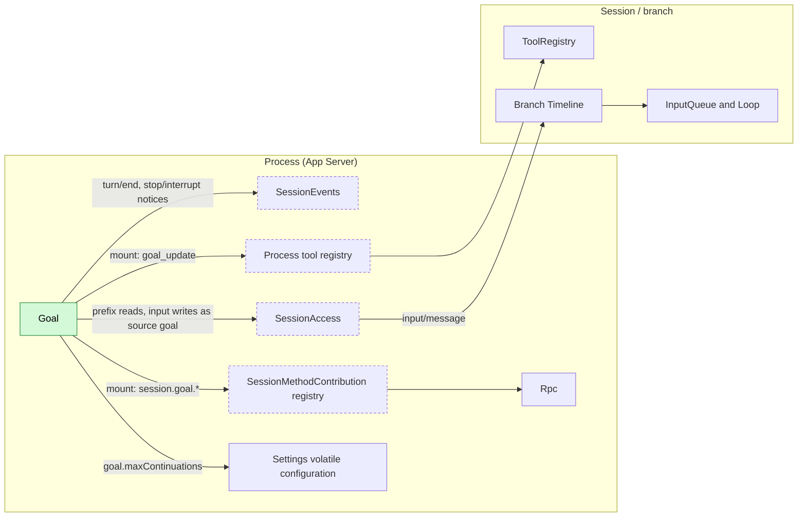
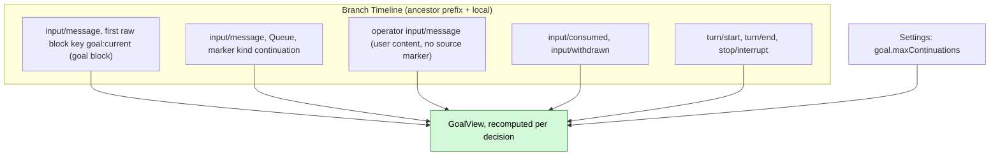
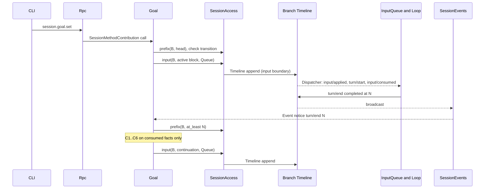
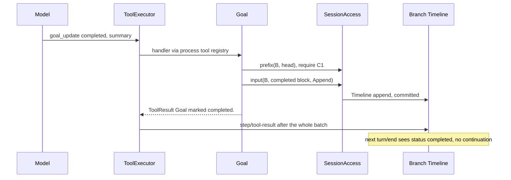
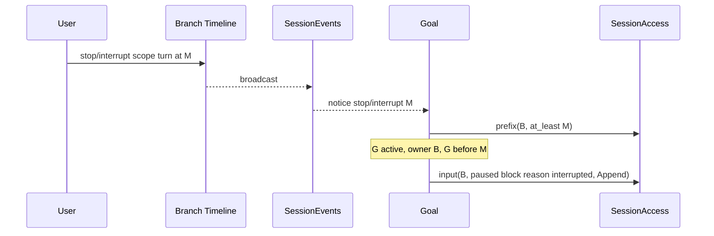
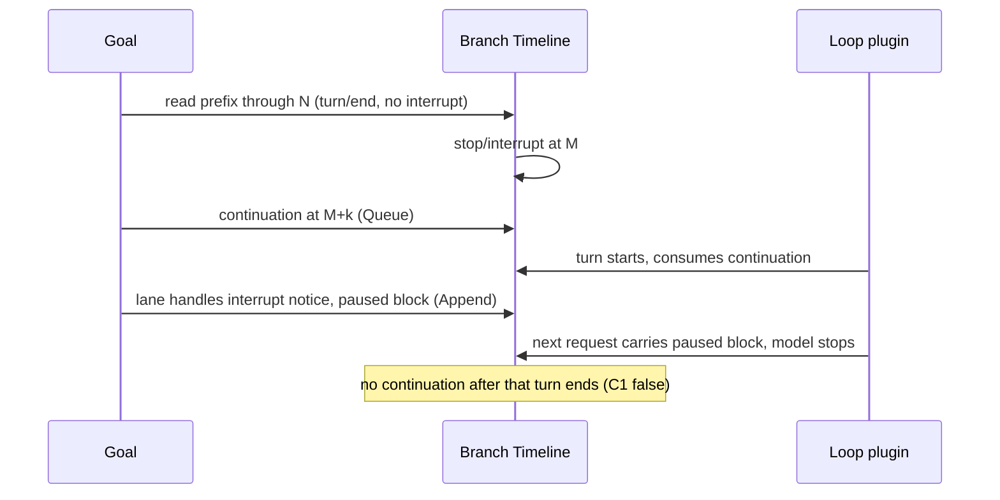
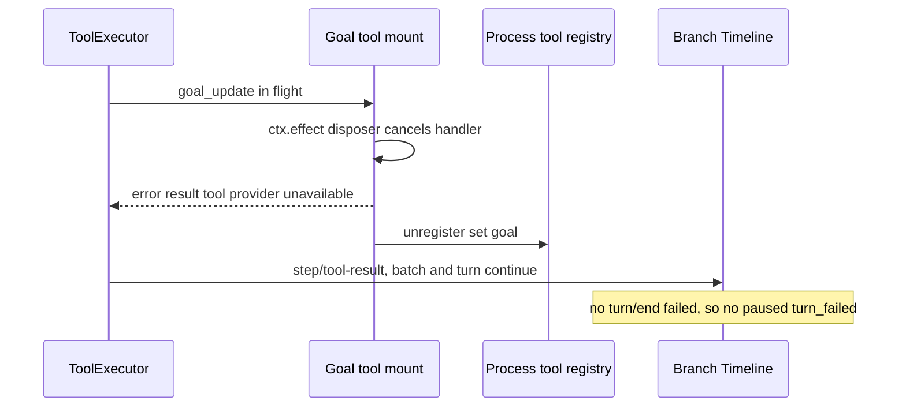

# Goal

Status: Draft. Overall design: [overview §5.2](../overview.md#52-goal). Phase: P2. Language: TypeScript first ([overview §11.3](../overview.md#113-assignment)).

Goal keeps a standing objective on a branch and continues the branch automatically until the model reports the objective completed or blocked, the user pauses or interrupts, or a continuation limit is reached. The goal and its status exist only as a keyed raw input block written through [session-access](../contracts/session-access.md); continuation is decided from a fixed Timeline prefix after a `turn/end` notice from the [broadcast subscription](../contracts/session-broadcast-subscription.md). Goal is a process plugin, writes no events of its own, and has no separate "Goal mode": the feature-list wording "switch Goal mode" is covered by the presence and status of a goal, visible through `session.goal.get` and the goal block.

## 1. Structure

Goal depends only on contracts and registries; no Session or branch plugin and not Rpc depends on Goal, so a Goal reload never reloads them. All model-visible effects are `input/message` facts consumed by the existing InputQueue and Loop.

| Part | Scope | Depends on | Provides |
| --- | --- | --- | --- |
| `Goal` | Process | [`SessionEvents`](../contracts/session-broadcast-subscription.md), [`SessionAccess`](../contracts/session-access.md), Settings volatile configuration, public data contracts of `input/message`, `input/consumed`, `input/withdrawn`, `turn/start`, `turn/end`, `stop/interrupt` | Process tool set `goal` (`goal_update`) mounted into the [process tool registry](../contracts/process-tool-contribution.md); Session methods `session.goal.*` mounted as a [`SessionMethodContribution`](../contracts/session-boundary.md); the goal block and continuation formats under source `goal`; configuration key `goal.maxContinuations` |

Both mounts follow the [extension-registry](../contracts/extension-registry.md) pattern: one mount instance registers in `apply` and unregisters in its `ctx.effect` disposer after settling its own in-flight calls. When Goal is not configured, `session.goal.*` return `method_not_found` and no tool is declared; when configured but inactive, `session.goal.*` return `service_reloading` and `goal_update` is withdrawn (withdraw-only). Goal never names another plugin's types and never reads capability state.

## 2. Data and state

Goal owns no persistent state. The goal of branch `B` is a pure function of a prefix of `B`, recomputed on every decision; compaction does not change it because the prefix is event history, not model context.

| Field | Derivation over the prefix |
| --- | --- |
| `G` | Latest `input/message` whose first raw block has key `goal:current`; none or `retire` means no goal |
| `status`, `owner`, `reason`, `objective` | Attributes and body of `G`'s marker (Goal parses only its own format) |
| `interrupted` | A `stop/interrupt {scope: turn}` in `B`'s local events with sequence greater than `G` |
| `last_operator` | Latest operator input: `input/message` with `user` content that is not marked by a source (A5) |
| `count` | Goal continuation inputs with sequence greater than `max(G, last_operator)` |
| `pending_driving` | Local `input/message` with effective mode Queue or Steer that has neither `input/consumed` nor `input/withdrawn` in the prefix |
| `turn_open` | A `turn/start` after the latest `turn/end` |

Runtime-only state: one serial lane per `(session, branch)` ordering Goal's own read-decide-write sequences, and the subscription. Neither is rebuilt; a new generation starts empty.

## 3. Flows

### 3.1 Set and continue

The continuation is written only after a fixed-prefix decision; InputQueue and Loop consume it through their own Dispatcher subscriptions. Goal registers nothing on any Dispatcher.

### 3.2 Completion through `goal_update`

The terminal block precedes the batch's `step/tool-result`, so the goal replayed after compaction is never `active` again.

### 3.3 Interrupt pauses the goal

`scope: branch` interrupts are ignored: the branch is closing and writes would return `BranchMissing`.

## 4. Timing and conflicts

### 4.1 Interrupt between read and write (at most one extra turn)

Decided by sequence, not wall-clock: the continuation precedes no earlier interrupt in Goal's prefix, so it stands; the later `paused` block ends the goal. This extra turn is accepted (decision E18); Goal does not withdraw its continuation.

### 4.2 Goal reload during `goal_update`

Because the registry is withdraw-only and the per-call outcome is not `capability reloading`, a Goal reload never fails a turn. A terminal block committed before cancellation stands; otherwise the goal stays `active`.

### 4.3 Other key rows

| Scenario | Sequence order | Outcome | Owner |
| --- | --- | --- | --- |
| User Queue/Steer input pending at decision | input < read, unconsumed | C5 fails: no continuation; the user's turn's end decides, count reset | Goal |
| Driving input withdrawn | input < `input/withdrawn` < read | Not pending; continuation proceeds | InputQueue; Goal |
| Another source's Queue follow-up after the same `turn/end` | both read before either writes | Two Queue inputs, two turns in order; Goal writes at most one continuation per `turn/end`; the next decision sees no pending input before continuing | InputQueue; Goal |
| Child cut after the goal block | consumed < cut | Child sees the parent's goal as background; no continuation; `goal_update` there returns the owner error | Goal |

Full table: [Appendix B](#appendix-b-full-conflict-table).

## 5. Context mapping

| What the model sees | Form | Placement |
| --- | --- | --- |
| Goal state (`active`, `paused`, `completed`, `blocked`, cleared) | One `input/message` without `user` content whose only raw block is `<dim-goal kind="goal" status=... branch=...>` with key `goal:current` (clear uses `retire`) | At its `input/consumed` position; Queue blocks start the turn they drive, Append blocks join the next request |
| Continuation | `input/message`, Queue, `<dim-goal kind="continuation" count=k limit=L>`, no key | Start of the turn it drives |
| `goal_update` | Tool declaration in the adopted `context/configured`; result in `ToolResult.content` | Tool-result position of its batch |

| Aspect | Rule |
| --- | --- |
| Compaction | The baseline replays the latest live `goal:current` block verbatim; retired goals are not replayed; continuations and earlier blocks survive only through the summary |
| Child branches | Inherit blocks consumed before the cut; the block names its owner branch and tells delegated work not to call `goal_update` (A3) |
| Non-interactive Sessions | Same mapping; continuations drive turns without a user present |
| Never visible | `submission_id`, mode, count of operator inputs, lanes, notices, diagnostics, other plugins' events |

Exact texts: [Appendix A.4](#a4-model-visible-texts).

## 6. Interfaces (summary)

| Interface | Kind | Purpose |
| --- | --- | --- |
| `goal_update {status, summary}` | Process tool, risk `session` | Model reports completion or blocking; writes the terminal block |
| `session.goal.set/edit/pause/resume/clear` | Session methods (SessionMethodContribution) | User controls the goal; each writes one block |
| `session.goal.get` | Session method | Current `GoalView` of a branch, replaces any "mode" query (A8) |
| `goal.maxContinuations` | Configuration (volatile) | Continuation limit, read at each decision |

Details: [Appendix A](#appendix-a-interface-details).

## 7. Security

Goal writes only `input/message` through session-access under source `goal`; resulting turns run under the Session's Permission and Approval policy, and a goal grants no authority. Users cannot forge goal blocks: `session.submit` accepts no raw blocks and `context_block` escapes the objective. `goal_update` is admitted under `session`. Diagnostics record Session id, branch id, decision and reason, never objective text.

## Appendix A. Interface details

### A.1 Tool `goal_update`

| Item | Value |
| --- | --- |
| Parameters | `{status: "completed" \| "blocked", summary: string}`; `summary` 1..=2000 characters (A10) |
| Result | `ToolResult.content`: `Goal marked completed.` or `Goal marked blocked.`; errors: `No active goal on this branch.`, `The goal belongs to branch <id>; continue your assigned task without calling goal_update.` (A3) |
| Risk category | `session` (existing; writes only Session input) (A9) |
| Requirements | `interactive: false`, `roles: None` (offered to every Session) (A9) |
| Set key / version | `goal`; version changes only with Goal's generation |
| Handler input | `SessionFacts` from [session-access](../contracts/session-access.md) plus `ToolExecutionContext` (branch, turn, request ids) |

Handler: takes the lane of `(session_id, branch_id)`, reads `prefix(branch, head)`, requires C1 (error result otherwise), writes the terminal block in Append mode, awaits commit, returns. On cancellation before the write it writes nothing; once `input` was called the write is not withdrawn.

### A.2 Session methods

| Method | Params | Result | Write |
| --- | --- | --- | --- |
| `session.goal.set` | `{sessionId, branchId?, objective}` | `{goal, sequence}` | `active` block, Queue |
| `session.goal.edit` | `{sessionId, branchId?, objective}` | `{goal, sequence}` | Block with new objective and current status; Queue if `active`, Append otherwise (A1) |
| `session.goal.pause` | `{sessionId, branchId?}` | `{goal, sequence}` | `paused` (reason `user`), Append |
| `session.goal.resume` | `{sessionId, branchId?}` | `{goal, sequence?}` | `active`, Queue; on an already active goal only when `!turn_open && !pending_driving`, else no write (A13) |
| `session.goal.clear` | `{sessionId, branchId?}` | `{sequence}` | Retire block, Append |
| `session.goal.get` | `{sessionId, branchId?}` | `{goal: GoalView \| null, through}` | None (A8) |

`branchId` defaults to `main` (A15). `GoalView = {status, objective, reason?, summary?, owner, count, limit, sequence}`. Transitions: `set` from any state; `edit` from `active`, `paused`, `blocked`; `pause` from `active`; `resume` from `paused`, `blocked`, `active`; `clear` from any live goal. Methods `acquire` the Session (may restore it); notices never restore (A14). The methods are the keyed service of Goal's [`SessionMethodContribution`](../contracts/session-boundary.md) mount; Rpc validates the envelope and routes by namespace without knowing Goal.

### A.3 Continuation decision

On `turn/end` at sequence `N` on branch `B`, all conditions over the prefix read with `at_least = N`:

| # | Condition | If false |
| --- | --- | --- |
| C1 | `G` exists, not retired, `status = active`, `owner = B` | Stop |
| C2 | No turn-scoped interrupt on `B` after `G` | Write `paused` (`interrupted`) and stop |
| C3 | The `turn/end` at `N` is `completed` | `failed`: write `paused` (`turn_failed`) (A6); `cancelled`: handled by C2 |
| C4 | `N` is the latest `turn/end` and `!turn_open` | Stop (a newer turn's end will trigger) |
| C5 | `!pending_driving` (includes Goal's own unconsumed continuation; excludes withdrawn inputs) | Stop |
| C6 | `count < maxContinuations` | Write `paused` (`limit`) and stop |
| — | All hold | Write continuation (Queue) with `count + 1` |

Interrupt notice at `M` (`scope: turn`): if C1 holds and `G < M`, write `paused` (`interrupted`). Gap notice: for each affected loaded Session, run the decision for every branch with `N` = the latest `turn/end` in its prefix (A11).

### A.4 Model-visible texts

Each write is one `input/message` with no `user` content whose only raw block is the marker rendered by session-access: `<dim-goal kind="..." ...>`, newline, escaped body, newline, `</dim-goal>` (A2).

| Write | Key | Mode | Text |
| --- | --- | --- | --- |
| `active` | `goal:current` | Queue (Append on edit when not active) | `<dim-goal kind="goal" status="active" branch="B">` / `Objective:` / `<objective>` / blank / `This is the user's standing goal for branch B. Keep working toward it across turns. When it is fully achieved, call goal_update with status "completed". If you cannot make progress without the user, call goal_update with status "blocked" and explain why. If you are working on a delegated sub-task started from branch B, treat this goal as background and do not call goal_update.` / `</dim-goal>` |
| `paused` | `goal:current` | Append | `status="paused" reason="interrupted\|user\|limit\|turn_failed"`; body `Objective:` / `<objective>` / blank / `The goal is paused (<reason phrase>). Do not continue working toward it on your own; respond only to the user's latest input.` |
| `completed` / `blocked` | `goal:current` | Append | `Objective:` / `<objective>` / blank / `Result:` or `Blocker:` / `
` / blank / `The goal is completed.` or `The goal is blocked.` + ` Do not continue working toward it.` |
| clear | `goal:current`, `retire` | Append | `<dim-goal kind="goal" status="cleared" branch="B">` / `The previous goal was cleared by the user. Disregard it.` |
| continuation | none | Queue | `<dim-goal kind="continuation" count="k" limit="L">` / `Continue working toward the active goal. If it is completed or blocked, call goal_update.` |

Reason phrases: `interrupted` "the user interrupted the turn", `user` "paused by the user", `limit` "the automatic continuation limit was reached", `turn_failed` "the last turn failed". Tool declaration description: "Report that the current goal is completed or blocked."

### A.5 Timeline and capability mechanics

| Step | Path |
| --- | --- |
| Subscribe | In `apply`: `SessionEvents::subscribe(ctx, {types: {"turn/end", "stop/interrupt"}, sessions: None, branches: None}, 256)`; the stream task is registered with `ctx.effect` |
| Trigger | Per notice, enqueue on the `(session, branch)` lane and return to `next()` |
| Read | `access.source("goal").get(session)` (loaded only), then `lease.prefix(branch, at_least = event.sequence)` |
| Write | `lease.input(branch, SourceInput {submission_id: "goal:<uuid>", marker, mode})` → `Session::input` → `Branch::input` → `TimelineContext::input` → `Timeline::append` (no registration callback). Goal awaits the committed event and `lease.published` before releasing the lane, so its next read sees its own write |
| Consumption | InputQueue's Dispatcher subscription appends `input/applied`; Loop appends `input/consumed`; handlers register work and return. Goal never writes Steer |
| StateCell | None owned; InputQueue's `StateCell<InputSnapshot>` and Loop's `LoopSnapshot` are never read by Goal |
| Recheck | Every write is preceded, inside the lane, by a prefix read; decisions use only facts in that prefix ([time bus §4](../../architecture/rust-agent/time-bus.md)). Later facts precede the write in sequence and are resolved by InputQueue and Loop |
| Terminal facts | A decision commits one input or none; `completed`/`blocked` are written by the `goal_update` handler before it returns |
| `Reloading` from SessionAccess | During an Agents reload the facade returns `Reloading`; before any write Goal retries the read and decision after 1 s, 2 s and 4 s, then gives up until the next trigger (A16) |
| Goal reload | The stream, lanes and mounts end; in-flight `goal_update` calls return "tool provider unavailable" (per [extension-registry](../contracts/extension-registry.md)); `session.goal.*` return `service_reloading`. The new generation subscribes in `apply`, takes over from the next notice it receives and never retries an earlier decision. An uncertain write either committed (a fact, deduplicated by C5) or did not |
| Restart | Same as reload. Missed `turn/end` notices are not replayed; an active goal waits for the next `turn/end`, `resume` or Gap re-evaluation. Committed unconsumed continuations are restored with the Session |

## Appendix B. Full conflict table

| Scenario | Sequence order | Outcome | Owner |
| --- | --- | --- | --- |
| User Queue input while a goal turn runs | input < `turn/end` N, unconsumed | C5 fails; the user's turn runs; its end continues with count reset | Goal, InputQueue |
| User input between Goal's read and write | read < input < continuation | Both run in order: user turn, then continuation turn; count reset | InputQueue, Loop |
| User input after the continuation | continuation < input | Continuation turn first; Queue next; Steer joins the continuation turn | InputQueue, Loop |
| Steer during a goal turn | consumed in turn | Same turn; resets count if operator input (A5) | Loop; Goal |
| Steer after `turn/end`, before decision | `turn/end` < steer | Steer starts a turn; C4 or C5 fails; that turn's end decides | Goal |
| Append input while idle | — | Not driving; continuation proceeds; Append consumed with its first request | Loop |
| Driving input withdrawn before the read | input < `input/withdrawn` < read | Excluded from `pending_driving`; continuation proceeds | InputQueue; Goal |
| Driving input withdrawn after the read | read < `input/withdrawn` | Decision already stopped at C5; the next `turn/end`, `resume` or Gap decides; an idle goal waits (A13) | Goal |
| Withdraw-and-Steer batch of a pending input | `input/withdrawn` + Steer in one batch | Steer starts a turn; its end decides | InputQueue; Goal |
| Goal's own continuation withdrawn by the user | continuation < `input/withdrawn` | Not consumed, not counted as pending; next decision may continue again; count includes it (counts continuation inputs written) | Goal |
| Other source's Queue follow-up after the same `turn/end` (e.g. a Hooks follow-up) | both reads < both writes | Two turns in order; at most one continuation per `turn/end`; counts only Goal continuations; that source's input does not reset the count unless it is operator input | InputQueue; Goal |
| Interrupt before Goal's read | interrupt < read | C2: `paused`, no continuation | Goal |
| Interrupt between read and write | read < interrupt < continuation | One extra turn; then `paused` (E18) | Loop; Goal |
| Interrupt after the continuation started its turn | consumed < interrupt | Turn cancelled; `paused` | Loop; Goal |
| Interrupt after apply, before consumption | applied < interrupt | Continuation stays pending; `paused` written after it; the next driving input consumes both, model sees `paused` last | Loop; Goal |
| Interrupt during `goal_update` after its write | block < interrupt | Goal `completed`/`blocked`; no pause | Goal |
| Interrupt during `goal_update` before its write | interrupt < handler write | Handler cancelled, no write; goal paused by the interrupt | ToolExecutor; Goal |
| Resume vs a pending interrupt notice | interrupt < resume block | Notice handled later finds `G > M`: no pause | Goal |
| Branch-scoped interrupt or branch close | close < write | `BranchMissing`/`SessionClosed`; nothing written; lanes dropped | Runtime facade |
| Tool batch not settled | terminal block < `step/tool-result` | Block consumed after the batch result; `turn/end` sees non-active goal | ToolExecutor, Loop |
| Two `goal_update` calls in one batch | lane order | Second finds no active goal: error result | Goal |
| `goal_update` vs `edit`/`clear` | lane order | The later reads the earlier's block | Goal |
| Compaction between a goal write and its consumption | write < compaction < consumed | Block delivered at its consumed position after the summary; later baselines replay it | History projection |
| Compaction after several goal blocks | — | Only the latest `goal:current` block replayed; count reads facts | History projection; Goal |
| Child cut between a goal write and its consumption | write < cut < consumed | Child does not adopt it; `owner ≠ child`: no continuation | InputQueue (child); Goal |
| Child cut after consumption | consumed < cut | Child sees the parent goal as background; `goal_update` rejected (A3) | Goal |
| Goal set on a child branch | — | Independent key on the child's Timeline | History projection |
| Session fork | facts copied | Fork's `main` owns the copied goal (A12) | Goal |
| Goal reload during a decision | — | Write committed or not; no retry; C5 deduplicates | Goal |
| Goal reload during `goal_update` | — | "tool provider unavailable" result; turn continues; committed block stands | Registry, ToolExecutor |
| Goal reload while a goal turn runs | — | Turn not failed (withdraw-only registry); its `turn/end` may be missed; Gap or the next trigger re-evaluates | Goal |
| Agents reload | facade `Reloading` | Decision retried (A16); no Goal reload | Goal |
| Process restart | `turn/end` missed | Not replayed; goal stays `active` until the next trigger | Goal |
| Session idle unload | `Ended {Unloaded}` | Lanes dropped; methods `acquire` before writing | AgentIndex; Goal |
| Session close | `Ended {Closed}` | Methods return `session_closed` | Goal |
| Duplicate or reordered notices, Gap | — | Per-branch notices are ordered; duplicates fail C4/C5; Gap re-evaluates (A11) | Goal |
| Duplicate `resume` | — | Second sees `turn_open` or `pending_driving`: no write | Goal (A13) |
| Duplicate `set` | — | Each writes a block; count resets | Goal (A13) |
| Turn failed (not by reload) | `turn/end {failed}` | `paused` (`turn_failed`) (A6) | Goal |
| Limit reached | count = limit | `paused` (`limit`) | Goal |
| Resource node offline | Session capabilities Pending | Inputs commit; turns start when capabilities recover | Lifecycle |
| Client detach | — | No effect | — |

## Appendix C. Errors and recovery

| Error code | Cause |
| --- | --- |
| `invalid_params` | Empty or oversize objective (A10), malformed branch id |
| `no_goal` | `pause`, `resume`, `edit`, `clear` without a live goal |
| `goal_not_active` | `pause` on a non-active goal |
| `goal_not_editable` | `edit` or `resume` on `completed` (use `set`) |
| `session_closed`, `session_unavailable`, `branch_missing` | Mapped from `AccessError` |
| `service_reloading` | `AccessError::Reloading` or Goal's mount inactive; the write did not happen or is found by `get` |
| `write_uncertain` | `PublicationUnknown`; `get` after recovery shows whether the block is in effect |

Goal never retries a write on its own except after `lookup(submission_id)` returns `Unknown` within the same generation. Process exit leaves only committed facts.

## Appendix D. Acceptance

Flow tests through Session methods, the `goal_update` tool and Timeline events (fake model):

1. Set on an idle branch starts a turn; normal end writes a continuation; `goal_update completed` ends continuation; the completed block precedes the batch's `step/tool-result`.
2. Limit: with `maxContinuations = 2`, the third decision writes `paused (limit)`; operator input resets the count; a marked input from another source does not.
3. Interrupt rows: before read, between read and write (at most one extra turn), after start, after apply; during `goal_update` before and after its write.
4. Pending Queue/Steer input suppresses continuation; Append does not; a withdrawn input does not suppress it.
5. Goal reload during `goal_update` and during a goal turn: the turn is not failed, no `paused (turn_failed)`.
6. Compaction after `completed`: the baseline contains `completed`, not `active`.
7. Child branch: inherits the block, no continuation, `goal_update` returns the owner error; a goal set on the child is independent.
8. Duplicate `turn/end` (resubscribe) writes at most one continuation; Gap re-evaluation continues a stalled goal.
9. Restart with an active idle goal: no continuation until a trigger; a committed unconsumed continuation is adopted after restore.
10. Unloaded Session: `session.goal.pause` restores it and writes; notices never restore. Goal not configured: `method_not_found`; configured but inactive: `service_reloading`.
11. `edit`, `clear` (retired key not replayed), forged `</dim-goal>` in an objective is escaped; `session.goal.get` reflects every status.

## Appendix E. Assumptions

| # | Assumption | Basis | Effect if rejected |
| --- | --- | --- | --- |
| A1 | `set`, `resume` and `edit` of an active goal use Queue; other writes use Append | Judgment (overview §5.2 fixes Queue only for continuation) | Set would not start work on an idle branch, or pause would start a turn |
| A2 | Exact block formats and texts in Appendix A.4 | Judgment; marker format from session-access | Text and parsing change together |
| A3 | A goal belongs to the branch named in its block; other branches never continue or update it, and the block tells delegated work not to call `goal_update` | Judgment from child-branch inheritance | Child branches would continue or complete the parent's goal |
| A4 | `goal.maxContinuations` default 20, range 1..=1000 | Judgment (overview §5.2 states a limit, not a value) | Different default |
| A5 | Count resets on a new goal block and on operator input only: `user` content and no source marker as first raw block; inputs written by other sources (Scheduler, Workflow, Hooks) do not reset it | Judgment; cross-review C5.3 | Another plugin's automatic input would reset the limit |
| A6 | A failed turn pauses the goal (`turn_failed`) | Judgment (avoid retry loops on provider errors) | Failed turns would continue and consume the limit |
| A7 | Pause does not interrupt the running turn | Judgment; overview §5.2 only writes a block | Pause would also call `stop` |
| A8 | `session.goal.get` exists and is the status query that replaces a "Goal mode" | Decision E18 | CLI derives status by parsing Goal's blocks |
| A9 | `goal_update` risk `session`, offered to all Sessions and roles | Judgment | Tool hidden in some Sessions or admitted under another category |
| A10 | Objective ≤ 4000 characters, summary ≤ 2000 | Judgment | Other limits |
| A11 | A Gap notice triggers re-evaluation of affected Sessions | Judgment from the subscription contract | Goals may stall after a dropped `turn/end` |
| A12 | A forked Session's `main` continues a copied goal | Judgment | Fork would need to retire the copied key |
| A13 | `resume` on an active idle goal restarts work; duplicate `set` is not deduplicated | Judgment (overview §5.2 "continues when the user resumes") | Restarted goals need `set` again |
| A14 | Notices never restore unloaded Sessions; Session methods do | Judgment | Background continuation would restore Sessions |
| A15 | `branchId` defaults to `main`; any branch may hold a goal | Judgment | Goal limited to `main` |
| A16 | On `AccessError::Reloading` before a write, Goal retries the read and decision three times (1 s, 2 s, 4 s) | Judgment from decisions §1 (facade returns `Reloading`) | Goals stall after an Agents reload until the next trigger |

## Appendix F. Open questions

| Question | Description |
| --- | --- |
| Overview §13 "How events enter context" | Goal designs for adopted input only |
| Overview §5.2 interfaces | Overview lists `session.goal.set/edit/pause/resume/clear`; `session.goal.get` is added here (A8) and should be registered |
