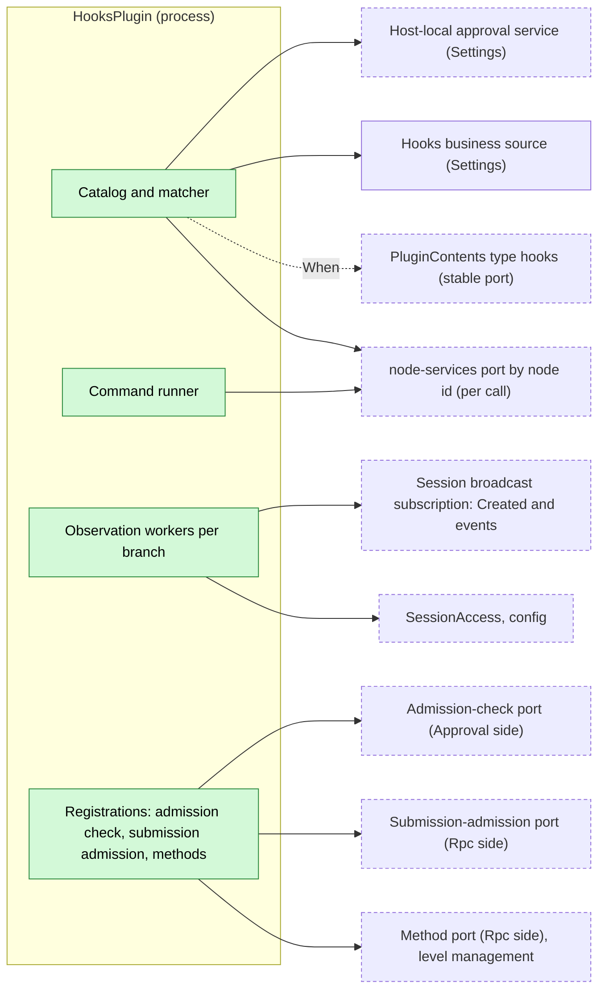
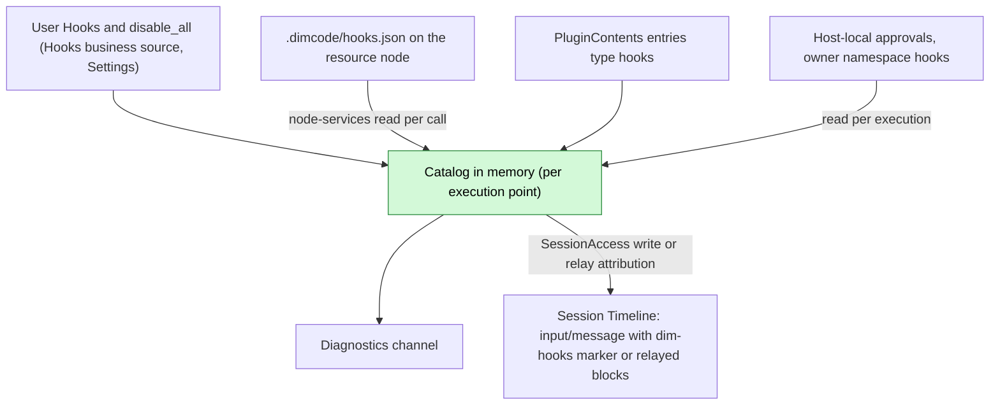
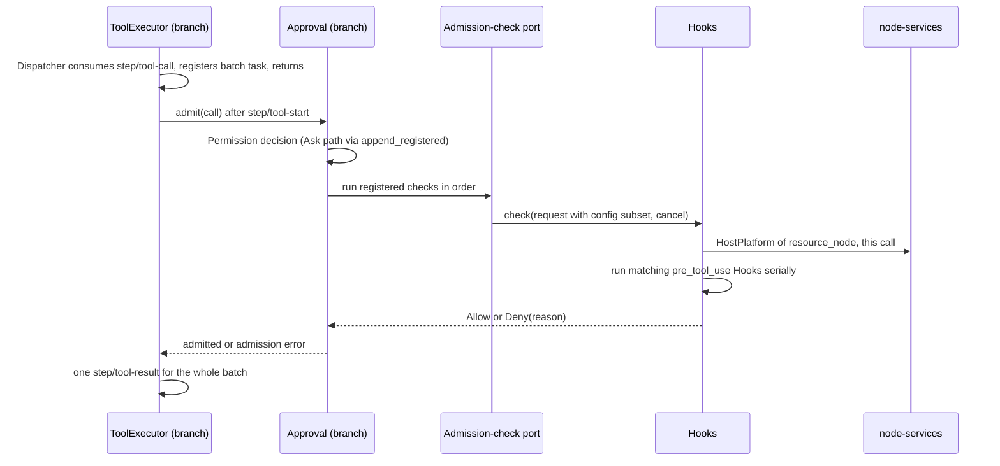
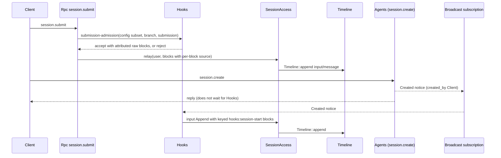
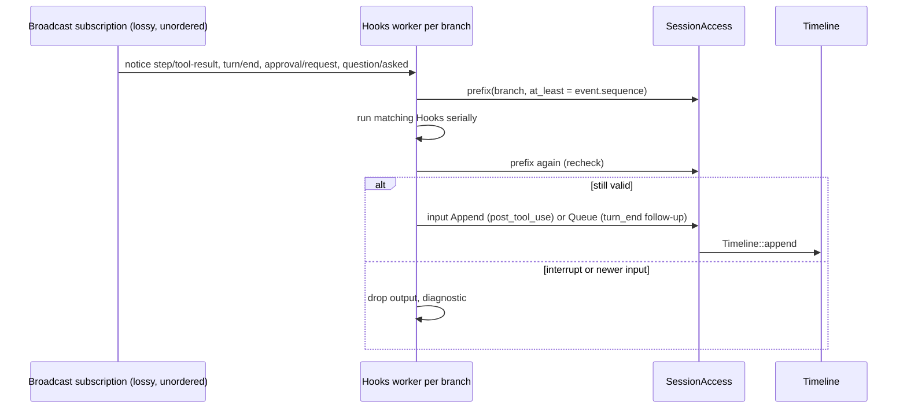
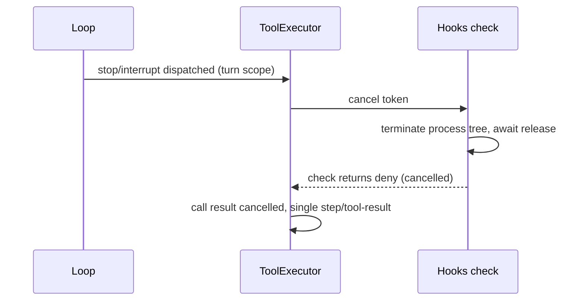

# Hooks

Status: Draft. Overall design: [overview B.7](../overview.md#b7-hooks). Phase: P2 (user and project sources); plugin source after #3. Language: Rust.

Hooks is an adapter that maps command Hook configuration onto extension points that other owners define; it adds no extension mechanism and no Timeline event. Pre-tool Hooks register into Approval's admission-check port and user-submit Hooks into Rpc's [submission-admission port](../contracts/session-boundary.md); Session-start, post-tool, turn-end and notification Hooks run after notices of the live [Session broadcast subscription](../contracts/session-broadcast-subscription.md) (Session start after the `Created` notice). Every command runs on the Session's resource node (`SessionConfig.resource_node`), whose services are looked up per call through the stable node-services port ([ADR 002 D2](../../adr/002-dependency-direction.md#d2-contributors-register-into-a-stable-port-owned-by-the-consumer)); output enters context only as input.

## 1. Structure



Hooks only registers into ports owned by their consumers ([ADR 002 D2](../../adr/002-dependency-direction.md#d2-contributors-register-into-a-stable-port-owned-by-the-consumer)): it registers in `apply` and unregisters in `ctx.effect`; Approval and Rpc never inject Hooks and never reload because of it. Every dependency of Hooks is stable (the Session access plugin, which depends only on AgentDirectory and Loader, the node-services port, Settings, the `PluginContents` port), so its lifetime is independent of Agents: an Agents reload only makes Session access return `Reloading`. Project files and process execution go through the node services of the Session's resource node, resolved per call, so an offline node affects only calls on that node.

| Part | Scope | Depends on | Provides |
| --- | --- | --- | --- |
| `HooksPlugin` | Process | Session broadcast subscription, `SessionAccess` (`config`, prefix reads, writes), node-services port, its business source in Settings and the host-local approval service, `When<PluginContents>` (stable port, type key `hooks`) | Registrations: admission check `hooks` (Approval's admission-check port), submission admission `hooks` (Rpc's submission-admission port, [session-boundary](../contracts/session-boundary.md)), method namespace `hooks` at level `management` (Rpc's method port) |

**Contracts depended on** (none names Hooks): Approval's admission-check port ([ADR 002 D2](../../adr/002-dependency-direction.md#d2-contributors-register-into-a-stable-port-owned-by-the-consumer), [D6](../../adr/002-dependency-direction.md#d6-fail-closed-requirements-come-from-adopted-business-configuration)), the submission-admission and method ports ([session-boundary](../contracts/session-boundary.md)), [session-access](../contracts/session-access.md) (`SessionAccess`, `config`, per-block relay attribution), [session-broadcast-subscription](../contracts/session-broadcast-subscription.md) (`Created` notice), the node-services port, Settings typed operations and host-local approval service (overview §7.2), `PluginContents` (PluginManager, optional). **Contracts defined here**: the Hook configuration format, the command protocol, the `hooks.*` management methods, source name `hooks` (marker `dim-hooks`, key namespace `hooks:`). Hooks does not define the admission ports; it only registers into them.

## 2. Data and state



User Hooks and `disable_all` are business configuration ([D5](../../adr/002-dependency-direction.md#d5-structural-configuration-and-business-configuration-are-separate)): read at each execution point, changed by a data update with notification, never a reload; enabling the plugin stays a loader row. Hooks owns no `StateCell` and rebuilds nothing from the Timeline. The catalog is recomputed from its sources at each execution point (A6); grants are read per execution and never cached as authority; follow-up counters are derived from the fixed prefix. Running processes live in memory under `ctx.effect` and are never re-run after reload or restart. Outcomes are recorded only as other owners' facts (Appendix A.5).

## 3. Flows

### 3.1 Pre-tool check



Hooks runs outside every commit lock and Dispatcher handler and writes nothing; ToolExecutor writes the terminal fact. A Hook error applies `on_error`, whose default for `pre_tool_use` is `deny` (E9). If no `hooks` checker is registered, Approval denies with a retryable reason only when a `RequiredCheck` record written for an adopted `pre_tool_use` rule matches the calling Session ([D6](../../adr/002-dependency-direction.md#d6-fail-closed-requirements-come-from-adopted-business-configuration), A.4); otherwise the call proceeds. A cancelled check returns deny.

### 3.2 User submit and Session start



Submission admission is fail closed only for adopted rules: with no checker registered and a matching `RequiredCheck` record written for an adopted `user_prompt_submit` rule ([session-boundary A.3](../contracts/session-boundary.md#a3-submission-admission-port)), Rpc returns `service_reloading` and writes nothing; without such a record the submission proceeds. Session start is observe-only and fail open: it runs only for a `Created` notice with `created_by = Client` (E10), never on restore (`Loaded`), and its context reaches the next model request after it is written (A24).

### 3.3 Observation Hooks



Workers decide only from the fixed prefix; events missed by a `Gap`, a reload or a restart never run.

## 4. Timing and conflicts



An interrupt after `step/tool-start` always wins over a finished Hook: output is discarded once the token is cancelled.

| Scenario | Sequence order | Outcome | Owner |
| --- | --- | --- | --- |
| Turn-end follow-up vs user input or Goal continuation | `turn/end` < other input < Hook write | Recheck sees the input: not written. If both read before either writes, both Queue inputs stand (at most one extra turn each) | Hooks, InputQueue |
| Follow-up withdrawn by the user | follow-up < `input/withdrawn` | Not consumed; not counted as a follow-up and not rewritten | InputQueue, Hooks |
| Hooks not registered (reload, Pending, disabled) | — | Only calls or submissions whose Session matches a `RequiredCheck` record are denied (retryable) or get `service_reloading`; others proceed; no Session-start or observation Hooks run | Approval, Rpc |
| Agents reload | — | `SessionAccess` and the broadcast subscription return `Reloading`; Hooks does not reload and its checkers stay registered; writes `lookup` before one retry | Hooks |
| Resource node offline | per call | That call's Hook errors: pre-tool → `on_error` (deny), observation → diagnostic; other nodes unaffected | Hooks |

Full table: Appendix B.

## 5. Context mapping

| Source | What the model sees | Placement | Compaction | Child branches |
| --- | --- | --- | --- | --- |
| `session_start` | One Append input: marker `<dim-hooks kind="session-start">`, one raw block per Hook with key `hooks:session-start/<source>/<id>` | Next model request after the write (A24) | Latest block per key replayed | Inherited while live at the cut |
| `user_prompt_submit` | Raw blocks `<dim-hooks kind="user-prompt-submit" hook="...">`, rendered by session-access from the per-block source `hooks`, before the user content of the relayed input | Consumed position of that input | Summary only | If consumed before the cut |
| `pre_tool_use` deny | Error text in `ToolResult.content` | Call position in the batch result | Summary only | If before the cut |
| `post_tool_use` | Append input, marker `kind="post-tool" call_id tool` | Next model request of a turn | Summary only | As inputs |
| `turn_end` | Queue input, marker `kind="follow-up"` | Start of the turn it drives | Summary only | As inputs |
| `notification` | Nothing | — | — | — |

Non-interactive Sessions: identical, except that Session-start Hooks run only for `created_by = Client` Sessions, so Scheduler runs, Workflow stages and Collaboration members never get them. The model never sees configuration, commands, exit codes, stderr (except a deny reason), approvals, diagnostics or other plugins' events.

## 6. Interfaces (summary)

| Interface | Kind | Purpose |
| --- | --- | --- |
| Admission check `hooks` | Registered into Approval's admission-check port | Run `pre_tool_use` Hooks; deny or allow |
| Submission admission `hooks` | Registered into Rpc's submission-admission port | Run `user_prompt_submit` Hooks; reject or append attributed blocks |
| `Created` notice | Consumed from the broadcast subscription | Run `session_start` Hooks for Client-created Sessions |
| `hooks.catalog`, `hooks.approve`, `hooks.revoke`, `hooks.set_enabled`, `hooks.disable_all` | Methods, level `management` | Inspect, approve, enable/disable |
| `dimcode hooks`, `/hooks` | CLI | Call the management methods |
| Configuration format, command protocol | Defined here | Appendix A |

No tools, no Session methods.

## 7. Security

User Hooks run without approval. Project and plugin Hooks run only with a grant in the Settings host-local approval service, record `{owner: hooks, node, workspace, source, id, event, tools, fingerprint}`, fingerprint = SHA-256 over the canonical entry without `enabled` (R11); reading configuration grants nothing, and replay, fork and restore never restore grants. Grants, overrides and isolation never enter Timeline. Commands run on the Session's resource node with that node's isolation applied by HostPlatform; a Hook is not admitted by Permission (it is not a tool) and never widens authority: no outcome admits a call that Permission or the user denied, and no output edits tool input. stdin may contain prompts and tool input; diagnostics keep only Hook id, exit status, duration and a bounded stderr excerpt.

## Appendix A. Interface details

### A.1 Configuration format

One JSON document per source, the same shape for user configuration (document `hooks` in Hooks' business source in Settings, not the loader editable layer), project file `.dimcode/hooks.json` (E11) and plugin content type `hooks`:

```json
{
  "version": 1,
  "hooks": [
    { "id": "guard-writes", "event": "pre_tool_use", "tools": ["write", "edit", "mcp__fs__*"],
      "command": "./scripts/guard.sh", "timeout_ms": 10000, "on_error": "deny", "enabled": true }
  ]
}
```

| Field | Type | Rule |
| --- | --- | --- |
| `version` | `1` | Other values make the whole document invalid (A1) |
| `id` | string `[a-z0-9][a-z0-9_-]{0,63}` | Unique within the source; identity of grants and overrides |
| `event` | `session_start` \| `user_prompt_submit` \| `pre_tool_use` \| `post_tool_use` \| `turn_end` \| `notification` | Required (A4) |
| `tools` | string array of name patterns | Only `pre_tool_use`/`post_tool_use`; `*` matches any run of characters, otherwise exact and case-sensitive; omitted = all tools (A5) |
| `kinds` | array of `approval` \| `question` | Only `notification`; omitted = both (A15) |
| `command` | string | Run by the resource node's execution shell with `SessionConfig.cwd` as working directory (A8) |
| `timeout_ms` | integer 100..=600000 | Default 60000 (A10) |
| `on_error` | `allow` \| `deny` | Only blocking events; default `deny` for `pre_tool_use` (E9), `allow` for `user_prompt_submit` (A11) |
| `enabled` | bool | Default `true` |

Invalid entries are listed `invalid` and never run; other entries of the same document are unaffected. No `env` field (credentials only as references; Hooks resolves none). Execution order per event: user, project, plugin sources (by plugin id), then document order (A12). Plugin Hooks are taken only from `PluginContents` entries installed on the Session's resource node (A23). Configuration changes are data updates with notification, never reloads (D5).

### A.2 Command protocol

| Channel | Content |
| --- | --- |
| stdin | One UTF-8 JSON object, then EOF: `{version: 1, event, hook_id, source, session_id, branch_id, cwd, resource_node, ...event fields}` |
| Environment | HostPlatform's filtered base environment plus `DIM_HOOK_EVENT`, `DIM_SESSION_ID`, `DIM_PROJECT_DIR` (A8) |
| Exit 0 | Success. stdout empty or one JSON object (`decision`, `reason`, `context`, `follow_up`); non-JSON stdout is `context` for `session_start` and `user_prompt_submit`, otherwise ignored (A13) |
| Exit 2 | Block for `pre_tool_use` and `user_prompt_submit`, stderr (first 2 KiB) as reason; error for other events |
| Other exit, signal, timeout, spawn failure, stdout over 64 KiB, node unavailable | Error: diagnostics; blocking events apply `on_error` |

Event fields: `user_prompt_submit {prompt: text of the user content, images: count}`; `pre_tool_use {turn_id, request_id, call_id, tool, input, risk}`; `post_tool_use {turn_id, call_id, tool, input, result: {text, is_error}}`; `turn_end {turn_id, outcome: completed|failed|cancelled, reason}`; `notification {kind, approval_id | call_id, tool?}`; `session_start {}`. `context` and `follow_up` are each at most 16 KiB after UTF-8 truncation (A13).

### A.3 Outcomes

| Event | Allow / success | Deny | `context` | `follow_up` |
| --- | --- | --- | --- | --- |
| `session_start` | — | Not supported (exit 2 = error) | Keyed raw block, Append | Ignored |
| `user_prompt_submit` | Submission continues | Rejected, nothing written (`hook_rejected`) | Attributed raw block in the same input | Ignored |
| `pre_tool_use` | Next check | Deny with `Hook <source>/<id>: <reason>` | Ignored (A16) | Ignored |
| `post_tool_use` | — | Not supported | Append input after the batch | Ignored |
| `turn_end` | — | Not supported | Ignored | Queue input, bounded (A14) |
| `notification` | — | Not supported | Ignored | Ignored |

### A.4 Port registrations

| Contract (owner, file) | Hooks' implementation |
| --- | --- |
| Admission-check port (Approval) | Reads the `SessionConfig` subset from the request; runs matching `pre_tool_use` Hooks in order; block, or error with `on_error: deny`, → deny; on cancel terminates the process tree, awaits release, returns the cancelled outcome (Approval settles it as deny) |
| Submission-admission port (Rpc, [session-boundary](../contracts/session-boundary.md)) | Runs `user_prompt_submit` Hooks on the submission; appends raw blocks attributed to source `hooks`; rejection → `hook_rejected` |
| Method port, level `management` ([session-boundary](../contracts/session-boundary.md)) | Methods of A.6 |

Session start is not a port: Hooks ignores `Created` notices unless `created_by = Client`, then runs `session_start` Hooks and writes one Append input through `SessionAccess`.

Each registration is made in `apply` and removed in its `ctx.effect` disposer after terminating its running processes; in-flight checks end "provider unavailable", never `capability reloading`.

Fail-closed rule ([D6](../../adr/002-dependency-direction.md#d6-fail-closed-requirements-come-from-adopted-business-configuration)), applied by the consumer while no `hooks` checker is registered, through `RequiredCheck` records ([session-boundary A.3](../contracts/session-boundary.md#a3-submission-admission-port)): when Hooks adopts its business configuration it writes, in its own Settings section, one record per adopted enabled `pre_tool_use` and `user_prompt_submit` rule (user rules `AllSessions`, approved project rules `ProjectRoot`; none while `disable_all`). Both consumers read these records per call without Hooks: Approval denies with a retryable reason only when a matching `pre_tool_use` record's checker is unregistered; Rpc's submission-admission port returns `service_reloading` only when a matching `user_prompt_submit` record's checker is unregistered. Loader rows and plugin presence never deny by themselves.

### A.5 Where outcomes are recorded (no events)

| Outcome | Recorded as |
| --- | --- |
| Pre-tool deny | The call's error result inside `step/tool-result` (ToolExecutor) |
| User-submit reject | Absence of the input; error to the RPC caller |
| Injected context, follow-up | `input/message` through session-access (source `hooks`) |
| Execution records | Diagnostics channel |

No later behavior depends on a Hook run except through these facts, so a Hook event would be derivable or irrelevant (time bus rule 3).

### A.6 Management methods

| Method | Parameters | Result |
| --- | --- | --- |
| `hooks.catalog` | `{cwd?, node?}` | Hooks per source: `id`, `source`, `event`, matcher, `command`, `enabled`, `approval` (`notRequired` \| `required` \| `approved`), `approvalToken`, `invalid?`; global `disabled` |
| `hooks.approve` | `{cwd, node?, source, id, approvalToken}` | Persists the grant; stale token → `hooks_settings_conflict` |
| `hooks.revoke` | `{cwd, node?, source, id}` | Removes the grant (A19) |
| `hooks.set_enabled` | `{source, id, cwd?, enabled}` | User source edits the entry; project/plugin source writes a host-local override (A9) |
| `hooks.disable_all` | `{disabled: bool}` | Global switch in Hooks' business source (D5) |

### A.7 Timeline and capability mechanics

| Path | Mechanics |
| --- | --- |
| Pre-tool | ToolExecutor consumes `step/tool-call`, registers the batch task and returns; per call appends `step/tool-start` (`Timeline::append`) and awaits `Approval::admit`, which after its own `append_registered` request path (if Ask) awaits the registered checks. Hooks writes nothing |
| User submit | Submission admission, then `SessionAccess::relay` → `Session::input` → `TimelineContext::input` → `Timeline::append` (no registration callback). InputQueue's Dispatcher subscription appends `input/applied`; Loop appends `input/consumed` |
| Session start | `Created` notice handled by the stream task like an event (worker per Session `main`); Hooks writes one Append input with marker and keyed blocks; Agents never waits for it |
| Observation | Broadcast `subscribe` with `types = {step/tool-result, turn/end, approval/request, question/asked}` (notices always delivered); the stream task (`ctx.effect`) enqueues per `(session, branch)` and returns; one worker per branch runs serially in sequence order (A20) |
| Fixed prefix | `lease.prefix(branch, at_least = event.sequence)`; `post_tool_use` resolves names and inputs from the `step/tool-call` named by `call_event_id`; never reads capability state |
| Recheck | Before writing: branch exists; for `post_tool_use`, no `stop/interrupt` after the tool result; for `turn_end`, no `stop/interrupt` and no non-withdrawn `input/message` after the `turn/end`, and fewer than N consecutive non-withdrawn follow-ups since the last input with another source or user content (A14). Later facts precede the write in sequence and are resolved by InputQueue and Loop |
| Writes | `SourceAccess` bound to `hooks`; `submission_id = hooks:<uuid>`; on `Reloading`/`PublicationUnknown`, `lookup` before one retry |
| Own reload | Registrations are removed after their processes are terminated; consumers apply the D6 rule; the subscription ends and the new generation subscribes from now on, skipping the window |
| Restart | As reload; no Hook is re-run; pending follow-ups are lost |

## Appendix B. Full conflict table

| Scenario | Sequence order | Outcome | Owner |
| --- | --- | --- | --- |
| Turn `stop/interrupt` while a pre-tool Hook runs | `step/tool-start` < interrupt | Token cancelled; tree terminated and released; result "Tool execution cancelled"; output discarded even if finished | Approval, ToolExecutor |
| Interrupt before the batch reaches admission | interrupt < `step/tool-call` consumption | Not admitted; no Hook runs | ToolExecutor |
| Hooks allowed, interrupt before start | checks done < interrupt | Approval's last cancel check settles cancelled | Approval |
| Branch-scoped interrupt or branch close during a pre-tool Hook | branch interrupt | As turn interrupt; close also closes Approval | Approval, ToolExecutor |
| Pre-tool deny for one call of a batch | — | That call's error result; others run; one `step/tool-result` after the batch | ToolExecutor |
| `post_tool_use` for a batch | `step/tool-result` | Fires only after the whole batch; one run per matching call | Hooks |
| Post-tool context vs following interrupt | result < interrupt < write | Recheck sees the interrupt: not written | Hooks |
| Turn-end follow-up vs user input | `turn/end` < input < write | Not written | Hooks |
| Turn-end follow-up vs Goal continuation (both after one `turn/end`) | both read before either writes | Both written; at most one extra turn each (accepted race, E18) | InputQueue |
| Follow-up written, then interrupt | follow-up < interrupt | Consumed by the next turn or cancelled with the turn (session-access) | Loop |
| Follow-up or post-tool input withdrawn | input < `input/withdrawn` | Never consumed; not counted toward the follow-up limit; not rewritten | InputQueue, Hooks |
| Concurrent Steer/Queue/Append | Timeline order | Applied by mode in sequence order | InputQueue |
| User-submit Hook and a concurrent submit | — | Each admitted independently; written in commit order | Rpc, Timeline |
| Compaction between write and consumption | input < compaction < consumed | Placed at its consumed position after the summary | ContextPreparation |
| Compaction after consumption | — | Session-start keyed blocks replayed; others via summary | History projection |
| Child branch cut between Hook input and consumption | input < cut < consumed | Child does not adopt it; Hook not re-run | InputQueue (child) |
| Observation event during Hooks reload or restart | dispatch in window | Never replayed | Hooks |
| Subscription `Gap` | — | Dropped events' Hooks never run; diagnostic | Hooks |
| Duplicate delivery | — | Impossible within a subscription; workers skip a handled `(session, branch, sequence)` | Broadcast subscription, Hooks |
| Duplicate or retried `session.submit` | two calls | Hooks run per call (A21); retry after uncertainty is the client's (`session.input_lookup`) | Rpc, client |
| Duplicate `hooks.approve` | — | Idempotent for the same token; stale token rejected | Hooks |
| Grant revoked or file edited while a Hook runs | — | Running process finishes; later executions not run | Hooks |
| Hooks not registered (reload, Pending, disabled) | — | Calls in a Session matched by a `pre_tool_use` `RequiredCheck` record denied (retryable), others proceed; in-flight check → provider unavailable, settled as deny; `session.submit` → `service_reloading` only with a matching `user_prompt_submit` record; `Created` notices in the window are missed (fail open) | Approval, Rpc |
| Approval reload mid-check | — | Token cancelled; Hook terminated; Approval's own reload settlement | ToolExecutor |
| Agents reload | — | Facades return `Reloading`; Hooks stays loaded and registered; writes `lookup` then one retry | Hooks |
| Session unload during a worker | — | Lease pins for read and write; afterwards `get` returns none and work is dropped | AgentIndex, Hooks |
| Session restore | `Loaded {restored: true}` | `session_start` does not run | Hooks |
| Session created by launch, Collaboration or fork | `created_by` ≠ `Client` | `session_start` does not run (E10) | Hooks |
| First user input before the Session-start write | `input/message` < Hooks Append | Context applies from the next model request; not inserted before the first input (A24) | InputQueue |
| `Created` notice lost (`Gap`) | — | `session_start` not run; diagnostic (fail open) | Hooks |
| Resource node offline | node-services port returns `node_unavailable` for that call | Pre-tool: error → `on_error` (default deny); user-submit: `on_error` (default allow); project file unreadable → project Hooks of that call skipped, diagnostic; observation: diagnostic; other nodes unaffected | Hooks |
| Client detach | — | No effect; a pending `session.submit` completes its admission | — |

## Appendix C. Errors and recovery

| Case | Result |
| --- | --- |
| Timeout | Tree terminated; error; `on_error` for blocking events |
| Unapproved project/plugin Hook | Skipped as not runnable; diagnostic; not an error |
| Approval service unreadable | Fail closed: project/plugin Hooks do not run |
| Invalid document | Marked invalid; none of its Hooks run |
| Write rejected (`BranchMissing`, `SessionClosed`) | Output dropped; diagnostic |
| Cancellation | Terminate tree, await release, then return |
| Process exit | Disposer terminates running Hooks; nothing settled later |

Error codes: `hook_rejected` (submit), `hooks_settings_conflict`, `hooks_invalid`, `service_reloading`.

## Appendix D. Acceptance

Through management methods, `session.create`/`session.submit`, tools and events:

1. Each exit-code and stdout case of A.2 per event, including timeout and both `on_error` defaults.
2. Pre-tool deny in a three-call batch: one error result, others executed, single `step/tool-result`.
3. Interrupt during a pre-tool Hook: process terminated before the result; result cancelled.
4. Hooks reloading: tool calls in a Session matched by a `pre_tool_use` `RequiredCheck` record denied with a retryable reason, others run; `session.submit` returns `service_reloading` only with a matching `user_prompt_submit` record; `session.create` succeeds; no Session, Approval or Rpc reloads; an Agents reload leaves Hooks registered.
5. Project Hook in `.dimcode/hooks.json`: not run before approval; runs after; stops after the file changes.
6. User-submit context appears as `<dim-hooks kind="user-prompt-submit">` before the user content.
7. Session-start context survives compaction; not run on restore or for launched/member Sessions.
8. Post-tool context after an interrupt is not written; follow-up stops at the limit, after user input, and ignores withdrawn follow-ups.
9. Reload and restart: events in the window produce no runs and no duplicates.
10. Resource node offline: only calls on that node fail; Sessions on other nodes unaffected.

## Appendix E. Assumptions

| # | Assumption | Basis | Effect if rejected |
| --- | --- | --- | --- |
| A1 | Versioned JSON document per source | Judgment | Format changes |
| A3 | User Hooks and `disable_all` are a `hooks` document in Hooks' Settings business source | ADR 002 D5 | Separate user file |
| A4 | Six events: session start, user submit, pre/post tool, turn end, notification | Overview §5.7 timing points; names are judgment | Names change |
| A5 | Tool name patterns with `*` glob only | Edge-case reference; judgment | Regex matching |
| A6 | Project file re-read at each execution point (no watcher) | ADR 001 MCP precedent | A watcher is needed |
| A8 | Node shell in Session cwd, base environment plus three variables, no `env` | Judgment; overview §9 credentials | Env configuration with references |
| A9 | Enable overrides for project/plugin Hooks are host-local | Judgment | Only user Hooks can be disabled individually |
| A10 | Default timeout 60 s, range 0.1–600 s | Judgment | Values change |
| A11 | `user_prompt_submit` default `on_error: allow` | Judgment (a broken submit Hook should not block all input) | Fail closed on submit as well |
| A12 | Order: user, project, plugin, document order | Judgment | Other ordering |
| A13 | stdout JSON or plain text; 64 KiB stdout, 16 KiB per output | Judgment | Limits change |
| A14 | `turn_end` follow-up starts a turn, at most 3 consecutive | Edge-case reference; Goal precedent | No follow-up |
| A15 | Notification Hooks on `approval/request` and `question/asked` (latter only with Questions) | Overview §5.11; judgment | Other triggers |
| A16 | Pre-tool Hooks cannot inject context or modify input | Judgment (never widen authority) | Input rewrite rules |
| A19 | `hooks.revoke` beyond the overview's four methods | MCP precedent | Revocation by file edit only |
| A20 | Observation Hooks run serially per branch | Judgment | Injected order may differ |
| A21 | Submit Hooks run per `session.submit` call, retries included | Judgment | Rpc dedupes first |
| A23 | Plugin Hooks run only from packages installed on the Session's resource node | Judgment; overview §3.1 | Cross-node content transfer |
| A24 | Session creation does not wait for Session-start Hooks; their context may follow the first user input | Maintainer decision: simplification (observe the broadcast `Created` notice) | A blocking creation hook is needed |

Decided items formerly listed as assumptions: project path `.dimcode/hooks.json` (E11), `pre_tool_use` default deny and Approval fail-closed rule (E9), Session start only for `created_by = Client`, observed from the broadcast `Created` notice, fail open (E10), host-local approval service (R11).

## Appendix F. Open questions

| Question | Description |
| --- | --- |
| Overview §13 "How events enter context" | This design uses adopted input only (E12) |
| Admission-check port contract | Approval's admission-check port is described in overview §3 and Appendix C but has no contract file yet; this document assumes it applies the `RequiredCheck` rule of [session-boundary](../contracts/session-boundary.md#a3-submission-admission-port) to tool calls |
| Remote resource nodes | The node-services port for a peer node depends on #5 |
| Plugin source | Depends on #3 and `PluginContents` |
