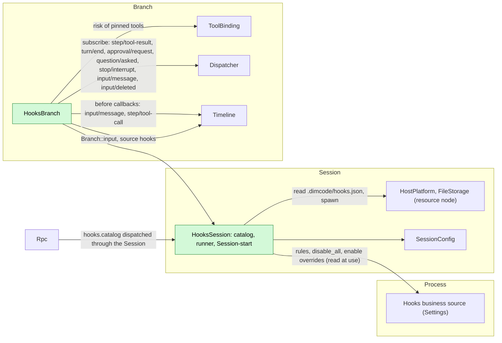
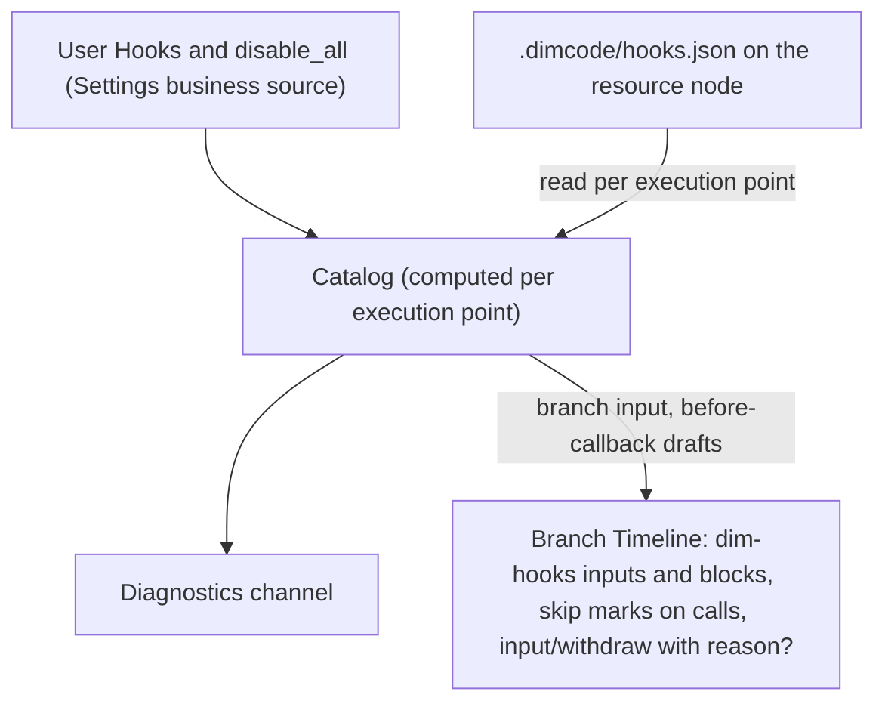
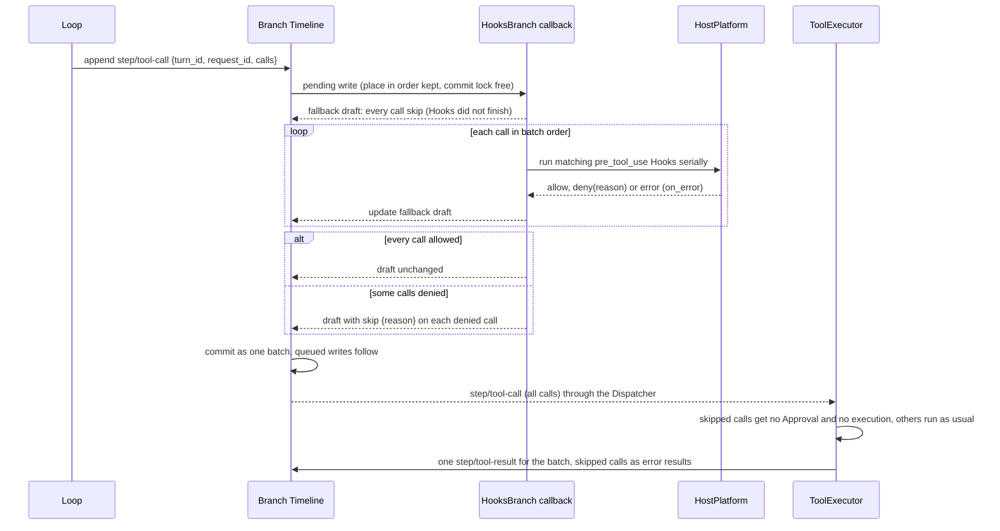
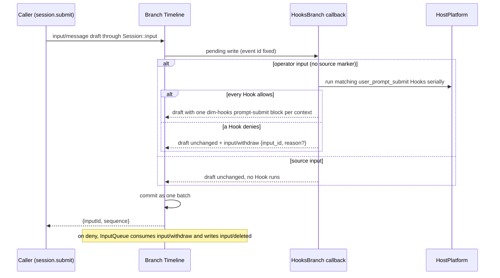
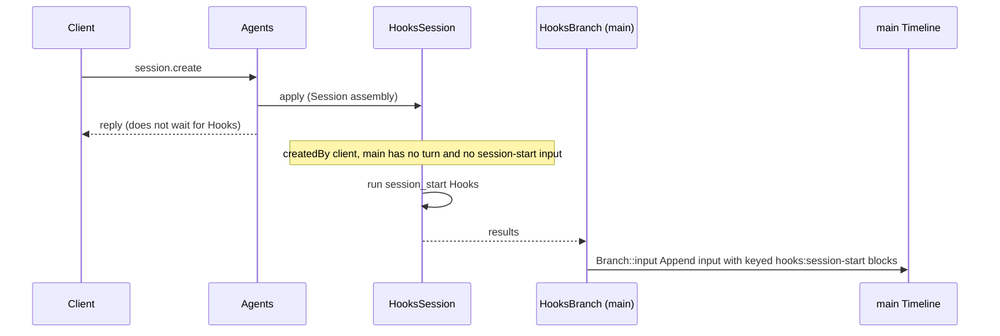
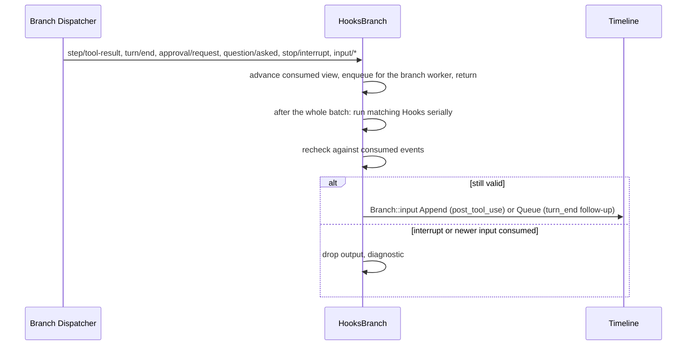
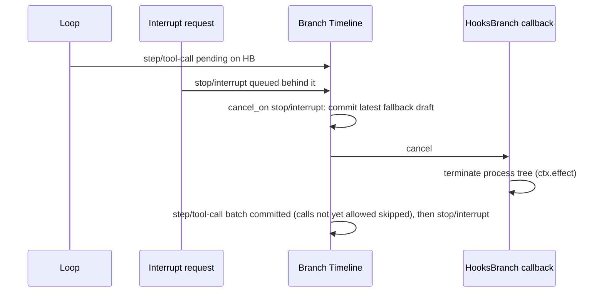

# Hooks

Status: To be designed. Overall design: [overview](../overview.md) (Hooks). Phase: P2 (user and project sources); plugin source after #3. Language: Rust. Scope: [ADR 002](../../adr/002-plugin-scope.md) (Session + branch).

> **To be designed.** This document is not authoritative and must not be implemented as written. Hooks is a cross-cutting mechanism needed for compatibility with third-party plugin systems (Claude, Codex, pi and others). It gets its own design and does not reuse existing infrastructure: the asynchronous Timeline before callback this document requires is withdrawn ([#21](https://github.com/arcships/dim/issues/21)), and so are the `skip` field and the other changes it asks of other plugins.

Hooks runs user-configured commands at fixed points of a Session's work. Its Session part holds the rules (read from business sources and the project file) and runs Session-start Hooks. Its branch part registers two asynchronous Timeline before callbacks (the runtime supplement in [overview Appendix B.1](../overview.md#b1-session-and-branch-capabilities)): on `input/message` for `user_prompt_submit` and on `step/tool-call` for `pre_tool_use`; it also runs post-tool, turn-end and notification Hooks from the branch Dispatcher. A callback never fails or blocks the write it holds. It edits the draft first (the generic per-call `skip` field of `step/tool-call`, or context blocks added to an operator input) and appends to the same batch only a command to an owner (`input/withdraw {input_id, reason?}` with the generic optional `reason` field). Both fields are changes to other plugins' contracts, listed in [overview Appendix B.1](../overview.md#b1-session-and-branch-capabilities) (Loop/ToolExecutor and InputQueue rows) and designed in [A.7](#a7-changes-to-other-plugins); the asynchronous before callback is a runtime requirement stated in [§9](#9-requirements-raised-to-mechanism-owners). Hooks declares no event and never writes another module's result event such as `step/tool-result` or `input/deleted`. Approval gets no change; ToolExecutor and InputQueue gain only the generic `skip` handling and `reason` field, which have no Hooks meaning; Loop keeps its pairing of calls and results, and like every writer it learns of a held commit through the Dispatcher (R1). Commands run through the Session's `HostPlatform` (its resource node); output enters context only as branch input with source `hooks`, as blocks added to an operator input, or as the error result ToolExecutor writes for a skipped call. Contracts are given in neutral form ([ADR 002 D5](../../adr/002-plugin-scope.md#d5-contracts-are-language-neutral)); the Rust binding is in Appendix G.

## 1. Structure



| Part | Scope | Depends on | Provides |
| --- | --- | --- | --- |
| `HooksSession` | Session (installed only when enabled) | Settings business source (`hooks` document); the Session's `HostPlatform` and `FileStorage`; `SessionConfig` | `sessionMethods` key `hooks` with `hooks.catalog`; Session-start Hook results for `main`; an internal catalog and command runner used by `HooksBranch` (not a contract) |
| `HooksBranch` | Branch | `HooksSession`'s runner; the branch Timeline (before callbacks), `Branch::input`, Dispatcher and ToolBinding | Before callbacks on `input/message` and `step/tool-call`, registered when the part loads and removed when it unloads |

Nothing collects Hooks: the callbacks are registrations on the branch Timeline and follow `HooksBranch`'s lifecycle, so no consumer depends on Hooks or names it.

**Reload.** Enabling, disabling or upgrading Hooks, or a Settings reload, reloads only the Hooks parts ([ADR 002 D3](../../adr/002-plugin-scope.md#d3-dependencies-follow-scope-rare-restarts-are-accepted)). A callback pending at unload cannot finish, so the runtime commits its latest fallback draft (Appendix A.4): a pending `step/tool-call` commits with every call not yet allowed marked `skip` (fail closed through the draft); a pending operator input commits unchanged (fail open). No write fails. Writes committed while `HooksBranch` is not loaded pass without Hooks; this window is accepted (A31) and confers no authority, because those calls still pass Approval and Permission. Editing rules, enable overrides or `disable_all` is business configuration and never reloads ([D4](../../adr/002-plugin-scope.md#d4-structural-configuration-and-business-configuration-are-separate)).

**Node.** On an offline resource node every `HostPlatform` or `FileStorage` call fails with `node_unavailable`; the Hooks parts and their dependents neither reload nor go Pending, and each execution point applies its error rule (Appendix C). This requires services imported over a rutis link to stay registered while the link is down and fail calls (requirement on [#5](https://github.com/arcships/dim/issues/5), stated in [ExternalAgent §9](ExternalAgent.md#9-requirements-raised-to-mechanism-owners)).

**Contracts depended on:** `sessionMethods` ([methods and tool contributions](../contracts/session-boundary.md)); asynchronous Timeline before callbacks (runtime supplement, [overview Appendix B.1](../overview.md#b1-session-and-branch-capabilities); requirement in [§9](#9-requirements-raised-to-mechanism-owners)); the `input/message`, `input/withdraw` (with the proposed `reason?` field, A.7) and `input/deleted` ([session access A.4](../contracts/session-access.md#a4-withdrawal)) data contracts; `step/tool-call` with the proposed per-call `skip` field (A.7); `step/tool-result` (read only); `Branch::input` for Hooks' own inputs; Session `HostPlatform` and `FileStorage` and branch ToolBinding (existing typed services); Settings business source. Hooks is Rust; exposing the typed services by name to non-Rust parts is issue [#4](https://github.com/arcships/dim/issues/4)'s work ([session access §9](../contracts/session-access.md#9-requirements-raised-to-mechanism-owners)). **Contracts defined here:** the Hook configuration format, the command protocol, `hooks.catalog`, source name `hooks` (marker `dim-hooks`, key namespace `hooks:`). Hooks declares no event.

## 2. Data and state



Hooks owns no `StateCell` and declares no event. The catalog is recomputed from its sources at each execution point (A6); follow-up counters and rechecks use only branch events Hooks has consumed through its Dispatcher subscription, each read after its whole atomic batch. Running processes live under `ctx.effect` and are never re-run after reload or restart.

## 3. Flows

### 3.1 Pre-tool before callback



The callback runs before Approval and Permission, so a call a Hook denies is never asked about or executed. A denied call stays in the batch (its input is never edited) and carries `skip {reason: "Hook <source>/<id>: <reason>"}`. ToolExecutor, consuming `step/tool-call`, does not admit or execute skipped calls and writes their error results, with `reason` as the error text, in its ordinary batch `step/tool-result`; Loop pairs them with their calls as usual. If every call is denied, every call is skipped and ToolExecutor's batch result carries only errors; there is no empty `calls` batch. A Hook error applies `on_error`, default `deny`. When no Hook matches, the callback returns at once and the draft is committed unchanged.

### 3.2 User prompt submit before callback



Only operator inputs (user content without a source marker) run Hooks, so inputs written by Hooks, Goal, Scheduler or Workflow never trigger them (A26). Allow with `context`: each context becomes a raw block with marker `<dim-hooks kind="prompt-submit">`, added after the draft's own raw blocks and before its user content; the user content is never edited. Deny: Hooks stops at the first deny, discards collected context, and appends to the input's batch `input/withdraw {input_id, reason?}` (InputQueue's command contract; `reason` is `Hook <source>/<id>: <reason>`, at most 2 KiB). The sequence is `input/message`, `input/withdraw`, then `input/deleted {input_id}` written by InputQueue: InputQueue decides adoption only after the whole batch is dispatched, so the same-batch withdraw always wins, the input is never applied and no turn starts. The caller's reply is the ordinary `{inputId, sequence}`; clients learn the outcome from these events on the Session broadcast and show the reason from `input/withdraw`. A Hook error applies `on_error`, default `allow` (A27). The caller dropping the call does not cancel the pending write, which commits per the callback's outcome.

### 3.3 Session start



Session start is fail open and runs only for `createdBy.kind = "client"` Sessions that have not started a turn (A24, A25). Its context reaches the next model request after it is written, which may follow the first user input.

### 3.4 Observation Hooks



The Dispatcher delivers branch events in order, so no event is skipped while the branch part is loaded; events dispatched during its reload are not run. The recheck reads only events Hooks has consumed, never the committed but unconsumed tail ([time-bus §4](../../architecture/rust-agent/time-bus.md)); a fact committed after the recheck is ordered after Hooks' write and settled by its owner.

## 4. Timing and conflicts



A pending callback holds every later write on its branch, including `stop/interrupt`. Both callbacks register `cancel_on: ["stop/interrupt"]`, so a queued interrupt ends the wait at once: the runtime commits the callback's latest fallback draft and cancels the callback, which terminates its processes (R1). Pre-tool: every call not yet allowed by all its Hooks is in the fallback draft as `skip {reason: "Tool was not executed: Hooks did not finish"}`; calls already allowed stay unmarked and settle by ToolExecutor's existing interrupt rule when the interrupt commits right after. Prompt submit: the fallback draft is the input unchanged, so the input commits before the interrupt without context blocks and remaining Hooks do not run.

| Scenario | Sequence order | Outcome | Owner |
| --- | --- | --- | --- |
| Turn-end follow-up vs user input or Goal continuation | `turn/end` < other input consumed < Hook write | Recheck sees the input: not written. If the input is consumed only after the recheck, both Queue inputs stand | Hooks, InputQueue |
| Follow-up withdrawn by the user | follow-up < `input/deleted` | Never applied; not counted | InputQueue, Hooks |
| Prompt-submit Hook denies | input + `input/withdraw {reason}` in one batch < `input/deleted` | Never applied; no turn starts; clients see the reason | Hooks, InputQueue |
| Write on the branch while a callback is pending | pending < queued | Queued writes commit after it, in order; branch latency up to the Hooks' run time (accepted) | Timeline |
| `stop/interrupt` while a callback is pending | pending < interrupt | Fallback draft committed, callback cancelled; see above | Hooks, Timeline |
| Hooks or Settings reload | — | Only Hooks parts reload; a pending callback cannot finish and the fallback draft commits (pre-tool: calls not yet allowed skipped; prompt submit: input unchanged) | Timeline, Lifecycle |
| Resource node offline | per call | `node_unavailable`, no reload: pre-tool and prompt-submit → `on_error`; observation → diagnostic | Hooks |

Full table: Appendix B.

## 5. Context mapping

| Source | What the model sees | Placement | Compaction | Child branches |
| --- | --- | --- | --- | --- |
| `session_start` | One Append input: marker `<dim-hooks kind="session-start">`, one raw block per Hook with key `hooks:session-start/<source>/<id>` | Next model request after the write | Latest block per key replayed | Inherited while live at the cut |
| `user_prompt_submit` `context` | Raw block in the operator input, marker `<dim-hooks kind="prompt-submit">`, one per Hook | Before the input's user content, at its consumed position | Summary only | As inputs |
| `user_prompt_submit` deny | Nothing: the input is deleted before it is applied, so it never enters context; `input/withdraw` is not projected | — | — | — |
| `pre_tool_use` deny | Error text `Hook <source>/<id>: <reason>` in ToolExecutor's batch `step/tool-result` for the skipped call | Paired with its call by `call_id`, before the next model request | Summary only | If before the cut |
| `post_tool_use` | Append input, marker `kind="post-tool" call_id tool` | Next model request of the turn | Summary only | As inputs |
| `turn_end` | Queue input, marker `kind="follow-up"` | Start of the turn it drives | Summary only | As inputs |
| `notification` | Nothing | — | — | — |

Non-interactive Sessions: identical, except that Session-start Hooks run only for `createdBy.kind = "client"`. The model never sees configuration, commands, exit codes, stderr (except a pre-tool deny reason), diagnostics or a withdraw reason.

## 6. Interfaces (summary)

| Interface | Kind | Purpose |
| --- | --- | --- |
| Before callback on `step/tool-call` | Branch Timeline registration by `HooksBranch` | Run `pre_tool_use` Hooks; mark denied calls `skip` |
| Before callback on `input/message` | Branch Timeline registration by `HooksBranch` | Run `user_prompt_submit` Hooks; add context blocks, or append `input/withdraw {input_id, reason?}` |
| `hooks.catalog {sessionId}` | `sessionMethods` key `hooks` | Effective Hooks of the Session with their enabled state |
| `hooks` document | Settings business source | User Hooks, `disable_all`, enable overrides (project Hooks keyed by workspace and Hook ID) |
| Configuration format, command protocol | Defined here | Appendix A |

## 7. Security

Hook commands run because of user or project configuration, not because of an agent decision, so they are outside Approval and Permission, which govern only agent-initiated actions such as tool calls ([overview §6.4](../overview.md#64-conventions)). Every enabled Hook runs, whatever its source (user, project file or plugin); its security is that of the configuration that declares it, and there is no approval, grant or fingerprint. Enabling and disabling (per Hook, per source through `disable_all`) is plain configuration. Project Hooks start disabled ([ADR 003 D3](../../adr/003-approval-scope.md#d3-enablement-is-ordinary-configuration-project-entries-start-disabled)): the project file's own `enabled` field cannot enable them; their enabled state lives in the user's `hooks` document keyed by workspace and Hook ID and is changed only by the user through the Settings operation (A9). Opening a repository with `.dimcode/hooks.json` runs none of its Hooks until the user enables them; after that, edits to an enabled Hook's command in the file take effect at the next execution point without asking again (ADR 003 D4). Commands run on the Session's resource node with that node's isolation applied by HostPlatform; a Hook is not admitted by Permission and never widens authority: no outcome admits a call that Permission or the user denied, and no output edits tool input or the user's input text (a pre-tool Hook only marks a call skipped; a prompt-submit Hook only adds attributed blocks or withdraws the input). The callbacks change only the draft they hold and append only `input/withdraw` to its batch (A.4). stdin may contain prompts and tool input; diagnostics keep only Hook id, exit status, duration and a bounded stderr excerpt.

## 8. Rule check

Rules: [principles §1 and §4](../../architecture/rust-agent/principles.md), [ADR 002](../../adr/002-plugin-scope.md) D1–D5.

| Rule | How this document complies |
| --- | --- |
| §4.1 Command events for others' state | A denied prompt is the command `input/withdraw` that InputQueue decides on; a denied call is a `skip` mark in the draft that ToolExecutor consumes and settles itself, so Hooks writes no result of another owner. |
| §4.2 No recall after handoff | Hooks acts only before commit, before the handoff to InputQueue or ToolExecutor; after commit it only appends new inputs. |
| §4.3 Only before callbacks, never block | Both interventions are before callbacks that edit the draft first and append only a command; when a callback cannot finish the fallback draft commits, so no write fails. |
| §4.4 No business meaning in core | `skip {reason}` and the withdraw `reason?` are generic fields any producer may set (A.7); Timeline's asynchronous callback carries no Hooks semantics. |
| §4.5 Read the whole batch | Observation Hooks and rechecks act only after the whole batch of the triggering event is consumed. |
| §4.6 Context only from handed-off events | A deleted prompt never enters context; a skip reason enters only through ToolExecutor's own `step/tool-result`; Hooks' inputs and context blocks enter after adoption. |
| §4.7 Public events and services only | Hooks reads only public event contracts and typed services in `Deps`; it never reads another plugin's state. |
| §4.8 Requirements to mechanism owners | The asynchronous before callback is raised in §9 with its five items; the `skip` field and the withdraw `reason?` are changes to other plugins in [overview Appendix B.1](../overview.md#b1-session-and-branch-capabilities); #4 and #5 are linked. |
| §4.9 Only facts later decisions use enter the Timeline | Hooks adds no event; `skip` is read by ToolExecutor's decision, and the withdraw `reason?` is a descriptive field on the required command `input/withdraw` (rule 9 allows such fields), read by clients and by AcpGateway's refusal decision; execution records stay in diagnostics. |
| §1 Capability and App Server boundary | Session and branch parts are Capabilities in their own crate; App Server only assembles them and dispatches `hooks.catalog`. |
| ADR 002 D1 Scope | Rules and runner are Session state; callbacks and observation follow the branch. |
| ADR 002 D2 No wiring modules | No module collects Hooks; callbacks are Timeline registrations owned by `HooksBranch`. |
| ADR 002 D3 Scope dependencies | Parts depend only on their own or enclosing scope; a reload commits fallback drafts and is accepted. |
| ADR 002 D4 Configuration | Rules, enable overrides and `disable_all` are business data read at use and never reload. |
| ADR 002 D5 Language-neutral contracts | Configuration, command protocol and method are neutral; Rust binding is Appendix G. |

## 9. Requirements raised to mechanism owners

This section lists only requirements to the runtime or rutis. This document states the five items for asynchronous before callbacks; other documents link here. The `skip` field and the withdraw `reason?` are changes to other plugins (Loop/ToolExecutor, InputQueue): they are listed in [overview Appendix B.1](../overview.md#b1-session-and-branch-capabilities) and designed in [A.7](#a7-changes-to-other-plugins).

### R1. Asynchronous Timeline before callbacks (runtime)

| Item | Content |
| --- | --- |
| Blocked by | Principles §4 rule 3 (intervene before a write only through before callbacks, never block it); today `Timeline::before` runs synchronously inside the commit lock, so a callback cannot await a Hook command that runs for seconds. |
| Existing mechanisms considered | Synchronous `before` (holds the commit lock for every write of the branch); a Dispatcher subscription (runs after commit, after the handoff of rule 2); a check in Rpc, ToolExecutor or Approval (forbidden by rules 3 and 4). |
| Generic capability | An asynchronous before callback registered on a branch Timeline for event kinds. A matching write keeps its place in order (event id fixed) and later writes on the branch queue behind it; the commit lock is not held while awaiting. The fallback draft is the only failure model: when the callback starts it returns a fallback draft synchronously and keeps it up to date while running; it ends by returning a transformed draft and events to append to the same atomic batch (only commands to an event's owner or events the registrant declares itself; appended events are not matched again). Options: `timeout`; `cancel_on` (event kinds whose queued write ends the wait). When the callback cannot finish (timeout, fault, registrant unload, branch close, or a queued write of a kind in `cancel_on`) the runtime commits the latest fallback draft and cancels the callback; there is no registration-time error option, and a write never fails because of a callback. A callback never awaits a write on its own branch. The writer's append returns on acceptance and the commit is reported through the Dispatcher, so synchronous writers such as Loop do not block. |
| Effect on sequence, batch, interrupt, reload | Sequence: order of acceptance is kept. Batch: appended events join the held write's batch; the fallback draft appends nothing. Interrupt: a queued `stop/interrupt` waits behind the callback; `cancel_on` ends that wait at once with the fallback draft. Reload: a pending callback commits its fallback; writes while the registrant is unloaded commit without it. Writers: an append no longer implies the event is committed; writers that need the committed event learn it through the Dispatcher. |
| Owner and issue | Runtime (Timeline); no issue filed yet; listed in overview §8 P0. |

Linked: #4 named typed services ([session access §9](../contracts/session-access.md#9-requirements-raised-to-mechanism-owners)); #5 imported services while a link is down ([ExternalAgent §9](ExternalAgent.md#9-requirements-raised-to-mechanism-owners)).

## Appendix A. Interface details

### A.1 Configuration format

One JSON document per source, the same shape for user configuration (`hooks` document in Settings) and the project file `.dimcode/hooks.json`:

```json
{
  "version": 1,
  "hooks": [
    { "id": "guard-writes", "event": "pre_tool_use", "tools": ["write", "edit", "mcp__fs__*"],
      "command": "./scripts/guard.sh", "timeout_ms": 10000, "on_error": "deny", "enabled": true }
  ]
}
```

| Field | Type | Rule |
| --- | --- | --- |
| `version` | `1` | Other values make the document invalid (A1) |
| `id` | string `[a-z0-9][a-z0-9_-]{0,63}` | Unique within the source; identity of enable overrides |
| `event` | `session_start` \| `user_prompt_submit` \| `pre_tool_use` \| `post_tool_use` \| `turn_end` \| `notification` | Required (A4) |
| `tools` | string array of name patterns | Only `pre_tool_use`/`post_tool_use`; `*` matches any run of characters; omitted = all tools (A5) |
| `kinds` | array of `approval` \| `question` | Only `notification`; omitted = both (A15) |
| `command` | string | Run by the node's execution shell with `SessionConfig.cwd` as working directory (A8) |
| `timeout_ms` | integer 100..=600000 | Default 60000 (A10) |
| `on_error` | `allow` \| `deny` | Only `pre_tool_use` (default `deny`) and `user_prompt_submit` (default `allow`, A27) |
| `enabled` | bool | Default `true` in user configuration; ignored in the project file, whose Hooks start disabled (A9) |

Invalid entries are listed `invalid` and never run. Order per event: user, project, plugin sources, then document order (A12).

### A.2 Command protocol

| Channel | Content |
| --- | --- |
| stdin | One UTF-8 JSON object, then EOF: `{version: 1, event, hook_id, source, session_id, branch_id, cwd, resource_node, ...event fields}` |
| Environment | HostPlatform's filtered base environment plus `DIM_HOOK_EVENT`, `DIM_SESSION_ID`, `DIM_PROJECT_DIR` (A8) |
| Exit 0 | Success. stdout empty or one JSON object (`decision`, `reason`, `context`, `follow_up`); non-JSON stdout is `context` for `session_start`, otherwise ignored (A13) |
| Exit 2 | Deny for `pre_tool_use` and `user_prompt_submit`, stderr (first 2 KiB) as reason; error for other events |
| Other exit, signal, timeout, spawn failure, stdout over 64 KiB, `node_unavailable` | Error: diagnostics; `pre_tool_use` and `user_prompt_submit` apply `on_error` |

Event fields: `user_prompt_submit {mode, text}` (text blocks of the input joined by newlines; images are not passed); `pre_tool_use {turn_id, request_id, call_id, tool, input, risk}` (`risk` from the request's pinned tool declarations in ToolBinding); `post_tool_use {turn_id, call_id, tool, input, result: {text, is_error}}`; `turn_end {turn_id, outcome, reason}`; `notification {kind, approval_id | call_id, tool?}`; `session_start {}`. `context` and `follow_up` are each at most 16 KiB (A13).

### A.3 Outcomes

| Event | Allow / success | Deny | `context` | `follow_up` |
| --- | --- | --- | --- | --- |
| `session_start` | — | Not supported | Keyed raw block, Append | Ignored |
| `user_prompt_submit` | Next Hook | Withdraw the input: `input/withdraw {input_id, reason?: "Hook <source>/<id>: <reason>"}` | Raw block added to the input (A28) | Ignored |
| `pre_tool_use` | Next Hook | Mark the call `skip {reason: "Hook <source>/<id>: <reason>"}`; ToolExecutor writes the error result | Ignored (A16) | Ignored |
| `post_tool_use` | — | Not supported | Append input after the batch | Ignored |
| `turn_end` | — | Not supported | Ignored | Queue input, bounded (A14) |
| `notification` | — | Not supported | Ignored | Ignored |

Outcomes are recorded in public event contracts: a tool deny is a `skip` mark in the committed `step/tool-call`, settled by ToolExecutor's batch `step/tool-result`; an input deny is `input/withdraw` with `reason` (InputQueue then writes `input/deleted`); context and follow-ups are `input/message` blocks with marker `dim-hooks`; execution records go to diagnostics.

### A.4 Before callbacks

| Callback | Registration (runtime options) | Draft read | Fallback draft | Writes on allow | Writes on deny |
| --- | --- | --- | --- | --- | --- |
| `pre_tool_use` | `step/tool-call` on the branch; `timeout` none (each Hook is bounded by its `timeout_ms`); `cancel_on: ["stop/interrupt"]` | `{turn_id, request_id, calls: [{id, name, input}]}` | Every call not yet allowed marked `skip {reason: "Tool was not executed: Hooks did not finish"}`; updated after each call is decided (allowed calls lose the mark, denied calls carry their deny reason) | Draft unchanged | Draft with `skip {reason}` on each denied call |
| `user_prompt_submit` | `input/message` on the branch; `timeout` none; `cancel_on: ["stop/interrupt"]` | `{submission_id?, user, blocks, mode}`; source marker in `blocks` | Draft unchanged | Draft with `dim-hooks kind="prompt-submit"` raw blocks added after its own blocks, or unchanged | Draft unchanged + `input/withdraw {input_id, reason?}` |

| Rule | Content |
| --- | --- |
| Timeout and errors | Every Hook run is bounded by its `timeout_ms`; a timeout, non-zero exit other than 2, spawn failure or `node_unavailable` is a Hook error mapped by the Hook's own `on_error` configuration field (A.1) inside the callback, so the callback itself returns normally. The runtime's fallback draft applies only when the callback cannot finish (registrant unload, branch close, callback fault, `cancel_on`): pre-tool fails closed through the draft, prompt submit fails open (A27). No write ever fails |
| Cancellation | `cancel_on` `stop/interrupt` (§4), branch close or unload: the runtime commits the latest fallback draft and cancels the callback; its processes are terminated by `ctx.effect` |
| Order | Calls in batch order; per call or input, Hooks in A12 order, serially; the first deny ends that call's or input's run |
| Ownership | Hooks declares no event. It edits the held draft and appends only the command `input/withdraw`; `step/tool-call`, `input/withdraw` and `input/deleted` follow their owners' data contracts |

### A.5 `hooks.catalog`

Served through `sessionMethods` key `hooks` (`describe(): async -> MethodDecl[]`, `call(MethodCall): async -> MethodReply`); declared method `hooks.catalog`, not mutating.

| Parameters | Result |
| --- | --- |
| `{sessionId}` | Hooks per source: `id`, `source`, `event`, matcher, `command`, `enabled`, `invalid?`; global `disabled` |

Enabling, disabling and `disable_all` are typed Settings operations on the `hooks` document, made only by the user (A9); there is no approval.

### A.6 Mechanics

| Path | Mechanics |
| --- | --- |
| Pre-tool | `HooksBranch`'s `step/tool-call` callback runs while the write is pending, before ToolExecutor and Approval see the batch; it sets the fallback draft at start and returns the transformed draft (A.4) |
| Prompt submit | `HooksBranch`'s `input/message` callback runs while the write is pending, for operator inputs only; it returns the draft with blocks, or the draft with `input/withdraw` appended (A.4) |
| Session start | `HooksSession`'s apply starts the run when eligible (A25); `HooksBranch` on `main` writes one Append input with marker and keyed blocks through `Branch::input`; Agents never waits |
| Observation | `HooksBranch` subscribes on the branch Dispatcher to the triggering events and to `stop/interrupt`, `input/message`, `input/deleted`; the handler advances its consumed view, enqueues and returns; one worker per branch runs serially in sequence order after each triggering event's whole batch (A20) |
| Recheck | Before writing, against consumed events only: for `post_tool_use`, no `stop/interrupt` after the tool result; for `turn_end`, no `stop/interrupt` and no non-deleted `input/message` after the `turn/end`, and fewer than 3 consecutive non-deleted follow-ups (A14) |
| Reload or restart | Running processes terminated by `ctx.effect`; no Hook is re-run; pending follow-ups are lost |

### A.7 Changes to other plugins

These two contract changes are listed in [overview Appendix B.1](../overview.md#b1-session-and-branch-capabilities) (Loop/ToolExecutor and InputQueue rows); this section records why Hooks needs them, in the same five items.

#### Per-call `skip` field in `step/tool-call` (Loop/ToolExecutor change)

| Item | Content |
| --- | --- |
| Blocked by | Principles §4 rule 1 (Hooks must not write ToolExecutor's `step/tool-result`), rule 3 (a callback cannot block the write) and rule 4 (no Hooks-specific handling in core); today `ToolCall` is `{id, name, input}` with `deny_unknown_fields`, so a draft cannot say "do not run this call". |
| Existing mechanisms considered | Removing the call and writing a `step/tool-result` without `call_event_id` (Hooks writes another owner's result, rule 1); failing the write (rule 3); an empty `calls` batch (special handling in Loop and ToolExecutor); a deny through Approval or Permission (needs a Hooks hook into Approval, rule 4); a Hooks command event consumed by ToolExecutor (core consumes a plugin event, rule 4). |
| Generic capability | Optional per-call field `skip: {reason: string}` in the `step/tool-call` data contract, settable by any before callback on `step/tool-call`. ToolExecutor, consuming the batch, does not ask Approval or Permission for a skipped call and does not execute it; it writes the call's error result with `reason` as the error text in its normal batch `step/tool-result`. Absent field = ordinary call. Loop pairs results with calls as today. |
| Effect on sequence, batch, interrupt, reload | Sequence: no new event. Batch: skipped results are part of the one batch result. Interrupt: a skipped call needs no execution, so its result is its skip reason in every case. Reload and recovery: `skip` is a committed fact, so a reloaded ToolExecutor settles skipped calls the same way and never runs them. Persistence: additive optional field; frozen fixtures stay valid; because older readers reject unknown fields, the owner records an explicit format decision. |
| Owner and issue | Loop/ToolExecutor owner (runtime, `dim-agent-types` and `dim-agent-capabilities`); no issue filed yet. |

#### Optional `reason` field in `input/withdraw` (InputQueue change)

| Item | Content |
| --- | --- |
| Blocked by | Principles §4 rules 1, 4 and 9: clients need the reason a prompt was withdrawn, Hooks may not declare a result-like event of its own for InputQueue's decision, and rule 9 limits new events while allowing descriptive fields on a required event. The later decision that uses it is AcpGateway's: a withdrawal with a `reason` in the input's own batch reports `refusal` ([AcpGateway](AcpGateway.md)). |
| Existing mechanisms considered | A Hooks-declared event carrying the reason (an extra event that only restates InputQueue's outcome); a wire error to the caller (a before callback cannot fail the write, rule 3); diagnostics (not visible to clients). |
| Generic capability | Optional string `reason?` (at most 2 KiB) in the `input/withdraw` command contract, written by any producer and carried for clients; InputQueue ignores it for its decision. |
| Effect on sequence, batch, interrupt, reload | None: the command and `input/deleted` keep their order and batch rules; the field is not projected into model context. |
| Owner and issue | InputQueue owner (runtime); contract in [session access A.4](../contracts/session-access.md#a4-withdrawal); no issue filed yet. |

## Appendix B. Full conflict table

| Scenario | Sequence order | Outcome | Owner |
| --- | --- | --- | --- |
| `stop/interrupt` queued while a pre-tool callback is pending | pending `step/tool-call` < interrupt | Fallback draft committed: calls not yet allowed marked `skip` `Tool was not executed: Hooks did not finish`; callback cancelled, tree terminated; allowed calls settled by ToolExecutor's interrupt rule | Hooks, ToolExecutor |
| Interrupt committed before the calls are written | interrupt < model output end | Loop writes no `step/tool-call`; no Hook runs | Loop |
| Branch close or `HooksBranch` unload while a pre-tool callback is pending | — | Fallback draft committed: calls not yet allowed are skipped; ToolExecutor writes their error results (or the closed Timeline rejects the write) | Timeline, ToolExecutor |
| Pre-tool deny for one call of a batch | one batch | Call marked `skip`; others run; ToolExecutor's one batch result includes the skipped call's error | Hooks, ToolExecutor |
| Pre-tool deny for every call of a batch | one batch | Every call skipped; batch result of errors only; next model request sees them | Hooks, ToolExecutor, Loop |
| Policy or user denial of an allowed call | after commit | Unchanged Approval path; Hooks already ran | Approval |
| Prompt-submit Hook denies | input + `input/withdraw {reason}` < `input/deleted` | Never applied; no turn; reply `{inputId, sequence}` | Hooks, InputQueue |
| Prompt-submit Hook allows with context | one batch | Blocks and user content in one `input/message` | Hooks |
| Caller drops a submission while its callback is pending | — | No effect: the write commits per the callback's outcome; the caller resolves it with `lookup` | Timeline |
| `stop/interrupt` queued while a prompt-submit callback is pending | pending input < interrupt | Fallback draft committed: the input unchanged; callback cancelled, running Hook terminated, remaining Hooks not run; then the interrupt; applied per InputQueue's interrupt rules | Hooks, InputQueue |
| Branch close or unload while a prompt-submit callback is pending | — | Fallback draft: the input is committed unchanged (or rejected by the closed Timeline) | Timeline |
| Two submissions on one branch | first pending < second | The second queues behind the first and runs its own callback after it; committed in order | Timeline, Hooks |
| Other writes on the branch while a callback is pending | pending < other | Queue behind it; branch latency bounded by the Hooks' `timeout_ms` (accepted) | Timeline |
| Source input (Goal, Hooks, Scheduler, Workflow) | — | Committed unchanged without running Hooks (A26) | Hooks |
| Withdrawn prompt and another client's `session.input.withdraw` | same-batch withdraw < later withdraw | Later command has no effect and writes nothing; reply `notHeld` | InputQueue |
| `post_tool_use` for a batch | `step/tool-result` | After the whole batch; one run per matching call; skipped calls run no post-tool Hook | Hooks |
| Post-tool context vs following interrupt | result < interrupt consumed < write | Not written | Hooks |
| Turn-end follow-up vs user input | `turn/end` < input consumed < write | Not written | Hooks |
| Turn-end follow-up vs Goal continuation | continuation consumed after the recheck | Both written; at most one extra turn each (accepted) | InputQueue |
| Follow-up or post-tool input withdrawn | input < `input/deleted` | Never applied; not counted | InputQueue, Hooks |
| Concurrent Steer/Queue/Append | Timeline order | Applied by mode in sequence order | InputQueue |
| Compaction | — | Session-start keyed blocks replayed; others via summary | History projection |
| Child branch cut between Hook input and consumption | input < cut < consumed | Child does not adopt it; not re-run | InputQueue |
| Child branch | — | Its own `HooksBranch` and callbacks | Hooks |
| Hook disabled or file edited while a Hook runs | — | Running process finishes; later executions follow the new state; an enabled project Hook's edited command runs without asking again (ADR 003 D4) | Hooks |
| Hooks or Settings reload | — | Only Hooks parts reload; pending callbacks commit their fallback drafts; writes and events in the window pass without Hooks (D3, A31) | Timeline, Lifecycle |
| Session restore or unload | — | Session start not re-run once a turn or session-start input exists (A25) | Hooks |
| Session created by launch, Collaboration or fork | `createdBy.kind` ≠ `"client"` | No Session start | Hooks |
| First user input before the Session-start write | input < Hooks Append | Context applies from the next model request | InputQueue |
| Resource node offline | — | Calls fail `node_unavailable`; no reload or Pending. Pre-tool and prompt-submit: `on_error`; project file unreadable → project Hooks skipped, diagnostic; observation and Session start: diagnostic | Hooks |
| Client detach | — | No effect | — |

## Appendix C. Errors and recovery

| Case | Result |
| --- | --- |
| Timeout | Tree terminated; error; `on_error` for `pre_tool_use` and `user_prompt_submit` |
| `node_unavailable` | As a Hook error; no reload |
| Invalid document | Marked invalid; none of its Hooks run |
| Append rejected (branch closed) | Output dropped; diagnostic |
| Callback cannot finish (unload, branch close, fault) | Runtime commits the latest fallback draft: pre-tool calls not yet allowed skipped, prompt submit unchanged |
| Cancellation (`cancel_on`, unload, branch close) | Runtime commits the fallback draft; tree terminated by `ctx.effect` |

## Appendix D. Acceptance

1. Each exit-code and stdout case of A.2 per event, including timeout and `on_error`.
2. Pre-tool deny in a three-call batch: the committed `step/tool-call` holds all three calls, the denied one with `skip {reason}`; no `approval/request` and no execution for it; ToolExecutor's one batch `step/tool-result` carries its error and the other two results; Hooks writes no `step/tool-result`. All three denied: all skipped, a batch result of errors, Loop continues.
3. `stop/interrupt` during a pre-tool Hook: the fallback draft commits at once with calls not yet allowed skipped (`Hooks did not finish`); the process is terminated; the interrupt commits right after the batch.
4. `HooksBranch` unload during a pre-tool Hook: the write commits with calls not yet allowed skipped; no write fails and the turn does not end `Failed` because of Hooks.
5. Project Hook in `.dimcode/hooks.json`: opening the workspace runs nothing and `hooks.catalog` lists it disabled; `enabled: true` in the file changes nothing; after the user enables it in user configuration it runs with no approval step; a later edit of its command in the file takes effect at the next execution point without asking; it stops when disabled; `hooks.catalog` shows no approval state.
6. Session-start context survives compaction; not run on restore or for launched, member or forked Sessions.
7. Post-tool context after a consumed interrupt is not written; follow-up stops at the limit, after consumed user input, and ignores deleted follow-ups.
8. Editing rules or `disable_all` takes effect at the next execution point without a reload.
9. Resource node offline: only that Session's Hooks fail with `node_unavailable`; no part reloads.
10. `user_prompt_submit`: exit 2 commits the input together with `input/withdraw {input_id, reason}` in one batch, InputQueue then writes `input/deleted`, and no turn starts; `context` arrives as a `dim-hooks kind="prompt-submit"` block in the same `input/message`; a timeout with default `on_error` commits the input; source inputs run no Hook; a write queued behind a pending callback commits after it in order.

## Appendix E. Assumptions

| # | Assumption | Basis | Effect if rejected |
| --- | --- | --- | --- |
| A1 | Versioned JSON document per source | Judgment | Format changes |
| A4 | Six events: session start, user prompt submit, pre/post tool, turn end, notification | ADR 002 scope; asynchronous before callbacks | Fewer events |
| A5 | Tool name patterns with `*` glob only | Judgment | Regex matching |
| A6 | Project file re-read at each execution point | Judgment | A watcher is needed |
| A8 | Node shell in Session cwd, base environment plus three variables, no `env` | Judgment | Env configuration with references |
| A9 | Enable overrides for project and plugin Hooks are Settings business data in user configuration; project Hooks start disabled and are enabled per workspace and Hook ID only by the user; enabling is plain configuration, unrelated to approval | [ADR 003](../../adr/003-approval-scope.md) D3; [overview §6.4](../overview.md#64-conventions) | Only user Hooks can be disabled individually |
| A10 | Default timeout 60 s, range 0.1–600 s | Judgment | Values change |
| A12 | Order: user, project, plugin, document order | Judgment | Other ordering |
| A13 | stdout JSON or plain text; 64 KiB stdout, 16 KiB per output | Judgment | Limits change |
| A14 | `turn_end` follow-up starts a turn, at most 3 consecutive | Goal precedent | No follow-up |
| A15 | Notification Hooks on `approval/request` and `question/asked` | Judgment | Other triggers |
| A16 | Pre-tool Hooks cannot inject context or modify input; they only mark a call skipped | Never widen authority | Input rewrite rules |
| A29 | Pre-tool Hooks run before Approval and Permission, at the commit of `step/tool-call` | Before-callback placement | Hooks would need a hook into Approval |
| A30 | A prompt deny is recorded as `input/withdraw {reason?}` (then `input/deleted`); callers get the ordinary reply, not an error | Existing withdrawal contract plus the `reason?` change (A.7) | A wire error code would be needed |
| A31 | Writes committed while `HooksBranch` is unloaded (reload, crash) pass without Hooks | Rare structural operation (D3); tool calls still pass Approval and Permission | A registration outliving its registrant would be needed from the runtime |
| A20 | Observation Hooks run serially per branch | Judgment | Injected order may differ |
| A24 | Session creation does not wait for Session-start Hooks; their context may follow the first input | Product decision | A blocking creation hook |
| A25 | Session start runs when `main` has no `turn/start` and no session-start input; a restore before the first turn may run it again | Judgment | A creation notice would be needed |
| A26 | `user_prompt_submit` runs only for operator inputs (user content, no source marker) on any branch | Avoids loops through source inputs | Source inputs would need their own matcher |
| A27 | `user_prompt_submit` errors default to `allow` | A broken Hook should not lock the user out | Fail closed by default |
| A28 | Prompt-submit context is unkeyed and survives compaction only through the summary | Judgment | Keyed blocks replayed like Session start |

## Appendix F. Open questions

| Question | Description |
| --- | --- |
| Plugin source | Reading plugin-provided Hooks from PluginManager's package content depends on [#3](https://github.com/arcships/dim/issues/3) |

## Appendix G. Rust binding

| Neutral | Rust |
| --- | --- |
| Before callbacks | `Timeline::before` asynchronous registration (proposed, R1) on the branch instance channel with keys `["step/tool-call"]` and `["input/message"]`, options `{timeout: None, cancel_on: ["stop/interrupt"]}`; the handler takes the `EventDraft` and a `CancellationToken`, returns the fallback draft synchronously, may update it, and finally returns the draft and appended `EventKind`s; there is no error option |
| `skip` | Proposed `Option<ToolCallSkip { reason: String }>` on `ToolCall` (A.7) |
| Withdraw `reason` | Proposed `Option<String>` on the `input/withdraw` data (A.7) |
| `sessionMethods` key `hooks` | `SessionMethodContribution(Arc<dyn MethodProvider>)` at `SessionScope::named_key::<SessionMethodContribution>("hooks")` |
| Callback cancellation | `CancellationToken` fired by `cancel_on`, branch close or unload |
| Internal runner | Session service `HooksRuntime`, private to Hooks |
| Session start, observation | `HooksSession::apply`; `HooksBranch` Dispatcher subscription; inputs through `Branch::input`; processes under `ctx.effect` |
