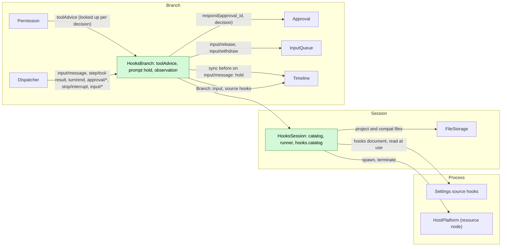
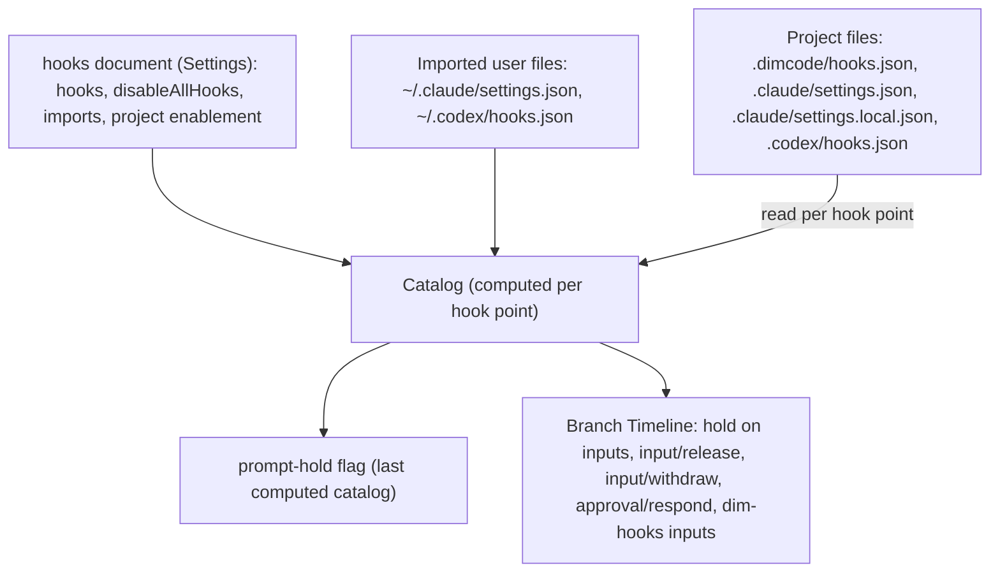
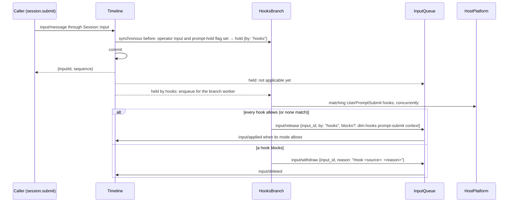
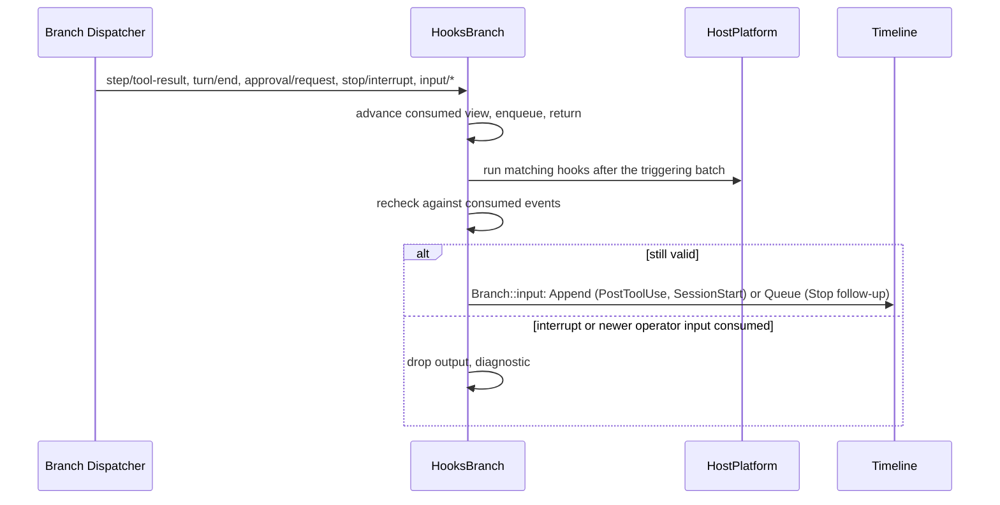

# Hooks

Status: Draft ([#143](https://github.com/arcships/dim/issues/143)). Overall design: [overview](../overview.md) (Hooks). Phase: M2 (user and project sources); plugin source after #3. Language: Rust. Scope: [ADR 002](../../adr/002-plugin-scope.md) (Session + branch).

Hooks runs user-configured commands (Claude Code, Codex and Dim hook documents) at fixed points of a Session's **business operations** and hands each command's decision to the owner of that operation. It is a third-party compatibility mechanism: hook documents written for Claude Code or Codex run unchanged where Dim has the same operation (Appendix G).

Hooks never hooks infrastructure. The withdrawn design ([#21](https://github.com/arcships/dim/issues/21)) made Timeline `before` callbacks asynchronous so a command could hold a write; that is not done. Timeline, Dispatcher, the event envelope and assembly are unchanged, and the one before callback Hooks registers is synchronous and only sets a field. Each hook point instead attaches to the business owner that already decides the operation, through that owner's public events or services:

| Hook point | Business operation | Owner that decides | How the hook's decision reaches the owner |
| --- | --- | --- | --- |
| `PreToolUse` | Admission of a tool call | Permission | Permission asks Hooks' `toolAdvice` service during its own decision (new generic advice port, A.6.1) |
| `PermissionRequest` | An approval question | Approval | Hooks answers through Approval's public `respond`, like a client (existing) |
| `UserPromptSubmit` | Adoption of an operator input | InputQueue | InputQueue holds the input; Hooks writes `input/release` or `input/withdraw` (new generic hold, A.6.2) |
| `PostToolUse`, `Stop`, `SessionStart` | Context after a tool result, after a turn, at Session start | InputQueue (inputs) | Hooks writes branch input with source `hooks` (existing) |
| `Notification` | An approval waiting for the user | — (observation) | Nothing reaches an owner (existing) |

Commands run through HostPlatform (the Session's resource node); a hook command waits only in Hooks' own tasks or in the owner's own task (Permission's decision runs in ToolExecutor's per-call admission task), never in a Dispatcher handler or under the commit lock. Contracts are given in neutral form ([ADR 002 D5](../../adr/002-plugin-scope.md#d5-contracts-are-language-neutral)); the Rust binding is Appendix H.

## 1. Structure



| Part | Scope | Depends on | Provides |
| --- | --- | --- | --- |
| `HooksSession` | Session (installed only when enabled) | Settings source `hooks`; the Session's `FileStorage` (project and compatibility files); HostPlatform; `SessionConfig` (`cwd`) | `sessionMethods` key `hooks` with `hooks.catalog`; a private catalog and command runner used by `HooksBranch` |
| `HooksBranch` | Branch | `HooksSession`'s runner; branch `Timeline` (one synchronous before callback), `Dispatcher`, `Approval`, InputQueue's branch input service, `Branch::input` | Branch service `toolAdvice` (key `hooks`) consumed by Permission; prompt holds and their settlement; observation hooks |

Permission looks `toolAdvice` up on each decision and does not depend on Hooks ([ADR 002 D3](../../adr/002-plugin-scope.md#d3-dependencies-follow-scope-and-point-from-extensions-to-the-core)): without Hooks it decides as today. InputQueue holds only inputs whose draft carries `hold`, which only a registered before callback sets; without Hooks nothing is held.

**Reload.** Enabling, disabling or upgrading Hooks reloads only the Hooks parts (D3). Before `HooksBranch`'s services are removed it settles its accepted work (AGENTS rule 8): running commands are terminated, and every input it holds is released or withdrawn by the `onError` of the hooks that were running (A.5). Calls whose advice was pending see the advice call dropped and Permission decides without it; approvals it was answering stay with the user. Writes while Hooks is not loaded pass without Hooks (A14). Editing hook documents, enablement or `disableAllHooks` is business configuration, read at the next hook point, and never reloads ([D4](../../adr/002-plugin-scope.md#d4-structural-configuration-and-business-configuration-are-separate)).

**Node.** On an offline resource node, spawning and file reads fail with `node_unavailable`; each hook point treats that as a hook error (Appendix C).

**Contracts depended on:** Permission's decision and the proposed `toolAdvice` port (A.6.1); Approval's `respond` and the `approval/request`, `approval/respond`, `approval/cancelled` facts; the `input/message` contract with the proposed `hold` field and the proposed `input/release` command (A.6.2); `input/withdraw {input_id, reason?}` and `input/deleted` ([session access A.4](../contracts/session-access.md#a4-withdrawal)); `step/tool-result`, `turn/start`, `turn/end`, `stop/interrupt` (read only); source input conventions ([session access A.2](../contracts/session-access.md#a2-source-input-conventions)); synchronous `Timeline::before` (unchanged); `sessionMethods`; HostPlatform `build_process_spec` and process supervision; Settings business sources. **Contracts defined here:** the hook document format, the command protocol, the `toolAdvice` reply Hooks gives, `hooks.catalog`, source name `hooks` (marker `dim-hooks`, key namespace `hooks:`). Hooks declares no event.

## 2. Data and state



Hooks owns no `StateCell` and declares no event. The catalog is recomputed from its sources at each hook point (A6). The only cached value is one flag per Session, "some enabled `UserPromptSubmit` hook exists", kept from the last computed catalog and from Settings change notifications, because the synchronous before callback cannot read files (A15). Everything else Hooks decides from is a branch fact it consumed through its Dispatcher subscription: held inputs and their settlement, approval requests, tool results, turns and interrupts. So a reloaded `HooksBranch` rebuilds its open work (inputs it holds) from history; commands are side effects and are never re-run.

## 3. Flows

### 3.1 PreToolUse through Permission

```mermaid
sequenceDiagram
  participant TE as ToolExecutor (admission task)
  participant AP as Approval
  participant PM as Permission
  participant HB as HooksBranch toolAdvice
  participant HP as HostPlatform
  TE->>AP: admit(call_id, call, risk, batch cancel)
  AP->>PM: decide
  PM->>PM: policy and command rules
  alt policy Deny
    PM-->>AP: Deny (no advice asked)
  else Allow or Ask
    PM->>HB: advise {call_id, name, input, risk, decision}
    HB->>HP: matching PreToolUse hooks, concurrently
    HP-->>HB: deny / ask / no opinion / error (onError)
    HB-->>PM: {advice: none | ask | deny, reason?}
    PM-->>AP: Deny{reason} if deny; Ask if ask; else policy decision
  end
  AP->>AP: Ask: approval/request as today
  AP-->>TE: admitted or error result
```

The wait happens inside Permission's asynchronous decision, which already runs in ToolExecutor's per-call admission task and already awaits a host port (command rules). Nothing on the Timeline or Dispatcher waits. A hook can only tighten: `deny` makes Permission deny with `Hook <source>: <reason>` as the error text ToolExecutor writes in its batch `step/tool-result`; `ask` turns an Allow into an approval question. A hook cannot allow; loosening goes through `PermissionRequest` (§3.2), which is recorded as an `approval/respond` fact. Approval's recheck after a user response does not ask for advice again. An interrupt cancels the batch token, Permission drops the advice call, and Hooks terminates the commands.

### 3.2 PermissionRequest through Approval

```mermaid
sequenceDiagram
  participant AP as Approval
  participant TL as Timeline
  participant HB as HooksBranch
  participant HP as HostPlatform
  participant C as Client
  AP->>TL: approval/request {approval_id, call, reason}
  TL-->>HB: through the Dispatcher (handler enqueues, returns)
  TL-->>C: through the Session broadcast
  HB->>HP: matching PermissionRequest hooks
  alt a hook allows or denies
    HB->>AP: respond(approval_id, allow | deny)
    AP->>TL: approval/respond, consumed by Approval as from a client
  else no opinion, error or timeout
    HB->>HB: nothing; the user answers
  end
```

This uses Approval exactly as Rpc's `approval.respond` does. Approval decides: it accepts the first response it consumes, answers a later one `Unknown`, and rechecks policy after an allow. If the user answers first, or Approval writes `approval/cancelled` (interrupt, close), Hooks consumes that and terminates the commands. Clients see the request and then the hook's `approval/respond` like any other response.

### 3.3 UserPromptSubmit through InputQueue



The before callback is synchronous and does not wait: it only adds the generic `hold` field to an operator input's draft (user content, no source marker) when the flag says a prompt hook may apply. The command runs after commit in `HooksBranch`'s worker, serially per branch so releases follow submission order. Until the release or withdrawal, InputQueue does not apply the input and Queue inputs behind it wait; Loop never sees it. On release, InputQueue makes the input applicable by its mode as if it had arrived then, with the release blocks placed after the input's own raw blocks and before its user content. On block, the input is deleted before it is applied, so it never enters context; clients show the `input/withdraw` reason. A user withdrawal (`session.input.withdraw`) of a held input works as today; Hooks consumes the `input/deleted`, terminates the commands and writes nothing.

### 3.4 Observation and context hooks



`PostToolUse` runs per matching call of a `step/tool-result` batch and writes one Append input for the batch. `Stop` runs on `turn/end` with outcome `completed`; a block writes a Queue follow-up carrying the reason, at most 3 consecutive (A11). `SessionStart` runs once on `main` when its history has no `turn/start` and no session-start input; its Append input waits, as any idle Append does, for the first driving input. `Notification` runs on `approval/request` and writes nothing.

## 4. Timing and conflicts

| Scenario | Sequence order | Outcome | Owner |
| --- | --- | --- | --- |
| Interrupt while PreToolUse runs | batch cancelled | Permission drops advice; commands terminated; call settles as cancelled | ToolExecutor, Permission |
| User answers before a PermissionRequest hook | `approval/respond` (user) < hook's respond | Hook's respond gets `Unknown`; commands terminated when the user's response is consumed | Approval |
| Interrupt while a prompt is held | input (held) < `stop/interrupt` | Hooks withdraws the input (`Interrupted before Hooks finished`); no turn starts from it | Hooks, InputQueue |
| User withdraws a held prompt | input < `input/deleted` | Commands terminated; Hooks writes nothing | InputQueue |
| Queue input behind a held Queue input | held < later | Later waits; FIFO kept | InputQueue |
| Stop follow-up vs newer operator input | `turn/end` < input consumed < write | Follow-up not written | Hooks |
| Hooks reload while prompts are held | — | Settled before unload by `onError`; inputs written while unloaded are not held (A14) | Hooks, Lifecycle |
| Crash with a held prompt | — | Next `HooksBranch` load settles it by `onError`; if Hooks is never loaded again the user withdraws it (D3: crash is not designed around) | Hooks |
| Resource node offline | per call | `node_unavailable` = hook error → `onError` | Hooks |

Full table: Appendix B.

## 5. Context mapping

| Source | What the model sees | Placement | Compaction | Child branches |
| --- | --- | --- | --- | --- |
| `SessionStart` context | Append input, marker `<dim-hooks kind="session-start">`, keyed raw block `hooks:session-start/<source>/<n>` per hook | With the first driving input | Latest block per key replayed | Inherited while live at the cut |
| `UserPromptSubmit` context | Release blocks, marker `<dim-hooks kind="prompt-submit">`, one per hook | Inside the released input, before its user content | Summary only | As inputs |
| `UserPromptSubmit` block | Nothing: the input is deleted before it is applied | — | — | — |
| `PreToolUse` deny | Error text `Hook <source>: <reason>` in ToolExecutor's `step/tool-result` | Paired with the call | Summary only | If before the cut |
| `PermissionRequest` | Nothing beyond Approval's ordinary outcome | — | — | — |
| `PostToolUse` context or block reason | Append input, marker `kind="post-tool"` with `call_id` and `tool` | Next model request of the turn | Summary only | As inputs |
| `Stop` block reason | Queue input, marker `kind="follow-up"` | Start of the turn it drives | Summary only | As inputs |
| `Notification` | Nothing | — | — | — |

The model never sees hook configuration, commands, exit codes, diagnostics or a withdrawal reason.

## 6. Interfaces (summary)

| Interface | Kind | Purpose |
| --- | --- | --- |
| `toolAdvice` key `hooks` | Branch service provided by `HooksBranch`, looked up by Permission (A.6.1) | `PreToolUse` decision |
| Synchronous before on `input/message` | Branch Timeline registration (unchanged mechanism) | Sets `hold {by: "hooks"}` |
| `input/release`, `input/withdraw` | Commands to InputQueue through its branch input service | `UserPromptSubmit` outcome |
| `Approval.respond` | Existing branch service | `PermissionRequest` outcome |
| `hooks.catalog {sessionId}` | `sessionMethods` key `hooks` | Effective hooks and enablement (A.7) |
| `hooks` document | Settings source `hooks` | User hooks, imports, project enablement, `disableAllHooks` (A.1, A.2) |
| Hook document format, command protocol | Defined here | A.1, A.3 |

## 7. Security

Hook commands run because of configuration, not an agent decision, so they need no approval and run when enabled ([ADR 003](../../adr/003-approval-scope.md) D2). User hooks are enabled as the user writes them; other products' user files are read only when the user imports them. Project sources start disabled: a repository's `.dimcode/hooks.json`, `.claude/settings.json`, `.claude/settings.local.json` or `.codex/hooks.json` runs nothing until the user enables that source for that workspace in the user's `hooks` document (D3); the project file cannot enable itself. After enabling, edits in the file take effect at the next hook point (D4). There are no grants, fingerprints or trust prompts.

Hooks never widens agent authority. `PreToolUse` can only deny or turn an allow into a question; it never admits a call and never edits tool input. `PermissionRequest` answers a question Approval asked, through the same path as the user, and Approval still rechecks policy and records the answer as `approval/respond`. `UserPromptSubmit` only withdraws an input or adds attributed blocks; it never edits the user's text. A hook command itself runs with the host's isolation as applied by HostPlatform. stdin contains prompts and tool input; diagnostics keep only source, event, exit status, duration and a bounded stderr excerpt.

## 8. Rule check

Rules: [principles §1 and §4](../../architecture/rust-agent/principles.md), [ADR 002](../../adr/002-plugin-scope.md) D1–D5.

| Rule | How this document complies |
| --- | --- |
| §4.1 Command events for others' state | Hooks changes inputs only by `input/release` and `input/withdraw`, which InputQueue decides on; approvals only by Approval's `respond`; tool admission is decided by Permission from advice it asked for. Hooks writes no result of another owner. |
| §4.2 No recall after handoff | Prompt hooks act while InputQueue still holds the input, before `input/applied`; tool advice is part of admission, before execution; after a handoff Hooks only writes new inputs. |
| §4.3 Before callbacks only transform synchronously | The one before callback sets the generic `hold` field and returns; the command runs after commit in Hooks' own task. A field the draft could not express was asked of its owner (A.6.2). |
| §4.4 No business meaning in core | Timeline, Dispatcher and before are unchanged; `hold`/`input/release` and `toolAdvice` are generic capabilities of InputQueue and Permission with no Hooks semantics. |
| §4.5 Read the whole batch | Observation hooks and rechecks run after the whole triggering batch; `PostToolUse` writes one input per result batch. |
| §4.6 Context only from handed-off events | A blocked prompt is deleted before adoption; release blocks enter with the adopted input; deny reasons enter through ToolExecutor's result; other output enters as adopted Hooks inputs. |
| §4.7 Public events and services only | Hooks reads public events and calls `Approval.respond` and InputQueue's input service; Permission calls `toolAdvice` it looks up. No internal state is read. |
| §4.8 Infrastructure unchanged | No infrastructure change: none to Timeline, Dispatcher, envelope, assembly or facades. Needs from business owners are in A.6 in this rule's format. |
| §4.9 Only decision facts in the Timeline | Hooks adds no event; `hold` and `input/release` are read by InputQueue's adoption decision; `approval/respond` by Approval; diagnostics stay out. |
| §1 Capability and App Server boundary | Both parts are Capabilities in their own crate; App Server only assembles them and dispatches `hooks.catalog`. |
| ADR 002 D1 Scope | Catalog, runner and method follow the Session; advice, holds and observation follow the branch whose facts they use. |
| ADR 002 D2 No wiring modules | Hooks attaches to owners through their own ports; nothing collects or adapts Hooks. |
| ADR 002 D3 Dependencies | Hooks depends on core parts (Approval, InputQueue, Timeline); Permission looks advice up per call and works without Hooks. |
| ADR 002 D4 Configuration | Hook documents, imports and enablement are business data read at use; no reload. |
| ADR 002 D5 Language-neutral contracts | Document format, command protocol, `toolAdvice`, `input/release` and `hooks.catalog` are neutral; Rust binding is Appendix H. |

## 9. Requirements raised to mechanism owners

None to the runtime or rutis: Hooks needs no infrastructure change. It needs two generic capabilities from business owners, stated in A.6 in the five items of §4 rule 8 and listed in [overview Appendix B.1](../overview.md#b1-session-and-branch-capabilities):

- Permission: a tool-advice port consulted during its decision (A.6.1).
- InputQueue: a `hold` field on `input/message` and the `input/release` command, with history rendering release blocks (A.6.2).

## Appendix A. Interface details

### A.1 Hook document format

Every source uses the Claude Code / Codex shape: an object keyed by event name, each holding matcher groups with command handlers. The user's own document is the Settings source `hooks`, which also carries Dim's user-only fields.

```json
{
  "hooks": {
    "PreToolUse": [
      { "matcher": "write|edit|mcp__fs__.*",
        "hooks": [ { "type": "command", "command": "$DIM_PROJECT_DIR/scripts/guard.sh", "timeout": 10, "onError": "deny" } ] }
    ],
    "UserPromptSubmit": [ { "hooks": [ { "type": "command", "command": "~/bin/prompt-check" } ] } ]
  },
  "disableAllHooks": false,
  "imports": ["claude", "codex"],
  "projects": { "/Users/me/src/app": { "enabled": ["dimcode", "claude"] } }
}
```

| Field | Rule |
| --- | --- |
| `hooks.<Event>` | `SessionStart`, `UserPromptSubmit`, `PreToolUse`, `PermissionRequest`, `PostToolUse`, `Stop`, `Notification`. Other event names (from Claude or Codex) are listed `unsupported` and never run (Appendix G) |
| `matcher` | Tool events: a regular expression searched in the tool name or its compatibility alias (G.2), unanchored as in Claude; empty, absent or `*` matches all. `SessionStart`: `startup` or absent. `Notification`: `permission_prompt` or absent. Ignored for `UserPromptSubmit` and `Stop`. An invalid expression makes the group `invalid` |
| `hooks[].type` | `command`. Other types (`prompt`, `agent`, `http` in Claude) are `unsupported` |
| `hooks[].command` | Run by the node's execution shell with `SessionConfig.cwd` as working directory |
| `hooks[].timeout` | Seconds, 1..=600, default 60 |
| `hooks[].onError` | Dim extension: `allow` (default) or `deny`; what an error, timeout or cancellation means (A.5). Ignored by Claude and Codex |
| `disableAllHooks` | User document only (also honored in Claude files): no hook runs from any source |
| `imports` | User document only: which other products' user files to read: `claude` (`~/.claude/settings.json` key `hooks`), `codex` (`~/.codex/hooks.json`) |
| `projects.<workspace>.enabled` | User document only: project sources enabled for that workspace root: `dimcode`, `claude`, `codex` |

### A.2 Sources and order

| Source id | File | Enabled |
| --- | --- | --- |
| `user` | Settings source `hooks` | As written |
| `user:claude`, `user:codex` | `~/.claude/settings.json`, `~/.codex/hooks.json` | When listed in `imports` |
| `project:dimcode` | `<workspace>/.dimcode/hooks.json` | When enabled for the workspace |
| `project:claude` | `<workspace>/.claude/settings.json` and `.claude/settings.local.json` (key `hooks`) | When enabled for the workspace |
| `project:codex` | `<workspace>/.codex/hooks.json` | When enabled for the workspace |
| `plugin:<id>` | A plugin package's hook document | After #3 (Appendix F) |

Catalog order is the table order, then document order. Handlers with identical `command` strings at one hook point run once (Claude dedup). Files are read through the Session's FileStorage at each hook point; a missing file is empty, an unreadable or invalid one is listed `invalid` with a diagnostic and none of its hooks run.

### A.3 Command protocol

| Channel | Content |
| --- | --- |
| stdin | One UTF-8 JSON object, then EOF. Common: `hook_event_name`, `session_id`, `cwd`, `permission_mode` (Dim preset), plus Dim fields `branch_id`, `dim_source` |
| Environment | HostPlatform's base environment plus `DIM_PROJECT_DIR`, `DIM_HOOK_EVENT`, `DIM_SESSION_ID`; hooks from `claude` sources also get `CLAUDE_PROJECT_DIR` |
| Exit 0 | stdout empty, one JSON object (A.4), or plain text (context for `SessionStart` and `UserPromptSubmit`, otherwise ignored) |
| Exit 2 | Blocking result for the event (A.4); stderr (first 2 KiB) is the reason |
| Other exit, signal, timeout, spawn failure, stdout over 64 KiB, `node_unavailable` | Error: diagnostic, then the handler's `onError` (A.5) |

Event fields:

| Event | stdin fields |
| --- | --- |
| `PreToolUse` | `tool_name`, `tool_input`, `tool_use_id`, `dim_tool_name`, `risk`, `permission_decision` (`allow` or `ask`: Permission's own) |
| `PermissionRequest` | `tool_name`, `tool_input`, `dim_tool_name`, `approval_id`, `reason` |
| `PostToolUse` | `tool_name`, `tool_input`, `tool_use_id`, `dim_tool_name`, `tool_response: {content, is_error}` |
| `UserPromptSubmit` | `prompt` (text blocks joined by newlines; images not passed), `mode` |
| `Stop` | `stop_hook_active` (the turn was driven by a Hooks follow-up), `turn_id` |
| `SessionStart` | `source: "startup"` |
| `Notification` | `notification_type: "permission_prompt"`, `message` |

`tool_name` is the compatibility alias for hooks from `claude` and `codex` sources when one exists (G.2), otherwise the Dim name; `tool_input` is Dim's input.

### A.4 Outcomes

| Event | stdout JSON read | Exit 2 | Result |
| --- | --- | --- | --- |
| `PreToolUse` | `hookSpecificOutput.permissionDecision` (`deny`, `ask`, `allow`) with `permissionDecisionReason`; legacy `decision: "block"` | deny | `deny` → advice deny; `ask` → advice ask; `allow` → no opinion (G.3) |
| `PermissionRequest` | `hookSpecificOutput.decision.behavior` (`allow`, `deny`) | deny | `respond(allow)` / `respond(deny)`; none → nothing |
| `UserPromptSubmit` | `decision: "block"` with `reason`; `hookSpecificOutput.additionalContext` | block | Block → withdraw; context → release block |
| `PostToolUse` | `decision: "block"` with `reason`; `hookSpecificOutput.additionalContext` | stderr as context | Append input |
| `Stop` | `decision: "block"` with `reason` | stderr as reason | Queue follow-up |
| `SessionStart` | `hookSpecificOutput.additionalContext` | error | Keyed Append block |
| `Notification` | — | error | — |

Context and reasons are each at most 16 KiB. Fields Dim does not support (`updatedInput`, `continue`, `stopReason`, `suppressOutput`, `systemMessage`) are ignored with a diagnostic.

### A.5 Concurrency, combination, timeouts and failure

| Item | Rule |
| --- | --- |
| Concurrency | The matching handlers of one hook point run concurrently (as in Claude); results are combined in catalog order, so the outcome does not depend on finishing order. Prompt hooks are serialized per branch across inputs |
| `PreToolUse` | Any deny → deny (reason of the first deny in catalog order; remaining handlers are terminated once a deny is known); else any ask → ask; else no opinion |
| `PermissionRequest` | Any deny → deny; else any allow → allow; else nothing |
| `UserPromptSubmit` | Any block → withdraw (first reason); else release with each context as one block, in catalog order |
| `PostToolUse`, `Stop` | All outputs in catalog order in one input |
| Timeout | Per handler `timeout`; the process tree is terminated |
| Error | Error, timeout and cancellation are mapped by the handler's `onError`: `allow` = no opinion (`PreToolUse`), nothing (`PermissionRequest`), release without its context (`UserPromptSubmit`); `deny` = deny, deny, withdraw with `Hook <source> did not finish`. Observation hooks: diagnostic only |
| Cancellation | `PreToolUse`: Permission drops the advice call (batch cancelled, branch closing). `PermissionRequest`: the request is answered or `approval/cancelled` is consumed. `UserPromptSubmit`: a consumed `stop/interrupt` withdraws the input (`Interrupted before Hooks finished`), a consumed `input/deleted` ends it silently. Unload: `onError` settlement (§1). Processes always end through `ctx.effect` |

### A.6 Changes to other plugins

#### A.6.1 Tool advice in Permission

| Item | Content |
| --- | --- |
| Blocked by | §4 rule 3 forbids waiting in a before callback, and rule 8 keeps Timeline unchanged, so a `PreToolUse` command cannot hold `step/tool-call`. Rule 7 forbids deciding for Permission. Permission is the owner of "may this call run" for every call, including calls its preset allows without asking, and today asks only its command-rules port. |
| Existing mechanisms considered | Async before on `step/tool-call` (withdrawn, #21); a Dispatcher subscription to `step/tool-call` (runs after the handoff to ToolExecutor, races execution, rule 2); answering `approval/request` (only exists for calls that already ask); `CommandRulesHost` (one port bound by the profile, only for `execute_process` commands). |
| Generic capability | During `decide`, after policy and command rules and only when the result is not Deny, Permission looks up the branch services `toolAdvice` (any number, by key) and calls each: `advise {call_id, name, input, risk, decision: "allow" \| "ask"}` → `{advice: "none" \| "ask" \| "deny", reason?}` (async; cancellation = Permission drops the call). Any deny → `Deny {reason}`; else any ask → `Ask {reason}`; else Permission's own decision. A provider error counts as `none`. Approval's recheck after a response does not ask again. ToolExecutor passes the call id through `admit` so advice can name the call. No business meaning: any plugin may provide advice; advice can never allow. |
| Effect on sequence, batch, interrupt, reload | Sequence and batch: no new event; a denied call's error text is in ToolExecutor's existing batch result. Interrupt: the batch token cancels `decide` and so the advice call. Reload: a provider unloading mid-call drops the call (`none`); Permission without providers decides as today. Latency of a call's admission grows by the advice time. |
| Owner and issue | Permission and ToolExecutor/Approval (`dim-agent-capabilities`); no issue filed yet. |

#### A.6.2 Input hold and release in InputQueue

| Item | Content |
| --- | --- |
| Blocked by | §4 rule 3 (a before callback cannot wait for a command) and rule 2 (once InputQueue writes `input/applied`, the input belongs to Loop). Today InputQueue applies a Steer, Append or idle Queue input in the same Dispatcher step that consumes it, so a `UserPromptSubmit` command that runs after commit is always too late, and `input/withdraw` after the fact is unreliable. |
| Existing mechanisms considered | Async before (withdrawn, #21); a check at the Rpc entry (rule 3: entries validate shape and authorization only); `input/withdraw` plus re-submission of the user's content as a new input (changes the caller's input id and makes the user's text a Hooks input); context as a separate Append or Queue input (lands in the wrong turn for a Queue input written while a turn runs). |
| Generic capability | (1) `input/message` gains optional `hold: {by: string}`, set only by a branch before callback (inputs arriving from outside with `hold` are rejected at the boundary). A held input stays in InputQueue unapplied and counts as waiting for Queue order. (2) New command `input/release {input_id, by, blocks?}`: if InputQueue holds the input with the same `by`, it becomes applicable by its mode as if it had just arrived, and `blocks` (raw blocks, no keys) are part of the input, after its own raw blocks and before its user content; otherwise nothing is written. `input/withdraw` of a held input deletes it as today. (3) History rendering folds release blocks into the input it renders. No business meaning: any before-callback registrant may hold an input and must release or withdraw it. |
| Effect on sequence, batch, interrupt, reload | Sequence: adoption of a held input moves to the release's sequence; inputs behind a held Queue input wait. Batch: release and withdraw are single commands. Interrupt: InputQueue's interrupt rules are unchanged; a held input is still held (its holder decides, Hooks withdraws). Reload: hold and release are facts, so a rebuilt InputQueue holds exactly the unreleased inputs. Persistence: an additive field and a new command event; frozen fixtures stay valid; older readers reject both, so the owner records a format decision. |
| Owner and issue | InputQueue and history projection (`dim-agent-types`, `dim-agent-capabilities`); contract in [session access A.4](../contracts/session-access.md#a4-withdrawal); no issue filed yet. |

### A.7 `hooks.catalog`

Served through `sessionMethods` key `hooks`; not mutating.

| Parameters | Result |
| --- | --- |
| `{sessionId}` | Per source: `source`, `path?`, `enabled`, `state` (`ok`, `missing`, `invalid` with message); per handler: `event`, `matcher`, `command`, `timeout`, `onError`, `state` (`ok`, `unsupported`, `invalid`); global `disableAllHooks` |

Enabling project sources, imports and `disableAllHooks` are fields of the user's `hooks` document, written by the user through `settings.update` (S8b). Hooks has no tool or method that writes configuration.

## Appendix B. Full conflict table

| Scenario | Sequence order | Outcome | Owner |
| --- | --- | --- | --- |
| PreToolUse deny for one call of a batch | one batch | That call's admission fails with the hook reason; others run; one batch result | Permission, ToolExecutor |
| PreToolUse ask under a permissive preset | — | `approval/request`; the user (or a PermissionRequest hook) answers | Approval |
| PreToolUse on a call policy denies | — | No advice asked, no hook runs | Permission |
| Interrupt during PreToolUse | batch cancelled | Advice dropped, tree terminated, call cancelled | ToolExecutor |
| Policy tightened while an approved call is rechecked | after `approval/respond` | Recheck decides; no advice asked again | Approval, Permission |
| PermissionRequest hook allows, user denies later | hook respond < user respond | Hook's answer stands; user's gets `Unknown` | Approval |
| `approval/cancelled` during PermissionRequest | — | Commands terminated, nothing written | Approval, Hooks |
| PermissionRequest in a non-interactive Session | — | Same; a hook may answer what no user would | Approval |
| Prompt blocked | held input < `input/withdraw {reason}` < `input/deleted` | Never applied; no turn | Hooks, InputQueue |
| Prompt allowed with context | held < `input/release {blocks}` < `input/applied` | One adopted input with blocks before user content | InputQueue |
| No prompt hook matches after a hold (stale flag) | held < `input/release` | Released at once without blocks | Hooks |
| Prompt-hold flag stale the other way (hook just enabled) | — | First input not held; later inputs are (A15) | Hooks |
| Steer held while a turn runs | held < release | Steer applied at release, at the next boundary | InputQueue |
| Two prompts on one branch | first < second | Hooks runs them serially; releases in order | Hooks |
| Interrupt while held | held < `stop/interrupt` | Withdrawn; then InputQueue's interrupt rules | Hooks, InputQueue |
| User withdraws while held | held < `input/deleted` | Commands terminated; nothing written | InputQueue |
| Release for an input not held (late) | deleted < release | InputQueue writes nothing | InputQueue |
| Source input (Goal, Hooks, Scheduler, Workflow) | — | Not held; no prompt hook | Hooks |
| PostToolUse output vs following interrupt | result < interrupt consumed < write | Not written | Hooks |
| Stop follow-up vs user input | `turn/end` < input consumed < write | Not written | Hooks |
| Stop follow-up limit | 3 consecutive follow-ups | No further follow-up; diagnostic | Hooks |
| Stop follow-up vs Goal continuation | both after `turn/end` | Both Queue inputs stand, in order | InputQueue |
| Child branch | — | Its own `HooksBranch`; held inputs are branch facts and are not inherited unapplied | Hooks |
| Compaction | — | Session-start keyed blocks replayed; others through the summary | History projection |
| Hooks or Settings reload | — | Hooks parts settle holds and reload; document edits never reload | Lifecycle, Hooks |
| Hooks disabled while prompts are held | — | Settled by `onError` before unload | Hooks |
| Session restore before the first turn | — | `SessionStart` runs again if no session-start input was written | Hooks |
| Session fork | copied turns | No `SessionStart` | Hooks |
| Resource node offline | — | Hook errors → `onError`; files unreadable → those sources `invalid` | Hooks |
| Client detach | — | No effect | — |

## Appendix C. Errors and recovery

| Case | Result |
| --- | --- |
| Timeout, spawn failure, bad exit, oversized output, `node_unavailable` | Hook error → `onError` (A.5); diagnostic |
| Invalid document or matcher | Listed `invalid`; none of its hooks run |
| Unsupported event or handler type | Listed `unsupported`; never runs |
| Branch input rejected (branch closed) | Output dropped; diagnostic |
| `Approval.respond` returns `Unknown` or `Closed` | Ignored |
| Unload with held inputs | Settled by `onError` before services are removed |
| Load with unsettled holds (after a crash) | Settled by `onError` at activation; commands are not re-run |

## Appendix D. Acceptance

1. Each exit-code and stdout case of A.3/A.4 per event, including timeout and `onError`.
2. Under a full-access preset, a `PreToolUse` deny for one call of three: no `approval/request`, no execution of that call, its error text in the one batch `step/tool-result`; Hooks writes no `step/tool-result`.
3. `PreToolUse` ask under a full-access preset produces an ordinary `approval/request`; a hook `allow` changes nothing.
4. A `PermissionRequest` hook allow writes `approval/respond` through Approval and the call runs after the policy recheck; a user answer first makes the hook's answer `Unknown`.
5. `UserPromptSubmit` block: the committed input carries `hold`, followed by `input/withdraw {reason}` and `input/deleted`; no turn starts. Allow with context: `input/release {blocks}` then `input/applied`, and the model request has the blocks before the user text. A Queue input written after a held one is applied after it.
6. Interrupt during a prompt hook withdraws the input; a user withdrawal ends the command and Hooks writes nothing.
7. Disabling Hooks while a prompt is held settles it by `onError`; no input stays held.
8. A repository with `.claude/settings.json` hooks runs nothing until the user enables `claude` for that workspace; a later edit of the file takes effect at the next hook point without asking.
9. A Claude `PreToolUse` hook with matcher `Bash` runs for `execute_process` and reads `tool_input.command`.
10. Timeline, Dispatcher and the synchronous before mechanism are unchanged; no write waits for a hook command.

## Appendix E. Assumptions

| # | Assumption | Basis | Effect if rejected |
| --- | --- | --- | --- |
| A1 | Claude/Codex document shape is the native format | Compatibility is the purpose; one parser | A Dim format plus a translator |
| A2 | Seven supported events (§ summary table) | Operations Dim has an owner for | Fewer or more points |
| A3 | `PreToolUse` cannot allow; loosening only through `PermissionRequest` | Never widen authority; answers are recorded as `approval/respond` | Permission would accept advice `allow` |
| A4 | `onError` defaults to `allow` | Claude treats non-2 exits as non-blocking | Fail closed by default |
| A5 | Handlers of one point run concurrently; combined in catalog order | Claude behavior; bounded latency | Serial, summed latency |
| A6 | Files are re-read at each hook point | No watcher needed | A watcher |
| A7 | Project enablement is per source and workspace, not per handler | Claude documents have no handler ids; ADR 003 D3 entry = source | Per-handler ids |
| A8 | Other products' user files are read only when imported | The user decides what runs | Read always |
| A9 | Tool aliases cover names only; `tool_input` stays Dim's | Input schemas differ | Per-tool input translation |
| A10 | Prompt hooks see text only | Images are not text | Pass attachment paths |
| A11 | At most 3 consecutive Stop follow-ups | Goal precedent; Claude's `stop_hook_active` | Unbounded loops |
| A12 | `SessionStart` runs only `startup`, for every Session whose `main` has no turn | Dim has no resume/clear/compact start | More sources |
| A13 | Interrupt during a held prompt withdraws it | The user cancels the pending submission | Release by `onError` |
| A14 | Writes while Hooks is unloaded pass without Hooks | Rare structural operation (D3); calls still pass Permission and Approval | Holds that outlive the holder |
| A15 | The before callback holds by a cached flag | It cannot read files; a stale `true` costs one release, a stale `false` misses one input after a file edit | Hold every operator input while Hooks is loaded |

## Appendix F. Open questions

| Question | Description |
| --- | --- |
| Plugin source | Hook documents in plugin packages (Claude `hooks/hooks.json`, `CLAUDE_PLUGIN_ROOT`) depend on [#3](https://github.com/arcships/dim/issues/3) and PluginManager; enabled with the plugin |
| PermissionRequest deny reason | `approval/respond` has no reason, so a hook deny shows Approval's generic text; a generic `reason?` on `approval/respond` would be Approval's change |
| AcpGateway refusal | AcpGateway reported `refusal` for a withdrawal in the input's own batch (withdrawn before-callback path); with holds, a Hooks withdrawal comes later, so AcpGateway needs another rule (for example: withdrawal of an input that carried `hold`) |
| pi extensions | pi hooks are TypeScript extension handlers, not commands; running them needs a TypeScript plugin runtime (#4), outside this mechanism |
| More events | Claude/Codex `SessionEnd`, `PreCompact`, `SubagentStop`, `PostToolUseFailure` need owners' facts (Session close, compaction, Collaboration) and are unsupported for now |
| Codex inline `[hooks]` | Hooks in Codex `config.toml` are not read; only `hooks.json` |

## Appendix G. Compatibility mapping

### G.1 Events

| Claude Code | Codex | Dim | Notes |
| --- | --- | --- | --- |
| `PreToolUse` | `PreToolUse` | `PreToolUse` → Permission advice | `allow` is no opinion; `updatedInput` ignored |
| `PermissionRequest` | — | `PermissionRequest` → Approval | `updatedInput`, `updatedPermissions` ignored |
| `PostToolUse` | `PostToolUse` | `PostToolUse` → Append input | Runs for errors too (`is_error`) |
| `UserPromptSubmit` | `UserPromptSubmit` | `UserPromptSubmit` → InputQueue hold | Text only |
| `Stop` | `Stop` | `Stop` → Queue follow-up | Bounded (A11) |
| `SessionStart` | `SessionStart` | `SessionStart` → keyed Append | `startup` only |
| `Notification` | — | `Notification` on `approval/request` | `permission_prompt` only |
| `SessionEnd`, `PreCompact`, `SubagentStart`, `SubagentStop`, `PostToolUseFailure`, others | — | Unsupported | Appendix F |
| `type: prompt`, `agent`, `http` handlers | — | Unsupported | Commands only |

### G.2 Tool name aliases (matchers and `tool_name` for `claude`/`codex` sources)

| Dim tool | Alias |
| --- | --- |
| `execute_process` | `Bash` |
| `read` | `Read` |
| `write` | `Write` |
| `edit` | `Edit` |
| `glob` | `Glob` |
| `grep` | `Grep` |
| MCP tools `mcp__<server>__<tool>` | Same name |

### G.3 Decisions

| Claude/Codex output | Dim effect |
| --- | --- |
| PreToolUse `deny` / `block` / exit 2 | Permission denies with the reason |
| PreToolUse `ask` | Approval question |
| PreToolUse `allow` / `approve` | No opinion; configure `PermissionRequest` to auto-approve |
| PermissionRequest `allow` / `deny` | `approval/respond` |
| UserPromptSubmit `block` / exit 2 | Input withdrawn, reason shown to clients |
| PostToolUse `block` | Reason given to the model as context |
| Stop `block` | Follow-up turn with the reason |
| `continue: false`, `stopReason` | Ignored (diagnostic) |

## Appendix H. Rust binding

| Neutral | Rust |
| --- | --- |
| `toolAdvice` | Proposed branch-scoped `ToolAdvice(Arc<dyn AdviseTool>)` at `BranchScope::named_key::<ToolAdvice>("hooks")`; `advise(ToolAdviceRequest, CancellationToken) -> HostFuture<ToolAdviceReply>`; Permission collects the keys per decision (A.6.1) |
| `hold`, `input/release` | Proposed `Option<InputHold { by: String }>` on `InputMessageData`; `EventKind::InputRelease(InputReleaseData { input_id, by, blocks: Vec<InputBlock> })`; release through InputQueue's branch input service next to withdrawal |
| Before callback | Existing synchronous `Timeline::before` on `["input/message"]` |
| `Approval.respond` | `Approval::respond(approval_id, ApprovalDecision)` from `InBranch<Approval>` |
| `sessionMethods` key `hooks` | `SessionMethodContribution` at `SessionScope::named_key::<SessionMethodContribution>("hooks")` |
| Runner | Session service `HooksRuntime`, private to Hooks; processes from `HostPlatform::build_process_spec` and `spawn`, owned by `ctx.effect` |
