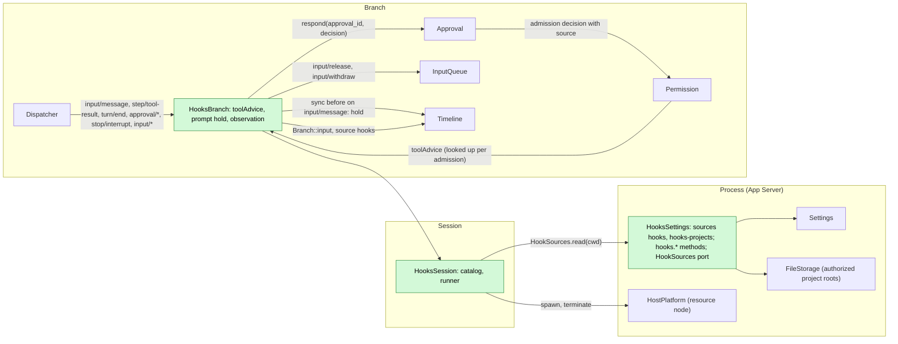
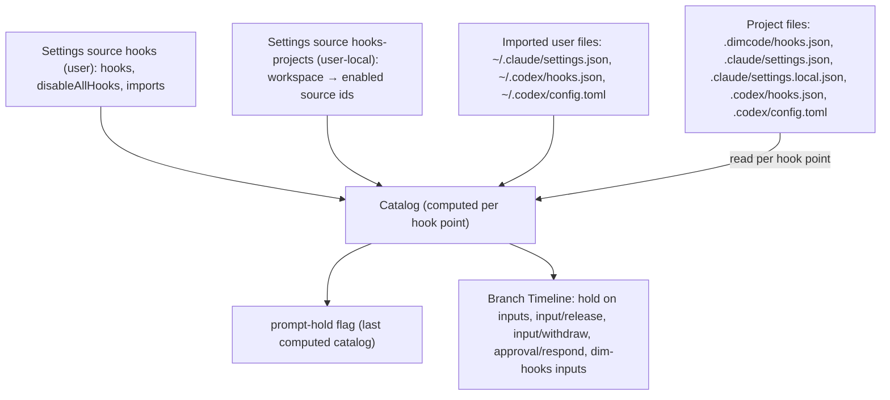
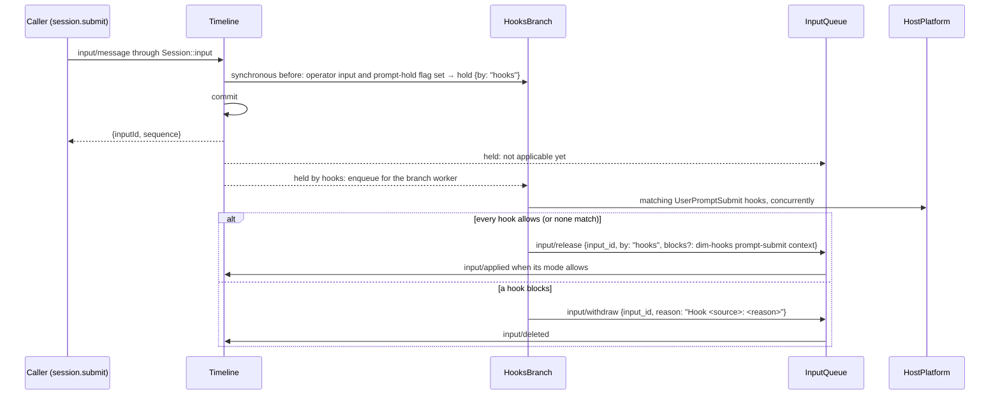
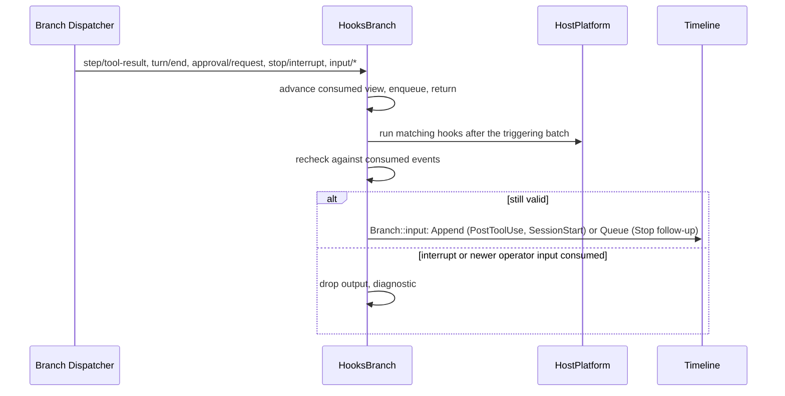

# Hooks

Status: Draft, Ready candidate ([#143](https://github.com/arcships/dim/issues/143)); what remains for Ready is §10. Overall design: [overview](../overview.md) (Hooks). Phase: M2 (user and project sources); plugin source after #3. Language: Rust. Scope: [ADR 002](../../adr/002-plugin-scope.md) (process + Session + branch).

Hooks runs user-configured commands (Claude Code, Codex and Dim hook documents) at fixed points of a Session's **business operations** and hands each command's decision to the owner of that operation. It is a third-party compatibility mechanism: hook documents written for Claude Code or Codex run unchanged where Dim has the same operation (Appendix G).

Hooks never hooks infrastructure. The withdrawn design ([#21](https://github.com/arcships/dim/issues/21)) made Timeline `before` callbacks asynchronous so a command could hold a write; that is not done. Timeline, Dispatcher, the event envelope and assembly are unchanged, and the one before callback Hooks registers is synchronous and only sets a field. Each hook point instead attaches to the business owner that already decides the operation, through that owner's public events or services:

| Hook point | Business operation | Owner that decides | How the hook's decision reaches the owner |
| --- | --- | --- | --- |
| `PreToolUse` | Admission of a tool call | Permission (called by Approval's `admit`) | Permission asks Hooks' `toolAdvice` service during the admission decision (new generic advice port, A.6.1) |
| `PermissionRequest` | An approval question | Approval | Hooks answers through Approval's public `respond`, like a client (existing) |
| `UserPromptSubmit` | Adoption of an operator input | InputQueue | InputQueue holds the input; Hooks writes `input/release` or `input/withdraw` (new generic hold, A.6.2) |
| `PostToolUse`, `PostToolUseFailure`, `Stop`, `SessionStart` | Context after a tool result, after a turn, at Session start | InputQueue (inputs) | Hooks writes branch input with source `hooks` (existing) |
| `Notification` | An approval waiting for the user | — (observation) | Nothing reaches an owner (existing) |

Commands run through HostPlatform (the Session's resource node); a hook command waits only in Hooks' own tasks or in the owner's own task (Permission's admission decision runs in ToolExecutor's per-call admission task), never in a Dispatcher handler or under the commit lock. Contracts are given in neutral form ([ADR 002 D5](../../adr/002-plugin-scope.md#d5-contracts-are-language-neutral)); the Rust binding is Appendix H.

### Owner check

Each hook point was checked against what its owner exposes on `main` today:

| Hook point | Owner today | Gap | Resolution |
| --- | --- | --- | --- |
| `PreToolUse` | `Approval::admit(AdmitCall {source, call}, risk, cancel)` calls `Permission::decide(call, risk, cancel)` for the admission and again for the recheck after an allow; `decide` already awaits the command-rules port; a Deny becomes `HostError::failed(reason)`, the error text of the call's result | `decide` has no way to ask anyone else, and does not receive `source` (the call id is only in `AdmitCall.source`); it cannot tell the admission from the recheck | A.6.1: Approval passes `source` to the admission decision only; Permission consults `toolAdvice` there. ToolExecutor needs no change |
| `PermissionRequest` | `approval/request {approval_id, source, call, reason}`; `Approval::respond(approval_id, decision)` accepts the first consumed response, else `Unknown`/`Cancelled`/`Closed`; `approval/respond {approval_id, decision}` has no reason | No reason on a deny | Usable as is; deny reason is §10 decision 7 |
| `UserPromptSubmit` | InputQueue applies a Steer, Append or idle Queue input in the Dispatcher step that consumes its `input/message`; `InputQueue::withdraw(InputWithdrawData {input_id, reason?})` (reason at most 2048 bytes) | No way to keep a committed input unapplied while a command runs | A.6.2 (hold and release) |
| `PostToolUse(Failure)` | `step/tool-result {turn_id, request_id, call_event_id?, results: [{call_id, result}]}`, `ToolResult.is_error` | None | Dispatcher subscription |
| `Stop` | `turn/end {turn_id, status: completed \| failed \| cancelled}` | None | Dispatcher subscription, `completed` only |
| `SessionStart` | No Session-start fact; `branch/start` and the absence of `turn/start` on `main` | None needed | Derived from history (§3.4) |
| `Notification` | `approval/request` | None | Dispatcher subscription |
| `PreCompact`, `PostCompact` | `context/compaction-start {trigger: threshold \| provider_output_budget_exhausted \| manual}` (the strategy is already called), `context/compaction {outcome}` | Blocking (`PreCompact` exit 2 in Claude) would need a compaction-admission port in ContextCompaction | Unsupported for now (§10 decision 6) |
| `SessionEnd` | Session close is lifecycle, not a Timeline fact; work must settle before services are removed (AGENTS rule 8) | A command at close would delay close | Unsupported |
| Configuration | Settings `BusinessDocument` sources with CAS; Rust sources have no generic client write (`settings.update` serves declared TypeScript sources only), so each Rust owner keeps its management methods (MCP: `mcp.catalog`, `mcp.set_enabled`, project enablement in `mcp-projects`); project roots are authorized by Settings and registered with FileStorage by the trusted host | The earlier draft wrote enablement through `settings.update` and read files through "the Session's FileStorage", neither of which exists | `HooksSettings` in App Server, mirroring MCP (§1, A.7) |

## 1. Structure



| Part | Scope | Depends on | Provides |
| --- | --- | --- | --- |
| `HooksSettings` | Process, App Server (where Settings and MCP's management live) | Settings (`BusinessDocument` sources `hooks`, `hooks-projects`); FileStorage (project roots Settings authorized; the user's `~/.claude`, `~/.codex` files) | Management methods `hooks.catalog`, `hooks.save`, `hooks.set_enabled` (A.7); the Session port `HookSources` that returns the effective sources for a `cwd` (A.2) |
| `HooksSession` | Session (installed only when enabled) | `HookSources`; HostPlatform; `SessionConfig.cwd` | A private catalog and command runner used by `HooksBranch` |
| `HooksBranch` | Branch | `HooksSession`'s runner; branch `Timeline` (one synchronous before callback), `Dispatcher`, `Approval`, InputQueue's branch input service, `Branch::input` | Branch service `toolAdvice` (key `hooks`) consumed by Permission; prompt holds and their settlement; observation hooks |

`HookSources` follows the existing host-port pattern of `CommandRulesHost` and `SkillSettingsHost`: the agent-side parts never name Settings, FileStorage or App Server. Permission looks `toolAdvice` up on each admission and does not depend on Hooks ([ADR 002 D3](../../adr/002-plugin-scope.md#d3-dependencies-follow-scope-and-point-from-extensions-to-the-core)): without Hooks it decides as today. InputQueue holds only inputs whose draft carries `hold`, which only a registered before callback sets; without Hooks nothing is held.

**Reload.** Enabling, disabling or upgrading Hooks reloads only the Hooks parts (D3). Before `HooksBranch`'s services are removed it settles its accepted work (AGENTS rule 8): running commands are terminated, and every input it holds is released or withdrawn by the `onFailure` of the hooks that were running (A.5). Calls whose advice was pending see the advice call dropped and Permission decides without it; approvals it was answering stay with the user. Writes while Hooks is not loaded pass without Hooks (A14). Editing hook documents, enablement or `disableAllHooks` is business configuration, read at the next hook point, and never reloads ([D4](../../adr/002-plugin-scope.md#d4-structural-configuration-and-business-configuration-are-separate)).

**Node.** On an offline resource node, spawning and file reads fail with `node_unavailable`; each hook point treats that as a hook failure (Appendix C).

**Contracts depended on:** `Approval::admit` and `AdmitCall.source`, `Permission::decide` and the proposed advice port (A.6.1); `Approval::respond` and the `approval/request`, `approval/respond`, `approval/cancelled` facts; the `input/message` contract with the proposed `hold` field and the proposed `input/release` command (A.6.2); `input/withdraw {input_id, reason?}` and `input/deleted` ([session access A.4](../contracts/session-access.md#a4-withdrawal)); `step/tool-result`, `turn/start`, `turn/end`, `stop/interrupt` (read only); source input conventions ([session access A.2](../contracts/session-access.md#a2-source-input-conventions)); synchronous `Timeline::before` (unchanged); Settings `BusinessDocument` and `settings.changed`; App Server `ManagementMethods`; HostPlatform `build_process_spec` and process supervision. **Contracts defined here:** the hook document format, the command protocol, the `toolAdvice` reply Hooks gives, the `hooks.*` methods, `HookSources`, source name `hooks` (marker `dim-hooks`, key namespace `hooks:`). Hooks declares no event.

## 2. Data and state



Hooks owns no `StateCell` and declares no event. The catalog is recomputed from `HookSources` at each hook point (A6). The only cached value is one flag per Session, "some enabled `UserPromptSubmit` hook exists", kept from the last computed catalog and refreshed on `settings.changed` for `hooks` and `hooks-projects`, because the synchronous before callback cannot read files (A15). Everything else Hooks decides from is a branch fact it consumed through its Dispatcher subscription: held inputs and their settlement, approval requests, tool results, turns and interrupts. So a reloaded `HooksBranch` rebuilds its open work (inputs it holds) from history; commands are side effects and are never re-run.

## 3. Flows

### 3.1 PreToolUse through Permission

```mermaid
sequenceDiagram
  participant TE as ToolExecutor (admission task)
  participant AP as Approval
  participant PM as Permission
  participant HB as HooksBranch toolAdvice
  participant HP as HostPlatform
  TE->>AP: admit({source, call}, risk, batch cancel)
  AP->>PM: admission decision (call, source, risk)
  PM->>PM: policy and command rules
  alt policy Deny
    PM-->>AP: Deny (no advice asked)
  else Allow or Ask
    PM->>HB: advise {source, name, input, risk, decision}
    HB->>HP: matching PreToolUse hooks, concurrently
    HP-->>HB: deny / ask / no opinion / failure (onFailure)
    HB-->>PM: {advice: none | ask | deny, reason?}
    PM-->>AP: Deny{reason} if deny; Ask if ask; else policy decision
  end
  AP->>AP: Ask: approval/request as today
  AP-->>TE: admitted or error result
```

The wait happens inside Permission's asynchronous decision, which already runs in ToolExecutor's per-call admission task and already awaits a host port (command rules). Nothing on the Timeline or Dispatcher waits. A hook can only tighten: `deny` makes Permission deny with `Hook <source>: <reason>`, which Approval returns as `HostError::failed` and ToolExecutor writes as the call's error text in its batch `step/tool-result`; `ask` turns an Allow into an approval question. A hook cannot allow; loosening goes through `PermissionRequest` (§3.2), which is recorded as an `approval/respond` fact. Approval's recheck after a user response is a plain decision and does not ask for advice again. An interrupt cancels the batch token, Permission drops the advice call, and Hooks terminates the commands. A call whose tool is unknown to the request's binding fails before `admit` and runs no hook.

### 3.2 PermissionRequest through Approval

```mermaid
sequenceDiagram
  participant AP as Approval
  participant TL as Timeline
  participant HB as HooksBranch
  participant HP as HostPlatform
  participant C as Client
  AP->>TL: approval/request {approval_id, source, call, reason}
  TL-->>HB: through the Dispatcher (handler enqueues, returns)
  TL-->>C: through the Session broadcast
  HB->>HP: matching PermissionRequest hooks
  alt a hook allows or denies
    HB->>AP: respond(approval_id, allow | deny)
    AP->>TL: approval/respond, consumed by Approval as from a client
  else no opinion, failure or timeout
    HB->>HB: nothing; the user answers
  end
```

This uses Approval exactly as Rpc's `approval.respond` does. Approval decides: it accepts the first response it consumes, answers a later one `Unknown`, and rechecks policy after an allow. If the user answers first, or Approval writes `approval/cancelled` (interrupt, close), Hooks consumes that and terminates the commands. Clients see the request and then the hook's `approval/respond` like any other response.

### 3.3 UserPromptSubmit through InputQueue



The before callback is synchronous and does not wait: it only adds the generic `hold` field to an operator input's draft (user content, no source marker) when the flag says a prompt hook may apply. The command runs after commit in `HooksBranch`'s worker, serially per branch so releases follow submission order. Until the release or withdrawal, InputQueue does not apply the input and Queue inputs behind it wait; Loop never sees it. On release, InputQueue makes the input applicable by its mode as if it had arrived then, with the release blocks placed after the input's own raw blocks and before its user content. On block, the input is deleted before it is applied, so it never enters context; clients show the `input/withdraw` reason, which Hooks cuts to InputQueue's 2048-byte limit. A user withdrawal (`session.input.withdraw`) of a held input works as today; Hooks consumes the `input/deleted`, terminates the commands and writes nothing.

### 3.4 Observation and context hooks



`PostToolUse` runs per matching call of a `step/tool-result` batch whose result is not an error, `PostToolUseFailure` per matching call whose result has `is_error`; one batch writes one Append input. `Stop` runs on `turn/end` with status `completed`; a block writes a Queue follow-up carrying the reason, at most 3 consecutive (A11). `SessionStart` runs once on `main` when its history has no `turn/start` and no `hooks:session-start/*` keyed block; its Append input waits, as any idle Append does, for the first driving input. `Notification` runs on `approval/request` and writes nothing. Handlers with `async: true` run on any of these points and nothing waits for or reads their output.

## 4. Timing and conflicts

| Scenario | Sequence order | Outcome | Owner |
| --- | --- | --- | --- |
| Interrupt while PreToolUse runs | batch cancelled | Permission drops advice; commands terminated; call settles as cancelled | ToolExecutor, Permission |
| User answers before a PermissionRequest hook | `approval/respond` (user) < hook's respond | Hook's respond gets `Unknown`; commands terminated when the user's response is consumed | Approval |
| Interrupt while a prompt is held | input (held) < `stop/interrupt` | Hooks withdraws the input (`Interrupted before Hooks finished`); no turn starts from it | Hooks, InputQueue |
| User withdraws a held prompt | input < `input/deleted` | Commands terminated; Hooks writes nothing | InputQueue |
| Queue input behind a held Queue input | held < later | Later waits; FIFO kept | InputQueue |
| Stop follow-up vs newer operator input | `turn/end` < input consumed < write | Follow-up not written | Hooks |
| Hooks reload while prompts are held | — | Settled before unload by `onFailure`; inputs written while unloaded are not held (A14) | Hooks, Lifecycle |
| Crash with a held prompt | — | Next `HooksBranch` load settles it by `onFailure`; if Hooks is never loaded again the user withdraws it (D3: crash is not designed around) | Hooks |
| Resource node offline | per call | `node_unavailable` = hook failure → `onFailure` | Hooks |

Full table: Appendix B.

## 5. Context mapping

| Source | What the model sees | Placement | Compaction | Child branches |
| --- | --- | --- | --- | --- |
| `SessionStart` context | Append input, marker `<dim-hooks kind="session-start">`, keyed raw block `hooks:session-start/<source>/<n>` per hook | With the first driving input | Latest block per key replayed | Inherited while live at the cut |
| `UserPromptSubmit` context | Release blocks, marker `<dim-hooks kind="prompt-submit">`, one per hook | Inside the released input, before its user content | Summary only | As inputs |
| `UserPromptSubmit` block | Nothing: the input is deleted before it is applied | — | — | — |
| `PreToolUse` deny | Error text `Hook <source>: <reason>` in ToolExecutor's `step/tool-result` | Paired with the call | Summary only | If before the cut |
| `PermissionRequest` | Nothing beyond Approval's ordinary outcome | — | — | — |
| `PostToolUse(Failure)` context or block reason | Append input, marker `kind="post-tool"` with `call_id` and `tool` | Next model request of the turn | Summary only | As inputs |
| `Stop` block reason | Queue input, marker `kind="follow-up"` | Start of the turn it drives | Summary only | As inputs |
| `Notification`, `async` handlers | Nothing | — | — | — |

The model never sees hook configuration, commands, exit codes, diagnostics or a withdrawal reason.

## 6. Interfaces (summary)

| Interface | Kind | Purpose |
| --- | --- | --- |
| `toolAdvice` key `hooks` | Branch service provided by `HooksBranch`, looked up by Permission (A.6.1) | `PreToolUse` decision |
| Synchronous before on `input/message` | Branch Timeline registration (unchanged mechanism) | Sets `hold {by: "hooks"}` |
| `input/release`, `input/withdraw` | Commands to InputQueue through its branch input service | `UserPromptSubmit` outcome |
| `Approval.respond` | Existing branch service | `PermissionRequest` outcome |
| `hooks.catalog`, `hooks.save`, `hooks.set_enabled` | App Server management methods (key `hooks`), like `mcp.*` | Effective hooks, user document writes, project enablement (A.7) |
| `HookSources` | Session port bound by App Server | Effective sources for a `cwd` (A.2) |
| `hooks`, `hooks-projects` | Settings sources (`BusinessDocument`) | User document; user-local project enablement (A.1, A.2) |
| Hook document format, command protocol | Defined here | A.1, A.3 |

## 7. Security

Hook commands run because of configuration, not an agent decision, so they need no approval and run when enabled ([ADR 003](../../adr/003-approval-scope.md) D2). User hooks are enabled as the user writes them; other products' user files are read only when the user imports them. Project sources start disabled: a repository's `.dimcode/hooks.json`, `.claude/settings.json`, `.claude/settings.local.json`, `.codex/hooks.json` or `.codex/config.toml` runs nothing until the user enables that source for that workspace (D3); the enablement lives in the user-local source `hooks-projects`, written only through `hooks.set_enabled`, so a project file cannot enable itself. After enabling, edits in the file take effect at the next hook point (D4). There are no grants, fingerprints, hashes or trust prompts (unlike Codex's hash-bound trust; G.4).

Hooks never widens agent authority. `PreToolUse` can only deny or turn an allow into a question; it never admits a call and never edits tool input. `PermissionRequest` answers a question Approval asked, through the same path as the user, and Approval still rechecks policy and records the answer as `approval/respond`. `UserPromptSubmit` only withdraws an input or adds attributed blocks; it never edits the user's text. A hook command itself runs with the host's isolation as applied by HostPlatform. stdin contains prompts and tool input; diagnostics keep only source, event, exit status, duration and a bounded stderr excerpt.

## 8. Rule check

Rules: [principles §1 and §4](../../architecture/rust-agent/principles.md), [ADR 002](../../adr/002-plugin-scope.md) D1–D5, AGENTS rule 11 and [ADR 003](../../adr/003-approval-scope.md).

| Rule | How this document complies |
| --- | --- |
| §4.1 Command events for others' state | Hooks changes inputs only by `input/release` and `input/withdraw`, which InputQueue decides on; approvals only by Approval's `respond`; tool admission is decided by Permission from advice it asked for. Hooks writes no result of another owner. A release for an input no longer held writes nothing. |
| §4.2 No recall after handoff | Prompt hooks act while InputQueue still holds the input, before `input/applied`; tool advice is part of admission, before execution; after a handoff Hooks only writes new inputs. |
| §4.3 Before callbacks only transform synchronously | The one before callback sets the generic `hold` field from a cached flag and returns; the command runs after commit in Hooks' own task. The field the draft could not express was asked of its owner (A.6.2). |
| §4.4 No business meaning in core | Timeline, Dispatcher and before are unchanged; `hold`/`input/release` and `toolAdvice` are generic capabilities of InputQueue and Permission with no Hooks semantics. |
| §4.5 Read the whole batch | Observation hooks and rechecks run after the whole triggering batch; `PostToolUse(Failure)` writes one input per result batch. |
| §4.6 Context only from handed-off events | A blocked prompt is deleted before adoption; release blocks enter with the adopted input; deny reasons enter through ToolExecutor's result; other output enters as adopted Hooks inputs. |
| §4.7 Public events and services only | Hooks reads public events and calls `Approval.respond` and InputQueue's input service; Permission calls `toolAdvice` it looks up. No internal state is read. |
| §4.8 Infrastructure unchanged | No change to Timeline, Dispatcher, envelope, assembly, lifecycle or facades. Needs from business owners are in A.6 in this rule's format. |
| §4.9 Only decision facts in the Timeline | Hooks adds no event; `hold` and `input/release` are read by InputQueue's adoption decision; `approval/respond` by Approval; configuration lives in Settings, diagnostics in the catalog. |
| §1 Capability and App Server boundary | `HooksSession` and `HooksBranch` are Capabilities in their own crate; `HooksSettings` lives in App Server next to Settings, like MCP's management, and binds `HookSources`. |
| ADR 002 D1 Scope | Configuration and its methods are per host (process); catalog and runner follow the Session; advice, holds and observation follow the branch whose facts they use. |
| ADR 002 D2 No wiring modules | Hooks attaches to owners through their own ports; `HookSources` is the agent-side port of Hooks' own configuration owner, not an adapter for others. |
| ADR 002 D3 Dependencies | Hooks depends on core parts (Approval, InputQueue, Timeline); Permission looks advice up per admission and works without Hooks. |
| ADR 002 D4 Configuration | Hook documents, imports and enablement are business data in Settings sources and files, read at use; no reload. |
| ADR 002 D5 Language-neutral contracts | Document format, command protocol, `toolAdvice`, `input/release`, `HookSources` and `hooks.*` are neutral; Rust binding is Appendix H. |
| AGENTS 11 / ADR 003 | Hook commands need no approval and run when enabled; project sources start disabled and only the user-local `hooks-projects` enables them; Approval and Permission keep governing only tool calls. |

## 9. Requirements raised to mechanism owners

None to the runtime or rutis: Hooks needs no infrastructure change. It needs two generic capabilities from business owners, stated in A.6 in the five items of §4 rule 8 and listed in [overview Appendix B.1](../overview.md#b1-session-and-branch-capabilities):

- Permission and Approval: a tool-advice port consulted during the admission decision, with Approval passing the call's `source` (A.6.1).
- InputQueue and history projection: a `hold` field on `input/message` and the `input/release` command, with history rendering release blocks (A.6.2).

Not requirements: the Settings sources `hooks` and `hooks-projects` are additive `BusinessDocument` sources (existing mechanism, additive `user/<source>` rows in v13); the `hooks.*` methods use the existing `ManagementMethods`; HostPlatform's existing shell-form `build_process_spec` covers `command` (exec-form `args` is unsupported, Appendix G). The optional deny reason on `approval/respond` is a maintainer decision (§10), not a requirement.

## 10. Toward Ready

Ready requires a maintainer answer to each decision below, and owners' acceptance of A.6.1 and A.6.2 with an issue for each.

| # | Decision | Proposed | Alternative |
| --- | --- | --- | --- |
| 1 | `PreToolUse` `allow` (A3) | No opinion; auto-approval only through `PermissionRequest` | Advice `allow` admits the call (widens authority from configuration) |
| 2 | `onFailure` default (A4) | `continue`, as Claude and Codex | `block` (fail closed) |
| 3 | Project enablement granularity (A7) | Per workspace and source id (`dimcode`, `claude`, `codex`), the ADR 003 D3 entry | Per handler (documents have no handler ids) |
| 4 | Prompt hold trigger (A15) | Cached flag, refreshed on Settings changes; a project-file edit is seen from the next input | Hold every operator input while Hooks is loaded (one extra `input/release` per input) |
| 5 | Configuration owner | `HooksSettings` in App Server with sources `hooks`, `hooks-projects` and `hooks.*` methods, as MCP | A declared JSON source written through `settings.update` (needs Hooks to be a declared, non-Rust owner) |
| 6 | Supported events | The eight in the summary table; `PreCompact`, `PostCompact`, `SessionEnd`, `Subagent*` and the rest unsupported | Add `PostCompact` as observation on `context/compaction`; `PreCompact` blocking needs a ContextCompaction admission port |
| 7 | `PermissionRequest` deny reason | Approval's generic text (no change) | Optional `reason?` on `approval/respond`, an Approval change |
| 8 | Compatibility gaps of stdin | `permission_mode` is Dim's preset value; no `transcript_path` | Map presets to Claude modes; expose a transcript file |
| 9 | AcpGateway `refusal` | AcpGateway reports `refusal` for the withdrawal of an input that carried `hold` (an AcpGateway rule, recorded here; its document is not edited) | Keep `cancelled` for Hooks withdrawals |
| 10 | Persistence format of `hold` and `input/release` | Additive field and new command event; older readers reject them; one format decision by the owner | — |

## Appendix A. Interface details

### A.1 Hook document format

Every source uses the Claude Code / Codex shape: an object keyed by event name, each holding matcher groups with command handlers. The user's own document is the Settings source `hooks`, which also carries Dim's user-only fields.

```json
{
  "hooks": {
    "PreToolUse": [
      { "matcher": "Bash|mcp__fs__.*",
        "hooks": [ { "type": "command", "command": "$DIM_PROJECT_DIR/scripts/guard.sh", "timeout": 10, "onFailure": "block" } ] }
    ],
    "UserPromptSubmit": [ { "hooks": [ { "type": "command", "command": "~/bin/prompt-check" } ] } ]
  },
  "disableAllHooks": false,
  "imports": ["claude", "codex"]
}
```

| Field | Rule |
| --- | --- |
| `hooks.<Event>` | `SessionStart`, `UserPromptSubmit`, `PreToolUse`, `PermissionRequest`, `PostToolUse`, `PostToolUseFailure`, `Stop`, `Notification`. Other event names (from Claude or Codex) are listed `unsupported` and never run (Appendix G) |
| `matcher` | As in Claude: empty, absent or `*` matches all; a value of only letters, digits, `_`, `-`, space, `,` and `|` is a list of exact names split on `|` or `,`; anything else is an unanchored regular expression. Tool events match the tool name or its compatibility alias (G.2). `SessionStart`: `startup`. `Notification`: `permission_prompt`. Ignored for `UserPromptSubmit` and `Stop`. An invalid expression makes the group `invalid` |
| `hooks[].type` | `command`. Other types (`http`, `mcp_tool`, `prompt`, `agent`) are `unsupported` |
| `hooks[].command` | Shell form, run by the node's execution shell with `SessionConfig.cwd` as working directory. `commandWindows` (Codex), when present, replaces it on a Windows node |
| `hooks[].timeout` | Positive integer seconds; default 600, and 30 for `UserPromptSubmit` (Claude's defaults) |
| `hooks[].onFailure` | `continue` (default) or `block` (Claude); what a failure, timeout or cancellation means (A.5) |
| `hooks[].async` | `true`: runs, nothing waits for it and its output is ignored |
| `hooks[].args`, `hooks[].if` | The handler is `unsupported` and never runs: exec form and permission-rule filters are not implemented, and ignoring them would change what runs |
| `hooks[].statusMessage`, other unknown fields | Ignored |
| `disableAllHooks` | User document only (also honored in Claude files of the same source): no hook runs from any source |
| `imports` | User document only: which other products' user files to read: `claude` (`~/.claude/settings.json` key `hooks`), `codex` (`~/.codex/hooks.json` and `[hooks]` in `~/.codex/config.toml`) |

Project enablement is not in this document but in the user-local source `hooks-projects`: `{ "enabled": { "<workspace>": ["dimcode", "claude", "codex"] } }`, the shape of MCP's `mcp-projects`, keyed by the canonical project root Settings authorized.

### A.2 Sources and order

| Source id | File | Enabled |
| --- | --- | --- |
| `user` | Settings source `hooks` | As written |
| `user:claude`, `user:codex` | `~/.claude/settings.json`; `~/.codex/hooks.json`, `~/.codex/config.toml` | When listed in `imports` |
| `project:dimcode` | `<workspace>/.dimcode/hooks.json` | When `hooks-projects` lists `dimcode` for the workspace |
| `project:claude` | `<workspace>/.claude/settings.json` and `.claude/settings.local.json` (key `hooks`) | When it lists `claude` |
| `project:codex` | `<workspace>/.codex/hooks.json`, `<workspace>/.codex/config.toml` (`[hooks]`) | When it lists `codex` |
| `plugin:<id>` | A plugin package's hook document | After #3 (§10, Appendix F) |

`HookSources.read(cwd, cancel)` returns, per source, its id, path, enabled state and parsed document or error. The workspace is the project root Settings authorized for `cwd`; a `cwd` with no authorized project has no project sources. Catalog order is the table order, then document order. Handlers with identical `command` strings at one hook point run once (Claude dedup). Files are read at each hook point; a missing file is empty, an unreadable or invalid one is listed `invalid` with a diagnostic and none of its hooks run.

### A.3 Command protocol

| Channel | Content |
| --- | --- |
| stdin | One UTF-8 JSON object, then EOF. Common: `hook_event_name`, `session_id`, `cwd`, `permission_mode` (Dim preset: `readOnly`, `workspaceWrite`, `fullAccess`), `turn_id` when turn-scoped, plus Dim fields `branch_id`, `dim_source`. No `transcript_path` (§10 decision 8) |
| Environment | HostPlatform's base environment plus `DIM_PROJECT_DIR`, `DIM_HOOK_EVENT`, `DIM_SESSION_ID`; hooks from `claude` sources also get `CLAUDE_PROJECT_DIR` |
| Exit 0 | stdout empty, one JSON object (A.4), or plain text (context for `SessionStart` and `UserPromptSubmit`, otherwise ignored) |
| Exit 2 | Blocking result for the event (A.4); stderr (first 2 KiB) is the reason |
| Other exit, signal, timeout, spawn failure, stdout over 64 KiB, `node_unavailable` | Failure: diagnostic, then the handler's `onFailure` (A.5) |

Event fields:

| Event | stdin fields |
| --- | --- |
| `PreToolUse` | `tool_name`, `tool_input`, `tool_use_id`, `dim_tool_name`, `risk`, `permission_decision` (`allow` or `ask`: Permission's own) |
| `PermissionRequest` | `tool_name`, `tool_input`, `tool_use_id`, `dim_tool_name`, `approval_id`, `reason` |
| `PostToolUse`, `PostToolUseFailure` | `tool_name`, `tool_input`, `tool_use_id`, `dim_tool_name`, `tool_response: {content, is_error}` |
| `UserPromptSubmit` | `prompt` (text blocks joined by newlines; images not passed), `mode` |
| `Stop` | `stop_hook_active` (the turn was driven by a Hooks follow-up) |
| `SessionStart` | `source: "startup"` |
| `Notification` | `notification_type: "permission_prompt"`, `message` |

`tool_use_id` is the `call_id` of the call's `source` (`BranchSource::Tool`). `tool_name` is the compatibility alias for hooks from `claude` and `codex` sources when one exists (G.2), otherwise the Dim name; `tool_input` is Dim's input.

### A.4 Outcomes

| Event | stdout JSON read | Exit 2 | Result |
| --- | --- | --- | --- |
| `PreToolUse` | `hookSpecificOutput.permissionDecision` (`deny`, `ask`, `allow`, `defer`) with `permissionDecisionReason`; legacy `decision: "block"` with `reason` | deny | `deny` → advice deny; `ask` → advice ask; `allow`, `defer` → no opinion (G.3) |
| `PermissionRequest` | `hookSpecificOutput.decision.behavior` (`allow`, `deny`), `message` | ignored (as Claude) | `respond(allow)` / `respond(deny)`; none → nothing |
| `UserPromptSubmit` | `decision: "block"` with `reason`; `hookSpecificOutput.additionalContext` | block | Block → withdraw; context → release block |
| `PostToolUse(Failure)` | `decision: "block"` with `reason`; `hookSpecificOutput.additionalContext` | stderr as context | Append input |
| `Stop` | `decision: "block"` with `reason`; `hookSpecificOutput.additionalContext` | stderr as reason | Queue follow-up (reason, then context) |
| `SessionStart` | `hookSpecificOutput.additionalContext` | failure | Keyed Append block |
| `Notification` | — | failure | — |

Context is at most 16 KiB per hook; a withdrawal reason is cut to 2048 bytes (InputQueue's limit). Fields Dim does not support (`updatedInput`, `updatedPermissions`, `updatedToolOutput`, `continue`, `stopReason`, `suppressOutput`, `systemMessage`, `initialUserMessage`, `sessionTitle`) are ignored with a diagnostic.

### A.5 Concurrency, combination, timeouts and failure

| Item | Rule |
| --- | --- |
| Concurrency | The matching handlers of one hook point run concurrently (as in Claude); results are combined in catalog order, so the outcome and the chosen reason do not depend on finishing order. Prompt hooks are serialized per branch across inputs |
| `PreToolUse` | Any deny → deny; else any ask → ask; else no opinion. The reason is the first deny in catalog order: once a deny is known, handlers after it in catalog order are terminated, and handlers before it run to completion because their deny would take precedence |
| `PermissionRequest` | Any deny → deny; else any allow → allow; else nothing |
| `UserPromptSubmit` | Any block → withdraw (first block in catalog order, by the same early-termination rule as `PreToolUse`); else release with each context as one block, in catalog order |
| `PostToolUse(Failure)`, `Stop` | All outputs in catalog order in one input |
| Timeout | Per handler `timeout`; the process tree is terminated |
| Failure | Failure, timeout and cancellation are mapped by the handler's `onFailure`: `continue` = no opinion (`PreToolUse`), nothing (`PermissionRequest`), release without its context (`UserPromptSubmit`); `block` = deny, deny, withdraw with `Hook <source> did not finish`. Observation hooks: diagnostic only |
| Cancellation | `PreToolUse`: Permission drops the advice call (batch cancelled, branch closing). `PermissionRequest`: the request is answered or `approval/cancelled` is consumed. `UserPromptSubmit`: a consumed `stop/interrupt` withdraws the input (`Interrupted before Hooks finished`), a consumed `input/deleted` ends it silently. Unload: `onFailure` settlement (§1). Processes always end through `ctx.effect` |

### A.6 Changes to other plugins

#### A.6.1 Tool advice in Permission

| Item | Content |
| --- | --- |
| Blocked by | §4 rule 3 forbids waiting in a before callback, and rule 8 keeps Timeline unchanged, so a `PreToolUse` command cannot hold `step/tool-call`. Rule 7 forbids deciding for Permission. Permission is the owner of "may this call run" for every call, including calls its preset allows without asking. Today `Permission::decide(call, risk, cancel)` asks only its command-rules port, receives no call identity, and is called identically for the admission and for Approval's recheck after an allow. |
| Existing mechanisms considered | Async before on `step/tool-call` (withdrawn, #21); a Dispatcher subscription to `step/tool-call` (runs after the handoff to ToolExecutor, races execution, rule 2); answering `approval/request` (only exists for calls that already ask); `CommandRulesHost` (one Session port bound by the profile, only for commands of `execute_process` calls, and it can only deny or approve by rule). |
| Generic capability | Approval's `admit` passes `AdmitCall.source` to Permission for the admission decision; the recheck stays a plain `decide`. In the admission decision, after policy and command rules and only when the result is not Deny, Permission looks up the branch services `toolAdvice` (any number, by key) and calls each: `advise {source, name, input, risk, decision: "allow" \| "ask"}` → `{advice: "none" \| "ask" \| "deny", reason?}` (async; cancellation = Permission drops the call). Any deny → `Deny {reason}`; else any ask → `Ask {reason}`; else Permission's own decision. A provider error counts as `none`. No business meaning: any plugin may provide advice; advice can never allow. ToolExecutor is unchanged: it already puts the call id in `AdmitCall.source`. |
| Effect on sequence, batch, interrupt, reload | Sequence and batch: no new event; a denied call's error text is in ToolExecutor's existing batch result. Interrupt: the batch token cancels the decision and so the advice call. Reload: a provider unloading mid-call drops the call (`none`); Permission without providers decides as today. Latency of a call's admission grows by the advice time. |
| Owner and issue | Permission and Approval (`dim-agent-capabilities`); issue to be filed when this design is accepted (§10). |

#### A.6.2 Input hold and release in InputQueue

| Item | Content |
| --- | --- |
| Blocked by | §4 rule 3 (a before callback cannot wait for a command) and rule 2 (once InputQueue writes `input/applied`, the input belongs to Loop). Today InputQueue applies a Steer, Append or idle Queue input in the same Dispatcher step that consumes it, so a `UserPromptSubmit` command that runs after commit is always too late, and `input/withdraw` after the fact is unreliable. |
| Existing mechanisms considered | Async before (withdrawn, #21); a check at the Rpc entry (rule 3: entries validate shape and authorization only); `input/withdraw` plus re-submission of the user's content as a new input (changes the caller's input id and makes the user's text a Hooks input); context as a separate Append or Queue input (lands in the wrong turn for a Queue input written while a turn runs). |
| Generic capability | (1) `input/message` gains optional `hold: {by: string}`. Validation of input arriving from outside rejects it, so only a branch before callback can add it. A held input stays in InputQueue unapplied and counts as waiting for Queue order. (2) New command `input/release {input_id, by, blocks?}`, through InputQueue's branch input service next to `withdraw`: if InputQueue holds the input with the same `by`, it becomes applicable by its mode as if it had just arrived, and `blocks` (raw blocks, no keys) are part of the input, after its own raw blocks and before its user content; otherwise nothing is written and the reply says `notHeld`. `input/withdraw` of a held input deletes it as today. (3) History rendering folds release blocks into the input it renders. No business meaning: any before-callback registrant may hold an input and must release or withdraw it. |
| Effect on sequence, batch, interrupt, reload | Sequence: adoption of a held input moves to the release's sequence; inputs behind a held Queue input wait. Batch: release and withdraw are single commands. Interrupt: InputQueue's interrupt rules are unchanged; a held input is still held (its holder decides; Hooks withdraws). Reload: hold and release are facts, so a rebuilt InputQueue holds exactly the unreleased inputs. Persistence: `InputMessageData` uses `deny_unknown_fields`, so older readers reject both the field and the new event; frozen fixtures stay valid; the owner records a format decision (§10 decision 10). |
| Owner and issue | InputQueue and history projection (`dim-agent-types`, `dim-agent-capabilities`); contract in [session access A.4](../contracts/session-access.md#a4-withdrawal); issue to be filed when this design is accepted (§10). |

### A.7 Management methods

Provided by `HooksSettings` through App Server `ManagementMethods` under key `hooks`, like `mcp.*`; never served to paired remote devices.

| Method | Parameters | Result |
| --- | --- | --- |
| `hooks.catalog` (not mutating) | `{cwd?}` | `userRevision`, `projectsRevision`; per source: `source`, `path?`, `enabled`, `state` (`ok`, `missing`, `invalid` with message); per handler: `event`, `matcher`, `command`, `timeout`, `onFailure`, `async`, `state` (`ok`, `unsupported`, `invalid`); `disableAllHooks` |
| `hooks.save` | `{expectedRevision, document}` | `{revision}`; CAS write of the user `hooks` document, validated by its `BusinessDocument` |
| `hooks.set_enabled` | `{cwd, source: "dimcode" \| "claude" \| "codex", enabled, expectedRevision}` | `{revision}`; CAS write of `hooks-projects` for the project root Settings authorized for `cwd` |

Hooks has no tool and no agent-reachable path that writes configuration.

## Appendix B. Full conflict table

| Scenario | Sequence order | Outcome | Owner |
| --- | --- | --- | --- |
| PreToolUse deny for one call of a batch | one batch | That call's admission fails with the hook reason; others run; one batch result | Permission, ToolExecutor |
| PreToolUse ask under a permissive preset | — | `approval/request`; the user (or a PermissionRequest hook) answers | Approval |
| PreToolUse on a call policy denies | — | No advice asked, no hook runs | Permission |
| Two PreToolUse denies finish in reverse order | — | Earlier handler awaited; its reason is used | Hooks |
| Interrupt during PreToolUse | batch cancelled | Advice dropped, tree terminated, call cancelled | ToolExecutor |
| Policy tightened while an approved call is rechecked | after `approval/respond` | Recheck decides; no advice asked again | Approval, Permission |
| PermissionRequest hook allows, user denies later | hook respond < user respond | Hook's answer stands; user's gets `Unknown` | Approval |
| `approval/cancelled` during PermissionRequest | — | Commands terminated, nothing written | Approval, Hooks |
| PermissionRequest in a non-interactive Session | — | Same; a hook may answer what no user would | Approval |
| Prompt blocked | held input < `input/withdraw {reason}` < `input/deleted` | Never applied; no turn | Hooks, InputQueue |
| Prompt allowed with context | held < `input/release {blocks}` < `input/applied` | One adopted input with blocks before user content | InputQueue |
| No prompt hook matches after a hold (stale flag) | held < `input/release` | Released at once without blocks | Hooks |
| Prompt-hold flag stale the other way (project file just edited) | — | First input not held; later inputs are (A15) | Hooks |
| Steer held while a turn runs | held < release | Steer applied at release, at the next boundary | InputQueue |
| Two prompts on one branch | first < second | Hooks runs them serially; releases in order | Hooks |
| Interrupt while held | held < `stop/interrupt` | Withdrawn; then InputQueue's interrupt rules | Hooks, InputQueue |
| User withdraws while held | held < `input/deleted` | Commands terminated; nothing written | InputQueue |
| Release for an input not held (late) | deleted < release | InputQueue writes nothing (`notHeld`) | InputQueue |
| Source input (Goal, Hooks, Scheduler, Workflow) | — | Not held; no prompt hook | Hooks |
| PostToolUse output vs following interrupt | result < interrupt consumed < write | Not written | Hooks |
| Stop follow-up vs user input | `turn/end` < input consumed < write | Not written | Hooks |
| Stop follow-up limit | 3 consecutive follow-ups | No further follow-up; diagnostic | Hooks |
| Stop follow-up vs Goal continuation | both after `turn/end` | Both Queue inputs stand, in order | InputQueue |
| Child branch | — | Its own `HooksBranch`; held inputs are branch facts and are not inherited unapplied | Hooks |
| Compaction | — | Session-start keyed blocks replayed; others through the summary; no compaction hook runs | History projection |
| Hooks or Settings reload | — | Hooks parts settle holds and reload; document edits never reload | Lifecycle, Hooks |
| Hooks disabled while prompts are held | — | Settled by `onFailure` before unload | Hooks |
| Session restore before the first turn | — | `SessionStart` runs again if no session-start block was written | Hooks |
| Session fork | copied turns | No `SessionStart` | Hooks |
| `cwd` outside any authorized project | — | No project sources; user and imported sources only | HooksSettings |
| Resource node offline | — | Hook failures → `onFailure`; files unreadable → those sources `invalid` | Hooks |
| Client detach | — | No effect | — |

## Appendix C. Errors and recovery

| Case | Result |
| --- | --- |
| Timeout, spawn failure, bad exit, oversized output, `node_unavailable` | Hook failure → `onFailure` (A.5); diagnostic |
| Invalid document or matcher | Listed `invalid`; none of its hooks run |
| Unsupported event, handler type or handler field (`args`, `if`) | Listed `unsupported`; never runs |
| Branch input rejected (branch closed) | Output dropped; diagnostic |
| `Approval.respond` returns `Unknown`, `Cancelled` or `Closed` | Ignored |
| `input/release` or `input/withdraw` replies `notHeld` | Ignored |
| `HookSources` read fails | Every source `invalid`; each hook point treats that as no hooks, except a held prompt, which is settled by the `onFailure` of the hooks that were running |
| Unload with held inputs | Settled by `onFailure` before services are removed |
| Load with unsettled holds (after a crash) | Settled by `onFailure` at activation; commands are not re-run |

## Appendix D. Acceptance

1. Each exit-code and stdout case of A.3/A.4 per event, including timeout and `onFailure`.
2. Under a full-access preset, a `PreToolUse` deny for one call of three: no `approval/request`, no execution of that call, its error text in the one batch `step/tool-result`; Hooks writes no `step/tool-result`.
3. `PreToolUse` ask under a full-access preset produces an ordinary `approval/request`; a hook `allow` changes nothing; Approval's recheck after the answer runs no hook.
4. A `PermissionRequest` hook allow writes `approval/respond` through Approval and the call runs after the policy recheck; a user answer first makes the hook's answer `Unknown`.
5. `UserPromptSubmit` block: the committed input carries `hold`, followed by `input/withdraw {reason}` and `input/deleted`; no turn starts. Allow with context: `input/release {blocks}` then `input/applied`, and the model request has the blocks before the user text. A Queue input written after a held one is applied after it.
6. Interrupt during a prompt hook withdraws the input; a user withdrawal ends the command and Hooks writes nothing.
7. Disabling Hooks while a prompt is held settles it by `onFailure`; no input stays held.
8. A repository with `.claude/settings.json` hooks runs nothing until `hooks.set_enabled` enables `claude` for that workspace; a later edit of the file takes effect at the next hook point without asking.
9. A Claude `PreToolUse` hook with matcher `Bash` runs for `exec` and reads `tool_input.command`; a Codex hook with matcher `apply_patch` runs for `write` and `edit`.
10. Two denying `PreToolUse` handlers that finish in reverse catalog order yield the first handler's reason.
11. Timeline, Dispatcher and the synchronous before mechanism are unchanged; no write waits for a hook command.

## Appendix E. Assumptions

| # | Assumption | Basis | Effect if rejected |
| --- | --- | --- | --- |
| A1 | Claude/Codex document shape is the native format | Compatibility is the purpose; one parser | A Dim format plus a translator |
| A2 | Eight supported events (summary table) | Operations Dim has an owner for | Fewer or more points (§10 decision 6) |
| A3 | `PreToolUse` cannot allow; loosening only through `PermissionRequest` | Never widen authority; answers are recorded as `approval/respond` | Permission would accept advice `allow` |
| A4 | `onFailure` defaults to `continue` | Claude and Codex treat non-2 exits as non-blocking | Fail closed by default |
| A5 | Handlers of one point run concurrently; combined in catalog order | Claude behavior; bounded latency | Serial, summed latency |
| A6 | Files are re-read at each hook point | No watcher needed | A watcher |
| A7 | Project enablement is per source and workspace, not per handler | Claude documents have no handler ids; ADR 003 D3 entry = source | Per-handler ids |
| A8 | Other products' user files are read only when imported | The user decides what runs | Read always |
| A9 | Tool aliases cover names only; `tool_input` stays Dim's | Input schemas differ | Per-tool input translation |
| A10 | Prompt hooks see text only | Images are not text | Pass attachment paths |
| A11 | At most 3 consecutive Stop follow-ups | Goal precedent; Claude's `stop_hook_active` | Unbounded loops |
| A12 | `SessionStart` runs only `startup`, for every Session whose `main` has no turn | Dim has no resume/clear/compact start; keyed blocks already survive compaction | More sources |
| A13 | Interrupt during a held prompt withdraws it | The user cancels the pending submission | Release by `onFailure` |
| A14 | Writes while Hooks is unloaded pass without Hooks | Rare structural operation (D3); calls still pass Permission and Approval | Holds that outlive the holder |
| A15 | The before callback holds by a cached flag | It cannot read files; a stale `true` costs one release, a stale `false` misses one input after a project-file edit | Hold every operator input while Hooks is loaded |

## Appendix F. Open questions

| Question | Description |
| --- | --- |
| Plugin source | Hook documents in plugin packages (Claude `hooks/hooks.json`, Codex `.codex-plugin/plugin.json`, `CLAUDE_PLUGIN_ROOT`) depend on [#3](https://github.com/arcships/dim/issues/3) and PluginManager's `pluginContents`; enabled with the plugin, only from sources on the Session's resource node |
| Questions as a notification | Questions now asks through the `ask_user` tool call ([Questions](Questions.md)); a Claude `Notification` `elicitation_dialog` analogue would observe that call. Not supported until Questions is Ready |
| pi extensions | pi hooks are TypeScript extension handlers, not commands; running them needs a TypeScript plugin runtime (#4), outside this mechanism |

Maintainer decisions are in §10.

## Appendix G. Compatibility mapping

### G.1 Events

| Claude Code | Codex | Dim | Notes |
| --- | --- | --- | --- |
| `PreToolUse` | `PreToolUse` | `PreToolUse` → Permission advice | `allow`, `defer` are no opinion; `updatedInput` ignored |
| `PermissionRequest` | `PermissionRequest` | `PermissionRequest` → Approval | `updatedInput`, `updatedPermissions` ignored |
| `PostToolUse` | `PostToolUse` | `PostToolUse` → Append input | Non-error results |
| `PostToolUseFailure` | — | `PostToolUseFailure` → Append input | Error results |
| `UserPromptSubmit` | `UserPromptSubmit` | `UserPromptSubmit` → InputQueue hold | Text only |
| `Stop` | `Stop` | `Stop` → Queue follow-up | Bounded (A11) |
| `SessionStart` | `SessionStart` | `SessionStart` → keyed Append | `startup` only |
| `Notification` | — | `Notification` on `approval/request` | `permission_prompt` only |
| `PreCompact`, `PostCompact` | `PreCompact`, `PostCompact` | Unsupported | §10 decision 6 |
| `SessionEnd`, `SubagentStart`, `SubagentStop`, others | `SessionEnd`, `Interrupt`, `SubagentStart`, `SubagentStop` | Unsupported | No owner fact or would delay close |
| `http`, `mcp_tool`, `prompt`, `agent` handlers | `mcp_tool`, `prompt`, `agent` | Unsupported | Commands only |

### G.2 Tool name aliases (matchers and `tool_name` for `claude`/`codex` sources)

| Dim tool | Claude alias | Codex alias |
| --- | --- | --- |
| Any tool with risk `execute_process` (`exec`, the shell tool) | `Bash` | `Bash` |
| `read` | `Read` | — |
| `write` | `Write` | `apply_patch` (Codex also matches `Write`) |
| `edit` | `Edit` | `apply_patch` (Codex also matches `Edit`) |
| `glob` | `Glob` | — |
| `grep` | `Grep` | — |
| MCP tools `mcp__<server>__<tool>` | Same name | Same name |

A matcher is tested against both the Dim name and the alias, so `exec` and `Bash` both match.

### G.3 Decisions

| Claude/Codex output | Dim effect |
| --- | --- |
| PreToolUse `deny` / `block` / exit 2 | Permission denies with the reason |
| PreToolUse `ask` | Approval question |
| PreToolUse `allow` / `defer` | No opinion; configure `PermissionRequest` to auto-approve |
| PermissionRequest `allow` / `deny` | `approval/respond` (`message` only in diagnostics, §10 decision 7) |
| UserPromptSubmit `block` / exit 2 | Input withdrawn, reason shown to clients |
| PostToolUse `block` | Reason given to the model as context |
| Stop `block` | Follow-up turn with the reason |
| `continue: false`, `stopReason` | Ignored (diagnostic) |

### G.4 Configuration differences

| Claude/Codex | Dim |
| --- | --- |
| Claude project `disableAllHooks: false` overrides the user's `true` | Only the user document and the user's imported Claude file decide; a project file cannot re-enable hooks |
| Codex hash-bound trust, `/hooks` review, `--dangerously-bypass-hook-trust` | Enablement per workspace and source (ADR 003 D3/D4); no hashes |
| Claude managed policy hooks, Codex managed hooks | No managed source |
| Claude skill and subagent frontmatter hooks | Not read |

## Appendix H. Rust binding

| Neutral | Rust |
| --- | --- |
| Admission decision | Proposed `Permission::admit_decision(call, source: &BranchSource, risk, cancel)` used by `Approval::admit`; `decide` stays for the recheck |
| `toolAdvice` | Proposed branch-scoped `ToolAdvice(Arc<dyn AdviseTool>)` at `BranchScope::named_key::<ToolAdvice>("hooks")`; `advise(ToolAdviceRequest, CancellationToken) -> HostFuture<ToolAdviceReply>`; Permission collects the keys per admission (A.6.1) |
| `hold`, `input/release` | Proposed `Option<InputHold { by: String }>` on `InputMessageData`; `EventKind::InputRelease(InputReleaseData { input_id, by, blocks: Vec<InputBlock> })`; `InputQueue::release` next to `InputQueue::withdraw`, answering `Withdrawal`-like `Released \| NotHeld` |
| Before callback | Existing synchronous `Timeline::before` on `["input/message"]` |
| `Approval.respond` | `Approval::respond(approval_id, ApprovalDecision)` from `InBranch<Approval>` |
| `HookSources` | Session port `HookSourcesHost(Arc<dyn ReadHookSources>)`, bound by App Server as `CommandRulesHost` and `SkillSettingsHost` are |
| `hooks`, `hooks-projects` | `BusinessDocument` types in App Server (`NAMESPACE` `hooks` / `hooks-projects`, `USER_FILE` `hooks.json` / `hooks-projects.json`) |
| `hooks.*` | `ManagementMethods::provide(ctx, "hooks", …)` |
| Runner | Session service `HooksRuntime`, private to Hooks; processes from `HostPlatform::build_process_spec` and `spawn`, owned by `ctx.effect` |
