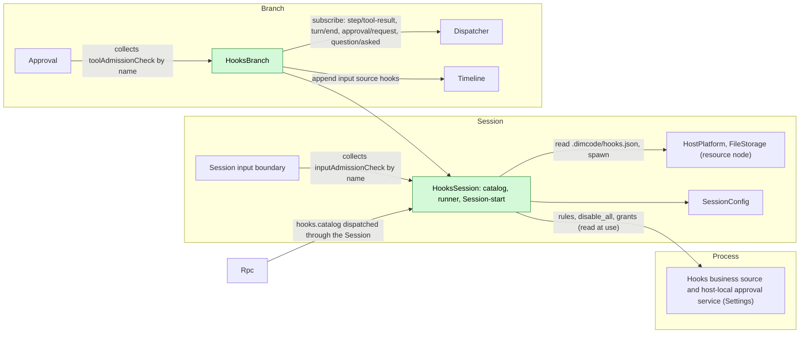
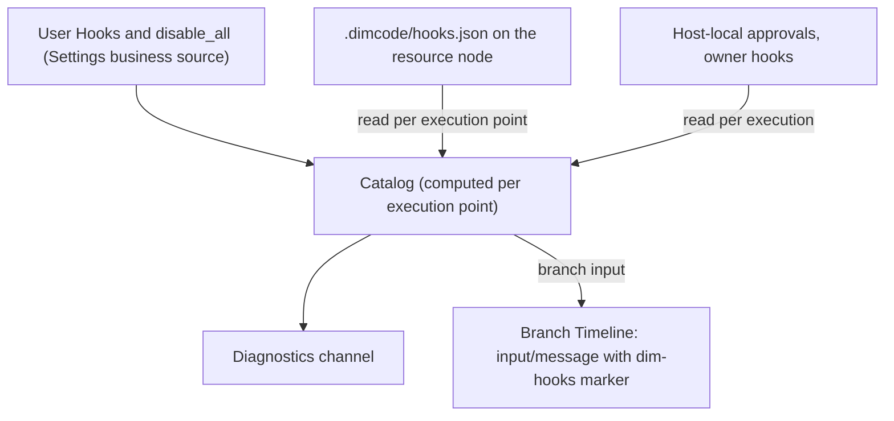
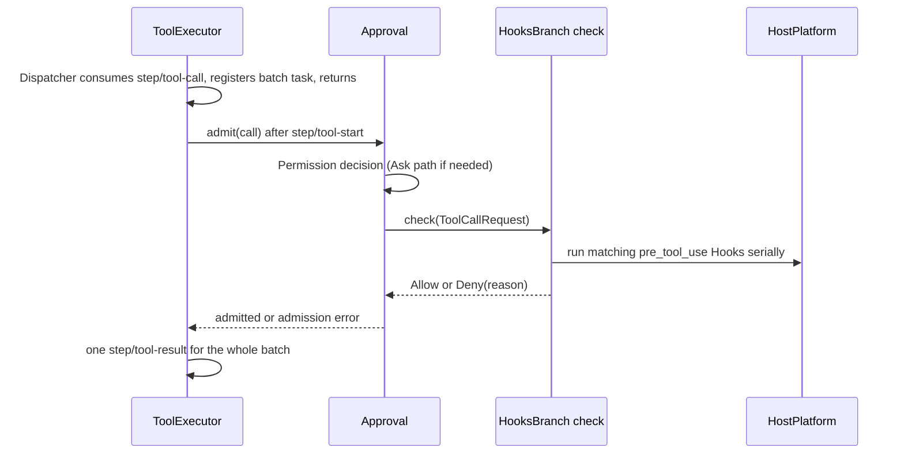
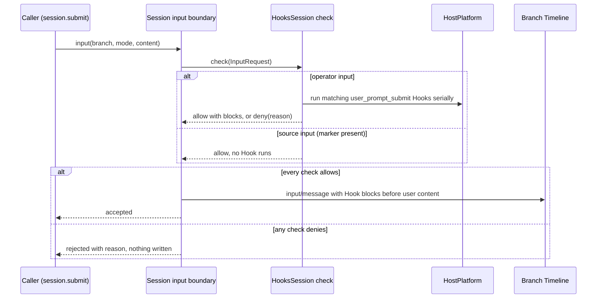
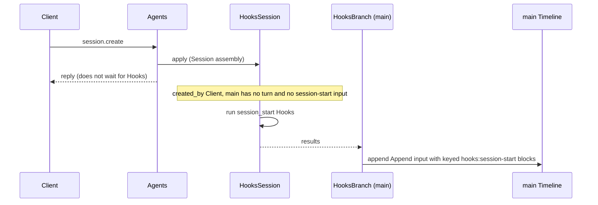
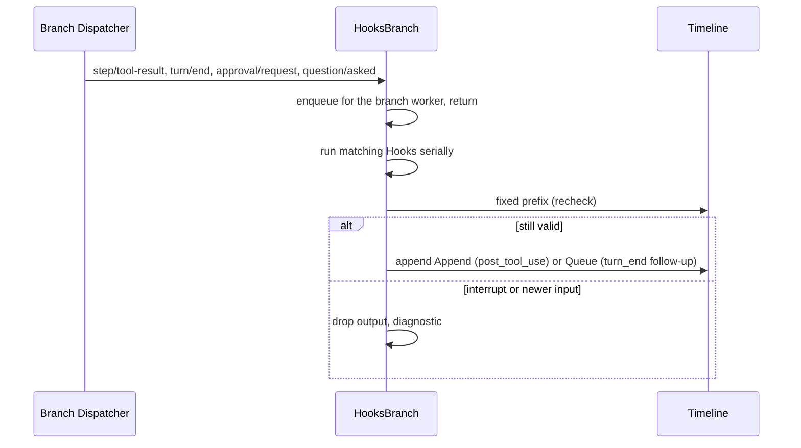
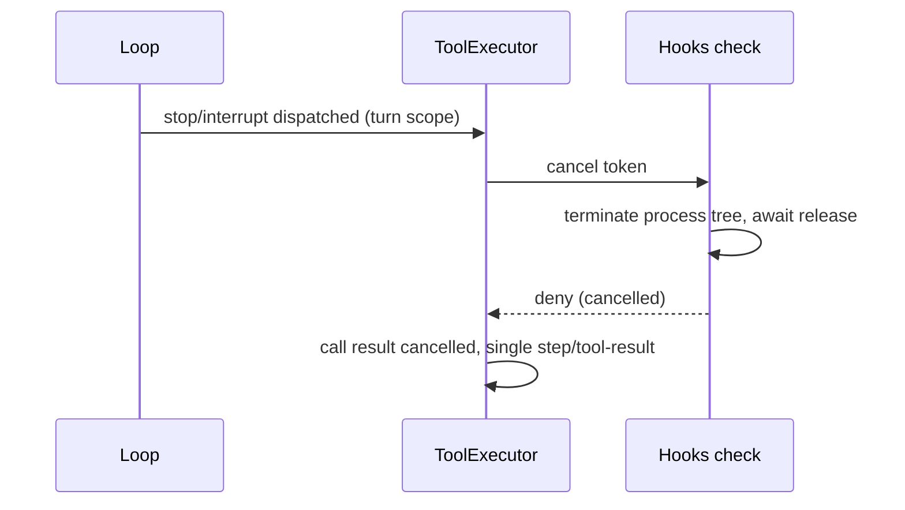

# Hooks

Status: Draft. Overall design: [overview](../overview.md) (Hooks). Phase: P2 (user and project sources); plugin source after #3. Language: Rust. Scope: [ADR 002](../../adr/002-plugin-scope.md) (Session + branch).

Hooks runs user-configured commands at fixed points of a Session's work and adds no Timeline event. Its Session part holds the rules (read from business sources and the project file), runs Session-start Hooks and provides the `inputAdmissionCheck` `hooks` that the Session input boundary consults before writing an operator input (`user_prompt_submit`). Its branch part provides the `toolAdmissionCheck` `hooks` that Approval consults before each tool call, and runs post-tool, turn-end and notification Hooks from the branch Dispatcher. Commands run through the Session's `HostPlatform` (its resource node); output enters context only as branch input with source `hooks` or as blocks attached to an admitted input. Contracts are given in neutral form ([ADR 002 D5](../../adr/002-plugin-scope.md#d5-contracts-are-language-neutral)); the Rust binding is in Appendix G.

## 1. Structure



| Part | Scope | Depends on | Provides |
| --- | --- | --- | --- |
| `HooksSession` | Session (installed only when enabled) | Settings business source (`hooks` document) and host-local approval service; the Session's `HostPlatform` and `FileStorage`; `SessionConfig` | `inputAdmissionCheck` key `hooks` (Session) for `user_prompt_submit`; `sessionMethods` key `hooks` with `hooks.catalog`, level `management`; Session-start Hook results for `main`; an internal catalog and command runner used by `HooksBranch` (not a contract) |
| `HooksBranch` | Branch | `HooksSession`'s runner, the branch Dispatcher and Timeline | `toolAdmissionCheck` key `hooks` (branch), collected by Approval by name ([methods and admission checks](../contracts/session-boundary.md)) |

Both checks are declared in Hooks' `provides`; the Session input boundary and Approval collect them by service name and scope and never name Hooks.

**Reload.** Approval depends on the `hooks` tool check and the Session input boundary on the `hooks` input check, so while Hooks is installed no tool call or operator input is admitted without them; there is no separate fail-closed record. Enabling, disabling or upgrading Hooks, or a Settings reload, reloads the Hooks parts, Approval, the input boundary and their dependents, failing in-flight turns and in-flight submissions; this is accepted ([ADR 002 D3](../../adr/002-plugin-scope.md#d3-dependencies-follow-scope-rare-restarts-are-accepted)). Editing rules, grants or `disable_all` is business configuration and never reloads ([D4](../../adr/002-plugin-scope.md#d4-structural-configuration-and-business-configuration-are-separate)).

**Node.** On an offline resource node every `HostPlatform` or `FileStorage` call fails with `node_unavailable`; the Hooks parts and their dependents neither reload nor go Pending, and each execution point applies its error rule (Appendix C). This requires services imported over a rutis link to stay registered while the link is down and fail calls (requirement on [#5](https://github.com/arcships/dim/issues/5)).

**Contracts depended on:** `toolAdmissionCheck`, `inputAdmissionCheck` and `sessionMethods` ([methods and admission checks](../contracts/session-boundary.md)); Session `HostPlatform` and `FileStorage` (existing typed services); Settings business source and host-local approval service. Hooks is Rust; exposing the typed services by name to non-Rust parts is issue [#4](https://github.com/arcships/dim/issues/4)'s work. **Contracts defined here:** the Hook configuration format, the command protocol, `hooks.catalog`, source name `hooks` (marker `dim-hooks`, key namespace `hooks:`).

## 2. Data and state



Hooks owns no `StateCell`. The catalog is recomputed from its sources at each execution point (A6); grants are read per execution and never cached as authority; follow-up counters are derived from the fixed prefix. Running processes live under `ctx.effect` and are never re-run after reload or restart.

## 3. Flows

### 3.1 Pre-tool check



The check runs outside every commit lock and Dispatcher handler and writes nothing; ToolExecutor writes the terminal fact. A Hook error applies `on_error`, default `deny` for `pre_tool_use`. A cancelled check returns deny.

### 3.2 User prompt submit



The check runs before the write, outside every commit lock, and writes nothing itself; the input boundary writes the input with the returned blocks in one append. Only operator inputs (user content without a source marker) run Hooks, so inputs written by Hooks, Goal, Scheduler or Workflow never trigger them (A26). A Hook error applies `on_error`, default `allow` for `user_prompt_submit` (A27). The caller dropping the call cancels the check: processes are terminated and nothing is written.

### 3.3 Session start



Session start is fail open and runs only for `created_by = Client` Sessions that have not started a turn (A24, A25). Its context reaches the next model request after it is written, which may follow the first user input.

### 3.4 Observation Hooks



The Dispatcher delivers branch events in order, so no event is skipped while the branch part is loaded; events dispatched during its reload are not run.

## 4. Timing and conflicts



An interrupt after `step/tool-start` always wins over a finished Hook.

| Scenario | Sequence order | Outcome | Owner |
| --- | --- | --- | --- |
| Turn-end follow-up vs user input or Goal continuation | `turn/end` < other input < Hook write | Recheck sees the input: not written. If both read before either writes, both Queue inputs stand | Hooks, InputQueue |
| Follow-up withdrawn by the user | follow-up < `input/withdrawn` | Not consumed; not counted | InputQueue, Hooks |
| Prompt-submit Hook denies | check < no write | No `input/message`; caller gets the reason; no turn starts | Session input boundary |
| Hooks or Settings reload | — | Approval and the input boundary reload with it; in-flight turns and submissions fail (D3) | Lifecycle |
| Resource node offline | per call | `node_unavailable`, no reload: pre-tool and prompt-submit → `on_error`; observation → diagnostic | Hooks |

Full table: Appendix B.

## 5. Context mapping

| Source | What the model sees | Placement | Compaction | Child branches |
| --- | --- | --- | --- | --- |
| `session_start` | One Append input: marker `<dim-hooks kind="session-start">`, one raw block per Hook with key `hooks:session-start/<source>/<id>` | Next model request after the write | Latest block per key replayed | Inherited while live at the cut |
| `user_prompt_submit` `context` | Raw block in the admitted input, marker `<dim-hooks kind="prompt-submit">`, one per Hook | Before the input's user content, at its consumed position | Summary only | As inputs |
| `user_prompt_submit` deny | Nothing (no input is written) | — | — | — |
| `pre_tool_use` deny | Error text in `ToolResult.content` | Call position in the batch result | Summary only | If before the cut |
| `post_tool_use` | Append input, marker `kind="post-tool" call_id tool` | Next model request of the turn | Summary only | As inputs |
| `turn_end` | Queue input, marker `kind="follow-up"` | Start of the turn it drives | Summary only | As inputs |
| `notification` | Nothing | — | — | — |

Non-interactive Sessions: identical, except that Session-start Hooks run only for `created_by = Client`. The model never sees configuration, commands, exit codes, stderr (except a deny reason), approvals or diagnostics.

## 6. Interfaces (summary)

| Interface | Kind | Purpose |
| --- | --- | --- |
| `toolAdmissionCheck` `hooks` | Branch service, `check(ToolCallRequest): async -> {verdict, reason?}` | Run `pre_tool_use` Hooks; deny or allow |
| `inputAdmissionCheck` `hooks` | Session service, `check(InputRequest): async -> {verdict, reason?, blocks?}` | Run `user_prompt_submit` Hooks; deny, or allow with context blocks |
| `hooks.catalog {sessionId}` | `sessionMethods` key `hooks`, level `management` | Effective Hooks of the Session with approval state |
| `hooks` document | Settings business source | User Hooks, `disable_all`, enable overrides |
| Grants | Settings host-local approval service | Approve or revoke project and plugin Hooks |
| Configuration format, command protocol | Defined here | Appendix A |

## 7. Security

User Hooks run without approval. Project and plugin Hooks run only with a grant in the Settings host-local approval service, record `{owner: hooks, node, workspace, source, id, event, tools, fingerprint}`, fingerprint = SHA-256 over the canonical entry without `enabled`; reading configuration grants nothing, and replay, fork and restore never restore grants. Commands run on the Session's resource node with that node's isolation applied by HostPlatform; a Hook is not admitted by Permission and never widens authority: no outcome admits a call that Permission or the user denied, and no output edits tool input or the user's input text (a prompt-submit Hook only adds attributed blocks or rejects). stdin may contain prompts and tool input; diagnostics keep only Hook id, exit status, duration and a bounded stderr excerpt.

## Appendix A. Interface details

### A.1 Configuration format

One JSON document per source, the same shape for user configuration (`hooks` document in Settings) and the project file `.dimcode/hooks.json`:

```json
{
  "version": 1,
  "hooks": [
    { "id": "guard-writes", "event": "pre_tool_use", "tools": ["write", "edit", "mcp__fs__*"],
      "command": "./scripts/guard.sh", "timeout_ms": 10000, "on_error": "deny", "enabled": true }
  ]
}
```

| Field | Type | Rule |
| --- | --- | --- |
| `version` | `1` | Other values make the document invalid (A1) |
| `id` | string `[a-z0-9][a-z0-9_-]{0,63}` | Unique within the source; identity of grants and overrides |
| `event` | `session_start` \| `user_prompt_submit` \| `pre_tool_use` \| `post_tool_use` \| `turn_end` \| `notification` | Required (A4) |
| `tools` | string array of name patterns | Only `pre_tool_use`/`post_tool_use`; `*` matches any run of characters; omitted = all tools (A5) |
| `kinds` | array of `approval` \| `question` | Only `notification`; omitted = both (A15) |
| `command` | string | Run by the node's execution shell with `SessionConfig.cwd` as working directory (A8) |
| `timeout_ms` | integer 100..=600000 | Default 60000 (A10) |
| `on_error` | `allow` \| `deny` | Only `pre_tool_use` (default `deny`) and `user_prompt_submit` (default `allow`, A27) |
| `enabled` | bool | Default `true` |

Invalid entries are listed `invalid` and never run. Order per event: user, project, plugin sources, then document order (A12).

### A.2 Command protocol

| Channel | Content |
| --- | --- |
| stdin | One UTF-8 JSON object, then EOF: `{version: 1, event, hook_id, source, session_id, branch_id, cwd, resource_node, ...event fields}` |
| Environment | HostPlatform's filtered base environment plus `DIM_HOOK_EVENT`, `DIM_SESSION_ID`, `DIM_PROJECT_DIR` (A8) |
| Exit 0 | Success. stdout empty or one JSON object (`decision`, `reason`, `context`, `follow_up`); non-JSON stdout is `context` for `session_start`, otherwise ignored (A13) |
| Exit 2 | Block for `pre_tool_use` and `user_prompt_submit`, stderr (first 2 KiB) as reason; error for other events |
| Other exit, signal, timeout, spawn failure, stdout over 64 KiB, `node_unavailable` | Error: diagnostics; `pre_tool_use` and `user_prompt_submit` apply `on_error` |

Event fields: `user_prompt_submit {mode, text}` (text blocks of the input joined by newlines; images are not passed); `pre_tool_use {turn_id, request_id, call_id, tool, input, risk}`; `post_tool_use {turn_id, call_id, tool, input, result: {text, is_error}}`; `turn_end {turn_id, outcome, reason}`; `notification {kind, approval_id | call_id, tool?}`; `session_start {}`. `context` and `follow_up` are each at most 16 KiB (A13).

### A.3 Outcomes

| Event | Allow / success | Deny | `context` | `follow_up` |
| --- | --- | --- | --- | --- |
| `session_start` | — | Not supported | Keyed raw block, Append | Ignored |
| `user_prompt_submit` | Next check | Reject the input with `Hook <source>/<id>: <reason>` | Raw block attached to the input (A28) | Ignored |
| `pre_tool_use` | Next check | Deny with `Hook <source>/<id>: <reason>` | Ignored (A16) | Ignored |
| `post_tool_use` | — | Not supported | Append input after the batch | Ignored |
| `turn_end` | — | Not supported | Ignored | Queue input, bounded (A14) |
| `notification` | — | Not supported | Ignored | Ignored |

Outcomes are recorded only as other owners' facts: a tool deny is the call's error result (ToolExecutor); an input deny is the caller's rejection with nothing written (Session input boundary); context and follow-ups are `input/message` blocks with marker `dim-hooks`; execution records go to diagnostics.

### A.4 Admission checks

| Service | Scope, key | Method | Request (fields Hooks reads) | Reply |
| --- | --- | --- | --- | --- |
| `toolAdmissionCheck` | branch, `hooks` | `check`, async | `ToolCallRequest {session_id, branch_id, turn_id, call_id, tool, arguments, risk}` | `{verdict: "allow" \| "deny", reason?}`; `reason` is model-visible |
| `inputAdmissionCheck` | Session, `hooks` | `check`, async | `InputRequest {session_id, branch_id, mode, content, source?}` | `{verdict: "allow" \| "deny", reason?, blocks?: [{marker, text}]}`; `reason` goes to the caller, `blocks` are written with the input |

Request shapes are owned by [methods and admission checks](../contracts/session-boundary.md). Cancellation is the consumer dropping the call or sending a cancel request (turn interrupt for tool checks, caller gone for input checks); Hooks terminates the process tree, awaits release and replies `deny` (tool) or nothing is written (input). Errors are never returned as call failures: every Hook failure is mapped to a verdict by `on_error`.

### A.5 `hooks.catalog`

Served through `sessionMethods` key `hooks` (`describe(): async -> MethodDecl[]`, `call(MethodCall): async -> MethodReply`); declared method `hooks.catalog`, level `management`, not mutating.

| Parameters | Result |
| --- | --- |
| `{sessionId}` | Hooks per source: `id`, `source`, `event`, matcher, `command`, `enabled`, `approval` (`notRequired` \| `required` \| `approved`), `approvalToken`, `invalid?`; global `disabled` |

Approving or revoking uses the `approvalToken` with the Settings host-local approval service; enabling and `disable_all` are typed Settings operations on the `hooks` document (A9).

### A.6 Mechanics

| Path | Mechanics |
| --- | --- |
| Pre-tool | ToolExecutor appends `step/tool-start` and awaits Approval's admission, which after its own request path (if Ask) awaits the collected `toolAdmissionCheck`s. Hooks writes nothing |
| Prompt submit | The Session input boundary awaits every collected `inputAdmissionCheck` before writing; Hooks runs matching `user_prompt_submit` Hooks serially for operator inputs and returns blocks or a deny. Hooks writes nothing |
| Session start | `HooksSession`'s apply starts the run when eligible (A25); `HooksBranch` on `main` appends one Append input with marker and keyed blocks through its Timeline; Agents never waits |
| Observation | `HooksBranch` subscribes on the branch Dispatcher; the handler enqueues and returns; one worker per branch runs serially in sequence order (A20) |
| Recheck | Before writing: for `post_tool_use`, no `stop/interrupt` after the tool result; for `turn_end`, no `stop/interrupt` and no non-withdrawn `input/message` after the `turn/end`, and fewer than 3 consecutive non-withdrawn follow-ups (A14) |
| Reload or restart | Running processes terminated by `ctx.effect`; no Hook is re-run; pending follow-ups are lost |

## Appendix B. Full conflict table

| Scenario | Sequence order | Outcome | Owner |
| --- | --- | --- | --- |
| Turn `stop/interrupt` while a pre-tool Hook runs | `step/tool-start` < interrupt | Tree terminated; result cancelled; output discarded | Approval, ToolExecutor |
| Interrupt before admission | interrupt < `step/tool-call` consumption | No Hook runs | ToolExecutor |
| Branch interrupt or close during a pre-tool Hook | branch interrupt | As turn interrupt | Approval, ToolExecutor |
| Pre-tool deny for one call of a batch | — | That call's error result; others run; one `step/tool-result` | ToolExecutor |
| Prompt-submit Hook denies | check, no write | Nothing written; caller rejected with the reason | Session input boundary |
| Prompt-submit Hook allows with context | check < write | Blocks and user content in one `input/message` | Session input boundary |
| Caller drops a submission during the check | — | Tree terminated; nothing written | Hooks, Session input boundary |
| Interrupt during a prompt-submit check | — | Independent: the check is not turn work; the input is written if allowed | Session input boundary |
| Two submissions checked concurrently | — | Checked independently; written in commit order | Session input boundary |
| Source input (Goal, Hooks, Scheduler, Workflow) | — | Allowed without running Hooks (A26) | Hooks |
| `post_tool_use` for a batch | `step/tool-result` | After the whole batch; one run per matching call | Hooks |
| Post-tool context vs following interrupt | result < interrupt < write | Not written | Hooks |
| Turn-end follow-up vs user input | `turn/end` < input < write | Not written | Hooks |
| Turn-end follow-up vs Goal continuation | both read before either writes | Both written; at most one extra turn each (accepted) | InputQueue |
| Follow-up or post-tool input withdrawn | input < `input/withdrawn` | Never consumed; not counted | InputQueue, Hooks |
| Concurrent Steer/Queue/Append | Timeline order | Applied by mode in sequence order | InputQueue |
| Compaction | — | Session-start keyed blocks replayed; others via summary | History projection |
| Child branch cut between Hook input and consumption | input < cut < consumed | Child does not adopt it; not re-run | InputQueue |
| Child branch | — | Its own `HooksBranch` and check | Hooks |
| Grant revoked or file edited while a Hook runs | — | Running process finishes; later executions follow the new state | Hooks |
| Hooks, Approval or Settings reload | — | Approval, the input boundary and dependents reload; in-flight turns and submissions fail (`service_reloading`); events in the window not run (D3) | Lifecycle |
| Session restore or unload | — | Session start not re-run once a turn or session-start input exists (A25) | Hooks |
| Session created by launch, Collaboration or fork | `created_by` ≠ `Client` | No Session start | Hooks |
| First user input before the Session-start write | input < Hooks Append | Context applies from the next model request | InputQueue |
| Resource node offline | — | Calls fail `node_unavailable`; no reload or Pending. Pre-tool and prompt-submit: `on_error`; project file unreadable → project Hooks skipped, diagnostic; observation and Session start: diagnostic | Hooks |
| Client detach | — | No effect | — |

## Appendix C. Errors and recovery

| Case | Result |
| --- | --- |
| Timeout | Tree terminated; error; `on_error` for `pre_tool_use` and `user_prompt_submit` |
| `node_unavailable` | As a Hook error; no reload |
| Unapproved project or plugin Hook | Skipped; diagnostic |
| Approval service unreadable | Fail closed: project and plugin Hooks do not run |
| Invalid document | Marked invalid; none of its Hooks run |
| Append rejected (branch closed) | Output dropped; diagnostic |
| Cancellation | Terminate tree, await release, then return |

## Appendix D. Acceptance

1. Each exit-code and stdout case of A.2 per event, including timeout and `on_error`.
2. Pre-tool deny in a three-call batch: one error result, others executed, single `step/tool-result`.
3. Interrupt during a pre-tool Hook: process terminated; result cancelled.
4. Project Hook in `.dimcode/hooks.json`: not run before approval; runs after; stops after the file changes.
5. Session-start context survives compaction; not run on restore or for launched, member or forked Sessions.
6. Post-tool context after an interrupt is not written; follow-up stops at the limit, after user input, and ignores withdrawn follow-ups.
7. Editing rules or `disable_all` takes effect at the next execution point without a reload.
8. Resource node offline: only that Session's Hooks fail with `node_unavailable`; no part reloads.
9. `user_prompt_submit`: exit 2 rejects the submission with the reason and writes nothing; `context` arrives as a `dim-hooks kind="prompt-submit"` block in the same `input/message`; a timeout with default `on_error` admits the input; source inputs run no Hook.

## Appendix E. Assumptions

| # | Assumption | Basis | Effect if rejected |
| --- | --- | --- | --- |
| A1 | Versioned JSON document per source | Judgment | Format changes |
| A4 | Six events: session start, user prompt submit, pre/post tool, turn end, notification | ADR 002 scope; Session `inputAdmissionCheck` | Fewer events |
| A5 | Tool name patterns with `*` glob only | Judgment | Regex matching |
| A6 | Project file re-read at each execution point | Judgment | A watcher is needed |
| A8 | Node shell in Session cwd, base environment plus three variables, no `env` | Judgment | Env configuration with references |
| A9 | Enable overrides for project and plugin Hooks are host-local Settings data | Judgment | Only user Hooks can be disabled individually |
| A10 | Default timeout 60 s, range 0.1–600 s | Judgment | Values change |
| A12 | Order: user, project, plugin, document order | Judgment | Other ordering |
| A13 | stdout JSON or plain text; 64 KiB stdout, 16 KiB per output | Judgment | Limits change |
| A14 | `turn_end` follow-up starts a turn, at most 3 consecutive | Goal precedent | No follow-up |
| A15 | Notification Hooks on `approval/request` and `question/asked` | Judgment | Other triggers |
| A16 | Pre-tool Hooks cannot inject context or modify input | Never widen authority | Input rewrite rules |
| A20 | Observation Hooks run serially per branch | Judgment | Injected order may differ |
| A24 | Session creation does not wait for Session-start Hooks; their context may follow the first input | Product decision | A blocking creation hook |
| A25 | Session start runs when `main` has no `turn/start` and no session-start input; a restore before the first turn may run it again | Judgment | A creation notice would be needed |
| A26 | `user_prompt_submit` runs only for operator inputs (user content, no source marker) on any branch | Avoids loops through source inputs | Source inputs would need their own matcher |
| A27 | `user_prompt_submit` errors default to `allow` | A broken Hook should not lock the user out | Fail closed by default |
| A28 | Prompt-submit context is unkeyed and survives compaction only through the summary | Judgment | Keyed blocks replayed like Session start |

## Appendix F. Open questions

| Question | Description |
| --- | --- |
| Plugin source | Reading plugin-provided Hooks from PluginManager's package content depends on [#3](https://github.com/arcships/dim/issues/3) |

## Appendix G. Rust binding

| Neutral | Rust |
| --- | --- |
| `toolAdmissionCheck` key `hooks` | `ToolAdmissionCheck(Arc<dyn AdmissionCheck>)` at `BranchScope::named_key::<ToolAdmissionCheck>("hooks")`, registered with `AgentBuilder::tool_admission_check("hooks")`; Approval collects `Contributions<ToolAdmissionCheck>` |
| `inputAdmissionCheck` key `hooks` | The Session-scoped input check type of [methods and admission checks](../contracts/session-boundary.md) at `SessionScope::named_key` with name `hooks`; the input boundary collects its `Contributions` |
| `sessionMethods` key `hooks` | `SessionMethodContribution(Arc<dyn MethodProvider>)` at `SessionScope::named_key::<SessionMethodContribution>("hooks")` |
| `check(…)` cancellation | `CancellationToken` passed to `check`; the returned `HostFuture` may be dropped |
| Internal runner | Session service `HooksRuntime`, private to Hooks |
| Session start, observation | `HooksSession::apply`; `HooksBranch` Dispatcher subscription; processes under `ctx.effect` |
