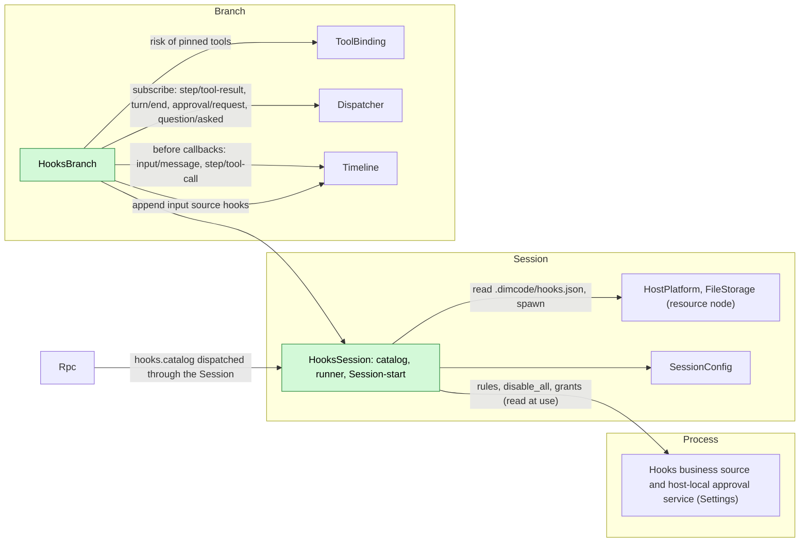
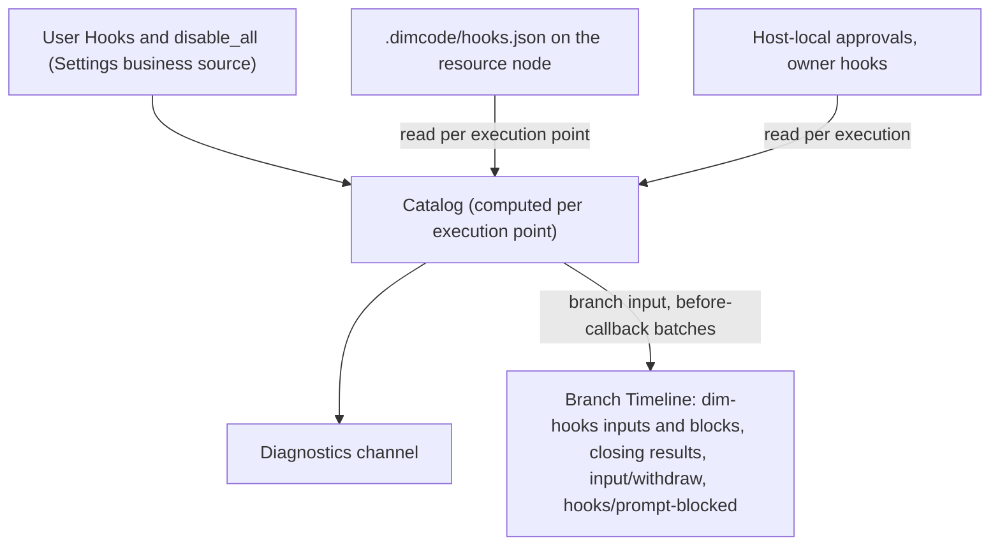
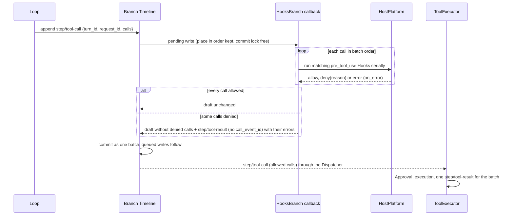
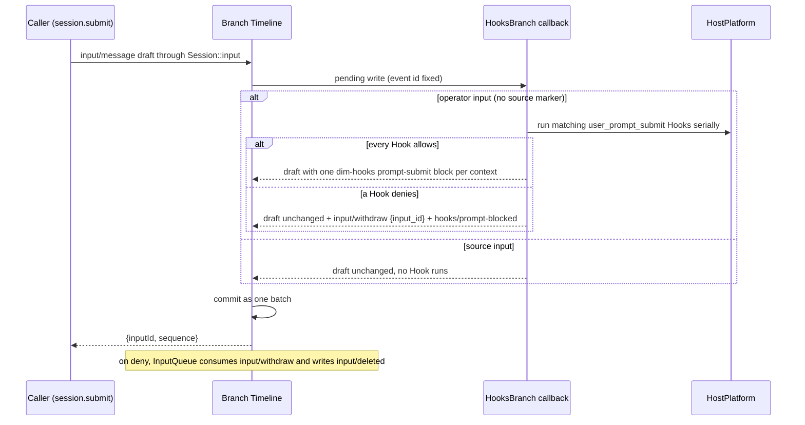
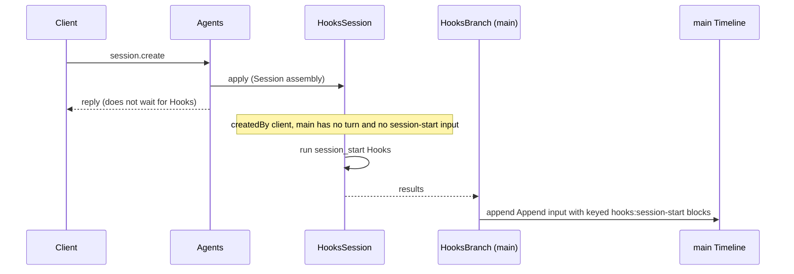
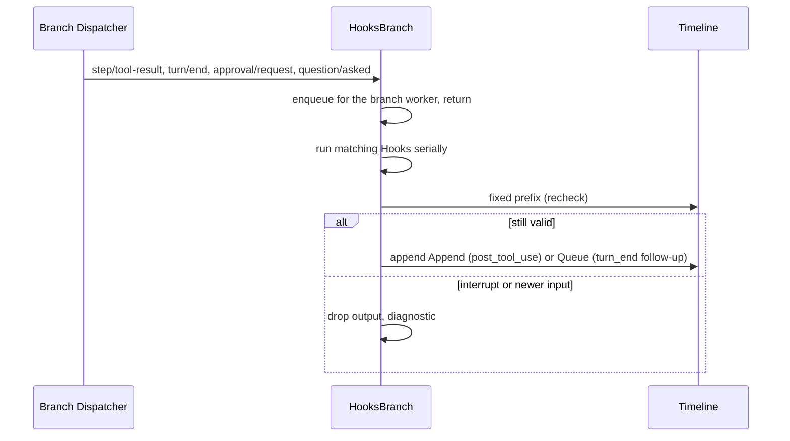
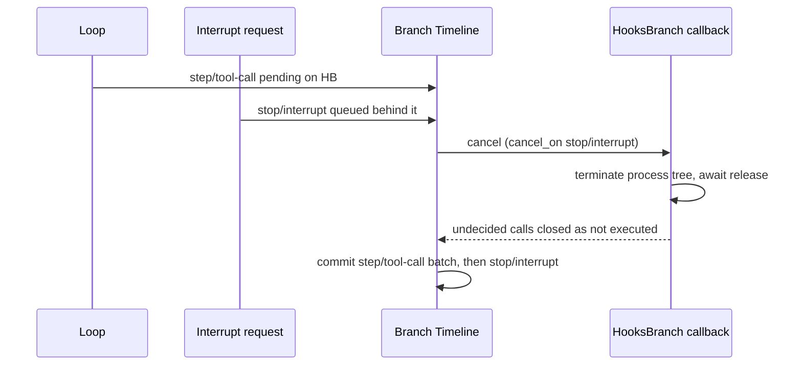

# Hooks

Status: Draft. Overall design: [overview](../overview.md) (Hooks). Phase: P2 (user and project sources); plugin source after #3. Language: Rust. Scope: [ADR 002](../../adr/002-plugin-scope.md) (Session + branch).

Hooks runs user-configured commands at fixed points of a Session's work. Its Session part holds the rules (read from business sources and the project file) and runs Session-start Hooks. Its branch part registers two asynchronous Timeline before callbacks (the runtime supplement in [overview Appendix B.1](../overview.md#b1-session-and-branch-capabilities)): on `input/message` for `user_prompt_submit` and on `step/tool-call` for `pre_tool_use`; it also runs post-tool, turn-end and notification Hooks from the branch Dispatcher. What a callback writes is decided here and uses existing public event contracts (a transformed draft, `input/withdraw`, a closing `step/tool-result`) plus one event Hooks declares itself, `hooks/prompt-blocked`; Approval, InputQueue, ToolExecutor and Loop get no Hooks-specific change. Commands run through the Session's `HostPlatform` (its resource node); output enters context only as branch input with source `hooks`, as blocks added to an operator input, or as a denied call's error result. Contracts are given in neutral form ([ADR 002 D5](../../adr/002-plugin-scope.md#d5-contracts-are-language-neutral)); the Rust binding is in Appendix G.

## 1. Structure



| Part | Scope | Depends on | Provides |
| --- | --- | --- | --- |
| `HooksSession` | Session (installed only when enabled) | Settings business source (`hooks` document) and host-local approval service; the Session's `HostPlatform` and `FileStorage`; `SessionConfig` | `sessionMethods` key `hooks` with `hooks.catalog`, level `management`; Session-start Hook results for `main`; an internal catalog and command runner used by `HooksBranch` (not a contract) |
| `HooksBranch` | Branch | `HooksSession`'s runner; the branch Timeline (before callbacks, appends), Dispatcher and ToolBinding | Before callbacks on `input/message` and `step/tool-call`, registered when the part loads and removed when it unloads; the event type `hooks/prompt-blocked` |

Nothing collects Hooks: the callbacks are registrations on the branch Timeline and follow `HooksBranch`'s lifecycle, so no consumer depends on Hooks or names it.

**Reload.** Enabling, disabling or upgrading Hooks, or a Settings reload, reloads only the Hooks parts ([ADR 002 D3](../../adr/002-plugin-scope.md#d3-dependencies-follow-scope-rare-restarts-are-accepted)). A callback pending at unload settles by its registration's `on_error` (Appendix A.4): a pending `step/tool-call` write fails and its turn ends `Failed`; a pending operator input is committed unchanged. Writes committed while `HooksBranch` is not loaded pass without Hooks (Appendix F). Editing rules, grants or `disable_all` is business configuration and never reloads ([D4](../../adr/002-plugin-scope.md#d4-structural-configuration-and-business-configuration-are-separate)).

**Node.** On an offline resource node every `HostPlatform` or `FileStorage` call fails with `node_unavailable`; the Hooks parts and their dependents neither reload nor go Pending, and each execution point applies its error rule (Appendix C). This requires services imported over a rutis link to stay registered while the link is down and fail calls (requirement on [#5](https://github.com/arcships/dim/issues/5)).

**Contracts depended on:** `sessionMethods` ([methods and tool contributions](../contracts/session-boundary.md)); asynchronous Timeline before callbacks (runtime supplement, [overview Appendix B.1](../overview.md#b1-session-and-branch-capabilities)); the `input/message`, `input/withdraw` and `input/deleted` ([session access A.4](../contracts/session-access.md#a4-withdrawal)), `step/tool-call` and `step/tool-result` data contracts, including results without `call_event_id` that close calls never dispatched (ADR agent-029); Session `HostPlatform` and `FileStorage` and branch ToolBinding (existing typed services); Settings business source and host-local approval service. Hooks is Rust; exposing the typed services by name to non-Rust parts is issue [#4](https://github.com/arcships/dim/issues/4)'s work. **Contracts defined here:** the Hook configuration format, the command protocol, `hooks.catalog`, the event `hooks/prompt-blocked`, source name `hooks` (marker `dim-hooks`, key namespace `hooks:`).

## 2. Data and state



Hooks owns no `StateCell`; its only own event, `hooks/prompt-blocked`, is a record for clients and is never read back by Hooks. The catalog is recomputed from its sources at each execution point (A6); grants are read per execution and never cached as authority; follow-up counters are derived from the fixed prefix. Running processes live under `ctx.effect` and are never re-run after reload or restart.

## 3. Flows

### 3.1 Pre-tool before callback



The callback runs before Approval and Permission, so a call a Hook denies is never asked about or executed. A denied call is removed from the draft (its input is never edited) and closed in the same atomic batch by one `step/tool-result {turn_id, request_id, results}` without `call_event_id`, each result an error `Hook <source>/<id>: <reason>`; Loop treats such results as closing calls without settling a batch and history pairs them with their calls by `call_id` (ADR agent-029). If every call is denied, the draft keeps an empty `calls` list, which ToolExecutor settles with an empty batch result, and Loop continues with the next request. A Hook error applies `on_error`, default `deny`. When no Hook matches, the callback returns at once and the draft is committed unchanged.

### 3.2 User prompt submit before callback



Only operator inputs (user content without a source marker) run Hooks, so inputs written by Hooks, Goal, Scheduler or Workflow never trigger them (A26). Allow with `context`: each context becomes a raw block with marker `<dim-hooks kind="prompt-submit">`, added after the draft's own raw blocks and before its user content; the user content is never edited. Deny: Hooks stops at the first deny, discards collected context, and appends to the input's batch `input/withdraw {input_id}` (InputQueue's command contract) and `hooks/prompt-blocked {input_id, source, hook_id, reason}`. The sequence is `input/message`, `input/withdraw`, `hooks/prompt-blocked`, then `input/deleted {input_id}` written by InputQueue: InputQueue decides adoption only after the whole batch is dispatched, so the same-batch withdraw always wins, the input is never applied and no turn starts. The caller's reply is the ordinary `{inputId, sequence}`; clients learn the outcome from these events on the Session broadcast. A Hook error applies `on_error`, default `allow` (A27). The caller dropping the call does not cancel the pending write, which commits per the callback's outcome.

### 3.3 Session start



Session start is fail open and runs only for `createdBy.kind = "client"` Sessions that have not started a turn (A24, A25). Its context reaches the next model request after it is written, which may follow the first user input.

### 3.4 Observation Hooks



The Dispatcher delivers branch events in order, so no event is skipped while the branch part is loaded; events dispatched during its reload are not run.

## 4. Timing and conflicts



A pending callback holds every later write on its branch, including `stop/interrupt`. Both callbacks register `cancel_on: ["stop/interrupt"]`, so a queued interrupt cancels them at once. Pre-tool: every call not yet allowed by all its Hooks is closed with the error `Tool was not executed: interrupted`; calls already allowed stay in the batch and settle by ToolExecutor's existing interrupt rule when the interrupt commits right after. Prompt submit: the running Hook is terminated and treated as an error (its `on_error`), remaining Hooks are skipped, and the input commits before the interrupt.

| Scenario | Sequence order | Outcome | Owner |
| --- | --- | --- | --- |
| Turn-end follow-up vs user input or Goal continuation | `turn/end` < other input < Hook write | Recheck sees the input: not written. If both read before either writes, both Queue inputs stand | Hooks, InputQueue |
| Follow-up withdrawn by the user | follow-up < `input/deleted` | Never applied; not counted | InputQueue, Hooks |
| Prompt-submit Hook denies | input + `input/withdraw` + `hooks/prompt-blocked` in one batch < `input/deleted` | Never applied; no turn starts; clients see the reason | Hooks, InputQueue |
| Write on the branch while a callback is pending | pending < queued | Queued writes commit after it, in order; branch latency up to the Hooks' run time (accepted) | Timeline |
| `stop/interrupt` while a callback is pending | pending < interrupt | Callback cancelled; see above | Hooks, Timeline |
| Hooks or Settings reload | — | Only Hooks parts reload; a pending callback settles by `on_error` (pre-tool: write fails, turn `Failed`; prompt submit: input committed unchanged) | Timeline, Lifecycle |
| Resource node offline | per call | `node_unavailable`, no reload: pre-tool and prompt-submit → `on_error`; observation → diagnostic | Hooks |

Full table: Appendix B.

## 5. Context mapping

| Source | What the model sees | Placement | Compaction | Child branches |
| --- | --- | --- | --- | --- |
| `session_start` | One Append input: marker `<dim-hooks kind="session-start">`, one raw block per Hook with key `hooks:session-start/<source>/<id>` | Next model request after the write | Latest block per key replayed | Inherited while live at the cut |
| `user_prompt_submit` `context` | Raw block in the operator input, marker `<dim-hooks kind="prompt-submit">`, one per Hook | Before the input's user content, at its consumed position | Summary only | As inputs |
| `user_prompt_submit` deny | Nothing: the input is deleted before it is applied, so it never enters context; `hooks/prompt-blocked` is not projected | — | — | — |
| `pre_tool_use` deny | Error text `Hook <source>/<id>: <reason>` in the closing `step/tool-result` | Paired with its call by `call_id`, before the next model request | Summary only | If before the cut |
| `post_tool_use` | Append input, marker `kind="post-tool" call_id tool` | Next model request of the turn | Summary only | As inputs |
| `turn_end` | Queue input, marker `kind="follow-up"` | Start of the turn it drives | Summary only | As inputs |
| `notification` | Nothing | — | — | — |

Non-interactive Sessions: identical, except that Session-start Hooks run only for `createdBy.kind = "client"`. The model never sees configuration, commands, exit codes, stderr (except a pre-tool deny reason), approvals, diagnostics or `hooks/prompt-blocked`.

## 6. Interfaces (summary)

| Interface | Kind | Purpose |
| --- | --- | --- |
| Before callback on `step/tool-call` | Branch Timeline registration by `HooksBranch` | Run `pre_tool_use` Hooks; remove and close denied calls |
| Before callback on `input/message` | Branch Timeline registration by `HooksBranch` | Run `user_prompt_submit` Hooks; add context blocks, or withdraw the input |
| `hooks/prompt-blocked {input_id, source, hook_id, reason}` | Branch event declared by Hooks | Reason a prompt was withdrawn, for clients |
| `hooks.catalog {sessionId}` | `sessionMethods` key `hooks`, level `management` | Effective Hooks of the Session with approval state |
| `hooks` document | Settings business source | User Hooks, `disable_all`, enable overrides |
| Grants | Settings host-local approval service | Approve or revoke project and plugin Hooks |
| Configuration format, command protocol | Defined here | Appendix A |

## 7. Security

User Hooks run without approval. Project and plugin Hooks run only with a grant in the Settings host-local approval service, record `{owner: hooks, node, workspace, source, id, event, tools, fingerprint}`, fingerprint = SHA-256 over the canonical entry without `enabled`; reading configuration grants nothing, and replay, fork and restore never restore grants. Commands run on the Session's resource node with that node's isolation applied by HostPlatform; a Hook is not admitted by Permission and never widens authority: no outcome admits a call that Permission or the user denied, and no output edits tool input or the user's input text (a pre-tool Hook only removes a call and closes it with an error; a prompt-submit Hook only adds attributed blocks or withdraws the input). The callbacks write only the events listed in A.4, and only in the batch of the write they hold. stdin may contain prompts and tool input; diagnostics keep only Hook id, exit status, duration and a bounded stderr excerpt.

## Appendix A. Interface details

### A.1 Configuration format

One JSON document per source, the same shape for user configuration (`hooks` document in Settings) and the project file `.dimcode/hooks.json`:

```json
{
  "version": 1,
  "hooks": [
    { "id": "guard-writes", "event": "pre_tool_use", "tools": ["write", "edit", "mcp__fs__*"],
      "command": "./scripts/guard.sh", "timeout_ms": 10000, "on_error": "deny", "enabled": true }
  ]
}
```

| Field | Type | Rule |
| --- | --- | --- |
| `version` | `1` | Other values make the document invalid (A1) |
| `id` | string `[a-z0-9][a-z0-9_-]{0,63}` | Unique within the source; identity of grants and overrides |
| `event` | `session_start` \| `user_prompt_submit` \| `pre_tool_use` \| `post_tool_use` \| `turn_end` \| `notification` | Required (A4) |
| `tools` | string array of name patterns | Only `pre_tool_use`/`post_tool_use`; `*` matches any run of characters; omitted = all tools (A5) |
| `kinds` | array of `approval` \| `question` | Only `notification`; omitted = both (A15) |
| `command` | string | Run by the node's execution shell with `SessionConfig.cwd` as working directory (A8) |
| `timeout_ms` | integer 100..=600000 | Default 60000 (A10) |
| `on_error` | `allow` \| `deny` | Only `pre_tool_use` (default `deny`) and `user_prompt_submit` (default `allow`, A27) |
| `enabled` | bool | Default `true` |

Invalid entries are listed `invalid` and never run. Order per event: user, project, plugin sources, then document order (A12).

### A.2 Command protocol

| Channel | Content |
| --- | --- |
| stdin | One UTF-8 JSON object, then EOF: `{version: 1, event, hook_id, source, session_id, branch_id, cwd, resource_node, ...event fields}` |
| Environment | HostPlatform's filtered base environment plus `DIM_HOOK_EVENT`, `DIM_SESSION_ID`, `DIM_PROJECT_DIR` (A8) |
| Exit 0 | Success. stdout empty or one JSON object (`decision`, `reason`, `context`, `follow_up`); non-JSON stdout is `context` for `session_start`, otherwise ignored (A13) |
| Exit 2 | Deny for `pre_tool_use` and `user_prompt_submit`, stderr (first 2 KiB) as reason; error for other events |
| Other exit, signal, timeout, spawn failure, stdout over 64 KiB, `node_unavailable` | Error: diagnostics; `pre_tool_use` and `user_prompt_submit` apply `on_error` |

Event fields: `user_prompt_submit {mode, text}` (text blocks of the input joined by newlines; images are not passed); `pre_tool_use {turn_id, request_id, call_id, tool, input, risk}` (`risk` from the request's pinned tool declarations in ToolBinding); `post_tool_use {turn_id, call_id, tool, input, result: {text, is_error}}`; `turn_end {turn_id, outcome, reason}`; `notification {kind, approval_id | call_id, tool?}`; `session_start {}`. `context` and `follow_up` are each at most 16 KiB (A13).

### A.3 Outcomes

| Event | Allow / success | Deny | `context` | `follow_up` |
| --- | --- | --- | --- | --- |
| `session_start` | — | Not supported | Keyed raw block, Append | Ignored |
| `user_prompt_submit` | Next Hook | Withdraw the input; `hooks/prompt-blocked` with `Hook <source>/<id>: <reason>` | Raw block added to the input (A28) | Ignored |
| `pre_tool_use` | Next Hook | Remove the call; closing error result `Hook <source>/<id>: <reason>` | Ignored (A16) | Ignored |
| `post_tool_use` | — | Not supported | Append input after the batch | Ignored |
| `turn_end` | — | Not supported | Ignored | Queue input, bounded (A14) |
| `notification` | — | Not supported | Ignored | Ignored |

Outcomes are recorded in existing event contracts where they exist: a tool deny is a closing `step/tool-result`; an input deny is `input/withdraw` (InputQueue then writes `input/deleted`) plus Hooks' own `hooks/prompt-blocked`; context and follow-ups are `input/message` blocks with marker `dim-hooks`; execution records go to diagnostics.

### A.4 Before callbacks and declared event

| Callback | Registration (runtime options) | Draft read | Writes on allow | Writes on deny |
| --- | --- | --- | --- | --- |
| `pre_tool_use` | `step/tool-call` on the branch; `timeout` none (each Hook is bounded by its `timeout_ms`); `on_error: fail`; `cancel_on: ["stop/interrupt"]` | `{turn_id, request_id, calls: [{id, name, input}]}` | Draft unchanged | Draft without the denied calls (empty `calls` if all denied) + `step/tool-result {turn_id, request_id, results: [{call_id, result: error}]}` without `call_event_id` |
| `user_prompt_submit` | `input/message` on the branch; `timeout` none; `on_error: commit`; `cancel_on: ["stop/interrupt"]` | `{submission_id?, user, blocks, mode}`; source marker in `blocks` | Draft with `dim-hooks kind="prompt-submit"` raw blocks added after its own blocks, or unchanged | Draft unchanged + `input/withdraw {input_id}` + `hooks/prompt-blocked` |

```text
// hooks/prompt-blocked (declared by Hooks through #2; branch event)
{ "input_id": "string",        // event id of the withdrawn input/message
  "source": "user" | "project" | "plugin", "hook_id": "string",
  "reason": "string" }          // Hook <source>/<id>: <reason>, at most 2 KiB
```

| Rule | Content |
| --- | --- |
| Timeout and errors | Every Hook run is bounded by its `timeout_ms`; a timeout, non-zero exit other than 2, spawn failure or `node_unavailable` is a Hook error mapped by its `on_error` inside the callback, so the callback itself returns normally. The registration's `on_error` applies only when the callback cannot finish (registrant unload, branch close, callback fault): `fail` for pre-tool (fail closed: the write fails and the turn ends `Failed`), `commit` for prompt submit (fail open, A27) |
| Cancellation | `cancel_on` `stop/interrupt` (§4); branch close or unload: processes terminated by `ctx.effect`, then the registration's `on_error` |
| Order | Calls in batch order; per call or input, Hooks in A12 order, serially; the first deny ends that call's or input's run |
| Ownership | `hooks/prompt-blocked` is the only event Hooks declares; it is a client-facing record, not a core event, and nothing consumes it for behaviour. `input/withdraw` and `step/tool-result` follow their owners' data contracts |

### A.5 `hooks.catalog`

Served through `sessionMethods` key `hooks` (`describe(): async -> MethodDecl[]`, `call(MethodCall): async -> MethodReply`); declared method `hooks.catalog`, level `management`, not mutating.

| Parameters | Result |
| --- | --- |
| `{sessionId}` | Hooks per source: `id`, `source`, `event`, matcher, `command`, `enabled`, `approval` (`notRequired` \| `required` \| `approved`), `approvalToken`, `invalid?`; global `disabled` |

Approving or revoking uses the `approvalToken` with the Settings host-local approval service; enabling and `disable_all` are typed Settings operations on the `hooks` document (A9).

### A.6 Mechanics

| Path | Mechanics |
| --- | --- |
| Pre-tool | `HooksBranch`'s `step/tool-call` callback runs while the write is pending, before ToolExecutor and Approval see the batch; it returns the transformed draft and appended closing results (A.4) |
| Prompt submit | `HooksBranch`'s `input/message` callback runs while the write is pending, for operator inputs only; it returns the draft with blocks, or the draft with `input/withdraw` and `hooks/prompt-blocked` appended (A.4) |
| Session start | `HooksSession`'s apply starts the run when eligible (A25); `HooksBranch` on `main` appends one Append input with marker and keyed blocks through its Timeline; Agents never waits |
| Observation | `HooksBranch` subscribes on the branch Dispatcher; the handler enqueues and returns; one worker per branch runs serially in sequence order (A20) |
| Recheck | Before writing: for `post_tool_use`, no `stop/interrupt` after the tool result; for `turn_end`, no `stop/interrupt` and no non-deleted `input/message` after the `turn/end`, and fewer than 3 consecutive non-deleted follow-ups (A14) |
| Reload or restart | Running processes terminated by `ctx.effect`; no Hook is re-run; pending follow-ups are lost |

## Appendix B. Full conflict table

| Scenario | Sequence order | Outcome | Owner |
| --- | --- | --- | --- |
| `stop/interrupt` queued while a pre-tool callback is pending | pending `step/tool-call` < interrupt | Callback cancelled; tree terminated; undecided calls closed `Tool was not executed: interrupted`; allowed calls committed and settled by ToolExecutor's interrupt rule | Hooks, ToolExecutor |
| Interrupt committed before the calls are written | interrupt < model output end | Loop writes no `step/tool-call`; no Hook runs | Loop |
| Branch close or `HooksBranch` unload while a pre-tool callback is pending | — | `on_error: fail`: the write fails; the turn ends `Failed` and Loop closes the undispatched calls | Timeline, Loop |
| Pre-tool deny for one call of a batch | one batch | Call removed; closing error result in the same batch; others run; ToolExecutor's one result for the rest | Hooks, ToolExecutor |
| Pre-tool deny for every call of a batch | one batch | Empty `calls`; empty batch result; next model request sees the errors | Hooks, ToolExecutor, Loop |
| Policy or user denial of an allowed call | after commit | Unchanged Approval path; Hooks already ran | Approval |
| Prompt-submit Hook denies | input + `input/withdraw` + `hooks/prompt-blocked` < `input/deleted` | Never applied; no turn; reply `{inputId, sequence}` | Hooks, InputQueue |
| Prompt-submit Hook allows with context | one batch | Blocks and user content in one `input/message` | Hooks |
| Caller drops a submission while its callback is pending | — | No effect: the write commits per the callback's outcome; the caller resolves it with `lookup` | Timeline |
| `stop/interrupt` queued while a prompt-submit callback is pending | pending input < interrupt | Running Hook terminated, its `on_error` applied; remaining Hooks skipped; input commits, then the interrupt; applied per InputQueue's interrupt rules | Hooks, InputQueue |
| Branch close or unload while a prompt-submit callback is pending | — | `on_error: commit`: the input is committed unchanged (or rejected by the closed Timeline) | Timeline |
| Two submissions on one branch | first pending < second | The second queues behind the first and runs its own callback after it; committed in order | Timeline, Hooks |
| Other writes on the branch while a callback is pending | pending < other | Queue behind it; branch latency bounded by the Hooks' `timeout_ms` (accepted) | Timeline |
| Source input (Goal, Hooks, Scheduler, Workflow) | — | Committed unchanged without running Hooks (A26) | Hooks |
| Withdrawn prompt and another client's `session.input.withdraw` | same-batch withdraw < later withdraw | Later command has no effect; reply `notHeld` | InputQueue |
| `post_tool_use` for a batch | `step/tool-result` with `call_event_id` | After the whole batch; one run per matching call; closing results of denied calls run no post-tool Hook | Hooks |
| Post-tool context vs following interrupt | result < interrupt < write | Not written | Hooks |
| Turn-end follow-up vs user input | `turn/end` < input < write | Not written | Hooks |
| Turn-end follow-up vs Goal continuation | both read before either writes | Both written; at most one extra turn each (accepted) | InputQueue |
| Follow-up or post-tool input withdrawn | input < `input/deleted` | Never applied; not counted | InputQueue, Hooks |
| Concurrent Steer/Queue/Append | Timeline order | Applied by mode in sequence order | InputQueue |
| Compaction | — | Session-start keyed blocks replayed; others via summary | History projection |
| Child branch cut between Hook input and consumption | input < cut < consumed | Child does not adopt it; not re-run | InputQueue |
| Child branch | — | Its own `HooksBranch` and callbacks | Hooks |
| Grant revoked or file edited while a Hook runs | — | Running process finishes; later executions follow the new state | Hooks |
| Hooks or Settings reload | — | Only Hooks parts reload; pending callbacks settle by `on_error`; writes and events in the window pass without Hooks (D3, Appendix F) | Timeline, Lifecycle |
| Session restore or unload | — | Session start not re-run once a turn or session-start input exists (A25) | Hooks |
| Session created by launch, Collaboration or fork | `createdBy.kind` ≠ `"client"` | No Session start | Hooks |
| First user input before the Session-start write | input < Hooks Append | Context applies from the next model request | InputQueue |
| Resource node offline | — | Calls fail `node_unavailable`; no reload or Pending. Pre-tool and prompt-submit: `on_error`; project file unreadable → project Hooks skipped, diagnostic; observation and Session start: diagnostic | Hooks |
| Client detach | — | No effect | — |

## Appendix C. Errors and recovery

| Case | Result |
| --- | --- |
| Timeout | Tree terminated; error; `on_error` for `pre_tool_use` and `user_prompt_submit` |
| `node_unavailable` | As a Hook error; no reload |
| Unapproved project or plugin Hook | Skipped; diagnostic |
| Approval service unreadable | Fail closed: project and plugin Hooks do not run |
| Invalid document | Marked invalid; none of its Hooks run |
| Append rejected (branch closed) | Output dropped; diagnostic |
| Callback cannot finish (unload, branch close, fault) | Runtime applies the registration's `on_error`: pre-tool `fail`, prompt submit `commit` |
| Cancellation | Terminate tree, await release, then return |

## Appendix D. Acceptance

1. Each exit-code and stdout case of A.2 per event, including timeout and `on_error`.
2. Pre-tool deny in a three-call batch: the denied call is absent from the committed `step/tool-call`, closed by a `step/tool-result` without `call_event_id` in the same batch; the other two run with one batch result; no `approval/request` for the denied call; the next model request pairs all three results. All three denied: empty batch, Loop continues.
3. `stop/interrupt` during a pre-tool Hook: process terminated at once; undecided calls closed as not executed; the interrupt commits right after the batch.
4. Project Hook in `.dimcode/hooks.json`: not run before approval; runs after; stops after the file changes.
5. Session-start context survives compaction; not run on restore or for launched, member or forked Sessions.
6. Post-tool context after an interrupt is not written; follow-up stops at the limit, after user input, and ignores deleted follow-ups.
7. Editing rules or `disable_all` takes effect at the next execution point without a reload.
8. Resource node offline: only that Session's Hooks fail with `node_unavailable`; no part reloads.
9. `user_prompt_submit`: exit 2 commits the input together with `input/withdraw` and `hooks/prompt-blocked` carrying the reason in one batch, InputQueue then writes `input/deleted`, and no turn starts; `context` arrives as a `dim-hooks kind="prompt-submit"` block in the same `input/message`; a timeout with default `on_error` commits the input; source inputs run no Hook; a write queued behind a pending callback commits after it in order.

## Appendix E. Assumptions

| # | Assumption | Basis | Effect if rejected |
| --- | --- | --- | --- |
| A1 | Versioned JSON document per source | Judgment | Format changes |
| A4 | Six events: session start, user prompt submit, pre/post tool, turn end, notification | ADR 002 scope; asynchronous before callbacks | Fewer events |
| A5 | Tool name patterns with `*` glob only | Judgment | Regex matching |
| A6 | Project file re-read at each execution point | Judgment | A watcher is needed |
| A8 | Node shell in Session cwd, base environment plus three variables, no `env` | Judgment | Env configuration with references |
| A9 | Enable overrides for project and plugin Hooks are host-local Settings data | Judgment | Only user Hooks can be disabled individually |
| A10 | Default timeout 60 s, range 0.1–600 s | Judgment | Values change |
| A12 | Order: user, project, plugin, document order | Judgment | Other ordering |
| A13 | stdout JSON or plain text; 64 KiB stdout, 16 KiB per output | Judgment | Limits change |
| A14 | `turn_end` follow-up starts a turn, at most 3 consecutive | Goal precedent | No follow-up |
| A15 | Notification Hooks on `approval/request` and `question/asked` | Judgment | Other triggers |
| A16 | Pre-tool Hooks cannot inject context or modify input; they only remove and close a call | Never widen authority | Input rewrite rules |
| A29 | Pre-tool Hooks run before Approval and Permission, at the commit of `step/tool-call` | Before-callback placement | Hooks would need a hook into Approval |
| A30 | A prompt deny is recorded as `input/withdraw` (then `input/deleted`) plus `hooks/prompt-blocked`; callers get the ordinary reply, not an error | Existing withdrawal contract | A wire error code would be needed |
| A20 | Observation Hooks run serially per branch | Judgment | Injected order may differ |
| A24 | Session creation does not wait for Session-start Hooks; their context may follow the first input | Product decision | A blocking creation hook |
| A25 | Session start runs when `main` has no `turn/start` and no session-start input; a restore before the first turn may run it again | Judgment | A creation notice would be needed |
| A26 | `user_prompt_submit` runs only for operator inputs (user content, no source marker) on any branch | Avoids loops through source inputs | Source inputs would need their own matcher |
| A27 | `user_prompt_submit` errors default to `allow` | A broken Hook should not lock the user out | Fail closed by default |
| A28 | Prompt-submit context is unkeyed and survives compaction only through the summary | Judgment | Keyed blocks replayed like Session start |

## Appendix F. Open questions

| Question | Description |
| --- | --- |
| Plugin source | Reading plugin-provided Hooks from PluginManager's package content depends on [#3](https://github.com/arcships/dim/issues/3) |
| Reload window | Registrations follow `HooksBranch`'s lifecycle, so tool calls and operator inputs committed while it is unloaded (reload, crash) pass without Hooks. Accept, or let the runtime keep a registration's `on_error` in force until the registrant returns |
| Asynchronous append | Loop appends `step/tool-call` synchronously today; the runtime supplement must report the deferred commit or `fail` outcome to it ([overview §9](../overview.md#9-open-questions)) |

## Appendix G. Rust binding

| Neutral | Rust |
| --- | --- |
| Before callbacks | `Timeline::before` asynchronous registration on the branch instance channel with keys `["step/tool-call"]` and `["input/message"]`, options `{timeout: None, on_error, cancel_on: ["stop/interrupt"]}`; the handler takes the `EventDraft` and a `CancellationToken` and returns the draft and appended `EventKind`s |
| `hooks/prompt-blocked` | Declared through #2 dynamic events by `HooksBranch` |
| `sessionMethods` key `hooks` | `SessionMethodContribution(Arc<dyn MethodProvider>)` at `SessionScope::named_key::<SessionMethodContribution>("hooks")` |
| Callback cancellation | `CancellationToken` fired by `cancel_on`, branch close or unload |
| Internal runner | Session service `HooksRuntime`, private to Hooks |
| Session start, observation | `HooksSession::apply`; `HooksBranch` Dispatcher subscription; processes under `ctx.effect` |
