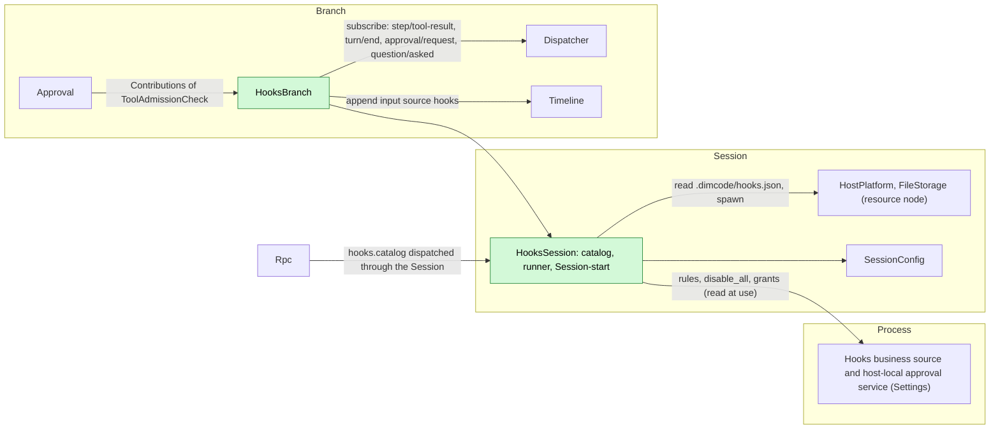
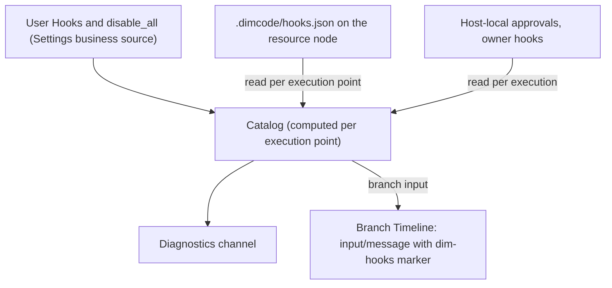
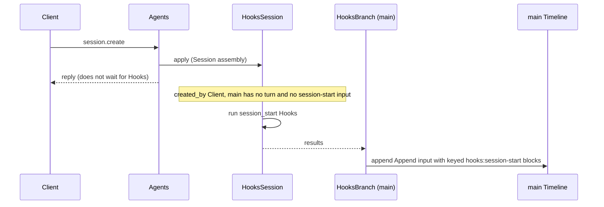
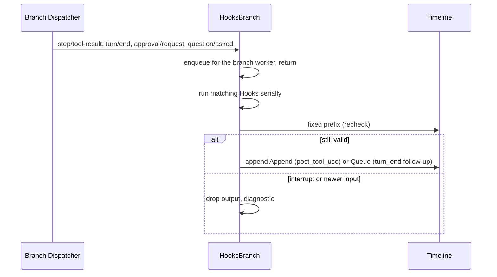
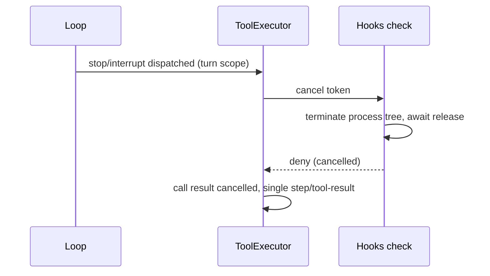

# Hooks

Status: Draft. Overall design: [overview](../overview.md) (Hooks). Phase: P2 (user and project sources); plugin source after #3. Language: Rust. Scope: [ADR 002](../../adr/002-plugin-scope.md) (Session + branch).

Hooks runs user-configured commands at fixed points of a Session's work and adds no Timeline event. Its Session part holds the rules (read from business sources and the project file) and runs Session-start Hooks; its branch part contributes a `ToolAdmissionCheck` that Approval consults before each tool call, and runs post-tool, turn-end and notification Hooks from the branch Dispatcher. Commands run through the Session's `HostPlatform` (its resource node); output enters context only as branch input with source `hooks`.

## 1. Structure



| Part | Scope | Depends on | Provides |
| --- | --- | --- | --- |
| `HooksSession` | Session (installed only when enabled) | Settings business source (`hooks` document) and host-local approval service; the Session's `HostPlatform` and `FileStorage`; `SessionConfig` | Session service `HooksRuntime` (catalog and command runner, used by `HooksBranch`); `S:SessionMethodContribution[hooks]` with `hooks.catalog`, level `management`; Session-start Hook results for `main` |
| `HooksBranch` | Branch | `HooksRuntime`, the branch Dispatcher and Timeline | `B:ToolAdmissionCheck[hooks]`, registered with `AgentBuilder::tool_admission_check("hooks")` and collected by Approval through `Contributions<ToolAdmissionCheck>` ([session-boundary](../contracts/session-boundary.md)) |

**Reload.** Approval depends on the `hooks` check, so while Hooks is installed no tool call is admitted without it; there is no separate fail-closed record. Enabling, disabling or upgrading Hooks, or a Settings reload, reloads the Hooks parts and Approval and its dependents, failing in-flight turns; this is accepted ([ADR 002 D3](../../adr/002-plugin-scope.md#d3-dependencies-follow-scope-rare-restarts-are-accepted)). Editing rules, grants or `disable_all` is business configuration and never reloads ([D4](../../adr/002-plugin-scope.md#d4-structural-configuration-and-business-configuration-are-separate)).

**Contracts depended on:** `ToolAdmissionCheck` and `SessionMethodContribution` ([session-boundary](../contracts/session-boundary.md)); Session `HostPlatform` and `FileStorage` (existing); Settings business source and host-local approval service. **Contracts defined here:** the Hook configuration format, the command protocol, `hooks.catalog`, source name `hooks` (marker `dim-hooks`, key namespace `hooks:`).

## 2. Data and state



Hooks owns no `StateCell`. The catalog is recomputed from its sources at each execution point (A6); grants are read per execution and never cached as authority; follow-up counters are derived from the fixed prefix. Running processes live under `ctx.effect` and are never re-run after reload or restart.

## 3. Flows

### 3.1 Pre-tool check


The check runs outside every commit lock and Dispatcher handler and writes nothing; ToolExecutor writes the terminal fact. A Hook error applies `on_error`, default `deny` for `pre_tool_use`. A cancelled check returns deny.

### 3.2 Session start



Session start is fail open and runs only for `created_by = Client` Sessions that have not started a turn (A24, A25). Its context reaches the next model request after it is written, which may follow the first user input.

### 3.3 Observation Hooks



The Dispatcher delivers branch events in order, so no event is skipped while the branch part is loaded; events dispatched during its reload are not run.

## 4. Timing and conflicts



An interrupt after `step/tool-start` always wins over a finished Hook.

| Scenario | Sequence order | Outcome | Owner |
| --- | --- | --- | --- |
| Turn-end follow-up vs user input or Goal continuation | `turn/end` < other input < Hook write | Recheck sees the input: not written. If both read before either writes, both Queue inputs stand | Hooks, InputQueue |
| Follow-up withdrawn by the user | follow-up < `input/withdrawn` | Not consumed; not counted | InputQueue, Hooks |
| Hooks or Settings reload | — | Approval reloads with it; in-flight turns fail (D3) | Lifecycle |
| Resource node offline | per call | Pre-tool → `on_error` (deny); observation → diagnostic | Hooks |

Full table: Appendix B.

## 5. Context mapping

| Source | What the model sees | Placement | Compaction | Child branches |
| --- | --- | --- | --- | --- |
| `session_start` | One Append input: marker `<dim-hooks kind="session-start">`, one raw block per Hook with key `hooks:session-start/<source>/<id>` | Next model request after the write | Latest block per key replayed | Inherited while live at the cut |
| `pre_tool_use` deny | Error text in `ToolResult.content` | Call position in the batch result | Summary only | If before the cut |
| `post_tool_use` | Append input, marker `kind="post-tool" call_id tool` | Next model request of the turn | Summary only | As inputs |
| `turn_end` | Queue input, marker `kind="follow-up"` | Start of the turn it drives | Summary only | As inputs |
| `notification` | Nothing | — | — | — |

Non-interactive Sessions: identical, except that Session-start Hooks run only for `created_by = Client`. The model never sees configuration, commands, exit codes, stderr (except a deny reason), approvals or diagnostics.

## 6. Interfaces (summary)

| Interface | Kind | Purpose |
| --- | --- | --- |
| `hooks` | `ToolAdmissionCheck` (branch) | Run `pre_tool_use` Hooks; deny or allow |
| `hooks.catalog {sessionId}` | `SessionMethodContribution`, level `management` | Effective Hooks of the Session with approval state |
| `hooks` document | Settings business source | User Hooks, `disable_all`, enable overrides |
| Grants | Settings host-local approval service | Approve or revoke project and plugin Hooks |
| Configuration format, command protocol | Defined here | Appendix A |

## 7. Security

User Hooks run without approval. Project and plugin Hooks run only with a grant in the Settings host-local approval service, record `{owner: hooks, node, workspace, source, id, event, tools, fingerprint}`, fingerprint = SHA-256 over the canonical entry without `enabled`; reading configuration grants nothing, and replay, fork and restore never restore grants. Commands run on the Session's resource node with that node's isolation applied by HostPlatform; a Hook is not admitted by Permission and never widens authority: no outcome admits a call that Permission or the user denied, and no output edits tool input. stdin may contain prompts and tool input; diagnostics keep only Hook id, exit status, duration and a bounded stderr excerpt.

## Appendix A. Interface details

### A.1 Configuration format

One JSON document per source, the same shape for user configuration (`hooks` document in Settings) and the project file `.dimcode/hooks.json`:

```json
{
  "version": 1,
  "hooks": [
    { "id": "guard-writes", "event": "pre_tool_use", "tools": ["write", "edit", "mcp__fs__*"],
      "command": "./scripts/guard.sh", "timeout_ms": 10000, "on_error": "deny", "enabled": true }
  ]
}
```

| Field | Type | Rule |
| --- | --- | --- |
| `version` | `1` | Other values make the document invalid (A1) |
| `id` | string `[a-z0-9][a-z0-9_-]{0,63}` | Unique within the source; identity of grants and overrides |
| `event` | `session_start` \| `pre_tool_use` \| `post_tool_use` \| `turn_end` \| `notification` | Required (A4) |
| `tools` | string array of name patterns | Only `pre_tool_use`/`post_tool_use`; `*` matches any run of characters; omitted = all tools (A5) |
| `kinds` | array of `approval` \| `question` | Only `notification`; omitted = both (A15) |
| `command` | string | Run by the node's execution shell with `SessionConfig.cwd` as working directory (A8) |
| `timeout_ms` | integer 100..=600000 | Default 60000 (A10) |
| `on_error` | `allow` \| `deny` | Only `pre_tool_use`; default `deny` |
| `enabled` | bool | Default `true` |

Invalid entries are listed `invalid` and never run. Order per event: user, project, plugin sources, then document order (A12).

### A.2 Command protocol

| Channel | Content |
| --- | --- |
| stdin | One UTF-8 JSON object, then EOF: `{version: 1, event, hook_id, source, session_id, branch_id, cwd, resource_node, ...event fields}` |
| Environment | HostPlatform's filtered base environment plus `DIM_HOOK_EVENT`, `DIM_SESSION_ID`, `DIM_PROJECT_DIR` (A8) |
| Exit 0 | Success. stdout empty or one JSON object (`decision`, `reason`, `context`, `follow_up`); non-JSON stdout is `context` for `session_start`, otherwise ignored (A13) |
| Exit 2 | Block for `pre_tool_use`, stderr (first 2 KiB) as reason; error for other events |
| Other exit, signal, timeout, spawn failure, stdout over 64 KiB, node unavailable | Error: diagnostics; `pre_tool_use` applies `on_error` |

Event fields: `pre_tool_use {turn_id, request_id, call_id, tool, input, risk}`; `post_tool_use {turn_id, call_id, tool, input, result: {text, is_error}}`; `turn_end {turn_id, outcome, reason}`; `notification {kind, approval_id | call_id, tool?}`; `session_start {}`. `context` and `follow_up` are each at most 16 KiB (A13).

### A.3 Outcomes

| Event | Allow / success | Deny | `context` | `follow_up` |
| --- | --- | --- | --- | --- |
| `session_start` | — | Not supported | Keyed raw block, Append | Ignored |
| `pre_tool_use` | Next check | Deny with `Hook <source>/<id>: <reason>` | Ignored (A16) | Ignored |
| `post_tool_use` | — | Not supported | Append input after the batch | Ignored |
| `turn_end` | — | Not supported | Ignored | Queue input, bounded (A14) |
| `notification` | — | Not supported | Ignored | Ignored |

Outcomes are recorded only as other owners' facts: a deny is the call's error result (ToolExecutor); context and follow-ups are `input/message` with source `hooks`; execution records go to diagnostics.

### A.4 `hooks.catalog`

| Parameters | Result |
| --- | --- |
| `{sessionId}` | Hooks per source: `id`, `source`, `event`, matcher, `command`, `enabled`, `approval` (`notRequired` \| `required` \| `approved`), `approvalToken`, `invalid?`; global `disabled` |

Approving or revoking uses the `approvalToken` with the Settings host-local approval service; enabling and `disable_all` are typed Settings operations on the `hooks` document (A9).

### A.5 Mechanics

| Path | Mechanics |
| --- | --- |
| Pre-tool | ToolExecutor appends `step/tool-start` and awaits `Approval::admit`, which after its own request path (if Ask) awaits the contributed checks. Hooks writes nothing |
| Session start | `HooksSession::apply` starts the run when eligible (A25); `HooksBranch` on `main` appends one Append input with marker and keyed blocks through its Timeline; Agents never waits |
| Observation | `HooksBranch` subscribes on the branch Dispatcher; the handler enqueues and returns; one worker per branch runs serially in sequence order (A20) |
| Recheck | Before writing: for `post_tool_use`, no `stop/interrupt` after the tool result; for `turn_end`, no `stop/interrupt` and no non-withdrawn `input/message` after the `turn/end`, and fewer than 3 consecutive non-withdrawn follow-ups (A14) |
| Reload or restart | Running processes terminated by `ctx.effect`; no Hook is re-run; pending follow-ups are lost |

## Appendix B. Full conflict table

| Scenario | Sequence order | Outcome | Owner |
| --- | --- | --- | --- |
| Turn `stop/interrupt` while a pre-tool Hook runs | `step/tool-start` < interrupt | Tree terminated; result cancelled; output discarded | Approval, ToolExecutor |
| Interrupt before admission | interrupt < `step/tool-call` consumption | No Hook runs | ToolExecutor |
| Branch interrupt or close during a pre-tool Hook | branch interrupt | As turn interrupt | Approval, ToolExecutor |
| Pre-tool deny for one call of a batch | — | That call's error result; others run; one `step/tool-result` | ToolExecutor |
| `post_tool_use` for a batch | `step/tool-result` | After the whole batch; one run per matching call | Hooks |
| Post-tool context vs following interrupt | result < interrupt < write | Not written | Hooks |
| Turn-end follow-up vs user input | `turn/end` < input < write | Not written | Hooks |
| Turn-end follow-up vs Goal continuation | both read before either writes | Both written; at most one extra turn each (accepted) | InputQueue |
| Follow-up or post-tool input withdrawn | input < `input/withdrawn` | Never consumed; not counted | InputQueue, Hooks |
| Concurrent Steer/Queue/Append | Timeline order | Applied by mode in sequence order | InputQueue |
| Compaction | — | Session-start keyed blocks replayed; others via summary | History projection |
| Child branch cut between Hook input and consumption | input < cut < consumed | Child does not adopt it; not re-run | InputQueue |
| Child branch | — | Its own `HooksBranch` and check | Hooks |
| Grant revoked or file edited while a Hook runs | — | Running process finishes; later executions follow the new state | Hooks |
| Hooks, Approval or Settings reload | — | Approval and dependents reload; in-flight turns fail; events in the window not run (D3) | Lifecycle |
| Session restore or unload | — | Session start not re-run once a turn or session-start input exists (A25) | Hooks |
| Session created by launch, Collaboration or fork | `created_by` ≠ `Client` | No Session start | Hooks |
| First user input before the Session-start write | input < Hooks Append | Context applies from the next model request | InputQueue |
| Resource node offline | — | Pre-tool: `on_error`; project file unreadable → project Hooks skipped, diagnostic; observation: diagnostic | Hooks |
| Client detach | — | No effect | — |

## Appendix C. Errors and recovery

| Case | Result |
| --- | --- |
| Timeout | Tree terminated; error; `on_error` for `pre_tool_use` |
| Unapproved project or plugin Hook | Skipped; diagnostic |
| Approval service unreadable | Fail closed: project and plugin Hooks do not run |
| Invalid document | Marked invalid; none of its Hooks run |
| Append rejected (branch closed) | Output dropped; diagnostic |
| Cancellation | Terminate tree, await release, then return |

## Appendix D. Acceptance

1. Each exit-code and stdout case of A.2 per event, including timeout and `on_error`.
2. Pre-tool deny in a three-call batch: one error result, others executed, single `step/tool-result`.
3. Interrupt during a pre-tool Hook: process terminated; result cancelled.
4. Project Hook in `.dimcode/hooks.json`: not run before approval; runs after; stops after the file changes.
5. Session-start context survives compaction; not run on restore or for launched, member or forked Sessions.
6. Post-tool context after an interrupt is not written; follow-up stops at the limit, after user input, and ignores withdrawn follow-ups.
7. Editing rules or `disable_all` takes effect at the next execution point without a reload.
8. Resource node offline: only that Session's Hooks fail.

## Appendix E. Assumptions

| # | Assumption | Basis | Effect if rejected |
| --- | --- | --- | --- |
| A1 | Versioned JSON document per source | Judgment | Format changes |
| A4 | Five events: session start, pre/post tool, turn end, notification | ADR 002 scope | User-submit Hooks need a submission mechanism |
| A5 | Tool name patterns with `*` glob only | Judgment | Regex matching |
| A6 | Project file re-read at each execution point | Judgment | A watcher is needed |
| A8 | Node shell in Session cwd, base environment plus three variables, no `env` | Judgment | Env configuration with references |
| A9 | Enable overrides for project and plugin Hooks are host-local Settings data | Judgment | Only user Hooks can be disabled individually |
| A10 | Default timeout 60 s, range 0.1–600 s | Judgment | Values change |
| A12 | Order: user, project, plugin, document order | Judgment | Other ordering |
| A13 | stdout JSON or plain text; 64 KiB stdout, 16 KiB per output | Judgment | Limits change |
| A14 | `turn_end` follow-up starts a turn, at most 3 consecutive | Goal precedent | No follow-up |
| A15 | Notification Hooks on `approval/request` and `question/asked` | Judgment | Other triggers |
| A16 | Pre-tool Hooks cannot inject context or modify input | Never widen authority | Input rewrite rules |
| A20 | Observation Hooks run serially per branch | Judgment | Injected order may differ |
| A24 | Session creation does not wait for Session-start Hooks; their context may follow the first input | Product decision | A blocking creation hook |
| A25 | Session start runs when `main` has no `turn/start` and no session-start input; a restore before the first turn may run it again | Judgment | A creation notice would be needed |

## Appendix F. Open questions

| Question | Description |
| --- | --- |
| User-submit Hooks | Rejecting or annotating a submission has no existing mechanism under ADR 002; `user_prompt_submit` is not offered |
| Plugin source | Reading plugin-provided Hooks from PluginManager's package content depends on #3 |
| Remote resource nodes | A peer node's `HostPlatform` for the Session depends on #5 |
