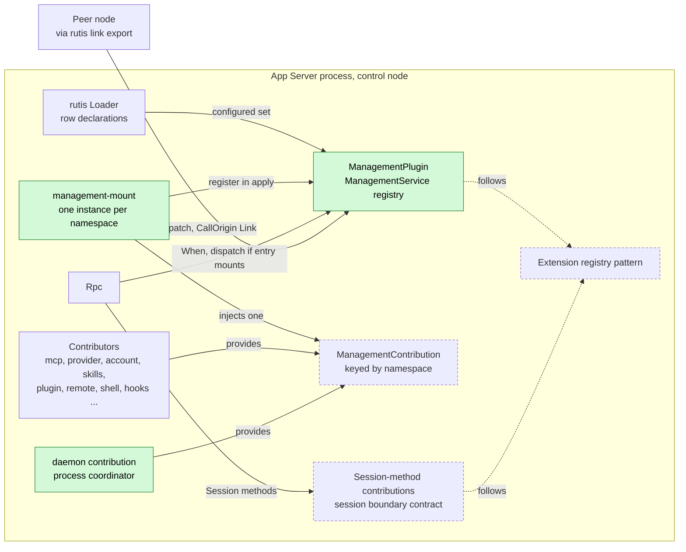
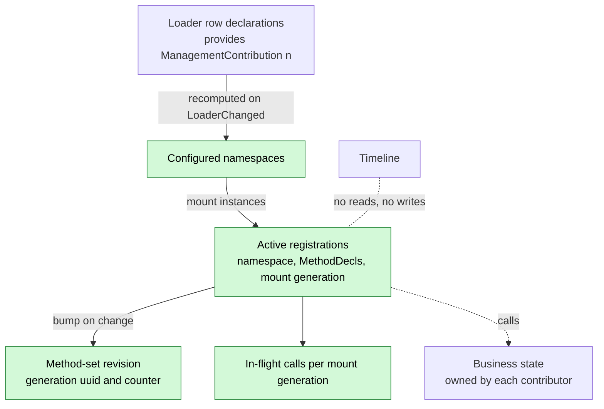
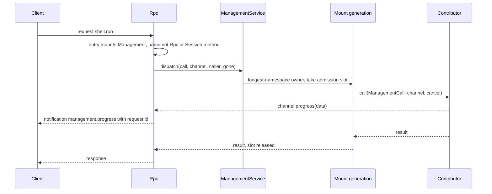
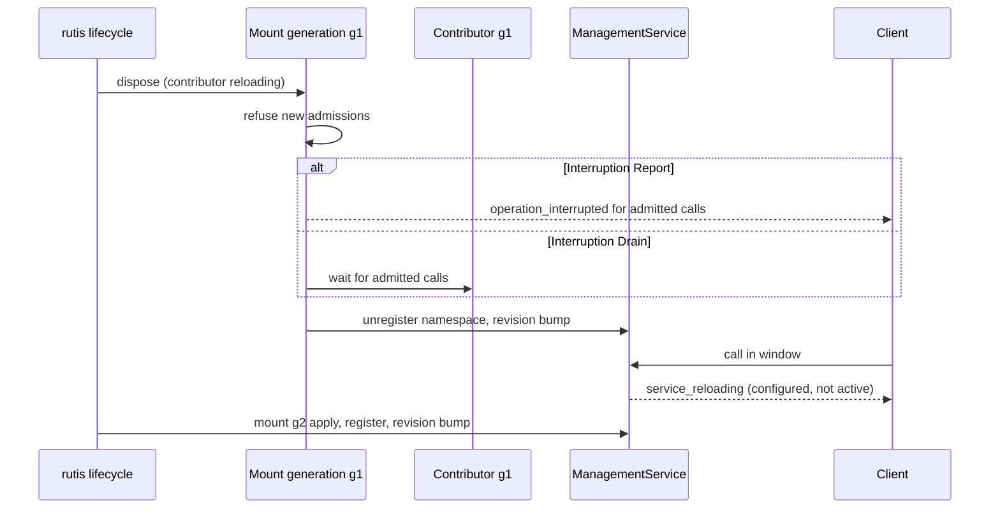
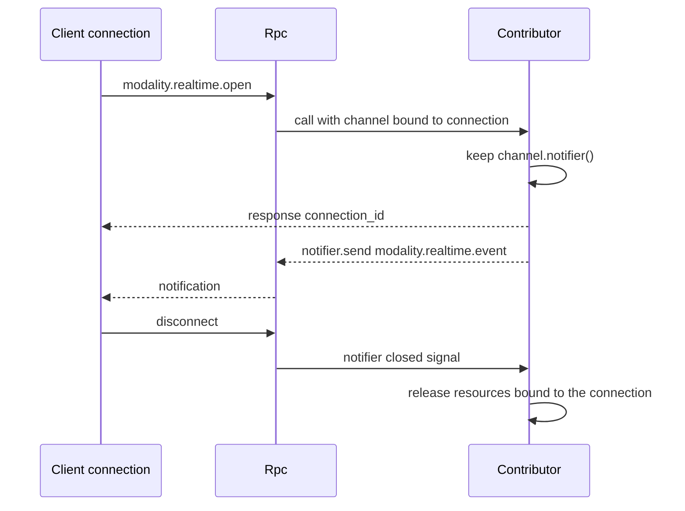
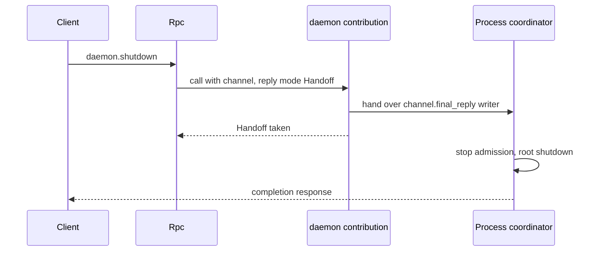
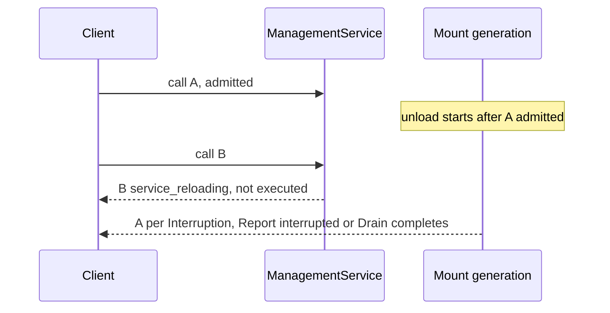

# Management

Status: Draft. Overall design: [overview §5.16](../overview.md#516-management), [common constraint 8](../overview.md#3-integration-methods), [§3.1 Multiple nodes](../overview.md#31-multiple-nodes), [§7.2 Rpc change](../overview.md#72-app-server-process-plugins). Phase: P0. Language: Rust.

Management is the management plane of the App Server process: a stable registry of management methods that process plugins contribute under their own namespaces, served as one dispatchable service and mounted on entries chosen by assembly (local RPC entry by default, never the RemoteGateway entry by default, other nodes only by explicit rutis link export). Mounting is the only authority; there are no identity tiers and no per-method authorization. Contributions follow the shared [extension registry](../contracts/extension-registry.md) pattern; this document defines what is specific to management methods: naming, interruption, the per-call progress sink, connection-bound notifications, reply handoff and the migration out of Rpc.

## 1. Structure



Management depends on no contributor: each mount instance injects the service and exactly one keyed contribution, so a contributor's reload or Pending state affects only its own namespace. Rpc injects Management optionally and routes non-Rpc names to it only on entries whose mount flag is set; Session-method contributions are a separate Rpc registry with the same pattern.

| Part | Scope | Depends on | Provides |
| --- | --- | --- | --- |
| `ManagementPlugin` | Process | `Arc<Loader>` | `ManagementService` (registry, dispatch, `management.methods`) |
| `management-mount` (instanced group) | Process, one per configured namespace | `ManagementService`, keyed `ManagementContribution` | Registration (no service) |
| Contributors | Process | their own dependencies | `ManagementContribution` keyed by namespace |
| `daemon` contribution | Process (process coordinator) | shutdown coordinator | `daemon.shutdown` (moved from Rpc, decision E21) |
| `RpcPlugin` (change) | Process | existing minus management services, `When<ManagementService>` | Session methods, entry mount gating |

Contracts defined here: `ManagementContribution`, `ManagementProvider`, `MethodDecl`, `Interruption`, `ManagementCall`, `CallChannel` (progress sink, connection notifier, reply handoff), `CallOrigin`, `ManagementError`, `ManagementService`, management naming rules. Contracts depended on: [extension registry](../contracts/extension-registry.md) (mount, discovery, configured vs active), rutis-loader `Loader`, Rpc entry mount flag and the [session boundary](../contracts/session-boundary.md) contract (Rpc's `SessionMethodContribution`, which shares these naming rules), rutis service export over links ([rutis nodes](https://github.com/arcships/rutis/blob/main/docs/guide/nodes.md)). Contributors depend only on this contract; Management never knows a contributor or a method's meaning.

## 2. Data and state



All Management state is in memory and rebuilt on every load from loader entries and mount `apply`; nothing is persisted and nothing enters the Timeline. The configured set (from declarations) versus the active set (registered mounts) decides `service_reloading` versus `unknown_method`.

## 3. Flows

### 3.1 Call on a mounting entry, with progress



Progress notifications are written through the same connection writer before the response, so the client sees them in order. A method that declares no progress sink gets a channel whose `progress` is a no-op.

### 3.2 Contributor reload



Only the reloading namespace is affected; other namespaces, Session methods and Rpc stay up. Unload never uses the capability-reloading reason (extension registry rule).

### 3.3 Connection-bound notifications



A notifier outlives the call but not the connection; its `closed()` future fires on disconnect, Rpc reload or entry close, and the contributor releases its resources. Notification names must lie in the contributor's namespace.

### 3.4 daemon.shutdown through reply handoff



`daemon.shutdown` keeps today's completion contract ([App Server shutdown completion](../../../crates/dim-app-server/README.md#shutdown-completion)); the only change is that it is a management method, so entries without the mount answer `unknown_method`.

## 4. Timing and conflicts



Admission order on the mount generation decides: calls admitted before unload follow their `Interruption`; calls after unload never execute. Management has no Timeline facts, so Timeline-sequence scenarios (interrupts, inputs, compaction, branch cuts) do not apply.

| Scenario | Outcome | Owner |
| --- | --- | --- |
| Two clients mutate the same configuration | Contributor's revision conflict (e.g. `mcp_settings_conflict`) | Contributor |
| Client disconnects mid-call | Call continues (detach is not cancel); progress dropped; notifier closed; `Report` cancel token fires | Contributor |
| Duplicate call after a lost reply | Executed twice unless the contributor is idempotent; clients read state before retrying a `mutating` method | Contributor, client |
| Namespace collision | Later registration rejected as a whole; first owner keeps names | Management |
| Contributor's resource node offline | That namespace `service_reloading`, or `node_unavailable` per call when it resolves nodes per call | Contributor |

Full table: [Appendix B](#appendix-b-full-conflict-table).

## 5. Context mapping

No model-visible effect. Management adds no tool, input, prompt source or Timeline event; management calls, progress, notifications and diagnostics are never projected into model context, in any Session, child branch or after compaction. A plugin that also offers the model an operation does so through a process-level tool with its own risk category ([process tool contribution](../contracts/process-tool-contribution.md)); management methods are never model tools.

## 6. Interfaces (summary)

| Interface | Kind | Purpose |
| --- | --- | --- |
| `ManagementContribution` / `ManagementProvider` | Service contract | A contributor's method list and `call` |
| `CallChannel` | Per-call port | Progress sink, connection notifier, final-reply handoff (R13) |
| `ManagementService::dispatch/methods` | Service | Rpc and link callers dispatch; list the active set |
| `management.methods` | Management method | Active methods and revision on this entry |
| `management.progress` | Notification | Per-call progress to the calling connection |
| `daemon.shutdown` | Management method | Moved from Rpc; `daemon` namespace |
| Rpc mount gating, `hello.features` | Rpc change | Route non-Rpc names to Management on mounting entries |
| Migration of `account.*`, `provider.*`, `skills.*`, `mcp.*` | Rpc change | Moved into contributions; wire-compatible |

Details: [Appendix A](#appendix-a-interface-details).

## 7. Security

Mounting is authority: an entry that mounts Management, or a peer to which it is exported, has host administrator rights, including changing approvals and configuration and running commands without Approval (overview §3.1). Defaults: the local protected transport mounts; the bare WebSocket entry and RemoteGateway do not; nothing is exported over links unless explicitly configured in host-local link configuration. `CallOrigin` is diagnostics only. Host-local approvals (`mcp.approve`, `hooks.approve`, `plugin.approve`, `workflow.approve`) are management methods that call the Settings host-local approval service, so they are unavailable on non-mounting entries. Credentials never appear in diagnostics, `management.methods`, progress, notifications or error messages; contributors keep today's redaction rules. Session methods are not gated by mounting: every entry that serves Session methods serves all of them (decision E3, [Appendix A.6](#a6-classification-migration-and-compatibility)).

## Appendix A. Interface details

### A.1 Contribution contract

```rust
/// Process service; key TypeKey::keyed_dynamic::<ManagementContribution>(namespace).
pub struct ManagementContribution(pub Arc<dyn ManagementProvider>);

pub trait ManagementProvider: Send + Sync + 'static {
    /// Complete method list of this generation; fixed for the generation (A5).
    fn methods(&self) -> Vec<MethodDecl>;
    /// Validates `params` at this boundary and executes. `cancel` fires only when
    /// the caller is gone AND the method is `Interruption::Report`; the provider
    /// may keep its admitted work (it owns that work).
    fn call(&self, call: ManagementCall, channel: CallChannel, cancel: CancellationToken)
        -> HostFuture<'_, Result<CallReply, ManagementError>>;
}
pub struct MethodDecl {
    pub name: String,                 // full wire name, e.g. "mcp.save"
    pub mutating: bool,               // changes host configuration or runs a command
    pub interruption: Interruption,
    pub progress: bool,               // emits management.progress (R13)
    pub notifications: Vec<String>,   // connection-bound notification names, inside the namespace
    pub reply: ReplyMode,             // Direct, or Handoff (daemon.shutdown only today)
}
pub enum Interruption {
    Report, // on Rpc or mount unload the caller receives operation_interrupted; may have committed
    Drain,  // unload waits for the call to finish
}
pub enum ReplyMode { Direct, Handoff }
pub enum CallReply { Value(serde_json::Value), HandedOff }
pub struct ManagementCall {
    pub method: String,
    pub params: serde_json::Value,    // raw JSON-RPC params, {} when absent
    pub origin: CallOrigin,           // diagnostics only, never authorization
}
pub enum CallOrigin {
    Local { connection_id: String },
    Entry { entry: String, connection_id: String },
    Link { peer: String },
}
pub struct ManagementError {
    pub code: i32,                    // -32602, -32601 or -32000
    pub app_error: Cow<'static, str>, // [a-z][a-z0-9_]*
    pub message: String,              // public text; never secrets
}
```

### A.2 Call channel (R13)

```rust
impl CallChannel {
    /// No-op unless the method declared `progress` and the caller has a connection.
    pub fn progress(&self, data: serde_json::Value);
    /// Connection-bound notifier; Err(Unsupported) for link callers without a sink
    /// or when the method declared no notifications.
    pub fn notifier(&self) -> Result<ConnectionNotifier, ChannelError>;
    /// Only for ReplyMode::Handoff: takes the connection's final-response writer.
    pub fn take_final_reply(&self) -> Result<FinalReply, ChannelError>;
}
impl ConnectionNotifier {
    pub fn send(&self, method: &str, params: serde_json::Value) -> Result<(), ChannelError>; // Gone after close
    pub fn closed(&self) -> impl Future<Output = ()>; // disconnect, Rpc reload, entry close
}
```

| Rule | Content |
| --- | --- |
| Progress wire form | Notification `management.progress {id: <request id>, method, data}`; ordered before the response on the same connection; dropped after disconnect (A13) |
| Progress rate | Rpc coalesces to the transport write budget; a slow client drops intermediate progress, never the response (A13) |
| Notification names | Must be declared in `MethodDecl.notifications` and lie in the contributor's namespace; others return `ChannelError::Undeclared` |
| Notifier lifetime | Valid after the call returns until the connection closes; `send` after close returns `Gone`; contributors release connection-bound resources on `closed()` |
| Link callers | `ManagementService::dispatch` takes an optional caller sink; without one, progress is dropped and `notifier()` returns `Unsupported` |
| Cross-language | Node contributors receive progress and notifier as host calls on the same rutis runtime row; envelope `{ok: true, value} \| {ok: false, error: {code, appError, message}}`; rutis 0.10 does not carry cancellation to Node, so `Report` callers are released while the Node call continues (A6) |

### A.3 Method naming

| Rule | Content |
| --- | --- |
| Namespace | The contribution key, `[a-z][a-z0-9_]*(\.[a-z][a-z0-9_]*)*`, owned by the contributor (overview common constraint 10) |
| Method name | `<namespace>.<segment>(.<segment>)*`, segments `[a-z][a-z0-9_]*`, at most 128 bytes |
| Ownership | Longest registered namespace prefix owns a name; sub-namespaces allowed (`account`, `account.codex`) |
| Reserved for Rpc | Exact names `hello`, `daemon.ping`; namespaces `session`, `approval`, `agent`; and every namespace Rpc reserves for Session-method contributions in the [session boundary](../contracts/session-boundary.md) contract |
| Reserved for Management | `management` |
| One wire name space | Rpc resolves built-ins first, then Session-method contributions, then Management; a management name shadowed by a Session-method namespace is unreachable and reported in diagnostics (A14) |
| Rejection | A list violating a rule or colliding with an active contribution is rejected as a whole; the earlier owner keeps its names (A7) |
| Stability | Wire names are stable across releases and languages ([overview §11.4](../overview.md#114-moving-from-ts-to-rust)) |

### A.4 Service and Management's own method

```rust
impl ManagementService {
    pub fn methods(&self) -> MethodSet;   // revision + active decls
    pub async fn dispatch(&self, call: ManagementCall, sink: Option<CallerSink>,
        caller_gone: CancellationToken) -> Result<CallReply, ManagementError>;
    pub fn register(&self, ctx: &Ctx, namespace: &str, provider: Arc<dyn ManagementProvider>)
        -> Result<(), ManagementError>;   // used only by management-mount
}
```

| Method | Params | Result |
| --- | --- | --- |
| `management.methods` | `{}` | `{revision: string, methods: [{name, namespace, mutating, progress, notifications}]}`, active methods sorted by name |

No change notification for the method set; a client re-reads `management.methods` after `unknown_method` or `service_reloading` (A8).

### A.5 Rpc change and mounting

| Item | Content |
| --- | --- |
| Routing | Rpc serves its built-ins and Session-method contributions; any other name on a v3 connection whose entry mounts Management is admitted as an ordinary command (request id, per-connection limit, command tracker) and dispatched with a `CallerSink` bound to the connection |
| Entry mount flag | Recorded per connection at accept time from entry assembly data: local transport `true` when Management is configured; bare WebSocket and RemoteGateway `false` unless assembly says otherwise ([RemoteGateway](RemoteGateway.md)); never derived from identity |
| `hello.features` (v3) | Protocol and Session features; on mounting entries also `management.methods`, the active management names and `daemon.shutdown.completed` when the `daemon` contribution is active |
| Not mounted, or v1/v2 | `-32601 unknown_method` |
| Configured but inactive namespace | `-32000 service_reloading` (retryable) |
| Link export | `ManagementService` exported through host-local link configuration; `CallOrigin::Link`; export is never a management method of the exported plane (A9) |
| Discovery and ready latch | Per [extension registry](../contracts/extension-registry.md): configured set from row declarations; the ready latch waits until initial mounts are Active or failed so the first `hello` sees the complete set (A3) |

### A.6 Classification, migration and compatibility

Sources: `MANAGEMENT_METHODS`, `MCP_METHODS`, `LOCAL_EXECUTION_METHODS`, `Call::is_management` in [protocol.rs](../../../crates/dim-app-server/src/protocol.rs); `validate_call` in [connection.rs](../../../crates/dim-app-server/src/connection.rs).

| Methods | Destination | Contributor (namespace) |
| --- | --- | --- |
| `account.providers/status/recover/logout`, `account.login.begin`, `account.login.browser.begin/complete`, `account.login.status/cancel` | Management | `ManagedProvidersPlugin` (`account`) |
| `account.codex.*`, `account.grok.*` | Management | `OpenAICodexOAuthPlugin` (`account.codex`), `GrokOAuthPlugin` (`account.grok`) |
| `provider.*` | Management | `ProviderPlugin` (`provider`) |
| `skills.catalog/set_enabled/refresh` | Management | `SkillsCatalogPlugin` (`skills`) |
| `mcp.catalog/set_enabled/save/remove/disconnect/approve/revoke` | Management | `McpPlugin` (`mcp`) |
| `daemon.shutdown` | Management | process coordinator (`daemon`), reply handoff (E21) |
| `session.create/list/summaries/attach/detach/submit/input_lookup/history/stop/idle/close/branch_create`, `approval.respond`, `session.permission.get/update`, `session.exec.stop`, `session.skills`, `session.model.update`, `session.prompt.refresh`, `session.mcp`, `session.mcp.refresh` | Rpc Session methods | — |
| `agent.create/list/close` | Rpc (Session-plane directory) | — (E21) |
| `hello`, `daemon.ping` | Rpc protocol | — |
| New plugin Session methods (`session.goal.*`, `session.input.withdraw`, `session.question.respond`, `session.rename`, `attachment.put`) | Rpc `SessionMethodContribution` ([session boundary](../contracts/session-boundary.md)) | each owner |

Interruption reproduces today: `mcp.*`, `skills.*` are `Report`; `account.*`, `provider.*` are `Drain`. After migration Rpc no longer injects `ProductServices` or the management part of `ExecutionServices`; a Provider or Mcp restart no longer reloads Rpc.

| Client | Before | After |
| --- | --- | --- |
| v1, v2 | Management methods `unknown_method` | Same |
| v3 local, product profile | `hello.features` has the 33 product names | Same names (active at hello) plus `management.methods`; params, results, codes and `appError` unchanged |
| v3 local, execution | `LOCAL_EXECUTION_METHODS` + `MCP_METHODS` in features | Same names; `session.*` from Rpc's list, `skills.*`/`mcp.*` from Management |
| v3 bare WebSocket, protected profile | All but `hello`/`daemon.ping` `local_transport_required` | Same |
| v3 RemoteGateway entry (new) | Did not exist; execution Session methods (`session.permission.get/update`, `session.exec.stop`, `session.skills`, `session.model.update`, `session.prompt.refresh`, `session.mcp`, `session.mcp.refresh`) were local-only | **Compatibility change (E3):** these become available to paired remote devices together with all other Session methods; management names and `daemon.shutdown` are `unknown_method` |
| v3, MCP absent | `mcp.*` `unknown_method` ("MCP integration is unavailable") | `unknown_method` with Management's message (A11) |
| v3 calling `daemon.shutdown` on a non-mounting entry | Gated as a protected method | `unknown_method` |

No protocol version is added; persistence formats are unchanged.

## Appendix B. Full conflict table

| Scenario | Sequence order | Outcome | Owner of the decision |
| --- | --- | --- | --- |
| Turn or branch interrupt, branch close, Steer/Queue/Append, unsettled tool batch, compaction, child branch cut, `input/withdrawn` | — | No effect: Management reads and writes no Timeline; contributors writing Session input do so through their owners' ports and own those rows | Contributor |
| Two clients mutate the same configuration | storage revision | Second gets the contributor's conflict | Contributor |
| Contributor reload with a `Report` call | admitted < unload | `operation_interrupted`; may have committed | Mount, contributor |
| Contributor reload with a `Drain` call | admitted < unload | Unload waits | Mount |
| Call during contributor reload | unload < call | `service_reloading`; not executed | Management |
| Contributor reload with live notifiers | — | Its disposer closes its notifiers and releases connection-bound resources | Contributor |
| Rpc reload with calls in flight | admitted < unload | `Report` interrupted, `Drain` drained, new calls `service_reloading`; all notifiers `closed()` | Rpc |
| Management reload | — | Mounts and Rpc's Management routing reload; window calls `service_reloading`; contributors unaffected | rutis lifecycle |
| Duplicate or late call | two admissions | Executed twice unless idempotent | Contributor, client |
| Client detaches or disconnects mid-call | — | Call continues; reply and progress dropped; notifiers closed; `Report` cancel fires | Contributor |
| Namespace collision | second registration | Rejected | Management |
| Management name shadowed by a Session-method namespace | — | Unreachable; diagnostic | Rpc |
| Method set changes between `hello` and a call | — | Current set decides | Management |
| Contributor's resource node offline | — | Per-call `node_unavailable` (node resolved per call) or namespace `service_reloading` | Contributor |
| Link drops mid-call | — | Peer sees a link error; call continues | rutis link, contributor |
| `daemon.shutdown` concurrent with another management call | admission | Coordinator stops admission, then settles admitted calls per `Interruption` | Process coordinator |
| Process restart mid-call | — | Reply lost; outcome per contributor persistence; not replayed | Contributor |
| Session unload/restore | — | No effect | — |

## Appendix C. Errors and recovery

| Case | Result |
| --- | --- |
| Invalid params | Contributor returns `-32602 invalid_params` |
| Not served on this entry, v1/v2, unknown name | `-32601 unknown_method` |
| Namespace configured, mount not Active | `-32000 service_reloading` |
| Mount unloading with a `Report` call | `-32000 operation_interrupted`, "the operation may already have committed. Read the current state before retrying" |
| Contribution rejected | Not registered; diagnostics name the row and names |
| Contributor panics in `call` | `-32000 management_failed`; mount stays registered (A12) |
| Malformed cross-language envelope | `-32000 management_failed`; reply text not forwarded |
| Process restart | Nothing persisted; discovery and mounts rebuild before the ready latch opens |

## Appendix D. Acceptance

Flow tests in the App Server suite, through the wire protocol only:

1. v3 local product and execution profiles: `hello.features` equals today's sets plus `management.methods`; a recorded transcript of every migrated method matches the pre-migration transcript.
2. v1 and v2 receive `unknown_method` for management names; the bare WebSocket entry of a protected profile receives `local_transport_required`.
3. Restarting Mcp yields `service_reloading` for `mcp.*` while `provider.*`, `skills.*` and Session methods succeed; the revision changes.
4. A test contributor with a blocked `Report` method is reloaded: `operation_interrupted`; a `Drain` method delays the reload.
5. A second contribution claiming `mcp.save` is rejected; `account.codex` coexists with `account`; a contribution under `session` is rejected.
6. A progress-declaring test method emits `management.progress` before its response; after disconnect the call completes and later progress is dropped.
7. A notifier-holding test method sends notifications after its response; disconnect fires `closed()`; `send` then returns `Gone`.
8. `daemon.shutdown` on the local entry keeps the completion contract; on a non-mounting entry returns `unknown_method`.
9. On a RemoteGateway test entry, `session.permission.update` and `session.exec.stop` succeed; management names fail `unknown_method`.
10. With Management exported over a test rutis link, the peer calls `mcp.catalog`; without export it is unreachable.

## Appendix E. Assumptions

| # | Assumption | Basis | Effect if rejected |
| --- | --- | --- | --- |
| A1 | Per-namespace mount instances instead of aggregated injection | [Extension registry](../contracts/extension-registry.md) (decision R2) | One Pending contributor disables the whole plane |
| A2 | Contributors are discovered from loader row declarations | Extension registry; [single-tree](../../architecture/rust-agent/single-tree.md) "dynamic sources through a declared management service" | An explicit contributor list |
| A3 | The ready latch waits for initial mounts | Judgment (preserve `hello.features`) | Clients call `management.methods` |
| A4 | Revision `"<generation uuid>:<counter>"` | Judgment | Any never-reused scheme |
| A5 | A contribution's method list is fixed per generation | Judgment | A change signal on the contribution |
| A6 | Node contributors are not cancelled; callers released | rutis 0.10 limitation, App Server README | — |
| A7 | Collisions reject the newcomer | Judgment | Ownership could flap with load order |
| A8 | No method-set change notification | Judgment | A `management.changed` notification |
| A9 | Export configured host-locally only | Overview §3.1 | Peers could widen their exports |
| A10 | `daemon.shutdown` uses a reply handoff mode | Decision E21; App Server shutdown completion | A coordinator-specific Rpc path |
| A11 | Messages may change; codes and `appError` do not | Judgment | Contributors reproduce exact texts |
| A12 | `management_failed` as generic failure code | Judgment | Another name |
| A13 | Progress is a `management.progress` notification keyed by request id, coalesced, dropped on disconnect | Decision R13; judgment on wire form | Another wire form or a Session-method stream |
| A14 | Cross-plane name precedence: Rpc built-ins, Session methods, then Management | Judgment | A shared reservation service checked by both registries |

## Appendix F. Open questions

| Question | Description |
| --- | --- |
| Loader declaration read API | Reading row declarations through the `Loader` handle needs confirming against rutis-loader 0.10; tracked in the [extension registry](../contracts/extension-registry.md) |
| Overview §7.2 Rpc row | Records only "carries only Session methods"; it should also record `hello`, `daemon.ping` and `agent.*` staying in Rpc, `daemon.shutdown` moving to Management, the Session-method registry and the E3 compatibility change |
