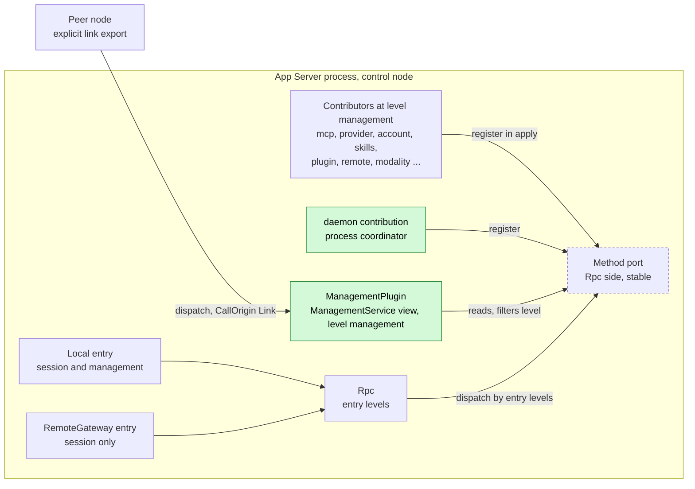
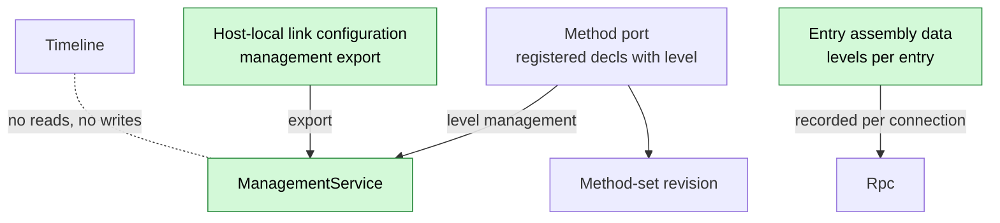
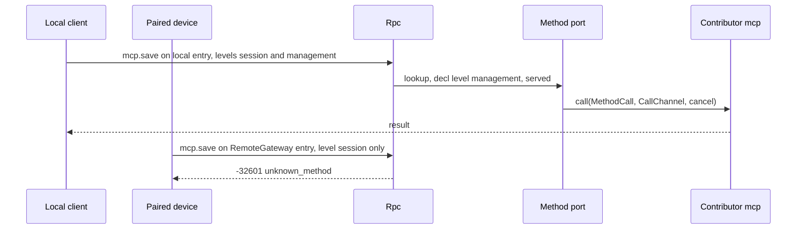
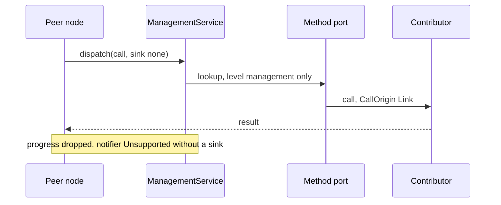
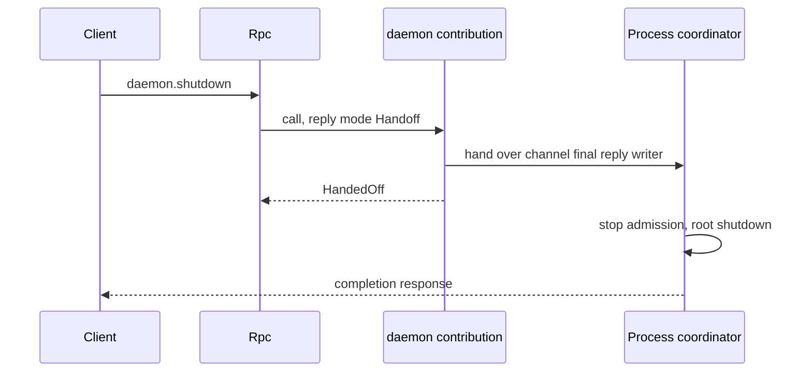

# Management

Status: Draft. Overall design: [overview B.16](../overview.md#b16-management), [common constraints](../overview.md#62-constraints), [multiple nodes](../overview.md#63-multiple-nodes), [Rpc change](../overview.md#c2-app-server-process-plugins), [ADR 002](../../adr/002-dependency-direction.md). Phase: P0. Language: Rust.

Management is the management plane of the App Server process: the methods registered at `level: management` in Rpc's method port ([method contribution](../contracts/session-boundary.md#a1-method-port)). The contract (`MethodDecl`, `Interruption`, `CallChannel`, naming, reserved names, precedence) lives in [session boundary](../contracts/session-boundary.md); this document defines only what is specific to the management level: which entries serve it, its export over rutis links and the authority that grants, `management.methods`, `daemon.shutdown`, and the migration of existing methods out of Rpc's own table.

## 1. Structure



Management owns no registration: every contributed method, at either level, registers in Rpc's one method port (ADR 002 D2), and Rpc dispatches a name only when the calling entry serves that method's level. `ManagementService` is a level-filtered view of the port, the unit that a host-local link configuration may export to a peer. Loader rows never make a name reachable: registration state in the port alone decides it.

| Part | Scope | Depends on | Provides |
| --- | --- | --- | --- |
| `ManagementPlugin` | Process | method port | `ManagementService` (management-level dispatch and listing), `management.methods` |
| `daemon` contribution | Process (process coordinator) | shutdown coordinator, method port | `daemon.shutdown` at level management (decision E21) |
| `RpcPlugin` (change) | Process | AgentIndex, ConnectionHub, ServerControl, method port | Per-entry levels; built-ins first, then registered methods |
| Contributors | Process | their own dependencies, method port | Methods with `level: management`, registered in `apply`, removed in `ctx.effect` |

Contracts defined here: the management level's entry and export rules, `ManagementService`, `management.methods`, the migration and compatibility tables. Contracts depended on: [method contribution](../contracts/session-boundary.md#a1-method-port) (including `CallChannel` and precedence), rutis service export over links ([rutis nodes](https://github.com/arcships/rutis/blob/main/docs/guide/nodes.md)). Management never knows a contributor or a method's meaning, and neither Management nor Rpc reloads when a contributor does.

## 2. Data and state



Management state is in memory and rebuilt on every load; entry levels are entry assembly data and link export is host-local structural configuration, never a method of the exported plane. Nothing enters the Timeline.

## 3. Flows

### 3.1 Same name on a serving and a non-serving entry



The entry's levels are the only check: a management method is unknown on an entry that does not serve the level, regardless of who is connected.

### 3.2 Peer call over an exported link



Export grants the peer host administrator rights; it is configured only host-locally (A2). Export uses rutis link semantics unchanged.

### 3.3 daemon.shutdown through reply handoff



`daemon.shutdown` keeps today's completion contract ([App Server shutdown completion](../../../crates/dim-app-server/README.md#shutdown-completion)); entries that do not serve the management level answer `unknown_method`.

## 4. Timing and conflicts

Management has no Timeline facts; unload, interruption and collision rules are the [method contribution](../contracts/session-boundary.md) rules. Rows specific to the management level:

| Scenario | Outcome | Owner |
| --- | --- | --- |
| Contributor unloads | Its names return `service_reloading` while it unloads, then leave the port (`unknown_method` until it registers again); its own in-flight calls end per `Interruption` (`Report`: `operation_interrupted`; `Drain`: the unload waits); Rpc and Management do not reload | Contributor, Rpc |
| Link drops mid-call | Peer sees a link error; call continues | rutis link, contributor |
| `daemon.shutdown` concurrent with another call | Coordinator stops admission, then settles admitted calls per `Interruption` | Process coordinator |
| Management reload | Link export and `management.methods` briefly `service_reloading`; local-entry dispatch through the port unaffected | rutis lifecycle |
| Two clients mutate the same configuration | Contributor's revision conflict (e.g. `mcp_settings_conflict`) | Contributor |

Full table: [Appendix B](#appendix-b-full-conflict-table).

## 5. Context mapping

No model-visible effect. Management methods are never model tools and their calls, progress, notifications and diagnostics never enter model context. A plugin that offers the model an operation does so through a [process tool](../contracts/process-tool-contribution.md) with its own risk category.

## 6. Interfaces (summary)

| Interface | Kind | Purpose |
| --- | --- | --- |
| Method registration with `level: management` | Contract ([session boundary](../contracts/session-boundary.md#a1-method-port)) | How contributors add management methods |
| `ManagementService::dispatch/methods` | Service | Management-level view; exported over links |
| `management.methods` | Management method | Registered management methods and revision on this entry |
| `daemon.shutdown` | Management method | Moved from Rpc; `daemon` namespace |
| Levels per entry | Rpc change | Local entry both levels; RemoteGateway session only |
| Migration of `account.*`, `provider.*`, `skills.*`, `mcp.*` | Rpc change | Moved into registrations; wire-compatible |

## 7. Security

The served level is authority: an entry that serves the management level, or a peer to which `ManagementService` is exported, has host administrator rights, including changing approvals and configuration and running commands without Approval. Defaults: the local protected transport serves both levels; the bare WebSocket entry keeps today's protected-profile rules; RemoteGateway serves `session` only; nothing is exported unless configured in host-local link configuration. There are no identity tiers or per-method authorization; `CallOrigin` is diagnostics only. Host-local approvals (`mcp.approve`, `hooks.approve`, `plugin.approve`, `workflow.approve`) are management methods. Session-level methods are not gated by identity: every entry serving `session` serves all of them (decision E3).

## Appendix A. Interface details

### A.1 Entry levels and export

| Item | Content |
| --- | --- |
| Entry levels | Recorded per connection at accept time from entry assembly data (`ConnectionEntry.levels`): local transport `{session, management}` when Management is configured; RemoteGateway `{session}` ([RemoteGateway](RemoteGateway.md)); never derived from identity |
| Dispatch | Rpc built-ins first, then the method port; a name that is not registered, or whose level the entry does not serve, is `-32601 unknown_method` |
| Link export | `ManagementService` exported through host-local link configuration with rutis link semantics unchanged; dispatches only `level: management`; `CallOrigin::Link`; without a caller sink, progress is dropped and `notifier()` returns `Unsupported` |
| `hello.features` (v3) | Built-ins and registered methods of the entry's levels; `daemon.shutdown.completed` when the `daemon` contribution is registered |
| v1/v2 | Contributed management names `-32601 unknown_method` |
| Ready latch | Opens after the loader's initial load settles, so contributors that register in `apply` are present at the first `hello`; a contributor still Pending is absent (A1) |

### A.2 Service and Management's own method

```rust
impl ManagementService {
    pub fn methods(&self) -> MethodSet;   // revision + registered level-management decls
    pub async fn dispatch(&self, call: MethodCall, sink: Option<CallerSink>,
        caller_gone: CancellationToken) -> Result<CallReply, MethodError>;
}
```

| Method | Params | Result |
| --- | --- | --- |
| `management.methods` | `{}` | `{revision, methods: [{name, namespace, mutating, progress, notifications}]}`, registered management methods sorted by name |

No change notification; a client re-reads `management.methods` after `unknown_method` or `service_reloading` (A3).

### A.3 Classification, migration and compatibility

Sources: `MANAGEMENT_METHODS`, `MCP_METHODS`, `LOCAL_EXECUTION_METHODS`, `Call::is_management` in [protocol.rs](../../../crates/dim-app-server/src/protocol.rs); `validate_call` in [connection.rs](../../../crates/dim-app-server/src/connection.rs).

| Methods | Destination | Contributor (namespace) |
| --- | --- | --- |
| `account.providers/status/recover/logout`, `account.login.begin`, `account.login.browser.begin/complete`, `account.login.status/cancel` | level management | `ManagedProvidersPlugin` (`account`) |
| `account.codex.*`, `account.grok.*` | level management | `OpenAICodexOAuthPlugin` (`account.codex`), `GrokOAuthPlugin` (`account.grok`) |
| `provider.*` | level management | `ProviderPlugin` (`provider`) |
| `skills.catalog/set_enabled/refresh` | level management | `SkillsCatalogPlugin` (`skills`) |
| `mcp.catalog/set_enabled/save/remove/disconnect/approve/revoke` | level management | `McpPlugin` (`mcp`) |
| `daemon.shutdown` | level management | process coordinator (`daemon`), reply handoff (E21) |
| `session.create/list/summaries/attach/detach/submit/input_lookup/history/stop/idle/close/branch_create`, `approval.respond`, `session.permission.get/update`, `session.exec.stop`, `session.skills`, `session.model.update`, `session.prompt.refresh`, `session.mcp`, `session.mcp.refresh` | Rpc built-ins (Session) | — |
| `agent.create/list/close` | Rpc built-ins | — (E21) |
| `hello`, `daemon.ping` | Rpc protocol | — |
| New plugin methods (`session.goal.*`, `session.input.withdraw`, `session.question.respond`, `session.rename`, `attachment.put`) | level session, [method contribution](../contracts/session-boundary.md#a1-method-port) | each owner |

Interruption reproduces today: `mcp.*`, `skills.*` are `Report`; `account.*`, `provider.*` are `Drain`. After migration Rpc no longer injects `ProductServices` or the management part of `ExecutionServices`; a Provider or Mcp restart no longer reloads Rpc (ADR 002 A3).

| Client | Before | After |
| --- | --- | --- |
| v1, v2 | Management methods `unknown_method` | Same |
| v3 local, product profile | `hello.features` has the 33 product names | Same names (registered at hello) plus `management.methods`; params, results, codes and `appError` unchanged |
| v3 local, execution | `LOCAL_EXECUTION_METHODS` + `MCP_METHODS` in features | Same names; `session.*` from Rpc, `skills.*`/`mcp.*` registered |
| v3 bare WebSocket, protected profile | All but `hello`/`daemon.ping` `local_transport_required` | Same |
| v3 RemoteGateway entry (new) | Did not exist; execution Session methods (`session.permission.get/update`, `session.exec.stop`, `session.skills`, `session.model.update`, `session.prompt.refresh`, `session.mcp`, `session.mcp.refresh`) were local-only | **Compatibility change (E3):** available to paired devices with all other Session methods; management names and `daemon.shutdown` `unknown_method` |
| v3, MCP absent or reloading | `mcp.*` `unknown_method` ("MCP integration is unavailable"); `service_reloading` during a restart | `unknown_method` with Rpc's message while Mcp is not registered (A4) |
| v3 calling `daemon.shutdown` on a non-serving entry | Gated as a protected method | `unknown_method` |

No protocol version is added; persistence formats are unchanged.

## Appendix B. Full conflict table

Contribution-level rows (unload with `Report`/`Drain`, calls during unload, namespace collision, detach, duplicate calls, Rpc reload) are in [session boundary](../contracts/session-boundary.md).

| Scenario | Sequence order | Outcome | Owner of the decision |
| --- | --- | --- | --- |
| Turn or branch interrupt, branch close, Steer/Queue/Append, unsettled tool batch, compaction, child branch cut, `input/withdrawn`, Session unload/restore | — | No effect: Management reads and writes no Timeline | — |
| Management method called on a session-only entry | — | `unknown_method` | Rpc |
| Contributor unloads or restarts | — | Its names `service_reloading` while it unloads, then `unknown_method` until it registers again; its in-flight calls end per `Interruption` (`Report`: `operation_interrupted`; `Drain`: the unload waits); Rpc and Management do not reload | Contributor, Rpc |
| Two clients mutate the same configuration | storage revision | Second gets the contributor's conflict | Contributor |
| Management reload | — | Export and `management.methods` `service_reloading` in the window; contributors and local dispatch unaffected | rutis lifecycle |
| Method set changes between `hello` and a call | — | Current registrations decide | Method port |
| Contributor's resource node offline | — | Per-call `node_unavailable` | Contributor |
| Link drops mid-call | — | Peer sees a link error; call continues | rutis link, contributor |
| `daemon.shutdown` concurrent with another call | admission | Coordinator stops admission, then settles admitted calls per `Interruption` | Process coordinator |
| Process restart mid-call | — | Reply lost; outcome per contributor persistence; not replayed | Contributor |

## Appendix C. Errors and recovery

| Case | Result |
| --- | --- |
| Level not served on this entry, name not registered, v1/v2 | `-32601 unknown_method` |
| Other errors (`invalid_params`, `service_reloading`, `operation_interrupted`, contributor failure) | Per [method contribution](../contracts/session-boundary.md) |
| Process restart | Nothing persisted; registrations rebuild before the ready latch opens |

## Appendix D. Acceptance

Flow tests in the App Server suite, through the wire protocol only:

1. v3 local product and execution profiles: `hello.features` equals today's sets plus `management.methods`; a recorded transcript of every migrated method matches the pre-migration transcript.
2. v1 and v2 receive `unknown_method` for management names; the bare WebSocket entry of a protected profile receives `local_transport_required`.
3. Restarting Mcp yields `unknown_method` for `mcp.*` until it registers again, while `provider.*`, `skills.*` and Session methods succeed and Rpc does not reload.
4. `daemon.shutdown` on the local entry keeps the completion contract; on a session-only entry returns `unknown_method`.
5. On a RemoteGateway test entry, `session.permission.update` and `session.exec.stop` succeed; management names fail `unknown_method`.
6. With Management exported over a test rutis link, the peer calls `mcp.catalog` but not a session-level method; without export it is unreachable.

## Appendix E. Assumptions

| # | Assumption | Basis | Effect if rejected |
| --- | --- | --- | --- |
| A1 | The ready latch opens after the loader's initial load settles | Judgment (preserve `hello.features`) | Clients call `management.methods` |
| A2 | Export configured host-locally only | Overview multiple nodes | Peers could widen their exports |
| A3 | No method-set change notification | Judgment | A `management.changed` notification |
| A4 | Messages may change; codes and `appError` do not; an unregistered namespace is `unknown_method`, not `service_reloading` | Judgment; ADR 002 | Contributors reproduce exact texts; Rpc keeps a namespace list |
| A5 | `daemon.shutdown` uses a reply handoff mode | Decision E21; App Server shutdown completion | A coordinator-specific Rpc path |

## Appendix F. Open questions

None.
