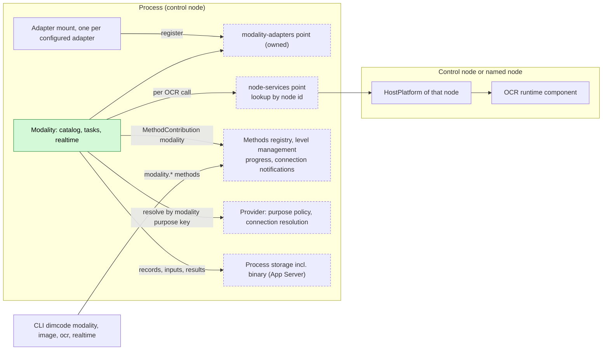
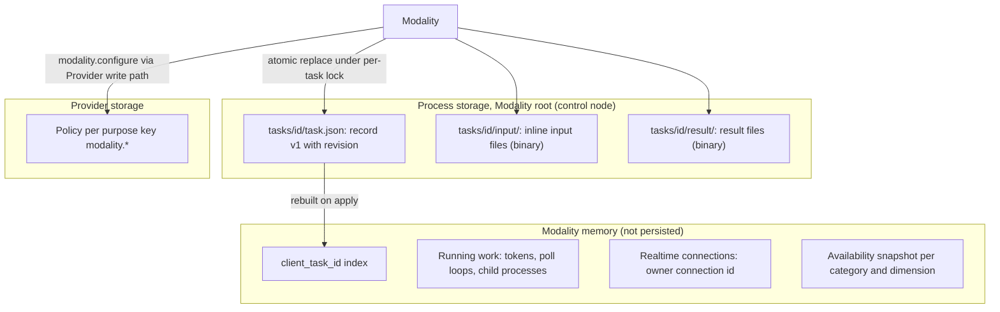
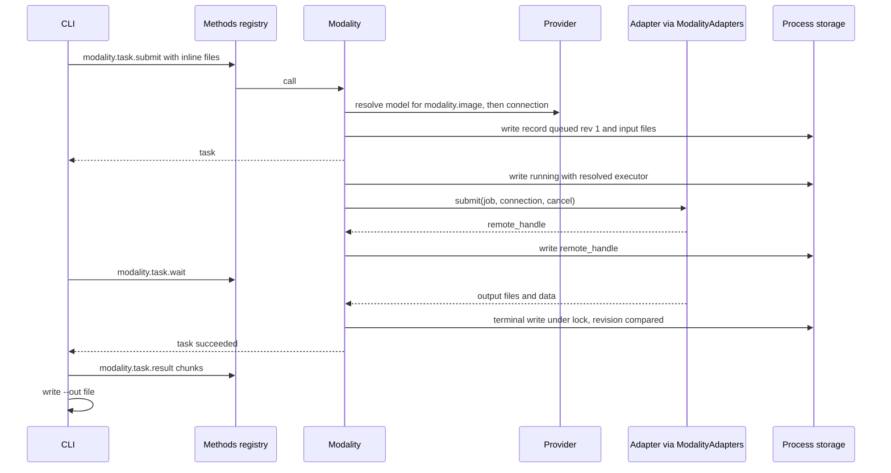
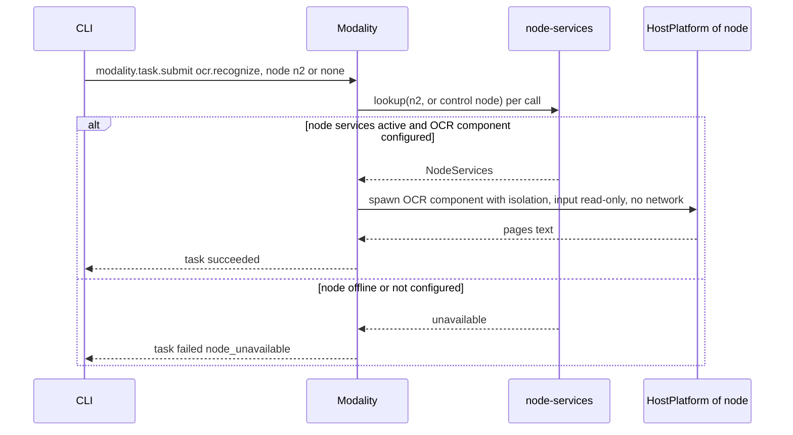
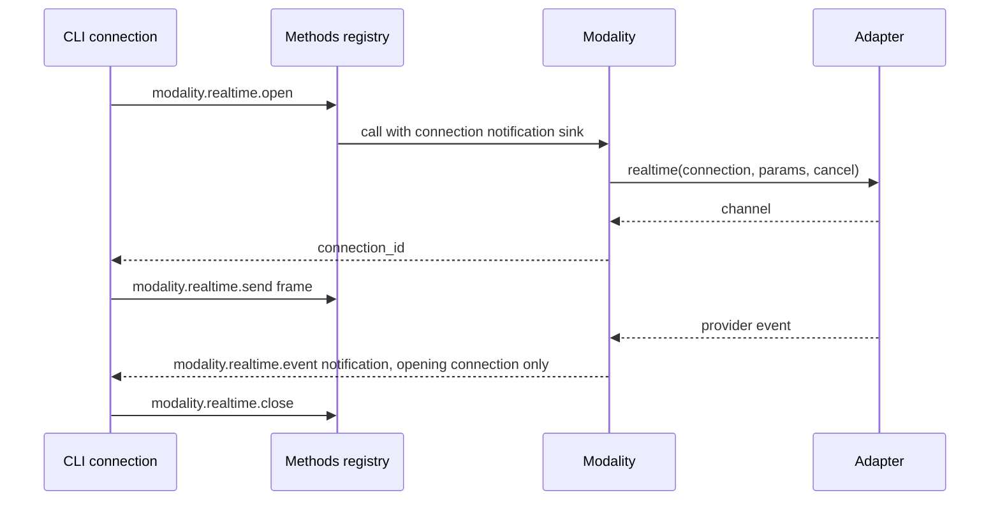
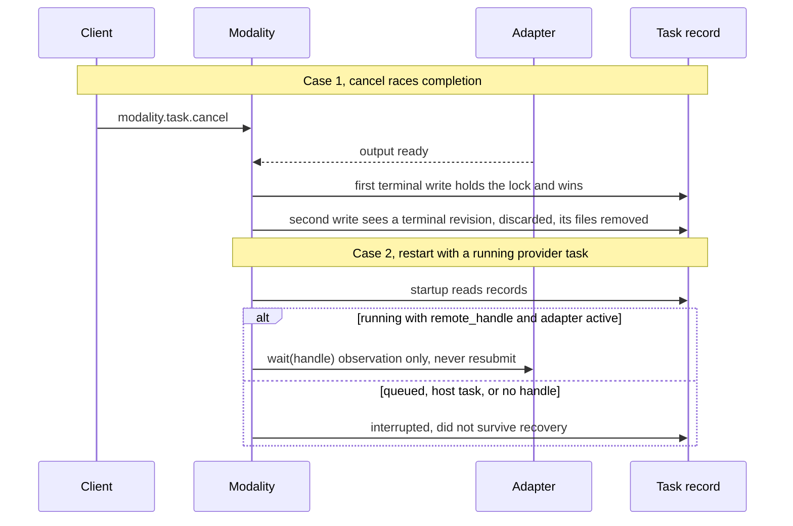

# Modality

Status: Draft. Overall design: [overview B.14](../overview.md#b14-modality). Phase: P3. Language: TypeScript first for provider-executed categories; OCR depends on the OCR runtime component ([overview F.3](../overview.md#f3-assignment)).

Modality is a process plugin and the single entry for non-conversational multimodal work in nine categories: image, video, speech, music, audio, 3D asset, motion, realtime and OCR. It reports availability per category with reasons, resolves the default model by a Modality-owned purpose key, runs asynchronous tasks (submit, status, wait, cancel) stored through the process storage contract, and holds realtime connections bound to the opening client connection. Provider adapters plug in through the `modality-adapters` extension point; OCR runs through the `NodeServices` of the control node by default or of a named node, looked up per call through `node-services`. It writes no Timeline events and contributes no model-visible tool.

## 1. Structure



Modality injects only the adapter registry and the node-services lookup, so an adapter reload or an offline OCR node changes availability and never reloads Modality. No Session or branch plugin depends on Modality.

| Part | Scope | Depends on | Provides |
| --- | --- | --- | --- |
| `Modality` | Process (control node) | Provider purpose selection, purpose-policy write path and non-conversational connection resolution; process storage (UTF-8 and binary); `modality-adapters` registry (own); `node-services` lookup; diagnostics | `ModalityTasks` process service; `MethodContribution` `modality` (level management) |
| `modality-adapters` registry | Process, inside Modality | — | Defines `ModalityAdapter`; name → adapter with availability |
| Adapter mount (per configured adapter) | Process | `modality-adapters` registry, keyed adapter service | Registration |

**Contracts depended on:** the [extension registry](../contracts/extension-registry.md) pattern and its per-call `node-services` lookup; the [method contribution](../contracts/session-boundary.md#a1-method-contribution) contract with its progress sink and connection-bound notifications ([call channel](../contracts/session-boundary.md#a2-call-channel)); Provider's per-purpose policy storage with its single write path and non-conversational connection resolution ([overview C.2](../overview.md#c2-app-server-process-plugins)); the App Server process storage contract with binary atomic replace; HostPlatform spawn with isolation ([HostPlatform](../../architecture/rust-agent/plugins/HostPlatform.md), isolation supplement in [overview C.1](../overview.md#c1-branch-and-session-capabilities)).
**Contracts defined here:** category and operation identifiers; purpose keys `modality.<category>` and `modality.<category>.<operation>` (opaque to Provider); the `modality-adapters` point and `ModalityAdapter`; the `ModalityTasks` service; task record and result formats (format version 1); the `modality.*` methods and the `modality.realtime.event` notification. Provider knows nothing about modalities; Modality knows no provider-specific semantics outside its built-in adapters.

## 2. Data and state



Task records are the only durable state; the index is rebuilt from them on `apply`, and non-terminal records are settled by the startup rule (§4). Running work and realtime connections are never rebuilt. Defaults live only in Provider. No Timeline state, no `StateCell`; ordering of competing writes uses the record `revision` under the per-task lock.

## 3. Flows

### 3.1 Submit, wait and retrieve (`dimcode image generate`)



The CLI reads inputs and writes outputs itself; Modality writes only inside its storage root (A7).

### 3.2 OCR on the control node or a named node



Modality has no Session, so OCR runs on the control node unless the caller names a node; an offline node fails only tasks on that node (A15).

### 3.3 Realtime connection



A connection closes on `close`, when the opening client connection ends, after 10 minutes idle (A9), on Modality unload or adapter unload, and on process exit. It has no task record and is never resumed.

### 3.4 Capability listing and default model

`dimcode modality` calls `modality.capabilities` and lists all nine categories. Each unavailable category or operation is shown with its reason per dimension, for example "not in this build", "OCR component not installed", "no adapter", "not configured" (decision E16). Nothing is hidden and there is no `--all`. `dimcode modality set-default image <provider>/<model>` calls `modality.configure`, which validates that an adapter serves that model for that operation and then calls Provider's single purpose-policy write path for `modality.image`.

## 4. Timing and conflicts

Modality is not branch work: turn and branch facts never affect tasks. Races are decided by the task record `revision` under the per-task lock.



| Scenario | Outcome | Owner |
| --- | --- | --- |
| Adapter mount unloaded mid-task | Its tasks: local tokens cancelled; with a handle they stay `running` and resume when the adapter is active again (A12); without a handle `interrupted`; availability flag false | Modality |
| Modality unload | `modality.*` returns `service_reloading`; disposer cancels local work, terminates OCR processes, closes realtime connections, writes `interrupted` for host tasks and tasks without handle | Methods registry, Modality |
| Duplicate `submit` with the same `client_task_id` | Existing task returned | Modality |
| Client detach while waiting | Task continues; that client's realtime connections close | Modality |

Full table in Appendix B.

## 5. Context mapping

No model-visible effect. Modality contributes no tool, prompt source, input or Timeline fact (decision E16, A13). A result reaches a model only when a user puts it into a Session by ordinary means (an `@` file reference, an attachment, pasted text), which are input facts owned by their plugins. The model never sees task records, availability, defaults, progress or diagnostics. Compaction, child branches and non-interactive Sessions are therefore unaffected.

## 6. Interfaces (summary)

| Interface | Kind | Purpose |
| --- | --- | --- |
| `modality.capabilities` | Method, level management | Every category and operation with availability reasons and default model |
| `modality.configure` | Method, level management | Validate, then set or clear the default through Provider's purpose-policy write path |
| `modality.task.submit/status/list/wait/cancel/result` | Methods, level management | Task lifecycle; chunked binary result retrieval |
| `modality.realtime.open/send/close`, `modality.realtime.event` | Methods, level management, and connection-bound notification | Realtime connection |
| `ModalityTasks` | Process service | Same operations, typed, for other plugins |
| `ModalityAdapter` / `modality-adapters` | Extension point | Provider-executed categories |
| `node-services` lookup | Depended on | OCR on a node |
| `dimcode modality`, `image`, `video`, `speech`, `music`, `audio`, `asset`, `motion`, `ocr`, `realtime` | CLI | Thin clients of the methods |

Details in Appendix A.

## 7. Security

- All `modality.*` methods are `level: management` (they spend provider credit and run host processes), available only on entries that mount that level ([Management](Management.md#a1-mounting-and-export)).
- Credentials are resolved by Provider per call; never in records, results, diagnostics or errors.
- The OCR component is an installed executable, not project content; started through the executing node's HostPlatform with that node's isolation, input read access only, no network (A14). Its path is host configuration, never request data.
- Inline inputs are size-checked and stored under the task directory; `node_path` is read by the component on its node with that node's permissions. Modality never writes outside its storage root; files are owner-only.
- Realtime events go only to the opening connection.

## Appendix A. Interface details

### A.1 Categories and operations

| Category | CLI | Operations | Input | Result | Executor | Purpose key |
| --- | --- | --- | --- | --- | --- | --- |
| `image` | `image` | `generate`, `edit` (image, optional mask), `enhance` (`upscale`, `restore`, `denoise`, `sharpen`, `remove_background`, `colorize`) | prompt, files | image files | Provider | `modality.image` |
| `video` | `video` | `generate`, `edit`, `enhance` | prompt, files | video file | Provider | `modality.video` |
| `speech` | `speech` | `synthesize`, `transcribe` | text or audio | audio file; or `data: { text, segments: [{ start_ms, end_ms, text }] }` plus `transcript.txt` | Provider | `modality.speech.synthesize`, `modality.speech.transcribe` |
| `music` | `music` | `generate` | prompt | audio file | Provider | `modality.music` |
| `audio` | `audio` | `generate` | prompt | audio file | Provider | `modality.audio` |
| `asset` | `asset` | `generate` | prompt, optional images | 3D file | Provider | `modality.asset` |
| `motion` | `motion` | `generate` | prompt | motion data file | Provider | `modality.motion` |
| `realtime` | `realtime` | `connect` | — | connection | Provider | `modality.realtime` |
| `ocr` | `ocr` | `recognize` | image or PDF | `data: { pages: [{ index, text }] }` plus `text.txt` | Host runtime component | none; component path configured per node |

Image understanding is not Modality (vision models through `read`). Per-operation keys are resolved before the category key (A3). Operation parameters beyond the input are declared by each adapter and validated at submission (A4).

### A.2 Extension point and node lookup

```rust
/// Keyed process service from an adapter plugin; key TypeKey::keyed_dynamic::<dyn ModalityAdapter>(name).
pub trait ModalityAdapter: Send + Sync + 'static {
    fn available(&self) -> watch::Receiver<bool>;
    fn connection_kinds(&self) -> Vec<String>;
    fn operations(&self, model: &ModelRef) -> Vec<OperationSpec>;   // category, operation, params schema
    fn submit(&self, job: Job, conn: ResolvedConnection, cancel: CancellationToken)
        -> HostFuture<'_, Submitted>;                               // Submitted { remote_handle: Option<String> }
    fn wait(&self, handle: Option<&str>, conn: ResolvedConnection, progress: ProgressSink,
        cancel: CancellationToken) -> HostFuture<'_, AdapterOutput>;
    fn cancel_remote(&self, handle: &str, conn: ResolvedConnection) -> HostFuture<'_, RemoteCancel>;
    fn realtime(&self, conn: ResolvedConnection, params: JsonObject, cancel: CancellationToken)
        -> HostFuture<'_, Option<RealtimeChannel>>;
}
pub enum RemoteCancel { Cancelled, Unsupported, AlreadyFinished }
```

The `modality-adapters` registry follows [extension-registry](../contracts/extension-registry.md): mounts register in `apply` and unregister in their `ctx.effect` disposer after their in-flight calls return; configured sets come from loader row declarations, so availability reasons distinguish "not configured" from "configured but inactive". OCR is not a registry contribution: per task, Modality looks up the target node's `NodeServices` through `node-services` (absent or inactive: `node_unavailable`), probes the OCR component path configured for that node in host configuration, and spawns it through that node's `HostPlatform`. `wait` with a stored `remote_handle` must work in a new generation; an adapter that returns no handle cannot be resumed.

### A.3 Methods

Contributed as one `MethodContribution` (namespace `modality`, every method `level: management`). `wait` uses the per-call progress sink; realtime uses connection-bound notifications ([call channel](../contracts/session-boundary.md#a2-call-channel)).

| Method | Parameters | Result |
| --- | --- | --- |
| `modality.capabilities` | `{}` | `{ categories: [{ category, available, reasons, operations: [{ operation, available, reasons: [{ dimension: "build" \| "platform" \| "runtime" \| "adapter" \| "configuration", detail }], params_schema?, default_model? }] }] }`; every category present |
| `modality.configure` | `{ category, operation?, model: "<provider>/<model>" \| null }` | Validates that an active adapter serves the model, then writes or clears the policy for the key through Provider's write path |
| `modality.task.submit` | `{ category, operation, params, files?: [{ name, media_type, data_base64 } \| { node_path }], model?, node?, client_task_id? }` | `{ task }`; an existing `client_task_id` returns the existing task |
| `modality.task.status` | `{ task_id }` | `{ task }` |
| `modality.task.list` | `{ state?, category?, limit? (≤100), after? }` | `{ tasks, next? }`, newest first |
| `modality.task.wait` | `{ task_id, timeout_ms? (≤600000, default 600000) }` | `{ task }` when terminal or at timeout (not an error); progress on the call's progress sink |
| `modality.task.cancel` | `{ task_id }` | `{ task }`; idempotent |
| `modality.task.result` | `{ task_id, name, offset, length (≤4 MiB) }` | `{ data_base64, eof }` |
| `modality.realtime.open` | `{ model?, params }` | `{ connection_id }` |
| `modality.realtime.send` | `{ connection_id, frame: { type: "text" \| "audio" \| "control", data } }` | `{}` |
| `modality.realtime.close` | `{ connection_id }` | `{}` |
| `modality.realtime.event` | Notification `{ connection_id, event }` | To the opening connection only |

Boundary validation: files at most 100 MiB per submission and 25 MiB per inline file (A5); media types checked per operation; `node_path` only for host-executed operations; `node` only for host-executed categories, default control node (A15). Model selection: explicit `model`, else the purpose policy, else `no_default_model`; the resolved model is fixed in the record. At most 4 running tasks per category; others stay `queued` in submission order (A6).

### A.4 Task record (process storage, format version 1)

| Field | Type |
| --- | --- |
| `version` | `1` |
| `task_id` | `mt_<uuid>` |
| `client_task_id` | string or null |
| `revision` | integer, incremented on every write |
| `category`, `operation` | identifiers from A.1 |
| `executor` | `{ kind: "provider", provider_id, model, adapter }` or `{ kind: "host", node }` |
| `params` | validated object; input files replaced by `{ name, media_type, bytes, sha256 }`, stored under `input/` |
| `state` | `queued`, `running`, `succeeded`, `failed`, `cancelled`, `interrupted` |
| `remote_handle` | string or null; written before `running` progress is reported |
| `progress` | `{ fraction?, message? }` or null; written at most once per second (A10) |
| `result` | `{ files: [{ name, media_type, bytes, sha256 }], data? }` or null |
| `error` | `{ code, message }` or null |
| `remote_cancel` | `"cancelled"`, `"unsupported"`, `"already_finished"` or null |
| `created_at`, `updated_at`, `finished_at` | RFC 3339 |

Records and result files use the process storage contract: per-plugin root, UTF-8 and binary atomic replace, lock, format version. Retention: terminal tasks deleted with their files after 30 days or beyond 200 terminal tasks, oldest first (A2); non-terminal tasks never.

### A.5 CLI

| Command | Behavior |
| --- | --- |
| `dimcode modality` | Table of all categories and operations; unavailable ones marked with their reason; default models |
| `dimcode modality set-default <category>[.<operation>] <provider>/<model>` / `--clear` | `modality.configure` |
| `dimcode modality task list\|status\|wait\|cancel` | Task methods; `wait --out <path>` retrieves results |
| `dimcode image generate\|edit\|enhance`, `video`, `speech synthesize\|transcribe`, `music`, `audio`, `asset`, `motion` | Submit; by default waits and writes results to `--out` or the current directory; `--no-wait` prints the id; `--json` prints the record |
| `dimcode ocr <file> [--node <id>]` | Submit `ocr.recognize`; prints text |
| `dimcode realtime` | Open, relay stdin lines as text frames, print events |

Invoking an unavailable category prints the same reason as the listing. The first Ctrl+C during a foreground wait stops waiting and prints the task id; the task continues (A8).

### A.6 Task mechanics

| Step | Mechanism |
| --- | --- |
| Submit | Validate at the boundary; write `queued` (revision 1) and input files; return. The scheduler task registered with `ctx.effect` starts it when a slot frees |
| Start | Write `running` with the resolved executor; call `submit`; write `remote_handle` as soon as known |
| Terminal | One write under the per-task lock comparing `revision`; first terminal write wins; later outcomes discarded and their files removed |
| Cancel | Mark requested; cancel the local token (aborts HTTP, or terminates the component's process tree through HostPlatform); `cancel_remote` when a handle exists; release resources; then write `cancelled` (with `remote_cancel`) |
| Adapter unload | Mount disposer waits for that adapter's calls to return; local tokens of its tasks cancelled; tasks with handle stay `running` and are resumed when the adapter is active again; others `interrupted`; realtime connections on it closed |
| Modality unload | Disposer cancels local work, terminates OCR processes, closes realtime connections, writes `interrupted` for host tasks and provider tasks without handle |
| Startup | `queued` → `interrupted` (never started later, A11); `running` host task → `interrupted`; `running` provider task with handle and active adapter → continue `wait` (observation only, A12); otherwise `interrupted` "did not survive recovery" |
| Configuration change | Volatile: availability recomputed; existing tasks keep their resolved executor |

## Appendix B. Full conflict table

| Scenario | Order | Outcome | Owner |
| --- | --- | --- | --- |
| Turn `stop/interrupt` or branch close in any Session | — | No effect; tasks are not branch work | — |
| Session unload, restore, close; compaction; child branch; Steer/Queue/Append; `input/withdrawn` | — | No effect; no model-visible output | — |
| Cancel before start | `queued` < cancel | `cancelled` without contacting the executor | Modality |
| Cancel races completion | lock order | First terminal write wins | Modality (revision) |
| Cancel on a terminal task | terminal < cancel | Unchanged record returned | Modality |
| Duplicate `submit` with same `client_task_id` | second after first | Existing task returned | Modality |
| Duplicate `cancel` | — | Idempotent | Modality |
| `wait` during Modality unload | wait pending | `service_reloading` or `operation_interrupted` per the method contribution; client calls `wait` again | Methods registry, client |
| Adapter mount unloaded or Pending | flag false | New submits for it `unavailable`; running tasks per A.6 | Modality |
| Modality unload or reload | — | A.6 | Modality |
| Process restart mid-task | `running` record | Startup rule; never resubmitted | Modality |
| Retention deletes a task a client still references | — | Terminal tasks only; `result` fails `not_found` | Modality |
| OCR node offline before start | node-services lookup fails | Task `failed` `node_unavailable`; other nodes unaffected | Modality |
| OCR node offline mid-run | process lost | Task `interrupted` | Modality |
| Client detach while waiting | — | Task continues; that client's realtime connections close | Modality |
| Provider credentials removed mid-task | — | Adapter call fails; `failed` `provider_error` | Modality |
| Default model changed after submission | — | Task keeps its recorded model | Modality |
| Realtime send after the owner connection closed | close < send | `not_found` | Modality |

## Appendix C. Errors and recovery

| Code | Meaning |
| --- | --- |
| `invalid_input` | Unknown category or operation, parameter or file violation |
| `unavailable` | Category or operation unavailable; `reasons` from `modality.capabilities` included |
| `no_default_model` | No explicit model and no policy for the purpose key |
| `node_unavailable` | Requested node not configured or offline |
| `provider_error` | Adapter or provider failure; message stripped of secrets |
| `executor_error` | OCR component failed or produced invalid output |
| `not_found` | Unknown or deleted task, result file or connection |
| `storage_error` | Record or file write failed; the task is marked `failed` if possible, else settled at next startup |
| `service_reloading` | Modality namespace not active (method contribution) |

Billing side effects of provider jobs submitted and then interrupted are not undone; the record states `interrupted` and the `remote_handle` if known.

## Appendix D. Acceptance

Flow tests through `modality.*` methods with a fake adapter plugin (controllable handle, delays, cancel support) and a fake OCR component on two nodes:

1. `modality.capabilities` lists all nine categories with reasons per dimension; the CLI shows every category, unavailable ones with their reason; there is no `--all`.
2. `configure` writes through Provider's write path; submit without `model` uses it; a task keeps its model after the default changes.
3. Submit, status, list, wait (terminal and timeout, progress received), chunked binary result with matching `sha256`.
4. Concurrency limit queues the fifth task of a category.
5. Cancel before start, during run (local abort, remote cancel, unsupported), on a terminal task; cancel racing completion yields one terminal state.
6. Duplicate `client_task_id` returns the same task.
7. Restart: host task `interrupted`; provider task with handle resumes without a second `submit`; without handle `interrupted`; `queued` `interrupted`.
8. Unloading the adapter mount does not reload Modality; its handle-bearing task resumes when the adapter returns.
9. OCR on the control node and on a second node; that node offline fails only its tasks.
10. Realtime: events reach only the opening connection; close on disconnect and idle timeout.
11. No Timeline event, tool declaration or input appears in any Session.

## Appendix E. Assumptions

| # | Assumption | Basis | Effect if rejected |
| --- | --- | --- | --- |
| A2 | Retention 30 days or 200 terminal tasks | Judgment | Disk use differs |
| A3 | Purpose keys per category, per operation for speech, with per-operation override | Overview §5.14; judgment | Synthesis and transcription share one default |
| A4 | Operation parameters declared by adapters, validated at submission | Judgment | Fixed schema per operation |
| A5 | 25 MiB per inline file, 100 MiB per submission | Judgment | Limits change |
| A6 | At most 4 running tasks per category | Judgment | Other concurrency |
| A7 | The CLI sends inputs inline and writes outputs; Modality writes only its storage root | Overview §5.14; judgment | Modality needs write access to caller paths |
| A8 | Ctrl+C during a CLI wait detaches rather than cancels | Judgment | Ctrl+C cancels costly tasks |
| A9 | Realtime idle timeout 10 minutes | Judgment | Connections outlive clients |
| A10 | Progress written at most once per second | Judgment | More storage writes |
| A11 | `queued` tasks are not started after restart | Overview §3 constraint 4, extended | Queued tasks start after restart |
| A12 | A running provider task with a stored handle is resumed by polling (observation, not re-execution) | Decision E16 | All running tasks `interrupted` on restart |
| A13 | No model-visible tool | Decision E16; feature list defines only CLI commands | A tool contribution must be designed |
| A14 | OCR component runs with input read access and no network | Judgment; overview isolation supplement | Weaker isolation |
| A15 | OCR runs on the control node unless the caller names a node; the OCR component path is host configuration per node | Simplification decision (Modality has no Session) | A Session-derived default node needs a Session parameter |

## Appendix F. Open questions

| Question | Description |
| --- | --- |
| Provider catalog by category | Whether Provider tags non-conversational models by category, or adapters stay the only source of which model serves which operation |
| Build vs feature list | Feature list places seven categories outside the standalone CLI's default scope; this design keeps them in scope and reports them unavailable by build |
