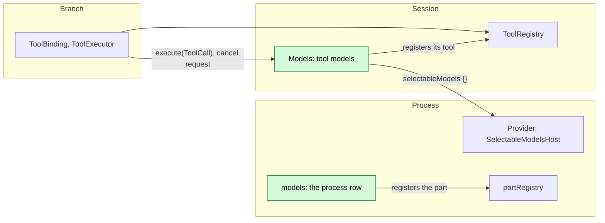

# Models

Status: Implemented. Language: Rust. Scope: [ADR 002](../../adr/002-plugin-scope.md) (Session).
Depends on the implemented [provider management](../appserver/provider-management.md) read (§3.6)
and on tool registration with `toolRegistry`
([session-boundary A.5](../contracts/session-boundary.md#a5-tool-contribution)).

Models gives the model one read-only tool, `models`, that answers which models the Session can use
right now and which Provider each one belongs to. It reads Provider's selectable-model port, so it
lists what execution would accept and keeps no availability rule of its own. It writes no event, holds
no state and changes no other module or type.

## 1. Structure



| Part | Scope | Depends on | Provides |
| --- | --- | --- | --- |
| `models` | Process, in the product profile | `partRegistry` | Registers the Session part `Models`; no name |
| `Models` | Session | `toolRegistry`, `selectableModels` | Registers the `models` tool; no name |

The row is registered beside `Provider` in the App Server's product profile
([lib.rs](../../../crates/dim-app-server/src/lib.rs)), so it exists exactly where the port does: a
profile without Provider has no `models` tool. The tool's declaration is
[models.rs](../../../crates/dim-app-server/src/models.rs); the read it calls is Provider's, and
this plugin copies none of its rules.

## 2. The tool

| Field | Value |
| --- | --- |
| Name | `models` |
| Source, risk | `extension`, `session` (a read-only informational call, admitted by every preset) |
| Input | `{}`; the tool takes no argument |
| Result | Text: one heading per Provider ID and one line per model (§2.1) |

The description is policy; the schema, the result format and the empty-answer text are protocol
([model-facing prompts §4](../model-prompts.md#4-protocol-and-policy)). The description, which the
declaration carries verbatim:

> List the models this Session can use now, grouped by provider ID. Use it when the user asks which
> models are available or which provider to name.

### 2.1 Result format

```
Available models: 2

provider dim
  claude-sonnet-4-5  context 200000  output 64000  vision  reasoning
provider 018ec73f-0000-7000-8000-000000000051
  served  context 128000  output 16384
```

The first line states how many models follow. Each `provider <providerId>` heading carries the ID
the operator names a model with; headings are in Provider ID order, and a model keeps the order
Provider's read reported it in. A model line is its model ID, its declared context window and
maximum output tokens, and `vision` and `reasoning` when it declares them. No display name is read:
the port carries identifiers and capabilities only, and the client renders a model's name from its
own catalog.

An empty read answers `No models are available to this Session; sign in to a provider or add one
first.` The line is the result's whole text; the plugin adds no refusal code.

### 2.2 Which models appear

The candidates are the ones [provider management §3.6](../appserver/provider-management.md#36-selectable-models-for-process-owners)
defines: the Providers default resolution considers, each model its own catalog read reports, and
only those `ProviderCatalog::selectable` accepts at that read. A model that is unavailable, disabled,
undeclared or unreachable therefore stays out, and a call made after a change sees the new state,
because every call reads again.

### 2.3 Errors and cancellation

A cancelled call returns `Cancelled`, and ToolExecutor writes the interrupted result every tool
gets. A failed read answers with an error result, `Models are unavailable: <owner's message>`,
carrying Provider's own message unchanged, so the model can tell the operator and retry the call;
the plugin adds no fallback list.

## 3. Events and lifetime

No Timeline event: the call and its result are the existing `step/tool-call` and
`step/tool-result` facts ToolExecutor writes. No Dispatcher subscription, no task and no state. The
registration is withdrawn when the part unloads, and the tool is offered again from the next
request once it registers again
([ToolRegistry](../../architecture/rust-agent/plugins/ToolRegistry.md)). A Session whose
mount list does not name `models` does not declare it, as with any registered tool.

## 4. Rule check

| Rule | Answer |
| --- | --- |
| §4 rule 1 (another owner's state changes through an instruction event) | It changes no other module's state. It reads Provider's selectable models through Provider's own read and writes nothing. |
| §4 rule 2 (handover is final) | Not applicable: it takes over no object. |
| §4 rule 3 (before callbacks) | None. The call takes no argument, so there is no draft to transform and no entry check. |
| §4 rule 4 (core carries no business meaning) | No core change. Timeline, Dispatcher, the port and ToolRegistry keep their existing contracts; the declaration, the result text and the error text are this plugin's. |
| §4 rule 5 (one atomic batch, in order) | Not applicable: it writes nothing. Each call reads one snapshot of the port's reply. |
| §4 rule 6 (context only from consumed or adopted events and tool results) | The list reaches the model only as a tool result. |
| §4 rule 7 (plugins interact through public events and services) | It uses `toolRegistry` and the process host port `SelectableModelsHost`, and reads no plugin's internal state. |
| §4 rule 8 (infrastructure is unchanged) | No change to Timeline, Dispatcher, the envelope, assembly and lifecycle, the Session and branch facades, the port or its types. |
| §4 rule 9 (only facts later decisions use enter the Timeline) | No new event. |
| §1 (Capability and App Server boundary) | A Session part registered by the App Server's process row, beside Provider: the tool is a Capability, the read stays Provider's, and the App Server is assembly only. |
| ADR 002 D1 (scope follows the owner of the state) | Session: one tool with no state; Provider keeps configuration, catalogs and credentials. |
| ADR 002 D2 (no wiring modules) | One process row that registers its part, and one tool. |
| ADR 002 D3 (dependencies point from extensions to the core) | The part depends on the core's `ToolRegistry` and the port type the core already declares; it names no App Server type. |
| ADR 002 D4 (business configuration is separate) | No configuration; there is nothing to enable per Session. |
| ADR 002 D5 (language-neutral contracts) | The tool's declaration, input, result format and error text are stated here without a Rust spelling; the Rust form is [models.rs](../../../crates/dim-app-server/src/models.rs). |

**Impact (public content):** one tool name, `models`, and its result format. No event, method, wire
field, service or type change.

## 5. Requirements raised to mechanism owners

None. The read it needs is the existing process host port; the tool registers through the existing
`ToolRegistry` route.
