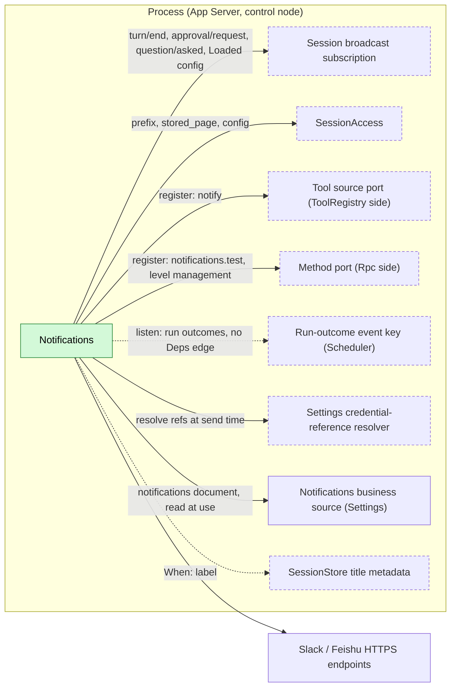
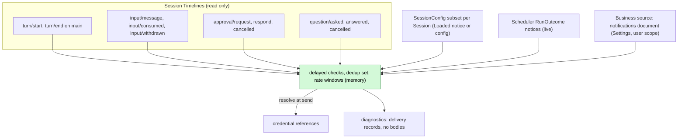
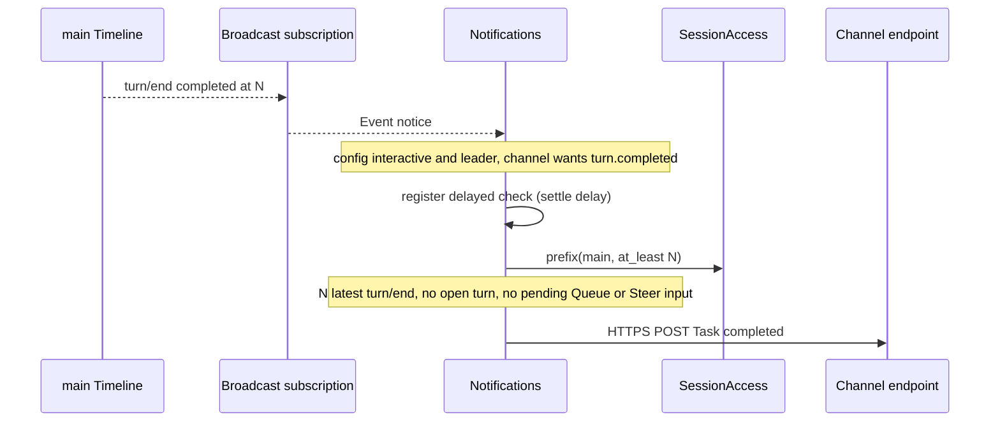
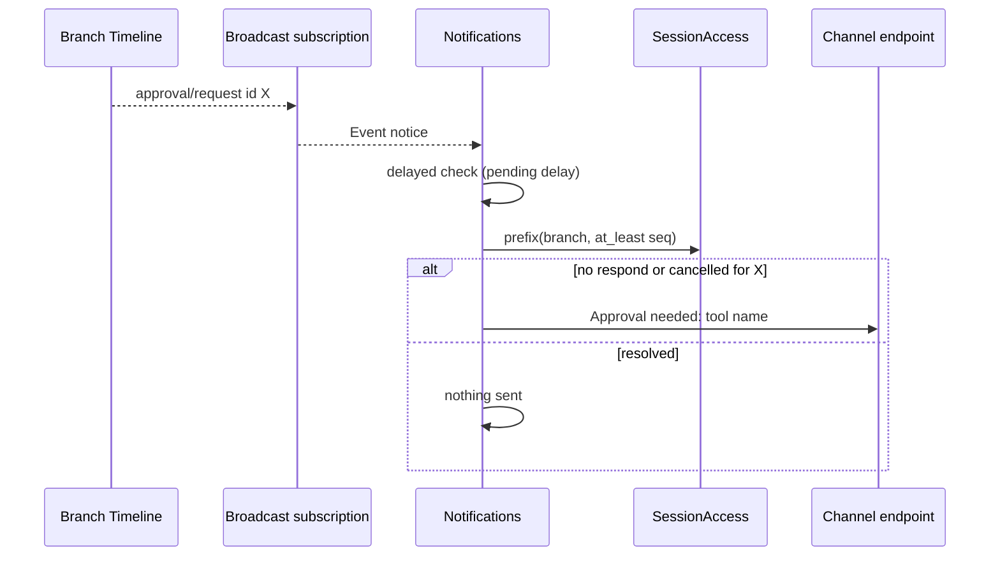
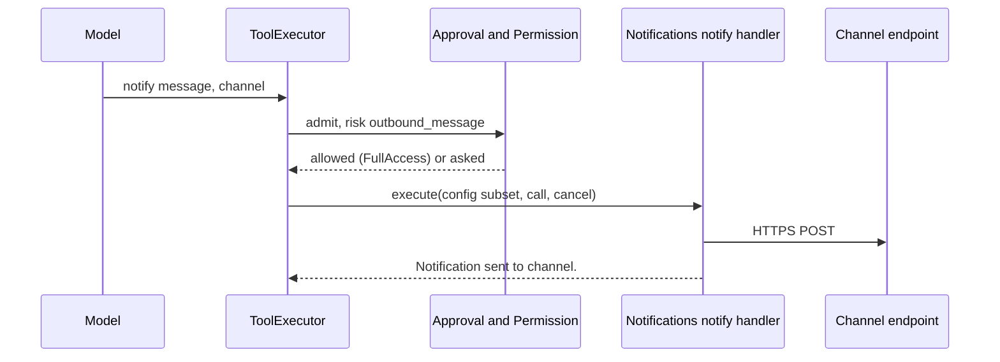
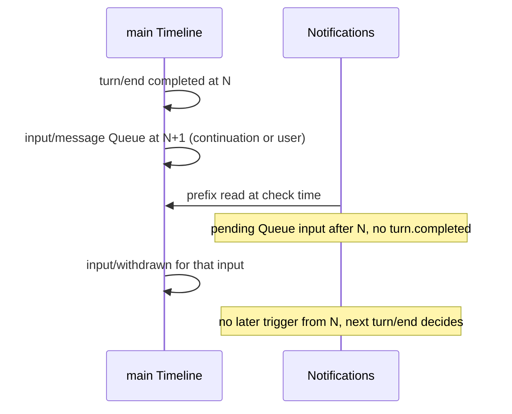

# Notifications

Status: Draft. Overall design: [overview B.11](../overview.md#b11-notifications). Phase: P2. Language: TypeScript first ([overview F.3](../overview.md#f3-assignment)).

Notifications delivers messages to configured external channels (Slack, Feishu) when a task on an interactive leader Session completes or fails, an approval is pending, a question awaits an answer or a scheduled job run ends, and lets the model send a message through the process tool `notify`. It observes Sessions only through the [broadcast subscription](../contracts/session-broadcast-subscription.md), confirms each trigger against a fixed prefix read through [session-access](../contracts/session-access.md), takes run ends from Scheduler's run-outcome event notice, and writes nothing to any Timeline. In-terminal reminders (bell, focus) belong to the CLI.

## 1. Structure



No Session or branch plugin depends on Notifications; both of its contributions are registrations into stable ports owned by their consumers ([ADR 002 D2](../../adr/002-dependency-direction.md#d2-contributors-register-into-a-stable-port-owned-by-the-consumer)), so its reload never reloads ToolRegistry or Rpc. Run outcomes arrive as an event notice ([D4](../../adr/002-dependency-direction.md#d4-peer-notices-use-events-not-dependencies)), not a dependency: without Scheduler, or while it reloads, the `schedule.ended` trigger is inert and Notifications stays loaded. Delivery uses the control node's network, never Session-bound resource services.

| Part | Scope | Depends on | Provides |
| --- | --- | --- | --- |
| `Notifications` | Process | [Session broadcast subscription](../contracts/session-broadcast-subscription.md) (`Loaded` with its `SessionConfig` subset), [`SessionAccess`](../contracts/session-access.md) (`get`, `prefix`, `stored_page`, `config`; never `input`), the run-outcome event key ([Scheduler A.7](Scheduler.md#a7-run-outcome-notice-public-contract); listener only, no `Deps` edge), its business source in Settings and the credential-reference resolver (decision R10), Permission category `outbound_message` (overview §7.1), public data contracts of `turn/start`, `turn/end`, `input/message`, `input/consumed`, `input/withdrawn`, `step/text`, `approval/request`, `approval/respond`, `approval/cancelled`, and `question/asked`, `question/answered`, `question/cancelled` (consumed only when registered), optionally (`When`) SessionStore title metadata | Process tool set `notifications` (`notify`) registered into the [tool source port](../contracts/process-tool-contribution.md); method `notifications.test` at level `management` registered into Rpc's [method port](../contracts/session-boundary.md); trigger names `turn.completed`, `turn.failed`, `approval.pending`, `question.pending`, `schedule.ended`; business configuration document `notifications` |

The `notifications` document is business configuration ([D5](../../adr/002-dependency-direction.md#d5-structural-configuration-and-business-configuration-are-separate)) in Notifications' Settings source, not the loader editable layer: read at use time; a change is a data update with notification (a new tool set version), never a reload.

## 2. Data and state



Notifications owns no persistent state and derives nothing from the Timeline into owned state: every trigger is checked against a fresh prefix. Memory state (delayed checks, deliveries in flight, dedup set `(session, branch, trigger, id)`, rate windows, cached configuration subsets) is not rebuilt; a new generation starts empty, and since notices are never replayed there are no cross-generation duplicates.

## 3. Flows

### 3.1 Task completed



Wall-clock only delays the read; the decision uses facts and sequence. Withdrawn inputs are not pending.

### 3.2 Approval pending



`question.pending` works the same with `question/asked` and `call_id`; it is inert when no plugin registers those event types.

`schedule.ended` needs no prefix read: job Sessions are non-interactive and excluded from event triggers (E14), so each `RunOutcome` notice from Scheduler is formatted and delivered directly (A17).

### 3.3 Model sends a message



The model can choose only among user-configured channels, never a URL.

## 4. Timing and conflicts

### 4.1 Input arrives during the settle delay



A pending driving input suppresses `turn.completed`. If it is withdrawn before the check, it no longer counts and the notification is sent; if withdrawn after the check, nothing more happens until the next `turn/end`, which is accepted (A15).

### 4.2 Other key rows

| Scenario | Order | Outcome | Owner |
| --- | --- | --- | --- |
| Member, workflow-stage, scheduled or ACP Session | config not interactive leader | No event-triggered notification (E14); job runs reported only via `schedule.ended` | Notifications |
| Approval answered or cancelled before the delay | request < respond < check | Nothing sent | Notifications |
| Interrupt during `notify` after sending | send < cancel | `Cancelled; delivery may have occurred.` | Notifications |
| Notifications reload mid-`notify` | — | That call gets "tool provider unavailable"; batch and turn continue; never resent | Tool source port; Notifications |

Full table: [Appendix B](#appendix-b-full-conflict-table).

## 5. Context mapping

Event-triggered notifications have no model-visible effect: nothing is written to any Session and channel messages never return to the model.

| What the model sees | Form and position |
| --- | --- |
| `notify` declaration | Name, description `Send a short message to one of the user's configured notification channels.`, schema with the channel enum, in the adopted `context/configured`; only while at least one channel allows the tool |
| `notify` outcome | `ToolResult.content` at the tool-result position of its batch; survives compaction only through the summary; child branches inherit results before their cut |
| Non-interactive Sessions | Same declaration and results (the tool is offered to every Session) |
| Never visible | Channel targets, credential references, delivery records, retry state, other Sessions' triggers, diagnostics, other plugins' events |

## 6. Interfaces (summary)

| Interface | Kind | Purpose |
| --- | --- | --- |
| `notify {message, channel?}` | Process tool, risk `outbound_message` | Model-initiated message to a configured channel |
| `notifications.test {channel}` | Method, level `management` | Send a fixed test text (A9) |
| `scheduled_run_outcomes()` | Event key listened to (Scheduler's contract; no `Deps` edge) | `schedule.ended` trigger |
| `notifications` document | Business configuration, Settings user scope, read at use | Channels, triggers, delays |

Details: [Appendix A](#appendix-a-interface-details).

## 7. Security

`notify` is admitted per call under `outbound_message`: FullAccess allows it automatically (decision E1); other presets do not allow it without the user (Permission's mapping). Channels come only from the user scope of Settings, never from project files or plugins (A8), so a repository cannot define an exfiltration target. Credentials are references resolved through Settings at send time and never logged, returned to the model or placed in diagnostics. Event-triggered messages carry no Session content unless `includeContent` is enabled per channel. Subscribers see all Sessions' events; Notifications forwards only template fields.

## Appendix A. Interface details

### A.1 Configuration (`notifications` document, user scope only, A8)

```text
notifications.channels: [{
  name: string,                       // [a-z0-9-]{1,32}, unique
  kind: "slack" | "feishu",
  target: { slack: { webhookRef } | { botTokenRef, channelId } }
        | { feishu: { webhookRef, signingSecretRef? } },
  triggers: ("turn.completed" | "turn.failed" | "approval.pending" | "question.pending" | "schedule.ended")[],
  includeContent: bool,               // default false (A5)
  allowTool: bool,                    // default true; channel offered to `notify`
  enabled: bool                       // default true
}]
notifications.settleDelaySeconds: u32   // default 3, 0..=60 (A2)
notifications.pendingDelaySeconds: u32  // default 10, 0..=3600 (A2)
notifications.defaultChannel: string?   // used by `notify` without `channel`
```

`*Ref` fields are credential references resolved by the Settings resolver; webhook URLs are treated as credentials. Changes only through typed Settings operations on Notifications' business source; validated at that boundary; read at each check, send and tool declaration.

### A.2 Tool `notify`

| Item | Value |
| --- | --- |
| Parameters | `{message: string (1..=4000), channel?: string}`; `channel` is an enum of channels with `allowTool && enabled` (A6) |
| Result | `Notification sent to <channel>.`; errors: `Unknown channel <name>.`, `No notification channel is configured.`, `Delivery failed: <fixed reason>.`, `Rate limit reached for <channel>.`, `Cancelled; delivery may have occurred.` |
| Risk category | `outbound_message` |
| Requirements | `interactive: false`, `roles: None` |
| Set | key `notifications`; offered only while a channel allows the tool; version changes with the channel list |
| Handler input | `SessionConfig` subset from the call context plus `ToolExecutionContext` |

Messages sent by the tool are prefixed `[dim <session label>] ` (A7).

### A.3 Method (level `management`)

| Method | Params | Result |
| --- | --- | --- |
| `notifications.test` | `{channel}` | `{ok, error?}`; error codes `unknown_channel`, `credential_unavailable`, `delivery_failed`, `rate_limited` |

### A.4 Trigger rules

| Event | Trigger | Rule (Session must be `interactive && collaboration_role = leader`) |
| --- | --- | --- |
| `turn/end` on `main` | `turn.completed` / `turn.failed` | `completed` / `failed`; `cancelled` none (A3). Fires only if `N` is the latest `turn/end`, no `turn/start` after it, and no Queue/Steer `input/message` lacks both `input/consumed` and `input/withdrawn` |
| `approval/request` (any branch) | `approval.pending` | No `approval/respond` or `approval/cancelled` with the same `approval_id` in the prefix read after the delay |
| `question/asked` (any branch) | `question.pending` | No `question/answered` or `question/cancelled` with the same `call_id` after the delay |
| Scheduler `RunOutcome` (no Session check) | `schedule.ended` | Every notice; `completed` and the failure states alike (A17) |
| `step/text` | Content | Optional excerpt of the turn's last request (`includeContent`) |

Templates (to channels, not to the model): `[dim <label>] Task completed.`, `[dim <label>] Task failed.`, `[dim <label>] Approval needed: <tool name>.`, `[dim <label>] The agent is waiting for your answer.`, `[dim schedule <job name>] Run <state>.` With `includeContent`: turn triggers append up to 500 characters of the last request's `step/text`; `approval.pending` the request `reason`; `question.pending` the question texts up to 500 characters (A5). Approval inputs are never sent.

### A.5 Mechanics

| Step | Path |
| --- | --- |
| Subscribe | In `apply`: `{types: {"turn/end", "approval/request", "question/asked"}, sessions: None, branches: None}`, capacity 256; stream task under `ctx.effect`. Types whose owner is not registered never arrive |
| Config | `Loaded` notices carry the `SessionConfig` subset, cached; for Sessions loaded earlier, `SessionAccess::config` on first notice. Ineligible Sessions are dropped before any work (E14) |
| Run outcomes | In `apply`: `on(host_ctx, &scheduled_run_outcomes(), listener)`, removed under `ctx.effect`; each notice goes straight to delivery; none arrive while Scheduler is absent |
| Trigger | For a matching enabled channel trigger not in the dedup set: register a delayed check with the plugin's task tracker; return to `next()` |
| Check | After the delay: `get(session)` → `prefix(branch, at_least = sequence)`; if not loaded, `stored_page(session, branch, after = sequence - 1, ...)` (A4). `Reloading`: retry after 1 s, 2 s, 4 s, then drop with a diagnostic (A16) |
| Format | Templates above; label = metadata title when available, else Session id (A7) |
| Deliver | Resolve references at send time; HTTPS POST; retry on network error, 429, 5xx with 1 s, 4 s, 16 s (3 attempts); no retry on other 4xx; 20 messages per minute per channel, excess dropped with a diagnostic (A10) |
| Timeline | No writes, no Dispatcher registration, no `StateCell` |
| Tool call | ToolExecutor admits via Approval/Permission, then calls the handler with a `CancellationToken`; the handler delivers and returns; settlement is ToolExecutor's |
| Reload / restart | Delayed checks and deliveries cancelled via `ctx.effect`; a request already sent is never resent ([time bus §5](../../architecture/rust-agent/time-bus.md)); in-flight `notify` calls get "tool provider unavailable" (turn continues). Notices missed while down are not replayed |

## Appendix B. Full conflict table

| Scenario | Sequence order | Outcome | Owner |
| --- | --- | --- | --- |
| Continuation or queued input before the check | `turn/end` N < input | No `turn.completed` | Notifications |
| That input withdrawn before the check | input < `input/withdrawn` < check | Not pending; notification sent | Notifications |
| That input withdrawn after the check | check < `input/withdrawn` | Nothing sent for N; next `turn/end` decides (A15) | Notifications |
| Input after the check | check < input | Sent; work continues (accepted) | Notifications |
| Turn ended by interrupt | `turn/end {cancelled}` | Nothing (A3) | Notifications |
| Turn failed | `turn/end {failed}` | `turn.failed` if still the latest turn | Notifications |
| Approval answered before the delay | request < respond < check | Nothing | Notifications |
| Approval cancelled by interrupt or branch close | request < `approval/cancelled` | Nothing | Notifications |
| Approval answered after send | check < respond | Stays sent; no follow-up (A11) | — |
| Question answered or cancelled before the delay | asked < answered/cancelled | Nothing | Notifications |
| Question event types not registered | — | Trigger inert | — |
| Concurrent Steer/Queue/Append | Timeline order | Unconsumed, unwithdrawn Queue/Steer suppresses `turn.completed`; Append does not | Notifications |
| Tool batch not settled | approvals inside the batch | Pending approval notified; `turn/end` cannot precede the batch result | Notifications; Loop |
| Compaction | — | No effect: checks read facts | — |
| Child branch of a leader Session | approval in child | Notified; child `turn/end` ignored (A1) | Notifications |
| Member, workflow-stage, scheduled or ACP Session | config | Nothing event-triggered (E14); `notify` still available | Notifications |
| Scheduled run ends | Scheduler persists terminal state < notice | One `schedule.ended` per run; no prefix read | Scheduler; Notifications |
| Notifications down at run end | — | That run not reported; `schedule.history` remains the record (A12) | Notifications |
| Scheduler reload or absent | event notice, no dependency | Notifications stays loaded; `notify` unaffected; runs ending in the window are not reported | Notifications |
| Branch close during the delay | — | `BranchMissing`: nothing | Notifications |
| Session unloaded during the delay | — | `stored_page` reads local facts (A4) | Notifications |
| Session closed or deleted | — | Nothing | Notifications |
| Duplicate notice, resubscribe | — | Dedup set within the generation | Notifications |
| Gap notice | — | Missed triggers not recovered (A12) | Notifications |
| Interrupt during `notify` before sending | cancel < send | No request; `Cancelled` | Notifications; ToolExecutor |
| Interrupt during `notify` after sending | send < cancel | Request aborted; `Cancelled; delivery may have occurred.` | Notifications |
| Notifications reload mid-delivery or mid-`notify` | — | Cancelled, never resent; `notify` gets "tool provider unavailable"; turn continues | Tool source port; Notifications |
| Process restart | — | Committed `notify` calls settled by ToolExecutor recovery without re-execution | ToolExecutor |
| Agents reload | facade `Reloading` | Check retried (A16); no Notifications reload | Notifications |
| Configuration change during the delay | — | Channels and triggers read at check time; tool set version changes | Notifications |
| Credential reference unresolvable | — | Delivery fails; diagnostic | Notifications |
| Resource node offline | — | No effect (control node delivers); the Session's events may pause | — |
| Client detach | — | No effect (A13) | — |

## Appendix C. Errors and recovery

| Case | Result |
| --- | --- |
| Invalid configuration | Rejected by Settings at the write boundary; last valid document kept |
| Delivery failure after retries | Diagnostic; tool returns an error result; no Session effect |
| Cancellation (interrupt, reload) | Outstanding requests aborted; resources released before the tool returns |
| Reload | `notifications.test` returns `service_reloading` while Notifications unloads, then `unknown_method` until it registers again; `notify` withdrawn |
| Process exit | In-memory checks lost; no persistent queue (A12) |

## Appendix D. Acceptance

Flow tests with fake HTTP endpoints and a fake model:

1. Completed `main` turn of an interactive leader Session sends one `turn.completed`; a Queue input before the check suppresses it; the same input withdrawn before the check does not; cancelled sends nothing; failed sends `turn.failed`.
2. Member Sessions and `interactive: false` Sessions send nothing event-triggered.
3. Approval answered before the delay sends nothing; unanswered sends once; cancelled sends nothing.
4. `question/asked` with and without an answer (when registered); inert otherwise. A scheduled run that completes, fails or times out sends one `schedule.ended`; without Scheduler the trigger is inert; a Scheduler reload does not reload Notifications.
5. `notify`: not declared without channels; sends and returns the result; FullAccess allows `outbound_message`, other presets ask; interrupt before and during delivery.
6. Retry on 5xx, none on 400, rate-limit drop, credential failure.
7. Reload during a `notify` call: "tool provider unavailable", turn not failed, no resend; restart settles a committed call without re-execution.
8. `includeContent: false` messages contain no Session text; diagnostics contain no bodies or URLs.

## Appendix E. Assumptions

| # | Assumption | Basis | Effect if rejected |
| --- | --- | --- | --- |
| A1 | Turn triggers only on `main`; approval and question triggers on any branch of an eligible Session | Judgment | Child-branch work would notify on every sub-task |
| A2 | Settle delay 3 s, pending delay 10 s | Judgment | Earlier or later messages |
| A3 | Interrupted turns do not notify | Judgment | Interrupts notify too |
| A4 | Unloaded Sessions are checked through `stored_page` | Judgment | Triggers for unloaded Sessions dropped |
| A5 | No Session content unless `includeContent`; excerpt 500 characters | Judgment (overview §9 sensitive data) | Content always or never included |
| A6 | `notify` parameters and channel enum | Judgment | Different schema |
| A7 | Label = metadata title if available, else Session id | Judgment | Other labels |
| A8 | Channels configurable only in user scope | Judgment from overview §9 Trust | Project channels need host-local approval |
| A9 | `notifications.test` management method exists | Judgment (overview §5.11 names only Settings configuration) | Users test with real events |
| A10 | Retry 3 attempts (1/4/16 s); 20 messages per minute per channel | Judgment | Other policies |
| A11 | No follow-up when a pending item resolves after notification | Judgment | Extra messages |
| A12 | Best effort: no persistent outbox, no recovery after Gap or restart | Overview §5.11; judgment | Process-storage outbox needed |
| A13 | Sent regardless of attached clients | Judgment (detach is not close) | Needs an attachment contract |
| A14 | Slack via webhook or bot token + channel id; Feishu via custom-bot webhook with optional signing | Feature list "Slack and Feishu"; modes are judgment | Other adapters |
| A15 | A suppressed `turn.completed` is not re-evaluated when the suppressing input is later withdrawn | Judgment | Withdrawal would need its own trigger |
| A16 | On `AccessError::Reloading` a check retries three times (1/2/4 s) | Judgment from decisions §1 | Notifications lost during Agents reloads |
| A17 | `schedule.ended` reports every run end with the job name and state, no Session content even with `includeContent` | Overview §5.11 (a scheduled job ends); judgment | Only failures reported, or output excerpts included |

## Appendix F. Open questions

| Question | Description |
| --- | --- |
| `notifications.test` | Not in overview §5.11 (A9); to be registered or dropped |
| Inbound actions | Answering approvals or questions from Slack/Feishu is out of scope (E23) |
