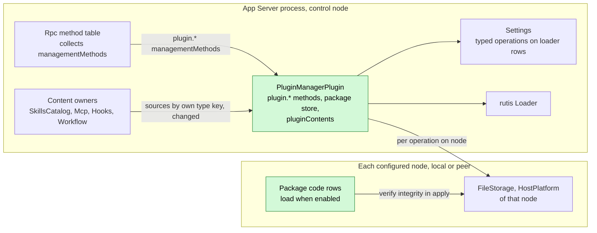
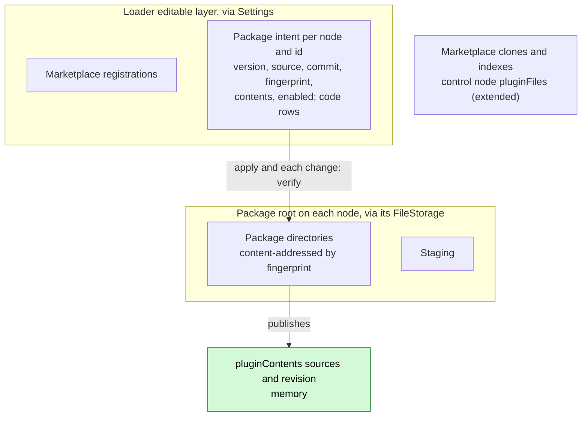
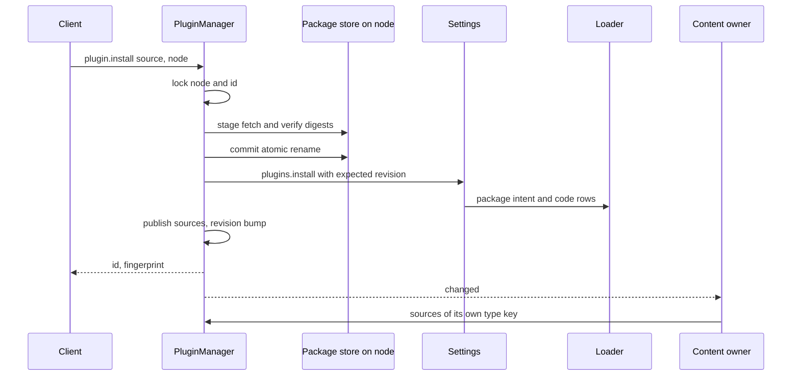
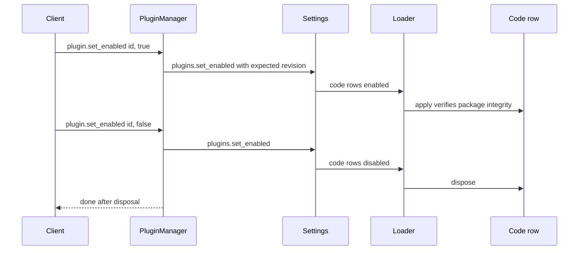
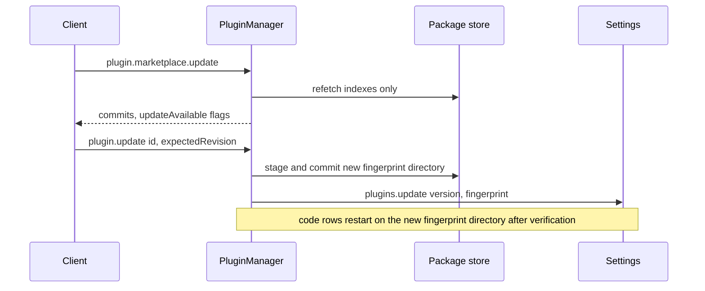

# PluginManager

Status: Draft. Overall design: [overview §4 Plugin catalog](../overview.md#4-plugin-catalog), [Settings, Mcp, SkillsCatalog changes](../overview.md#b2-app-server-process-plugins), [conventions](../overview.md#64-conventions), [multiple nodes](../overview.md#63-multiple-nodes), [ADR 002](../../adr/002-plugin-scope.md). Phase: P3 (depends on [#3](https://github.com/arcships/dim/issues/3); non-Rust capability plugins on [#4](https://github.com/arcships/dim/issues/4); peer nodes on [#5](https://github.com/arcships/dim/issues/5)). Language: Rust.

> **Changes for the redesign.** (1) [#36](https://github.com/arcships/dim/issues/36): the dependency is reversed. PluginManager depends on the content owners (Mcp, SkillsCatalog and others) and hands them package content through their typed operations; owners never depend on `pluginContents`, so a failed or reloading PluginManager leaves them running with their user and project sources. (2) [#41](https://github.com/arcships/dim/issues/41): PluginManager verifies a package before it writes or re-enables its rows; code rows do not check integrity in `apply` (the loader has already run the entry by then). An enabled package is trusted (ADR 003 D4); tampering with installed files afterwards is out of scope.

> **P3: redesign with rutis' existing capabilities.** rutis is an external dependency; the requirements this document raises to rutis are withdrawn ([principles §4 rule 8](../../architecture/rust-agent/principles.md)).

PluginManager is a process plugin ([ADR 002](../../adr/002-plugin-scope.md): installation is per host). It installs plugin packages from Git marketplaces, local paths or Git URLs onto a target node, records plugin intent (install, enable, node binding, package paths) through typed Settings operations into loader rows, and publishes the typed content of enabled packages as the named process service `pluginContents`. Content owners (SkillsCatalog, Mcp, Hooks, Workflow, in any language) depend on `pluginContents` by name, define their own content type keys and read the content they understand; PluginManager knows none of them. Package code runs when its package is enabled: there is no host-local approval, because installing and enabling are host configuration done through management methods, outside Approval and Permission, which govern only agent-initiated actions ([overview conventions](../overview.md#64-conventions)). Packages are never upgraded automatically. PluginManager handles only structural operations (install, enable, disable, update, remove), and it is the only writer of structural fields of any plugin row, including the `enabled` field of built-in plugins such as [RemoteGateway](RemoteGateway.md); each plugin declares the schema of its own business configuration, which is written through Settings typed operations into its named Settings sources, never through PluginManager.

## 1. Structure



All dependencies are process services at the same scope ([ADR 002 D3](../../adr/002-plugin-scope.md)). Content owners depend on `pluginContents`, accepted per D3: installing, enabling or removing a package changes published sources as a data update (`changed`), never a reload, while a PluginManager reload (upgrade, crash) reloads the content owners. Rpc looks up PluginManager's `managementMethods` service (key `plugin`) per call and does not reload with it ([methods §3.2](../contracts/session-boundary.md#32-management-method)). A PluginManager reload is a rare structural event whose propagation to content owners is documented, not prevented. Package code rows are ordinary loader rows: they offer the named services their code declares in its `provides` (for example `toolContribution`, `sessionMethods`, `modalityAdapter`), consumers collect them by service name and scope, and when one unloads its dependents reload under the same rule. A code row on an offline peer node does not unload: its imported services stay registered and fail calls with `node_unavailable`, and its dependents neither reload nor go Pending (requirement on [#5](https://github.com/arcships/dim/issues/5), [§9](#9-requirements-raised-to-mechanism-owners)).

| Part | Scope | Depends on | Provides |
| --- | --- | --- | --- |
| `PluginManagerPlugin` | Process, control node | Settings (typed operations on the loader editable layer), `pluginFiles` (extended) on the control node, the rutis Loader, `FileStorage` and `HostPlatform` of each configured node | `pluginContents` process service; `managementMethods` key `plugin` (`plugin.*`), collected by Rpc |
| Package code rows | Process, on the package's node | that node's `FileStorage`, what the code declares | named services declared in its `provides`; reads its own business configuration (its named Settings sources, its own schema) at use time |
| Content owners | Process | `pluginContents` | — (each defines its own type key) |

Contracts defined here: package manifest `dim-plugin.json` schema 2, marketplace index `dim-marketplace.json`, the `pluginContents` service and its `ContentSource` shape ([language-neutral](../../adr/002-plugin-scope.md#d5-contracts-are-language-neutral), A.3; Rust binding in Appendix G), the package directory layout, the code-row integrity check, `plugin.*` methods. Contracts depended on: typed Settings operations on the loader editable layer (#3) for plugin intent and structural fields, `pluginFiles` (extended) on the control node, the rutis-loader `Loader` (`entries`, `reload`, `restart`, `LoaderChanged`), `FileStorage` and `HostPlatform` of the package's node (peer nodes: imported over the rutis link), the [methods](../contracts/session-boundary.md) contract. These depended-on services are existing typed Rust services that PluginManager, a Rust plugin, uses directly; exposing them by name to non-Rust code rows is [#4](https://github.com/arcships/dim/issues/4)'s work. PluginManager never calls a content owner and never names a content type key in code.

## 2. Data and state



Package intent in loader rows is the persisted state; `plugin.list` is projected from loader entries, never from a separate store. Published sources are rebuilt from intent on `apply` (verifying each enabled package) and updated in place after each operation, with a revision bump. Per-plugin business configuration is neither in rows nor in PluginManager: each plugin declares its schema, the configuration is written through Settings typed operations into its named Settings sources, and the plugin reads it at use time, so configuring never reloads anything ([ADR 002 D4](../../adr/002-plugin-scope.md), A16). Package bytes live under the package root of their node, marketplace caches in control-node `pluginFiles` (extended). Nothing is a Session fact.

## 3. Flows

### 3.1 Install and publish



Content-only packages are active once published; owners reconcile on `changed` and never receive pushes. Code rows of an enabled package load at once; they are Pending only while their runtime is unavailable.

### 3.2 Enable, disable and code lifecycle



A code row checks integrity in its own `apply`; a mismatch fails `integrity_failed` and keeps it out of service. No approval is asked: the package runs because a local administrator enabled it. Disabling code unloads that row; its dependents reload per D3, and in-flight turns that used what it offered may fail. That cost is documented, not prevented.

### 3.3 Explicit update, never automatic



A marketplace refresh only marks `updateAvailable`; changing an installed package always takes an explicit `plugin.update` (decision E22).

## 4. Timing and conflicts


Install is ordered stage, commit, Settings write; the Settings revision is the commit point, so an interruption never leaves a half-registered package.

| Scenario | Outcome | Owner |
| --- | --- | --- |
| Code row disabled while something it offers is in use | The row unloads; dependents reload (D3); affected in-flight turns may fail | Loader, code row |
| Package updated while its code runs | Code rows restart on the new fingerprint directory; dependents reload (D3) | Loader, code row |
| Node offline after install | Operations on that node `node_unavailable`; its sources withdrawn; its code rows' services fail calls `node_unavailable`; nothing reloads or goes Pending; other nodes unaffected | PluginManager |
| Plugin business configuration changed (Settings typed operation) while the plugin runs | Business data update and notification; no reload; next use reads the new value | Plugin, Settings |
| Two installs of one id | Second waits on the lock, then `plugin_exists` | PluginManager |
| Package disabled while a branch uses its Skill | Branch keeps its adopted prompt until it re-adopts | Skills owner |
| PluginManager reload | Content owners reload with it (D3); `plugin.*` returns `unknown_method` until it is active again, and Rpc does not reload; in-flight install/remove `operation_interrupted` | PluginManager |

Full table: [Appendix B](#appendix-b-full-conflict-table).

## 5. Context mapping

No direct model-visible effect. PluginManager writes no input, offers no tool and registers no prompt source. Package content reaches the model only through its owner, in that owner's form: Skills through the Skill prompt source (adopted per branch, replayed after compaction as configuration, inherited by child branches from the adopted prefix), MCP and code-row tools through tool declarations and `ToolResult.content`, Hooks output through Session input. Non-interactive Sessions differ only as owners define. The model never sees package ids, fingerprints, marketplace data, configuration or diagnostics.

## 6. Interfaces (summary)

| Interface | Kind | Purpose |
| --- | --- | --- |
| `plugin.marketplace.list/add/remove/update/search/view` | Management methods | Marketplaces; `update` refreshes indexes only |
| `plugin.install/update/list/set_enabled/reload/remove` | Management methods | Package lifecycle; `set_enabled` also switches built-in plugin rows |
| `pluginContents` (`sources`, `changed`) | Process service, no key | Generic content publication |
| Code-row integrity check | Loader row rule | Code rows load when enabled and their package verifies |
| `dim-plugin.json` v2, `dim-marketplace.json` v1 | File formats | Package and marketplace descriptions |
| Typed Settings operations `plugins.*`, `marketplaces.*` | Depended on (#3, ADR 002 D4) | Persist intent (structural only) |
| CLI | `/plugins`, `/plugin`, `/reload-plugins`, `dimcode plugin …` | User entries |

Details: [Appendix A](#appendix-a-interface-details).

## 7. Security

Installing, enabling and removing are management methods, provided only by this process plugin and never served to paired remote devices ([methods](../contracts/session-boundary.md)); RemoteGateway never serves them. Package code is trusted native-process code once loaded (AGENTS rule 11). It runs because a local administrator installed and enabled it, not because of an agent decision, so Approval and Permission do not govern it and there is no host-local approval: the security of that configuration is the administrator's. Git fetch runs no repository hooks or submodules; package files are never executed at install time; integrity is rechecked on every load. Content owners run executable content they interpret (Hooks, MCP, workflows) when it is enabled, with no approval step. A plugin's business configuration lives in its named Settings sources, and the plugin handles its own secrets ([settings-service §1.2](../appserver/settings-service.md#12-decision-secrets-belong-to-their-owner)); PluginManager never reads it, and secrets never enter rows, `plugin.list`, diagnostics or content sources. A package whose code contributes management methods extends the host administration surface only once a local administrator enabled it.

## 8. Rule check

Rules: [principles §1 and §4](../../architecture/rust-agent/principles.md), [ADR 002](../../adr/002-plugin-scope.md) D1–D5.

| Rule | How this document complies |
| --- | --- |
| §4.1 Command events for state owned by others | Loader rows are process state with no Timeline; PluginManager changes them only through the owner's typed write operations (Settings `plugins.*` over #3) and never writes other plugins' business configuration. |
| §4.2 No withdrawal after handover | Not applicable: PluginManager hands no Timeline object to another module; a published source change reaches a branch only when its owner re-adopts. |
| §4.3 Intervene before a write only through before callbacks | Not applicable: PluginManager registers no before callback and adds no check at a Session or RPC entry; the code-row integrity check runs in that row's own `apply`. |
| §4.4 Core mechanisms carry no business meaning | `pluginContents` publishes opaque typed sources; the Loader and Rpc get no plugin-specific handling. |
| §4.5 Read the whole batch before deciding | Not applicable: PluginManager reads no Timeline event. |
| §4.6 Model context only from handed-over events | Package content reaches the model only through its owner's adopted prompt, tool or input rules. |
| §4.7 Plugins interact only through public events and services | PluginManager never calls a content owner; owners read `pluginContents`, and each plugin's business configuration is reached only through Settings. |
| §4.8 Generic requirements to mechanism owners | Typed loader operations (#3), services by name for non-Rust code (#4) and offline-node behaviour (#5) are raised in §9. |
| §4.9 Only facts later decisions use enter the Timeline | PluginManager writes no Timeline event; intent stays in loader rows, packages in node storage, and clients read `plugin.list`. |
| §1 Capability and App Server boundary | PluginManager is a process plugin in its own crate, not a Capability; the App Server only collects its `managementMethods`. |
| ADR 002 D1 Scope follows the owner | Installation is per host, so PluginManager is process-scoped. |
| ADR 002 D2 No wiring modules | Content owners and code-row consumers collect services by name; no wiring module exists. |
| ADR 002 D3 Dependencies follow scope | All dependencies are process services; PluginManager and code-row reloads propagate as documented rare structural events. |
| ADR 002 D4 Structural and business configuration | PluginManager writes only structural intent (install, enable, disable, update, remove) to loader rows, and is the only writer of structural fields such as RemoteGateway's `enabled`; business configuration belongs to each plugin's named Settings sources. |
| ADR 002 D5 Language-neutral contracts | `pluginContents`, the manifest and the methods are neutral; Appendix G is a binding only. |

## 9. Requirements raised to mechanism owners

### 9.1 Typed operations on the loader editable layer ([#3](https://github.com/arcships/dim/issues/3))

Withdrawn: rutis is an external dependency, so no requirement is raised to it. PluginManager uses the existing rutis-loader operations, checks revisions itself as the only writer, and verifies package integrity before it writes rows.

| Item | Content |
| --- | --- |
| Blocked by | ADR 002 D4 puts structural plugin intent in loader rows, and principles §4.1 and §4.7 forbid editing another module's state directly; rutis-loader 0.10 offers no typed write operation for adding, updating or removing rows. |
| Existing mechanisms considered | `Loader` `entries`, `reload` and `restart` only read or restart rows; `VolatileUpdate` changes `x-volatile` fields of an existing row but cannot add or remove rows; a Settings business source holds business configuration, not rows; a PluginManager-owned store would be a second source of truth for rows. |
| Generic capability | Typed operations on the editable layer: add, update and remove a row, set its `disabled` flag and set a field of an existing row (an `x-volatile` field arrives as `VolatileUpdate` without reload), each with an expected revision, atomic, with a change notification; no knowledge of packages or plugins. |
| Effect on sequence, batch, interrupt, reload | No Timeline sequence or batch is involved; an interrupted operation either committed its revision or wrote nothing; adding or removing a row loads or unloads only that row, and its dependents reload per D3. |
| Owner and issue | rutis-loader, [#3](https://github.com/arcships/dim/issues/3). The Settings typed operations that wrap it (A.6) are a Settings supplement, listed in [overview Appendix B.2](../overview.md#b2-app-server-process-plugins). |

### 9.2 Other requirements (stated elsewhere)

| Requirement | Owner | Five items |
| --- | --- | --- |
| Services imported from a peer node stay registered while the link is down and fail calls with `node_unavailable` | rutis, [#5](https://github.com/arcships/dim/issues/5) | [ExternalAgent §9](ExternalAgent.md#9-requirements-raised-to-mechanism-owners); PluginManager needs it so an offline node never reloads PluginManager or makes a code row's dependents Pending |
| Runtime services exposed by name to non-Rust plugins | runtime, [#4](https://github.com/arcships/dim/issues/4) | [session access §9](../contracts/session-access.md#9-requirements-raised-to-mechanism-owners); Node code rows need it to use `FileStorage` |

## Appendix A. Interface details

### A.1 Package manifest `dim-plugin.json` (schema 2)

Version 1 was the manifest of the former `--plugin-dir` account package, which a Rust managed provider plugin replaced ([App Server contract](../../../crates/dim-app-server/README.md#managed-provider-plugins)); it is not installable here (A3).

```json
{
  "schemaVersion": 2,
  "id": "acme-review",
  "version": "1.2.0",
  "name": "Acme review kit",
  "description": "Review Skills and hooks",
  "files": {"skills/review/SKILL.md": "<sha256>", "dist/index.js": "<sha256>"},
  "contents": [
    {"type": "skills", "path": "skills"},
    {"type": "hooks", "path": "hooks/hooks.json"}
  ],
  "code": [
    {"runtime": "node", "entry": "dist/index.js", "hostApiVersion": 2, "rutisVersion": "0.10.0"}
  ]
}
```

| Field | Rule (validated once at the install boundary) |
| --- | --- |
| `id` | `[a-z][a-z0-9-]{0,63}`; unique per node (A4) |
| `version` | SemVer; displayed and compared for `updateAvailable` only |
| `files` | Every file except `dim-plugin.json` and `.git/`; relative POSIX paths, no `..`, no symlinks; unlisted file or digest mismatch rejects |
| `contents` | Opaque `type` `[a-z][a-z0-9-]*` (key defined by its consumer: `skills`, `hooks`, `mcp`, `workflows`, R14), `path` inside the package, optional `options` ≤ 64 KiB; only this shape is validated |
| `code` | Optional; `runtime: "node"` loads `entry` as a rutis runtime row; `hostApiVersion`/`rutisVersion` checked; other runtimes rejected until #4 (A1) |
| Fingerprint | SHA-256 of the stored manifest bytes; the manifest lists every file digest, so it binds all package bytes. It names the exact package content in `plugin.list` and `pluginContents` and addresses its directory |

### A.2 Marketplace index `dim-marketplace.json` (A5)

At the repository root: `{schemaVersion: 1, name, plugins: [{id, version, description, keywords?, source: {path} | {git, ref?}, fingerprint?}]}`. `source.path` is inside the marketplace repository; `fingerprint`, when present, must equal the fetched package's fingerprint.

### A.3 `pluginContents`

Service `pluginContents`, scope process, no key, provided by PluginManagerPlugin; content owners depend on it by name. Errors are data `{ code, message }`.

| Method | Kind | Request | Reply |
| --- | --- | --- | --- |
| `sources` | sync | `{ type }` | `{ revision, sources: ContentSource[] }`: enabled, integrity-verified packages on available nodes |
| `changed` | async | `{ after_revision }` | `{ revision }` once the published revision exceeds `after_revision`; the consumer cancels by dropping the call |

`ContentSource`:

| Field | Type | Meaning |
| --- | --- | --- |
| `package` | string | Package id |
| `version` | string | Package version |
| `fingerprint` | string | Identifies the exact package bytes |
| `node` | string or null | null = control node |
| `root` | string | Package directory on `node` |
| `path` | string | Declared path, relative to `root` |
| `options` | object | From the manifest |

A consumer owns its type key and format and reads files through services valid for `node`. Node rule (A6): a source on node N is content of node N. A consumer that executes content against a Session (for example Hooks) uses only sources whose node equals that Session's resource node (`SessionConfig.resource_node`); a consumer that only reads content on the control node ignores sources it cannot reach and reports them in its own catalog.

### A.4 Package store

Internal to PluginManager, not a service: `stage` (fetch, verify), `commit` (atomic rename), `verify` (re-hash), `remove`, `fetch_marketplace`, each run against the `FileStorage` and `HostPlatform` of the target node; sources are a local path or a Git URL with optional reference. A node that is not configured or whose services are unavailable fails the operation with `node_unavailable`.

Packages live under PluginManager's package root on their node, written through that node's `FileStorage` (A13). Git runs through the node's `HostPlatform` with hooks and submodules disabled, `https://` and `ssh://` only (A7). Local paths are copied, never referenced (A8). Directories are content-addressed by fingerprint, so an update never rewrites files a running row uses.

### A.5 Methods (`managementMethods`, key `plugin`)

| Method | Params | Result | Interruption |
| --- | --- | --- | --- |
| `plugin.marketplace.list` | `{}` | `[{name, url, ref, commit, fetchedAt, error?}]` | Drain |
| `plugin.marketplace.add` | `{name, url, ref?}` | `{commit}` | Report |
| `plugin.marketplace.remove` | `{name}` | `{}` | Report |
| `plugin.marketplace.update` | `{name?}` | `[{name, commit, error?}]`; refreshes indexes only | Report |
| `plugin.marketplace.search` | `{query, marketplace?}` | `[{marketplace, id, version, description, installed: [{node, version}]}]` | Drain |
| `plugin.marketplace.view` | `{marketplace, id}` | entry plus manifest summary (`contents` types, `code` presence) | Drain |
| `plugin.install` | `{source: {marketplace, id} \| {path} \| {git, ref?}, node?, enabled?}` | `{id, version, node, fingerprint}` | Report |
| `plugin.update` | `{id, node?, version?, expectedRevision}` | `{version, fingerprint}` | Report |
| `plugin.list` | `{node?}` | `[{id, version, node, builtin, enabled, status, contents, source, updateAvailable, error?}]`; built-in plugin rows appear with `builtin: true` | Drain |
| `plugin.set_enabled` | `{id, node?, enabled, expectedRevision}`; `id` may name a built-in plugin row (A17) | `{}` | Report |
| `plugin.reload` | `{id?, node?}` | `[{id, node, status, error?}]` | Report |
| `plugin.remove` | `{id, node?}` | `{cleanupError?}` | Report |

`status`: `active`, `pending` (awaiting runtime), `unavailable` (node offline; its services fail calls), `failed` (reason), `disabled`. `install`, `update` and `marketplace.update` report phases (`fetch`, `verify`, `commit`) through the call's progress sink ([methods](../contracts/session-boundary.md), A14). Additions to the overview catalog entry: `update`, `marketplace.search/view` (A9).

### A.6 Typed Settings operations used (#3, proposed Settings supplement)

| Operation | Effect |
| --- | --- |
| `plugins.install(entry, expected_revision)` | Records package intent and creates code rows on the editable layer |
| `plugins.update(id, node, version, fingerprint, expected_revision)` | Updates package intent; code rows follow |
| `plugins.set_enabled(id, node, enabled, expected_revision)` | Sets the package's enabled flag and `set_disabled` on its code rows; for a built-in plugin row, sets its structural `enabled` field (`VolatileUpdate` when `x-volatile`) |
| `plugins.remove(id, node, expected_revision)` | Removes the package intent and all its code rows |
| `marketplaces.save/remove` | Marketplace registrations |

`reload`, `restart` and status call the `Loader` directly.

### A.7 Capability mechanics

| Step | Path |
| --- | --- |
| Timeline | No writes, no Dispatcher subscription, no `StateCell`; rechecks are Settings revisions |
| Install | Lock `(node, id)` (A10), `stage`, compare with intent, `commit`, `plugins.install`, publish sources, reply; a failed Settings write leaves an unreferenced directory collected later (A11) |
| Publication | On `apply`, verify each enabled package and build sources; after each operation, update sources and bump the revision; a package that fails verification is withdrawn and reported `failed` |
| Code rows | `apply` verifies integrity, else fails `integrity_failed`; `set_enabled`/`update` restart them through the `Loader`; each code row reads its own business configuration at use time |
| PluginManager reload | Content owners reload with it (D3); `plugin.*` returns `unknown_method` until it is active again, and Rpc does not reload; in-flight install/remove return `operation_interrupted`; code rows are unaffected |
| Process restart | Loader restores rows; packages re-verify; staging deleted; orphans collected after the loader settled |

## Appendix B. Full conflict table

| Scenario | Sequence order | Outcome | Owner of the decision |
| --- | --- | --- | --- |
| Turn or branch interrupt, branch close, concurrent inputs, `input/withdraw`/`input/deleted`, unsettled batch, compaction, child cut | — | No effect on PluginManager; owners' adoption rules apply | Content owners |
| Package disabled while a Session uses its Skill | revision bump < next adoption | Branch keeps its adopted prompt until it re-adopts | Skills / PromptSourcesBranch |
| Code row disabled while in use | — | Row unloads; its dependents reload (D3); affected in-flight turns may fail | Loader |
| Two installs of one id on one node | lock, then Settings revision | Second `plugin_exists` (or `plugin_settings_conflict` across processes) | PluginManager, Settings |
| Package updated while its code runs | new fingerprint | Code rows restart on the new directory; dependents reload (D3) | Loader, code row |
| Disable while code runs | disable persisted < restart | Code rows disposed after settling their work; reply after disposal | Loader, code rows |
| Install interrupted after commit, before Settings | — | `operation_interrupted`; no intent; directory collected | PluginManager |
| Install interrupted after Settings write | — | `operation_interrupted`; intent exists; retry `plugin_exists` | Client reads state |
| Duplicate or late `plugin.install` | — | `plugin_exists` | PluginManager |
| Marketplace update finds a newer version | — | `updateAvailable` only; nothing changes | PluginManager |
| Target node unavailable before install | — | `node_unavailable`; nothing written | PluginManager |
| Node offline after install | — | Its sources withdrawn; its code rows' imported services stay registered and fail calls `node_unavailable`; no dependent reloads or goes Pending (requirement on #5); other nodes unaffected | PluginManager, rutis link |
| Package node differs from a Session's resource node | — | Executing consumers ignore the source for that Session | Content owner |
| Files modified on disk | next verification | `integrity_failed`; sources withdrawn; code rows fail | PluginManager, code row |
| PluginManager reload or restart mid-operation | — | Per A.7; never re-executes a fetch | PluginManager |
| Session unload/restore | — | No effect | — |
| Client detach | — | Operation continues; reply and progress dropped | Rpc |

## Appendix C. Errors and recovery

| Code (`appError`) | Meaning |
| --- | --- |
| `manifest_invalid` | Missing or malformed manifest or index |
| `integrity_failed` | Digest mismatch, unlisted file, path escape or symlink |
| `incompatible_host` | `hostApiVersion`/`rutisVersion` or unsupported `runtime` |
| `source_unavailable` | Git fetch or path read failed (stderr only in diagnostics) |
| `node_unavailable` | Target node not configured or its services unavailable |
| `plugin_exists`, `plugin_not_found`, `marketplace_not_found` | Identity errors |
| `plugin_settings_conflict` | Stale `expectedRevision` |
| `runtime_unavailable` | Node runtime not configured; code rows Pending |
| `operation_interrupted` | `Report` rule of the methods contract; read `plugin.list` before retrying |

Removal disposes code rows, then deletes the directory; a deletion failure returns `cleanupError` and garbage collection retries.

## Appendix D. Acceptance

Flow tests through `plugin.*` methods with a local test marketplace and a test consumer of a custom type key:

1. Add, update, search, view a marketplace; invalid index `manifest_invalid`; update marks `updateAvailable` without changing installed packages.
2. Install from marketplace, path and Git URL; tampered, unlisted and fingerprint-mismatched packages are rejected with nothing written.
3. A content-only package publishes sources to the test consumer through `changed()` without reloading it; disable withdraws them; remove deletes intent then files; a PluginManager reload reloads the test consumer, which then reads the same sources.
4. A package with Node code loads its code row as soon as it is enabled, with no approval step; `plugin.update` restarts it on the new directory; disabling disposes it; `plugin.set_enabled` on RemoteGateway's built-in row reaches it as `VolatileUpdate` without a reload.
5. Disabling a package whose code row offers a test tool reloads its dependents; the test records the failed in-flight turn as the documented outcome.
6. Concurrent installs; stale `expectedRevision`; interruption after commit and after the Settings write.
7. Peer test node: install targets it; taking it offline makes only its operations and its code rows' services fail with `node_unavailable`, withdraws its sources and reloads nothing; recovery restores them.
8. Restart: rows restored, integrity verified, staging removed, orphans collected.

## Appendix E. Assumptions

| # | Assumption | Basis | Effect if rejected |
| --- | --- | --- | --- |
| A1 | Package code is Node runtime rows (rutis-bridge) that provide and consume named services; no dynamic Rust code; access to the runtime's typed services by name waits on #4 | Overview §4, Appendix C; ADR 002 D5 | More `code.runtime` values |
| A2 | Package code runs when its package is enabled; there is no host-local approval | Decision R6 (round 2); overview conventions | An approval step before code loads |
| A3 | Manifest schema 2 extends the former account-package format; v1 is not accepted | App Server README; judgment | Compatibility mapping |
| A4 | One installed version per `(node, id)` | Judgment | Side-by-side versions |
| A5 | Marketplace index format and name | Judgment; feature list "Git plugin marketplaces" | Format replaced |
| A6 | Sources are node content; executing consumers match the Session's resource node | Overview multiple nodes; judgment | Consumers read peer content through imported services |
| A7 | Git via the node's `git`, hooks/submodules disabled, `https`/`ssh` only | Judgment | Library fetcher or more schemes |
| A8 | Local paths copied, not linked | Judgment (integrity) | A development link mode |
| A9 | Additional methods `update`, `marketplace.search/view` | Feature list; overview §4 | Folded into other methods |
| A10 | Operations serialize per `(node, id)` | Judgment | Settings revisions alone |
| A11 | Unreferenced directories garbage-collected after the loader settled | Judgment | Explicit cleanup command |
| A12 | Content owners depend on `pluginContents`; a PluginManager reload reloads them | ADR 002 D3 | A separately hosted publication service |
| A13 | Package directories are written through the node's `FileStorage` under a PluginManager package root (atomic rename available there) | Judgment | A per-node storage service is needed |
| A14 | Install and update report progress phases | Methods contract progress sink; judgment | Result only |
| A15 | No automatic upgrade, including content-only packages | Decision E22 | Opt-in auto-upgrade setting |
| A16 | Each plugin declares the schema of its business configuration, which is written through Settings typed operations into its named Settings sources and read at use time; PluginManager has no configure method | ADR 002 D4 | PluginManager would write other plugins' business configuration |
| A17 | `plugin.set_enabled` also sets the structural `enabled` field of built-in plugin rows (for example RemoteGateway); no plugin writes its own structural fields | Decision R3 (round 2); ADR 002 D4 | Each plugin writes its own structural fields |

## Appendix F. Open questions

| Question | Description |
| --- | --- |
| #3 typed operations | The Settings operations in A.6 are proposed here; their final shape belongs to the Settings supplement and #3 (structural intent only; business configuration is each plugin's, ADR 002 D4) |
| Overview SkillsCatalog change | "Installation and removal are initiated by PluginManager" is read as: PluginManager publishes and withdraws sources, SkillsCatalog reads them; PluginManager makes no SkillsCatalog call |
| Peer-node content | Whether control-node consumers should read content on peer nodes through imported resource services (#5) |

Requirements on [#3](https://github.com/arcships/dim/issues/3), [#4](https://github.com/arcships/dim/issues/4) and [#5](https://github.com/arcships/dim/issues/5): see [§9](#9-requirements-raised-to-mechanism-owners).

## Appendix G. Rust binding

Rust content owners may use the generated binding; the neutral form in A.3 is normative.

```rust
/// Binding for service `pluginContents` (process, no key).
impl PluginContents {
    pub fn sources(&self, type_key: &str) -> Vec<Arc<ContentSource>>;
    pub fn changed(&self) -> tokio::sync::watch::Receiver<u64>; // revision; maps `changed`
}
pub struct ContentSource {
    pub package: String,
    pub version: String,
    pub fingerprint: String,
    pub node: Option<String>,
    pub root: PathBuf,
    pub path: PathBuf,
    pub options: serde_json::Value,
}
```

PluginManager registers it under `TypeKey::named("pluginContents")`; its `plugin.*` methods use the `managementMethods` binding of the [methods](../contracts/session-boundary.md) contract.
