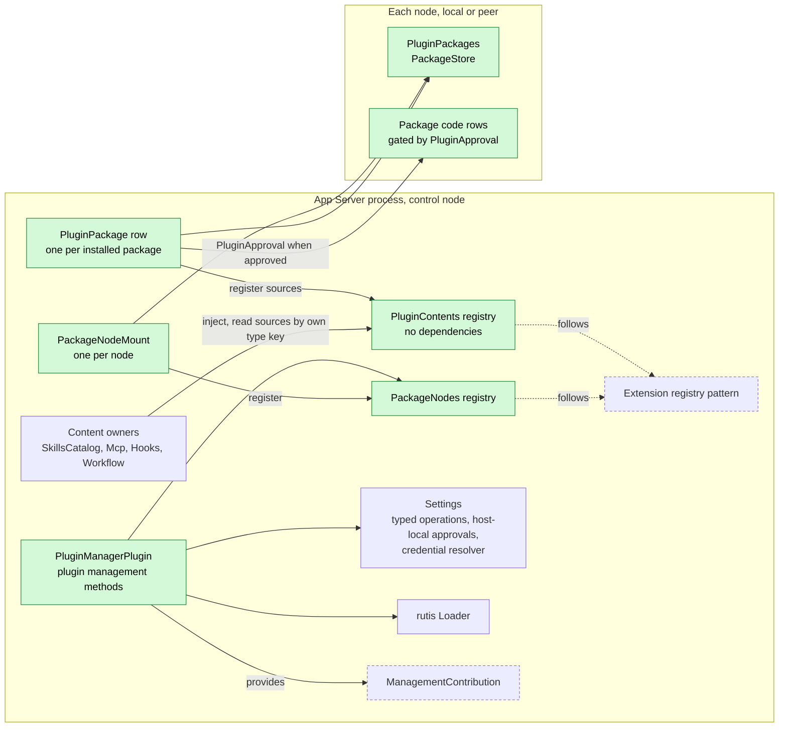
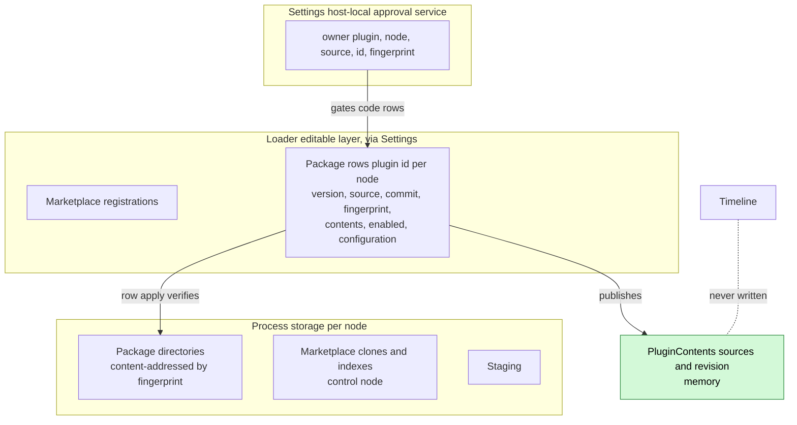
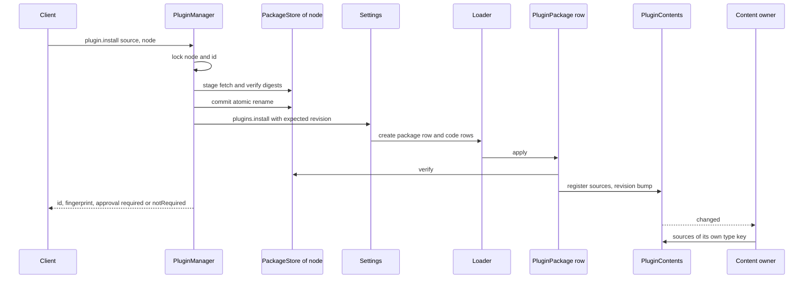
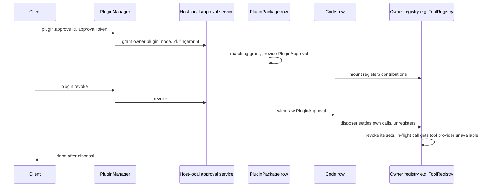
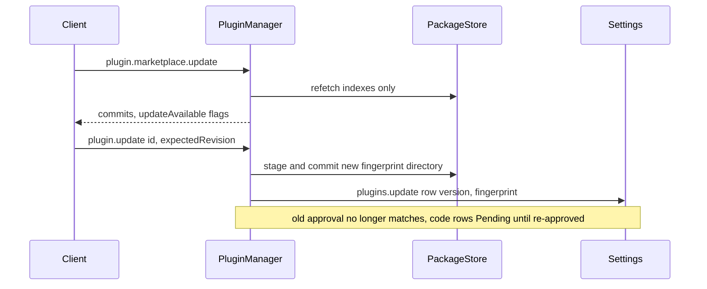
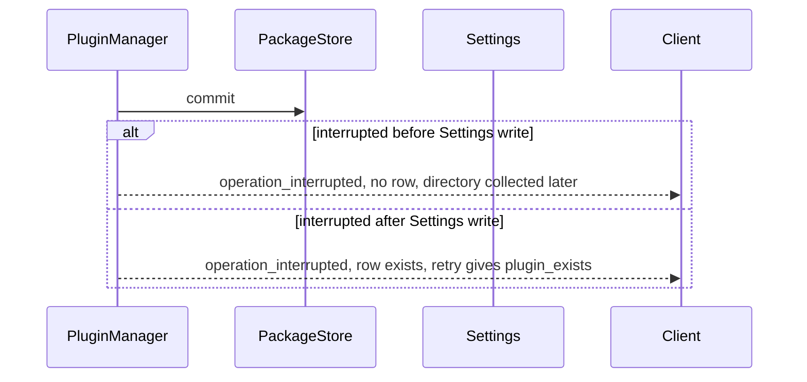

# PluginManager

Status: Draft. Overall design: [overview §5.12](../overview.md#512-pluginmanager), [§7.2 Settings, Mcp, SkillsCatalog](../overview.md#72-app-server-process-plugins), [§9 Trust](../overview.md#9-cross-cutting-conventions), [§3.1 Multiple nodes](../overview.md#31-multiple-nodes). Phase: P3 (depends on [#3](https://github.com/arcships/dim/issues/3); non-Rust capability plugins on [#4](https://github.com/arcships/dim/issues/4); peer nodes on [#5](https://github.com/arcships/dim/issues/5)). Language: Rust.

PluginManager installs plugin packages from Git marketplaces, local paths or Git URLs onto a target node, records plugin intent and configuration through typed Settings operations into the loader editable layer, and publishes the typed content of enabled packages through `PluginContents`. Content owners (Skills, Hooks, MCP, workflows) define their own content type keys and discover the content they understand; PluginManager knows none of them. Package code runs only after approval through the Settings host-local approval service bound to node and package fingerprint. Packages are never upgraded automatically.

## 1. Structure



`PluginContents` and `PackageNodes` are stable registries with no dependency on PluginManager, package rows or nodes, so a PluginManager reload, a package row change or an offline peer never reloads a content owner. Package code rows that contribute tools, management methods or other extensions register through each owner's registry like any contributor ([extension registry](../contracts/extension-registry.md)).

| Part | Scope | Depends on | Provides |
| --- | --- | --- | --- |
| `PluginManagerPlugin` | Process, control node | `SettingsService` (typed operations, host-local approvals), `Arc<Loader>`, `PackageNodes` | `ManagementContribution` (`plugin`) |
| `PluginContentsPlugin` | Process, control node | — | `PluginContents` (stable registry) |
| `PackageNodesPlugin` | Process, control node | — | `PackageNodes` (stable registry of node stores) |
| `PluginPackages` | Process, one row per node (`peer:<node>/PluginPackages`) | `HostPlatform` of that node, process storage of that node | `PackageStore` keyed by node |
| `PackageNodeMount` | Process, one instance per configured node | `PackageNodes`, keyed `PackageStore` | Registration |
| `PluginPackage` row | Process, one per installed package | `PluginContents`, `PackageNodes`, host-local approval service | Content sources; `PluginApproval` keyed `<node>/<id>` |
| Package code rows | Process, on the package's node | what the code declares, plus `PluginApproval` | what the code declares |
| Content owners | Process | `When<PluginContents>` | — (each defines its own type key) |

Contracts defined here: package manifest `dim-plugin.json` schema 2, marketplace index `dim-marketplace.json`, the `PluginContents` publication contract (`ContentSource`), `PackageStore`, the `PluginApproval` gate key, `plugin.*` management methods. Contracts depended on: typed Settings operations on the loader editable layer (#3), the Settings host-local approval service (R11) and credential-reference resolver (R10), [process storage](../overview.md#72-app-server-process-plugins) (R8), the rutis-loader `Loader` (`entries`, `reload`, `restart`, `LoaderChanged`), `HostPlatform` process start on the package's node, [Management](Management.md) contribution contract, [extension registry](../contracts/extension-registry.md). PluginManager never calls a consumer and never names a content type key in code.

## 2. Data and state



The package row is the persisted intent; `plugin.list` is projected from loader entries, never from a separate store. Published sources are rebuilt by row `apply` on every load; package bytes and marketplace caches live in each node's process storage; approvals live only in the host-local approval service. Nothing is a Session fact.

## 3. Flows

### 3.1 Install and publish



Content-only packages are active once their row applies; owners reconcile on `changed` and never receive pushes. Code rows stay Pending until approval.

### 3.2 Approve, revoke and code lifecycle



Revoking or disabling code that contributes tools affects only that contributor: the batch and turn continue, branches adopt the tool set without it (fixes the earlier "settled as a contributor reload" chain).

### 3.3 Explicit update, never automatic



A marketplace refresh only marks `updateAvailable`; changing an installed package always takes an explicit `plugin.update` (decision E22).

## 4. Timing and conflicts



Install is ordered stage, commit, Settings write; the Settings revision is the commit point, so an interruption never leaves an approved or half-registered package.

| Scenario | Outcome | Owner |
| --- | --- | --- |
| Code row contributing tools revoked or disabled while a call runs | That call gets "tool provider unavailable"; batch and turn continue | ToolRegistry registry, code row |
| Approval granted, then package updated | New fingerprint does not match; code rows Pending until re-approved | `PluginPackage` row |
| Node goes offline after install | Only that node's mount and rows Pending; its sources withdrawn | rutis lifecycle |
| Two installs of one id | Second waits on the lock, then `plugin_exists` | PluginManager |
| Package disabled while a branch uses its Skill | Branch keeps its adopted prompt until it re-adopts | Skills owner |

Full table: [Appendix B](#appendix-b-full-conflict-table).

## 5. Context mapping

No direct model-visible effect. PluginManager writes no input, contributes no tool and registers no prompt source. Package content reaches the model only through its owner, in that owner's form: Skills through the Skill prompt source (adopted per branch, replayed after compaction as configuration, inherited by child branches from the adopted prefix), MCP and code-row tools through tool declarations and `ToolResult.content`, Hooks output through Session input. Non-interactive Sessions differ only as owners define. The model never sees package ids, fingerprints, approvals, marketplace data, configuration or diagnostics.

## 6. Interfaces (summary)

| Interface | Kind | Purpose |
| --- | --- | --- |
| `plugin.marketplace.list/add/remove/update/search/view` | Management methods | Marketplaces; `update` refreshes indexes only |
| `plugin.install/update/list/set_enabled/configure/reload/approve/revoke/remove` | Management methods | Package lifecycle |
| `PluginContents::sources(type_key)`, `changed()` | Process service | Generic content publication |
| `PackageStore` | Node service | Stage, commit, verify, remove, fetch marketplace |
| `PluginApproval` keyed `<node>/<id>` | Gate key | Code rows load only when approved |
| `dim-plugin.json` v2, `dim-marketplace.json` v1 | File formats | Package and marketplace descriptions |
| Typed Settings operations `plugins.*`, `marketplaces.*` | Depended on (#3) | Persist intent |
| CLI | `/plugins`, `/plugin`, `/reload-plugins`, `dimcode plugin …` | User entries |

Details: [Appendix A](#appendix-a-interface-details).

## 7. Security

Installing, approving and removing are management operations, available only on entries that mount Management. Package code is trusted native-process code once loaded (AGENTS rule 11), so loading requires a host-local approval of the exact fingerprint on that node; replay, fork, FullAccess, project files and installation itself never grant it. Git fetch runs no repository hooks or submodules; package files are never executed at install time; integrity is rechecked on every load. Content owners apply their own host-local approval to executable content they interpret (Hooks, MCP, workflows). Plugin configuration holds credential references only, resolved by the plugin through the Settings credential resolver; resolved secrets never enter rows, `plugin.list`, diagnostics or content sources. A package that contributes a `ManagementContribution` extends the host administration surface only after approval.

## Appendix A. Interface details

### A.1 Package manifest `dim-plugin.json` (schema 2)

Version 1 is the existing managed-provider manifest ([App Server contract](../../../crates/dim-app-server/README.md#optional-managed-provider)); it stays for `--plugin-dir` and is not installable here (A3).

```json
{
  "schemaVersion": 2,
  "id": "acme-review",
  "version": "1.2.0",
  "name": "Acme review kit",
  "description": "Review Skills and hooks",
  "files": {"skills/review/SKILL.md": "<sha256>", "dist/index.js": "<sha256>"},
  "contents": [
    {"type": "skills", "path": "skills"},
    {"type": "hooks", "path": "hooks/hooks.json"}
  ],
  "code": [
    {"runtime": "node", "entry": "dist/index.js", "hostApiVersion": 2, "rutisVersion": "0.10.0"}
  ]
}
```

| Field | Rule (validated once at the install boundary) |
| --- | --- |
| `id` | `[a-z][a-z0-9-]{0,63}`; unique per node (A4) |
| `version` | SemVer; displayed and compared for `updateAvailable` only |
| `files` | Every file except `dim-plugin.json` and `.git/`; relative POSIX paths, no `..`, no symlinks; unlisted file or digest mismatch rejects |
| `contents` | Opaque `type` `[a-z][a-z0-9-]*` (key defined by its consumer: `skills`, `hooks`, `mcp`, `workflows`, R14), `path` inside the package, optional `options` ≤ 64 KiB; only this shape is validated |
| `code` | Optional; `runtime: "node"` loads `entry` as a rutis runtime row; `hostApiVersion`/`rutisVersion` checked; other runtimes rejected until #4 (A1) |
| Fingerprint | SHA-256 of the stored manifest bytes; the manifest lists every file digest, so it binds all package bytes. This is the canonical executable content PluginManager declares to the host-local approval service (R11) |

### A.2 Marketplace index `dim-marketplace.json` (A5)

At the repository root: `{schemaVersion: 1, name, plugins: [{id, version, description, keywords?, source: {path} | {git, ref?}, fingerprint?}]}`. `source.path` is inside the marketplace repository; `fingerprint`, when present, must equal the fetched package's fingerprint.

### A.3 Plugin content sources

```rust
/// Process service, stable registry; key TypeKey::of::<PluginContents>().
impl PluginContents {
    /// Sources of enabled, integrity-verified packages whose node store is Active.
    pub fn sources(&self, type_key: &str) -> Vec<Arc<ContentSource>>;
    pub fn changed(&self) -> tokio::sync::watch::Receiver<u64>; // revision
    pub fn register(&self, ctx: &Ctx, source: ContentSource);  // used only by PluginPackage rows
}
pub struct ContentSource {
    pub package: String,
    pub version: String,
    pub fingerprint: String,             // consumers bind their own approvals to it
    pub node: Option<String>,            // None = control node
    pub root: PathBuf,                   // package directory on `node`
    pub path: PathBuf,                   // declared path, relative to root
    pub options: serde_json::Value,
    pub configuration: serde_json::Value, // credential references only
}
```

A consumer owns its type key and format, reads files through services valid for `node`, and binds its own host-local approval to `node + package + fingerprint` (overview §9). Node rule (A6): a source on node N is content of node N. A consumer that executes content against a Session (for example Hooks) uses only sources whose node equals that Session's resource node (`SessionFacts.resource_node`); a consumer that only reads content on the control node ignores sources it cannot reach and reports them in its own catalog.

### A.4 Node package store

```rust
impl PackageStore {   // one per node
    async fn stage(&self, source: PackageSource) -> Result<Staged, PluginError>;   // fetch, verify
    async fn commit(&self, staged: Staged) -> Result<StoredPackage, PluginError>;  // atomic rename
    async fn verify(&self, stored: &StoredPackage) -> Result<(), PluginError>;     // re-hash
    async fn remove(&self, stored: &StoredPackage) -> Result<(), PluginError>;
    async fn fetch_marketplace(&self, url: &str, reference: Option<&str>) -> Result<Index, PluginError>;
}
pub enum PackageSource { Path(PathBuf), Git { url: String, reference: Option<String> } }
```

Packages live under the node's process storage root for `PluginPackages` (R8, A13). Git runs through the node's `HostPlatform` with hooks and submodules disabled, `https://` and `ssh://` only (A7). Local paths are copied, never referenced (A8). Directories are content-addressed by fingerprint, so an update never rewrites files a running row uses.

### A.5 Management methods (namespace `plugin`)

| Method | Params | Result | Interruption |
| --- | --- | --- | --- |
| `plugin.marketplace.list` | `{}` | `[{name, url, ref, commit, fetchedAt, error?}]` | Drain |
| `plugin.marketplace.add` | `{name, url, ref?}` | `{commit}` | Report |
| `plugin.marketplace.remove` | `{name}` | `{}` | Report |
| `plugin.marketplace.update` | `{name?}` | `[{name, commit, error?}]`; refreshes indexes only | Report |
| `plugin.marketplace.search` | `{query, marketplace?}` | `[{marketplace, id, version, description, installed: [{node, version}]}]` | Drain |
| `plugin.marketplace.view` | `{marketplace, id}` | entry plus manifest summary (`contents` types, `code` presence) | Drain |
| `plugin.install` | `{source: {marketplace, id} \| {path} \| {git, ref?}, node?, enabled?}` | `{id, version, node, fingerprint, approval, approvalToken?}` | Report |
| `plugin.update` | `{id, node?, version?, expectedRevision}` | `{version, fingerprint, approval}` | Report |
| `plugin.list` | `{node?}` | `[{id, version, node, enabled, status, approval, approvalToken?, contents, source, updateAvailable, error?}]` | Drain |
| `plugin.set_enabled` | `{id, node?, enabled, expectedRevision}` | `{}` | Report |
| `plugin.configure` | `{id, node?, configuration, expectedRevision}` | `{}` | Report |
| `plugin.reload` | `{id?, node?}` | `[{id, node, status, error?}]` | Report |
| `plugin.approve` | `{id, node?, approvalToken}` | `{}` | Report |
| `plugin.revoke` | `{id, node?}` | `{}` after code rows are disposed | Report |
| `plugin.remove` | `{id, node?}` | `{cleanupError?}` | Report |

`status`: `active`, `pending` (node offline or awaiting approval), `failed` (reason), `disabled`. `approval`: `notRequired`, `required`, `approved`; `approvalToken` is the fingerprint (a digest, not a credential). `install`, `update` and `marketplace.update` emit `management.progress` phases (`fetch`, `verify`, `commit`) when the caller has a connection (A14). Additions to overview §5.12: `configure`, `approve`, `revoke`, `update`, `marketplace.search/view` (A9).

### A.6 Typed Settings operations used (#3, proposed Settings supplement)

| Operation | Effect |
| --- | --- |
| `plugins.install(entry, expected_revision)` | Creates package row and code rows on the editable layer |
| `plugins.update(id, node, version, fingerprint, expected_revision)` | Updates the package row; code rows follow |
| `plugins.set_enabled(id, node, enabled, expected_revision)` | `set_disabled` on the package row (code rows follow by dependency) |
| `plugins.configure(id, node, configuration, expected_revision)` | Row configuration update (volatile where the plugin declares it) |
| `plugins.remove(id, node, expected_revision)` | Removes all rows of the package |
| `marketplaces.save/remove` | Marketplace registrations |
| Host-local approval service `grant/revoke {owner: "plugin", node, source, id, fingerprint}` | Outside loader and Timeline (R11) |

`reload`, `restart` and status call the `Loader` directly.

### A.7 Capability mechanics

| Step | Path |
| --- | --- |
| Timeline | No writes, no Dispatcher subscription, no `StateCell`; rechecks are Settings revisions and approval-record matches |
| Install | Lock `(node, id)` (A10), `stage`, compare with intent, `commit`, `plugins.install`, rows created, reply; a failed Settings write leaves an unreferenced directory collected later (A11) |
| Row load | `PluginPackage::apply` resolves the node store per call through `PackageNodes`, `verify`, registers sources, provides `PluginApproval` when a matching grant exists; its `ctx.effect` withdraws both |
| Code rows | Pending until approved; disposed on revoke or disable; Pending while the node is offline; contributions go through owner registries |
| PluginManager reload | Only management methods reload (`plugin.*` `service_reloading`); registries, rows, code rows and content owners are unaffected; in-flight install/remove return `operation_interrupted` |
| Process restart | Loader restores rows; rows re-verify; staging deleted; orphans collected after the loader settled |

## Appendix B. Full conflict table

| Scenario | Sequence order | Outcome | Owner of the decision |
| --- | --- | --- | --- |
| Turn or branch interrupt, branch close, concurrent inputs, `input/withdrawn`, unsettled batch, compaction, child cut | — | No effect on PluginManager; owners' adoption rules apply | Content owners, ToolBinding |
| Package disabled while a Session uses its Skill | revision bump < next adoption | Branch keeps its adopted prompt until it re-adopts | Skills / PromptSourcesBranch |
| Code row contributing tools revoked or disabled mid-call | — | That call "tool provider unavailable"; batch and turn continue; branches adopt without it | ToolRegistry registry |
| Two installs of one id on one node | lock, then Settings revision | Second `plugin_exists` (or `plugin_settings_conflict` across processes) | PluginManager, Settings |
| `set_enabled` races `configure` | Settings revision | Stale `expectedRevision` fails | Settings |
| Approval granted, then package updated | new fingerprint | Code rows Pending until re-approved | `PluginPackage` row |
| Revoke while code runs | revoke persisted < gate withdrawn | Code rows disposed after settling their work; reply after disposal | Loader, code rows |
| Install interrupted after commit, before Settings | — | `operation_interrupted`; no row; directory collected | PluginManager |
| Install interrupted after Settings write | — | `operation_interrupted`; row exists; retry `plugin_exists` | Client reads state |
| Duplicate or late `plugin.install` | — | `plugin_exists` | PluginManager |
| Marketplace update finds a newer version | — | `updateAvailable` only; nothing changes | PluginManager |
| Target node offline before install | — | `node_unavailable`; nothing written | `PackageNodes` |
| Node offline after install | mount Pending | Its rows Pending; its sources withdrawn; other nodes unaffected | rutis lifecycle |
| Package node differs from a Session's resource node | — | Executing consumers ignore the source for that Session | Content owner |
| Files modified on disk | next load | `integrity_failed`; row failed; sources withdrawn | `PluginPackage` row |
| PluginManager reload or restart mid-operation | — | Per A.7; never re-executes a fetch | PluginManager |
| Session unload/restore | — | No effect | — |
| Client detach | — | Operation continues; reply and progress dropped | Management |

## Appendix C. Errors and recovery

| Code (`appError`) | Meaning |
| --- | --- |
| `manifest_invalid` | Missing or malformed manifest or index |
| `integrity_failed` | Digest mismatch, unlisted file, path escape or symlink |
| `incompatible_host` | `hostApiVersion`/`rutisVersion` or unsupported `runtime` |
| `source_unavailable` | Git fetch or path read failed (stderr only in diagnostics) |
| `node_unavailable` | Target node store not Active |
| `plugin_exists`, `plugin_not_found`, `marketplace_not_found` | Identity errors |
| `plugin_settings_conflict` | Stale `expectedRevision` |
| `approval_stale` | `approvalToken` differs from the current fingerprint |
| `runtime_unavailable` | Node runtime not configured; code rows Pending |
| `operation_interrupted` | Management `Report` rule; read `plugin.list` before retrying |

Removal disposes rows, then deletes the directory; a deletion failure returns `cleanupError` and garbage collection retries.

## Appendix D. Acceptance

Flow tests through management methods with a local test marketplace and a test consumer of a custom type key:

1. Add, update, search, view a marketplace; invalid index `manifest_invalid`; update marks `updateAvailable` without changing installed packages.
2. Install from marketplace, path and Git URL; tampered, unlisted and fingerprint-mismatched packages are rejected with nothing written.
3. A content-only package publishes sources to the test consumer; disable withdraws them; reload bumps the revision; remove deletes rows then files; a PluginManager reload does not reload the test consumer.
4. A package with Node code stays Pending until `plugin.approve`; `plugin.update` requires re-approval; revoke disposes the code row.
5. A code row contributing a test tool is revoked mid-call: that call returns "tool provider unavailable", the turn continues, other Sessions are unaffected.
6. Concurrent installs; stale `expectedRevision`; interruption after commit and after the Settings write.
7. Peer test node: install targets it; offline makes only its rows Pending and withdraws sources; recovery restores them.
8. Restart: rows restored, integrity verified, staging removed, orphans collected.

## Appendix E. Assumptions

| # | Assumption | Basis | Effect if rejected |
| --- | --- | --- | --- |
| A1 | Package code is Node runtime rows until #4; no dynamic Rust code | Overview §5.12, §11.1 | More `code.runtime` values |
| A2 | Code approvals use the Settings host-local approval service with owner `plugin` | Decision R11; overview §9 | A plugin-owned approval file |
| A3 | Manifest schema 2 extends the existing format; v1 only for `--plugin-dir` | App Server README; judgment | Compatibility mapping |
| A4 | One installed version per `(node, id)` | Judgment | Side-by-side versions |
| A5 | Marketplace index format and name | Judgment; feature list "Git plugin marketplaces" | Format replaced |
| A6 | Sources are node content; executing consumers match the Session's resource node | Overview §3.1; judgment | Consumers read peer content through imported services |
| A7 | Git via the node's `git`, hooks/submodules disabled, `https`/`ssh` only | Judgment | Library fetcher or more schemes |
| A8 | Local paths copied, not linked | Judgment (integrity) | A development link mode |
| A9 | Additional methods `configure`, `approve`, `revoke`, `update`, `marketplace.search/view` | Feature list; overview §5.12 | Folded into other methods |
| A10 | Operations serialize per `(node, id)` | Judgment | Settings revisions alone |
| A11 | Unreferenced directories garbage-collected after the loader settled | Judgment | Explicit cleanup command |
| A12 | Node stores and content sources use stable registries | Decision R2 | Offline peers or reloads propagate to owners |
| A13 | Process storage is available on peer nodes for `PluginPackages` | Decision R8; judgment for peers | Peer packages stored through that node's `FileStorage` |
| A14 | Install and update report progress phases | Decision R13; judgment | Result only |
| A15 | No automatic upgrade, including content-only packages | Decision E22 | Opt-in auto-upgrade setting |

## Appendix F. Open questions

| Question | Description |
| --- | --- |
| #3 typed operations | The Settings operations in A.6 are proposed here; their final shape belongs to the Settings supplement and #3 |
| Overview §7.2 SkillsCatalog | "Installation and removal are initiated by PluginManager" is read as: PluginManager publishes and withdraws sources, SkillsCatalog discovers them; PluginManager makes no SkillsCatalog call |
| Peer-node content | Whether control-node consumers should read content on peer nodes through imported resource services (#5) |
